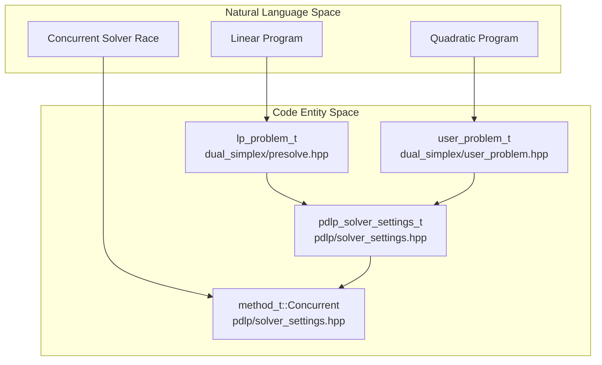
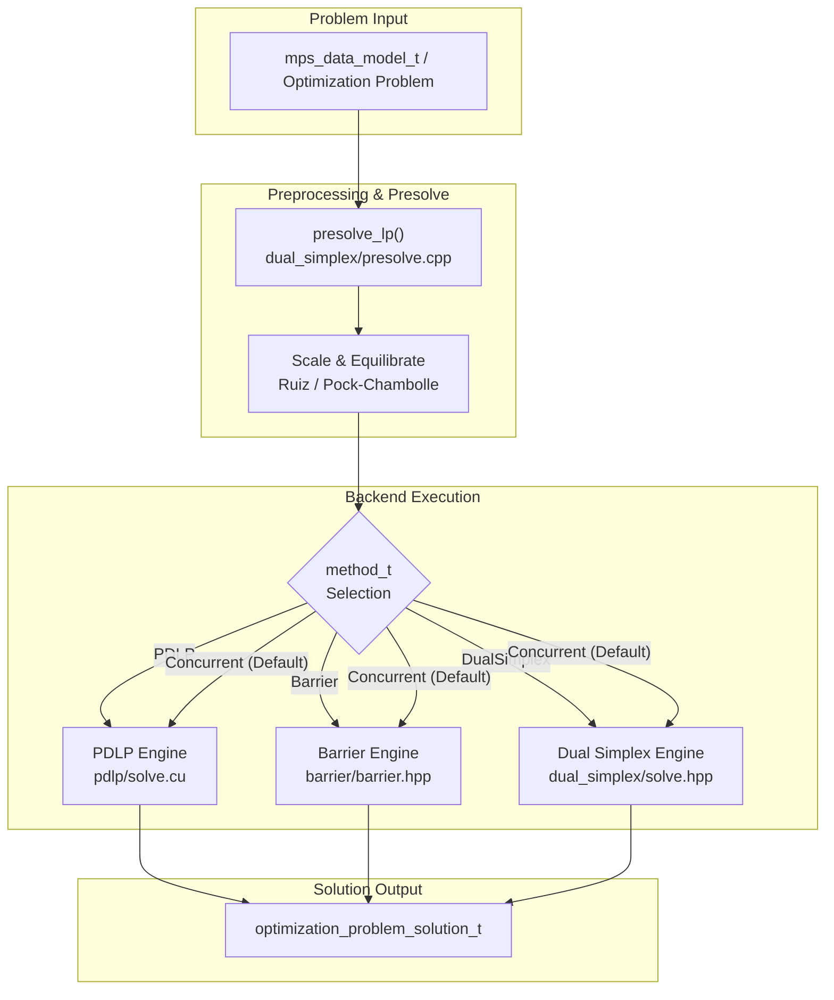

<!-- source: DeepWiki mcp.deepwiki.com · repo NVIDIA/cuopt · page 2.1 Linear Programming Solver · fetched 2026-10-26 -->

# Linear Programming Solver

<details>
<summary>Relevant source files</summary>

The following files were used as context for generating this wiki page:

- [cpp/include/cuopt/mathematical_optimization/constants.h](cpp/include/cuopt/mathematical_optimization/constants.h)
- [cpp/include/cuopt/mathematical_optimization/mip/solver_settings.hpp](cpp/include/cuopt/mathematical_optimization/mip/solver_settings.hpp)
- [cpp/include/cuopt/mathematical_optimization/pdlp/solver_settings.hpp](cpp/include/cuopt/mathematical_optimization/pdlp/solver_settings.hpp)
- [cpp/src/dual_simplex/presolve.cpp](cpp/src/dual_simplex/presolve.cpp)
- [cpp/src/dual_simplex/presolve.hpp](cpp/src/dual_simplex/presolve.hpp)
- [cpp/src/dual_simplex/simplex_solver_settings.hpp](cpp/src/dual_simplex/simplex_solver_settings.hpp)
- [cpp/src/dual_simplex/solve.cpp](cpp/src/dual_simplex/solve.cpp)
- [cpp/src/dual_simplex/solve.hpp](cpp/src/dual_simplex/solve.hpp)
- [cpp/src/dual_simplex/user_problem.hpp](cpp/src/dual_simplex/user_problem.hpp)
- [cpp/src/math_optimization/solver_settings.cu](cpp/src/math_optimization/solver_settings.cu)
- [cpp/src/pdlp/solve.cu](cpp/src/pdlp/solve.cu)
- [cpp/tests/linear_programming/pdlp_test.cu](cpp/tests/linear_programming/pdlp_test.cu)

</details>


## Purpose and Scope

This page provides a high-level overview of cuOpt's Linear Programming (LP) and Quadratic Programming (QP) solver engine. The solver employs a flexible dispatch system supporting multiple underlying algorithms—**PDLP**, **Barrier**, and **Dual Simplex**—and features a **three-method concurrent approach** that races these solvers simultaneously to automatically return the fastest optimal solution [cpp/include/cuopt/mathematical_optimization/pdlp/solver_settings.hpp:71-78]().

As a parent page, this document outlines the core solver engines and architectural components. Detailed technical specifications are maintained in the respective child pages linked below.

```
├── 2.1.1 PDLP Algorithm
├── 2.1.2 Dual Simplex Algorithm
├── 2.1.3 Barrier Method and Conic Solving
├── 2.1.4 Concurrent Solver Execution
└── 2.1.5 Presolving and Scaling
```

Sources: [cpp/include/cuopt/mathematical_optimization/pdlp/solver_settings.hpp:71-78]()

---

## Architecture and Solver Dispatch

The solver architecture normalizes incoming problem formulations into internal representations (`lp_problem_t` and `user_problem_t`) and dispatches them according to user configuration (`method_t`) or quadratic objective presence [cpp/src/dual_simplex/presolve.hpp:42-57](), [cpp/src/dual_simplex/user_problem.hpp:47-86]().

### Natural Language to Code Entity Mapping



Sources: [cpp/src/dual_simplex/presolve.hpp:42-57](), [cpp/src/dual_simplex/user_problem.hpp:47-86](), [cpp/include/cuopt/mathematical_optimization/pdlp/solver_settings.hpp:71-78]()

---

## Core Solver Sub-Topics

### 2.1.1 PDLP Algorithm
PDLP (Primal-Dual Hybrid Gradient) is a GPU-accelerated first-order method designed for extremely large-scale linear programs. It features adaptive step sizing, sophisticated restart strategies, automated convergence/infeasibility detection, CUDA graph optimization, and multi-GPU distributed execution [cpp/src/pdlp/solve.cu:126-149](). For deep technical details, see [PDLP Algorithm](#2.1.1).

Sources: [cpp/src/pdlp/solve.cu:126-149]()

### 2.1.2 Dual Simplex Algorithm
The CPU-based revised dual simplex method handles Phase 1 and Phase 2 solving phases, robust LU factorization, basis updates, steepest-edge pricing, ratio tests, and folding transformations [cpp/src/dual_simplex/presolve.cpp:8-14](). For deep technical details, see [Dual Simplex Algorithm](#2.1.2).

Sources: [cpp/src/dual_simplex/presolve.cpp:8-14]()

### 2.1.3 Barrier Method and Conic Solving
The interior-point barrier method utilizes GPU-accelerated sparse Cholesky and LDLT factorizations via `cuDSS`, iterative refinement, barrier caching, crossover routines, and full support for second-order cone programming (SOCP) and quadratic programs (QP) [cpp/src/dual_simplex/solve.cpp:30-32](). For deep technical details, see [Barrier Method and Conic Solving](#2.1.3).

Sources: [cpp/src/dual_simplex/solve.cpp:30-32]()

### 2.1.4 Concurrent Solver Execution
By default, LP problems are solved using concurrent execution where PDLP, Barrier, and Dual Simplex run simultaneously across GPU streams and CPU worker threads [cpp/tests/linear_programming/pdlp_test.cu:160-167](). A synchronization halt mechanism monitors worker threads and immediately returns the result of the first solver to reach optimality. For deep technical details, see [Concurrent Solver Execution](#2.1.4).

Sources: [cpp/tests/linear_programming/pdlp_test.cu:160-167]()

### 2.1.5 Presolving and Scaling
Before entering the core solver engines, optimization problems undergo rigorous presolve transformations, bounds strengthening, dualization decisions, and matrix equilibration scaling (Ruiz and Pock-Chambolle algorithms) to improve numerical conditioning [cpp/src/pdlp/solve.cu:128-132](), [cpp/src/dual_simplex/presolve.cpp:10-11](). For deep technical details, see [Presolving and Scaling](#2.1.5).

Sources: [cpp/src/pdlp/solve.cu:128-132](), [cpp/src/dual_simplex/presolve.cpp:10-11]()

---

## Solver Dispatch Architecture



Sources: [cpp/src/pdlp/solve.cu:126-149](), [cpp/src/dual_simplex/presolve.cpp:8-14](), [cpp/include/cuopt/mathematical_optimization/pdlp/solver_settings.hpp:71-78]()

---

