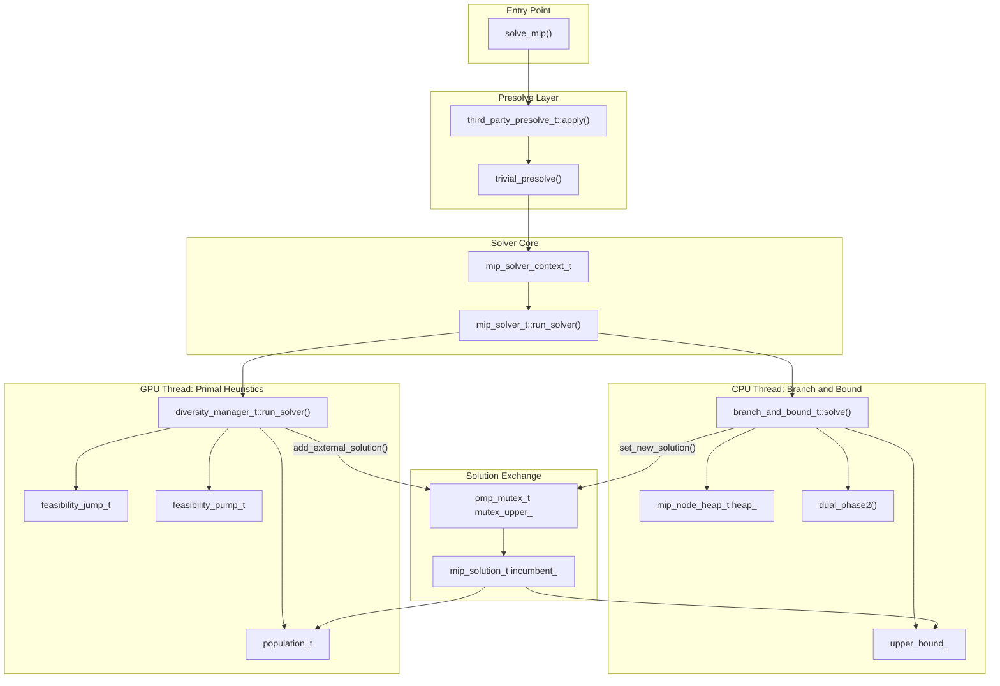

<!-- source: DeepWiki mcp.deepwiki.com · repo NVIDIA/cuopt · page 2.2 Mixed Integer Programming Solver · fetched 2026-10-26 -->

# Mixed Integer Programming Solver

Relevant source files

The following files were used as context for generating this wiki page:

- [cpp/src/mip_heuristics/diversity/diversity_manager.cu](cpp/src/mip_heuristics/diversity/diversity_manager.cu)
- [cpp/src/mip_heuristics/diversity/population.cu](cpp/src/mip_heuristics/diversity/population.cu)
- [cpp/src/mip_heuristics/diversity/population.cuh](cpp/src/mip_heuristics/diversity/population.cuh)
- [cpp/src/mip_heuristics/feasibility_jump/cpu/audit.cpp](cpp/src/mip_heuristics/feasibility_jump/cpu/audit.cpp)
- [cpp/src/mip_heuristics/feasibility_jump/cpu/audit.hpp](cpp/src/mip_heuristics/feasibility_jump/cpu/audit.hpp)
- [cpp/src/mip_heuristics/feasibility_jump/cpu/setup/structure.hpp](cpp/src/mip_heuristics/feasibility_jump/cpu/setup/structure.hpp)
- [cpp/src/mip_heuristics/feasibility_jump/early_cpufj.cu](cpp/src/mip_heuristics/feasibility_jump/early_cpufj.cu)
- [cpp/src/mip_heuristics/feasibility_jump/early_cpufj.cuh](cpp/src/mip_heuristics/feasibility_jump/early_cpufj.cuh)
- [cpp/src/mip_heuristics/feasibility_jump/fj_cpu_bridge.cu](cpp/src/mip_heuristics/feasibility_jump/fj_cpu_bridge.cu)
- [cpp/src/mip_heuristics/mip_constants.hpp](cpp/src/mip_heuristics/mip_constants.hpp)
- [cpp/src/mip_heuristics/presolve/third_party_presolve.cpp](cpp/src/mip_heuristics/presolve/third_party_presolve.cpp)
- [cpp/src/mip_heuristics/presolve/third_party_presolve.hpp](cpp/src/mip_heuristics/presolve/third_party_presolve.hpp)
- [cpp/src/mip_heuristics/solve.cu](cpp/src/mip_heuristics/solve.cu)
- [cpp/src/mip_heuristics/solver.cu](cpp/src/mip_heuristics/solver.cu)
- [cpp/src/mip_heuristics/solver_context.cuh](cpp/src/mip_heuristics/solver_context.cuh)
- [cpp/src/mip_heuristics/utils.hpp](cpp/src/mip_heuristics/utils.hpp)
- [cpp/tests/internal/CMakeLists.txt](cpp/tests/internal/CMakeLists.txt)
- [cpp/tests/linear_programming/unit_tests/presolve_test.cu](cpp/tests/linear_programming/unit_tests/presolve_test.cu)
- [cpp/tests/mip/incumbent_callback_test.cu](cpp/tests/mip/incumbent_callback_test.cu)
- [cpp/tests/mip/population_test.cu](cpp/tests/mip/population_test.cu)

## Purpose and Scope

This page provides an overview of cuOpt's Mixed Integer Programming (MIP) solver architecture, which combines exact methods with GPU-accelerated primal heuristics to solve optimization problems containing integer variables. The solver uses a hybrid CPU/GPU approach where:

- **CPU threads** execute branch-and-bound tree search using dual simplex to maintain globally valid dual bounds
- **GPU threads** execute population-based primal heuristics to rapidly discover high-quality integer-feasible solutions

These components run concurrently and exchange solutions bidirectionally, with termination occurring when the gap between primal and dual bounds satisfies user-specified tolerances.

For detailed component documentation:
- **Branch and Bound**: see [Branch and Bound](#2.2.1)
- **GPU Primal Heuristics**: see [GPU Primal Heuristics](#2.2.2)
- **Local Search Methods**: see [Local Search Methods](#2.2.3)
- **MIP Presolving with PaPILO**: see [MIP Presolving with PaPILO](#2.2.4)
- **Constraint Propagation and Bounds Strengthening**: see [Constraint Propagation and Bounds Strengthening](#2.2.5)
- **Cutting Planes and Conflict Graphs**: see [Cutting Planes and Conflict Graphs](#2.2.6)

Sources: [cpp/src/branch_and_bound/branch_and_bound.cpp:1-43](), [cpp/src/mip_heuristics/solve.cu:117-125]()

## Overall Architecture

The MIP solver uses a hybrid architecture where CPU-based branch-and-bound runs concurrently with GPU-based primal heuristics, managed via `mip_solver_t` [cpp/src/mip_heuristics/solver.cu:54-63]() and `diversity_manager_t` [cpp/src/mip_heuristics/diversity/diversity_manager.cu:53-98]().

**MIP Solver Component Architecture**

Sources: [cpp/src/mip_heuristics/solver.cu:54-63](), [cpp/src/mip_heuristics/diversity/diversity_manager.cu:53-98]()

## Solving Pipeline and Sub-Topics

The MIP solver coordinates presolving, parallel heuristic exploration, and branch-and-bound optimization. Below is an overview of the core sub-systems and their child page references.

### 2.2.1 Branch and Bound
The CPU-based branch-and-bound subsystem explores the MIP search tree using LP relaxations solved via dual simplex. It manages node selection, variable branching decisions, worker pools, and sub-MIP heuristics (such as RINS and RENS) to close the dual bound.
For details, see [Branch and Bound](#2.2.1).

Sources: [cpp/src/mip_heuristics/solver.cu:65-86]()

### 2.2.2 GPU Primal Heuristics
GPU heuristics operate within the `diversity_manager_t` and `population_t` classes to rapidly generate integer-feasible solutions. Techniques include feasibility pump, feasibility jump, simple rounding, and diversity-driven population management running concurrently with the search tree.
For details, see [GPU Primal Heuristics](#2.2.2).

Sources: [cpp/src/mip_heuristics/diversity/diversity_manager.cu:53-98](), [cpp/src/mip_heuristics/diversity/population.cu:33-53]()

### 2.2.3 Local Search Methods
Local search methods repair constraint violations and refine incumbent solutions through specialized neighborhood structures, move evaluations, and line-segment searches integrated directly into the MIP heuristic pipeline.
For details, see [Local Search Methods](#2.2.3).

Sources: [cpp/src/mip_heuristics/diversity/diversity_manager.cu:68-80]()

### 2.2.4 MIP Presolving with PaPILO
Before solving, problems are reduced using PaPILO and PSLP presolver integrations alongside trivial presolving and custom variable eliminations. This layer simplifies constraints, removes redundant variables, and maintains postsolve storage for uncrushing solutions back to the original problem space.
For details, see [MIP Presolving with PaPILO](#2.2.4).

Sources: [cpp/src/mip_heuristics/presolve/third_party_presolve.hpp:73-111]()

### 2.2.5 Constraint Propagation and Bounds Strengthening
Constraint propagation and domain reduction techniques strengthen variable bounds during presolve and local search repair. Probing caches and domain tightening reduce the feasible search space prior to entering the branch-and-bound phase.
For details, see [Constraint Propagation and Bounds Strengthening](#2.2.5).

Sources: [cpp/src/mip_heuristics/solver.cu:88-135]()

### 2.2.6 Cutting Planes and Conflict Graphs
The cut generation subsystem derives valid inequalities—including MIR, Gomory, and clique cuts—using clique tables and conflict graphs. These cuts tighten the LP relaxation bounds within the branch-and-bound nodes.
For details, see [Cutting Planes and Conflict Graphs](#2.2.6).

Sources: [cpp/src/mip_heuristics/diversity/diversity_manager.cu:16-20]()

---

