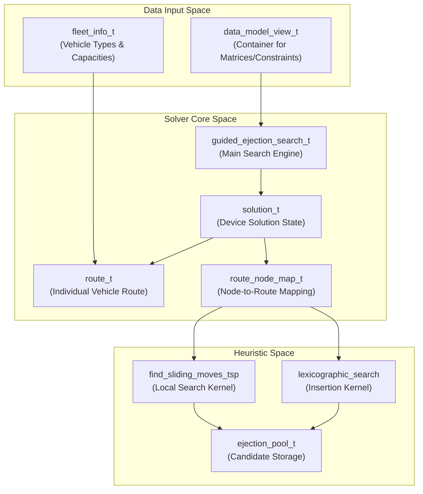
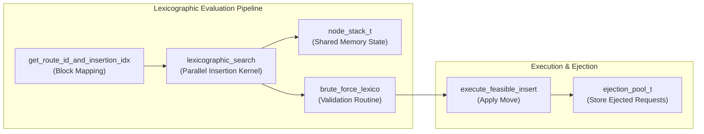

<!-- source: DeepWiki mcp.deepwiki.com · repo NVIDIA/cuopt · page 2.3 Routing Solver · fetched 2026-10-26 -->

# Routing Solver

Relevant source files

The following files were used as context for generating this wiki page:

- [cpp/include/cuopt/routing/cython/cython.hpp](cpp/include/cuopt/routing/cython/cython.hpp)
- [cpp/include/cuopt/routing/data_model_view.hpp](cpp/include/cuopt/routing/data_model_view.hpp)
- [cpp/src/mip_heuristics/feasibility_jump/feasibility_jump_kernels.cuh](cpp/src/mip_heuristics/feasibility_jump/feasibility_jump_kernels.cuh)
- [cpp/src/routing/crossovers/eax_recombiner.hpp](cpp/src/routing/crossovers/eax_recombiner.hpp)
- [cpp/src/routing/crossovers/ox_kernels.cuh](cpp/src/routing/crossovers/ox_kernels.cuh)
- [cpp/src/routing/crossovers/ox_recombiner.cuh](cpp/src/routing/crossovers/ox_recombiner.cuh)
- [cpp/src/routing/data_model_view.cu](cpp/src/routing/data_model_view.cu)
- [cpp/src/routing/generator/generator.cu](cpp/src/routing/generator/generator.cu)
- [cpp/src/routing/generator/generator.hpp](cpp/src/routing/generator/generator.hpp)
- [cpp/src/routing/ges/compute_fragment_ejections.cu](cpp/src/routing/ges/compute_fragment_ejections.cu)
- [cpp/src/routing/ges/compute_fragment_ejections.cuh](cpp/src/routing/ges/compute_fragment_ejections.cuh)
- [cpp/src/routing/ges/execute_insertion.cu](cpp/src/routing/ges/execute_insertion.cu)
- [cpp/src/routing/ges/lexicographic_search/brute_force_lexico.cu](cpp/src/routing/ges/lexicographic_search/brute_force_lexico.cu)
- [cpp/src/routing/ges/lexicographic_search/lexicographic_search.cu](cpp/src/routing/ges/lexicographic_search/lexicographic_search.cu)
- [cpp/src/routing/ges/lexicographic_search/node_stack.cuh](cpp/src/routing/ges/lexicographic_search/node_stack.cuh)
- [cpp/src/routing/local_search/local_search.cu](cpp/src/routing/local_search/local_search.cu)
- [cpp/src/routing/local_search/local_search.cuh](cpp/src/routing/local_search/local_search.cuh)
- [cpp/src/routing/local_search/sliding_tsp.cu](cpp/src/routing/local_search/sliding_tsp.cu)
- [cpp/src/routing/local_search/vrp/fragment_kernels.cuh](cpp/src/routing/local_search/vrp/fragment_kernels.cuh)
- [cpp/src/routing/local_search/vrp/vrp_search.cu](cpp/src/routing/local_search/vrp/vrp_search.cu)
- [cpp/src/routing/node/node.cuh](cpp/src/routing/node/node.cuh)
- [cpp/src/routing/node/pdp_node.cuh](cpp/src/routing/node/pdp_node.cuh)
- [cpp/src/routing/node/vehicle_fixed_cost_node.cuh](cpp/src/routing/node/vehicle_fixed_cost_node.cuh)
- [cpp/src/routing/route/route.cuh](cpp/src/routing/route/route.cuh)
- [cpp/src/routing/utilities/cython.cu](cpp/src/routing/utilities/cython.cu)
- [cpp/tests/linear_programming/utilities/pdlp_test_utilities.cuh](cpp/tests/linear_programming/utilities/pdlp_test_utilities.cuh)
- [cpp/tests/routing/level0/l0_objective_function_test.cu](cpp/tests/routing/level0/l0_objective_function_test.cu)
- [cpp/tests/routing/level0/l0_vehicle_order_match.cu](cpp/tests/routing/level0/l0_vehicle_order_match.cu)
- [cpp/tests/routing/level0/l0_vehicle_types_test.cu](cpp/tests/routing/level0/l0_vehicle_types_test.cu)
- [cpp/tests/routing/unit_tests/order_locations.cu](cpp/tests/routing/unit_tests/order_locations.cu)
- [python/cuopt/cuopt/routing/structure/routing_utilities.pxd](python/cuopt/cuopt/routing/structure/routing_utilities.pxd)

The Routing Solver is cuOpt's specialized optimization engine designed to solve large-scale Vehicle Routing Problems (VRP), including the Traveling Salesperson Problem (TSP), Capacitated Vehicle Routing Problem (CVRP), and Pickup and Delivery Problems with Time Windows (PDPTW). The solver combines GPU-accelerated population metaheuristics, Guided Ejection Search (GES), exact lexicographic insertion evaluation, and genetic recombination operators (OX and EAX) to achieve near-optimal solutions efficiently.

---

## 1. Architecture and Data Flow

The routing solver is implemented in C++/CUDA within the `cuopt::routing` namespace. Input problems are modeled through `data_model_view_t`, which passes non-owning views of matrices and constraints down to the device-side solver engine (`guided_ejection_search_t`) and solution structures (`solution_t`).

**Diagram: Routing Solver Entity Mapping**

Sources: [cpp/include/cuopt/routing/data_model_view.hpp:27-56](), [cpp/src/routing/route/route.cuh:20-35](), [cpp/src/routing/local_search/sliding_tsp.cu:96-101]()

---

## 2. Supported Problem Variants and Dimensions

The solver uses C++ template metaprogramming via the `request_t` enumeration (distinguishing between standard VRP and Pickup and Delivery PDP logic) and an extensible dimension framework inside `route_t`.

| Problem Variant | Core Implementation | Key Constraints & Characteristics |
| :--- | :--- | :--- |
| **TSP** | `sliding_tsp.cu` | Single-route sequence optimization using sliding windows and reverse costs. |
| **CVRP** | `route_t` with `dim_t::CAPACITY` | Multi-dimensional demand tracking against vehicle capacity limits. |
| **PDPTW** | `request_t::PDP` | Strict pairing between pickup and delivery nodes, precedence, and time windows. |
| **Breaks** | `dim_t::BREAK` | Uniform and heterogeneous vehicle break intervals and restricted break locations. |

Sources: [cpp/src/routing/route/route.cuh:161-187](), [cpp/src/routing/local_search/sliding_tsp.cu:23-33](), [cpp/src/routing/data_model_view.hpp:125-158]()

---

## 3. Guided Ejection Search (GES) and Lexicographic Search

The core metaheuristic engine is **Guided Ejection Search (GES)**. GES attempts to iteratively insert unassigned orders into existing routes. When an insertion violates capacity or time window constraints, orders are ejected into an ejection pool (`ejection_pool_t`) to be resolved in subsequent iterations.

### Lexicographic Insertion Search
The `lexicographic_search` kernel evaluates all possible insertion positions for pickup and delivery nodes in parallel [cpp/src/routing/ges/lexicographic_search/lexicographic_search.cu:115-122](). Each thread block handles a specific pickup insertion position (`get_route_id_and_insertion_idx`), utilizing `node_stack_t` to manage state exploration on shared memory.

**Diagram: Lexicographic Search and Insertion Flow**

Sources: [cpp/src/routing/ges/lexicographic_search/lexicographic_search.cu:73-105](), [cpp/src/routing/ges/lexicographic_search/node_stack.cuh:96-118](), [cpp/src/routing/ges/execute_insertion.cu:31-62]()

---

## 4. Local Search Operators

The `local_search_t` class coordinates intra-route and inter-route optimization operators to refine solutions produced by GES [cpp/src/routing/local_search/local_search.cu:28-47]().

* **Sliding TSP / Sliding Window Search**: Evaluates local neighborhood permutations within a window (default maximum window size 20) via `find_sliding_moves_tsp` and `eval_move` [cpp/src/routing/local_search/sliding_tsp.cu:20-81]().
* **Cross Moves**: Explores inter-route exchanges by finding compatible route segments and updating insertion paths (`run_cross_search`) [cpp/src/routing/local_search/local_search.cu:104-136]().
* **Prize Collection**: Optimizes unserved order selection when the objective includes a prize dimension (`run_collect_prizes`) [cpp/src/routing/local_search/local_search.cu:87-101]().

Sources: [cpp/src/routing/local_search/local_search.cu:28-136](), [cpp/src/routing/local_search/sliding_tsp.cu:20-41]()

---

## 5. Recombination Operators (OX and EAX)

To maintain population diversity, the solver uses genetic recombination algorithms, notably **Order Crossover (OX)** based on Christian Prins' VRP evolutionary algorithm [cpp/src/routing/crossovers/ox_recombiner.cuh:147-159]().

* **OX Recombiner**: The `OX` struct extracts route segments from parent genomes (Parent A and Parent B), restricts fragment destruction thresholds, and solves a shortest-path / Bellman-Ford formulation to reconstruct valid offspring [cpp/src/routing/crossovers/ox_recombiner.cuh:38-134](). It supports a fixed-route mode where fleet size constraints are strictly preserved.
* **EAX Recombiner**: Edge Assembly Crossover (`eax_recombiner.hpp`) builds AB-cycles from parent adjacency graphs to generate diverse, high-quality offspring routes.

Sources: [cpp/src/routing/crossovers/ox_recombiner.cuh:38-180]()

---

## 6. Python Integration and Cython Bridges

Python APIs wrap the underlying C++ routing engine through Cython interfaces (`cpp/src/routing/utilities/cython.cu`) [cpp/src/routing/utilities/cython.cu:8-15]().

* **Single Solve**: `call_solve` converts a Python `data_model_view_t` and `solver_settings_t` into native C++ solver calls, returning a managed `vehicle_routing_ret_t` buffer [cpp/src/routing/utilities/cython.cu:70-92]().
* **Batch Solve**: `call_batch_solve` uses OpenMP and CUDA stream pools to execute multiple independent routing solves concurrently across available hardware [cpp/src/routing/utilities/cython.cu:101-150]().

Sources: [cpp/src/routing/utilities/cython.cu:70-150]()

---

## 7. GPU Memory and Performance Optimization

The routing solver relies heavily on RAPIDS Memory Manager (`rmm`) for device memory management. 
* **Views**: Heavy solver states (`solution_t`, `route_t`) expose lightweight `view_t` counterparts containing raw device pointers, avoiding host-device synchronization overhead during kernel execution [cpp/src/routing/route/route.cuh:119-135]().
* **Shared Memory Caching**: Kernels like `find_sliding_moves_tsp` and `lexicographic_search` copy active route dimensions into dynamic shared memory (`__shared__`) to accelerate inner-loop cost evaluations and delta checks [cpp/src/routing/local_search/sliding_tsp.cu:127-133](), [cpp/src/routing/ges/lexicographic_search/lexicographic_search.cu:147-150]().

Sources: [cpp/src/routing/route/route.cuh:119-135](), [cpp/src/routing/local_search/sliding_tsp.cu:127-133](), [cpp/src/routing/ges/lexicographic_search/lexicographic_search.cu:147-150]()

---

