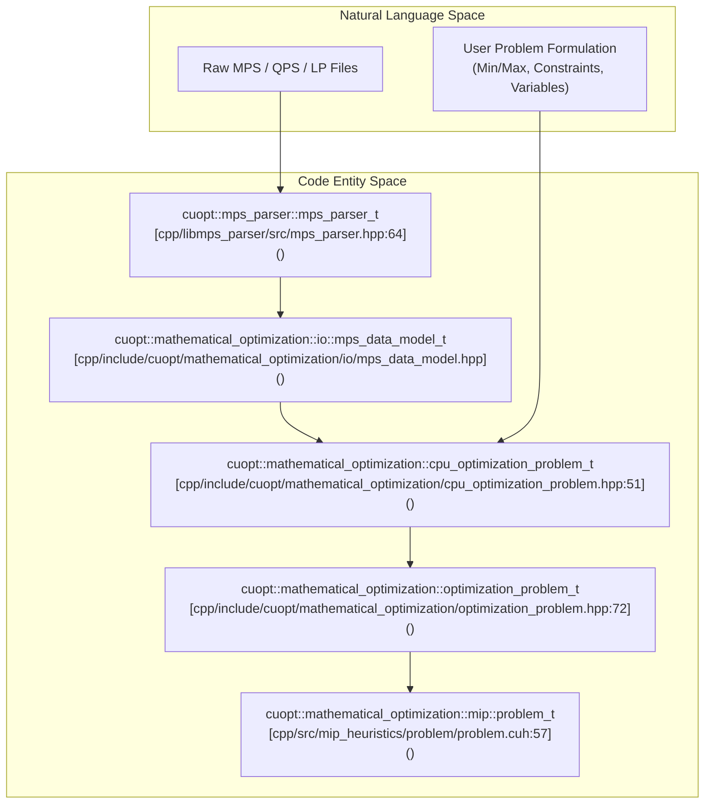
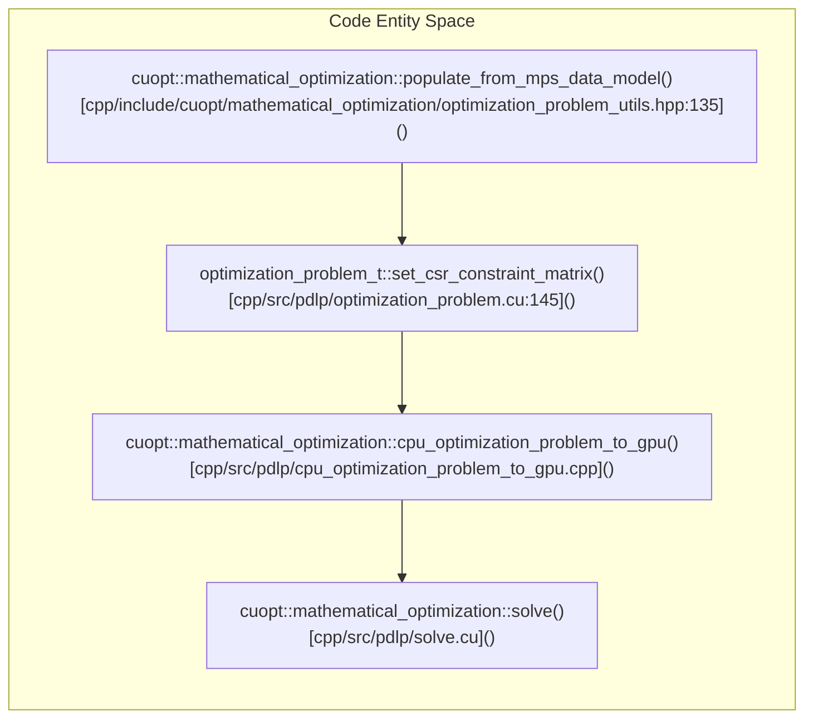

<!-- source: DeepWiki mcp.deepwiki.com · repo NVIDIA/cuopt · page 3 Problem Representation · fetched 2026-10-26 -->

# Problem Representation

Relevant source files

The following files were used as context for generating this wiki page:

- [cpp/include/cuopt/mathematical_optimization/cpu_optimization_problem.hpp](cpp/include/cuopt/mathematical_optimization/cpu_optimization_problem.hpp)
- [cpp/include/cuopt/mathematical_optimization/optimization_problem.hpp](cpp/include/cuopt/mathematical_optimization/optimization_problem.hpp)
- [cpp/include/cuopt/mathematical_optimization/optimization_problem_utils.hpp](cpp/include/cuopt/mathematical_optimization/optimization_problem_utils.hpp)
- [cpp/include/cuopt/mathematical_optimization/pdlp/pdlp_warm_start_data.hpp](cpp/include/cuopt/mathematical_optimization/pdlp/pdlp_warm_start_data.hpp)
- [cpp/src/grpc/codegen/generated/generated_build_array_chunks.inc](cpp/src/grpc/codegen/generated/generated_build_array_chunks.inc)
- [cpp/src/grpc/codegen/generated/generated_chunked_arrays_to_problem.inc](cpp/src/grpc/codegen/generated/generated_chunked_arrays_to_problem.inc)
- [cpp/src/grpc/codegen/generated/generated_estimate_problem_size.inc](cpp/src/grpc/codegen/generated/generated_estimate_problem_size.inc)
- [cpp/src/grpc/codegen/generated/generated_problem_to_proto.inc](cpp/src/grpc/codegen/generated/generated_problem_to_proto.inc)
- [cpp/src/grpc/codegen/generated/generated_proto_to_problem.inc](cpp/src/grpc/codegen/generated/generated_proto_to_problem.inc)
- [cpp/src/io/CMakeLists.txt](cpp/src/io/CMakeLists.txt)
- [cpp/src/math_optimization/CMakeLists.txt](cpp/src/math_optimization/CMakeLists.txt)
- [cpp/src/math_optimization/solver_settings.cpp](cpp/src/math_optimization/solver_settings.cpp)
- [cpp/src/mip_heuristics/problem/problem.cu](cpp/src/mip_heuristics/problem/problem.cu)
- [cpp/src/mip_heuristics/problem/problem.cuh](cpp/src/mip_heuristics/problem/problem.cuh)
- [cpp/src/mip_heuristics/relaxed_lp/lp_state.cuh](cpp/src/mip_heuristics/relaxed_lp/lp_state.cuh)
- [cpp/src/pdlp/CMakeLists.txt](cpp/src/pdlp/CMakeLists.txt)
- [cpp/src/pdlp/cpu_optimization_problem.cpp](cpp/src/pdlp/cpu_optimization_problem.cpp)
- [cpp/src/pdlp/optimization_problem.cu](cpp/src/pdlp/optimization_problem.cu)
- [cpp/src/pdlp/problem_memory.cuh](cpp/src/pdlp/problem_memory.cuh)
- [cpp/tests/linear_programming/unit_tests/solution_interface_test.cu](cpp/tests/linear_programming/unit_tests/solution_interface_test.cu)
- [cpp/tests/linear_programming/unit_tests/solver_settings_test.cu](cpp/tests/linear_programming/unit_tests/solver_settings_test.cu)

This page provides an overview of how mathematical optimization problems (Linear Programming, Quadratic Programming, Mixed Integer Linear Programming, and Routing) are represented internally within cuOpt [cpp/include/cuopt/mathematical_optimization/optimization_problem.hpp:39-72](). It covers internal data structures, memory layouts on GPU (`rmm::device_uvector`) [cpp/src/mip_heuristics/problem/problem.cu:86-90]() and CPU (`std::vector`) [cpp/src/pdlp/cpu_optimization_problem.cpp:61-63](), transformation pipelines, file parsing, and solution representations.

For deep technical details, refer to the child pages:
- **[Core Data Structures](#3.1)** — Detail `optimization_problem_t`, `cpu_optimization_problem_t`, `lp_problem_t`, `user_problem_t`, MIP `problem_t`, and CSR/CSC layouts.
- **[Problem Translation Pipeline](#3.2)** — Explain parsing, validation, conversion to `user_problem_t`, presolve to `lp_problem_t`, and final solver formatting.
- **[MPS/LP File Support](#3.3)** — Describe MPS/QPS/LP parsing, the `mps_parser` implementation, experimental fast FP64 parser, and integration with the problem pipeline.
- **[Solution Structures](#3.4)** — Detail solution data structures, termination statuses, primal/dual solutions, and warm start data.

---

## Purpose and Scope

Problem representation in cuOpt bridges high-level user formulations with performance-oriented GPU and CPU execution engines. The pipeline manages memory allocations, sparse matrix compression, scaling, presolve reductions, and dualization.

**Diagram: Natural Language Space to Code Entity Space - Problem Pipeline**

Sources:
- [cpp/include/cuopt/mathematical_optimization/optimization_problem.hpp:72-72]()
- [cpp/include/cuopt/mathematical_optimization/cpu_optimization_problem.hpp:51-51]()
- [cpp/src/mip_heuristics/problem/problem.cuh:57-57]()

---

## Core Data Structures

cuOpt defines distinct abstractions for host-only problem storage, GPU-resident optimization problems, and mixed-integer extensions. The `optimization_problem_interface_t` defines a unified virtual interface implemented by both `optimization_problem_t` (GPU memory via RMM) [cpp/include/cuopt/mathematical_optimization/optimization_problem.hpp:44-46]() and `cpu_optimization_problem_t` (CPU memory via `std::vector`) [cpp/include/cuopt/mathematical_optimization/cpu_optimization_problem.hpp:44-46]().

For MIP solvers, `mip::problem_t` extends the representation by maintaining both Compressed Sparse Row (CSR) and Compressed Sparse Column (CSC) matrix views, alongside binary and integer variable tracking [cpp/src/mip_heuristics/problem/problem.cu:101-112]().

For details, see [Core Data Structures](#3.1).

Sources:
- [cpp/include/cuopt/mathematical_optimization/optimization_problem.hpp:39-72]()
- [cpp/include/cuopt/mathematical_optimization/cpu_optimization_problem.hpp:43-52]()
- [cpp/src/mip_heuristics/problem/problem.cu:101-112]()

---

## Problem Translation Pipeline

The translation pipeline takes inputs from the Python SDK, C API, or file parsers and prepares them for solver engines. Raw inputs are validated, converted into `user_problem_t`, passed through presolve routines (using PaPILO/PSLP) and scaling passes (Ruiz, Pock-Chambolle), and finally materialized into `lp_problem_t` or `optimization_problem_t` structures.

**Diagram: Natural Language Space to Code Entity Space - Translation Flow**

Sources:
- [cpp/include/cuopt/mathematical_optimization/optimization_problem_utils.hpp:135-136]()
- [cpp/src/pdlp/optimization_problem.cu:145-151]()
- [cpp/src/pdlp/cpu_optimization_problem_to_gpu.cpp:1-12]()

For details, see [Problem Translation Pipeline](#3.2).

Sources:
- [cpp/include/cuopt/mathematical_optimization/optimization_problem_utils.hpp:135-136]()
- [cpp/src/pdlp/optimization_problem.cu:145-151]()

---

## MPS/LP File Support

File support modules provide high-performance parsing of standard mathematical optimization file formats, including MPS, QPS, and CPLEX LP files. The `mps_parser_t` implementation supports fixed and free format MPS files, reader utilities with compression detection, and direct population helpers.

For details, see [MPS/LP File Support](#3.3).

Sources:
- [cpp/src/pdlp/cpu_optimization_problem.cpp:12-18]()

---

## Solution Structures

Solutions resulting from LP, QP, MILP, or routing solves are encapsulated in dedicated solution containers. These structures hold primal solutions, dual solutions, reduced costs, termination statuses (`pdlp_termination_status_t`, `mip_termination_status_t`), objective values, and warm-start data (`pdlp_warm_start_data_t`) to enable efficient sequential solves.

For details, see [Solution Structures](#3.4).

Sources:
- [cpp/include/cuopt/mathematical_optimization/pdlp/pdlp_warm_start_data.hpp:1-15]()
- [cpp/tests/linear_programming/unit_tests/solution_interface_test.cu:74-127]()

---

