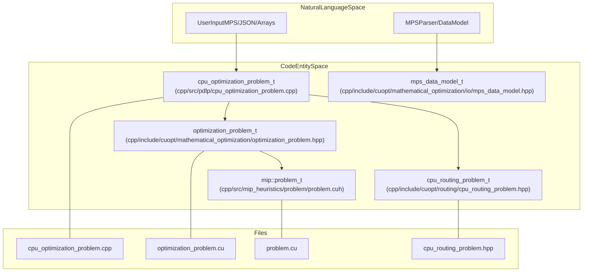
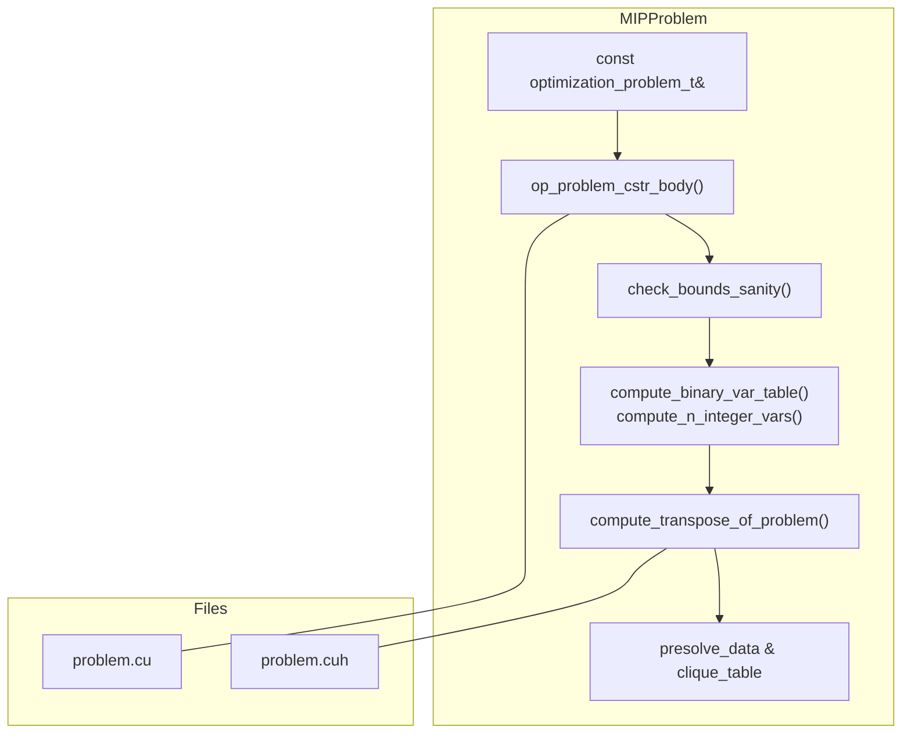
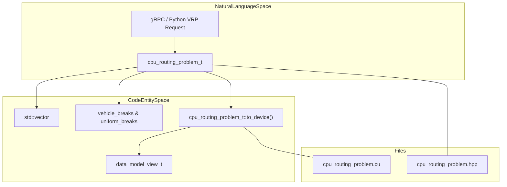

<!-- source: DeepWiki mcp.deepwiki.com · repo NVIDIA/cuopt · page 3.1 Core Data Structures · fetched 2026-10-26 -->

# Core Data Structures

Relevant source files

The following files were used as context for generating this wiki page:

- [cpp/include/cuopt/mathematical_optimization/cpu_optimization_problem.hpp](cpp/include/cuopt/mathematical_optimization/cpu_optimization_problem.hpp)
- [cpp/include/cuopt/mathematical_optimization/optimization_problem.hpp](cpp/include/cuopt/mathematical_optimization/optimization_problem.hpp)
- [cpp/include/cuopt/mathematical_optimization/optimization_problem_utils.hpp](cpp/include/cuopt/mathematical_optimization/optimization_problem_utils.hpp)
- [cpp/include/cuopt/mathematical_optimization/pdlp/pdlp_warm_start_data.hpp](cpp/include/cuopt/mathematical_optimization/pdlp/pdlp_warm_start_data.hpp)
- [cpp/include/cuopt/routing/cpu_routing_problem.hpp](cpp/include/cuopt/routing/cpu_routing_problem.hpp)
- [cpp/src/grpc/codegen/generated/generated_build_array_chunks.inc](cpp/src/grpc/codegen/generated/generated_build_array_chunks.inc)
- [cpp/src/grpc/codegen/generated/generated_chunked_arrays_to_problem.inc](cpp/src/grpc/codegen/generated/generated_chunked_arrays_to_problem.inc)
- [cpp/src/grpc/codegen/generated/generated_estimate_problem_size.inc](cpp/src/grpc/codegen/generated/generated_estimate_problem_size.inc)
- [cpp/src/grpc/codegen/generated/generated_problem_to_proto.inc](cpp/src/grpc/codegen/generated/generated_problem_to_proto.inc)
- [cpp/src/grpc/codegen/generated/generated_proto_to_problem.inc](cpp/src/grpc/codegen/generated/generated_proto_to_problem.inc)
- [cpp/src/grpc/routing/cuopt_routing.proto](cpp/src/grpc/routing/cuopt_routing.proto)
- [cpp/src/grpc/routing/cuopt_routing_solution.proto](cpp/src/grpc/routing/cuopt_routing_solution.proto)
- [cpp/src/grpc/routing/grpc_routing_problem_mapper.cpp](cpp/src/grpc/routing/grpc_routing_problem_mapper.cpp)
- [cpp/src/grpc/routing/grpc_routing_solution_mapper.cpp](cpp/src/grpc/routing/grpc_routing_solution_mapper.cpp)
- [cpp/src/io/CMakeLists.txt](cpp/src/io/CMakeLists.txt)
- [cpp/src/math_optimization/CMakeLists.txt](cpp/src/math_optimization/CMakeLists.txt)
- [cpp/src/math_optimization/solver_settings.cpp](cpp/src/math_optimization/solver_settings.cpp)
- [cpp/src/mip_heuristics/problem/problem.cu](cpp/src/mip_heuristics/problem/problem.cu)
- [cpp/src/mip_heuristics/problem/problem.cuh](cpp/src/mip_heuristics/problem/problem.cuh)
- [cpp/src/mip_heuristics/relaxed_lp/lp_state.cuh](cpp/src/mip_heuristics/relaxed_lp/lp_state.cuh)
- [cpp/src/pdlp/CMakeLists.txt](cpp/src/pdlp/CMakeLists.txt)
- [cpp/src/pdlp/cpu_optimization_problem.cpp](cpp/src/pdlp/cpu_optimization_problem.cpp)
- [cpp/src/pdlp/optimization_problem.cu](cpp/src/pdlp/optimization_problem.cu)
- [cpp/src/pdlp/problem_memory.cuh](cpp/src/pdlp/problem_memory.cuh)
- [cpp/src/routing/cpu_routing_problem.cu](cpp/src/routing/cpu_routing_problem.cu)
- [cpp/tests/linear_programming/unit_tests/solution_interface_test.cu](cpp/tests/linear_programming/unit_tests/solution_interface_test.cu)
- [cpp/tests/linear_programming/unit_tests/solver_settings_test.cu](cpp/tests/linear_programming/unit_tests/solver_settings_test.cu)
- [cpp/tests/routing/grpc/grpc_vrp_test_driver.cpp](cpp/tests/routing/grpc/grpc_vrp_test_driver.cpp)

This page details the fundamental data structures used to represent mathematical optimization and vehicle routing problems in cuOpt. These structures bridge user-facing APIs (Python, C, gRPC) and internal GPU/CPU solver engines.

---

## Overview of Problem Representations

cuOpt uses a hierarchical problem architecture. User input is parsed into host data models or CPU problem structures, translated into GPU-accelerated representations (`optimization_problem_t`), and further specialized for MIP heuristics (`problem_t`) or routing solvers (`cpu_routing_problem_t`).

### Natural Language Space to Code Entity Space

**Sources:** [cpp/include/cuopt/mathematical_optimization/optimization_problem.hpp:71-120](), [cpp/include/cuopt/mathematical_optimization/cpu_optimization_problem.hpp:50-149](), [cpp/src/mip_heuristics/problem/problem.cuh:57-160](), [cpp/include/cuopt/routing/cpu_routing_problem.hpp:74-136]()

---

## Core Optimization Problem Interfaces

### `optimization_problem_t` (GPU Storage)
`optimization_problem_t` is the primary GPU-backed container for linear, quadratic, and mixed-integer problems. All matrix and vector data are stored using `rmm::device_uvector` on a specified CUDA stream.

*   **View Struct (`view_t`):** Strips RAII metadata to expose raw `raft::device_span` pointers for execution inside CUDA kernels [cpp/include/cuopt/mathematical_optimization/optimization_problem.hpp:90-119]().
*   **Fields:** Contains CSR constraint matrix (`A`, `A_indices`, `A_offsets`), objective coefficients (`c`), right-hand side (`b`), variable bounds (`variable_lower_bounds`, `variable_upper_bounds`), constraint bounds, and variable types [cpp/src/pdlp/optimization_problem.cu:60-112]().

**Sources:** [cpp/include/cuopt/mathematical_optimization/optimization_problem.hpp:71-120](), [cpp/src/pdlp/optimization_problem.cu:60-112]()

### `cpu_optimization_problem_t` (CPU Storage)
`cpu_optimization_problem_t` implements `optimization_problem_interface_t` using standard CPU containers (`std::vector`). 
*   **Role:** Used by gRPC clients, thin clients, and remote serialization layers where GPU memory is unavailable or unneeded until transfer [cpp/include/cuopt/mathematical_optimization/cpu_optimization_problem.hpp:50-51]().
*   **Integration:** Adopts parsed storage directly from `mps_data_model_t` without copying array/string data [cpp/include/cuopt/mathematical_optimization/cpu_optimization_problem.hpp:108-111]().

**Sources:** [cpp/include/cuopt/mathematical_optimization/cpu_optimization_problem.hpp:50-149](), [cpp/src/pdlp/cpu_optimization_problem.cpp:60-164]()

---

## Mixed Integer Programming Problem Structures (`mip::problem_t`)

The MIP solver utilizes `cuopt::mathematical_optimization::mip::problem_t` to manage variables, constraints, and presolve operations on the GPU.

### Implementation Details
*   **Construction:** Initializes sparse CSR arrays, computes integer/binary classifications, bounds sanity checks, and objective scaling [cpp/src/mip_heuristics/problem/problem.cu:60-118]().
*   **Auxiliary Structures:** Manages transposition of constraints (`reverse_coefficients`, `reverse_constraints`, `reverse_offsets`), clique tables (`clique_table`), and PaPILO presolve mappings [cpp/src/mip_heuristics/problem/problem.cu:139-161](), [cpp/src/mip_heuristics/problem/problem.cuh:116-148]().

**Sources:** [cpp/src/mip_heuristics/problem/problem.cuh:57-160](), [cpp/src/mip_heuristics/problem/problem.cu:60-118]()

---

## Routing Problem Structures (`cpu_routing_problem_t`)

Vehicle Routing Problems (VRP) are managed via `cpu_routing_problem_t`, which holds host-side definitions of fleet structures, cost matrices, time windows, and capacities.

### Routing Architecture and Conversion

*   **`cpu_cost_matrix_t`**: Stores vehicle-type specific cost or transit time matrices in row-major `std::vector<float>` format [cpp/include/cuopt/routing/cpu_routing_problem.hpp:36-40]().
*   **`cpu_capacity_dimension_t`**: Manages multidimensional capacities per vehicle and demands per order [cpp/include/cuopt/routing/cpu_routing_problem.hpp:41-45]().
*   **`to_device()`**: Marshals host vectors onto device memory, returning a non-owning `data_model_view_t` used by GPU routing kernels [cpp/include/cuopt/routing/cpu_routing_problem.hpp:131-136]().

**Sources:** [cpp/include/cuopt/routing/cpu_routing_problem.hpp:74-136]()

---

## CSR and CSC Sparse Matrix Layouts

Internal solvers rely heavily on Compressed Sparse Row (CSR) and Compressed Sparse Column (CSC) formats for sparse matrix-vector products and factorizations.

*   **CSR Layout:** Uses `A` (values), `A_indices` (column indices), and `A_offsets` (row start pointers) to represent row-oriented constraints [cpp/include/cuopt/mathematical_optimization/optimization_problem.hpp:98-104]().
*   **CSC Layout:** Column-oriented format storing column start pointers, row indices, and values, utilized in dual residual computations and $A^T y$ products.

**Sources:** [cpp/include/cuopt/mathematical_optimization/optimization_problem.hpp:98-104](), [cpp/src/pdlp/optimization_problem.cu:145-168]()

---

