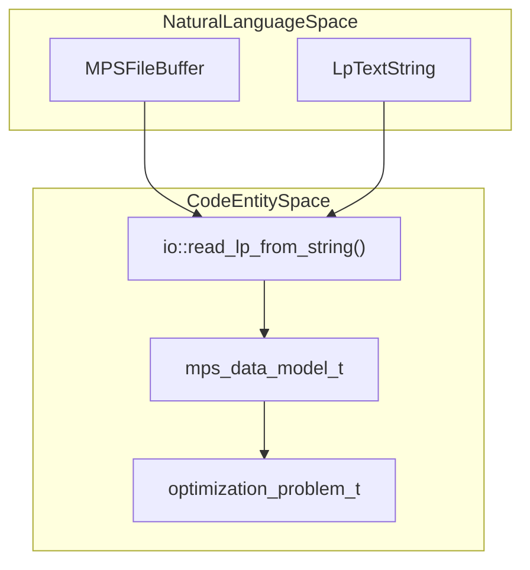
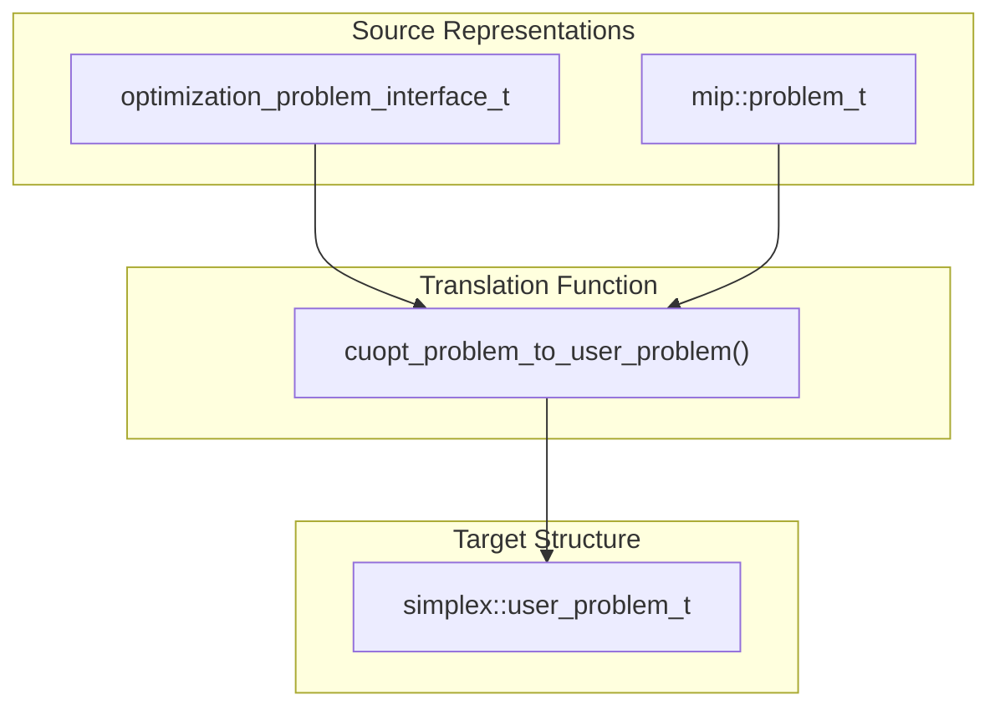
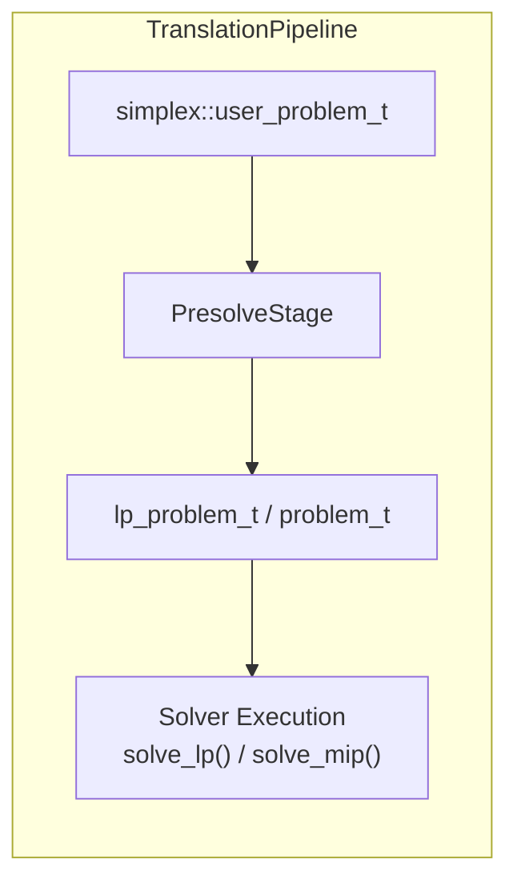
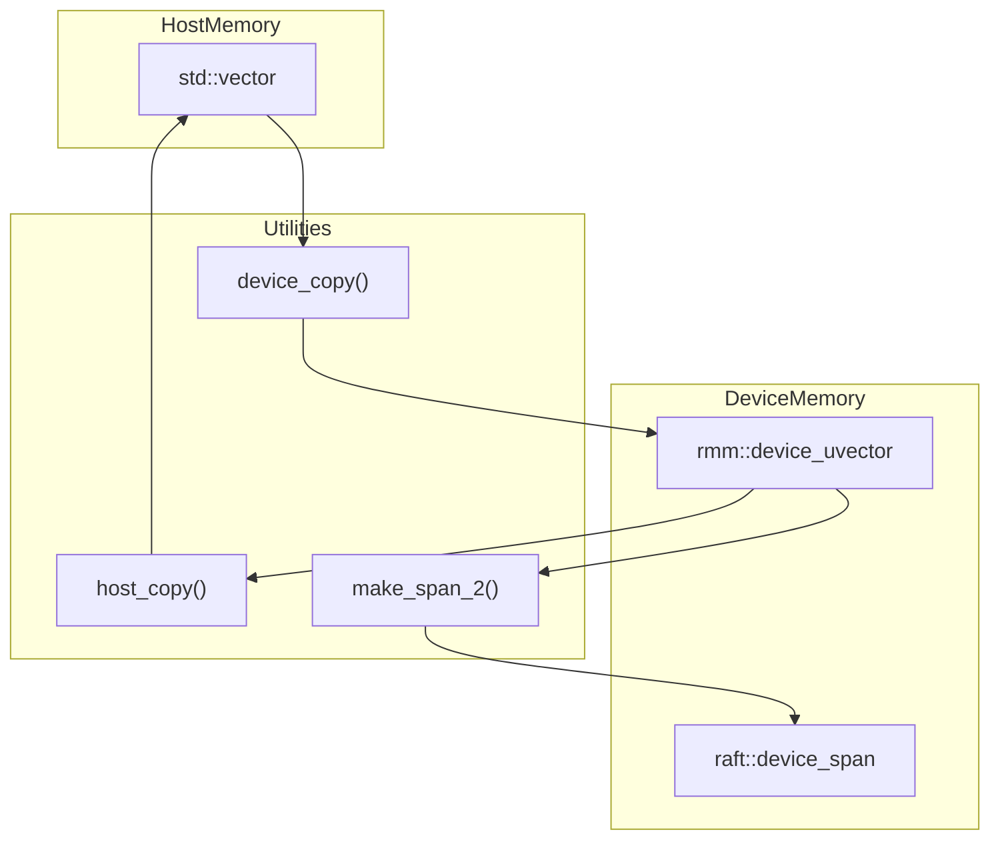

<!-- source: DeepWiki mcp.deepwiki.com · repo NVIDIA/cuopt · page 3.2 Problem Translation Pipeline · fetched 2026-10-26 -->

# Problem Translation Pipeline

Relevant source files

The following files were used as context for generating this wiki page:

- [cpp/src/io/mps_writer.cpp](cpp/src/io/mps_writer.cpp)
- [cpp/src/pdlp/swap_and_resize_helper.cuh](cpp/src/pdlp/swap_and_resize_helper.cuh)
- [cpp/src/pdlp/translate.hpp](cpp/src/pdlp/translate.hpp)
- [cpp/src/routing/solution/route_node_map.cuh](cpp/src/routing/solution/route_node_map.cuh)
- [cpp/src/routing/utilities/check_input.cu](cpp/src/routing/utilities/check_input.cu)
- [cpp/src/utilities/copy_helpers.hpp](cpp/src/utilities/copy_helpers.hpp)
- [cpp/tests/linear_programming/parser_test.cpp](cpp/tests/linear_programming/parser_test.cpp)
- [cpp/tests/qp/unit_tests/lp_parser_solve_test.cu](cpp/tests/qp/unit_tests/lp_parser_solve_test.cu)
- [cpp/tests/qp/unit_tests/mps_ranged_rows_test.cu](cpp/tests/qp/unit_tests/mps_ranged_rows_test.cu)
- [cpp/tests/qp/unit_tests/mps_writer_test.cpp](cpp/tests/qp/unit_tests/mps_writer_test.cpp)
- [python/cuopt/cuopt/linear_programming/problem.py](python/cuopt/cuopt/linear_programming/problem.py)
- [python/cuopt/cuopt/linear_programming/solver/solver.py](python/cuopt/cuopt/linear_programming/solver/solver.py)
- [python/cuopt/cuopt/tests/linear_programming/test_python_API.py](python/cuopt/cuopt/tests/linear_programming/test_python_API.py)

## Purpose and Scope

This document details the transformation pipeline that converts user-provided optimization problems from file formats (MPS/LP), Python APIs, or C++ structures into internal representations suitable for GPU-accelerated solving. The pipeline encompasses parsing, data validation, conversion into `simplex::user_problem_t`, presolving, and mapping into internal solver formats such as `lp_problem_t` or device-optimized `problem_t` structures. Additionally, this section covers memory reuse strategies and host-device copy utilities.

For core data structures, see [Core Data Structures](#3.1). For file support details, see [MPS/LP File Support](#3.3). For solver execution, see [Linear Programming Solver](#2.1).

Sources: `[cpp/src/pdlp/translate.hpp:30-111]()`, `[python/cuopt/cuopt/linear_programming/problem.py:93-163]()`

---

## Parsing and Validation

Optimization problems enter the codebase via parsers that read MPS or LP string buffers and files into intermediate data models. The parser validates tokens, dimensions, matrix non-zeros, bound types, and objective senses.

**Natural Language to Code Entity Mapping for Parsers**

Validation checks include ensuring constraint matrix offsets match row counts, verifying quadratic objective format (upper-triangular CSR representation for $H = Q + Q^T$), and verifying variable types (`VType::CONTINUOUS`, `VType::INTEGER`, `VType::SEMI_CONTINUOUS`).

Sources: `[cpp/tests/qp/unit_tests/lp_parser_solve_test.cu:41-84]`, `[cpp/tests/linear_programming/parser_test.cpp:143-158]()`

---

## Conversion to `user_problem_t`

Once parsed or built via the Python/C++ API, problem data is converted into a unified intermediate structure: `simplex::user_problem_t<i_t, f_t>`. This container standardizes row senses, objective offsets, sparse matrix layouts, and quadratic constraints.

**Conversion Flow to `user_problem_t`**

### Transformation Logic

1. **Matrix Extraction**: Host-side CSR constraint matrix components (`A_values`, `A_indices`, `A_offsets`) are extracted from the source problem interface (`[cpp/src/pdlp/translate.hpp:38-40]()`).
2. **Row Sense Decoding**: Lower and upper constraint bounds are evaluated to determine row sense (`'E'`, `'G'`, `'L'`) and handle range constraints (`[cpp/src/pdlp/translate.hpp:59-80]()`):
   - $cl == cu \implies$ `'E'` (Equality)
   - $cu == \infty \implies$ `'G'` (Greater-than)
   - $cl == -\infty \implies$ `'L'` (Less-than)
   - Finite interval $\implies$ `'E'` with range row tracking (`range_rows`, `range_value`).
3. **Quadratic Cones**: Quadratic constraints are converted into second-order cone formats when present (`[cpp/src/pdlp/translate.hpp:103-106]()`).

Sources: `[cpp/src/pdlp/translate.hpp:30-111]()`, `[cpp/src/pdlp/translate.hpp:113-165]()`

---

## Presolve and Conversion to Solver Format

From `user_problem_t`, the pipeline executes presolve transformations to reduce problem dimensions before dispatching to solver-specific structures like `lp_problem_t` or GPU-resident `problem_t` instances.

| Pipeline Stage | Input Structure | Output Structure | Key Operations |
|----------------|-----------------|------------------|----------------|
| **Parsing** | File / String | `mps_data_model_t` | Tokenization, bounds checking |
| **Intermediate** | `mps_data_model_t` | `simplex::user_problem_t` | Sense normalization, bound categorization |
| **Presolve** | `user_problem_t` | `lp_problem_t` | Fixed variable elimination, coefficient scaling (Ruiz/Pock-Chambolle), redundancy checks |
| **Solver Dispatch** | `lp_problem_t` / `problem_t` | Solution Object | GPU/CPU concurrent execution (PDLP, Barrier, Simplex, B&B) |

**Presolve and Solver Format Transition**

Sources: `[cpp/tests/qp/unit_tests/lp_parser_solve_test.cu:67-72]()`, `[cpp/src/io/mps_writer.cpp:40-128]()`

---

## Copy Helpers and Memory Reuse

To minimize host-device allocation overhead and memory fragmentation during translation loops, cuOpt relies on centralized copy helpers and `rmm::device_uvector` containers.

### Key Copy Utilities

- `host_copy()`: Transfers device pointers or `rmm::device_uvector` buffers back to host `std::vector` objects asynchronously across a `cuda::stream_ref` (`[cpp/src/utilities/copy_helpers.hpp:56-115]()`).
- `device_copy()`: Allocates device memory using RMM and copies host `std::vector` data to the device (`[cpp/src/utilities/copy_helpers.hpp:153-193]()`).
- `make_span_2()`: Creates type-punned `raft::device_span` views over device uvectors for vectorized operations (`[cpp/src/utilities/copy_helpers.hpp:28-45]()`).

**Memory Copy and View Abstractions**

Sources: `[cpp/src/utilities/copy_helpers.hpp:28-224]()`, `[python/cuopt/cuopt/linear_programming/problem.py:178-189]()`

---

