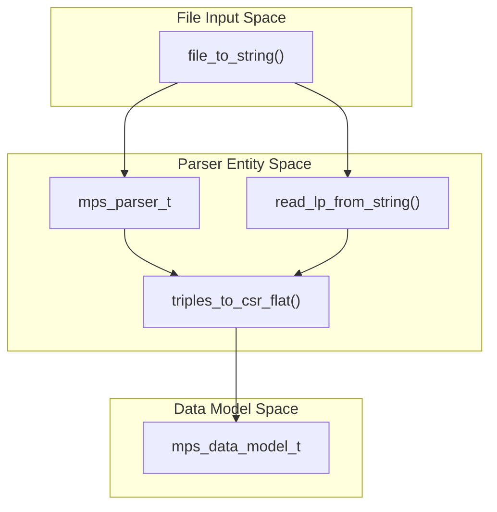
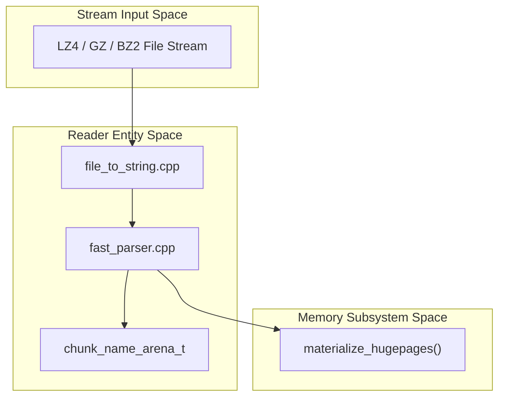
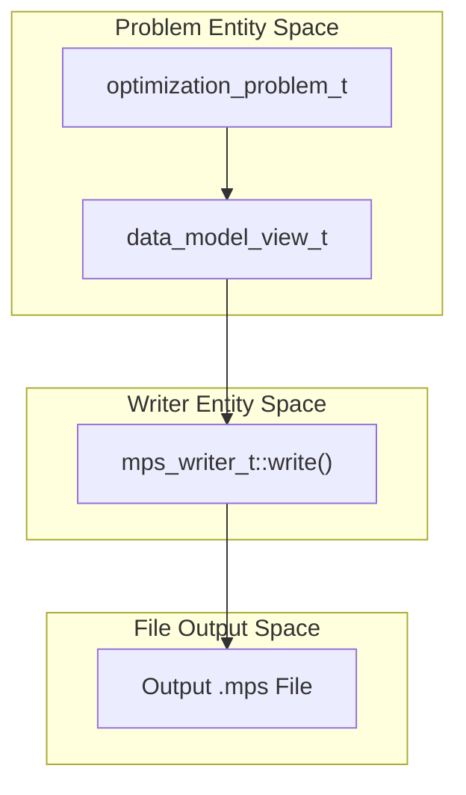
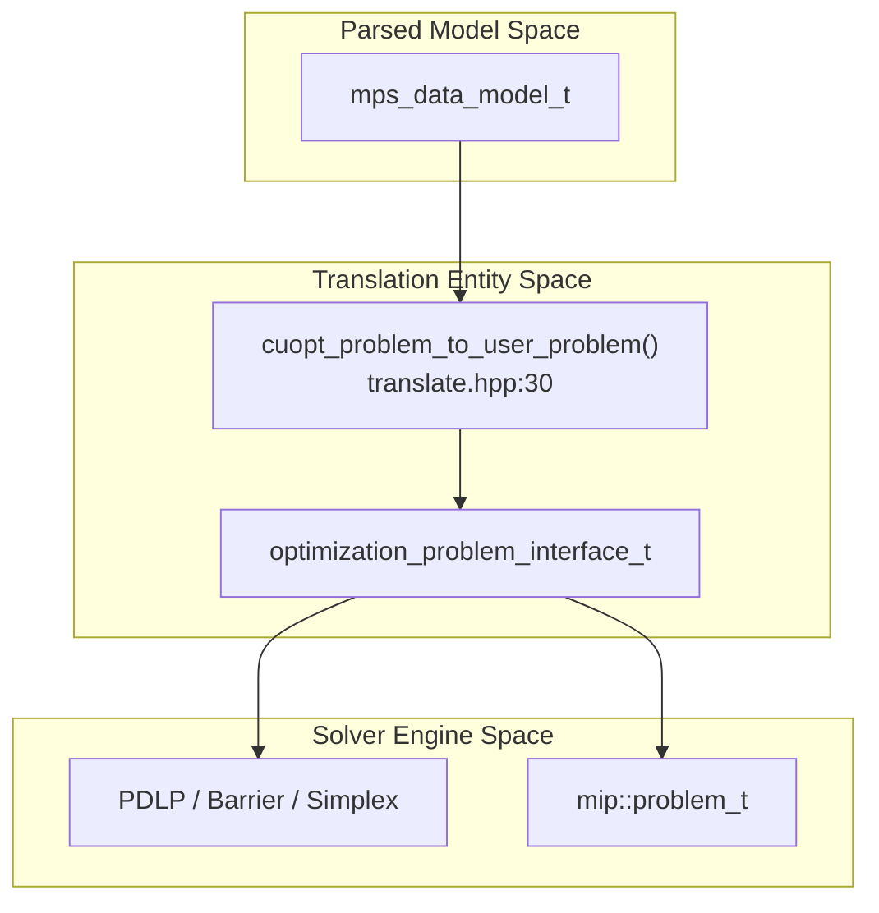

<!-- source: DeepWiki mcp.deepwiki.com · repo NVIDIA/cuopt · page 3.3 MPS/LP File Support · fetched 2026-10-26 -->

# MPS/LP File Support

Relevant source files

The following files were used as context for generating this wiki page:

- [ci/utils/aggregate_nightly.py](ci/utils/aggregate_nightly.py)
- [cpp/src/io/experimental_mps_fast/fast_fp64_parser.hpp](cpp/src/io/experimental_mps_fast/fast_fp64_parser.hpp)
- [cpp/src/io/experimental_mps_fast/fast_parser.cpp](cpp/src/io/experimental_mps_fast/fast_parser.cpp)
- [cpp/src/io/experimental_mps_fast/lz4_file_reader.cpp](cpp/src/io/experimental_mps_fast/lz4_file_reader.cpp)
- [cpp/src/io/file_to_string.cpp](cpp/src/io/file_to_string.cpp)
- [cpp/src/io/mps_data_model.cpp](cpp/src/io/mps_data_model.cpp)
- [cpp/src/io/mps_parser.cpp](cpp/src/io/mps_parser.cpp)
- [cpp/src/io/mps_parser_internal.hpp](cpp/src/io/mps_parser_internal.hpp)
- [cpp/src/io/mps_writer.cpp](cpp/src/io/mps_writer.cpp)
- [cpp/src/pdlp/translate.hpp](cpp/src/pdlp/translate.hpp)
- [cpp/src/utilities/pcgenerator.hpp](cpp/src/utilities/pcgenerator.hpp)
- [cpp/tests/linear_programming/experimental_mps_fast/fast_parser_edge_test.cpp](cpp/tests/linear_programming/experimental_mps_fast/fast_parser_edge_test.cpp)
- [cpp/tests/linear_programming/parser_test.cpp](cpp/tests/linear_programming/parser_test.cpp)
- [cpp/tests/qp/unit_tests/lp_parser_solve_test.cu](cpp/tests/qp/unit_tests/lp_parser_solve_test.cu)
- [cpp/tests/qp/unit_tests/mps_ranged_rows_test.cu](cpp/tests/qp/unit_tests/mps_ranged_rows_test.cu)
- [cpp/tests/qp/unit_tests/mps_writer_test.cpp](cpp/tests/qp/unit_tests/mps_writer_test.cpp)
- [python/cuopt/cuopt/linear_programming/problem.py](python/cuopt/cuopt/linear_programming/problem.py)
- [python/cuopt/cuopt/linear_programming/solver/solver.py](python/cuopt/cuopt/linear_programming/solver/solver.py)
- [python/cuopt/cuopt/tests/linear_programming/test_python_API.py](python/cuopt/cuopt/tests/linear_programming/test_python_API.py)

## Purpose and Scope

This page details cuOpt's file parsing and writing infrastructure for linear programming (LP), quadratic programming (QP), and mixed-integer programming (MIP) problems. It covers standard MPS, QPS, and LP file formats, the core `mps_parser` implementation, the experimental fast FP64 parser (`fast_parser.cpp`), compressed file and LZ4 stream reading (`file_to_string.cpp`), MPS output generation (`mps_writer.cpp`), and how parsed data models integrate into the solver pipeline (`translate.hpp`).

Sources: `[cpp/src/io/mps_parser.cpp:1-40]()`, `[cpp/src/io/mps_writer.cpp:8-26]()`, `[cpp/src/pdlp/translate.hpp:10-20]()`

## Core Parsers: mps_parser and LP Parser

The `mps_parser` subsystem handles standard Mathematical Programming System (MPS) and quadratic programming (QPS) files, as well as LP format strings. It parses coordinate triples (rows, columns, values) and flattens them into compressed sparse row (CSR) or compressed sparse column (CSC) representations using helper functions like `triples_to_csr_flat` `[cpp/src/io/mps_parser.cpp:50-158]()`.

Parser Diagram:

Sources: `[cpp/src/io/mps_parser.cpp:44-158]()`, `[cpp/tests/linear_programming/parser_test.cpp:40-85]()`

## Experimental Fast FP64 Parser and LZ4 Reader

For high-performance ingestion of very large MPS files, cuOpt includes an experimental multithreaded fast FP64 parser implemented in `fast_parser.cpp` and `fast_fp64_parser.hpp`. It leverages OpenMP for parallel section scanning and column parsing, string memory arenas (`chunk_name_arena_t`), and hugepage materialization (`materialize_hugepages`) to minimize memory allocation overhead `[cpp/src/io/experimental_mps_fast/fast_parser.cpp:52-128, 174-206]()`.

Additionally, file readers support compressed formats such as `.gz`, `.bz2`, and `.lz4` streams via `file_to_string.cpp`, dynamically loading compression libraries (`libz.so`, `libbz2.so`) via `dlopen` `[cpp/src/io/file_to_string.cpp:19-140]()`.

Fast Parser & Reader Diagram:

Sources: `[cpp/src/io/experimental_mps_fast/fast_parser.cpp:52-128]`, `[cpp/src/io/file_to_string.cpp:19-181]()`

## MPS Writer

The `mps_writer_t` class serializes optimization problem instances—including linear constraints, variable bounds, objective coefficients, and quadratic objective matrices (`QUADOBJ`)—back into standard MPS format `[cpp/src/io/mps_writer.cpp:40-128]()`. It handles matrix symmetry conversions where quadratic terms are scaled or represented as upper-triangular matrices `[cpp/tests/qp/unit_tests/mps_writer_test.cpp:8-46]()`.

Writer Diagram:

Sources: `[cpp/src/io/mps_writer.cpp:40-140]`, `[cpp/tests/qp/unit_tests/mps_writer_test.cpp:8-46]()`

## Integration with the Problem Pipeline

Parsed MPS data models are translated into internal solver formats via `cuopt_problem_to_user_problem` and `mps_data_model_to_optimization_problem` defined in `translate.hpp` and associated headers `[cpp/src/pdlp/translate.hpp:30-111]()`. These translation functions convert sparse constraint matrices, variable bounds, and objective offsets into structures consumed by the PDLP, Barrier, Dual Simplex, and MIP solver pipelines `[cpp/src/pdlp/translate.hpp:113-165]()`.

Pipeline Integration Diagram:

Sources: `[cpp/src/pdlp/translate.hpp:30-165]`, `[python/cuopt/cuopt/linear_programming/problem.py:194-205]()`

---

