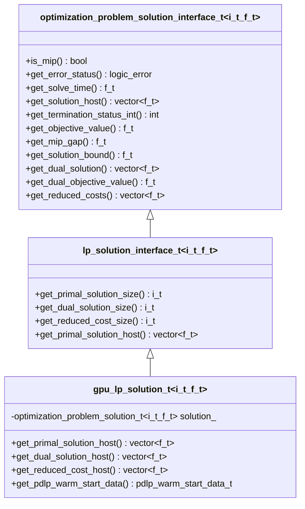
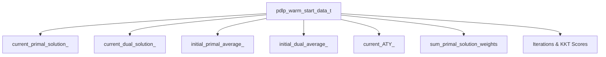

<!-- source: DeepWiki mcp.deepwiki.com · repo NVIDIA/cuopt · page 3.4 Solution Structures · fetched 2026-10-26 -->

# Solution Structures

<details>
<summary>Relevant source files</summary>

The following files were used as context for generating this wiki page:

- [ci/check_symbols.sh](ci/check_symbols.sh)
- [cpp/include/cuopt/mathematical_optimization/optimization_problem_solution.hpp](cpp/include/cuopt/mathematical_optimization/optimization_problem_solution.hpp)
- [cpp/include/cuopt/mathematical_optimization/optimization_problem_solution_interface.hpp](cpp/include/cuopt/mathematical_optimization/optimization_problem_solution_interface.hpp)
- [cpp/include/cuopt/mathematical_optimization/utilities/cython_types_gpu.hpp](cpp/include/cuopt/mathematical_optimization/utilities/cython_types_gpu.hpp)
- [cpp/src/pdlp/solution_conversion.cu](cpp/src/pdlp/solution_conversion.cu)
- [python/cuopt/cuopt/grpc/client/CMakeLists.txt](python/cuopt/cuopt/grpc/client/CMakeLists.txt)
- [python/cuopt/cuopt/linear_programming/solution/solution.py](python/cuopt/cuopt/linear_programming/solution/solution.py)

</details>


This page details the data structures used to represent optimization solutions within NVIDIA cuOpt. It covers C++ core solution classes (`optimization_problem_solution_t`, `mip_solution_t`, `gpu_lp_solution_t`), unified polymorphism interfaces (`optimization_problem_solution_interface_t`), termination statuses, primal/dual solutions, reduced costs, MIP incumbents/solution pools, warm start data structures, and their Python SDK counterpart containers.

---

## 1. Purpose and Scope

The solution subsystem bridges raw solver outputs from GPU/CPU backends to client-facing representations. Its core responsibilities include:
- Storing final primal and dual vectors, slack variables, and reduced costs in GPU memory via `rmm::device_uvector` or host containers.
- Providing unified polymorphism via `optimization_problem_solution_interface_t` for both LP and MIP solvers.
- Tracking convergence metrics, termination codes, and solver statistics.
- Preserving algorithm states in `pdlp_warm_start_data_t` to enable efficient warm-starting and iterative solve reuse.

Sources: `[cpp/include/cuopt/mathematical_optimization/optimization_problem_solution_interface.hpp:33-43]`, `[python/cuopt/cuopt/linear_programming/solution/solution.py:58-130]`

---

## 2. Core C++ Solution Data Structures

cuOpt defines distinct solution representations depending on whether the problem category is a Linear Program (LP/PDLP) or a Mixed-Integer Linear Program (MILP/MIP). To support a uniform C API and polymorphic handling, these classes inherit from abstract interfaces.

### Title: Solution Class Hierarchy and Polymorphism

Sources: `[cpp/include/cuopt/mathematical_optimization/optimization_problem_solution_interface.hpp:42-157]`, `[cpp/include/cuopt/mathematical_optimization/optimization_problem_solution.hpp:28-142]`

### LP and MIP Backend Solutions
- `optimization_problem_solution_t`: Manages GPU device memory buffers (`rmm::device_uvector`) for primal vectors, dual vectors, reduced costs, and associated PDLP iteration states [cpp/src/pdlp/solution_conversion.cu:28-44]().
- `mip_solution_t`: Encapsulates integer solutions, objective bounds, MIP gaps, node counts, and solution pools for branch-and-bound engines [cpp/src/pdlp/solution_conversion.cu:110-133]().

Sources: `[cpp/src/pdlp/solution_conversion.cu:28-133]`, `[cpp/include/cuopt/mathematical_optimization/optimization_problem_solution.hpp:28-42]`

---

## 3. Termination Statuses

Termination statuses inform callers why a solver run terminated. Both PDLP and MIP engines map internal enums into standardized integer codes and status enumerations.

| Status Category | LP Enum (`pdlp_termination_status_t`) | MIP Enum (`mip_termination_status_t`) | Description |
| :--- | :--- | :--- | :--- |
| **Optimal** | `Optimal` | `Optimal` | Solution satisfies primal/dual feasibility and optimality tolerances. |
| **Infeasible** | `PrimalInfeasible` | `Infeasible` | Proven that no feasible solution exists. |
| **Unbounded** | `DualInfeasible` | `Unbounded` | Objective function can be improved indefinitely. |
| **Time Limit** | `TimeLimit` | `TimeLimit` | Execution halted because the user time limit was reached. |
| **Feasible Found** | `PrimalFeasible` | `FeasibleFound` | A valid feasible solution was found before stopping. |
| **Numerical Error** | `NumericalError` | `NumericalError` | Solver encountered numerical instability or breakdown. |

Sources: `[python/cuopt/cuopt/linear_programming/solver/solver_wrapper.py:8-10]`, `[cpp/include/cuopt/mathematical_optimization/optimization_problem_solution_interface.hpp:75-82]`

---

## 4. Primal/Dual Solutions, Slack, and Reduced Costs

For Linear Programming problems solved via PDLP or Simplex:
- **Primal Solution**: Represented as a vector of variable values of size equal to the number of decision variables (`get_primal_solution_size()`) [cpp/include/cuopt/mathematical_optimization/optimization_problem_solution_interface.hpp:143-145]().
- **Dual Solution**: Dual multipliers corresponding to the linear constraints, matching the number of constraints (`get_dual_solution_size()`) [cpp/include/cuopt/mathematical_optimization/optimization_problem_solution_interface.hpp:148-150]().
- **Reduced Costs**: Associated with lower/upper variable bounds, indicating the rate of change of the objective per unit change in variable bounds [python/cuopt/cuopt/linear_programming/solution/solution.py:73-76]().
- **Slack / Residuals**: L2 norms of primal and dual residuals (`l2_primal_residual`, `l2_dual_residual`) measure infeasibility [cpp/src/pdlp/solution_conversion.cu:93-94]().

Sources: `[python/cuopt/cuopt/linear_programming/solution/solution.py:68-87]`, `[cpp/src/pdlp/solution_conversion.cu:28-104]`

---

## 5. Incumbents and MIP Solution Pools

For Mixed-Integer Programming, solutions track incumbent improvements and alternative points:
- **Incumbent Solution**: The best integer-feasible solution found during the branch-and-bound search, retrieved via `get_solution_host()` [cpp/include/cuopt/mathematical_optimization/optimization_problem_solution_interface.hpp:66-72]().
- **MIP Gap & Bounds**: Tracks `mip_gap_`, `solution_bound_` (lower bound for minimization), and `objective_` [cpp/src/pdlp/solution_conversion.cu:121-124]().
- **Solution Pools**: Alternative feasible solutions discovered during heuristic searches or tree exploration.

Sources: `[cpp/src/pdlp/solution_conversion.cu:110-133]`, `[python/cuopt/cuopt/linear_programming/solution/solution.py:97-106]`

---

## 6. Warm Start Data Structures

To accelerate sequential solves or resume interrupted PDLP iterations, cuOpt captures algorithm state inside `pdlp_warm_start_data_t`.

### Title: PDLP Warm Start Data Layout

Sources: `[python/cuopt/cuopt/linear_programming/solution/solution.py:14-34]`, `[cpp/src/pdlp/solution_conversion.cu:44-72]`

The warm start buffer includes:
- Current primal and dual iterate vectors (`current_primal_solution_`, `current_dual_solution_`) [cpp/src/pdlp/solution_conversion.cu:45-49]().
- Averaging accumulators (`initial_primal_average_`, `initial_dual_average_`, `sum_primal_solutions_`) [cpp/src/pdlp/solution_conversion.cu:50-58]().
- Scaling parameters and iteration counters (`initial_primal_weight_`, `total_pdlp_iterations_`) [cpp/src/pdlp/solution_conversion.cu:64-67]().

Sources: `[python/cuopt/cuopt/linear_programming/solution/solution.py:14-56]`, `[cpp/src/pdlp/solution_conversion.cu:44-82]`

---

## 7. Python SDK Solution Containers

At the Python layer, `Solution` and `PDLPWarmStartData` wrap the C++ Cython return structures (`linear_programming_ret_t`, `mip_ret_t`) [python/cuopt/cuopt/linear_programming/solution/solution.py:14-176]().

```python
class Solution:
    def __init__(
        self,
        problem_category,
        vars,
        solve_time=0.0,
        primal_solution=None,
        dual_solution=None,
        reduced_cost=None,
        ...
    ):
        ...
```
Sources: `[python/cuopt/cuopt/linear_programming/solution/solution.py:58-176]`, `[cpp/src/pdlp/solution_conversion.cu:28-133]`

---

