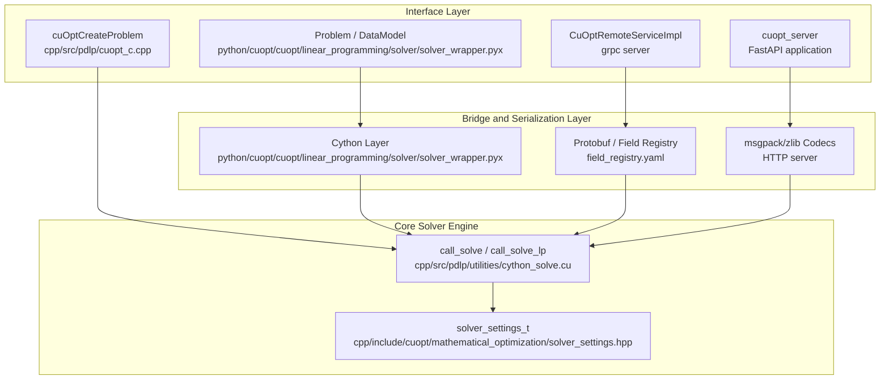

<!-- source: DeepWiki mcp.deepwiki.com · repo NVIDIA/cuopt · page 4 APIs and Interfaces · fetched 2026-10-26 -->

# APIs and Interfaces

Relevant source files

The following files were used as context for generating this wiki page:

- [cpp/include/cuopt/linear_programming/cuopt_c.h](cpp/include/cuopt/linear_programming/cuopt_c.h)
- [cpp/include/cuopt/mathematical_optimization/cuopt_c.h](cpp/include/cuopt/mathematical_optimization/cuopt_c.h)
- [cpp/include/cuopt/mathematical_optimization/solve.hpp](cpp/include/cuopt/mathematical_optimization/solve.hpp)
- [cpp/include/cuopt/mathematical_optimization/utilities/cython_solve.hpp](cpp/include/cuopt/mathematical_optimization/utilities/cython_solve.hpp)
- [cpp/include/cuopt/mathematical_optimization/utilities/cython_types.hpp](cpp/include/cuopt/mathematical_optimization/utilities/cython_types.hpp)
- [cpp/src/pdlp/cuopt_c.cpp](cpp/src/pdlp/cuopt_c.cpp)
- [cpp/src/pdlp/utilities/cython_solve.cu](cpp/src/pdlp/utilities/cython_solve.cu)
- [cpp/tests/linear_programming/c_api_tests/c_api_test.c](cpp/tests/linear_programming/c_api_tests/c_api_test.c)
- [cpp/tests/linear_programming/c_api_tests/c_api_tests.cpp](cpp/tests/linear_programming/c_api_tests/c_api_tests.cpp)
- [cpp/tests/linear_programming/c_api_tests/c_api_tests.h](cpp/tests/linear_programming/c_api_tests/c_api_tests.h)
- [python/cuopt/cuopt/distance_engine/waypoint_matrix_wrapper.pyx](python/cuopt/cuopt/distance_engine/waypoint_matrix_wrapper.pyx)
- [python/cuopt/cuopt/linear_programming/solver/solver.pxd](python/cuopt/cuopt/linear_programming/solver/solver.pxd)
- [python/cuopt/cuopt/linear_programming/solver/solver_wrapper.pyx](python/cuopt/cuopt/linear_programming/solver/solver_wrapper.pyx)
- [python/cuopt/cuopt/routing/utils_wrapper.pyx](python/cuopt/cuopt/routing/utils_wrapper.pyx)
- [python/cuopt/cuopt/utilities/__init__.py](python/cuopt/cuopt/utilities/__init__.py)
- [python/cuopt/cuopt/utilities/utils.py](python/cuopt/cuopt/utilities/utils.py)
- [python/cuopt/distance_engine/waypoint_matrix_wrapper.pyx](python/cuopt/distance_engine/waypoint_matrix_wrapper.pyx)

This page provides a high-level overview of the API layers available in the cuOpt codebase, spanning the C API, Python SDK, Java bindings, gRPC remote service, HTTP server, MCP server, and command-line tools. Each interface targets distinct integration patterns and deployment scenarios, bridging user workflows with the underlying C++ optimization core.

For deep technical details, see the child pages:
- [C/C++ API](#4.1)
- [Python API](#4.2)
- [Remote Execution: gRPC Service](#4.3)
- [HTTP Server API](#4.4)
- [Command Line and Thin Clients](#4.5)
- [Java API](#4.6)
- [Third-Party Integrations and MCP Server](#4.7)

Sources: [cpp/include/cuopt/mathematical_optimization/cuopt_c.h:25-47](), [python/cuopt/cuopt/linear_programming/solver/solver_wrapper.pyx:40-61]()

## API Layers and Architecture Overview

cuOpt's multi-tier architecture exposes identical underlying solver capabilities through specialized wrappers and protocol layers. The following diagram maps high-level interface concepts to their corresponding code entities.

**Interface to Code Entity Mapping**

Sources: [cpp/src/pdlp/cuopt_c.cpp:92-100](), [python/cuopt/cuopt/linear_programming/solver/solver_wrapper.pyx:40-61](), [cpp/src/pdlp/utilities/cython_solve.cu:54-74]()

## C/C++ API

The native C API (`libcuopt`) provides direct access to linear, mixed-integer, and quadratic optimization solvers using an opaque handle design pattern.

- **Interface Definition**: Defined in `cpp/include/cuopt/mathematical_optimization/cuopt_c.h` [cpp/include/cuopt/mathematical_optimization/cuopt_c.h:1-47]().
- **Opaque Handles**: Uses types like `cuOptOptimizationProblem`, `cuOptSolverSettings`, and `cuOptSolution` to hide internal C++ implementations and maintain ABI stability.
- **Lifecycle Functions**: Problems are created via `cuOptReadProblem` or creation helpers, configured via parameter setters, and freed using destructor calls [cpp/tests/linear_programming/c_api_tests/c_api_test.c:70-75]().

For detailed interface documentation, opaque handle patterns, callbacks, and usage examples, see [C/C++ API](#4.1).

Sources: [cpp/include/cuopt/mathematical_optimization/cuopt_c.h:25-47](), [cpp/tests/linear_programming/c_api_tests/c_api_test.c:70-75]()

## Python API

The Python SDK exposes cuOpt's capabilities via high-level object-oriented wrappers backed by Cython.

- **Package Structure**: Organized into `cuopt.linear_programming` for LP/MILP/QP solving and `cuopt.routing` for vehicle routing and distance engines [python/cuopt/cuopt/linear_programming/solver/solver_wrapper.pyx:40-61]().
- **Cython Bridges**: Translates Python structures and CuPy/NumPy arrays into C++ data models (`data_model_view_t`) and execution calls (`call_solve`, `call_solve_lp`, `call_solve_mip`) [python/cuopt/cuopt/linear_programming/solver/solver_wrapper.pyx:40-61](), [cpp/src/pdlp/utilities/cython_solve.cu:54-102]().
- **Routing & Distance Engine**: Integrates waypoint matrices (`WaypointMatrix`) and fleet routing structures [python/cuopt/distance_engine/waypoint_matrix_wrapper.pyx:29-33]().

For detailed classes, data models, warm starting, and Cython integration, see [Python API](#4.2).

Sources: [python/cuopt/cuopt/linear_programming/solver/solver_wrapper.pyx:40-61](), [cpp/src/pdlp/utilities/cython_solve.cu:54-102](), [python/cuopt/distance_engine/waypoint_matrix_wrapper.pyx:29-33]()

## Remote Execution: gRPC Service

The gRPC remote service architecture enables distributed and containerized offloading of compute-heavy solve workloads.

- **Server Internals**: `CuOptRemoteServiceImpl` manages shared-memory job queues, `posix_spawn` worker processes, and pipe-based serialization [cpp/src/pdlp/cuopt_c.cpp:92-100]().
- **Clients**: C++ (`grpc_client_t`) and Python bindings provide remote solve endpoints (`solve_lp_remote`, `solve_mip_remote`) [cpp/tests/linear_programming/c_api_tests/c_api_tests.h:83-87]().
- **Codegen**: Uses `field_registry.yaml` to generate Protocol Buffer definitions and converters automatically.

For server architecture, client wrappers, and protocol generation, see [Remote Execution: gRPC Service](#4.3).

Sources: [cpp/tests/linear_programming/c_api_tests/c_api_tests.h:83-87](), [python/cuopt/cuopt/linear_programming/solver/solver_wrapper.pyx:40-61]()

## HTTP Server API

The `cuopt_server` microservice provides a FastAPI-based REST interface for lightweight integration.

- **Endpoints & Pydantic**: Exposes REST endpoints backed by Pydantic data definitions for constraints, objectives, and solver parameters.
- **Codecs & Serialization**: Utilizes optimized `msgpack` and `zlib` codecs alongside async job handlers and health check routes.

For API endpoints, schema definitions, and codecs, see [HTTP Server API](#4.4).

Sources: [cpp/include/cuopt/mathematical_optimization/cuopt_c.h:25-47]()

## Command Line and Thin Clients

Command-line utilities and thin clients offer standalone execution and self-hosted client connections.

- **`cuopt_cli`**: A standalone C++ executable for solving linear and mixed-integer programming problems directly from MPS/LP files.
- **`cuopt_sh`**: A self-hosted client utility facilitating connection to remote cuOpt server instances.

For argument parsing, solver settings, and usage examples, see [Command Line and Thin Clients](#4.5).

Sources: [cpp/tests/linear_programming/c_api_tests/c_api_tests.cpp:37-45]()

## Java API

Java bindings permit integration into enterprise JVM environments.

- **JNI Layer**: Implemented via `cuopt_jni.cpp` bridging native C/C++ operations.
- **Classes**: Exposes Java-native wrappers for `SolverSettings`, problem definitions, and `NativeLogSink` log handlers, packaged via custom build scripts and published to Maven.

For class hierarchies, JNI bridging details, and build scripts, see [Java API](#4.6).

Sources: [cpp/include/cuopt/mathematical_optimization/cuopt_c.h:25-47]()

## Third-Party Integrations and MCP Server

Extends cuOpt's reach into modeling languages and agentic workflows.

- **Modeling Frameworks**: Connects with standard algebraic modeling systems such as AMPL, GAMS, PuLP, Pyomo, CVXPY, and JuMP.
- **MCP Server**: Implements the Model Context Protocol (`cuopt_mcp`), exposing optimization tools directly to large language model agents.

For integration guides and MCP server protocols, see [Third-Party Integrations and MCP Server](#4.7).

Sources: [cpp/include/cuopt/mathematical_optimization/cuopt_c.h:25-47]()

---

