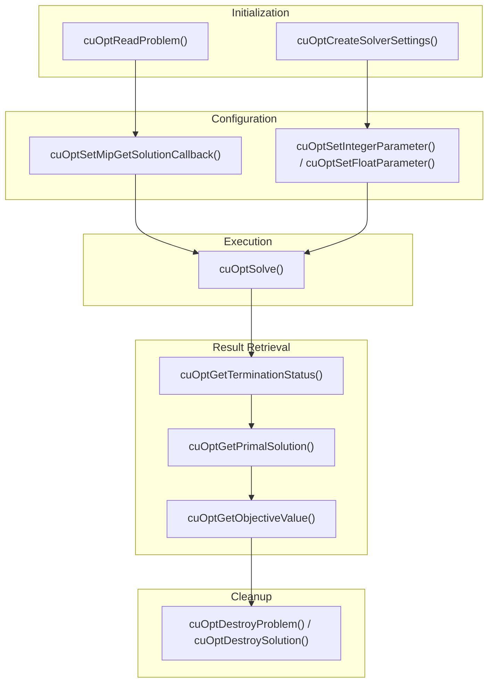
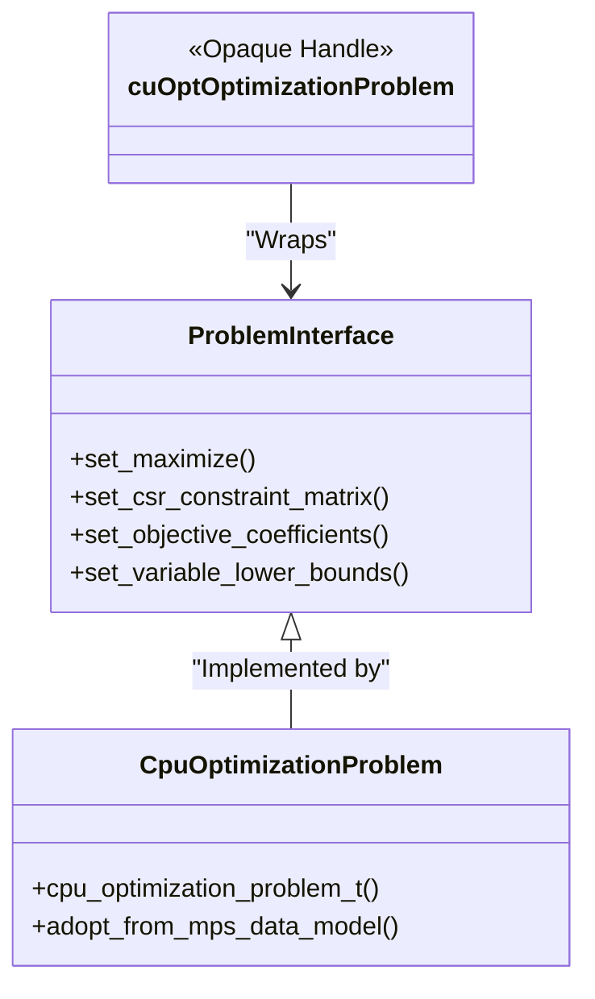
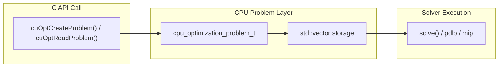

<!-- source: DeepWiki mcp.deepwiki.com · repo NVIDIA/cuopt · page 4.1 C/C++ API · fetched 2026-10-26 -->

# C/C++ API

<details>
<summary>Relevant source files</summary>

The following files were used as context for generating this wiki page:

- [cpp/include/cuopt/linear_programming/cuopt_c.h](cpp/include/cuopt/linear_programming/cuopt_c.h)
- [cpp/include/cuopt/mathematical_optimization/cpu_optimization_problem.hpp](cpp/include/cuopt/mathematical_optimization/cpu_optimization_problem.hpp)
- [cpp/include/cuopt/mathematical_optimization/cuopt_c.h](cpp/include/cuopt/mathematical_optimization/cuopt_c.h)
- [cpp/include/cuopt/mathematical_optimization/optimization_problem_utils.hpp](cpp/include/cuopt/mathematical_optimization/optimization_problem_utils.hpp)
- [cpp/src/grpc/codegen/generated/generated_build_array_chunks.inc](cpp/src/grpc/codegen/generated/generated_build_array_chunks.inc)
- [cpp/src/grpc/codegen/generated/generated_chunked_arrays_to_problem.inc](cpp/src/grpc/codegen/generated/generated_chunked_arrays_to_problem.inc)
- [cpp/src/grpc/codegen/generated/generated_estimate_problem_size.inc](cpp/src/grpc/codegen/generated/generated_estimate_problem_size.inc)
- [cpp/src/grpc/codegen/generated/generated_problem_to_proto.inc](cpp/src/grpc/codegen/generated/generated_problem_to_proto.inc)
- [cpp/src/grpc/codegen/generated/generated_proto_to_problem.inc](cpp/src/grpc/codegen/generated/generated_proto_to_problem.inc)
- [cpp/src/io/CMakeLists.txt](cpp/src/io/CMakeLists.txt)
- [cpp/src/math_optimization/CMakeLists.txt](cpp/src/math_optimization/CMakeLists.txt)
- [cpp/src/math_optimization/solver_settings.cpp](cpp/src/math_optimization/solver_settings.cpp)
- [cpp/src/pdlp/CMakeLists.txt](cpp/src/pdlp/CMakeLists.txt)
- [cpp/src/pdlp/cpu_optimization_problem.cpp](cpp/src/pdlp/cpu_optimization_problem.cpp)
- [cpp/src/pdlp/cuopt_c.cpp](cpp/src/pdlp/cuopt_c.cpp)
- [cpp/tests/linear_programming/c_api_tests/c_api_test.c](cpp/tests/linear_programming/c_api_tests/c_api_test.c)
- [cpp/tests/linear_programming/c_api_tests/c_api_tests.cpp](cpp/tests/linear_programming/c_api_tests/c_api_tests.cpp)
- [cpp/tests/linear_programming/c_api_tests/c_api_tests.h](cpp/tests/linear_programming/c_api_tests/c_api_tests.h)
- [cpp/tests/linear_programming/unit_tests/solution_interface_test.cu](cpp/tests/linear_programming/unit_tests/solution_interface_test.cu)
- [cpp/tests/linear_programming/unit_tests/solver_settings_test.cu](cpp/tests/linear_programming/unit_tests/solver_settings_test.cu)

</details>


## Purpose and Scope

The cuOpt C/C++ API provides a high-performance interface for solving Linear Programming (LP), Quadratic Programming (QP), and Mixed Integer Programming (MILP) problems. The core of the library is implemented in C++ and exposed via a stable C ABI (`cuopt_c.h`) and a template-based C++ interface [cpp/include/cuopt/mathematical_optimization/cuopt_c.h:1-131](). This API allows for fine-grained control over solver settings, memory management via RMM, and integration with GPU-accelerated sparse solvers like cuDSS and cuSparse.

The C API is designed around an **opaque handle pattern**, ensuring binary compatibility while allowing the underlying C++ implementation to evolve [cpp/include/cuopt/mathematical_optimization/cuopt_c.h:33-46]().

Sources: [cpp/include/cuopt/mathematical_optimization/cuopt_c.h:1-131]()

---

## C API Interface (`cuopt_c.h`)

The C API provides a simplified entry point for users who require a stable ABI or are integrating cuOpt into non-C++ environments. It manages primary object types via opaque pointers [cpp/include/cuopt/mathematical_optimization/cuopt_c.h:33-46]().

### Key Opaque Handles

| Handle Type | Description |
| :--- | :--- |
| `cuOptOptimizationProblem` | Holds the problem definition (A, b, c, bounds, types). Created via `cuOptCreateProblem`, `cuOptCreateRangedProblem`, or `cuOptReadProblem` [cpp/include/cuopt/mathematical_optimization/cuopt_c.h:25-33](). |
| `cuOptSolverSettings` | Stores solver parameters (tolerances, time limits, methods). Created via `cuOptCreateSolverSettings` [cpp/include/cuopt/mathematical_optimization/cuopt_c.h:35-40](). |
| `cuOptSolution` | Contains the results of a solve (primal/dual values, status, objective). Created by `cuOptSolve` [cpp/include/cuopt/mathematical_optimization/cuopt_c.h:42-46](). |

Sources: [cpp/include/cuopt/mathematical_optimization/cuopt_c.h:25-46]()

### C API Data Flow

The following diagram illustrates the typical lifecycle of a problem solved via the C API.



Sources: [cpp/include/cuopt/mathematical_optimization/cuopt_c.h:130-144](), [cpp/src/pdlp/cuopt_c.cpp:92-100]()

---

## Problem Creation and Management

Problems can be defined manually by providing matrices in Compressed Sparse Row (CSR) format or loaded from standard files (`.mps`, `.qps`, `.lp`) [cpp/include/cuopt/mathematical_optimization/cuopt_c.h:111-131]().

### Creation Functions

| Function | Purpose |
| :--- | :--- |
| `cuOptReadProblem` | Loads a problem from an MPS, QPS, or LP file with case-insensitive format dispatch [cpp/include/cuopt/mathematical_optimization/cuopt_c.h:111-131](). |
| `cuOptCreateProblem` | Defines a linear problem with constraints, objective coefficients, and variable types [cpp/include/cuopt/mathematical_optimization/cuopt_c.h:146-175](). |
| `cuOptWriteProblem` | Serializes an optimization problem back to a file format (such as MPS) [cpp/include/cuopt/mathematical_optimization/cuopt_c.h:142-145](). |

Sources: [cpp/include/cuopt/mathematical_optimization/cuopt_c.h:111-175]()

### Code Entity Mapping: Problem Representation

This diagram bridges the natural language concepts of an optimization problem to the specific C structures and interface functions.



Sources: [cpp/include/cuopt/mathematical_optimization/cpu_optimization_problem.hpp:50-55](), [cpp/src/pdlp/cuopt_c.cpp:111-120]()

---

## Solver Settings and Callbacks

Solver behavior is controlled via the `cuOptSolverSettings` opaque handle [cpp/include/cuopt/mathematical_optimization/cuopt_c.h:35-40](). Parameters can be set via helper functions or string keys [cpp/tests/linear_programming/c_api_tests/c_api_test.c:77-131]().

### Parameter Setting Example (C)
```c
cuOptSolverSettings settings = NULL;
cuOptCreateSolverSettings(&settings);

// Set time limit and method parameters
cuOptSetFloatParameter(settings, "time_limit", 60.0);
cuOptSetIntegerParameter(settings, "method", 1);
```
Sources: [cpp/tests/linear_programming/c_api_tests/c_api_test.c:77-131]()

### Callback System
For MILP problems, the C API supports callbacks to retrieve intermediate solutions or inject heuristic solutions [cpp/src/pdlp/cuopt_c.cpp:51-89]().
- `c_get_solution_callback_t`: Wraps `cuOptMIPGetSolutionCallback` to pass incumbent solutions and bounds to user code [cpp/src/pdlp/cuopt_c.cpp:51-69]().
- `c_set_solution_callback_t`: Wraps `cuOptMIPSetSolutionCallback` to allow user-defined solution injection during branch-and-bound [cpp/src/pdlp/cuopt_c.cpp:71-89]().

Sources: [cpp/src/pdlp/cuopt_c.cpp:51-89]()

---

## Internal Implementation: `cpu_optimization_problem_t`

The underlying C++ implementation manages problem definitions using `cpu_optimization_problem_t` on the host and interfaces directly with GPU solvers when hardware is present [cpp/include/cuopt/mathematical_optimization/cpu_optimization_problem.hpp:50-65]().

### Memory Layout and Data Flow
Data provided via the C API is validated and stored in host structures (`std::vector`) or transferred to device vectors (`rmm::device_uvector`) [cpp/src/pdlp/cpu_optimization_problem.cpp:76-110]() [cpp/include/cuopt/mathematical_optimization/cpu_optimization_problem.hpp:46-55]().



Sources: [cpp/include/cuopt/mathematical_optimization/cpu_optimization_problem.hpp:46-65](), [cpp/src/pdlp/cpu_optimization_problem.cpp:76-110]()

---

## Example Usage: MPS File Solve Test

The following snippet from the test suite illustrates a standard C API flow for loading an MPS file and checking termination status [cpp/tests/linear_programming/c_api_tests/c_api_tests.cpp:37-45]().

```cpp
TEST(c_api, afiro)
{
  const std::string& rapidsDatasetRootDir = cuopt::test::get_rapids_dataset_root_dir();
  std::string filename = rapidsDatasetRootDir + "/linear_programming/" + "afiro_original.mps";
  int termination_status;
  EXPECT_EQ(solve_mps_file(filename.c_str(), 60, CUOPT_INFINITY, &termination_status),
            CUOPT_SUCCESS);
  EXPECT_EQ(termination_status, CUOPT_TERMINATION_STATUS_OPTIMAL);
}
```

Sources: [cpp/tests/linear_programming/c_api_tests/c_api_tests.cpp:37-45]()

---

## Summary of Key C API Functions

| Function | File Reference |
| :--- | :--- |
| `cuOptReadProblem` | [cpp/include/cuopt/mathematical_optimization/cuopt_c.h:130]() |
| `cuOptCreateProblem` | [cpp/include/cuopt/mathematical_optimization/cuopt_c.h:176]() |
| `cuOptSolve` | [cpp/include/cuopt/mathematical_optimization/cuopt_c.h:200]() |
| `cuOptGetPrimalSolution` | [cpp/include/cuopt/mathematical_optimization/cuopt_c.h:250]() |
| `cuOptSetIntegerParameter` | [cpp/include/cuopt/mathematical_optimization/cuopt_c.h:320]() |

Sources: [cpp/include/cuopt/mathematical_optimization/cuopt_c.h:1-400]()

---

