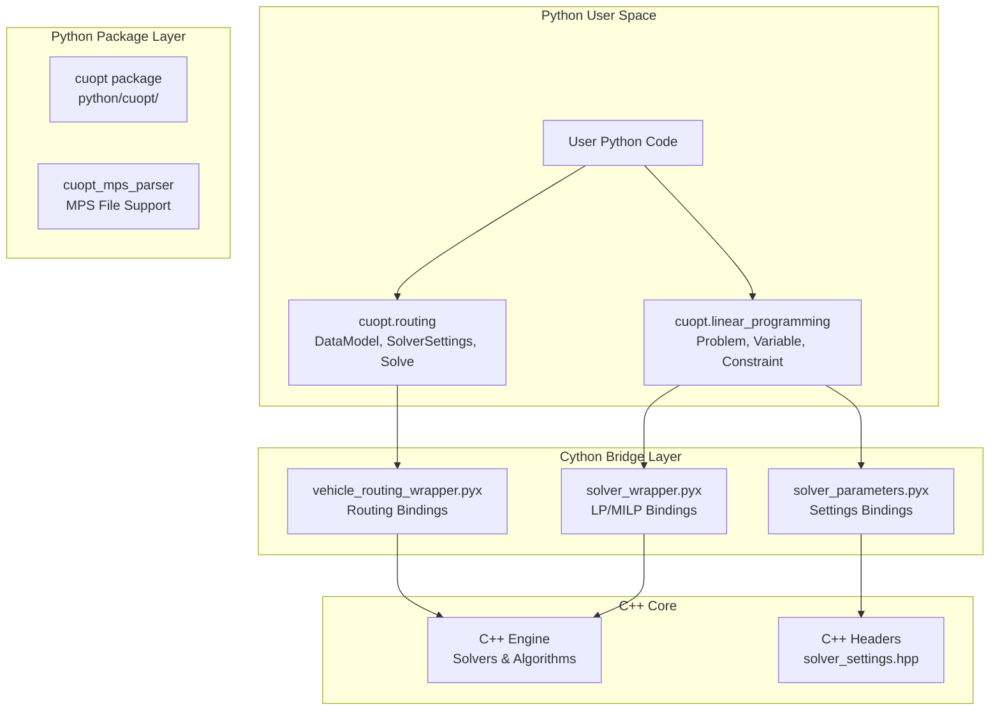
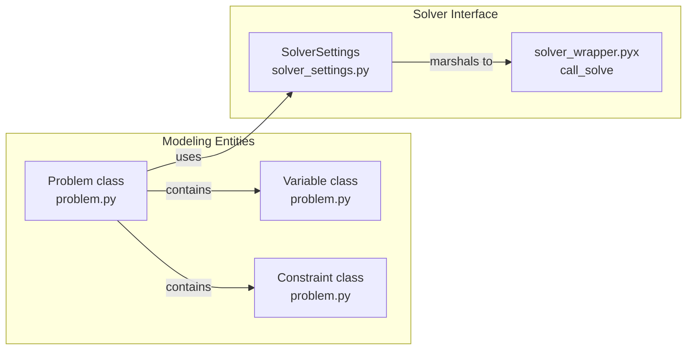

<!-- source: DeepWiki mcp.deepwiki.com · repo NVIDIA/cuopt · page 4.2 Python API · fetched 2026-10-26 -->

# Python API

Relevant source files

The following files were used as context for generating this wiki page:

- [cpp/src/io/mps_writer.cpp](cpp/src/io/mps_writer.cpp)
- [cpp/src/pdlp/translate.hpp](cpp/src/pdlp/translate.hpp)
- [cpp/tests/linear_programming/parser_test.cpp](cpp/tests/linear_programming/parser_test.cpp)
- [cpp/tests/qp/unit_tests/lp_parser_solve_test.cu](cpp/tests/qp/unit_tests/lp_parser_solve_test.cu)
- [cpp/tests/qp/unit_tests/mps_ranged_rows_test.cu](cpp/tests/qp/unit_tests/mps_ranged_rows_test.cu)
- [cpp/tests/qp/unit_tests/mps_writer_test.cpp](cpp/tests/qp/unit_tests/mps_writer_test.cpp)
- [cpp/tests/routing/routing_test.cuh](cpp/tests/routing/routing_test.cuh)
- [python/cuopt/cuopt/linear_programming/problem.py](python/cuopt/cuopt/linear_programming/problem.py)
- [python/cuopt/cuopt/linear_programming/solver/solver.py](python/cuopt/cuopt/linear_programming/solver/solver.py)
- [python/cuopt/cuopt/routing/validation.py](python/cuopt/cuopt/routing/validation.py)
- [python/cuopt/cuopt/routing/vehicle_routing.pxd](python/cuopt/cuopt/routing/vehicle_routing.pxd)
- [python/cuopt/cuopt/routing/vehicle_routing.py](python/cuopt/cuopt/routing/vehicle_routing.py)
- [python/cuopt/cuopt/routing/vehicle_routing_wrapper.pyx](python/cuopt/cuopt/routing/vehicle_routing_wrapper.pyx)
- [python/cuopt/cuopt/tests/linear_programming/test_python_API.py](python/cuopt/cuopt/tests/linear_programming/test_python_API.py)
- [python/cuopt/cuopt/tests/routing/test_host_arrays.py](python/cuopt/cuopt/tests/routing/test_host_arrays.py)
- [python/cuopt/cuopt/tests/routing/test_routing_grpc_serialization.py](python/cuopt/cuopt/tests/routing/test_routing_grpc_serialization.py)

## Purpose and Scope

The Python API provides user-facing interfaces for solving optimization problems using cuOpt. This page covers the overall Python API architecture, package structure, and how the Python layer integrates with the underlying C++ core engine. For detailed API documentation of specific problem types, see [Linear Programming Python API](#4.2.1) for LP/MILP problems and [Routing Python API](#4.2.2) for vehicle routing problems. For implementation details of the Python-C++ bridge, see [Cython Bridges and Type Conversion](#4.2.3).

The Python SDK is organized into two primary sub-packages: `cuopt.linear_programming` for algebraic modeling of LP/MILP/QP problems and `cuopt.routing` for specialized vehicle routing solvers.

Sources: [python/cuopt/cuopt/linear_programming/problem.py:12-14](), [python/cuopt/cuopt/routing/vehicle_routing_wrapper.pyx:12-20]()

## Python API Architecture

The cuOpt Python API is built as a wrapper layer over the C++ core engine. The architecture follows a layered design where Python packages expose high-level interfaces that communicate with the C++ implementation via Cython bindings.

### System Integration

**Architecture Diagram: Python API Layers and Dependencies**

The Python API consists of multiple packages organized hierarchically:

1.  **High-Level Modeling**: `cuopt.linear_programming.problem.Problem` provides an object-oriented way to define variables and constraints [python/cuopt/cuopt/linear_programming/problem.py:53-66]().
2.  **Solver Control**: `cuopt.linear_programming.SolverSettings` manages parameters like time limits and algorithm selection [python/cuopt/cuopt/linear_programming/solver_settings/solver_settings.py:69-74]().
3.  **Bridge layer**: Cython wrappers (e.g., `solver_wrapper.pyx`) translate Python objects to C++ `solver_settings_t` and `data_model_view_t` [python/cuopt/cuopt/linear_programming/solver/solver_wrapper.pyx:163-170]().

Sources: [python/cuopt/cuopt/linear_programming/problem.py:12-14](), [python/cuopt/cuopt/linear_programming/solver/solver_wrapper.pyx:30-50]()

## API Surfaces

### Linear Programming API

The LP API allows for algebraic modeling of optimization problems. It supports continuous and integer variables, linear and quadratic expressions, and a variety of solver parameters.

| Class | Role | Key Methods |
| :--- | :--- | :--- |
| `Problem` | Main container for the model | `addVariable`, `addConstraint`, `solve` |
| `Variable` | Represents a decision variable | `setLowerBound`, `setUpperBound`, `getValue` |
| `SolverSettings` | Configures the solver engine | `set_parameter`, `set_optimality_tolerance` |
| `Solution` | Container for solver output | `primal_solution`, `obj_value`, `status` |

**Code Entity Mapping: LP API**

Sources: [python/cuopt/cuopt/linear_programming/problem.py:53-66](), [python/cuopt/cuopt/linear_programming/problem.py:69-105](), [python/cuopt/cuopt/linear_programming/solver_settings/solver_settings.py:69-132]()

### Routing API

The routing API is specialized for Vehicle Routing Problems (VRP). It uses a `DataModel` to ingest cost matrices and constraints, and a `Solve` function to trigger the GPU-accelerated metaheuristics.

*   **Data Ingestion**: Supports `cudf.Series` and `numpy.ndarray` for efficient GPU data transfer [python/cuopt/cuopt/routing/vehicle_routing_wrapper.pyx:127-135]().
*   **Objectives**: Supports multiple optimization goals including `COST`, `TRAVEL_TIME`, and `VARIANCE_ROUTE_SIZE` [python/cuopt/cuopt/routing/vehicle_routing_wrapper.pyx:104-133]().
*   **Constraints**: Handles capacity, time windows, and pickup/delivery pairs [python/cuopt/cuopt/routing/vehicle_routing_wrapper.pyx:171-186]().

Sources: [python/cuopt/cuopt/routing/vehicle_routing_wrapper.pyx:104-133](), [python/cuopt/cuopt/routing/vehicle_routing_wrapper.pyx:151-167]()

## Integration with pandas, NumPy, and cuDF

The Python SDK is designed for high-performance data interchange:

1.  **NumPy/cuDF to C++**: The `get_data_ptr` function extracts raw memory addresses from `cudf.Series` or `np.ndarray` to pass to the C++ core [python/cuopt/cuopt/linear_programming/solver/solver_wrapper.pyx:127-135]().
2.  **Type Casting**: The `type_cast` utility ensures Python data types match the expected C++ precision (e.g., `float32` for routing, `float64` for LP) [python/cuopt/cuopt/routing/vehicle_routing_wrapper.pyx:64-82]().
3.  **CSR Format**: For LP problems, the API supports Compressed Sparse Row (CSR) format for constraint matrices, facilitating integration with `scipy.sparse` [python/cuopt_server/cuopt_server/utils/linear_programming/data_definition.py:96-120]().

Sources: [python/cuopt/cuopt/linear_programming/solver/solver_wrapper.pyx:127-135](), [python/cuopt/cuopt/routing/vehicle_routing_wrapper.pyx:64-82](), [python/cuopt_server/cuopt_server/utils/linear_programming/data_definition.py:122-137]()

## Solver Configuration and Settings

Solver behavior is controlled via the `SolverSettings` class, which interacts with the C++ `solver_settings_t` structure.

*   **Parameter Management**: Parameters are set using string keys (e.g., `"time_limit"`) which are validated against the available C++ parameter names [python/cuopt/cuopt/linear_programming/solver_settings/solver_settings.py:132-147]().
*   **Method Selection**: Users can choose between `Concurrent`, `PDLP`, `DualSimplex`, or `Barrier` methods via the `SolverMethod` enum [python/cuopt/cuopt/linear_programming/solver_settings/solver_settings.py:12-20]().
*   **Warm Starting**: The `set_pdlp_warm_start_data` method allows passing solution context from a previous solve to accelerate convergence on similar problems [python/cuopt/cuopt/linear_programming/solver_settings/solver_settings.py:183-207]().

Sources: [python/cuopt/cuopt/linear_programming/solver_settings/solver_settings.py:12-20](), [python/cuopt/cuopt/linear_programming/solver_settings/solver_settings.py:132-147](), [python/cuopt/cuopt/linear_programming/solver_settings/solver_settings.py:183-207]()

## Child Pages

For more in-depth information, refer to the following sub-pages:

*   [Linear Programming Python API](#4.2.1) — Detailed guide on `Problem`, `Variable`, and `Constraint` usage.
*   [Routing Python API](#4.2.2) — Configuration of cost matrices, time windows, and fleet data.
*   [Cython Bridges and Type Conversion](#4.2.3) — Technical details on how Python data is marshaled to C++ and GPU memory.

---

