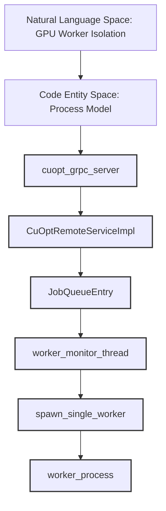
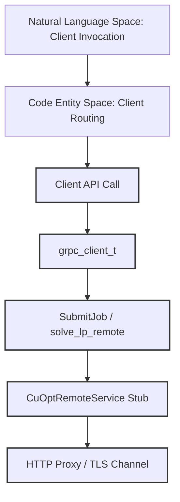

<!-- source: DeepWiki mcp.deepwiki.com · repo NVIDIA/cuopt · page 4.3 Remote Execution: gRPC Service · fetched 2026-10-26 -->

# Remote Execution: gRPC Service

Relevant source files

The following files were used as context for generating this wiki page:

- [ci/docker/entrypoint.sh](ci/docker/entrypoint.sh)
- [cpp/docs/grpc-server-architecture.md](cpp/docs/grpc-server-architecture.md)
- [cpp/src/grpc/server/grpc_incumbent_proto.hpp](cpp/src/grpc/server/grpc_incumbent_proto.hpp)
- [cpp/src/grpc/server/grpc_pipe_io.cpp](cpp/src/grpc/server/grpc_pipe_io.cpp)
- [cpp/src/grpc/server/grpc_pipe_serialization.hpp](cpp/src/grpc/server/grpc_pipe_serialization.hpp)
- [cpp/src/grpc/server/grpc_server_logger.hpp](cpp/src/grpc/server/grpc_server_logger.hpp)
- [cpp/src/grpc/server/grpc_server_main.cpp](cpp/src/grpc/server/grpc_server_main.cpp)
- [cpp/src/grpc/server/grpc_server_threads.cpp](cpp/src/grpc/server/grpc_server_threads.cpp)
- [cpp/src/grpc/server/grpc_server_types.hpp](cpp/src/grpc/server/grpc_server_types.hpp)
- [cpp/src/grpc/server/grpc_service_impl.cpp](cpp/src/grpc/server/grpc_service_impl.cpp)
- [cpp/src/grpc/server/grpc_worker.cpp](cpp/src/grpc/server/grpc_worker.cpp)
- [cpp/src/grpc/server/grpc_worker_infra.cpp](cpp/src/grpc/server/grpc_worker_infra.cpp)
- [cpp/tests/linear_programming/grpc/CMakeLists.txt](cpp/tests/linear_programming/grpc/CMakeLists.txt)
- [cpp/tests/linear_programming/grpc/grpc_integration_test.cpp](cpp/tests/linear_programming/grpc/grpc_integration_test.cpp)
- [cpp/tests/linear_programming/grpc/grpc_worker_spawn_test.cpp](cpp/tests/linear_programming/grpc/grpc_worker_spawn_test.cpp)
- [docs/cuopt/source/_static/large-rubric.css](docs/cuopt/source/_static/large-rubric.css)
- [docs/cuopt/source/cuopt-grpc/advanced.rst](docs/cuopt/source/cuopt-grpc/advanced.rst)
- [docs/cuopt/source/cuopt-grpc/api.rst](docs/cuopt/source/cuopt-grpc/api.rst)
- [docs/cuopt/source/cuopt-grpc/examples.rst](docs/cuopt/source/cuopt-grpc/examples.rst)
- [docs/cuopt/source/cuopt-grpc/examples/incumbent_stream_demo.py](docs/cuopt/source/cuopt-grpc/examples/incumbent_stream_demo.py)
- [docs/cuopt/source/cuopt-grpc/examples/remote_lp_demo.mps](docs/cuopt/source/cuopt-grpc/examples/remote_lp_demo.mps)
- [docs/cuopt/source/cuopt-grpc/examples/remote_lp_demo.py](docs/cuopt/source/cuopt-grpc/examples/remote_lp_demo.py)
- [docs/cuopt/source/cuopt-grpc/grpc-server-architecture.md](docs/cuopt/source/cuopt-grpc/grpc-server-architecture.md)
- [docs/cuopt/source/cuopt-grpc/index.rst](docs/cuopt/source/cuopt-grpc/index.rst)
- [docs/cuopt/source/cuopt-grpc/python-async-client-api.rst](docs/cuopt/source/cuopt-grpc/python-async-client-api.rst)
- [docs/cuopt/source/cuopt-grpc/python-async-client.rst](docs/cuopt/source/cuopt-grpc/python-async-client.rst)
- [docs/cuopt/source/cuopt-grpc/quick-start.rst](docs/cuopt/source/cuopt-grpc/quick-start.rst)

## Purpose and Scope

The NVIDIA cuOpt gRPC service provides a scalable, multi-process remote execution architecture designed to offload compute-intensive mathematical optimization solves (Linear Programming, Mixed Integer Programming, Quadratic Programming, and Vehicle Routing Problems) to GPU-accelerated servers (`cuopt_grpc_server`). 

This parent page introduces the high-level architecture connecting remote clients to worker pools, while deep technical internals are partitioned across dedicated child pages:
- **Server Internals**: Detailed in [gRPC Server Internals](#4.3.1) (`CuOptRemoteServiceImpl`, shared memory queues, `posix_spawn` worker processes, and pipe IPC).
- **Client Interfaces**: Detailed in [gRPC Clients (C++, Python, Routing)](#4.3.2) (`grpc_client_t`, language-specific clients, and TLS configurations).
- **Protocol Codegen**: Detailed in [Protocol Buffers and Field Registry Codegen](#4.3.3) (`field_registry.yaml`-driven schema compilation).

Sources: [`cpp/docs/grpc-server-architecture.md:1-17`(), `docs/cuopt/source/cuopt-grpc/quick-start.rst:9-31`()]

---

## 1. Server Architecture and Worker Lifecycle

The server process model is built around a main gRPC service router (`CuOptRemoteServiceImpl`) that manages request dispatch, background monitoring threads, and an isolated pool of GPU worker processes [cpp/docs/grpc-server-architecture.md:20-53](). 

To ensure fault tolerance and eliminate GPU context pollution between distinct client requests, each worker executes in a separate process container joined via POSIX shared-memory control blocks (`SharedMemoryControl`, `JobQueueEntry`, `ResultQueueEntry`) [cpp/src/grpc/server/grpc_server_types.hpp:86-120](). Worker health is continuously audited by `worker_monitor_thread()`, which handles process respawns upon encountering unexpected termination or CUDA liveness failures [cpp/src/grpc/server/grpc_server_threads.cpp:58-138]().

For full details on queue structures, pipe serialization, and worker supervision, see [gRPC Server Internals](#4.3.1).

Sources: [`cpp/docs/grpc-server-architecture.md:20-53`(), `cpp/src/grpc/server/grpc_server_types.hpp:86-120`(), `cpp/src/grpc/server/grpc_server_threads.cpp:58-138`()]

---

## 2. Client Interfaces and Remote Solving

Remote execution allows standard Python, C++, and CLI workflows to target a remote GPU server with minimal or zero code alterations [docs/cuopt/source/cuopt-grpc/quick-start.rst:9-44](). When environment variables such as `CUOPT_REMOTE_HOST` and `CUOPT_REMOTE_PORT` are configured, the underlying client libraries route mathematical optimization problems through `grpc_client_t` wrappers [docs/cuopt/source/cuopt-grpc/advanced.rst:70-127]().

In addition to integrated remote hooks for LP and MIP solvers, dedicated asynchronous clients (such as Python's `Client` and `RoutingClient`) offer explicit job submission, status polling, and incumbent streaming capabilities [docs/cuopt/source/cuopt-grpc/quick-start.rst:146-169]().

For complete documentation on client classes, cython bridges, routing clients, and TLS/mTLS configurations, see [gRPC Clients (C++, Python, Routing)](#4.3.2).

Sources: [`docs/cuopt/source/cuopt-grpc/quick-start.rst:9-44`(), `docs/cuopt/source/cuopt-grpc/advanced.rst:70-127`(), `cpp/tests/linear_programming/grpc/grpc_integration_test.cpp:52`()]

---

## 3. Protocol, Serialization, and Code Generation

To handle multi-gigabyte problem instances and solution tensors efficiently without exhausting protocol buffer limits, the gRPC layer relies on chunked binary streaming and specialized pipe serialization strategies [cpp/src/grpc/server/grpc_pipe_serialization.hpp:71-89](). 

Problem descriptors, settings, and structural metadata are compiled from a single source of truth (`field_registry.yaml`), which automatically drives code generation for protocol buffer definitions, conversion utilities, chunked array builders, and schema validators [cpp/src/grpc/server/grpc_pipe_serialization.hpp:111-158]().

For detailed mechanics on field registry compilation, chunked message handlers, and serialization code generation, see [Protocol Buffers and Field Registry Codegen](#4.3.3).

Sources: [`cpp/src/grpc/server/grpc_pipe_serialization.hpp:71-158`()]

---

