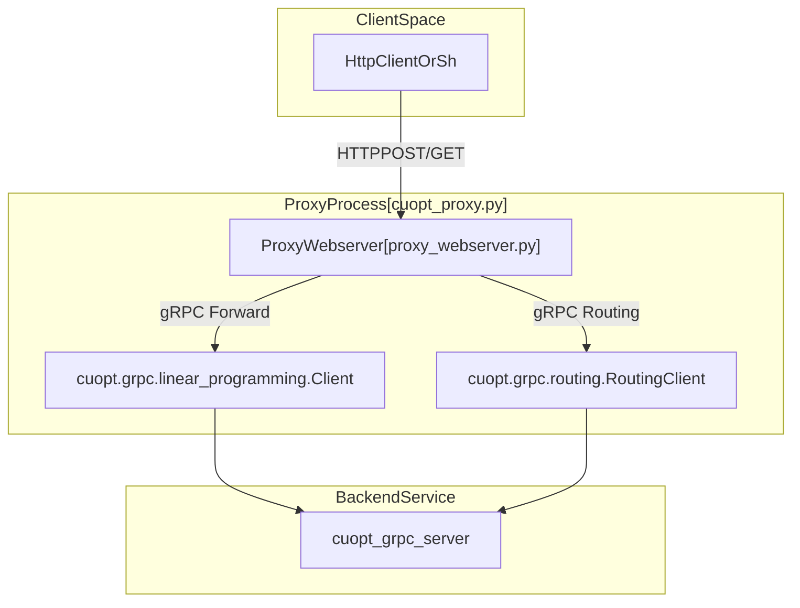
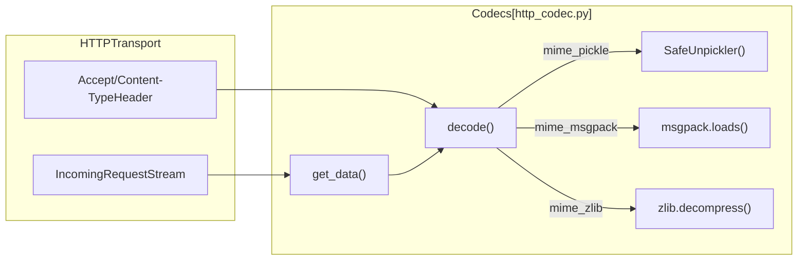
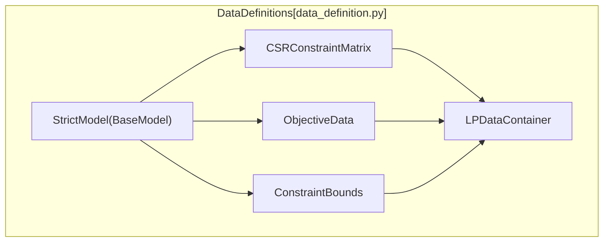
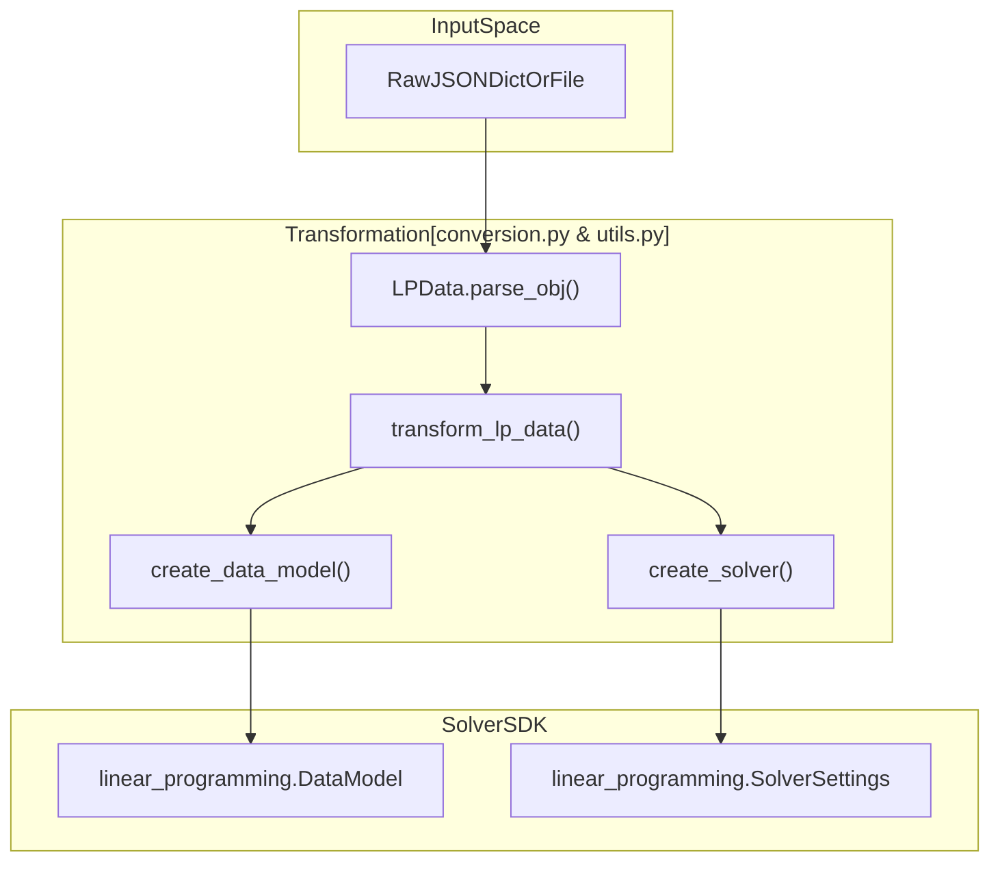

<!-- source: DeepWiki mcp.deepwiki.com · repo NVIDIA/cuopt · page 4.4 HTTP Server API · fetched 2026-10-26 -->

# HTTP Server API

Relevant source files

The following files were used as context for generating this wiki page:

- [cmake/RAPIDS.cmake](cmake/RAPIDS.cmake)
- [cmake/rapids_config.cmake](cmake/rapids_config.cmake)
- [conda/recipes/cuopt/conda_build_config.yaml](conda/recipes/cuopt/conda_build_config.yaml)
- [conda/recipes/libcuopt/conda_build_config.yaml](conda/recipes/libcuopt/conda_build_config.yaml)
- [cpp/doxygen/Doxyfile](cpp/doxygen/Doxyfile)
- [docs/cuopt/source/conf.py](docs/cuopt/source/conf.py)
- [python/cuopt/CMakeLists.txt](python/cuopt/CMakeLists.txt)
- [python/cuopt_server/cuopt_server/__init__.py](python/cuopt_server/cuopt_server/__init__.py)
- [python/cuopt_server/cuopt_server/cuopt_proxy.py](python/cuopt_server/cuopt_server/cuopt_proxy.py)
- [python/cuopt_server/cuopt_server/tests/test_client_version.py](python/cuopt_server/cuopt_server/tests/test_client_version.py)
- [python/cuopt_server/cuopt_server/tests/test_http_codec.py](python/cuopt_server/cuopt_server/tests/test_http_codec.py)
- [python/cuopt_server/cuopt_server/tests/test_lp_conversion.py](python/cuopt_server/cuopt_server/tests/test_lp_conversion.py)
- [python/cuopt_server/cuopt_server/tests/test_lp_data_transformation.py](python/cuopt_server/cuopt_server/tests/test_lp_data_transformation.py)
- [python/cuopt_server/cuopt_server/tests/test_routing_conversion.py](python/cuopt_server/cuopt_server/tests/test_routing_conversion.py)
- [python/cuopt_server/cuopt_server/tests/test_utils_deprecated_boundary.py](python/cuopt_server/cuopt_server/tests/test_utils_deprecated_boundary.py)
- [python/cuopt_server/cuopt_server/utils/client_version.py](python/cuopt_server/cuopt_server/utils/client_version.py)
- [python/cuopt_server/cuopt_server/utils/deprecated/job_queue.py](python/cuopt_server/cuopt_server/utils/deprecated/job_queue.py)
- [python/cuopt_server/cuopt_server/utils/deprecated/linear_programming/solver.py](python/cuopt_server/cuopt_server/utils/deprecated/linear_programming/solver.py)
- [python/cuopt_server/cuopt_server/utils/deprecated/routing/conversion.py](python/cuopt_server/cuopt_server/utils/deprecated/routing/conversion.py)
- [python/cuopt_server/cuopt_server/utils/deprecated/routing/solver.py](python/cuopt_server/cuopt_server/utils/deprecated/routing/solver.py)
- [python/cuopt_server/cuopt_server/utils/deprecated/solver.py](python/cuopt_server/cuopt_server/utils/deprecated/solver.py)
- [python/cuopt_server/cuopt_server/utils/http_codec.py](python/cuopt_server/cuopt_server/utils/http_codec.py)
- [python/cuopt_server/cuopt_server/utils/http_envelope.py](python/cuopt_server/cuopt_server/utils/http_envelope.py)
- [python/cuopt_server/cuopt_server/utils/linear_programming/conversion.py](python/cuopt_server/cuopt_server/utils/linear_programming/conversion.py)
- [python/cuopt_server/cuopt_server/utils/linear_programming/data_definition.py](python/cuopt_server/cuopt_server/utils/linear_programming/data_definition.py)
- [python/cuopt_server/cuopt_server/utils/linear_programming/data_transformation.py](python/cuopt_server/cuopt_server/utils/linear_programming/data_transformation.py)
- [python/cuopt_server/cuopt_server/utils/routing/conversion.py](python/cuopt_server/cuopt_server/utils/routing/conversion.py)
- [python/cuopt_server/cuopt_server/utils/routing/data_definition.py](python/cuopt_server/cuopt_server/utils/routing/data_definition.py)
- [python/cuopt_server/cuopt_server/utils/routing/host_optimization_data_model.py](python/cuopt_server/cuopt_server/utils/routing/host_optimization_data_model.py)
- [python/cuopt_server/cuopt_server/utils/utils.py](python/cuopt_server/cuopt_server/utils/utils.py)
- [python/cuopt_server/cuopt_server/webserver.py](python/cuopt_server/cuopt_server/webserver.py)
- [python/libcuopt/CMakeLists.txt](python/libcuopt/CMakeLists.txt)

## Purpose and Scope

The `cuopt_server` is a FastAPI-based microservice that provides a RESTful HTTP and gRPC-backed proxy interface to NVIDIA cuOpt's optimization engines. It supports Linear Programming (LP), Mixed Integer Linear Programming (MILP), and Vehicle Routing Problems (VRP). The server handles request validation via Pydantic models, multi-format codec streaming (`msgpack`, `zlib`, `json`, `pickle`), and asynchronous job dispatching or direct gRPC forwarding.

Key components documented in this section include:
*   **FastAPI Microservice & Endpoints**: REST routes for problem submission, solution retrieval, warm starting, and health checks [python/cuopt_server/cuopt_server/webserver.py:114-183]().
*   **HTTP Codecs**: Flexible content negotiation and buffer streaming supporting `application/json`, `application/vnd.msgpack`, `application/zlib`, and `application/octet-stream` [python/cuopt_server/cuopt_server/utils/http_codec.py:27-143]().
*   **Pydantic Data Definitions**: Strict schema enforcement for sparse matrices (`CSRConstraintMatrix`), objective functions, constraint/variable bounds, and solver configurations [python/cuopt_server/cuopt_server/utils/linear_programming/data_definition.py:18-140]().
*   **Conversion Utilities**: Translation layers mapping HTTP DTOs into cuOpt Python SDK `DataModel` and `SolverSettings` objects [python/cuopt_server/cuopt_server/utils/linear_programming/conversion.py:25-151]().
*   **gRPC Proxy Architecture**: The `cuopt_proxy` service bridging HTTP clients directly to `cuopt_grpc_server` workers [python/cuopt_server/cuopt_server/cuopt_proxy.py:4-8]().

**Sources:** [python/cuopt_server/cuopt_server/webserver.py:114-183](), [python/cuopt_server/cuopt_server/utils/http_codec.py:27-143](), [python/cuopt_server/cuopt_server/utils/linear_programming/data_definition.py:18-140](), [python/cuopt_server/cuopt_server/utils/linear_programming/conversion.py:25-151](), [python/cuopt_server/cuopt_server/cuopt_proxy.py:4-8]()

## System Architecture and gRPC Proxy

The server architecture supports both self-hosted multi-process job queues and lightweight gRPC-backed HTTP proxying (`cuopt_proxy.py`), which forwards incoming REST requests directly to `cuopt_grpc_server`.

Title: "cuOpt HTTP Proxy and Server Flow"

**Sources:** [python/cuopt_server/cuopt_server/cuopt_proxy.py:4-8](), [python/cuopt_server/cuopt_proxy.py:191-218]()

## REST API Endpoints and FastAPI Microservice

The FastAPI application (`webserver.py`) defines endpoints for server health checks, optimization problem submission, log retrieval, and warm-start management.

### Core Endpoints Table

| Endpoint | Method | Description | Source Reference |
| :--- | :--- | :--- | :--- |
| `/`, `/cuopt/health`, `/v2/health/ready`, `/v2/health/live` | `GET` | Health and readiness check returning server status and version. | [python/cuopt_server/cuopt_server/webserver.py:149-183]() |
| `/cuopt/log/{id}` | `GET` | Query solver execution logs by request UUID (self-hosted). | [python/cuopt_server/cuopt_server/webserver.py:218-238]() |
| `/cuopt/request` | `POST` | Submit an optimization request (LP/MILP/VRP). | [python/cuopt_server/cuopt_server/webserver.py:433-450]() |
| `/cuopt/solution/{reqId}` | `GET` | Retrieve solution status and results for a job ID. | [python/cuopt_server/cuopt_server/webserver.py:488-510]() |
| `/cuopt/solution/{reqId}/warmstart` | `GET` | Retrieve PDLP warm-start data for a completed job. | [python/cuopt_server/cuopt_server/webserver.py:537-543]() |

**Sources:** [python/cuopt_server/cuopt_server/webserver.py:114-183](), [python/cuopt_server/cuopt_server/webserver.py:218-238]()

## Data Serialization, Codecs, and MIME Types

The `http_codec.py` module manages content types, payload decoding, buffer streaming, and serialization across HTTP entry points.

### Supported MIME Types and Codecs

*   `application/json` (`mime_json`): Standard JSON serialization [python/cuopt_server/cuopt_server/utils/http_codec.py:27]().
*   `application/vnd.msgpack` (`mime_msgpack`): MessagePack binary serialization with NumPy array patching via `msgpack_numpy` [python/cuopt_server/cuopt_server/utils/http_codec.py:24](), [python/cuopt_server/cuopt_server/utils/http_codec.py:28]().
*   `application/zlib` (`mime_zlib`): Zlib-compressed JSON payloads [python/cuopt_server/cuopt_server/utils/http_codec.py:29]().
*   `application/octet-stream` (`mime_pickle`): Python pickle deserialized securely via `SafeUnpickler` restricting classes to `numpy.ndarray` and `numpy.core.multiarray._reconstruct` [python/cuopt_server/cuopt_server/utils/http_codec.py:30](), [python/cuopt_server/cuopt_server/utils/http_codec.py:38-70]().

Title: "HTTP Codec and Serialization Pipeline"

**Sources:** [python/cuopt_server/cuopt_server/utils/http_codec.py:24-113](), [python/cuopt_server/cuopt_server/utils/http_codec.py:116-143]()

## Pydantic Data Definitions and Schema Validation

Problem inputs are validated against strict Pydantic models inheriting from `StrictModel` (which forbids extra attributes) (`data_definition.py`).

### Key Data Structures

*   `CSRConstraintMatrix`: Encapsulates sparse constraint matrices using compressed sparse row format with `indices`, `offsets`, and `values` arrays validated by `listint` and `listfloat` validators [python/cuopt_server/cuopt_server/utils/linear_programming/data_definition.py:18-140]().
*   `ObjectiveData`: Specifies objective coefficients `c`, scalability factors, and function offsets [python/cuopt_server/cuopt_server/utils/linear_programming/data_definition.py:142-174]().
*   `ConstraintBounds`: Defines right-hand side `bounds`, upper bounds, lower bounds, and row types supporting numeric values and infinity literals (`inf`, `ninf`) [python/cuopt_server/cuopt_server/utils/linear_programming/data_definition.py:176-240]().

Title: "Pydantic Model Structure"

**Sources:** [python/cuopt_server/cuopt_server/utils/linear_programming/data_definition.py:18-240]()

## Conversion Utilities and Solver Translation

The `conversion.py` and `utils.py` modules translate validated Pydantic models into native Python SDK `DataModel` and `SolverSettings` instances.

### Translation Functions

*   `create_data_model(LP_data)`: Populates a `linear_programming.DataModel` instance from `LPData`, setting CSR constraint matrices, objective coefficients, bounds, variable types, and initial primal/dual solutions [python/cuopt_server/cuopt_server/utils/linear_programming/conversion.py:25-87]().
*   `create_solver(LP_data, warmstart_data)`: Configures `linear_programming.SolverSettings`, parsing tolerances, limits (`time_limit`, `iteration_limit`), and attaching PDLP warm-start data (`pdlp_from_http_warmstart`) [python/cuopt_server/cuopt_server/utils/linear_programming/conversion.py:90-151]().
*   `build_lp_datamodel_from_json(data)`: Parses raw JSON or file dictionaries into validated `LPData`, applies data transformations, and returns the constructed `DataModel` and `SolverSettings` [python/cuopt_server/cuopt_server/utils/utils.py:59-85]().

Title: "Conversion Pipeline"

**Sources:** [python/cuopt_server/cuopt_server/utils/linear_programming/conversion.py:25-151](), [python/cuopt_server/cuopt_server/utils/utils.py:59-85](), [python/cuopt_server/cuopt_server/tests/test_lp_conversion.py:36-69]()

## Configuration Parameters

Server behavior is configured via environment variables and command-line arguments in `cuopt_proxy.py` and `cuopt_service.py`:

| Environment Variable | CLI Flag / Option | Default | Description |
| :--- | :--- | :--- | :--- |
| `CUOPT_SERVER_IP` | `-i`, `--ip` | `0.0.0.0` | Bind IP address for the HTTP service. | [python/cuopt_server/cuopt_server/cuopt_proxy.py:36-73]() |
| `CUOPT_SERVER_PORT` | `-p`, `--port` | `5000` | Port for the HTTP service. | [python/cuopt_server/cuopt_server/cuopt_proxy.py:37-79]() |
| `CUOPT_GRPC_HOST` | `--grpc-host` | `127.0.0.1` | Host address of `cuopt_grpc_server`. | [python/cuopt_server/cuopt_proxy.py:38-86]() |
| `CUOPT_GRPC_PORT` | `--grpc-port` | `5001` | Port of `cuopt_grpc_server`. | [python/cuopt_server/cuopt_proxy.py:39-91]() |
| `CUOPT_SERVER_LOG_LEVEL`| `-l`, `--log-level` | `info` | Logging verbosity (`critical`, `error`, `warning`, `info`, `debug`). | [python/cuopt_server/cuopt_proxy.py:40-99]() |
| `CUOPT_DATA_DIR` | `-d`, `--data-dir` | `""` | Directory for file-based input uploads. | [python/cuopt_server/cuopt_proxy.py:42-113]() |
| `CUOPT_MAX_REQUEST_SIZE`| `--max-request-size`| `1GB` | Maximum HTTP request body size in bytes. | [python/cuopt_server/cuopt_proxy.py:45-133]() |

**Sources:** [python/cuopt_server/cuopt_server/cuopt_proxy.py:30-156]()

---

