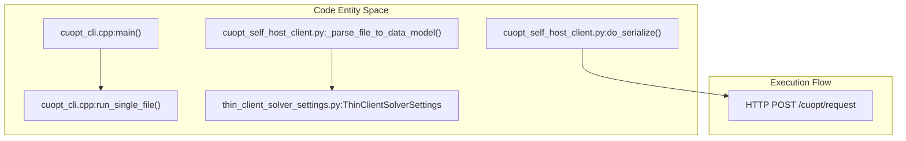
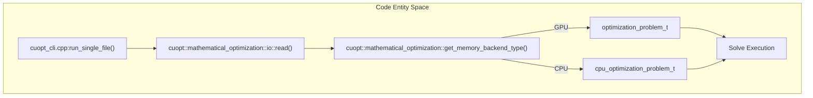

<!-- source: DeepWiki mcp.deepwiki.com · repo NVIDIA/cuopt · page 4.5 Command Line and Thin Clients · fetched 2026-10-26 -->

# Command Line and Thin Clients

Relevant source files

The following files were used as context for generating this wiki page:

- [cpp/cuopt_cli.cpp](cpp/cuopt_cli.cpp)
- [cpp/include/cuopt/mathematical_optimization/solve_remote.hpp](cpp/include/cuopt/mathematical_optimization/solve_remote.hpp)
- [cpp/src/grpc/client/grpc_client.cpp](cpp/src/grpc/client/grpc_client.cpp)
- [cpp/src/grpc/client/grpc_client.hpp](cpp/src/grpc/client/grpc_client.hpp)
- [cpp/src/grpc/client/solve_remote.cpp](cpp/src/grpc/client/solve_remote.cpp)
- [cpp/src/grpc/grpc_service_mapper.cpp](cpp/src/grpc/grpc_service_mapper.cpp)
- [cpp/src/grpc/grpc_service_mapper.hpp](cpp/src/grpc/grpc_service_mapper.hpp)
- [cpp/src/grpc/grpc_settings_mapper.cpp](cpp/src/grpc/grpc_settings_mapper.cpp)
- [cpp/src/grpc/grpc_settings_mapper.hpp](cpp/src/grpc/grpc_settings_mapper.hpp)
- [cpp/tests/linear_programming/grpc/grpc_client_test.cpp](cpp/tests/linear_programming/grpc/grpc_client_test.cpp)
- [python/cuopt_self_hosted/cuopt_sh_client/cuopt_self_host_client.py](python/cuopt_self_hosted/cuopt_sh_client/cuopt_self_host_client.py)
- [python/cuopt_self_hosted/cuopt_sh_client/cuopt_sh.py](python/cuopt_self_hosted/cuopt_sh_client/cuopt_sh.py)
- [python/cuopt_self_hosted/cuopt_sh_client/thin_client_solver_settings.py](python/cuopt_self_hosted/cuopt_sh_client/thin_client_solver_settings.py)
- [python/cuopt_server/cuopt_server/cuopt_service.py](python/cuopt_server/cuopt_server/cuopt_service.py)
- [python/cuopt_server/cuopt_server/tests/test_lp.py](python/cuopt_server/cuopt_server/tests/test_lp.py)
- [python/cuopt_server/cuopt_server/utils/deprecated/health_check.py](python/cuopt_server/cuopt_server/utils/deprecated/health_check.py)
- [python/cuopt_server/cuopt_server/utils/deprecated/process_handler.py](python/cuopt_server/cuopt_server/utils/deprecated/process_handler.py)
- [python/cuopt_server/cuopt_server/utils/deprecated/request_filter.py](python/cuopt_server/cuopt_server/utils/deprecated/request_filter.py)

The Command Line Interface (CLI) and thin client components provide terminal and remote integration mechanisms for solving optimization problems without writing native C++ or direct API orchestration code. This page details `cuopt_cli` (the C++ LP/MILP solver executable), `cuopt_sh` (the self-hosted client infrastructure), thin client solver configuration structures, and serialization pipelines.

---

## 1. Overview of CLI and Thin Client Infrastructure

cuOpt offers two distinct execution wrappers for terminal and thin client workflows:
1. **`cuopt_cli`**: A C++ executable utilizing `argparse` to parse MPS, QPS, or LP files, configure solver settings, and invoke the native solver backends (`cuopt::mathematical_optimization::optimization_problem_t` or `cpu_optimization_problem_t`) [cpp/cuopt_cli.cpp:37-47]().
2. **`cuopt_sh`**: A Python-based client (`cuopt_self_host_client.py`) that serializes optimization payloads via `msgpack`, `pickle`, or `zlib` and dispatches them to a self-hosted `cuopt_server` instance via HTTP/REST [python/cuopt_self_hosted/cuopt_sh_client/cuopt_self_host_client.py:43-62]().

Sources: [cpp/cuopt_cli.cpp:37-47](), [python/cuopt_self_hosted/cuopt_sh_client/cuopt_self_host_client.py:43-62]()

---

## 2. C++ Command-Line Solver (`cuopt_cli`)

`cuopt_cli` acts as a direct interface to the cuOpt mathematical optimization libraries [cpp/cuopt_cli.cpp:37-41](). It handles automatic file-extension dispatch, memory backend selection, and argument mapping.

### Execution Pipeline and File Dispatch

Input files are dispatched by extension inside `run_single_file` [cpp/cuopt_cli.cpp:98-103]():
* `.lp`, `.lp.gz`, `.lp.bz2`: Routed to the LP parser.
* `.mps`, `.qps`, and compressed variants: Routed to the MPS parser (`cuopt::mathematical_optimization::io::read`) [cpp/cuopt_cli.cpp:121-124]().

Sources: [cpp/cuopt_cli.cpp:98-151]()

### CUDA Module Loading Optimization
When running multi-GPU or concurrent solver tasks, `cuopt_cli` enforces `CUDA_MODULE_LOADING=EAGER` to load required kernels during initialization, avoiding runtime latency spikes [cpp/cuopt_cli.cpp:36-36]().

Sources: [cpp/cuopt_cli.cpp:36-36]()

---

## 3. Self-Hosted Thin Client (`cuopt_sh`)

The self-hosted client (`cuopt_self_host_client.py`) manages client-side payload serialization, file parsing, and communication with self-hosted REST services [python/cuopt_self_hosted/cuopt_sh_client/cuopt_self_host_client.py:43-62]().

### Serialization and Codec Selection
Depending on environment variables (`CUOPT_PREFER_PICKLE` and `CUOPT_USE_ZLIB`), `do_serialize()` determines the serialization format [python/cuopt_self_hosted/cuopt_sh_client/cuopt_self_host_client.py:43-62]():

| Environment Variable | Condition | Serialization Method | MIME Type |
| :--- | :--- | :--- | :--- |
| `CUOPT_USE_ZLIB=True` | `use_zlib == True` | `zlib.compress(json.dumps(data))` | `application/zlib` |
| `CUOPT_PREFER_PICKLE=True` | `pickle_first == True` | `pickle.dumps` (fallback to `msgpack`) | `application/octet-stream` |
| Default | `pickle_first == False` | `msgpack.dumps` (fallback to `pickle`) | `application/vnd.msgpack` |

Sources: [python/cuopt_self_hosted/cuopt_sh_client/cuopt_self_host_client.py:43-85]()

---

## 4. Thin Client Solver Settings

Thin clients configure optimization jobs using `ThinClientSolverSettings` and associated enumeration types defined in `thin_client_solver_settings.py` [python/cuopt_self_hosted/cuopt_sh_client/thin_client_solver_settings.py:10-71]().

### Solver Methods and Modes
* **`SolverMethod`**: Specifies the algorithm (`Concurrent = 0`, `PDLP`, `DualSimplex`, `Barrier`, `PrimalSimplex`) [python/cuopt_self_hosted/cuopt_sh_client/thin_client_solver_settings.py:10-20]().
* **`PDLPSolverMode`**: Controls PDLP parameter profiles (`Stable1`, `Stable2`, `Methodical1`, `Fast1`, `Stable3`) [python/cuopt_self_hosted/cuopt_sh_client/thin_client_solver_settings.py:34-59]().

### Parameter Dictionary Mapping
The `ThinClientSolverSettings.toDict()` method separates tolerances into a nested dictionary structure while keeping general solver configurations at the root [python/cuopt_self_hosted/cuopt_sh_client/thin_client_solver_settings.py:152-183]().

Sources: [python/cuopt_self_hosted/cuopt_sh_client/thin_client_solver_settings.py:10-183]()

---

