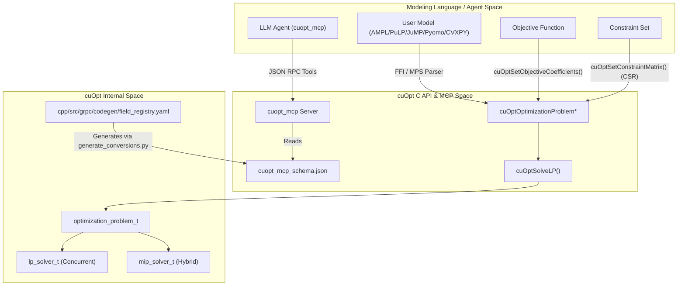
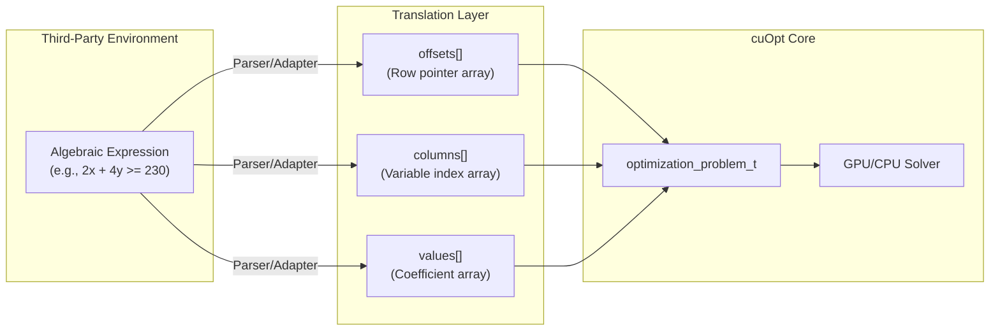
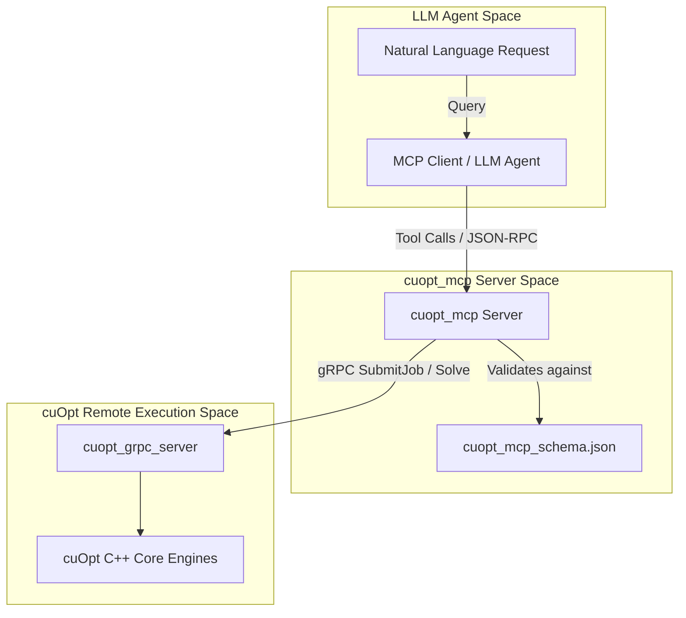

<!-- source: DeepWiki mcp.deepwiki.com · repo NVIDIA/cuopt · page 4.7 Third-Party Integrations and MCP Server · fetched 2026-10-26 -->

# Third-Party Integrations and MCP Server

Relevant source files

The following files were used as context for generating this wiki page:

- [ci/thirdparty-testing/run_cvxpy_tests.sh](ci/thirdparty-testing/run_cvxpy_tests.sh)
- [ci/thirdparty-testing/run_pulp_tests.sh](ci/thirdparty-testing/run_pulp_tests.sh)
- [ci/thirdparty-testing/run_pyomo_tests.sh](ci/thirdparty-testing/run_pyomo_tests.sh)
- [cpp/include/cuopt/mathematical_optimization/pdlp/solver_solution.hpp](cpp/include/cuopt/mathematical_optimization/pdlp/solver_solution.hpp)
- [cpp/src/grpc/codegen/FIELD_REGISTRY_REFERENCE.md](cpp/src/grpc/codegen/FIELD_REGISTRY_REFERENCE.md)
- [cpp/src/grpc/codegen/field_registry.yaml](cpp/src/grpc/codegen/field_registry.yaml)
- [cpp/src/grpc/codegen/generate_conversions.py](cpp/src/grpc/codegen/generate_conversions.py)
- [cpp/src/grpc/codegen/generated/cuopt_mcp_schema.json](cpp/src/grpc/codegen/generated/cuopt_mcp_schema.json)
- [cpp/src/grpc/codegen/generated/cuopt_remote_data.proto](cpp/src/grpc/codegen/generated/cuopt_remote_data.proto)
- [cpp/src/grpc/codegen/generated/generated_enum_converters_settings.inc](cpp/src/grpc/codegen/generated/generated_enum_converters_settings.inc)
- [cpp/tests/linear_programming/unit_tests/pdlp_memory_test.cu](cpp/tests/linear_programming/unit_tests/pdlp_memory_test.cu)
- [docs/cuopt/source/convex-features.rst](docs/cuopt/source/convex-features.rst)
- [docs/cuopt/source/cuopt-c/mip/index.rst](docs/cuopt/source/cuopt-c/mip/index.rst)
- [docs/cuopt/source/cuopt-cli/index.rst](docs/cuopt/source/cuopt-cli/index.rst)
- [docs/cuopt/source/cuopt-python/index.rst](docs/cuopt/source/cuopt-python/index.rst)
- [docs/cuopt/source/cuopt-python/mip/index.rst](docs/cuopt/source/cuopt-python/mip/index.rst)
- [docs/cuopt/source/introduction.rst](docs/cuopt/source/introduction.rst)
- [docs/cuopt/source/milp-features.rst](docs/cuopt/source/milp-features.rst)
- [docs/cuopt/source/mip-settings.rst](docs/cuopt/source/mip-settings.rst)
- [docs/cuopt/source/thirdparty_modeling_languages/index.rst](docs/cuopt/source/thirdparty_modeling_languages/index.rst)
- [python/cuopt_mcp/tests/test_schema.py](python/cuopt_mcp/tests/test_schema.py)

## Purpose and Scope

NVIDIA cuOpt provides integrations with leading mathematical modeling languages, allowing users to leverage GPU-accelerated optimization within existing workflows. These integrations target **Linear Programming (LP)**, **Mixed-Integer Linear Programming (MILP)**, **Quadratic Programming (QP)**, and **Second-Order Cone Programming (SOCP)** problems, enabling a "near-zero code change" experience where cuOpt acts as a drop-in replacement for traditional CPU-based solvers.

Additionally, cuOpt features the `cuopt_mcp` Model Context Protocol (MCP) server, which exposes cuOpt solver capabilities and parameter schemas directly to Large Language Model (LLM) agents, enabling natural language problem formulation and automated solver tuning.

**Key capabilities supported via integrations:**
- **LP/QP/SOCP Solving**: Concurrent execution of PDLP (GPU), Barrier (GPU with cuDSS/cuSparse), and Dual Simplex (CPU). [docs/cuopt/source/introduction.rst:69-78](), [docs/cuopt/source/thirdparty_modeling_languages/index.rst:39-42]()
- **MILP Solving**: Hybrid GPU primal heuristics (Feasibility Pump/Jump) combined with CPU Branch-and-Bound. [docs/cuopt/source/introduction.rst:102-105]()
- **LLM Agent Integration (`cuopt_mcp`)**: Schema-driven tool exposition via JSON Schema generated from `field_registry.yaml`. [cpp/src/grpc/codegen/field_registry.yaml:1-45](), [cpp/src/grpc/codegen/generated/cuopt_mcp_schema.json:1-12]()

Sources: [docs/cuopt/source/introduction.rst:1-121](), [docs/cuopt/source/milp-features.rst:1-24](), [docs/cuopt/source/thirdparty_modeling_languages/index.rst:1-42]()

---

## Integration Architecture

The integration layer bridges high-level algebraic modeling languages and agent frameworks to the cuOpt C++ core via the C API (`cuopt_c.h`) or gRPC services.

### System Entity Mapping

The following diagram maps modeling language concepts and agent tools to specific code entities within the cuOpt repository.

**Diagram: Natural Language and Modeling Space to Code Entity Space**

Sources: [cpp/src/grpc/codegen/field_registry.yaml:1-45](), [cpp/src/grpc/codegen/generated/cuopt_mcp_schema.json:1-12](), [cpp/src/grpc/codegen/generate_conversions.py:1-17](), [docs/cuopt/source/thirdparty_modeling_languages/index.rst:1-42]()

---

## Supported Modeling Languages

### AMPL
AMPL users can switch to cuOpt by modifying the `solver` option. The integration supports both LP and MILP. [docs/cuopt/source/thirdparty_modeling_languages/index.rst:7-10]()
- **Configuration**: `option solver cuopt;`
- **Data Flow**: AMPL communicates with cuOpt via the NL interface or by generating an MPS file ingested by the parser. [docs/cuopt/source/thirdparty_modeling_languages/index.rst:7-10]()

### GAMS and GAMSPy
GAMS requires a specific solver link built using `cuoptlink-builder`. [docs/cuopt/source/thirdparty_modeling_languages/index.rst:13-16]()
- **Usage**: `gams model_name lp=cuopt` [docs/cuopt/source/thirdparty_modeling_languages/index.rst:13-16]()
- **Implementation**: Translates GAMS GDX structures into `optimization_problem_t` CSR format. [docs/cuopt/source/thirdparty_modeling_languages/index.rst:13-16]()

### PuLP (Python)
PuLP interfaces with cuOpt as an external solver. Tested via nightly CI scripts (`ci/thirdparty-testing/run_pulp_tests.sh`). [ci/thirdparty-testing/run_pulp_tests.sh:1-65](), [docs/cuopt/source/thirdparty_modeling_languages/index.rst:19-23]()
- **Usage**: `prob.solve(CUOPT())` [docs/cuopt/source/thirdparty_modeling_languages/index.rst:19-23]()
- **Data Flow**: Exports model to MPS format and solves via `cuopt_cli` or C API. [docs/cuopt/source/thirdparty_modeling_languages/index.rst:19-23]()

### Pyomo (Python)
Pyomo provides a direct solver wrapper (`cuopt_direct`) tested in CI (`ci/thirdparty-testing/run_pyomo_tests.sh`). [ci/thirdparty-testing/run_pyomo_tests.sh:1-51](), [docs/cuopt/source/thirdparty_modeling_languages/index.rst:33-37]()
- **Usage**: `SolverFactory('cuopt_direct')` [docs/cuopt/source/thirdparty_modeling_languages/index.rst:33-37]()

### CVXPY (Python)
CVXPY supports cuOpt for linear, quadratic, and conic (QCQP/SOCP) optimization problems, validated through `ci/thirdparty-testing/run_cvxpy_tests.sh`. [ci/thirdparty-testing/run_cvxpy_tests.sh:1-75](), [docs/cuopt/source/thirdparty_modeling_languages/index.rst:39-42]()
- **Usage**: `problem.solve(solver=cvxpy.CUOPT)` [docs/cuopt/source/thirdparty_modeling_languages/index.rst:39-42]()

### JuMP (Julia)
JuMP uses the `cuOpt.jl` package implementing the MathOptInterface (MOI) standard. [docs/cuopt/source/thirdparty_modeling_languages/index.rst:26-30]()
- **Usage**: `Model(cuOpt.Optimizer)` [docs/cuopt/source/thirdparty_modeling_languages/index.rst:26-30]()

Sources: [ci/thirdparty-testing/run_pulp_tests.sh:1-65](), [ci/thirdparty-testing/run_pyomo_tests.sh:1-51](), [ci/thirdparty-testing/run_cvxpy_tests.sh:1-75](), [docs/cuopt/source/thirdparty_modeling_languages/index.rst:1-42]()

---

## Technical Implementation: Data Translation

The primary challenge in third-party integration is converting algebraic expressions into the **Compressed Sparse Row (CSR)** format and constraint bounds used by cuOpt. [docs/cuopt/source/milp-features.rst:34-62]()

### Data Flow Diagram: Matrix Translation

**Diagram: CSR Data Flow for Integrations**

Sources: [docs/cuopt/source/milp-features.rst:34-62](), [cpp/tests/linear_programming/unit_tests/pdlp_memory_test.cu:31-46]()

---

## Model Context Protocol (MCP) Server (`cuopt_mcp`)

The `cuopt_mcp` package is a Model Context Protocol server that exposes cuOpt optimization tools, solvers, and parameter schemas to LLM agents. 

### Schema Generation Pipeline
The MCP server relies on `cuopt_mcp_schema.json`, which is auto-generated from `cpp/src/grpc/codegen/field_registry.yaml` via `cpp/src/grpc/codegen/generate_conversions.py`. [cpp/src/grpc/codegen/field_registry.yaml:1-45](), [cpp/src/grpc/codegen/generated/cuopt_mcp_schema.json:1-12](), [cpp/src/grpc/codegen/generate_conversions.py:1-17]()

Each field entry in `field_registry.yaml` can specify an `description`, `default`, and `param_name` (emitted as `x-parameter-name` in JSON Schema), which instructs LLM agents on how to construct solver payloads and configure parameters like `pdlp_solver_mode`, `time_limit`, and tolerances. [cpp/src/grpc/codegen/field_registry.yaml:38-67](), [cpp/src/grpc/codegen/generated/cuopt_mcp_schema.json:10-80]()

### MCP Server Architecture

**Diagram: LLM Agent to cuOpt MCP Server Data Flow**

Sources: [cpp/src/grpc/codegen/field_registry.yaml:38-67](), [cpp/src/grpc/codegen/generated/cuopt_mcp_schema.json:1-120](), [cpp/src/grpc/codegen/generate_conversions.py:1-17]()

---

