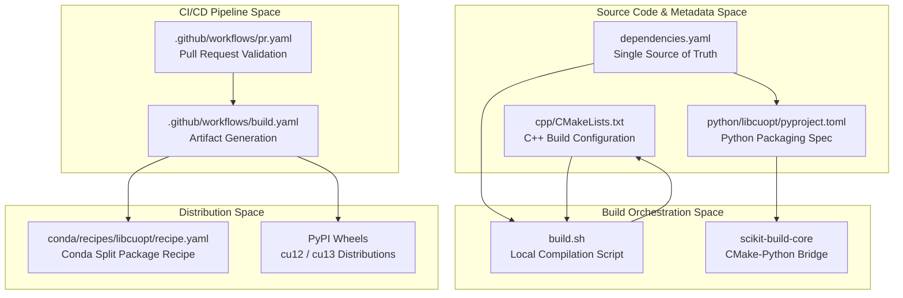
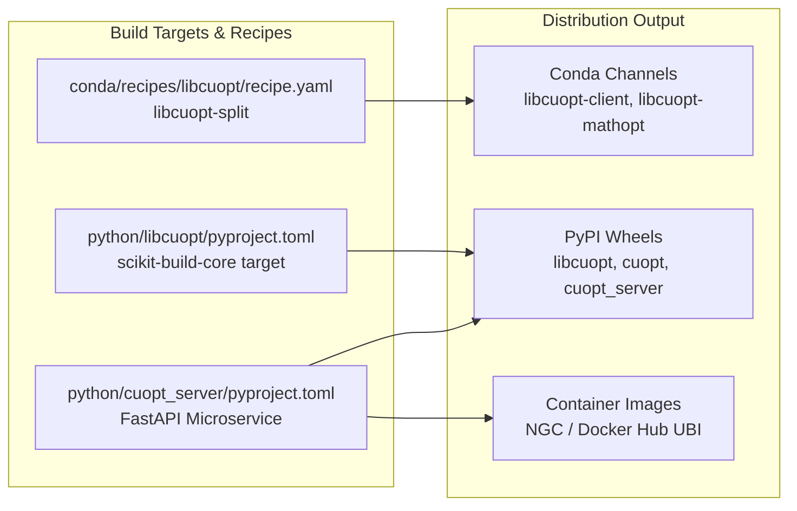

<!-- source: DeepWiki mcp.deepwiki.com · repo NVIDIA/cuopt · page 5 Build and Distribution · fetched 2026-10-26 -->

# Build and Distribution

Relevant source files

The following files were used as context for generating this wiki page:

- [CONTRIBUTING.md](CONTRIBUTING.md)
- [build.sh](build.sh)
- [conda/environments/all_cuda-129_arch-aarch64.yaml](conda/environments/all_cuda-129_arch-aarch64.yaml)
- [conda/environments/all_cuda-129_arch-x86_64.yaml](conda/environments/all_cuda-129_arch-x86_64.yaml)
- [conda/environments/all_cuda-133_arch-aarch64.yaml](conda/environments/all_cuda-133_arch-aarch64.yaml)
- [conda/environments/all_cuda-133_arch-x86_64.yaml](conda/environments/all_cuda-133_arch-x86_64.yaml)
- [conda/recipes/cuopt-server/recipe.yaml](conda/recipes/cuopt-server/recipe.yaml)
- [conda/recipes/cuopt-sh-client/recipe.yaml](conda/recipes/cuopt-sh-client/recipe.yaml)
- [conda/recipes/cuopt/recipe.yaml](conda/recipes/cuopt/recipe.yaml)
- [conda/recipes/libcuopt/recipe.yaml](conda/recipes/libcuopt/recipe.yaml)
- [cpp/CMakeLists.txt](cpp/CMakeLists.txt)
- [cpp/src/mip_heuristics/feasibility_jump/fj_types.hpp](cpp/src/mip_heuristics/feasibility_jump/fj_types.hpp)
- [cpp/src/mip_heuristics/feasibility_jump/load_balancing.cuh](cpp/src/mip_heuristics/feasibility_jump/load_balancing.cuh)
- [cpp/tests/CMakeLists.txt](cpp/tests/CMakeLists.txt)
- [cpp/tests/examples/routing/CMakeLists.txt](cpp/tests/examples/routing/CMakeLists.txt)
- [cpp/tests/linear_programming/CMakeLists.txt](cpp/tests/linear_programming/CMakeLists.txt)
- [cpp/tests/linear_programming/unit_tests/lp_solution_test.cu](cpp/tests/linear_programming/unit_tests/lp_solution_test.cu)
- [dependencies.yaml](dependencies.yaml)
- [python/cuopt/pyproject.toml](python/cuopt/pyproject.toml)
- [python/cuopt_self_hosted/pyproject.toml](python/cuopt_self_hosted/pyproject.toml)
- [python/cuopt_server/pyproject.toml](python/cuopt_server/pyproject.toml)
- [python/libcuopt/pyproject.toml](python/libcuopt/pyproject.toml)

This document describes the build system, dependency management, CI/CD pipelines, package distribution mechanisms, documentation generation, and version control procedures for NVIDIA cuOpt. It covers how C++ libraries and Python packages are compiled, tested, and published across multiple platforms, architectures, and CUDA versions.

For information about the runtime architecture of built packages, see [Package Architecture](#1.2). For end-user installation guides, see [Installation and Getting Started](#1.1).

## Overview

cuOpt utilizes a multi-layered build system that compiles core C++ engines (`libcuopt-client`, `libcuopt-mathopt`, `libcuopt-routing`) [conda/recipes/libcuopt/recipe.yaml:107-164]() and Python packages (`cuopt`, `cuopt_server`, `cuopt_sh_client`) [build.sh:24-26](). The build process supports multiple CUDA runtimes (e.g., CUDA 12.x and 13.x) [dependencies.yaml:10](), Python versions (3.11-3.14) [python/libcuopt/pyproject.toml:27-30](), and target CPU architectures (`x86_64`, `aarch64`) [dependencies.yaml:11](). All dependency versions are centrally declared in `dependencies.yaml` [dependencies.yaml:1-4]() and translated via `rapids-dependency-file-generator` into environment files and `pyproject.toml` configurations. The `build.sh` script orchestrates local compilation [build.sh:14-64](), while GitHub Actions workflows automate continuous integration, testing, and distribution.

### System Mapping: Build Components to Code Entities

The following diagram bridges natural language build concepts to specific files and scripts within the codebase.

**Sources:** [cpp/CMakeLists.txt:1-51](), [dependencies.yaml:1-25](), [build.sh:1-60](), [python/libcuopt/pyproject.toml:1-40](), [conda/recipes/libcuopt/recipe.yaml:1-120]()

---

## 5.1. Build System

The cuOpt build system combines CMake for C++ libraries and `scikit-build-core` for Python extensions. The `cpp/CMakeLists.txt` file defines object libraries for client components, mathopt (LP/MIP), and routing [cpp/CMakeLists.txt:51-56](). The top-level `build.sh` script coordinates environment setup, compiler flags, and target generation [build.sh:1-64](). 

Third-party dependencies are integrated via RAPIDS CMake extensions and CPM package management [cpp/CMakeLists.txt:16-19](). GPU architecture selection is handled automatically through `rapids_cuda_init_architectures(CUOPT)` [cpp/CMakeLists.txt:21](), supporting target options such as `--allgpuarch` and `--ci-only-arch` [build.sh:54-55]().

For deep technical details on the CMake structure, compilation flags, and custom build targets, see [Build System](#5.1).

**Sources:** [cpp/CMakeLists.txt:16-56](), [build.sh:14-64]()

---

## 5.2. Dependency Management

Dependency management is centralized around `dependencies.yaml`, which serves as the single source of truth for all C++, Python, and testing requirements [dependencies.yaml:1-15](). The file is parsed by `rapids-dependency-file-generator` to produce conda environment specifications (e.g., `conda/environments/all_cuda-129_arch-x86_64.yaml`) and dynamic `pyproject.toml` entries [python/libcuopt/pyproject.toml:5-10]().

The system manages version constraints, CUDA-suffixed package routing (separating core dependencies from mathopt-specific accelerated libraries like cuDSS and NCCL), and matrix-based conditional dependencies across different target platforms [conda/recipes/libcuopt/recipe.yaml:149-164]().

For detailed information on dependency generation and constraint handling, see [Dependency Management](#5.2).

**Sources:** [dependencies.yaml:1-40](), [python/libcuopt/pyproject.toml:5-10](), [conda/recipes/libcuopt/recipe.yaml:149-164](), [conda/environments/all_cuda-129_arch-x86_64.yaml:1-25]()

---

## 5.3. CI/CD Workflows

Continuous integration and delivery are implemented via GitHub Actions workflows and shell scripts located in `ci/`. The pipeline uses matrix strategies to validate pull requests across multiple CUDA versions, operating systems, and architectures.

Workflows execute automated builds, GTest-based C++ unit tests, pytest-based Python test suites, and style/lint checks (including SonarQube integrations and pre-commit hooks). Nightly runs ensure ongoing compatibility with upstream RAPIDS libraries and nightly CUDA toolchains.

For complete documentation on workflow definitions, build scripts, and test triggers, see [CI/CD Workflows](#5.3).

**Sources:** [CONTRIBUTING.md:70-84](), [build.sh:1-64]()

---

## 5.4. Package Distribution and Deployment

cuOpt distributes its components through multiple packaging channels to support diverse deployment scenarios. Split C++ libraries and Python bindings are packaged as PyPI wheels with CUDA-specific tags (e.g., `cu12`, `cu13`) and as modular Conda packages via recipes in `conda/recipes/` [conda/recipes/libcuopt/recipe.yaml:15-122]().

In addition to Python packages, the distribution pipeline builds Docker and Red Hat UBI container images with multi-architecture manifests, Helm charts, and deployment configurations for the NVIDIA NIM Operator.

### Distribution Entity Mapping

The following diagram maps cuOpt build output directories and package recipes to their respective distribution formats.

For detailed instructions on packaging, container builds, and deployment options, see [Package Distribution and Deployment](#5.4).

**Sources:** [conda/recipes/libcuopt/recipe.yaml:1-122](), [python/libcuopt/pyproject.toml:1-50](), [python/cuopt_server/pyproject.toml:1-40]()

---

## 5.5. Documentation Generation

Documentation is generated using Sphinx and hosted as part of the official RAPIDS documentation suite. The documentation source layout under `docs/cuopt/` includes Sphinx configuration (`conf.py`), Markdown/reStructuredText pages, and API references extracted from C++ sources via Doxygen and Breathe.

The documentation pipeline also validates code examples and notebooks during test runs, and maintains version switcher JSON configurations for historical documentation versions.

For details on building and configuring documentation, see [Documentation Generation](#5.5).

**Sources:** [conda/environments/all_cuda-129_arch-x86_64.yaml:8-84]()

---

## 5.6. Version Management and Release Process

cuOpt adheres to the RAPIDS release cycle and versioning scheme [CONTRIBUTING.md:36-38](). Version numbers are synchronized across the repository using `update-version.sh`, tracking files like `VERSION` and `RAPIDS_BRANCH`. 

The contribution model follows standard Git branching practices (targeting `main` during development and `release/YY.MM` during burn-down phases), enforced by pre-commit hooks, DCO sign-offs, CODEOWNERS policies, and automated release notes generation [CONTRIBUTING.md:21-45]().

For further details on versioning scripts and the release lifecycle, see [Version Management and Release Process](#5.6).

**Sources:** [CONTRIBUTING.md:21-87]()

---

