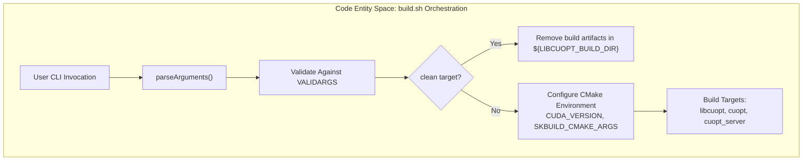
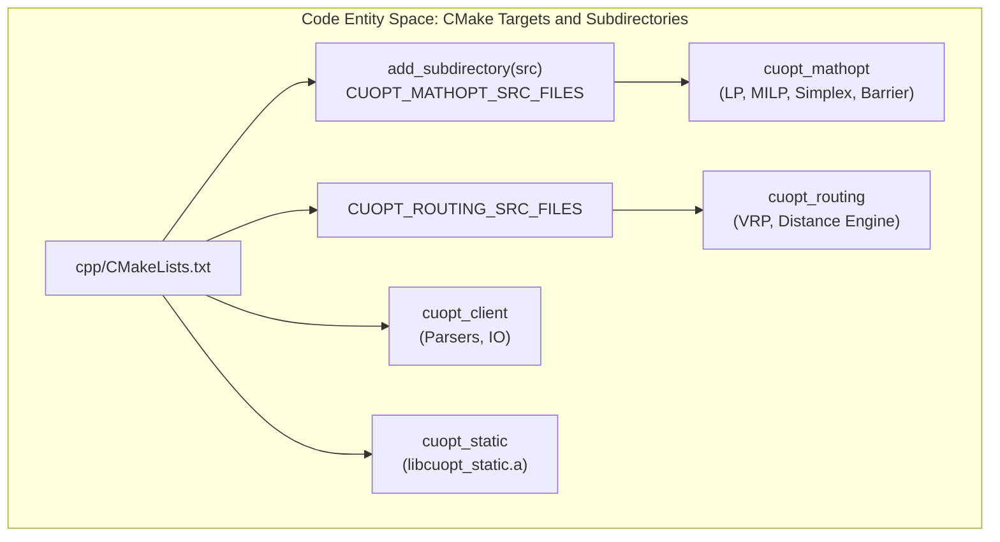
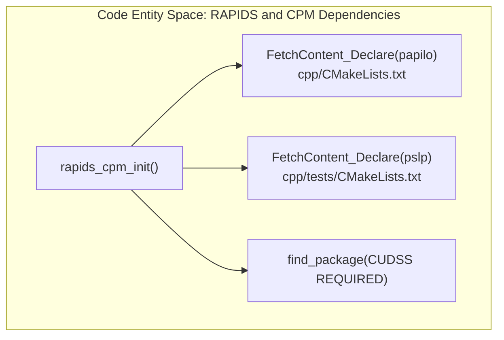
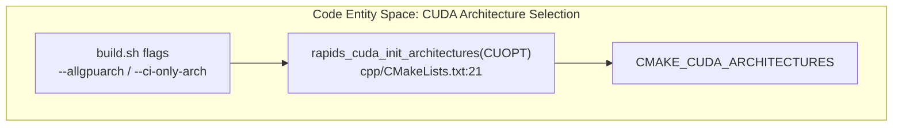

<!-- source: DeepWiki mcp.deepwiki.com · repo NVIDIA/cuopt · page 5.1 Build System · fetched 2026-10-26 -->

# Build System

Relevant source files

The following files were used as context for generating this wiki page:

- [CONTRIBUTING.md](CONTRIBUTING.md)
- [build.sh](build.sh)
- [ci/build_wheel_libcuopt_client.sh](ci/build_wheel_libcuopt_client.sh)
- [ci/build_wheel_libcuopt_mathopt.sh](ci/build_wheel_libcuopt_mathopt.sh)
- [ci/build_wheel_libcuopt_routing.sh](ci/build_wheel_libcuopt_routing.sh)
- [ci/utils/install_openssl3_runtime.sh](ci/utils/install_openssl3_runtime.sh)
- [ci/utils/install_protobuf_grpc.sh](ci/utils/install_protobuf_grpc.sh)
- [cpp/CMakeLists.txt](cpp/CMakeLists.txt)
- [cpp/src/CMakeLists.txt](cpp/src/CMakeLists.txt)
- [cpp/src/mip_heuristics/feasibility_jump/fj_types.hpp](cpp/src/mip_heuristics/feasibility_jump/fj_types.hpp)
- [cpp/src/mip_heuristics/feasibility_jump/load_balancing.cuh](cpp/src/mip_heuristics/feasibility_jump/load_balancing.cuh)
- [cpp/tests/CMakeLists.txt](cpp/tests/CMakeLists.txt)
- [cpp/tests/examples/routing/CMakeLists.txt](cpp/tests/examples/routing/CMakeLists.txt)
- [cpp/tests/linear_programming/CMakeLists.txt](cpp/tests/linear_programming/CMakeLists.txt)
- [cpp/tests/linear_programming/unit_tests/lp_solution_test.cu](cpp/tests/linear_programming/unit_tests/lp_solution_test.cu)
- [python/cmake/cuopt_wheel_build.cmake](python/cmake/cuopt_wheel_build.cmake)
- [python/cuopt/cuopt/CMakeLists.txt](python/cuopt/cuopt/CMakeLists.txt)
- [python/cuopt/cuopt/distance_engine/CMakeLists.txt](python/cuopt/cuopt/distance_engine/CMakeLists.txt)
- [python/cuopt/cuopt/linear_programming/data_model/CMakeLists.txt](python/cuopt/cuopt/linear_programming/data_model/CMakeLists.txt)
- [python/cuopt/cuopt/linear_programming/internals/CMakeLists.txt](python/cuopt/cuopt/linear_programming/internals/CMakeLists.txt)
- [python/cuopt/cuopt/linear_programming/io/CMakeLists.txt](python/cuopt/cuopt/linear_programming/io/CMakeLists.txt)
- [python/cuopt/cuopt/linear_programming/solver/CMakeLists.txt](python/cuopt/cuopt/linear_programming/solver/CMakeLists.txt)
- [python/cuopt/cuopt/linear_programming/solver_settings/CMakeLists.txt](python/cuopt/cuopt/linear_programming/solver_settings/CMakeLists.txt)
- [python/cuopt/cuopt/routing/CMakeLists.txt](python/cuopt/cuopt/routing/CMakeLists.txt)
- [python/libcuopt_client/pyproject.toml](python/libcuopt_client/pyproject.toml)

## Purpose and Scope
This page details the CMake build architecture for NVIDIA cuOpt, centered around `cpp/CMakeLists.txt` and `build.sh`. It covers the component-level object libraries (`cuopt_client`, `cuopt_mathopt`, `cuopt_routing`), third-party dependency resolution via `rapids-cpm` and CPM, orchestration logic in `build.sh`, and CUDA architecture selection macros.

Sources: [cpp/CMakeLists.txt:1-120](), [build.sh:1-100]()

## Build Orchestration via `build.sh`
The `build.sh` script coordinates the build of the core C++ libraries, Python bindings, and servers. It parses arguments against `VALIDARGS`, establishes build types, configures sanitizers, and invokes CMake and Ninja.

Sources: [build.sh:9-122](), [build.sh:65-70]()

## CMake Configuration & Component Libraries (`cpp/CMakeLists.txt`)
The root C++ build configuration in `cpp/CMakeLists.txt` establishes the project properties, compiler standards (C++20 and CUDA C++20), and organizes compilation into distinct object and shared libraries including `cuopt_client`, `cuopt_mathopt`, and `cuopt_routing`.

Sources: [cpp/CMakeLists.txt:26-80](), [cpp/src/CMakeLists.txt:37-47]()

## Third-Party CPM Packages and Dependencies
cuOpt leverages RAPIDS CMake utilities (`rapids-cmake`, `rapids-cpm`) to fetch and build external dependencies such as PaPILO (`papilo`), PSLP (`pslp`), and others via CPM and `FetchContent`.

Sources: [cpp/CMakeLists.txt:14-20](), [cpp/tests/CMakeLists.txt:107-109]()

## CUDA Architecture Selection
CUDA architectures are managed using RAPIDS CMake architecture helpers, translating user flags like `--allgpuarch` or `--ci-only-arch` into standard CMake CUDA architecture lists (`CMAKE_CUDA_ARCHITECTURES`).

Sources: [cpp/CMakeLists.txt:21](), [build.sh:54-55]()

---

