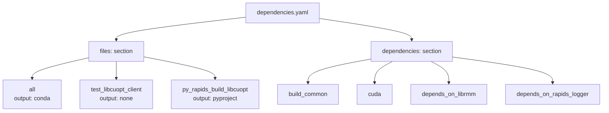
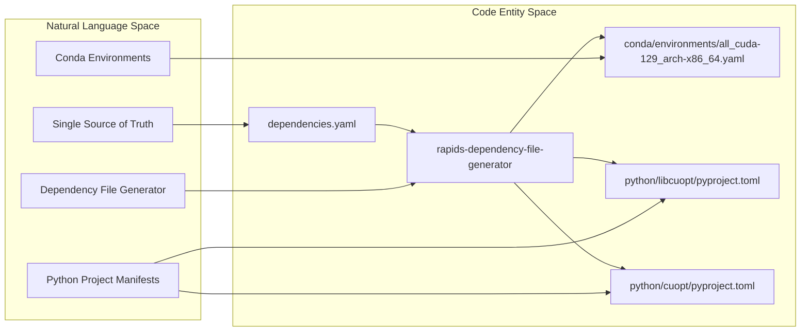
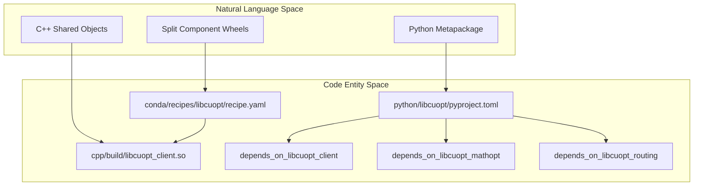

<!-- source: DeepWiki mcp.deepwiki.com · repo NVIDIA/cuopt · page 5.2 Dependency Management · fetched 2026-10-26 -->

# Dependency Management

Relevant source files

The following files were used as context for generating this wiki page:

- [cmake/RAPIDS.cmake](cmake/RAPIDS.cmake)
- [cmake/rapids_config.cmake](cmake/rapids_config.cmake)
- [conda/environments/all_cuda-129_arch-aarch64.yaml](conda/environments/all_cuda-129_arch-aarch64.yaml)
- [conda/environments/all_cuda-129_arch-x86_64.yaml](conda/environments/all_cuda-129_arch-x86_64.yaml)
- [conda/environments/all_cuda-133_arch-aarch64.yaml](conda/environments/all_cuda-133_arch-aarch64.yaml)
- [conda/environments/all_cuda-133_arch-x86_64.yaml](conda/environments/all_cuda-133_arch-x86_64.yaml)
- [conda/recipes/cuopt-server/recipe.yaml](conda/recipes/cuopt-server/recipe.yaml)
- [conda/recipes/cuopt-sh-client/recipe.yaml](conda/recipes/cuopt-sh-client/recipe.yaml)
- [conda/recipes/cuopt/conda_build_config.yaml](conda/recipes/cuopt/conda_build_config.yaml)
- [conda/recipes/cuopt/recipe.yaml](conda/recipes/cuopt/recipe.yaml)
- [conda/recipes/libcuopt/conda_build_config.yaml](conda/recipes/libcuopt/conda_build_config.yaml)
- [conda/recipes/libcuopt/recipe.yaml](conda/recipes/libcuopt/recipe.yaml)
- [cpp/doxygen/Doxyfile](cpp/doxygen/Doxyfile)
- [dependencies.yaml](dependencies.yaml)
- [docs/cuopt/source/conf.py](docs/cuopt/source/conf.py)
- [python/cuopt/CMakeLists.txt](python/cuopt/CMakeLists.txt)
- [python/cuopt/pyproject.toml](python/cuopt/pyproject.toml)
- [python/cuopt_self_hosted/pyproject.toml](python/cuopt_self_hosted/pyproject.toml)
- [python/cuopt_server/cuopt_server/utils/linear_programming/data_definition.py](python/cuopt_server/cuopt_server/utils/linear_programming/data_definition.py)
- [python/cuopt_server/cuopt_server/utils/routing/data_definition.py](python/cuopt_server/cuopt_server/utils/routing/data_definition.py)
- [python/cuopt_server/pyproject.toml](python/cuopt_server/pyproject.toml)
- [python/libcuopt/CMakeLists.txt](python/libcuopt/CMakeLists.txt)
- [python/libcuopt/pyproject.toml](python/libcuopt/pyproject.toml)

## Purpose and Scope

This document details the dependency management architecture for the cuOpt codebase. The system centers on `dependencies.yaml` as the single source of truth, processed via `rapids-dependency-file-generator` to automatically synthesize Conda environment files, package `pyproject.toml` manifests, and build backend configurations [dependencies.yaml:1-5](). This ensures rigorous consistency across multi-architecture targets (`x86_64`, `aarch64`), CUDA versions (`12.9`, `13.3`), and package distribution channels [dependencies.yaml:6-11]().

For the broader build orchestration that consumes these dependencies, see [Build System](#5.1). For details on continuous integration pipelines validating these environments, see [CI/CD Workflows](#5.3).

---

## Single Source of Truth: `dependencies.yaml`

The `dependencies.yaml` file defines all package dependencies, version constraints, and conditional inclusion rules for the repository [dependencies.yaml:1-5]()]. It is partitioned into output target blocks under the `files` key, defining how individual dependency tags map to specific package generators [dependencies.yaml:6-39]().

**Sources:** [dependencies.yaml:6-39]()

---

## Dependency Generation and Code Entity Mapping

The `rapids-dependency-file-generator` tool reads `dependencies.yaml` and materializes environment specifications and build configuration files across the codebase [dependencies.yaml:4](). 

The following diagram bridges the high-level dependency concepts to specific code entities and generated files within the repository:

**Sources:** [dependencies.yaml:4](), [python/libcuopt/pyproject.toml:9](), [python/cuopt/pyproject.toml:9](), [conda/environments/all_cuda-129_arch-x86_64.yaml:1-2]()

All auto-generated artifacts contain explicit header comments pointing back to `dependencies.yaml` to prevent manual drift:
* `python/libcuopt/pyproject.toml` [python/libcuopt/pyproject.toml:9]()
* `python/cuopt/pyproject.toml` [python/cuopt/pyproject.toml:9]()
* `conda/environments/all_cuda-129_arch-x86_64.yaml` [conda/environments/all_cuda-129_arch-x86_64.yaml:1-2]()

---

## Component Splitting Architecture

To minimize the runtime and distribution footprint, `libcuopt` is split into independent component packages and shared libraries (`libcuopt-client`, `libcuopt-mathopt`, `libcuopt-routing`) [dependencies.yaml:40-63](), [conda/recipes/libcuopt/recipe.yaml:102-105](). Each component declares only its precise downstream requirements.

The relationship between the high-level component split concept and the underlying package metadata and shared libraries is mapped below:

**Sources:** [dependencies.yaml:145-163](), [python/libcuopt/pyproject.toml:32-40](), [conda/recipes/libcuopt/recipe.yaml:102-122]()

---

## Matrix-Based Conditional Dependencies and CUDA Suffix Handling

The `files` block in `dependencies.yaml` configures matrix expansions across supported CUDA versions and target CPU architectures [dependencies.yaml:6-11]().

### Matrix Parameters
* **CUDA Versions:** `12.9`, `13.3` [dependencies.yaml:10]()
* **Architectures:** `x86_64`, `aarch64` [dependencies.yaml:11]()

### CUDA Suffixes and Wheel Builds
For PyPI and wheel distributions, package names and dependencies adjust dynamically via `cuda_suffixed` and `use_cuda_wheels` matrix entries [dependencies.yaml:131-133](). For instance, `libcuopt` build requirements incorporate specific toolchain constraints and version bounds [python/libcuopt/pyproject.toml:79-92](). Similarly, CuPy dependencies within `cuopt` select architecture-specific execution targets like `cupy-cuda13x` [python/cuopt/pyproject.toml:23]().

**Sources:** [dependencies.yaml:6-39](), [python/libcuopt/pyproject.toml:79-92](), [python/cuopt/pyproject.toml:21-34]()

---

## Build, Host, and Runtime Dependencies

Dependencies are segregated into build-time tooling, host compilation headers, and runtime packages within Conda recipes and `pyproject.toml` configurations [conda/recipes/libcuopt/recipe.yaml:65-101](), [conda/recipes/cuopt/recipe.yaml:67-108]().

| Dependency Tier | Scope / Purpose | Key Code References |
|-----------------|---------------- | ------------------- |
| **Build** | Compilers, CMake, Ninja, and build backends | `cmake`, `ninja`, `scikit-build-core` [conda/recipes/libcuopt/recipe.yaml:66-75]() |
| **Host** | Development headers, linking libraries, and SDK interfaces | `libraft-headers`, `librmm`, `libcudss-dev`, `libgrpc` [conda/recipes/libcuopt/recipe.yaml:80-101]() |
| **Runtime** | Dynamic libraries, Python SDK dependencies, and microservice frameworks | `cudf`, `cupy`, `fastapi`, `uvicorn`, `rapids-logger` [conda/recipes/cuopt/recipe.yaml:87-104](), [conda/recipes/cuopt-server/recipe.yaml:30-40]() |

**Sources:** [conda/recipes/libcuopt/recipe.yaml:65-101](), [conda/recipes/cuopt/recipe.yaml:67-108](), [conda/recipes/cuopt-server/recipe.yaml:24-41]()

---

