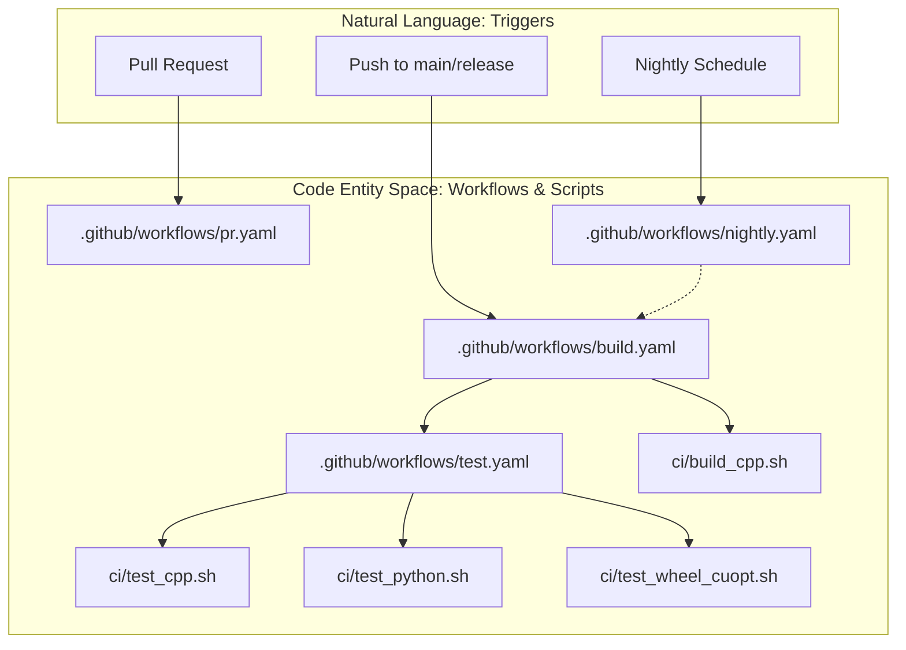
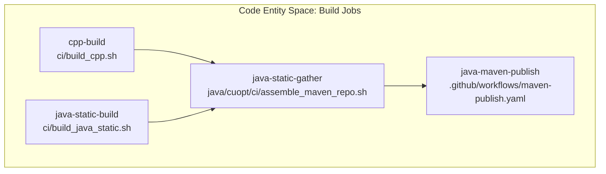
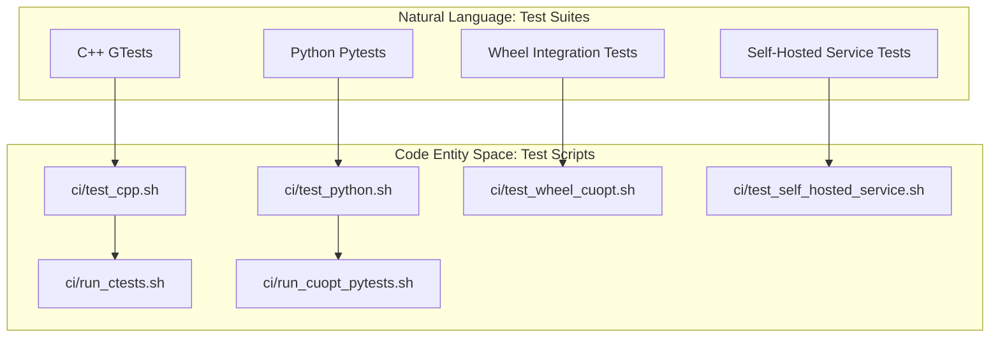

<!-- source: DeepWiki mcp.deepwiki.com · repo NVIDIA/cuopt · page 5.3 CI/CD Workflows · fetched 2026-10-26 -->

# CI/CD Workflows

Relevant source files

The following files were used as context for generating this wiki page:

- [.github/workflows/build.yaml](.github/workflows/build.yaml)
- [.github/workflows/build_test_publish_images.yaml](.github/workflows/build_test_publish_images.yaml)
- [.github/workflows/cloud_ci.yaml](.github/workflows/cloud_ci.yaml)
- [.github/workflows/multi_gpu_cpp_test.yaml](.github/workflows/multi_gpu_cpp_test.yaml)
- [.github/workflows/nightly-summary.yaml](.github/workflows/nightly-summary.yaml)
- [.github/workflows/pr.yaml](.github/workflows/pr.yaml)
- [.github/workflows/test.yaml](.github/workflows/test.yaml)
- [.github/workflows/trigger-breaking-change-alert.yaml](.github/workflows/trigger-breaking-change-alert.yaml)
- [RAPIDS_BRANCH](RAPIDS_BRANCH)
- [ci/build_cpp.sh](ci/build_cpp.sh)
- [ci/build_docs.sh](ci/build_docs.sh)
- [ci/build_python.sh](ci/build_python.sh)
- [ci/build_wheel.sh](ci/build_wheel.sh)
- [ci/build_wheel_cuopt.sh](ci/build_wheel_cuopt.sh)
- [ci/build_wheel_cuopt_server.sh](ci/build_wheel_cuopt_server.sh)
- [ci/build_wheel_cuopt_sh_client.sh](ci/build_wheel_cuopt_sh_client.sh)
- [ci/build_wheel_libcuopt.sh](ci/build_wheel_libcuopt.sh)
- [ci/check_style.sh](ci/check_style.sh)
- [ci/test_cpp.sh](ci/test_cpp.sh)
- [ci/test_cpp_memcheck.sh](ci/test_cpp_memcheck.sh)
- [ci/test_notebooks.sh](ci/test_notebooks.sh)
- [ci/test_python.sh](ci/test_python.sh)
- [ci/test_self_hosted_service.sh](ci/test_self_hosted_service.sh)
- [ci/test_wheel_cuopt.sh](ci/test_wheel_cuopt.sh)
- [ci/test_wheel_cuopt_server.sh](ci/test_wheel_cuopt_server.sh)
- [ci/utils/crash_helpers.sh](ci/utils/crash_helpers.sh)
- [ci/utils/nbtest.sh](ci/utils/nbtest.sh)
- [ci/utils/notebook_command_extractor.py](ci/utils/notebook_command_extractor.py)
- [ci/utils/notebook_list.py](ci/utils/notebook_list.py)
- [ci/utils/pr_test_summary.py](ci/utils/pr_test_summary.py)
- [datasets/mip/swath1.mps](datasets/mip/swath1.mps)
- [datasets/solomon/In/r107.txt](datasets/solomon/In/r107.txt)
- [docs/cuopt/source/faq.rst](docs/cuopt/source/faq.rst)
- [docs/cuopt/source/system-requirements.rst](docs/cuopt/source/system-requirements.rst)
- [sonar-project.properties](sonar-project.properties)
- [sonarqube/README.md](sonarqube/README.md)
- [sonarqube/run-sonar-analysis.sh](sonarqube/run-sonar-analysis.sh)
- [sonarqube/sonar-branches.txt](sonarqube/sonar-branches.txt)

## Purpose and Scope

This page documents the GitHub Actions-based CI/CD pipeline for the cuOpt repository (`https://github.com/NVIDIA/cuopt`). It covers build workflows, test orchestration, matrix strategies, nightly automation, artifact publishing, and code validation scripts located in `.github/workflows/` and the `ci/` directory. For details on CMake configuration and dependency management, refer to [Build System](#5.1). For package distribution and deployment, see [Package Distribution and Deployment](#5.4).

---

## Workflow Architecture and Orchestration

The CI/CD pipeline is orchestrated via GitHub Actions workflows that trigger on pushes, pull requests, scheduled cron intervals, or manual `workflow_dispatch` events [.github/workflows/build.yaml:6-13]().

Title: cuOpt Workflow Orchestration and Code Mapping

Sources: [.github/workflows/build.yaml:4-40](), [.github/workflows/pr.yaml:4-15](), [.github/workflows/test.yaml:4-27](), [.github/workflows/nightly.yaml:4-15]()

---

## Main Build Workflow (`build.yaml`)

The `build.yaml` workflow executes on pushes to `main`, `release/*` branches, and release tags, compiling all C++ libraries, Python bindings, Java static classifiers, and CUDA wheel packages [.github/workflows/build.yaml:4-13]().

### Build Job Structure and Matrix Strategies

`build.yaml` invokes shared workflows from `rapidsai/shared-workflows` combined with local build scripts [.github/workflows/build.yaml:50-66](). For instance, C++ conda builds invoke `ci/build_cpp.sh` [.github/workflows/build.yaml:66](). Java static builds utilize a custom matrix strategy built over Rocky 8/Wheel containers to ensure binary compatibility with standard `libstdc++` and GNU OpenMP runtimes [.github/workflows/build.yaml:76-110]().

Title: Build Pipeline Data Flow

Sources: [.github/workflows/build.yaml:50-165]()

---

## Test Orchestration and Execution Workflows (`test.yaml`)

Test execution is decoupled into `test.yaml`, which runs after build artifacts are successfully published [.github/workflows/test.yaml:7-27]().

Title: Test Execution and Script Mapping

Sources: [.github/workflows/test.yaml:31-183](), [ci/test_cpp.sh:1-80](), [ci/test_python.sh:1-109](), [ci/test_wheel_cuopt.sh:1-114](), [ci/test_self_hosted_service.sh:1-160]()

### C++ and Python Test Suites

* **C++ Testing (`ci/test_cpp.sh`)**: Configures conda environments via `rapids-dependency-file-generator`, downloads test datasets (PDLP, MIPLIB, QPLIB), and executes GTests through `ci/run_ctests.sh` [ci/test_cpp.sh:15-65](). Specific gRPC cancel tests are filtered out during standard runs to prevent asynchronous job cancellation race conditions [ci/test_cpp.sh:62-65]().
* **Python Testing (`ci/test_python.sh`)**: Installs test dependencies, sets up coverage reports via `.coveragerc`, and executes pytest on `cuopt` and `cuopt_server` modules [ci/test_python.sh:17-92]().
* **Wheel Testing (`ci/test_wheel_cuopt.sh` & `ci/test_wheel_cuopt_server.sh`)**: Installs generated wheels into a fresh virtual environment using strict pip constraints and executes verification scripts, CLI tests, and third-party solver integration tests (`jump`, `cvxpy`, `pulp`, `pyomo`) during nightly runs [ci/test_wheel_cuopt.sh:29-100]().
* **Self-Hosted Service Testing (`ci/test_self_hosted_service.sh`)**: Boots up `cuopt_grpc_server` and `cuopt_server.cuopt_proxy`, checks service health via `/cuopt/health`, and executes `cuopt_sh` CLI routines across JSON, MPS, and compressed inputs [ci/test_self_hosted_service.sh:90-155]().

Sources: [ci/test_cpp.sh:1-80](), [ci/test_python.sh:1-109](), [ci/test_wheel_cuopt.sh:1-114](), [ci/test_self_hosted_service.sh:1-160]()

---

## Pull Request Validation and Lean CI (`pr.yaml`)

Pull requests are processed through `pr.yaml`, which evaluates matrix filters (`compute-matrix-filters`) to optimize CI compute usage [.github/workflows/pr.yaml:18-74]().

### Matrix Filtering Logic

To prevent resource exhaustion, output filters group builds by architecture, CUDA version, and Python version:
* `libcuopt_filter`: Groups by architecture and major CUDA version, selecting the maximum Python version [.github/workflows/pr.yaml:67]()
* `cuopt_filter`: Groups by CUDA version and architecture, selecting the minimum Python version [.github/workflows/pr.yaml:70]()
* `cuopt_server_filter`: Restricts builds to `amd64` and maximum Python/CUDA versions [.github/workflows/pr.yaml:71]()

**Sources:** [.github/workflows/pr.yaml:52-74]()

---

## Specialized Build Steps: Custom cuDSS Threading Layer

During wheel builds (`ci/build_wheel_libcuopt.sh`), cuOpt compiles a custom cuDSS threading layer (`-DCUOPT_BUILD_CUSTOM_CUDSS_MTLAYER=ON`) linked against a modern GNU `libgomp` fetched from conda-forge (`ci/utils/install_modern_libgomp.py`) [ci/build_wheel_libcuopt.sh:44-54](). This unifies the OpenMP runtime between cuOpt and cuDSS to prevent dual-runtime symbol conflicts and locking failures [ci/build_wheel_libcuopt.sh:44-54](). Furthermore, `auditwheel repair` explicitly excludes foundational libraries (e.g., `libcuda.so.1`, `libcudss.so.*`, `libssl.so.3`, `libcrypto.so.3`) to preserve runtime FIPS compliance and dynamic linking integrity against the host environment [ci/build_wheel_libcuopt.sh:106-130]().

Sources: [ci/build_wheel_libcuopt.sh:1-140]()

---

