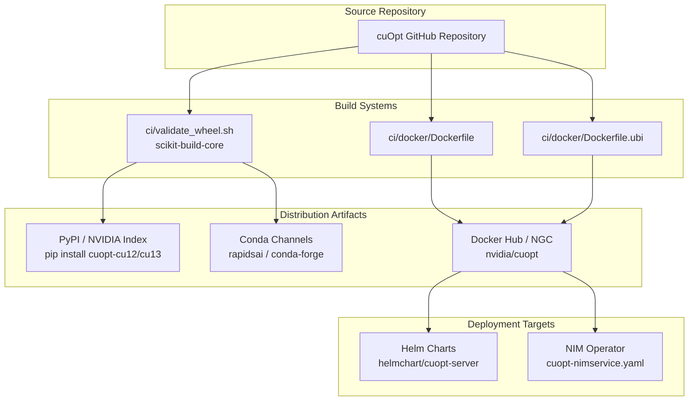
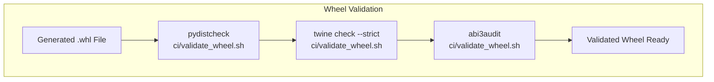
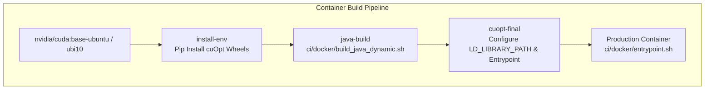
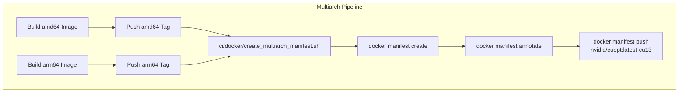

<!-- source: DeepWiki mcp.deepwiki.com · repo NVIDIA/cuopt · page 5.4 Package Distribution and Deployment · fetched 2026-10-26 -->

# Package Distribution and Deployment

Relevant source files

The following files were used as context for generating this wiki page:

- [.github/workflows/build_images.yaml](.github/workflows/build_images.yaml)
- [.github/workflows/test_images.yaml](.github/workflows/test_images.yaml)
- [ci/docker/Dockerfile](ci/docker/Dockerfile)
- [ci/docker/Dockerfile.ubi](ci/docker/Dockerfile.ubi)
- [ci/docker/JavaSmokeTest.java](ci/docker/JavaSmokeTest.java)
- [ci/docker/README.md](ci/docker/README.md)
- [ci/docker/build_java_dynamic.sh](ci/docker/build_java_dynamic.sh)
- [ci/docker/context/README.md](ci/docker/context/README.md)
- [ci/docker/create_multiarch_manifest.sh](ci/docker/create_multiarch_manifest.sh)
- [ci/docker/smoke_image.sh](ci/docker/smoke_image.sh)
- [ci/docker/test_image.sh](ci/docker/test_image.sh)
- [ci/validate_wheel.sh](ci/validate_wheel.sh)
- [docs/cuopt/source/_static/install-selector.css](docs/cuopt/source/_static/install-selector.css)
- [docs/cuopt/source/_static/install-selector.js](docs/cuopt/source/_static/install-selector.js)
- [docs/cuopt/source/cuopt-server/index.rst](docs/cuopt/source/cuopt-server/index.rst)
- [docs/cuopt/source/cuopt-server/nim-operator/configuration.rst](docs/cuopt/source/cuopt-server/nim-operator/configuration.rst)
- [docs/cuopt/source/cuopt-server/nim-operator/deployment.rst](docs/cuopt/source/cuopt-server/nim-operator/deployment.rst)
- [docs/cuopt/source/cuopt-server/nim-operator/guide/cuopt-nimservice-full.yaml](docs/cuopt/source/cuopt-server/nim-operator/guide/cuopt-nimservice-full.yaml)
- [docs/cuopt/source/cuopt-server/nim-operator/guide/cuopt-nimservice.yaml](docs/cuopt/source/cuopt-server/nim-operator/guide/cuopt-nimservice.yaml)
- [docs/cuopt/source/cuopt-server/nim-operator/guide/deploy.sh](docs/cuopt/source/cuopt-server/nim-operator/guide/deploy.sh)
- [docs/cuopt/source/cuopt-server/nim-operator/guide/namespace.yaml](docs/cuopt/source/cuopt-server/nim-operator/guide/namespace.yaml)
- [docs/cuopt/source/cuopt-server/nim-operator/index.rst](docs/cuopt/source/cuopt-server/nim-operator/index.rst)
- [docs/cuopt/source/cuopt-server/nim-operator/prerequisites.rst](docs/cuopt/source/cuopt-server/nim-operator/prerequisites.rst)
- [docs/cuopt/source/install.rst](docs/cuopt/source/install.rst)
- [helmchart/cuopt-server/README.md](helmchart/cuopt-server/README.md)
- [helmchart/cuopt-server/templates/NOTES.txt](helmchart/cuopt-server/templates/NOTES.txt)
- [helmchart/cuopt-server/templates/_helpers.tpl](helmchart/cuopt-server/templates/_helpers.tpl)
- [helmchart/cuopt-server/templates/deployment.yaml](helmchart/cuopt-server/templates/deployment.yaml)
- [helmchart/cuopt-server/templates/ingress.yaml](helmchart/cuopt-server/templates/ingress.yaml)
- [helmchart/cuopt-server/templates/service.yaml](helmchart/cuopt-server/templates/service.yaml)
- [helmchart/cuopt-server/templates/serviceaccount.yaml](helmchart/cuopt-server/templates/serviceaccount.yaml)
- [helmchart/cuopt-server/values.yaml](helmchart/cuopt-server/values.yaml)
- [java/cuopt/CMakeLists.txt](java/cuopt/CMakeLists.txt)
- [java/cuopt/ci/build_static_libcuopt.sh](java/cuopt/ci/build_static_libcuopt.sh)
- [python/libcuopt_mathopt/pyproject.toml](python/libcuopt_mathopt/pyproject.toml)
- [python/libcuopt_routing/pyproject.toml](python/libcuopt_routing/pyproject.toml)
- [regression/config.sh](regression/config.sh)

## Purpose and Scope

This document details the multi-channel distribution architecture for NVIDIA cuOpt. It covers PyPI binary wheels (with CUDA 12 and CUDA 13 suffixes), Conda packages, Ubuntu and Red Hat Enterprise Linux (RHEL) UBI 10 container images, multiarch manifest orchestration, Helm charts for Kubernetes, and container validation frameworks.

For details on the underlying CMake build configuration, see [Build System](#5.1). For CI/CD orchestration pipelines, see [CI/CD Workflows](#5.3).

---

## Distribution Channels Overview

cuOpt packages are distributed across four primary distribution channels to support developer environments, enterprise containerized deployments, and Kubernetes orchestration:

Sources: [.github/workflows/build_images.yaml:1-104](), [ci/docker/Dockerfile:1-160](), [ci/docker/Dockerfile.ubi:1-139](), [ci/validate_wheel.sh:1-77]()

---

## PyPI Wheels and Split Component Distribution

cuOpt separates its C++ core libraries and Python SDK into specialized wheel packages. This granular packaging keeps download sizes manageable and allows fine-grained dependency tracking.

### Component Split Layout
- `libcuopt-client`: Lightweight client stubs and IPC communication utilities [ci/validate_wheel.sh:45-50]().
- `libcuopt_mathopt`: Mathematical optimization (LP, MILP, QP, SOCP) C++ binaries and solvers [python/libcuopt_routing/pyproject.toml:12-14]().
- `libcuopt_routing`: Vehicle Routing Problem (VRP, TSP, PDP) C++ engine and spatial data structures [python/libcuopt_routing/pyproject.toml:12-14]().
- `libcuopt`: Meta-package binding mathopt, routing, and client components into a unified interface [ci/docker/build_java_dynamic.sh:15-18]().
- `cuopt`: Python SDK wrapper and Cython bindings [ci/validate_wheel.sh:51-54]().
- `cuopt-server`: FastAPI-based optimization microservice [ci/docker/Dockerfile:84]().
- `cuopt-sh-client`: Self-hosted thin client bindings [ci/docker/Dockerfile:87]().

### Wheel Validation Pipeline
Before publishing to PyPI or the NVIDIA index, generated wheels undergo rigorous inspection via `ci/validate_wheel.sh`. The script executes three main validation utilities:
1. `pydistcheck`: Enforces strict compressed size ceilings (e.g., 725MiB for CUDA 12 `libcuopt`, 50MiB for `libcuopt_client`) [ci/validate_wheel.sh:22-50]().
2. `twine check --strict`: Validates package metadata and long descriptions [ci/validate_wheel.sh:63-68]().
3. `abi3audit`: Verifies that shared libraries correctly conform to stable ABI standards where applicable [ci/validate_wheel.sh:69-77]().

Sources: [ci/validate_wheel.sh:1-77](), [python/libcuopt_routing/pyproject.toml:1-84]()

---

## Conda Package Distribution

Conda packages are generated using `rattler-build` recipes defined across the workspace. Recipes specify matrix entries for CUDA versions (`cuda-version=12.9` or `cuda-version=13.0`) and target Python runtimes (`>=3.11`, `<3.15`) [docs/cuopt/source/_static/install-selector.js:26-51](). Dependencies are managed centrally via `dependencies.yaml` and synchronized using the RAPIDS dependency generator.

Sources: [docs/cuopt/source/_static/install-selector.js:1-183]()

---

## Docker and UBI Container Images

cuOpt publishes two primary container image variants optimized for different enterprise environments: Ubuntu-based images for general deployment and Red Hat UBI 10 (RHEL 10) images for FIPS 140-3 compliance [ci/docker/README.md:7-14].

### Multi-Stage Build Architecture
Both `ci/docker/Dockerfile` (Ubuntu) and `ci/docker/Dockerfile.ubi` (UBI 10) employ multi-stage builds to strip build toolchains from production images:
1. `cuda-libs`: Extracts runtime CUDA libraries (`libnvrtc`, `libnvJitLink`) [ci/docker/Dockerfile:10-14](), [ci/docker/Dockerfile.ubi:9-10]().
2. `cuda-headers`: Mounts CUDA headers for runtime JIT compilation via CuPy/NVRTC [ci/docker/Dockerfile:15](), [ci/docker/Dockerfile.ubi:12]().
3. `install-env`: Installs Python, system dependencies (`gcc`, `libgomp1`), and pip-installs cuOpt packages [ci/docker/Dockerfile:18-90](), [ci/docker/Dockerfile.ubi:15-63]().
4. `java-build`: Compiles `libcuopt_jni.so` and `cuopt.jar` dynamically against the installed pip libraries using `ci/docker/build_java_dynamic.sh` [ci/docker/Dockerfile:93-121](), [ci/docker/build_java_dynamic.sh:1-69]().
5. `cuopt-final`: Assembles the production container, configures `LD_LIBRARY_PATH`, and exposes entrypoints [ci/docker/Dockerfile:122-160](), [ci/docker/Dockerfile.ubi:83-139]().

### RHEL / UBI 10 Dynamic Linker Handling
On RHEL and UBI 10 distributions, Python's native layout places pure-Python wheels in `lib` and compiled extensions (`platlib`) in `lib64`. Because `libcuopt` RPATHs expect a unified layout, `Dockerfile.ubi` explicitly indexes NVIDIA wheel library directories into the dynamic linker configuration (`/etc/ld.so.conf.d/cuopt-nvidia-wheels.conf`) and invokes `ldconfig` to ensure `libnccl.so.2` and other dependencies resolve correctly [ci/docker/Dockerfile.ubi:97-115]().

Sources: [ci/docker/Dockerfile:1-160](), [ci/docker/Dockerfile.ubi:1-139](), [ci/docker/build_java_dynamic.sh:1-69](), [ci/docker/README.md:1-43]()

---

## Multiarch Manifests and CI/CD Workflows

Cross-architecture publishing is orchestrated via GitHub Actions workflows (`.github/workflows/build_images.yaml` and `.github/workflows/test_images.yaml`) and the manifest creation script `ci/docker/create_multiarch_manifest.sh`.

### Manifest Orchestration Flow
1. **Per-Arch Builds**: Individual worker nodes build and push architecture-specific images (`amd64` and `arm64`) to Docker Hub and NGC staging (`nvcr.io/nvstaging/nvaie/cuopt`) [.github/workflows/build_images.yaml:33-124]().
2. **Manifest Creation**: `ci/docker/create_multiarch_manifest.sh` inspects image existence, creates docker manifest lists, explicitly annotates architectures (`--arch amd64`, `--arch arm64`), and pushes unified tags along with shorthand major-version aliases (`cu12`, `cu13`) [ci/docker/create_multiarch_manifest.sh:9-84]().
3. **Image Testing**: Post-build jobs (`ci/docker/test_image.sh` and `ci/docker/smoke_image.sh`) spin up the containerized runtime to execute test suites, Java smoke tests, and server startup verification [.github/workflows/test_images.yaml:56-122](), [ci/docker/test_image.sh:1-68]().

Sources: [.github/workflows/build_images.yaml:1-148](), [.github/workflows/test_images.yaml:1-122](), [ci/docker/create_multiarch_manifest.sh:1-156]()

---

## Kubernetes Deployment and Helm Charts

For orchestration in cloud-native environments, cuOpt provides a Helm chart located under `helmchart/cuopt-server/`.

### Configuration and Deployment Settings
The chart exposes runtime tuning via `helmchart/cuopt-server/values.yaml`:
- **GPU Resources**: Requests and limits explicitly bind NVIDIA GPUs (`nvidia.com/gpu: 1`) [helmchart/cuopt-server/values.yaml:64-70]().
- **Server Modes**: The `serverType` parameter controls the entrypoint behavior (`proxy`, `grpc`, or `legacy`), mapping health probes appropriately [helmchart/cuopt-server/values.yaml:96-107]().
- **Service & Networking**: Configures `ClusterIP` services, ingress controllers, and gRPC ports (`5001`) [helmchart/cuopt-server/values.yaml:43-63, 108-110]().

Sources: [helmchart/cuopt-server/values.yaml:1-121]()

---

## Sources

- [.github/workflows/build_images.yaml]()
- [.github/workflows/test_images.yaml]()
- [ci/docker/Dockerfile]()
- [ci/docker/Dockerfile.ubi]()
- [ci/docker/README.md]()
- [ci/docker/build_java_dynamic.sh]()
- [ci/docker/create_multiarch_manifest.sh]()
- [ci/docker/test_image.sh]()
- [ci/validate_wheel.sh]()
- [docs/cuopt/source/_static/install-selector.js]()
- [helmchart/cuopt-server/values.yaml]()
- [python/libcuopt_routing/pyproject.toml]()

---

