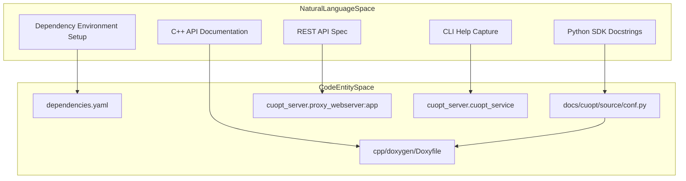
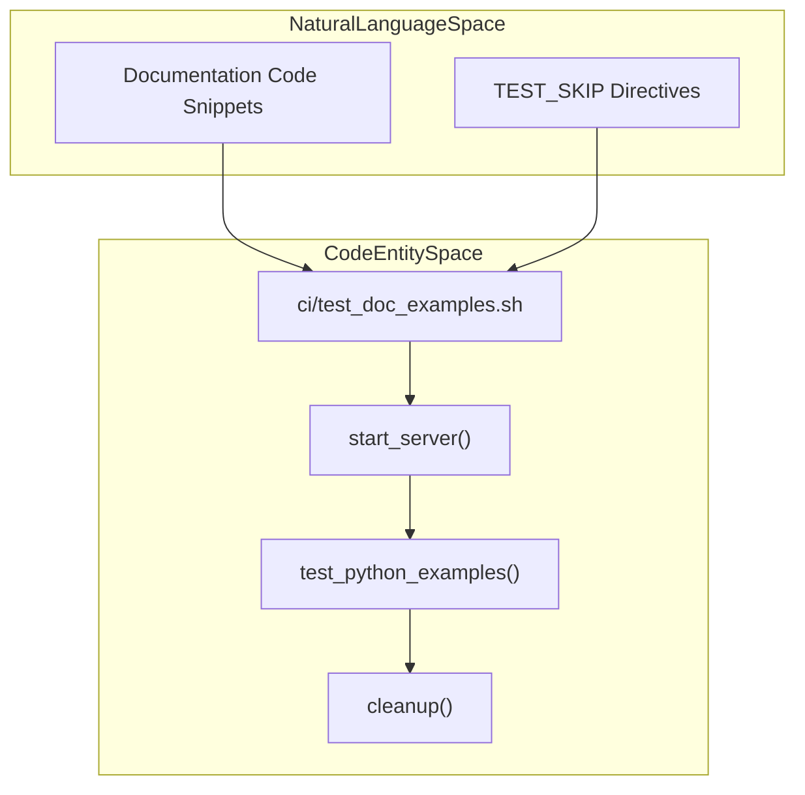

<!-- source: DeepWiki mcp.deepwiki.com · repo NVIDIA/cuopt · page 5.5 Documentation Generation · fetched 2026-10-26 -->

# Documentation Generation

<details>
<summary>Relevant source files</summary>

The following files were used as context for generating this wiki page:

- [ci/test_doc_examples.sh](ci/test_doc_examples.sh)
- [ci/test_skills_assets.sh](ci/test_skills_assets.sh)
- [cmake/RAPIDS.cmake](cmake/RAPIDS.cmake)
- [cmake/rapids_config.cmake](cmake/rapids_config.cmake)
- [conda/recipes/cuopt/conda_build_config.yaml](conda/recipes/cuopt/conda_build_config.yaml)
- [conda/recipes/libcuopt/conda_build_config.yaml](conda/recipes/libcuopt/conda_build_config.yaml)
- [cpp/doxygen/Doxyfile](cpp/doxygen/Doxyfile)
- [docs/cuopt/source/conf.py](docs/cuopt/source/conf.py)
- [docs/cuopt/source/cuopt-c/convex/examples/Makefile](docs/cuopt/source/cuopt-c/convex/examples/Makefile)
- [docs/cuopt/source/cuopt-c/mip/examples/Makefile](docs/cuopt/source/cuopt-c/mip/examples/Makefile)
- [docs/cuopt/source/cuopt-c/mip/mip-examples.rst](docs/cuopt/source/cuopt-c/mip/mip-examples.rst)
- [docs/cuopt/source/cuopt-python/mip/mip-examples.rst](docs/cuopt/source/cuopt-python/mip/mip-examples.rst)
- [docs/cuopt/source/cuopt-server/csp-guides/csp-aws.rst](docs/cuopt/source/cuopt-server/csp-guides/csp-aws.rst)
- [docs/cuopt/source/cuopt-server/examples/lp/examples/basic_lp_example.py](docs/cuopt/source/cuopt-server/examples/lp/examples/basic_lp_example.py)
- [docs/cuopt/source/cuopt-server/examples/lp/examples/batch_mode_example.sh](docs/cuopt/source/cuopt-server/examples/lp/examples/batch_mode_example.sh)
- [docs/cuopt/source/cuopt-server/examples/routing-examples.rst](docs/cuopt/source/cuopt-server/examples/routing-examples.rst)
- [docs/cuopt/source/cuopt-server/examples/routing/examples/initial_solution_example.py](docs/cuopt/source/cuopt-server/examples/routing/examples/initial_solution_example.py)
- [docs/cuopt/source/hidden/limitations.rst](docs/cuopt/source/hidden/limitations.rst)
- [docs/cuopt/source/resources.rst](docs/cuopt/source/resources.rst)
- [docs/cuopt/source/versions1.json](docs/cuopt/source/versions1.json)
- [python/cuopt/CMakeLists.txt](python/cuopt/CMakeLists.txt)
- [python/cuopt_server/cuopt_server/utils/linear_programming/data_definition.py](python/cuopt_server/cuopt_server/utils/linear_programming/data_definition.py)
- [python/cuopt_server/cuopt_server/utils/routing/data_definition.py](python/cuopt_server/cuopt_server/utils/routing/data_definition.py)
- [python/libcuopt/CMakeLists.txt](python/libcuopt/CMakeLists.txt)
- [python/libcuopt/libcuopt/load.py](python/libcuopt/libcuopt/load.py)

</details>


## Purpose and Scope

This page describes the documentation generation and validation system for NVIDIA cuOpt. The system builds comprehensive technical documentation from multiple sources—including C++ Doxygen XML comments, Python docstrings, CLI help strings, FastAPI OpenAPI specifications, and executable code snippets—using Sphinx as the core documentation engine (`docs/cuopt/source/conf.py`) [docs/cuopt/source/conf.py:1-48]().

---

## Documentation Build Pipeline and Orchestration

The documentation build process is orchestrated through build scripts that set up the required environment via `rapids-dependency-file-generator`, invoke Doxygen for C++ sources (`cpp/doxygen/Doxyfile`), and execute Sphinx to produce HTML artifacts [docs/cuopt/source/conf.py:186]().

### Build Pipeline and Code Entities



**Sources:** [docs/cuopt/source/conf.py:21-49](), [cpp/doxygen/Doxyfile:35-41]()

---

## Sphinx Configuration and Dynamic Artifact Generation

The Sphinx configuration file `docs/cuopt/source/conf.py` acts as the execution entry point during documentation builds. It dynamically generates auxiliary files required by Sphinx extensions before building the documentation pages [docs/cuopt/source/conf.py:21-49]().

### Dynamic File Generation
During initialization, `conf.py` invokes shell commands and Python modules to capture up-to-date help output and schema definitions:
1. **Server CLI Help**: Executes `python -m cuopt_server.cuopt_service --help` and saves the output to `cuopt-server/server-api/server-cli-help.txt` [docs/cuopt/source/conf.py:23-26]().
2. **Self-Hosted Client Help**: Executes `cuopt_sh --help` and saves it to `cuopt-server/client-api/sh-cli-help.txt` [docs/cuopt/source/conf.py:28-31]().
3. **C++ CLI Help**: Executes `cuopt_cli --help` and saves it to `cuopt-cli/cuopt-cli-help.txt` [docs/cuopt/source/conf.py:33-36]().
4. **OpenAPI Specification**: Imports `cuopt_server.proxy_webserver:app` (`cuoptapp`), extracts routes via FastAPI's `get_openapi`, and serializes the schema to `cuopt_spec.yaml` [docs/cuopt/source/conf.py:5-49]().

### Doxygen and Breathe Integration for C++
C++ headers and sources are parsed using Doxygen (`cpp/doxygen/Doxyfile`) [cpp/doxygen/Doxyfile:35-48](). The generated XML output is consumed by Sphinx via the `breathe` extension (`doxygen_xml_path = Path("../../../cpp/doxygen/xml")`) [docs/cuopt/source/conf.py:185-186](). To ensure compatibility with Sphinx function-pointer typedef parsing, `conf.py` defines a normalization function `normalize_function_pointer_typedefs` that post-processes Doxygen XML nodes [docs/cuopt/source/conf.py:189-213]().

| Extension / Tool | Target Source | Purpose in Sphinx |
|------------------|---------------|-------------------|
| `breathe` | C++ Doxygen XML (`cpp/doxygen/xml`) | Renders C++ classes, functions, and structs [docs/cuopt/source/conf.py:63](), [docs/cuopt/source/conf.py:186]() |
| `sphinx.ext.autodoc` | Python packages (`cuopt`, `cuopt_server`) | Extracts inline module docstrings [docs/cuopt/source/conf.py:67]() |
| `swagger_plugin_for_sphinx` | OpenAPI YAML (`cuopt_spec.yaml`) | Renders interactive Swagger UI for REST endpoints [docs/cuopt/source/conf.py:76](), [docs/cuopt/source/conf.py:85]() |
| `myst_parser` | Markdown (`.md`) files | Enables MyST Markdown formatting [docs/cuopt/source/conf.py:74]() |

**Sources:** [docs/cuopt/source/conf.py:5-49](), [docs/cuopt/source/conf.py:61-92](), [docs/cuopt/source/conf.py:185-213](), [cpp/doxygen/Doxyfile:35-48]()

---

## Example Testing Infrastructure

To prevent documentation drift, code examples and snippets embedded or referenced within the docs source tree are automatically validated using test harnesses such as `ci/test_doc_examples.sh` [ci/test_doc_examples.sh:1-125]().

### Example Testing Workflow



The script `ci/test_doc_examples.sh` scans documentation examples, checks for `# TEST_SKIP:` markers to bypass unconfigured or manual templates [ci/test_doc_examples.sh:130-149](), starts temporary gRPC and proxy servers if required [ci/test_doc_examples.sh:72-92](), and executes Python scripts within strict environment boundaries [ci/test_doc_examples.sh:190-232]().

**Sources:** [ci/test_doc_examples.sh:1-125](), [ci/test_doc_examples.sh:130-149](), [ci/test_doc_examples.sh:190-232]()

---

## Version Management and Switcher JSON

The documentation supports multi-version deployments via a dynamic version switcher widget configured in `conf.py` and backed by `docs/cuopt/source/versions1.json` [docs/cuopt/source/conf.py:152-157](), [docs/cuopt/source/versions1.json:1-48]().

### Version Registry Structure
The file `docs/cuopt/source/versions1.json` maintains an array of published versions, URLs, and preference flags [docs/cuopt/source/versions1.json:1-8](). The Sphinx theme options map the active release version to this registry:

```python
html_theme_options = {
    "switcher": {
        "json_url": "../versions1.json",
        "version_match": release,
    },
    ...
}
```
[docs/cuopt/source/conf.py:152-157]()

**Sources:** [docs/cuopt/source/conf.py:118-169](), [docs/cuopt/source/versions1.json:1-48]()

---

