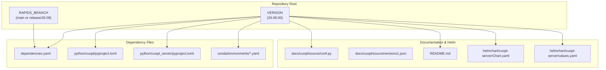
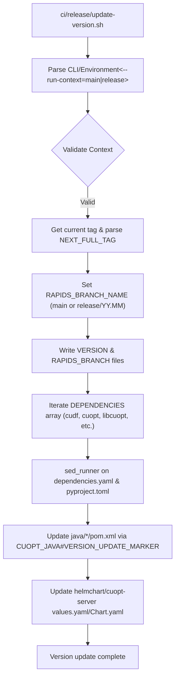
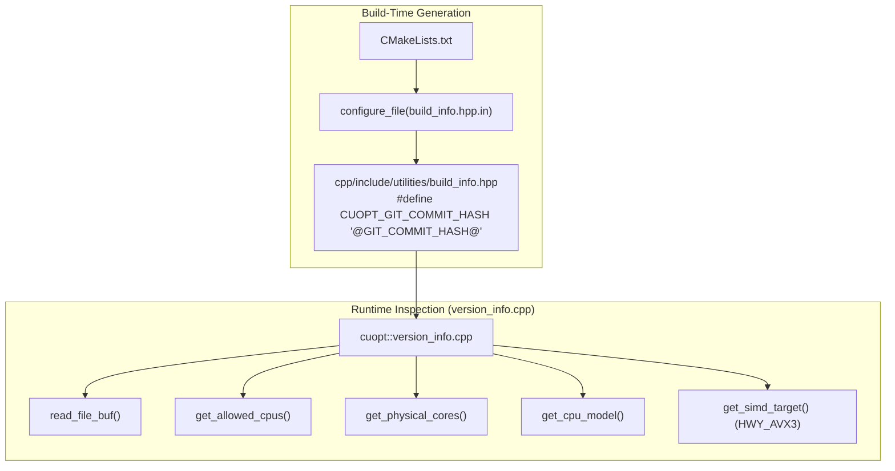
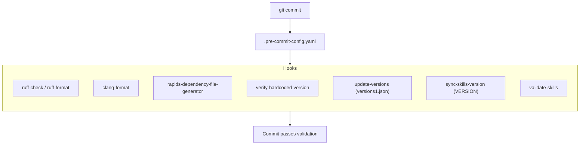
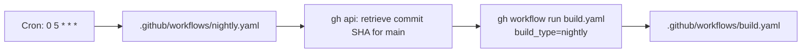

<!-- source: DeepWiki mcp.deepwiki.com · repo NVIDIA/cuopt · page 5.6 Version Management and Release Process · fetched 2026-10-26 -->

# Version Management and Release Process

Relevant source files

The following files were used as context for generating this wiki page:

- [.github/CODEOWNERS](.github/CODEOWNERS)
- [.github/workflows/nightly.yaml](.github/workflows/nightly.yaml)
- [.pre-commit-config.yaml](.pre-commit-config.yaml)
- [.yamllint.yaml](.yamllint.yaml)
- [RELEASE-NOTES.md](RELEASE-NOTES.md)
- [ci/release/update-version.sh](ci/release/update-version.sh)
- [ci/run-vale.sh](ci/run-vale.sh)
- [codecov.yml](codecov.yml)
- [cpp/src/utilities/build_info.hpp.in](cpp/src/utilities/build_info.hpp.in)
- [cpp/src/utilities/version_info.cpp](cpp/src/utilities/version_info.cpp)
- [cpp/src/utilities/version_info.hpp](cpp/src/utilities/version_info.hpp)
- [cpp/tests/utilities/test_cli.cpp](cpp/tests/utilities/test_cli.cpp)
- [docs/cuopt/source/cuopt-python/routing/examples/tsp_batch_example.py](docs/cuopt/source/cuopt-python/routing/examples/tsp_batch_example.py)
- [docs/cuopt/source/cuopt-server/examples/lp/examples/warmstart_example.py](docs/cuopt/source/cuopt-server/examples/lp/examples/warmstart_example.py)
- [python/.coveragerc](python/.coveragerc)

This page documents the version management system, release workflow, build/version inspection subsystem, pre-commit quality checks, and code ownership policies for cuOpt. It covers version file structures, automated version updates via `update-version.sh`, C++ build-time version metadata generation, release notes maintenance, and CI/CD distribution mechanisms.

For information about dependency management across packages, see [Dependency Management](#5.2). For CI/CD workflow details beyond releases, see [CI/CD Workflows](#5.3).

---

## 1. Version Scheme and Version Files

cuOpt uses a calendar-based versioning scheme aligned with the RAPIDS ecosystem.

### Version Format

| Format | Example | Usage |
|--------|---------|-------|
| Full Version | `26.08.00` | YY.MM.PP format stored in `VERSION` file |
| Short Version | `26.08` | YY.MM format for dependency ranges |
| PEP440 Normalized | `26.8` | Python packaging (removes leading zeros) |
| Docker Tag | `26.8.0` | Container images (removes leading zeros) |
| Git Tag | `v26.08.00` | Release tags with `v` prefix |

### Core Version Files

**Sources:** [VERSION:1-1](), [RAPIDS_BRANCH:1-1](), [ci/release/update-version.sh:96-98]()

---

## 2. Version Update Automation (`update-version.sh`)

The `[ci/release/update-version.sh]()` script is the centralized tool for updating versions across the repository. It operates in two contexts: `main` (development) and `release` (release branch preparation).

### Script Execution and Code Entity Mapping

The script validates execution preconditions, parses the new target tag, updates package arrays, updates Java Maven artifacts using specific comment markers, and adjusts documentation and CI workflow file references.

**Sources:** [ci/release/update-version.sh:1-166]()

### Key Update Operations

| Target File | Code Pattern / Mechanism | Update Target |
|-------------|-------------------------|---------------|
| `VERSION` | Direct write | `26.08.00` |
| `RAPIDS_BRANCH` | Direct write | `release/26.08` |
| `dependencies.yaml` | `sed_runner` regex substitution | `==YY.MM.*,>=0.0.0a0` |
| `java/*/pom.xml` | `CUOPT_JAVA#VERSION_UPDATE_MARKER` | `<version>YY.MM.P-SNAPSHOT</version>` |
| `helmchart/.../Chart.yaml` | `appVersion:` and `version:` fields | `26.8.0` |

**Sources:** [ci/release/update-version.sh:96-154]()

---

## 3. Build and Version Info Subsystem (`version_info.cpp`)

At runtime and build-time, cuOpt queries system properties, hardware constraints (CPU cores, NUMA topologies, instruction sets like AVX-512 via Highway), and embedded Git commit hashes.

### C++ Version and Build Metadata Subsystem

**Sources:** [cpp/src/utilities/version_info.cpp:29-224](), [cpp/src/utilities/build_info.hpp.in:1-14]()

---

## 4. Pre-Commit Hooks and Quality Enforcement

Pre-commit hooks enforce formatting, copyright compliance, version constraints, and agent skill synchronization.

### Pre-Commit Pipeline Architecture

**Sources:** [.pre-commit-config.yaml:11-156]()

---

## 5. Release Notes and Code Ownership

### Release Notes Structure

Release notes are maintained in `[RELEASE-NOTES.md]()` and categorized by release version (e.g., `26.08`, `26.06`). Each entry contains:
* **New Features**: Major capability additions (e.g., Multi-GPU PDLP, quadratic constraints, Python pandas/NumPy routing inputs).
* **Breaking Changes**: API deprecations or modifications requiring user migration.
* **Improvements**: Performance optimizations, numerical stability tweaks, refactorings.
* **Bug Fixes**: Resolved edge cases, numerical instabilities, and crash bugs.
* **Documentation & New Contributors**: Acknowledgments and documentation updates.

**Sources:** [RELEASE-NOTES.md:1-117]()

### Code Owners (`CODEOWNERS`)

Repository paths are governed by specific GitHub teams defined in `[.github/CODEOWNERS]()`:

| Path Pattern | Assigned Owners | Scope |
|--------------|----------------|-------|
| `*` | `@nvidia/cuopt-infra-codeowners` | Default fallback |
| `cpp/`, `benchmarks/` | `@nvidia/cuopt-solver-codeowners` | C++ solver engines |
| `cpp/src/grpc/`, `cpp/include/cuopt/grpc/` | `@nvidia/cuopt-infra-codeowners` | gRPC transport layer |
| `python/`, `notebooks/`, `docs/` | `@nvidia/cuopt-infra-codeowners` | Python SDK & docs |
| `ci/`, `.github/` | `@nvidia/cuopt-ci-codeowners` | CI pipelines & workflows |
| `skills/`, `AGENTS.md` | `@nvidia/cuopt-infra-codeowners` | Agent skills & contributor tools |

**Sources:** [.github/CODEOWNERS:1-46]()

---

## 6. CI/CD Release Pipelines & Nightly Runs

The release and nightly pipelines are driven by GitHub Actions workflows. The nightly scheduler [`[.github/workflows/nightly.yaml]()`]() triggers builds daily at 5:00 UTC.

**Sources:** [.github/workflows/nightly.yaml:1-47]()

---

**Sources:**
- [.github/workflows/nightly.yaml:1-47]()
- [.pre-commit-config.yaml:1-159]()
- [ci/release/update-version.sh:1-166]()
- [.github/CODEOWNERS:1-46]()
- [RELEASE-NOTES.md:1-117]()
- [cpp/src/utilities/version_info.cpp:29-224]()
- [cpp/src/utilities/build_info.hpp.in:1-14]()
- [VERSION:1-1]()
- [RAPIDS_BRANCH:1-1]()

---

