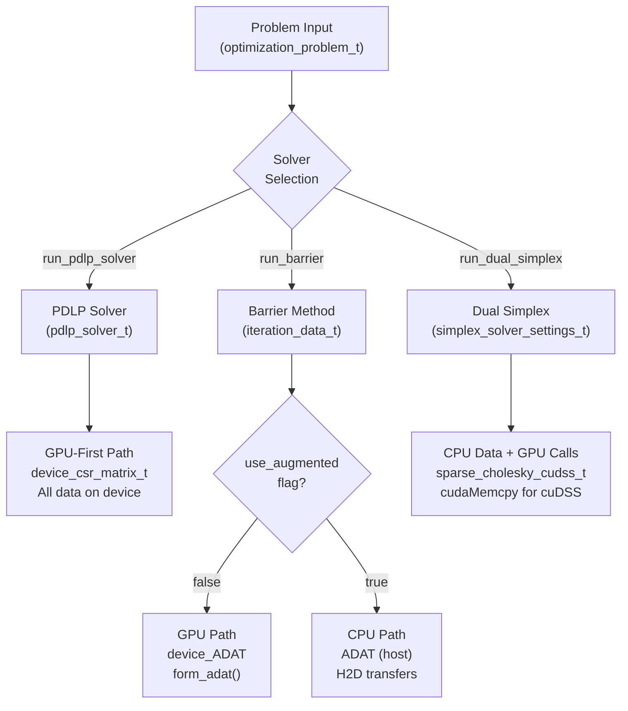
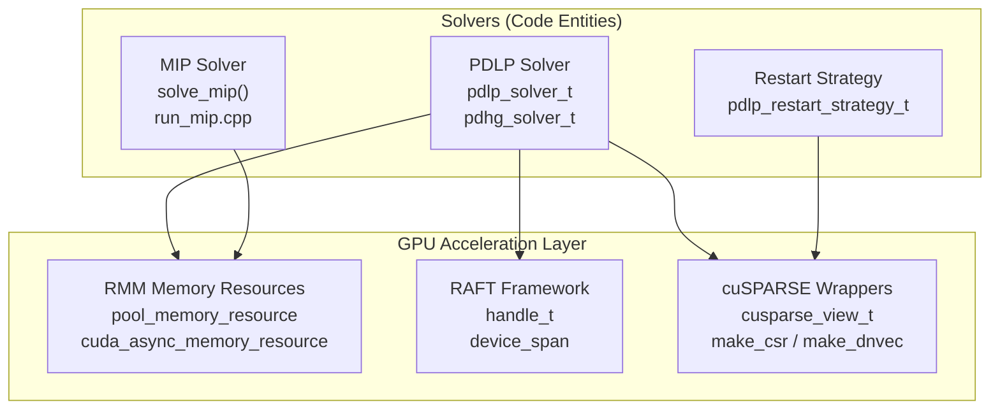

<!-- source: DeepWiki mcp.deepwiki.com · repo NVIDIA/cuopt · page 6 GPU Acceleration and Performance · fetched 2026-10-26 -->

# GPU Acceleration and Performance

Relevant source files

The following files were used as context for generating this wiki page:

- [benchmarks/linear_programming/cuopt/benchmark_helper.hpp](benchmarks/linear_programming/cuopt/benchmark_helper.hpp)
- [benchmarks/linear_programming/cuopt/run_mip.cpp](benchmarks/linear_programming/cuopt/run_mip.cpp)
- [benchmarks/linear_programming/cuopt/run_pdlp.cu](benchmarks/linear_programming/cuopt/run_pdlp.cu)
- [cpp/src/pdlp/cusparse_view.cu](cpp/src/pdlp/cusparse_view.cu)
- [cpp/src/pdlp/cusparse_view.hpp](cpp/src/pdlp/cusparse_view.hpp)
- [cpp/src/pdlp/optimal_batch_size_handler/optimal_batch_size_handler.cu](cpp/src/pdlp/optimal_batch_size_handler/optimal_batch_size_handler.cu)
- [cpp/src/pdlp/pdhg.cu](cpp/src/pdlp/pdhg.cu)
- [cpp/src/pdlp/pdhg.hpp](cpp/src/pdlp/pdhg.hpp)
- [cpp/src/pdlp/pdlp.cuh](cpp/src/pdlp/pdlp.cuh)
- [cpp/src/pdlp/restart_strategy/pdlp_restart_strategy.cu](cpp/src/pdlp/restart_strategy/pdlp_restart_strategy.cu)
- [cpp/src/pdlp/restart_strategy/pdlp_restart_strategy.cuh](cpp/src/pdlp/restart_strategy/pdlp_restart_strategy.cuh)
- [cpp/src/pdlp/restart_strategy/weighted_average_solution.cu](cpp/src/pdlp/restart_strategy/weighted_average_solution.cu)
- [cpp/src/pdlp/restart_strategy/weighted_average_solution.hpp](cpp/src/pdlp/restart_strategy/weighted_average_solution.hpp)
- [cpp/src/pdlp/step_size_strategy/adaptive_step_size_strategy.cu](cpp/src/pdlp/step_size_strategy/adaptive_step_size_strategy.cu)
- [cpp/src/pdlp/termination_strategy/convergence_information.hpp](cpp/src/pdlp/termination_strategy/convergence_information.hpp)
- [cpp/src/pdlp/termination_strategy/termination_strategy.cu](cpp/src/pdlp/termination_strategy/termination_strategy.cu)
- [cpp/src/pdlp/utilities/ping_pong_graph.cu](cpp/src/pdlp/utilities/ping_pong_graph.cu)
- [cpp/src/pdlp/utilities/ping_pong_graph.cuh](cpp/src/pdlp/utilities/ping_pong_graph.cuh)
- [cpp/src/routing/ges_solver.cu](cpp/src/routing/ges_solver.cu)
- [cpp/src/utilities/cuda_helpers.cuh](cpp/src/utilities/cuda_helpers.cuh)
- [cpp/src/utilities/device_scalar_init.hpp](cpp/src/utilities/device_scalar_init.hpp)
- [cpp/src/utilities/manual_cuda_graph.cuh](cpp/src/utilities/manual_cuda_graph.cuh)
- [cpp/tests/mip/determinism_test.cu](cpp/tests/mip/determinism_test.cu)
- [cpp/tests/mip/load_balancing_test.cu](cpp/tests/mip/load_balancing_test.cu)
- [cpp/tests/mip/multi_probe_test.cu](cpp/tests/mip/multi_probe_test.cu)
- [cpp/tests/routing/unit_tests/set_shmem_of_kernel.cu](cpp/tests/routing/unit_tests/set_shmem_of_kernel.cu)
- [cpp/tests/utilities/base_fixture.hpp](cpp/tests/utilities/base_fixture.hpp)

## Purpose and Scope

This page describes cuOpt's GPU acceleration strategies, memory management, and integration with NVIDIA libraries (cuDSS, cuSparse, cuBLAS, RAFT). It covers how different solvers leverage GPU resources, memory allocation patterns, and concurrent execution coordination. 

*   For details on memory resource adaptors and pool sizing per worker process, see [GPU Memory Management](#6.1).
*   For details on cuDSS sparse Cholesky/LDLT factorization, device sparse matrix abstractions, augmented matvec, and vector math kernels, see [cuDSS and Sparse Linear Algebra](#6.2).
*   For details on `cusparse_view_t` abstractions, SpMV, CSR/CSC handling, manual/ping-pong CUDA graphs, and kernel-level performance tuning, see [cuSparse Operations and CUDA Graphs](#6.3).
*   For details on multi-GPU PDLP, MIP GPU queue management, and concurrent LP/heuristic execution, see [Multi-GPU and Concurrent Execution](#6.4).
*   For details on benchmarks/ harness (`run_pdlp`, `run_mip`, `run_cpufj`), dataset download scripts, and MIPLIB/Netlib datasets, see [Benchmarking and Regression Testing](#6.5).

---

## GPU Acceleration Strategy Overview

cuOpt employs a multi-layered GPU acceleration approach where different solver components have varying degrees of GPU utilization:

**GPU-First Solvers:**
*   PDLP solver (`pdlp_solver_t`) maintains all data on GPU and performs all computations there [cpp/src/pdlp/pdlp.cuh:48-69]().
*   Uses `device_csr_matrix_t` for matrix storage in `problem_t` [cpp/src/pdlp/pdlp.cuh:66-69]().
*   Minimizes host-device transfers through persistent GPU memory.
*   Employs CUDA graphs to optimize repetitive operations [cpp/src/pdlp/pdhg.cu:105-106]().

**Hybrid CPU-GPU Solvers:**
*   **Barrier Method**: Can operate in both pure GPU mode and CPU mode with GPU acceleration [benchmarks/linear_programming/cuopt/run_pdlp.cu:54-60]().
*   **Dual Simplex**: Keeps data on CPU but offloads factorizations to cuDSS on GPU.
*   **MIP Solver**: Uses GPU for LP relaxations and local search heuristics (`mip_heuristics`). In the MIP solver, `run_mip` [benchmarks/linear_programming/cuopt/run_mip.cpp:17-18]() orchestrates concurrent execution of GPU heuristics and CPU branch-and-bound.

**Initialization:**
The system initializes GPU contexts early to avoid overhead during solving. This sets cuBLAS and cuSparse to device pointer mode, enabling GPU-resident scalar parameters.

### GPU Execution Path Decision Flow

**Sources:** [benchmarks/linear_programming/cuopt/run_mip.cpp:17-18](), [cpp/src/pdlp/pdlp.cuh:48-69](), [cpp/src/pdlp/pdhg.cu:105-106]()

---

## GPU Memory Management with RMM

cuOpt uses RAPIDS Memory Manager (RMM) for all GPU memory allocations. RMM provides pool-based memory allocation to reduce overhead and stream-ordered memory operations [benchmarks/linear_programming/cuopt/run_mip.cpp:24-28]().

### Core Memory Types and Helpers

| Type | Description | Usage |
|------|-------------|-------|
| `rmm::device_uvector<T>` | Device vector with RAII | Primary container for GPU data [cpp/src/pdlp/pdlp.cuh:34-34]() |
| `rmm::device_scalar<T>` | Single device value | Used for scalar parameters in kernels [cpp/src/pdlp/pdlp.cuh:33-33]() |
| `cudaStream_t` / stream views | Stream wrapper | Stream coordination and async execution [cpp/src/pdlp/pdhg.cu:60-60]() |
| `raft::device_span<T>` | Non-owning view | Used for kernel arguments [cpp/src/utilities/cuda_helpers.cuh:18-18]() |

### Memory Allocation and Transfers

Data movement between host and device uses utility functions and memory resource adaptors (`limiting_resource_adaptor`, `pool_memory_resource`, `cuda_async_memory_resource`) [benchmarks/linear_programming/cuopt/run_mip.cpp:24-28]().

**Memory Limit Tracking:**
The `set_shmem_of_kernel` utility [cpp/src/utilities/cuda_helpers.cuh:200-221]() dynamically manages shared memory allocations with thread-safe caching.

**Sources:** [benchmarks/linear_programming/cuopt/run_mip.cpp:24-28](), [cpp/src/pdlp/pdlp.cuh:33-34](), [cpp/src/utilities/cuda_helpers.cuh:18-21](), [cpp/src/utilities/cuda_helpers.cuh:200-221]()

---

## cuSparse and Linear Algebra Operations

cuOpt leverages cuSparse for high-performance sparse matrix operations, particularly in the PDLP and Barrier solvers [cpp/src/pdlp/cusparse_view.hpp:17-20]().

### Optimization Utilities

The codebase includes specialized kernels and structures to optimize GPU throughput:
*   **Vectorization & SpMV Descriptors:** `cusparse_view_t` [cpp/src/pdlp/cusparse_view.hpp:142-154]() manages matrix descriptors (`cusparseSpMatDescr_t`) [cpp/src/pdlp/cusparse_view.hpp:38-43]() and dense vector views (`cusparseDnVecDescr_t`) [cpp/src/pdlp/cusparse_view.hpp:45-50]() for cuSPARSE SpMV/SpMM operations.
*   **Dynamic Loading:** Runtime loading via `dynamic_load_runtime` [cpp/src/pdlp/cusparse_view.cu:38-73]() handles version mismatches between compiled and runtime cuSPARSE libraries.
*   **CUDA Graphs Integration:** Solvers utilize `ping_pong_graph_t` [cpp/src/pdlp/pdhg.cu:105-106]() and graph capture to minimize CPU launch overhead across PDHG iterations.

### System Mapping: GPU Acceleration Architecture

**Sources:** [cpp/src/pdlp/cusparse_view.cu:38-73](), [cpp/src/pdlp/cusparse_view.hpp:38-50](), [cpp/src/pdlp/cusparse_view.hpp:142-154](), [cpp/src/pdlp/pdhg.cu:105-106]()

---

## Child Pages
*   [GPU Memory Management](#6.1) — Detail RMM integration: memory resource adaptors, pool sizing per worker process, device vectors, copy helpers, and memory tests.
*   [cuDSS and Sparse Linear Algebra](#6.2) — Explain cuDSS sparse Cholesky/LDLT factorization, device sparse matrix abstractions, augmented matvec, and vector math kernels.
*   [cuSparse Operations and CUDA Graphs](#6.3) — Detail `cusparse_view_t` abstractions, SpMV, CSR/CSC handling, manual/ping-pong CUDA graphs, and kernel-level performance tuning.
*   [Multi-GPU and Concurrent Execution](#6.4) — Explain multi-GPU PDLP (NCCL, KaMinPar partitioning, shards), MIP GPU queue management and process forking, and concurrent LP/heuristic execution.
*   [Benchmarking and Regression Testing](#6.5) — Document benchmarks/ harness (`run_pdlp`, `run_mip`, `run_cpufj`), dataset download scripts, MIPLIB/Netlib datasets, and the regression/ benchmark scripts and configs.

---

