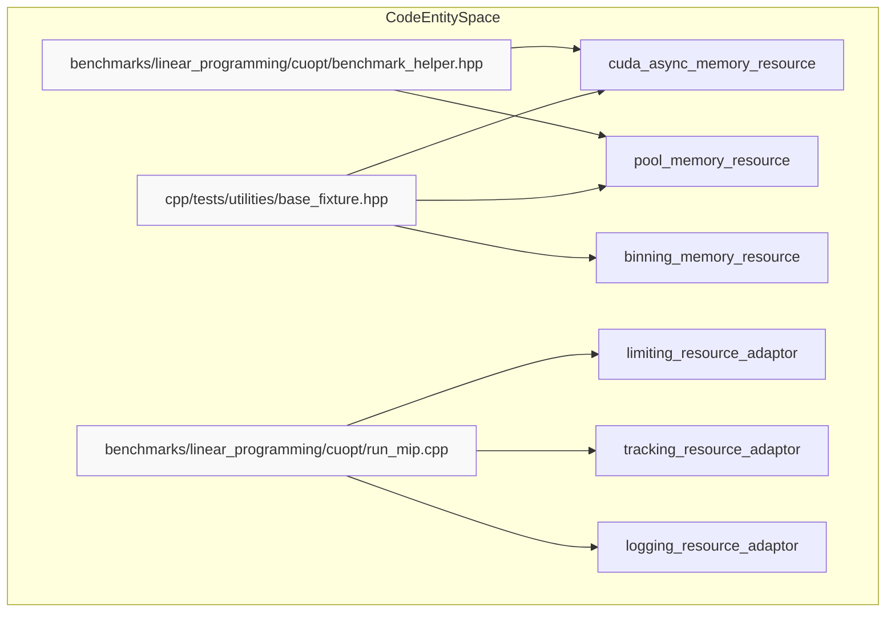
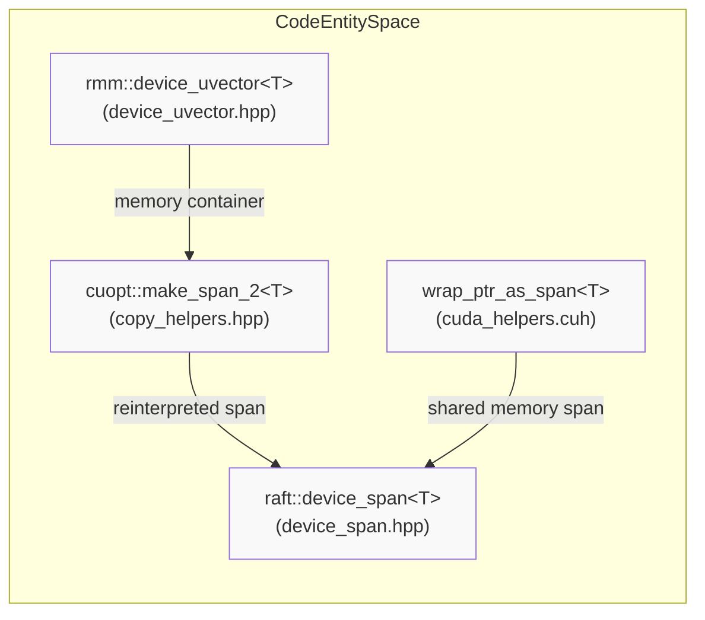

<!-- source: DeepWiki mcp.deepwiki.com · repo NVIDIA/cuopt · page 6.1 GPU Memory Management · fetched 2026-10-26 -->

# GPU Memory Management

<details>
<summary>Relevant source files</summary>

The following files were used as context for generating this wiki page:

- [benchmarks/linear_programming/cuopt/benchmark_helper.hpp](benchmarks/linear_programming/cuopt/benchmark_helper.hpp)
- [benchmarks/linear_programming/cuopt/run_mip.cpp](benchmarks/linear_programming/cuopt/run_mip.cpp)
- [benchmarks/linear_programming/cuopt/run_pdlp.cu](benchmarks/linear_programming/cuopt/run_pdlp.cu)
- [cpp/src/pdlp/swap_and_resize_helper.cuh](cpp/src/pdlp/swap_and_resize_helper.cuh)
- [cpp/src/routing/ges_solver.cu](cpp/src/routing/ges_solver.cu)
- [cpp/src/routing/solution/route_node_map.cuh](cpp/src/routing/solution/route_node_map.cuh)
- [cpp/src/routing/utilities/check_input.cu](cpp/src/routing/utilities/check_input.cu)
- [cpp/src/utilities/copy_helpers.hpp](cpp/src/utilities/copy_helpers.hpp)
- [cpp/src/utilities/cuda_helpers.cuh](cpp/src/utilities/cuda_helpers.cuh)
- [cpp/tests/mip/determinism_test.cu](cpp/tests/mip/determinism_test.cu)
- [cpp/tests/mip/load_balancing_test.cu](cpp/tests/mip/load_balancing_test.cu)
- [cpp/tests/mip/multi_probe_test.cu](cpp/tests/mip/multi_probe_test.cu)
- [cpp/tests/routing/unit_tests/set_shmem_of_kernel.cu](cpp/tests/routing/unit_tests/set_shmem_of_kernel.cu)
- [cpp/tests/utilities/base_fixture.hpp](cpp/tests/utilities/base_fixture.hpp)

</details>


## Purpose and Scope

This document details the GPU memory management subsystem in cuOpt, focusing on **RAPIDS Memory Manager (RMM)** integration, memory resource adaptors, worker process pool sizing heuristics, device vector abstractions, copy helpers, and memory-related test infrastructures.

Sources: [cpp/tests/utilities/base_fixture.hpp:1-49](), [benchmarks/linear_programming/cuopt/benchmark_helper.hpp:22-46]()

---

## 1. RMM Integration and Memory Resource Adaptors

cuOpt relies heavily on **RMM** for device memory allocation, minimizing overhead via asynchronous streams and custom resource adaptors. The test and benchmark frameworks define several factory functions to instantiate different RMM memory resources [cpp/tests/utilities/base_fixture.hpp:28-48](), [benchmarks/linear_programming/cuopt/benchmark_helper.hpp:22-46]():

* `make_cuda()`: Wraps standard `rmm::mr::cuda_memory_resource()` [cpp/tests/utilities/base_fixture.hpp:29]().
* `make_async()`: Instantiates `rmm::mr::cuda_async_memory_resource()` for stream-ordered memory allocation [cpp/tests/utilities/base_fixture.hpp:31](), [benchmarks/linear_programming/cuopt/benchmark_helper.hpp:36]().
* `make_managed()`: Wraps `rmm::mr::managed_memory_resource()` for unified memory [cpp/tests/utilities/base_fixture.hpp:33]().
* `make_pool()`: Constructs an `rmm::mr::pool_memory_resource` backed by an asynchronous resource [cpp/tests/utilities/base_fixture.hpp:35-40](), [benchmarks/linear_programming/cuopt/benchmark_helper.hpp:37-46]().
* `make_binning()`: Combines a pool resource with a `rmm::mr::binning_memory_resource` for small-granularity bins (256B to 4096KiB) [cpp/tests/utilities/base_fixture.hpp:42-48]().



Sources: [cpp/tests/utilities/base_fixture.hpp:28-48](), [benchmarks/linear_programming/cuopt/benchmark_helper.hpp:22-46](), [benchmarks/linear_programming/cuopt/run_mip.cpp:24-29]()

---

## 2. Pool Sizing per Worker Process

In distributed or concurrent worker environments (such as benchmarking and multi-process gRPC workers), memory pools must be dynamically sized based on available device memory. The helper function `make_pool()` queries the device status via CUDA runtime APIs [benchmarks/linear_programming/cuopt/benchmark_helper.hpp:37-46]():

```cpp
inline auto make_pool()
{
  size_t free_mem, total_mem;
  RAFT_CUDA_TRY(cudaMemGetInfo(&free_mem, &total_mem));
  size_t rmm_alloc_gran = 256;
  double alloc_ratio    = 0.4;
  // allocate 40%
  size_t initial_pool_size = (size_t(free_mem * alloc_ratio) / rmm_alloc_gran) * rmm_alloc_gran;
  return rmm::mr::pool_memory_resource(make_async(), initial_pool_size);
}
```

This ensures each worker claims an appropriate fraction (40%) of the free device memory aligned to 256-byte granularity blocks.

Sources: [benchmarks/linear_programming/cuopt/benchmark_helper.hpp:37-46]()

---

## 3. Device Vectors and Memory Wrappers

Type-safe device memory containers are managed primarily through `rmm::device_uvector<T>`, supplemented by span wrappers and alignment helpers defined in [cpp/src/utilities/cuda_helpers.cuh:165-173]() and [cpp/src/utilities/copy_helpers.hpp:28-45]().



For instance, `make_span_2` reinterprets a container into a double-width precision span:
```cpp
template <typename T>
raft::device_span<typename type_2<T>::type> make_span_2(rmm::device_uvector<T>& container)
{
  using T2 = typename type_2<T>::type;
  static_assert(sizeof(T2) == 2 * sizeof(T));
  return raft::device_span<T2>(reinterpret_cast<T2*>(container.data()),
                               sizeof(T) * container.size() / sizeof(T2));
}
```

Sources: [cpp/src/utilities/copy_helpers.hpp:28-45](), [cpp/src/utilities/cuda_helpers.cuh:165-173]()

---

## 4. Copy Helpers and Host-Device Transfer Utilities

Data transfers between host (`std::vector`) and device (`rmm::device_uvector` or raw pointers) are centralized in `cpp/src/utilities/copy_helpers.hpp` [cpp/src/utilities/copy_helpers.hpp:56-218]().

| Function Signature | Direction | Description | Cited Lines |
|---|---|---|---|
| `host_copy(T const* device_ptr, size_t size, cuda::stream_ref)` | Device → Host | Copies raw device pointer data asynchronously/synchronously | [cpp/src/utilities/copy_helpers.hpp:56-64]() |
| `host_copy(bool const* device_ptr, size_t size, cuda::stream_ref)` | Device → Host | Transforms boolean device array to integer vector before copying | [cpp/src/utilities/copy_helpers.hpp:83-98]() |
| `host_copy(rmm::device_uvector<T> const&, cuda::stream_ref)` | Device → Host | Copies device vector contents to host `std::vector` | [cpp/src/utilities/copy_helpers.hpp:108-115]() |
| `device_copy(std::vector<T> const&, cuda::stream_ref)` | Host → Device | Allocates and copies a host vector into a new `rmm::device_uvector` | [cpp/src/utilities/copy_helpers.hpp:187-193]() |
| `device_copy(std::vector<bool> const&, cuda::stream_ref)` | Host → Device | Converts host boolean vector to integer format and copies to device | [cpp/src/utilities/copy_helpers.hpp:202-219]() |

Sources: [cpp/src/utilities/copy_helpers.hpp:56-219]()

---

## 5. Memory Tests and Fixture Infrastructure

Unit tests validate memory allocation modes and catch resource leaks through custom fixtures and macros defined in `cpp/tests/utilities/base_fixture.hpp`.

### Test Configuration and `CUOPT_TEST_PROGRAM_MAIN`

The `CUOPT_TEST_PROGRAM_MAIN()` macro parses command-line options (such as `--rmm_mode` defaulting to `"pool"`), configures the current device RMM resource via `rmm::mr::set_current_device_resource()`, and runs the GoogleTest suite [cpp/tests/utilities/base_fixture.hpp:80-124]().

```cpp
#define CUOPT_TEST_PROGRAM_MAIN()                                        \
  int main(int argc, char** argv)                                        \
  {                                                                      \
    ::testing::InitGoogleTest(&argc, argv);                              \
    auto const cmd_opts = parse_test_options(argc, argv);                \
    auto const rmm_mode = cmd_opts["rmm_mode"].as<std::string>();        \
    auto resource       = cuopt::test::create_memory_resource(rmm_mode); \
    rmm::mr::set_current_device_resource(resource);                      \
    return RUN_ALL_TESTS();                                              \
  }
```

The resource factory `create_memory_resource` supports `"binning"`, `"cuda"`, `"pool"`, and `"managed"` allocation modes [cpp/tests/utilities/base_fixture.hpp:64-75]().

Sources: [cpp/tests/utilities/base_fixture.hpp:64-124]()

---

