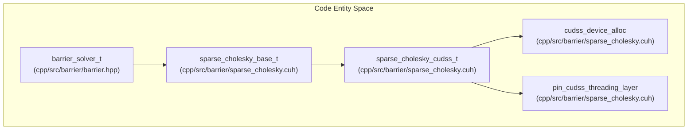
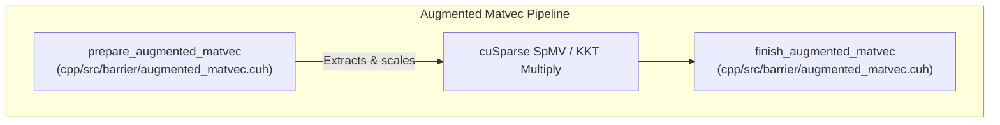
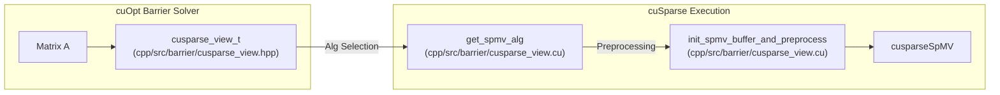

<!-- source: DeepWiki mcp.deepwiki.com · repo NVIDIA/cuopt · page 6.2 cuDSS and Sparse Linear Algebra · fetched 2026-10-26 -->

# cuDSS and Sparse Linear Algebra

Relevant source files

The following files were used as context for generating this wiki page:

- [benchmarks/linear_programming/cuopt/run_cpufj.cu](benchmarks/linear_programming/cuopt/run_cpufj.cu)
- [cpp/src/barrier/augmented_matvec.cuh](cpp/src/barrier/augmented_matvec.cuh)
- [cpp/src/barrier/barrier.cu](cpp/src/barrier/barrier.cu)
- [cpp/src/barrier/barrier.hpp](cpp/src/barrier/barrier.hpp)
- [cpp/src/barrier/cusparse_view.cu](cpp/src/barrier/cusparse_view.cu)
- [cpp/src/barrier/cusparse_view.hpp](cpp/src/barrier/cusparse_view.hpp)
- [cpp/src/barrier/device_sparse_matrix.cuh](cpp/src/barrier/device_sparse_matrix.cuh)
- [cpp/src/barrier/iterative_refinement.hpp](cpp/src/barrier/iterative_refinement.hpp)
- [cpp/src/barrier/scaling_gpu.cu](cpp/src/barrier/scaling_gpu.cu)
- [cpp/src/barrier/second_order_cone_kernels.cuh](cpp/src/barrier/second_order_cone_kernels.cuh)
- [cpp/src/barrier/sparse_cholesky.cuh](cpp/src/barrier/sparse_cholesky.cuh)
- [cpp/src/barrier/sparse_matrix_kernels.cuh](cpp/src/barrier/sparse_matrix_kernels.cuh)
- [cpp/src/linear_algebra/vector_math.cuh](cpp/src/linear_algebra/vector_math.cuh)
- [cpp/src/mip_heuristics/presolve/trivial_presolve.cuh](cpp/src/mip_heuristics/presolve/trivial_presolve.cuh)
- [cpp/src/mip_heuristics/presolve/trivial_presolve_helpers.cuh](cpp/src/mip_heuristics/presolve/trivial_presolve_helpers.cuh)
- [cpp/src/mip_heuristics/problem/presolve_data.cu](cpp/src/mip_heuristics/problem/presolve_data.cu)
- [cpp/src/mip_heuristics/problem/presolve_data.cuh](cpp/src/mip_heuristics/problem/presolve_data.cuh)
- [cpp/tests/socp/barrier_kernels_test.cu](cpp/tests/socp/barrier_kernels_test.cu)
- [cpp/tests/socp/solve_barrier_socp.cu](cpp/tests/socp/solve_barrier_socp.cu)

## Purpose and Scope

This page details the integration of NVIDIA cuDSS (CUDA Sparse Direct Solver) and the supporting sparse linear algebra infrastructure within the cuOpt optimization engine. The barrier interior-point solver relies heavily on sparse matrix factorizations (Cholesky and LDLT) to solve the normal and augmented equations arising in each interior-point iteration. This documentation covers cuDSS wrapper classes, device sparse matrix abstractions (`device_csc_matrix_t`, `device_csr_matrix_t`), augmented matrix-vector product kernels (`prepare_augmented_matvec`, `finish_augmented_matvec`), and optimized GPU vector math and reduction workspaces.

**Sources:** [cpp/src/barrier/sparse_cholesky.cuh:1-63](), [cpp/src/barrier/barrier.cu:8-32](), [cpp/src/barrier/augmented_matvec.cuh:1-11]()

---

## 1. cuDSS Sparse Cholesky and LDLT Factorization

cuDSS provides GPU-accelerated sparse direct solvers used by the barrier method for interior-point iterations. The abstract base class `sparse_cholesky_base_t` defines the interface for symbolic analysis, numeric factorization, and linear system solves.

### Threading Layer Pinning and Memory Management
- **Threading Pinning**: `detail::pin_cudss_threading_layer()` pins cuDSS's dlopen'd threading-layer plugin using `dlopen` with `RTLD_NOW | RTLD_NODELETE` to prevent teardown races where `cudssDestroy()` unmaps the library while OpenMP threads are still active [cpp/src/barrier/sparse_cholesky.cuh:30-48]().
- **Memory Allocation**: RMM pool fragmentation can make workspace allocations smaller than requested. CuOpt implements `cudss_device_alloc()` and `cudss_device_dealloc()` using `cudaMallocAsync` and `cudaFreeAsync` specifically for cuDSS workspaces [cpp/src/barrier/sparse_cholesky.cuh:115-133]().

**Sources:** [cpp/src/barrier/sparse_cholesky.cuh:30-63](), [cpp/src/barrier/sparse_cholesky.cuh:115-133]()

---

## 2. Device Sparse Matrix Abstractions

CuOpt uses device-resident sparse matrix representations to avoid host-device transfer overhead during iterative solves.

| Class / Struct | File | Description |
|----------------|------|-------------|
| `device_csc_matrix_t` | `cpp/src/barrier/device_sparse_matrix.cuh` | Device-resident Compressed Sparse Column (CSC) matrix with `col_start`, row indices `i`, and values `x`. Supports move semantics, resizing, and host conversion [cpp/src/barrier/device_sparse_matrix.cuh:126-209](). |
| `csc_view_t` | `cpp/src/barrier/device_sparse_matrix.cuh` | Non-owning span-based view over CSC arrays (`col_start`, `i`, `x`) [cpp/src/barrier/device_sparse_matrix.cuh:119-123](). |
| `device_csr_matrix_t` | `cpp/src/barrier/device_sparse_matrix.cuh` | Device-resident Compressed Sparse Row (CSR) matrix counterpart used for row-oriented operations and cuSparse integration. |

**Sources:** [cpp/src/barrier/device_sparse_matrix.cuh:119-209]()

---

## 3. Augmented Matvec Kernels

During barrier solves, matrix-vector products involving augmented KKT systems or constraint matrices require specialized preparation and post-processing kernels to handle free variables and scaling factors.

### Kernel Functions
- `prepare_augmented_matvec`: Copies primal/dual components into partitioned vectors `x1`, `x2`, `y1`, `y2`, and computes regularized diagonal contributions for linear free variables [cpp/src/barrier/augmented_matvec.cuh:13-44]().
- `finish_augmented_matvec`: Combines partitioned result buffers back into global solver output vectors with scaling factors `alpha` and `beta` [cpp/src/barrier/augmented_matvec.cuh:46-63]().

**Sources:** [cpp/src/barrier/augmented_matvec.cuh:1-64]()

---

## 4. Vector Math Kernels and Reduction Workspaces

GPU-accelerated vector operations are designed around reusable workspace structures to minimize allocation overhead across barrier iterations.

### Key Workspace Structures
- `reduction_workspace_t`: Caches scratch buffers for `cub::DeviceReduce` operations, allowing sequential async reductions on the same CUDA stream without reallocating [cpp/src/linear_algebra/vector_math.cuh:33-92]().
- `transform_reduce_pair_helper_t`: Fuses two independent same-length reductions (such as primal-dual step length pairs `(w, dw)` and `(v, dv)`) into a single kernel launch and host read [cpp/src/barrier/device_sparse_matrix.cuh:72-116]().
- `gmres_workspace_t`: Pre-allocates Krylov subspace bases ($V$ and $Z$) and reduction variables for iterative refinement steps in the barrier solve [cpp/src/barrier/iterative_refinement.hpp:56-131]().

**Sources:** [cpp/src/linear_algebra/vector_math.cuh:33-92](), [cpp/src/barrier/device_sparse_matrix.cuh:72-116](), [cpp/src/barrier/iterative_refinement.hpp:56-131]()

---

## 5. cuSparse Integration and SpMV

Auxiliary matrix-vector multiplications utilize `cuSparse` via the lightweight `cusparse_view_t` wrapper class.

### Algorithm Selection and Preprocessing
- `get_spmv_alg`: Automatically selects between `CUSPARSE_SPMV_CSR_ALG2` (for deterministic bit-wise results) and `CUSPARSE_SPMV_CSR_ALG1` depending on pre-evaluated beta bug conditions in older cuSparse library versions [cpp/src/barrier/cusparse_view.cu:134-141]().
- `init_spmv_buffer_and_preprocess`: Queries SpMV workspace buffer sizes and invokes optional preprocessing routines to optimize repeated sparse matrix-vector multiplications [cpp/src/barrier/cusparse_view.cu:143-164]().

**Sources:** [cpp/src/barrier/cusparse_view.hpp:1-91](), [cpp/src/barrier/cusparse_view.cu:124-164]()

---

