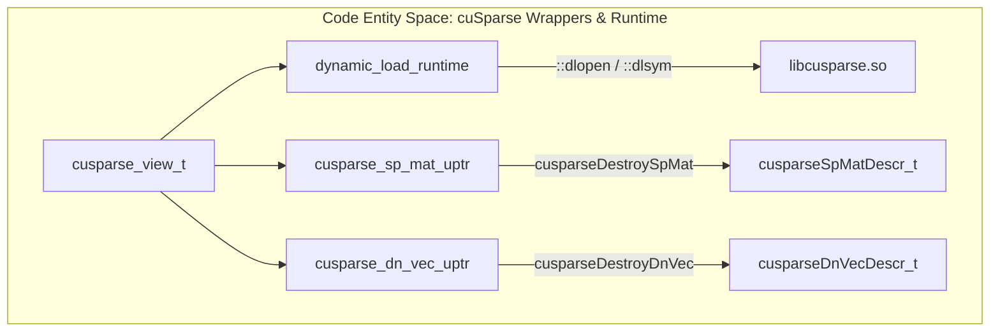
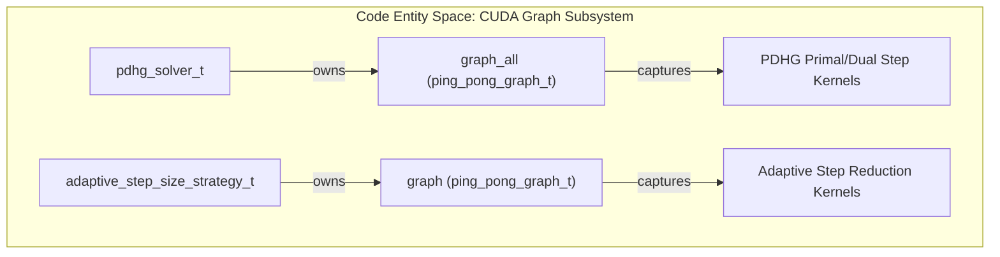

<!-- source: DeepWiki mcp.deepwiki.com · repo NVIDIA/cuopt · page 6.3 cuSparse Operations and CUDA Graphs · fetched 2026-10-26 -->

# cuSparse Operations and CUDA Graphs

<details>
<summary>Relevant source files</summary>

The following files were used as context for generating this wiki page:

- [benchmarks/linear_programming/cuopt/run_cpufj.cu](benchmarks/linear_programming/cuopt/run_cpufj.cu)
- [cpp/src/barrier/cusparse_view.cu](cpp/src/barrier/cusparse_view.cu)
- [cpp/src/barrier/cusparse_view.hpp](cpp/src/barrier/cusparse_view.hpp)
- [cpp/src/barrier/scaling_gpu.cu](cpp/src/barrier/scaling_gpu.cu)
- [cpp/src/barrier/sparse_matrix_kernels.cuh](cpp/src/barrier/sparse_matrix_kernels.cuh)
- [cpp/src/mip_heuristics/presolve/trivial_presolve.cuh](cpp/src/mip_heuristics/presolve/trivial_presolve.cuh)
- [cpp/src/mip_heuristics/presolve/trivial_presolve_helpers.cuh](cpp/src/mip_heuristics/presolve/trivial_presolve_helpers.cuh)
- [cpp/src/mip_heuristics/problem/presolve_data.cu](cpp/src/mip_heuristics/problem/presolve_data.cu)
- [cpp/src/mip_heuristics/problem/presolve_data.cuh](cpp/src/mip_heuristics/problem/presolve_data.cuh)
- [cpp/src/pdlp/cusparse_view.cu](cpp/src/pdlp/cusparse_view.cu)
- [cpp/src/pdlp/cusparse_view.hpp](cpp/src/pdlp/cusparse_view.hpp)
- [cpp/src/pdlp/optimal_batch_size_handler/optimal_batch_size_handler.cu](cpp/src/pdlp/optimal_batch_size_handler/optimal_batch_size_handler.cu)
- [cpp/src/pdlp/pdhg.cu](cpp/src/pdlp/pdhg.cu)
- [cpp/src/pdlp/pdhg.hpp](cpp/src/pdlp/pdhg.hpp)
- [cpp/src/pdlp/pdlp.cuh](cpp/src/pdlp/pdlp.cuh)
- [cpp/src/pdlp/restart_strategy/pdlp_restart_strategy.cu](cpp/src/pdlp/restart_strategy/pdlp_restart_strategy.cu)
- [cpp/src/pdlp/restart_strategy/pdlp_restart_strategy.cuh](cpp/src/pdlp/restart_strategy/pdlp_restart_strategy.cuh)
- [cpp/src/pdlp/restart_strategy/weighted_average_solution.cu](cpp/src/pdlp/restart_strategy/weighted_average_solution.cu)
- [cpp/src/pdlp/restart_strategy/weighted_average_solution.hpp](cpp/src/pdlp/restart_strategy/weighted_average_solution.hpp)
- [cpp/src/pdlp/step_size_strategy/adaptive_step_size_strategy.cu](cpp/src/pdlp/step_size_strategy/adaptive_step_size_strategy.cu)
- [cpp/src/pdlp/termination_strategy/convergence_information.hpp](cpp/src/pdlp/termination_strategy/convergence_information.hpp)
- [cpp/src/pdlp/termination_strategy/termination_strategy.cu](cpp/src/pdlp/termination_strategy/termination_strategy.cu)
- [cpp/src/pdlp/utilities/ping_pong_graph.cu](cpp/src/pdlp/utilities/ping_pong_graph.cu)
- [cpp/src/pdlp/utilities/ping_pong_graph.cuh](cpp/src/pdlp/utilities/ping_pong_graph.cuh)
- [cpp/src/utilities/device_scalar_init.hpp](cpp/src/utilities/device_scalar_init.hpp)
- [cpp/src/utilities/manual_cuda_graph.cuh](cpp/src/utilities/manual_cuda_graph.cuh)

</details>


## Purpose and Scope

This page details the implementation and architecture of NVIDIA cuSparse wrappers (`cusparse_view_t`) across cuOpt's optimization solver subsystems (such as PDLP and Barrier), sparse matrix format conversions (CSR/CSC), manual and ping-pong CUDA graph abstractions (`ping_pong_graph_t`), and kernel-level performance tuning strategies including dynamic symbol loading and algorithm selection.

---

## 1. The cuSparse Abstraction Layer (`cusparse_view_t`)

cuOpt encapsulates cuSparse opaque handles and descriptors within RAII-compliant C++ classes (`cusparse_view_t`) located in both the `pdlp` and `barrier` solver namespaces. These wrappers manage sparse matrix descriptors (`cusparseSpMatDescr_t`), dense vector descriptors (`cusparseDnVecDescr_t`), and dense matrix descriptors (`cusparseDnMatDescr_t`).

To prevent memory leaks and safely manage cuSparse lifetimes, cuOpt defines custom deleters wrapped in `std::unique_ptr` aliases (`cusparse_sp_mat_uptr`, `cusparse_dn_vec_uptr`, `cusparse_dn_mat_uptr`) [cpp/src/pdlp/cusparse_view.hpp:38-65]().

### Dynamic Runtime Symbol Loading

Because compiled CUDA toolkit versions can mismatch the host runtime version where `libcusparse.so` is loaded, cuOpt implements a dynamic runtime loading layer (`dynamic_load_runtime`) using `dlopen` and `dlsym`. This allows optional or post-release cuSparse APIs (such as `cusparseSpMV_preprocess` or SpMVOp descriptors) to be safely queried and invoked if available at runtime [cpp/src/barrier/cusparse_view.cu:35-70](), [cpp/src/pdlp/cusparse_view.cu:38-73]().



Sources: `[cpp/src/pdlp/cusparse_view.hpp:38-65]()`, `[cpp/src/barrier/cusparse_view.cu:35-70]`, `[cpp/src/pdlp/cusparse_view.cu:38-73]()`

---

## 2. Sparse Matrix Operations and Algorithm Selection (SpMV, CSR/CSC)

Solvers rely heavily on Sparse Matrix-Vector products ($A \times x$ and $A^T \times y$). The `barrier::cusparse_view_t` and `pdlp::cusparse_view_t` classes handle CSR and CSC conversions and dispatch appropriate cuSparse routines [cpp/src/barrier/cusparse_view.hpp:26-90](), [cpp/src/pdlp/cusparse_view.hpp:142-163]().

### Algorithm Selection and the Beta Bug

When executing SpMV operations, cuOpt dynamically chooses between algorithm variants (`CUSPARSE_SPMV_CSR_ALG1` and `CUSPARSE_SPMV_CSR_ALG2`) via `get_spmv_alg`. ALG2 provides bit-wise deterministic results on the GPU, but is guarded against known cuSparse version-dependent "beta bugs" using a row-offset inspection heuristic (`alg2_beta_bug_possible`) [cpp/src/barrier/cusparse_view.cu:122-141]():

```cpp
static cusparseSpMVAlg_t get_spmv_alg(bool beta_bug_possible, double beta)
{
  constexpr int cusparse_version =
    CUSPARSE_VER_MAJOR * 1000 + CUSPARSE_VER_MINOR * 100 + CUSPARSE_VER_PATCH;
  if (beta_bug_possible && beta != 0 && cusparse_version < 13000) { return CUSPARSE_SPMV_CSR_ALG1; }
  return CUSPARSE_SPMV_CSR_ALG2;
}
```

Sources: `[cpp/src/barrier/cusparse_view.cu:122-141]()`, `[cpp/src/barrier/cusparse_view.hpp:26-90]()`

---

## 3. CUDA Graphs: Manual and Ping-Pong Abstractions

To minimize kernel launch overhead across thousands of iterative solver steps, cuOpt constructs and captures execution flows into CUDA Graphs.

### Ping-Pong Graph Architecture

In the PDLP solver (`pdhg_solver_t`), iterative update steps alternate between two buffer states (e.g., current iterate vs. next iterate). cuOpt implements `ping_pong_graph_t` to manage graph capture and re-execution without redundant host-side dispatch overhead [cpp/src/pdlp/pdhg.cu:105-106](), [cpp/src/pdlp/step_size_strategy/adaptive_step_size_strategy.cu:64-64]().



Sources: `[cpp/src/pdlp/pdhg.cu:105-106]()`, `[cpp/src/pdlp/step_size_strategy/adaptive_step_size_strategy.cu:64-64]`, `[cpp/src/pdlp/pdhg.hpp:68-68]()`

---

## 4. Kernel-Level Performance Tuning and Runtime Adaptation

cuOpt applies several low-level optimizations around cuSparse and stream execution:

1. **Workspace Allocation & Preprocessing**: External SpMV buffers are queried via `raft::sparse::detail::cusparsespmv_buffersize` and allocated via RMM device buffers to ensure zero dynamic allocation during solving loops [cpp/src/barrier/cusparse_view.cu:151-163]().
2. **Stream Synchronization**: Stream references (`cuda::stream_ref` / `handle_ptr->get_stream()`) are explicitly bound to cuSparse handles via `cusparseSetStream` prior to executing SpMV/SpMM preprocessing and compute calls [cpp/src/barrier/cusparse_view.cu:115-118]().
3. **Graph Guarding**: Graph captures are conditionally disabled when mixed-precision SpMV or certain unsupported multi-stream configurations are active, falling back safely to standard stream queuing [cpp/src/pdlp/pdhg.cu:102-105]().

Sources: `[cpp/src/barrier/cusparse_view.cu:115-163]()`, `[cpp/src/pdlp/pdhg.cu:102-105]()`

---

