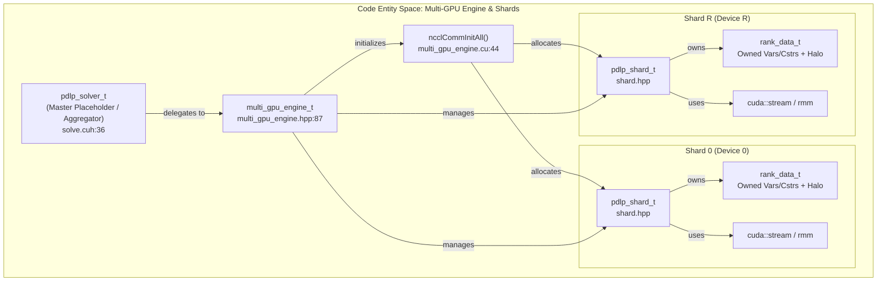
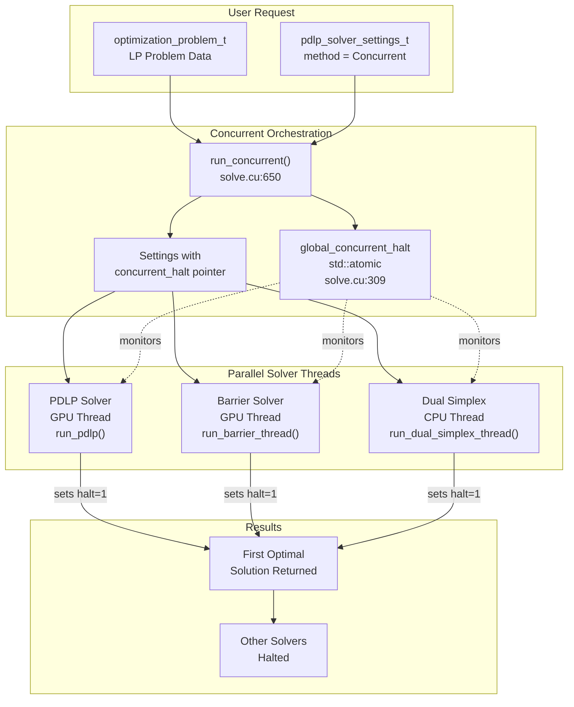
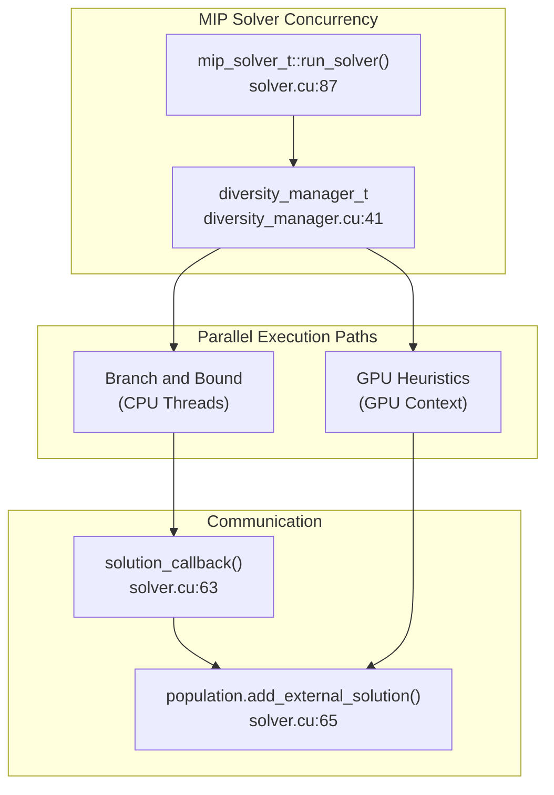
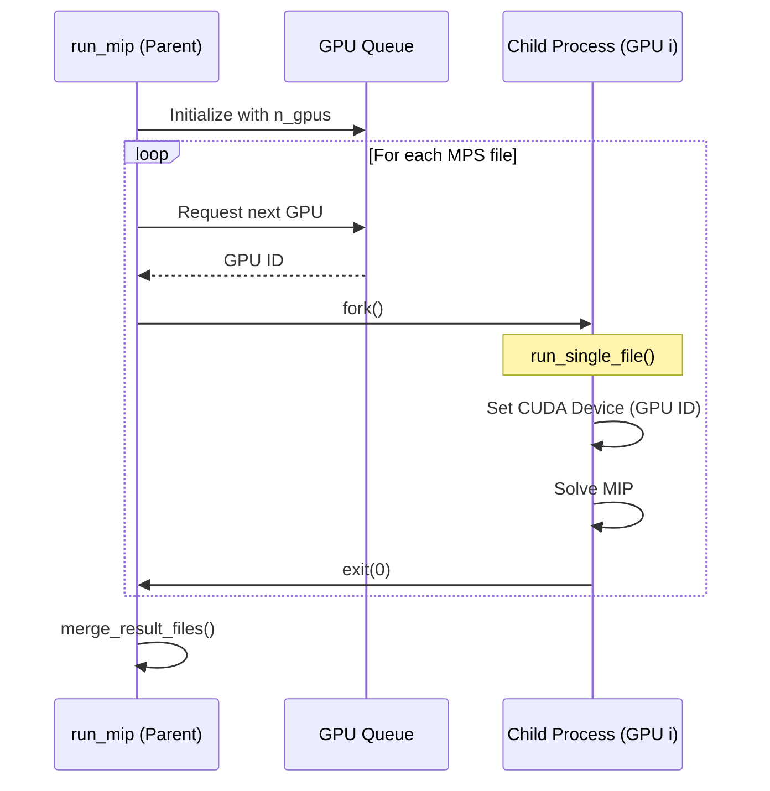

<!-- source: DeepWiki mcp.deepwiki.com · repo NVIDIA/cuopt · page 6.4 Multi-GPU and Concurrent Execution · fetched 2026-10-26 -->

# Multi-GPU and Concurrent Execution

Relevant source files

The following files were used as context for generating this wiki page:

- [ci/test_cpp_multi_gpu.sh](ci/test_cpp_multi_gpu.sh)
- [cpp/cmake/thirdparty/get_kaminpar.cmake](cpp/cmake/thirdparty/get_kaminpar.cmake)
- [cpp/src/pdlp/distributed_pdlp/distributed_algorithms.cu](cpp/src/pdlp/distributed_pdlp/distributed_algorithms.cu)
- [cpp/src/pdlp/distributed_pdlp/multi_gpu_engine.cu](cpp/src/pdlp/distributed_pdlp/multi_gpu_engine.cu)
- [cpp/src/pdlp/distributed_pdlp/multi_gpu_engine.hpp](cpp/src/pdlp/distributed_pdlp/multi_gpu_engine.hpp)
- [cpp/src/pdlp/distributed_pdlp/partitioner.cpp](cpp/src/pdlp/distributed_pdlp/partitioner.cpp)
- [cpp/src/pdlp/distributed_pdlp/partitioner.hpp](cpp/src/pdlp/distributed_pdlp/partitioner.hpp)
- [cpp/src/pdlp/distributed_pdlp/shard.cu](cpp/src/pdlp/distributed_pdlp/shard.cu)
- [cpp/src/pdlp/distributed_pdlp/shard.hpp](cpp/src/pdlp/distributed_pdlp/shard.hpp)
- [cpp/src/pdlp/initial_scaling_strategy/initial_scaling.cu](cpp/src/pdlp/initial_scaling_strategy/initial_scaling.cu)
- [cpp/src/pdlp/initial_scaling_strategy/initial_scaling.cuh](cpp/src/pdlp/initial_scaling_strategy/initial_scaling.cuh)
- [cpp/src/pdlp/pdlp.cu](cpp/src/pdlp/pdlp.cu)
- [cpp/src/pdlp/solve.cuh](cpp/src/pdlp/solve.cuh)
- [cpp/src/pdlp/termination_strategy/convergence_information.cu](cpp/src/pdlp/termination_strategy/convergence_information.cu)
- [cpp/src/pdlp/termination_strategy/infeasibility_information.cu](cpp/src/pdlp/termination_strategy/infeasibility_information.cu)
- [cpp/src/pdlp/utils.cuh](cpp/src/pdlp/utils.cuh)
- [cpp/tests/linear_programming/pdlp_distributed_test.cu](cpp/tests/linear_programming/pdlp_distributed_test.cu)

## Purpose and Scope

This document describes cuOpt's multi-GPU support and concurrent execution strategies for both Linear Programming (LP) and Mixed Integer Programming (MIP) problems. The system employs three distinct architectural approaches:

1.  **Multi-GPU Distributed PDLP:** NCCL-backed distributed execution of the First-Order Primal-Dual Hybrid Gradient (PDHG / PDLP) method across multiple GPUs using graph partitioning (`KaMinPar`), shard-local problem representations, and halo exchange routines (`multi_gpu_engine_t`).
2.  **LP Concurrent Execution:** Thread-based parallel execution of PDLP, Barrier, and Dual Simplex solvers with shared-memory coordination via atomic flags (`global_concurrent_halt`).
3.  **MIP Multi-GPU and Concurrent Execution:** Process-based parallelism using `fork()` for distributing MIP problem instances across multiple GPUs, combined with internal GPU-accelerated heuristics running concurrently with CPU-based Branch and Bound.

For information about individual solver methods, see page 2.1. For branch-and-bound details, see page 2.2.1. For sparse linear algebra operations, see page 6.3.

**Sources:** [cpp/src/pdlp/distributed_pdlp/multi_gpu_engine.hpp:64-119](), [cpp/src/linear_programming/solve.cu:650-754](), [benchmarks/linear_programming/cuopt/run_mip.cpp:434-521]()

## Multi-GPU Distributed PDLP Architecture

### Overview and Shard Ownership Model

When a linear program is too large to fit within the memory of a single GPU, cuOpt dispatches the solve to a distributed multi-GPU engine `multi_gpu_engine_t` [cpp/src/pdlp/distributed_pdlp/multi_gpu_engine.hpp:64-88](). The distributed architecture relies on a strict ownership model:

*   **Master:** The top-level `pdlp_solver_t` instance that manages scalar metadata, aggregation buffers, and solution gathering, but does not allocate the full constraint matrix `A` or `A^T` locally when created as a shape-0 placeholder [cpp/src/pdlp/solve.cuh:36-46]().
*   **Shard (`pdlp_shard_t`):** The complete device-local worker assigned to CUDA device `r`. Each shard owns its device stream, RAFT handle, NCCL communicator (`ncclComm_t`), local partitioned optimization problem, and local staging buffers for halo exchanges [cpp/src/pdlp/distributed_pdlp/multi_gpu_engine.hpp:64-86]().
*   **Rank Data (`rank_data_t`):** The host-side partition metadata describing owned variables/constraints, global-to-local index mappings, local CSR matrices, and peer send/receive plans generated during graph partitioning [cpp/src/pdlp/distributed_pdlp/multi_gpu_engine.hpp:64-86]().
*   **Halo Entries:** Local copies of variables or constraints owned by peer ranks but required by a shard's local sparse matrix-vector multiplication (`SpMV`) [cpp/src/pdlp/distributed_pdlp/multi_gpu_engine.hpp:64-86]().

**Multi-GPU PDLP Engine and Shard Structure**

**Sources:** [cpp/src/pdlp/distributed_pdlp/multi_gpu_engine.hpp:64-119](), [cpp/src/pdlp/distributed_pdlp/multi_gpu_engine.cu:24-80](), [cpp/src/pdlp/solve.cuh:36-74]()

### Partitioning and Communication Initialization

The multi-GPU engine initializes NCCL communicators across all available target devices via `ncclCommInitAll` [cpp/src/pdlp/distributed_pdlp/multi_gpu_engine.cu:44-50](). Graph partitioning (traditionally via `KaMinPar` or equivalent CSR partitioning utilities) assigns contiguous blocks or graph cuts of rows and columns to each rank [cpp/src/pdlp/distributed_pdlp/multi_gpu_engine.hpp:64-86](). 

During execution, matrix operations and scaling iterations require synchronizing halo regions across device boundaries:
*   **Halo Exchanges (`halo_exchange_var`, `halo_exchange_cstr`):** Gathers owned values needed by peer ranks into staging buffers and executes peer-to-peer transfers [cpp/src/pdlp/distributed_pdlp/multi_gpu_engine.cu:153-172]().
*   **Distributed Scaling:** Cross-shard coordinate equilibration uses `distributed_curtis_reid_scaling`, `distributed_ruiz_inf_scaling`, and `distributed_bound_objective_rescaling` to maintain global numerical stability without requiring a centralized monolithic matrix copy [cpp/src/pdlp/distributed_pdlp/distributed_algorithms.cu:55-150]().
*   **Solution Gathering:** Final primal/dual solutions and reduced costs are gathered from all shards back to the master process via `gather_potential_next_solutions_to_master()` [cpp/src/pdlp/distributed_pdlp/distributed_algorithms.cu:30-48]().

**Sources:** [cpp/src/pdlp/distributed_pdlp/multi_gpu_engine.cu:24-80](), [cpp/src/pdlp/distributed_pdlp/distributed_algorithms.cu:30-150]()

## LP Concurrent Solver Strategy

### Overview

Concurrent mode is the default method for solving linear programs in cuOpt. When concurrent mode is enabled, cuOpt simultaneously executes three different solver algorithms:

| Solver Method | Execution Platform | Primary Use Case |
| :--- | :--- | :--- |
| **PDLP** | GPU | Large-scale problems, first-order method |
| **Barrier (Interior-Point)** | GPU | Medium to large problems, high accuracy |
| **Dual Simplex** | CPU | Small to medium problems, basic solutions |

The first solver to reach an optimal solution terminates the others and returns its result, ensuring automatic selection of the most efficient method.

**Sources:** [cpp/src/linear_programming/solve.cu:650-754]()

### LP Concurrent Execution Architecture

**Concurrent Solver Coordination Flow**

**Sources:** [cpp/src/linear_programming/solve.cu:650-754]()

### Global Halt Coordination

The concurrent solvers coordinate through a shared atomic variable that enables efficient inter-thread communication. The `global_concurrent_halt` atomic variable serves as the coordination point:

*   **Declaration:** `std::atomic<int> global_concurrent_halt{0};` at [cpp/src/linear_programming/solve.cu:309]().
*   **Initialization:** Set to 0 when concurrent mode starts [cpp/src/linear_programming/solve.cu:663]().
*   **Pointer propagation:** Each solver receives a pointer to this variable via `settings.concurrent_halt` [cpp/src/linear_programming/solve.cu:664]().
*   **Termination signaling:** When a solver finds an optimal solution, it sets `*settings.concurrent_halt = 1` [cpp/src/linear_programming/solve.cu:426](), [cpp/src/linear_programming/solve.cu:500](), [cpp/src/linear_programming/solve.cu:629]().
*   **Status checking:** Other solvers periodically check this value and return with `ConcurrentLimit` status if it's non-zero.

**Sources:** [cpp/src/linear_programming/solve.cu:309](), [cpp/src/linear_programming/solve.cu:650-754]()

## MIP Multi-GPU and Concurrent Execution

### Internal Concurrent Heuristics

The Mixed Integer Programming (MIP) solver utilizes a hybrid concurrency model. While the dual bound is improved via CPU-based Branch and Bound, the primal bound is simultaneously improved using GPU-accelerated heuristics managed by the `diversity_manager_t`.

**MIP Internal Concurrency Architecture**

Key implementation details for MIP concurrency:
*   **Diversity Manager:** Orchestrates various recombiners (FP, LS, BP, Sub-MIP) and manages the solution population [cpp/src/mip_heuristics/diversity/diversity_manager.cu:41-81]().
*   **Solution Sharing:** The `branch_and_bound_solution_helper_t` provides a `solution_callback` that allows the CPU-based branch-and-bound process to inject solutions into the GPU-managed population [cpp/src/mip_heuristics/solver.cu:58-84]().
*   **Concurrent LP for MIP:** If a problem is reduced to an LP during MIP presolve, it automatically triggers the `solve_lp_with_method` using `method_t::Concurrent` [cpp/src/mip_heuristics/solver.cu:150-158]().

**Sources:** [cpp/src/mip_heuristics/solver.cu:42-175](), [cpp/src/mip_heuristics/diversity/diversity_manager.cu:41-81]()

### Multi-GPU Process-Based Parallelism

For batch processing of MIP instances, cuOpt provides a process-based multi-GPU strategy using `fork()`. This is implemented in the benchmark harness and allows distributing different problem files across available GPUs.

**MIP Multi-GPU Process Orchestration**

**Sources:** [benchmarks/linear_programming/cuopt/run_mip.cpp:434-521]()

### Implementation Details in `run_mip.cpp`

The multi-GPU benchmark harness handles work distribution and result aggregation:

*   **GPU Queue Management:** Uses a queue of available GPU IDs to distribute processes [benchmarks/linear_programming/cuopt/run_mip.cpp:437-440]().
*   **Process Forking:** Creates a child process for each problem instance using `fork()` [benchmarks/linear_programming/cuopt/run_mip.cpp:457]().
*   **Result Aggregation:** Temporary result files are written by each process and merged into a final report using `merge_result_files` [benchmarks/linear_programming/cuopt/run_mip.cpp:43-68]().
*   **CPU Resource Partitioning:** CPU threads are divided among GPU processes to prevent contention: `num_cpu_threads = omp_get_max_threads() / n_gpus` [benchmarks/linear_programming/cuopt/run_mip.cpp:416]().

**Sources:** [benchmarks/linear_programming/cuopt/run_mip.cpp:43-521]()

## Thread and Synchronization Primitives

CuOpt utilizes specialized wrappers for OpenMP to handle multi-threaded synchronization in CPU-bound portions of the solver (like Dual Simplex and MIP Branch and Bound).

### `omp_mutex_t` and `omp_atomic_t`

These classes provide a safe C++ interface to OpenMP locking and atomic operations:

*   **`omp_mutex_t`:** A wrapper for `omp_lock_t` that follows RAII principles for initialization and destruction [cpp/src/utilities/omp_helpers.hpp:20-55]().
*   **`omp_atomic_t<T>`:** Provides atomic read, write, capture, and fetch-and-add operations using `#pragma omp atomic` [cpp/src/utilities/omp_helpers.hpp:60-127]().
*   **Atomic Min/Max:** Implements atomic comparison and update (CAS) for floating-point values using `#pragma omp atomic compare capture` [cpp/src/utilities/omp_helpers.hpp:137-158]().

**Sources:** [cpp/src/utilities/omp_helpers.hpp:8-163]()

## Summary of Execution Modes

| Feature | Multi-GPU LP Mode | LP Concurrent Mode | MIP Mode |
| :--- | :--- | :--- | :--- |
| **Concurrency Level** | Distributed Shards (NCCL) | Algorithm Level (PDLP/Barrier/Simplex) | Component Level (B&B/Heuristics) |
| **Parallelism Type** | Multi-GPU NCCL collectives | Shared-memory threads | Hybrid (Threads + Multi-process) |
| **GPU Distribution** | Shard-per-GPU assignment [multi_gpu_engine.cu:54]() | Thread-based device selection [solve.cu:683]() | Process-based `fork()` [run_mip.cpp:457]() |
| **Coordination** | NCCL all-reduce / halo exchanges | Atomic halt flag [solve.cu:309]() | Diversity Manager / Population [solver.cu:96]() |
| **Result Merging** | Master solution gather [distributed_algorithms.cu:30]() | First optimal wins [solve.cu:717]() | File-based merge [run_mip.cpp:43]() |

**Sources:** [cpp/src/pdlp/distributed_pdlp/multi_gpu_engine.cu:24-80](), [cpp/src/pdlp/distributed_pdlp/distributed_algorithms.cu:30-48](), [cpp/src/linear_programming/solve.cu:650-754](), [benchmarks/linear_programming/cuopt/run_mip.cpp:43-521](), [cpp/src/mip_heuristics/solver.cu:87-175]()

---

