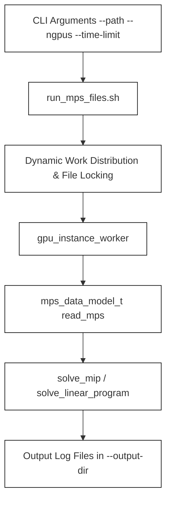
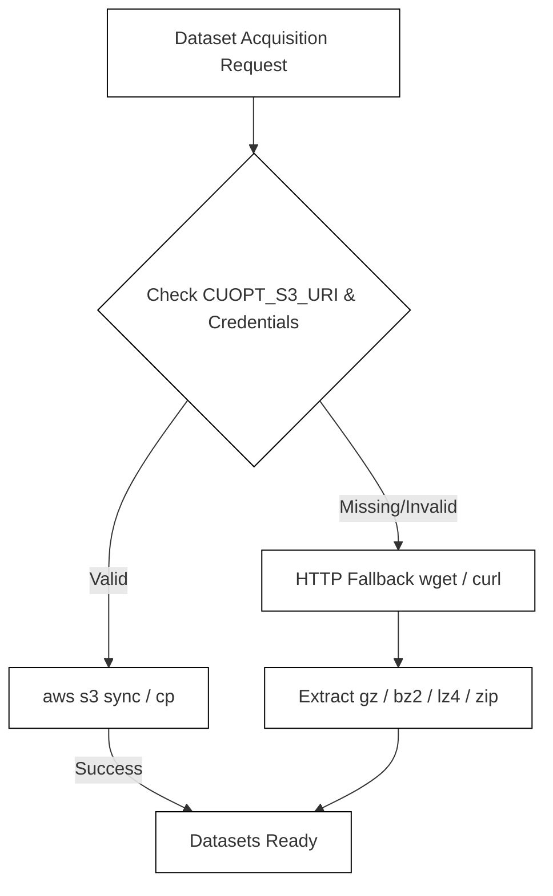
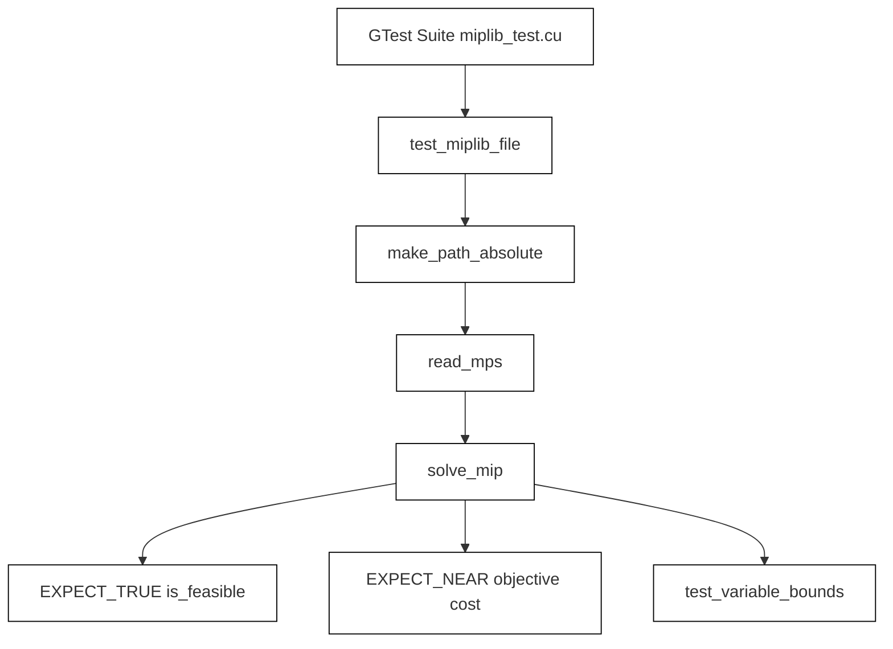

<!-- source: DeepWiki mcp.deepwiki.com · repo NVIDIA/cuopt · page 6.5 Benchmarking and Regression Testing · fetched 2026-10-26 -->

# Benchmarking and Regression Testing

Relevant source files

The following files were used as context for generating this wiki page:

- [.claude/CLAUDE.md](.claude/CLAUDE.md)
- [.gitignore](.gitignore)
- [agents/AGENTS.md](agents/AGENTS.md)
- [benchmarks/README.md](benchmarks/README.md)
- [benchmarks/linear_programming/run_mps_files.sh](benchmarks/linear_programming/run_mps_files.sh)
- [benchmarks/linear_programming/utils/get_datasets.py](benchmarks/linear_programming/utils/get_datasets.py)
- [ci/README.md](ci/README.md)
- [cmake/README.md](cmake/README.md)
- [cpp/include/cuopt/mathematical_optimization/io/data_model_view.hpp](cpp/include/cuopt/mathematical_optimization/io/data_model_view.hpp)
- [cpp/include/cuopt/mathematical_optimization/io/mps_data_model.hpp](cpp/include/cuopt/mathematical_optimization/io/mps_data_model.hpp)
- [cpp/include/cuopt/mathematical_optimization/io/parser.hpp](cpp/include/cuopt/mathematical_optimization/io/parser.hpp)
- [cpp/src/dual_simplex/scaling.cpp](cpp/src/dual_simplex/scaling.cpp)
- [cpp/src/dual_simplex/scaling.hpp](cpp/src/dual_simplex/scaling.hpp)
- [cpp/src/io/parser.cpp](cpp/src/io/parser.cpp)
- [cpp/src/linear_algebra/sparse_matrix.hpp](cpp/src/linear_algebra/sparse_matrix.hpp)
- [cpp/tests/dual_simplex/unit_tests/solve.cpp](cpp/tests/dual_simplex/unit_tests/solve.cpp)
- [cpp/tests/dual_simplex/unit_tests/solve_barrier.cu](cpp/tests/dual_simplex/unit_tests/solve_barrier.cu)
- [cpp/tests/mip/miplib_test.cu](cpp/tests/mip/miplib_test.cu)
- [datasets/get_test_data.sh](datasets/get_test_data.sh)
- [datasets/linear_programming/download_pdlp_test_dataset.sh](datasets/linear_programming/download_pdlp_test_dataset.sh)
- [datasets/mip/dominating_set.mps](datasets/mip/dominating_set.mps)
- [datasets/mip/download_miplib_test_dataset.sh](datasets/mip/download_miplib_test_dataset.sh)
- [datasets/mip/presolve_instance.sh](datasets/mip/presolve_instance.sh)
- [datasets/quadratic_programming/min_x_squared.mps](datasets/quadratic_programming/min_x_squared.mps)
- [notebooks/README.md](notebooks/README.md)
- [print_env.sh](print_env.sh)
- [regression/get_datasets.py](regression/get_datasets.py)

### Purpose and Scope
This section documents the benchmarking infrastructure, parallel execution harness scripts, dataset download automation, and integration with regression test suites in the cuOpt codebase. It covers the parallel Mathematical Programming System (MPS) execution script (`run_mps_files.sh`), dataset acquisition tools for MIPLIB, Netlib, Mittelmann, and routing suites, and how benchmark and regression instances are integrated into C++ GTest suites.

---

### 1. Parallel Benchmarking Harness (`run_mps_files.sh`)

The script `benchmarks/linear_programming/run_mps_files.sh` provides a parallel benchmarking harness designed to execute LP and MIP problem instances across multiple GPUs [benchmarks/linear_programming/run_mps_files.sh:7-12]. It handles dynamic work distribution, file locking across parallel sub-processes, time/iteration limits, and configuration options such as presolve modes and cut families.

*Figure 1: Execution flow of the parallel MPS benchmarking harness.*

**Key Script Parameters and Configuration:**
* `--path PATH`: Specifies the directory containing `.mps`, `.MPS`, or `.SIF` files [benchmarks/linear_programming/run_mps_files.sh:63].
* `--ngpus N`: Total number of available GPU devices to leverage [benchmarks/linear_programming/run_mps_files.sh:66].
* `--gpus-per-instance N`: Allocates multiple GPUs per benchmark invocation (e.g., setting to 2 enables multi-GPU solver runs) [benchmarks/linear_programming/run_mps_files.sh:67].
* `--time-limit N`: Sets the per-problem wall-clock time limit in seconds [benchmarks/linear_programming/run_mps_files.sh:68].
* `--batch-num N` and `--n-batches N`: Divides benchmark workloads uniformly across batches when resource constraints require distributed execution [benchmarks/linear_programming/run_mps_files.sh:75-76].

Sources: `benchmarks/linear_programming/run_mps_files.sh`, `benchmarks/README.md` [benchmarks/linear_programming/run_mps_files.sh:1-174](), [benchmarks/README.md:1-26]().

---

### 2. Dataset Acquisition and Management Scripts

The codebase provides automated retrieval scripts to pull standard optimization benchmark suites (MIPLIB, Netlib, Mittelmann LP sets, and routing instances) from both authenticated S3 buckets and public HTTP repositories.

#### Dataset Download Architecture
* **S3 Integration (`try_download_from_s3`)**: Scripts check for explicit credentials (`CUOPT_S3_URI`, `CUOPT_AWS_ACCESS_KEY_ID`, `CUOPT_AWS_SECRET_ACCESS_KEY`) to safely sync cached benchmark sets from internal S3 infrastructure without mixing external AWS configurations [datasets/mip/download_miplib_test_dataset.sh:67-116](), [datasets/get_test_data.sh:9-55]().
* **HTTP Fallback**: If S3 variables are unset or validation fails, scripts fall back to public web resources such as the ZIB MIPLIB WebData repository, Netlib, and SINTEF/ASU Plato repositories (`wget` with retry logic and unzipping/gunzipping) [datasets/mip/download_miplib_test_dataset.sh:144-155](), [datasets/get_test_data.sh:193-217]().

*Figure 2: Fallback logic in dataset download automation scripts.*

#### Dataset Suites Documented:
* **MIPLIB & Netlib**: Managed by `datasets/mip/download_miplib_test_dataset.sh` [datasets/mip/download_miplib_test_dataset.sh:5-61](), `benchmarks/linear_programming/utils/get_datasets.py` [benchmarks/linear_programming/utils/get_datasets.py:22-72](), and `regression/get_datasets.py` [regression/get_datasets.py:21-268]().
* **Routing Suites**: Managed by `datasets/get_test_data.sh` [datasets/get_test_data.sh:98-146](), pulling TSPLIB, CVRP (Vrp-Set-X), ACVRP, CVRPTW (Homberger), Solomon 100-customer instances, and PDPTW datasets.

Sources: `benchmarks/linear_programming/utils/get_datasets.py`, `datasets/mip/download_miplib_test_dataset.sh`, `datasets/get_test_data.sh`, `regression/get_datasets.py` [benchmarks/linear_programming/utils/get_datasets.py:1-213](), [datasets/mip/download_miplib_test_dataset.sh:1-155](), [datasets/get_test_data.sh:1-217](), [regression/get_datasets.py:1-268]().

---

### 3. Regression Testing and Test Suites Integration

Benchmark problem instances are integrated directly into C++ unit and regression tests via Google Test (`GTest`). These tests ensure numerical stability, verify termination statuses, and guard against regressions in presolve, barrier, dual simplex, and branch-and-bound components.

*Figure 3: Integration of benchmark problem instances within the Google Test framework.*

#### Key Test Suites and Functions:
* `cpp/tests/mip/miplib_test.cu`: Implements `test_miplib_file()` [cpp/tests/mip/miplib_test.cu:36-61]() which loads MIPLIB instances (e.g., `50v-10.mps`, `neos5.mps`, `swath1.mps`), runs `solve_mip()`, and asserts feasibility, objective value tolerances, and variable bounds validity [cpp/tests/mip/miplib_test.cu:52-60](). It also includes thread-count regression checks (`low_thread_count_test`) [cpp/tests/mip/miplib_test.cu:74-91]() and node-limit verification (`node_limit_test`) [cpp/tests/mip/miplib_test.cu:96-118]().
* `cpp/tests/dual_simplex/unit_tests/solve_barrier.cu`: Exercises barrier solves on canonical and regression models (e.g., `chess set`, `dual_variable_greater_than`) [cpp/tests/dual_simplex/unit_tests/solve_barrier.cu:43-184]().
* `cpp/tests/dual_simplex/unit_tests/solve.cpp`: Verifies dual simplex execution and integer variable handling [cpp/tests/dual_simplex/unit_tests/solve.cpp:24-96]().

Sources: `cpp/tests/mip/miplib_test.cu`, `cpp/tests/dual_simplex/unit_tests/solve_barrier.cu`, `cpp/tests/dual_simplex/unit_tests/solve.cpp` [cpp/tests/mip/miplib_test.cu:1-120](), [cpp/tests/dual_simplex/unit_tests/solve_barrier.cu:1-191](), [cpp/tests/dual_simplex/unit_tests/solve.cpp:1-195]().

---

