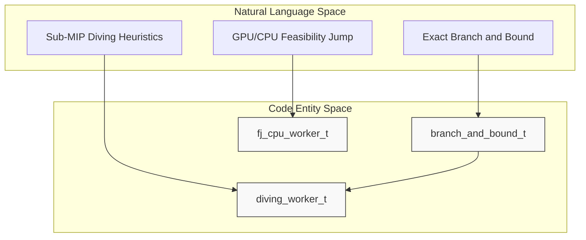
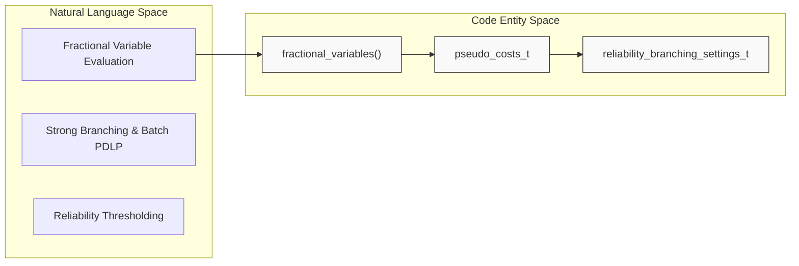

<!-- source: DeepWiki mcp.deepwiki.com · repo NVIDIA/cuopt · page 7 Advanced Topics · fetched 2026-10-26 -->

# Advanced Topics

Relevant source files

The following files were used as context for generating this wiki page:

- [cpp/include/cuopt/mathematical_optimization/constants.h](cpp/include/cuopt/mathematical_optimization/constants.h)
- [cpp/include/cuopt/mathematical_optimization/mip/solver_settings.hpp](cpp/include/cuopt/mathematical_optimization/mip/solver_settings.hpp)
- [cpp/include/cuopt/mathematical_optimization/pdlp/solver_settings.hpp](cpp/include/cuopt/mathematical_optimization/pdlp/solver_settings.hpp)
- [cpp/src/branch_and_bound/branch_and_bound.cpp](cpp/src/branch_and_bound/branch_and_bound.cpp)
- [cpp/src/branch_and_bound/branch_and_bound.hpp](cpp/src/branch_and_bound/branch_and_bound.hpp)
- [cpp/src/branch_and_bound/deterministic_workers.hpp](cpp/src/branch_and_bound/deterministic_workers.hpp)
- [cpp/src/branch_and_bound/pseudo_costs.cpp](cpp/src/branch_and_bound/pseudo_costs.cpp)
- [cpp/src/branch_and_bound/pseudo_costs.hpp](cpp/src/branch_and_bound/pseudo_costs.hpp)
- [cpp/src/branch_and_bound/worker.hpp](cpp/src/branch_and_bound/worker.hpp)
- [cpp/src/branch_and_bound/worker_pool.hpp](cpp/src/branch_and_bound/worker_pool.hpp)
- [cpp/src/dual_simplex/simplex_solver_settings.hpp](cpp/src/dual_simplex/simplex_solver_settings.hpp)
- [cpp/src/math_optimization/solver_settings.cu](cpp/src/math_optimization/solver_settings.cu)
- [cpp/src/mip_heuristics/root_heuristics.hpp](cpp/src/mip_heuristics/root_heuristics.hpp)
- [cpp/src/pdlp/solve.cu](cpp/src/pdlp/solve.cu)

This page provides a high-level overview of advanced cuOpt features, internal mechanisms, and customization options for experienced users and developers. Topics include metaheuristic implementations, pseudo-cost branching strategies, parameter tuning, warm starting mechanisms, logging subsystems, and testing infrastructure. 

As a PARENT page, this section summarizes core concepts and links to detailed child pages. For basic solver usage, see [Core Solver Engines](#2). For API details, see [APIs and Interfaces](#4).

---

## Local Search and Metaheuristics

cuOpt employs sophisticated local search and metaheuristic methods to rapidly discover and improve primal bounds in Mixed Integer Programming (MIP) and Vehicle Routing Problems (VRP). The system coordinates background CPU heuristics and GPU-accelerated Feasibility Jump routines alongside the exact branch-and-bound tree exploration.

For detailed information on neighborhood exploration, diversity management, recombination operators, and heuristic implementations, see [Local Search and Metaheuristics](#7.1).

**Sources:** [cpp/src/branch_and_bound/branch_and_bound.hpp:98-105](), [cpp/src/mip_heuristics/root_heuristics.hpp:40-40]()

---

## Pseudo-Costs and Branching Strategies

To navigate the combinatorial search space efficiently, the branch-and-bound engine relies on pseudo-cost statistics and reliability branching. These mechanisms estimate the objective penalty of branching up or down on fractional variables before committing to a subtree.

For deep dives into pseudo-cost updates, strong branching with batch PDLP, and reliability thresholds, see [Pseudo-Costs and Branching Strategies](#7.2).

**Sources:** [cpp/src/branch_and_bound/pseudo_costs.hpp:40-71](), [cpp/src/branch_and_bound/pseudo_costs.hpp:109-123]()

---

## Solver Configuration and Parameter Tuning

cuOpt exposes a comprehensive hierarchy of configuration options to control solver tolerances, algorithm selection, iteration/node limits, and scaling strategies. These settings are managed via dedicated C++ settings classes and mapped to client APIs.

| Configuration Domain | Primary Class | Key Parameters |
|---|---|---|
| Simplex / LP Settings | `simplex_solver_settings_t` | `pivot_tol`, `primal_tol`, `dual_tol`, `iteration_limit` [cpp/src/dual_simplex/simplex_solver_settings.hpp:43-45]() |
| MIP Settings | `mip_solver_settings_t` | `time_limit`, `node_limit`, `max_cut_passes`, `reliability_branching` [cpp/include/cuopt/mathematical_optimization/mip/solver_settings.hpp:122-130]() |
| PDLP Parameters | `pdlp_solver_settings_t` | Solver modes (`Stable1`, `Fast1`), step sizes, restart strategies [cpp/include/cuopt/mathematical_optimization/pdlp/solver_settings.hpp:50-55]() |

For a complete guide to parameter tables, precision modes, presolve options, and tuning recommendations, see [Solver Configuration and Parameter Tuning](#7.3).

**Sources:** [cpp/src/dual_simplex/simplex_solver_settings.hpp:31-134](), [cpp/include/cuopt/mathematical_optimization/mip/solver_settings.hpp:69-165]()

---

## Warm Starting and Solution Reuse

Solution reuse allows cuOpt to ingest prior states, primal/dual solutions, or PDLP warm-start data to accelerate convergence on related problem instances or consecutive time-horizon solves.

Initial guesses and warm-start structures are registered prior to solver invocation using methods such as `set_initial_pdlp_primal_solution()` and `add_initial_mip_solution()`.

For details on PDLP warm-start containers, barrier caches, incumbent injection, and server-side storage, see [Warm Starting and Solution Reuse](#7.4).

**Sources:** [cpp/src/math_optimization/solver_settings.cu:30-44](), [cpp/src/math_optimization/solver_settings.cu:103-108]()

---

## Testing and Quality Assurance

cuOpt maintains robust quality assurance via automated test suites covering C++ Google Test (`GTest`) frameworks, Python `pytest` integrations, determinism verification, and remote gRPC service tests. Numerical accuracy and solution validity are continuously checked against strict primal and dual tolerances using internal verification utilities like `check_guess()`.

For details on the testing infrastructure, benchmark harnesses, and lint/coverage tools, see [Testing and Quality Assurance](#7.5).

**Sources:** [cpp/src/branch_and_bound/branch_and_bound.cpp:100-143]()

---

## Logging and Diagnostics

The logging subsystem provides granular diagnostic streaming, integration with `rapids-logger`, support for custom logger callbacks, and build/version information reporting. Logs can be streamed concurrently across gRPC and HTTP remote solver sessions.

For details on configuring logging sinks, log levels, and runtime telemetry, see [Logging and Diagnostics](#7.6).

**Sources:** [cpp/src/dual_simplex/simplex_solver_settings.hpp:136-139]()

---

