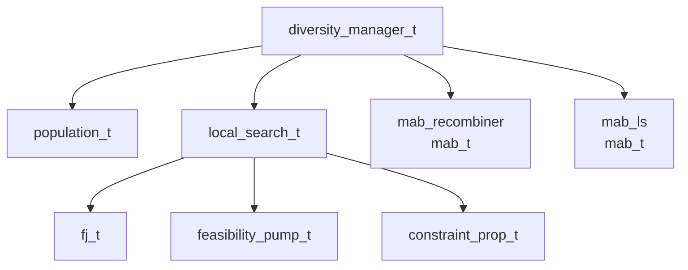
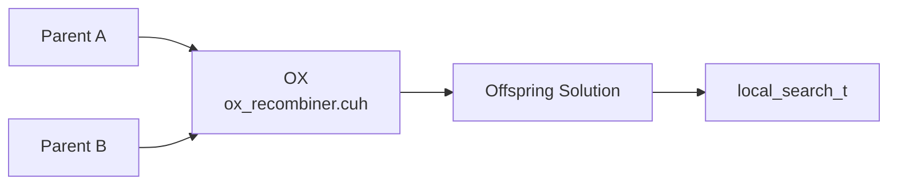

<!-- source: DeepWiki mcp.deepwiki.com · repo NVIDIA/cuopt · page 7.1 Local Search and Metaheuristics · fetched 2026-10-26 -->

# Local Search and Metaheuristics

Relevant source files

The following files were used as context for generating this wiki page:

- [cpp/src/mip_heuristics/diversity/diversity_manager.cu](cpp/src/mip_heuristics/diversity/diversity_manager.cu)
- [cpp/src/mip_heuristics/diversity/population.cu](cpp/src/mip_heuristics/diversity/population.cu)
- [cpp/src/mip_heuristics/diversity/population.cuh](cpp/src/mip_heuristics/diversity/population.cuh)
- [cpp/src/mip_heuristics/presolve/third_party_presolve.cpp](cpp/src/mip_heuristics/presolve/third_party_presolve.cpp)
- [cpp/src/mip_heuristics/presolve/third_party_presolve.hpp](cpp/src/mip_heuristics/presolve/third_party_presolve.hpp)
- [cpp/src/mip_heuristics/solve.cu](cpp/src/mip_heuristics/solve.cu)
- [cpp/src/mip_heuristics/solver.cu](cpp/src/mip_heuristics/solver.cu)
- [cpp/src/routing/crossovers/eax_recombiner.hpp](cpp/src/routing/crossovers/eax_recombiner.hpp)
- [cpp/src/routing/crossovers/ox_kernels.cuh](cpp/src/routing/crossovers/ox_kernels.cuh)
- [cpp/src/routing/crossovers/ox_recombiner.cuh](cpp/src/routing/crossovers/ox_recombiner.cuh)
- [cpp/src/routing/local_search/local_search.cu](cpp/src/routing/local_search/local_search.cu)
- [cpp/src/routing/local_search/local_search.cuh](cpp/src/routing/local_search/local_search.cuh)
- [cpp/src/routing/local_search/sliding_tsp.cu](cpp/src/routing/local_search/sliding_tsp.cu)
- [cpp/src/routing/local_search/vrp/fragment_kernels.cuh](cpp/src/routing/local_search/vrp/fragment_kernels.cuh)
- [cpp/src/routing/local_search/vrp/vrp_search.cu](cpp/src/routing/local_search/vrp/vrp_search.cu)
- [cpp/src/routing/node/node.cuh](cpp/src/routing/node/node.cuh)
- [cpp/src/routing/node/pdp_node.cuh](cpp/src/routing/node/pdp_node.cuh)
- [cpp/src/routing/node/vehicle_fixed_cost_node.cuh](cpp/src/routing/node/vehicle_fixed_cost_node.cuh)
- [cpp/src/routing/route/route.cuh](cpp/src/routing/route/route.cuh)
- [cpp/tests/internal/CMakeLists.txt](cpp/tests/internal/CMakeLists.txt)
- [cpp/tests/linear_programming/unit_tests/presolve_test.cu](cpp/tests/linear_programming/unit_tests/presolve_test.cu)
- [cpp/tests/linear_programming/utilities/pdlp_test_utilities.cuh](cpp/tests/linear_programming/utilities/pdlp_test_utilities.cuh)
- [cpp/tests/mip/incumbent_callback_test.cu](cpp/tests/mip/incumbent_callback_test.cu)
- [cpp/tests/mip/population_test.cu](cpp/tests/mip/population_test.cu)
- [cpp/tests/routing/unit_tests/order_locations.cu](cpp/tests/routing/unit_tests/order_locations.cu)

The cuOpt optimization engine employs a robust metaheuristic and local search framework across both Mixed Integer Programming (MIP) and Vehicle Routing Problems (VRP). This framework combines population-based diversity management, adaptive strategy selection via Multi-Armed Bandits (MAB), advanced recombination operators, and high-performance local search routines. 

This page provides a high-level overview of the metaheuristic architecture. For deep technical details, refer to the child pages:
- [Feasibility Jump Implementation](#7.1.1) — Detailed breakdown of GPU and CPU feasibility jump, move generation, and acceptance criteria.
- [Constraint Propagation and Repair](#7.1.2) — Explanation of bounds repair, rounding strategies, and probing caches.

---

## Metaheuristic Framework Architecture

The metaheuristic control flow is anchored by the `diversity_manager_t` class, which coordinates the population pool, adaptive recombiners, and local search operators [cpp/src/mip_heuristics/diversity/diversity_manager.cu:53-98](). 

*Diagram: Core components of the metaheuristic engine managed by `diversity_manager_t`.*

Sources: [cpp/src/mip_heuristics/diversity/diversity_manager.cu:53-98]()

---

## Population-Based Diversity Management

The `population_t` class maintains a collection of diverse feasible and infeasible solutions [cpp/src/mip_heuristics/diversity/population.cuh:42-50](). It tracks population statistics, dynamically updates constraint penalty weights, and filters out redundant local optima using Hamming distance thresholds.

### Key Population Operations

| Component / Function | Role in Codebase | Source Reference |
| :--- | :--- | :--- |
| `population_t` | Core container managing solution arrays and index sorting. | [cpp/src/mip_heuristics/diversity/population.cuh:42-50]() |
| `add_external_solution()` | Thread-safe queue insertion for asynchronous solutions from Branch & Bound or CPU heuristics. | [cpp/src/mip_heuristics/population.cu:147-171]() |
| `update_weights()` | Adjusts constraint violation penalties based on solution feasibility. | [cpp/src/mip_heuristics/diversity/population.cu:126-132]() |
| `run_all_recombiners()` | Triggers crossover and recombination operators on selected parent pairs. | [cpp/src/mip_heuristics/diversity/population.cuh:76-76]() |

Sources: [cpp/src/mip_heuristics/diversity/population.cuh:42-50](), [cpp/src/mip_heuristics/diversity/population.cu:147-171]()

---

## Recombination and Neighborhood Exploration

To generate high-quality offspring, cuOpt utilizes specialized recombiners (such as Feasibility Pump, Line Segment, and Sub-MIP recombiners) alongside VRP-specific operators like the Order Crossover (`OX`) structure [cpp/src/routing/crossovers/ox_recombiner.cuh:38-42]().

*Diagram: Recombination pipeline utilizing `OX` routing crossover.*

Sources: [cpp/src/routing/crossovers/ox_recombiner.cuh:38-42]()

---

## Local Search and Repair

Local search methods refine intermediate solutions and repair constraint violations. These are invoked directly by the diversity manager or embedded inside MIP heuristics.

For granular implementation details on move generation, kernel load balancing, and acceptance criteria, see [Feasibility Jump Implementation](#7.1.1). For details on bounds tightening and domain reduction during repair phases, see [Constraint Propagation and Repair](#7.1.2).

Sources: [cpp/src/mip_heuristics/solve.cu:117-125]()

---

## Child Pages

- [Feasibility Jump Implementation](#7.1.1) — Deep dive into GPU and CPU feasibility jump: move generation, load balancing kernels, SAT/CDCL utilities, portfolio, audit, and acceptance criteria.
- [Constraint Propagation and Repair](#7.1.2) — Explain propagation in local search: bounds repair, rounding strategies, feasibility restoration, and probing caches.

---

