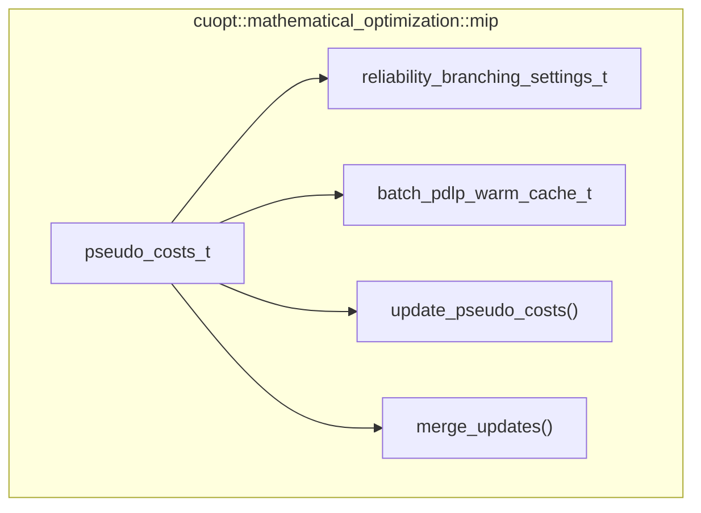
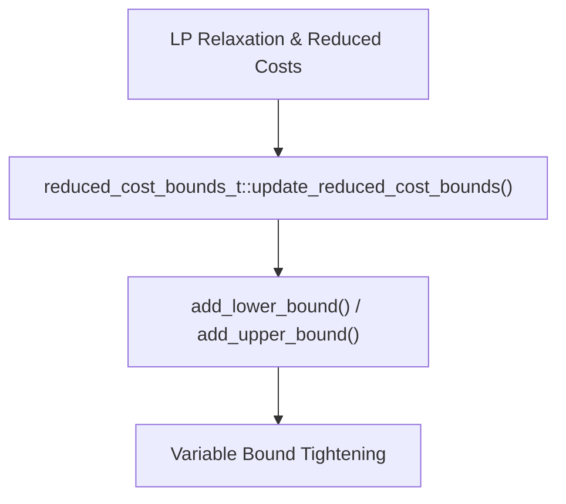

<!-- source: DeepWiki mcp.deepwiki.com · repo NVIDIA/cuopt · page 7.2 Pseudo-Costs and Branching Strategies · fetched 2026-10-26 -->

# Pseudo-Costs and Branching Strategies

Relevant source files

The following files were used as context for generating this wiki page:

- [cpp/include/cuopt/mathematical_optimization/mip/submip_hyper_params.hpp](cpp/include/cuopt/mathematical_optimization/mip/submip_hyper_params.hpp)
- [cpp/src/branch_and_bound/CMakeLists.txt](cpp/src/branch_and_bound/CMakeLists.txt)
- [cpp/src/branch_and_bound/branch_and_bound.cpp](cpp/src/branch_and_bound/branch_and_bound.cpp)
- [cpp/src/branch_and_bound/branch_and_bound.hpp](cpp/src/branch_and_bound/branch_and_bound.hpp)
- [cpp/src/branch_and_bound/constants.hpp](cpp/src/branch_and_bound/constants.hpp)
- [cpp/src/branch_and_bound/degenerate_pivots.cpp](cpp/src/branch_and_bound/degenerate_pivots.cpp)
- [cpp/src/branch_and_bound/degenerate_pivots.hpp](cpp/src/branch_and_bound/degenerate_pivots.hpp)
- [cpp/src/branch_and_bound/deterministic_workers.hpp](cpp/src/branch_and_bound/deterministic_workers.hpp)
- [cpp/src/branch_and_bound/diving_heuristics.cpp](cpp/src/branch_and_bound/diving_heuristics.cpp)
- [cpp/src/branch_and_bound/diving_heuristics.hpp](cpp/src/branch_and_bound/diving_heuristics.hpp)
- [cpp/src/branch_and_bound/fractional.hpp](cpp/src/branch_and_bound/fractional.hpp)
- [cpp/src/branch_and_bound/pseudo_costs.cpp](cpp/src/branch_and_bound/pseudo_costs.cpp)
- [cpp/src/branch_and_bound/pseudo_costs.hpp](cpp/src/branch_and_bound/pseudo_costs.hpp)
- [cpp/src/branch_and_bound/reduced_cost_bounds.hpp](cpp/src/branch_and_bound/reduced_cost_bounds.hpp)
- [cpp/src/branch_and_bound/worker.hpp](cpp/src/branch_and_bound/worker.hpp)
- [cpp/src/branch_and_bound/worker_pool.hpp](cpp/src/branch_and_bound/worker_pool.hpp)
- [cpp/src/mip_heuristics/root_heuristics.hpp](cpp/src/mip_heuristics/root_heuristics.hpp)

## Purpose and Scope

This page documents the pseudo-cost computation, reliability branching, strong branching integration, degenerate pivot handling, reduced-cost bound tightening, and diving heuristics used within cuOpt's Mixed Integer Programming (MIP) Branch and Bound solver. These mechanisms drive variable selection and tree pruning to efficiently close the MIP gap.

---

## 1. Core Data Structures and Configuration

The pseudo-cost system relies on tracking historical objective changes when variables are branched. The core classes and structures are defined in `[cpp/src/branch_and_bound/pseudo_costs.hpp]()`.

*   `pseudo_costs_t<i_t, f_t>`: Manages cumulative pseudo-cost sums (`pseudo_cost_sum_down`, `pseudo_cost_sum_up`) and execution counts (`pseudo_cost_num_down`, `pseudo_cost_num_up`) for each variable `[cpp/src/branch_and_bound/pseudo_costs.hpp:109-123]()`.
*   `reliability_branching_settings_t<i_t, f_t>`: Configures reliability branching parameters, including iteration bounds (`lower_max_lp_iter`, `upper_max_lp_iter`), candidate limits (`max_num_candidates`), and reliability thresholds (`max_reliable_threshold`, `min_reliable_threshold`) `[cpp/src/branch_and_bound/pseudo_costs.hpp:40-71]()`.
*   `batch_pdlp_warm_cache_t<i_t, f_t>`: Caches warm-start data (`initial_primal`, `initial_dual`, step size, primal weight) for batch PDLP evaluations during strong branching `[cpp/src/branch_and_bound/pseudo_costs.hpp:80-89]()`.

**Diagram: PseudoCostArchitecture**

Sources: `[cpp/src/branch_and_bound/pseudo_costs.hpp:40-123]()`, `[cpp/src/branch_and_bound/pseudo_costs.cpp:143-156]()`

---

## 2. Strong Branching and Reliability Branching

Reliability branching combines pseudo-cost estimates with strong branching. For variables with insufficient historical data (i.e., below the reliability threshold), the solver performs trial LP solves (or single dual simplex pivot estimates) to evaluate objective degradation.

### Single Dual Simplex Pivot Estimates
Before launching full LP solves for strong branching candidates, `single_pivot_objective_change_estimate()` estimates objective changes via a single dual simplex pivot update `[cpp/src/branch_and_bound/pseudo_costs.cpp:79-142]()`:
1. Computes the basis transpose solve (`b_transpose_solve`) for the leaving variable `[cpp/src/branch_and_bound/pseudo_costs.cpp:105-105]()`.
2. Computes the reduced cost update (`compute_delta_z` or `compute_reduced_cost_update`) `[cpp/src/branch_and_bound/pseudo_costs.cpp:119-140]()`.
3. Determines step length and estimated objective change (`delta_obj_down`, `delta_obj_up`) without full re-factorization `[cpp/src/branch_and_bound/pseudo_costs.cpp:157-162]()`.

If `rank_candidates_with_dual_pivot` is enabled, candidates are sorted based on these fast dual pivot estimates before incurring full simplex iterations `[cpp/src/branch_and_bound/pseudo_costs.hpp:70-71]()`.

Sources: `[cpp/src/branch_and_bound/pseudo_costs.hpp:40-71]`, `[cpp/src/branch_and_bound/pseudo_costs.cpp:79-188]()`

---

## 3. Reduced-Cost Bounds and Domain Reduction

The `reduced_cost_bounds_t<i_t, f_t>` class leverages reduced costs from LP relaxations to tighten variable bounds and prune nodes during Branch and Bound `[cpp/src/branch_and_bound/reduced_cost_bounds.hpp:37-50]()`.

*   `add_lower_bound()` / `add_upper_bound()`: Registers objective-bound pairs for variables, tracking whether bounds are accepted, tightened, or dominated `[cpp/src/branch_and_bound/reduced_cost_bounds.hpp:52-100]()`.
*   `update_reduced_cost_bounds()`: Scans non-basic variables with significant reduced costs (`|reduced_costs[j]| > threshold`) relative to the current relaxation objective and incumbent upper bound, deducing tighter integer bounds (`u_tilde_j`, `l_tilde_j`) `[cpp/src/branch_and_bound/reduced_cost_bounds.hpp:102-156]()`.

**Diagram: ReducedCostFlow**

Sources: `[cpp/src/branch_and_bound/reduced_cost_bounds.hpp:37-156]()`

---

## 4. Degenerate Pivots

Degenerate pivots in the dual simplex algorithm during branch evaluation can cause stalling or cycling. The codebase includes dedicated degenerate pivot handlers in `[cpp/src/branch_and_bound/degenerate_pivots.hpp]()` and `[cpp/src/branch_and_bound/degenerate_pivots.cpp]()` that perturb bounds or switch pricing strategies when zero step-length pivots occur repeatedly, ensuring progress toward node resolution.

Sources: `[cpp/src/branch_and_bound/branch_and_bound.cpp:9]`, `[cpp/src/branch_and_bound/degenerate_pivots.cpp]()`

---

## 5. Diving Heuristics

Diving heuristics use pseudo-costs and reduced costs to perform a fast, greedy descent into the search tree to find feasible integer solutions. 

*   `search_strategy_t`: Defines various diving and heuristic traversal modes, including `PSEUDOCOST_DIVING`, `LINE_SEARCH_DIVING`, `GUIDED_DIVING`, `COEFFICIENT_DIVING`, `FARKAS_DIVING`, `VECTOR_LENGTH_DIVING`, `RINS`, and `RENS` `[cpp/src/branch_and_bound/constants.hpp:30-41]`.
*   `diving_worker_t`: Executes plunging heuristics utilizing the shared `pseudo_costs_t` instance to prioritize variables with strong pseudo-cost scores `[cpp/src/mip_heuristics/root_heuristics.hpp:37-40]()`.

Sources: `[cpp/src/branch_and_bound/constants.hpp:30-61]`, `[cpp/src/mip_heuristics/root_heuristics.hpp:37-112]()`

---

## Code Entity Reference

| Entity | Location | Role |
| :--- | :--- | :--- |
| `pseudo_costs_t` | `[cpp/src/branch_and_bound/pseudo_costs.hpp:109]()` | Main pseudo-cost storage and merging logic |
| `reliability_branching_settings_t` | `[cpp/src/branch_and_bound/pseudo_costs.hpp:40]()` | Configuration for reliability and strong branching |
| `batch_pdlp_warm_cache_t` | `[cpp/src/branch_and_bound/pseudo_costs.hpp:80]()` | Warm-start caching for batch PDLP evaluations |
| `single_pivot_objective_change_estimate` | `[cpp/src/branch_and_bound/pseudo_costs.cpp:79]()` | Fast dual simplex pivot objective estimation |
| `reduced_cost_bounds_t` | `[cpp/src/branch_and_bound/reduced_cost_bounds.hpp:37]()` | Reduced-cost-based bound tightening |
| `search_strategy_t` | `[cpp/src/branch_and_bound/constants.hpp:30]()` | Enumeration of diving and search strategies |

Sources: `[cpp/src/branch_and_bound/pseudo_costs.hpp]()`, `[cpp/src/branch_and_bound/reduced_cost_bounds.hpp]()`, `[cpp/src/branch_and_bound/constants.hpp]()`

---

