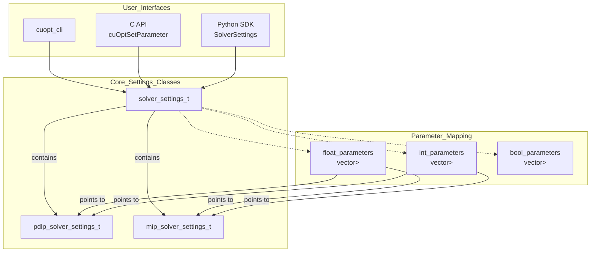
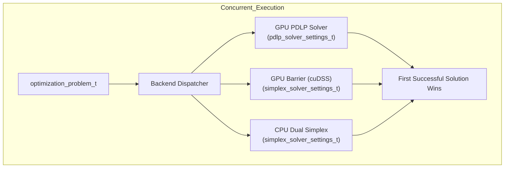

<!-- source: DeepWiki mcp.deepwiki.com · repo NVIDIA/cuopt · page 7.3 Solver Configuration and Parameter Tuning · fetched 2026-10-26 -->

# Solver Configuration and Parameter Tuning

Relevant source files

The following files were used as context for generating this wiki page:

- [cpp/include/cuopt/mathematical_optimization/constants.h](cpp/include/cuopt/mathematical_optimization/constants.h)
- [cpp/include/cuopt/mathematical_optimization/mip/solver_settings.hpp](cpp/include/cuopt/mathematical_optimization/mip/solver_settings.hpp)
- [cpp/include/cuopt/mathematical_optimization/pdlp/solver_settings.hpp](cpp/include/cuopt/mathematical_optimization/pdlp/solver_settings.hpp)
- [cpp/src/dual_simplex/simplex_solver_settings.hpp](cpp/src/dual_simplex/simplex_solver_settings.hpp)
- [cpp/src/math_optimization/solver_settings.cu](cpp/src/math_optimization/solver_settings.cu)
- [cpp/src/pdlp/solve.cu](cpp/src/pdlp/solve.cu)
- [docs/cuopt/source/convex-settings.rst](docs/cuopt/source/convex-settings.rst)
- [docs/cuopt/source/cuopt-c/convex/convex-c-api.rst](docs/cuopt/source/cuopt-c/convex/convex-c-api.rst)
- [python/cuopt/cuopt/linear_programming/solver_settings/solver_settings.pxd](python/cuopt/cuopt/linear_programming/solver_settings/solver_settings.pxd)
- [python/cuopt/cuopt/linear_programming/solver_settings/solver_settings.pyx](python/cuopt/cuopt/linear_programming/solver_settings/solver_settings.pyx)

This page provides comprehensive documentation for configuring cuOpt's LP and MILP solvers, including parameter settings, solver modes, tolerances, method selection, and internal mapping architectures. Proper configuration is essential for achieving optimal performance across different problem types and scales.

## Overview

cuOpt's solver configuration system controls algorithm selection, convergence criteria, resource limits, and optimization strategies. The system provides robust defaults that work well for most problems, but specific problem characteristics benefit from targeted parameter tuning across the C++, Python, and server APIs.

### Configuration Architecture

The configuration subsystem relies on core C++ classes that aggregate solver-specific settings and map string/integer identifiers to underlying algorithm hyper-parameters:
- **`solver_settings_t<i_t, f_t>`**: The central registry class managing parameter tables and configurations [cpp/src/math_optimization/solver_settings.cu:56-122]().
- **`pdlp_solver_settings_t<i_t, f_t>`**: Manages PDLP-specific parameters, tolerances, and warm-start data buffers [cpp/include/cuopt/mathematical_optimization/pdlp/solver_settings.hpp:121-185]().
- **`mip_solver_settings_t<i_t, f_t>`**: Manages branch-and-bound, heuristics, cut generation, and PaPILO presolve options [cpp/include/cuopt/mathematical_optimization/mip/solver_settings.hpp:69-156]().
- **`simplex_solver_settings_t<i_t, f_t>`**: Manages CPU dual simplex and barrier method parameters [cpp/src/dual_simplex/simplex_solver_settings.hpp:31-134]().

### Configuration Interfaces

All user interfaces expose the same underlying parameters with consistent naming conventions. When using the Server/Thin client, the `CUOPT_` prefix is removed and parameter names are converted to lowercase [docs/cuopt/source/convex-settings.rst:9-10]().

| Interface | Parameter Format | Example |
|-----------|------------------|---------|
| Python SDK | `settings.set_parameter("time_limit", 100.0)` | Direct Python types / Cython bridge [python/cuopt/cuopt/linear_programming/solver_settings/solver_settings.pyx:179-195]() |
| C API | `cuOptSetParameter(settings, CUOPT_TIME_LIMIT, "100.0")` | String constants [cpp/include/cuopt/mathematical_optimization/constants.h:34]() |
| Server | `"solver_config": {"time_limit": 100.0}` | JSON dictionary [docs/cuopt/source/convex-settings.rst:9-10]() |
| CLI | `--time-limit 100.0` | Hyphenated command-line flags |

Sources: [cpp/include/cuopt/mathematical_optimization/constants.h:23-115](), [cpp/src/math_optimization/solver_settings.cu:60-137](), [docs/cuopt/source/convex-settings.rst:6-10]()

---

## Parameter Reference

### Common Parameters (LP and MILP)

Parameters applicable to both LP and MILP problems:

| Parameter Constant | Type | Default | Range | Description |
|--------------------|------|---------|-------|-------------|
| `CUOPT_TIME_LIMIT` | double | $\infty$ | $[0, \infty)$ | Maximum solve time in seconds [cpp/src/math_optimization/solver_settings.cu:126-127]() |
| `CUOPT_WORK_LIMIT` | double | $\infty$ | $[0, \infty)$ | Maximum work limit in normalized units [cpp/src/math_optimization/solver_settings.cu:128]() |
| `CUOPT_LOG_TO_CONSOLE` | bool | true | — | Enable console logging output |
| `CUOPT_LOG_FILE` | string | `""` | — | Path to log file (empty = no file) [docs/cuopt/source/convex-settings.rst:38-42]() |
| `CUOPT_SOLUTION_FILE` | string | `""` | — | Path to solution output file [docs/cuopt/source/convex-settings.rst:43-48]() |
| `CUOPT_USER_PROBLEM_FILE` | string | `""` | — | Path to write user problem [docs/cuopt/source/convex-settings.rst:49-54]() |
| `CUOPT_NUM_CPU_THREADS` | int | -1 | $[-1, \text{max}]$ | CPU threads for parallel operations (-1 = auto) [cpp/src/dual_simplex/simplex_solver_settings.hpp:101]() |
| `CUOPT_PRESOLVE` | int | -1 | $[-1, 2]$ | Presolver selection: -1=Default, 0=Off, 1=PaPILO, 2=PSLP [docs/cuopt/source/convex-settings.rst:63-66]() |

### LP-Specific Parameters

Parameters for configuring linear programming and convex solvers:

| Parameter Constant | Type | Default | Range | Description |
|--------------------|------|---------|-------|-------------|
| `CUOPT_METHOD` | int | 0 | $[0, 4]$ | Solving method: 0=Concurrent, 1=PDLP, 2=DualSimplex, 3=Barrier, 4=PrimalSimplex [cpp/include/cuopt/mathematical_optimization/pdlp/solver_settings.hpp:71-78]() |
| `CUOPT_PDLP_SOLVER_MODE` | int | 4 | $[0, 4]$ | PDLP mode: 0=Stable1, 1=Stable2, 2=Methodical1, 3=Fast1, 4=Stable3 [cpp/include/cuopt/mathematical_optimization/pdlp/solver_settings.hpp:50-56]() |
| `CUOPT_ITERATION_LIMIT` | int | max | $[0, \text{max}]$ | Maximum iterations [cpp/src/dual_simplex/simplex_solver_settings.hpp:35]() |
| `CUOPT_NUM_GPUS` | int | 1 | $[1, 2]$ | Number of GPUs for concurrent or multi-GPU execution [cpp/src/dual_simplex/simplex_solver_settings.hpp:82]() |
| `CUOPT_CROSSOVER` | bool | false | — | Convert interior-point barrier solution to basic solution [cpp/src/dual_simplex/simplex_solver_settings.hpp:97]() |
| `CUOPT_PDLP_PRECISION` | int | -1 | $[-1, 2]$ | Precision mode: -1=Default, 0=Single, 1=Double, 2=Mixed [cpp/include/cuopt/mathematical_optimization/pdlp/solver_settings.hpp:101-106]() |

### MILP-Specific Parameters

Parameters for mixed-integer programming:

| Parameter Constant | Type | Default | Range | Description |
|--------------------|------|---------|-------|-------------|
| `CUOPT_MIP_ABSOLUTE_TOLERANCE` | double | 1e-6 | $[0, 0.1]$ | Absolute feasibility tolerance [cpp/src/math_optimization/solver_settings.cu:135]() |
| `CUOPT_MIP_RELATIVE_TOLERANCE` | double | 1e-12 | $[0, 0.1]$ | Relative feasibility tolerance [cpp/src/math_optimization/solver_settings.cu:136]() |
| `CUOPT_MIP_INTEGRALITY_TOLERANCE` | double | 1e-5 | $[0, 0.1]$ | Integer variable integrality violation tolerance [cpp/src/math_optimization/solver_settings.cu:137]() |
| `CUOPT_MIP_ABSOLUTE_GAP` | double | 1e-10 | $[0, \infty)$ | Absolute optimality gap termination tolerance [cpp/include/cuopt/mathematical_optimization/mip/solver_settings.hpp:109]() |
| `CUOPT_MIP_RELATIVE_GAP` | double | 1e-4 | $[0, 0.1]$ | Relative optimality gap termination tolerance [cpp/include/cuopt/mathematical_optimization/mip/solver_settings.hpp:110]() |
| `CUOPT_MIP_HEURISTICS_ONLY` | bool | false | — | Run only primal heuristics without branch-and-bound [cpp/include/cuopt/mathematical_optimization/mip/solver_settings.hpp:126]() |
| `CUOPT_RANDOM_SEED` | int | 0 | $[0, \text{max}]$ | Random number generator seed [cpp/src/dual_simplex/simplex_solver_settings.hpp:121]() |

Sources: [cpp/include/cuopt/mathematical_optimization/constants.h:23-111](), [cpp/src/math_optimization/solver_settings.cu:125-137](), [cpp/include/cuopt/mathematical_optimization/mip/solver_settings.hpp:104-156]()

---

## Solver Settings Architecture

**Figure 1**: Solver settings architecture mapping string constants to underlying member variables in `solver_settings_t`.

Sources: [cpp/src/math_optimization/solver_settings.cu:56-137](), [cpp/include/cuopt/mathematical_optimization/pdlp/solver_settings.hpp:121-185](), [cpp/include/cuopt/mathematical_optimization/mip/solver_settings.hpp:69-156]()

---

## PDLP Solver Modes and Precision Modes

### Solver Modes (`CUOPT_PDLP_SOLVER_MODE`)
PDLP supports five distinct modes that modify internal hyper-parameters (such as adaptive step-sizing factors, restart frequency thresholds, and Ruiz equilibration passes) [cpp/include/cuopt/mathematical_optimization/pdlp/solver_settings.hpp:50-56](), [cpp/src/pdlp/solve.cu:126-149]():
- **`Stable3` (Default)**: Best overall balance between convergence success and solve speed [cpp/include/cuopt/mathematical_optimization/pdlp/solver_settings.hpp:46]().
- **`Stable2` / `Stable1`**: Legacy stability modes for exceptionally ill-conditioned problems [cpp/include/cuopt/mathematical_optimization/pdlp/solver_settings.hpp:41]().
- **`Methodical1`**: Takes smaller, highly conservative steps requiring fewer total major iterations, at the cost of $1.3\times$ to $1.7\times$ higher memory overhead [cpp/include/cuopt/mathematical_optimization/pdlp/solver_settings.hpp:42-43]().
- **`Fast1`**: Optimizes for raw execution speed with reduced convergence guarantees on difficult instances [cpp/include/cuopt/mathematical_optimization/pdlp/solver_settings.hpp:44]().

### Precision Modes (`CUOPT_PDLP_PRECISION`)
Controlled via `pdlp_precision_t`:
- **`DefaultPrecision`**: Uses problem native type (`double` for FP64 problems) [cpp/include/cuopt/mathematical_optimization/pdlp/solver_settings.hpp:102]().
- **`SinglePrecision`**: Executes internal PDHG iterations in FP32, casting input/output vectors [cpp/include/cuopt/mathematical_optimization/pdlp/solver_settings.hpp:103]().
- **`DoublePrecision`**: Explicit FP64 execution [cpp/include/cuopt/mathematical_optimization/pdlp/solver_settings.hpp:104]().
- **`MixedPrecision`**: Uses FP32 sparse matrix-vector multiplication (SpMV) combined with FP64 vector arithmetic and updates [cpp/include/cuopt/mathematical_optimization/pdlp/solver_settings.hpp:105]().

Sources: [cpp/include/cuopt/mathematical_optimization/pdlp/solver_settings.hpp:36-106](), [cpp/src/pdlp/solve.cu:126-149]()

---

## Concurrent Solver Execution and Multi-GPU Settings

When `CUOPT_METHOD` is set to `Concurrent` (`0`), cuOpt launches multiple solvers in parallel [cpp/include/cuopt/mathematical_optimization/pdlp/solver_settings.hpp:72](), [docs/cuopt/source/convex-settings.rst:83]():

**Figure 2**: Concurrent method execution flow across GPU and CPU backends.

### Multi-GPU Configuration
- **`CUOPT_NUM_GPUS`**: Setting this to `2` when using `Concurrent` mode assigns PDLP and Barrier to separate physical GPUs, avoiding resource contention [docs/cuopt/source/convex-settings.rst:130-134]().
- **Multi-GPU PDLP Sharding**: When `CUOPT_METHOD` is `PDLP` and `CUOPT_NUM_GPUS > 1` (or `-1`), cuOpt partitions the constraint matrix across multiple GPUs [docs/cuopt/source/convex-settings.rst:135-139]().
- **`CUOPT_MULTIGPU_PDLP_PARTITIONER`**: Controls the graph partitioner used for sharding: `0` (Auto), `1` (KaMinPar multi-threaded partitioner), or `2` (RoundRobin assignment) [cpp/include/cuopt/mathematical_optimization/pdlp/solver_settings.hpp:115-119](), [docs/cuopt/source/convex-settings.rst:141-146]().

Sources: [cpp/include/cuopt/mathematical_optimization/pdlp/solver_settings.hpp:71-119](), [docs/cuopt/source/convex-settings.rst:79-146]()

---

## MIP Cut Configurations and Heuristics Options

The branch-and-bound MIP solver integrates GPU-accelerated primal heuristics and a comprehensive cutting plane generation subsystem [cpp/include/cuopt/mathematical_optimization/mip/solver_settings.hpp:130-138]().

### Cut Generators
Each cut type can be configured via integer parameters (where `-1` indicates automatic selection, `0` is disabled, and `1` is enabled) [cpp/src/math_optimization/solver_settings.cu:93-98]():
- **Mixed Integer Rounding (MIR)**: `CUOPT_MIP_MIXED_INTEGER_ROUNDING_CUTS` [cpp/include/cuopt/mathematical_optimization/constants.h:79]()
- **Gomory Mixed Integer Cuts**: `CUOPT_MIP_MIXED_INTEGER_GOMORY_CUTS` [cpp/include/cuopt/mathematical_optimization/constants.h:80]()
- **Knapsack Cover Cuts**: `CUOPT_MIP_KNAPSACK_CUTS` [cpp/include/cuopt/mathematical_optimization/constants.h:81]()
- **Flow Cover Cuts**: `CUOPT_MIP_FLOW_COVER_CUTS` [cpp/include/cuopt/mathematical_optimization/constants.h:82]()
- **Clique Cuts**: `CUOPT_MIP_CLIQUE_CUTS` [cpp/include/cuopt/mathematical_optimization/constants.h:84]()
- **Zero-Half Cuts**: `CUOPT_MIP_ZERO_HALF_CUTS` [cpp/include/cuopt/mathematical_optimization/constants.h:85]()

### Cut Management Parameters
- **`CUOPT_MIP_CUT_PASSES`**: Maximum rounds of cut generation at tree nodes (default: `10`) [cpp/include/cuopt/mathematical_optimization/mip/solver_settings.hpp:130]()
- **`CUOPT_MIP_CUT_MIN_ORTHOGONALITY`**: Minimum angle/orthogonality required to accept generated cuts (default: `0.5`) [cpp/include/cuopt/mathematical_optimization/mip/solver_settings.hpp:145]()

Sources: [cpp/include/cuopt/mathematical_optimization/constants.h:78-87](), [cpp/include/cuopt/mathematical_optimization/mip/solver_settings.hpp:130-145]()

---

## Warm Starting and Initial Solutions

cuOpt supports injecting initial primal and dual solutions to accelerate optimization solves [cpp/src/math_optimization/solver_settings.cu:31-87]().

### PDLP Warm Start APIs
- **Primal/Dual Vectors**: `set_initial_pdlp_primal_solution()` and `set_initial_pdlp_dual_solution()` copy host/device solution vectors onto the solver stream [cpp/src/math_optimization/solver_settings.cu:31-44]().
- **Advanced State Warm Starting**: `set_pdlp_warm_start_data()` accepts complete solver state (averages, ATY vectors, step sizes, and primal weights) for seamless iterative continuation [cpp/src/math_optimization/solver_settings.cu:47-87]().

### MIP Initial Incumbents
- **`mip_solver_settings_t::add_initial_solution()`**: Allows injection of known feasible integer assignments, which are fed directly into GPU primal heuristics and branch-and-bound root nodes as initial incumbents [cpp/src/math_optimization/solver_settings.cu:103-108](), [cpp/include/cuopt/mathematical_optimization/mip/solver_settings.hpp:92-96]().

Sources: [cpp/src/math_optimization/solver_settings.cu:31-108](), [cpp/include/cuopt/mathematical_optimization/pdlp/solver_settings.hpp:152-168]()

---

## Performance Tuning Guidelines

1. **Mixed Precision SpMV**: Enable `CUOPT_PDLP_PRECISION` as `MixedPrecision` (`2`) to utilize FP32 sparse matrix operations while keeping FP64 vector updates, yielding speedups on tensor-core equipped architectures [cpp/include/cuopt/mathematical_optimization/pdlp/solver_settings.hpp:105]().
2. **Concurrent GPU Allocation**: Set `CUOPT_NUM_GPUS` to `2` when solving large LPs in `Concurrent` mode to isolate GPU memory spaces and compute streams for PDLP and Barrier [docs/cuopt/source/convex-settings.rst:130-134]().
3. **MIP Presolve**: Ensure `CUOPT_PRESOLVE` remains enabled (`1` for PaPILO) to maximize variable fixing and domain reduction before branch-and-bound begins [docs/cuopt/source/convex-settings.rst:63-66]().

Sources: [cpp/include/cuopt/mathematical_optimization/pdlp/solver_settings.hpp:101-106](), [cpp/include/cuopt/mathematical_optimization/mip/solver_settings.hpp:164](), [docs/cuopt/source/convex-settings.rst:56-73]()

---

