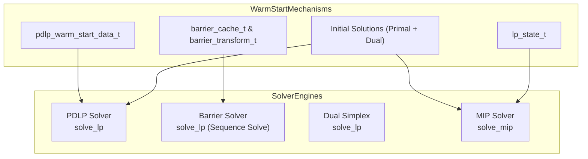
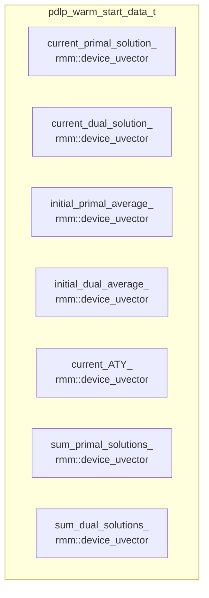
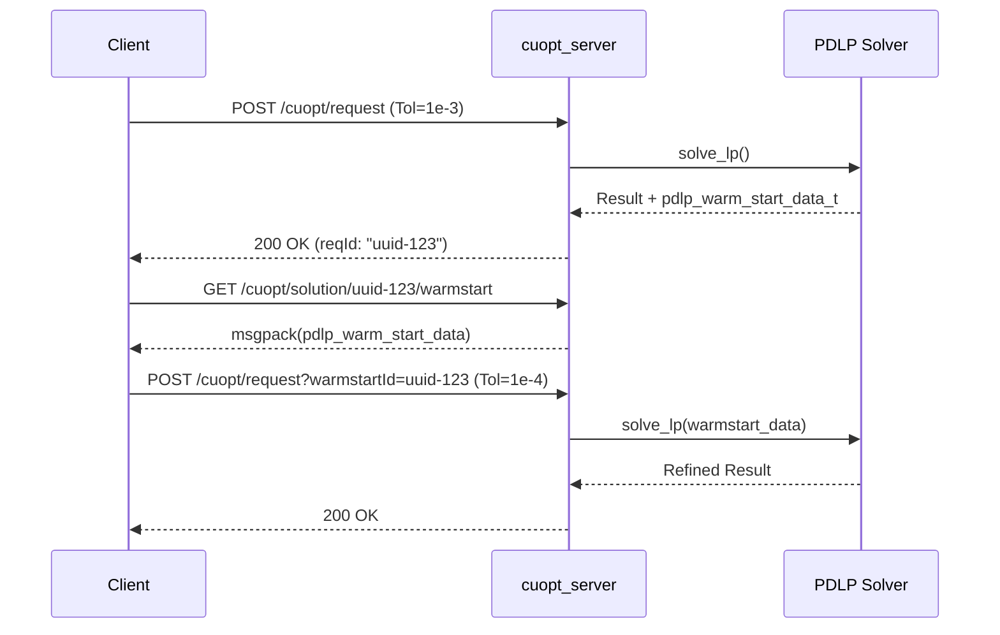
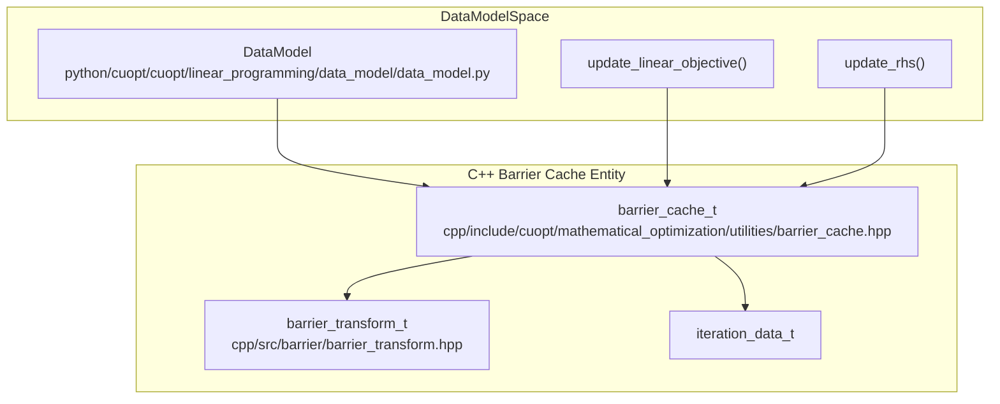
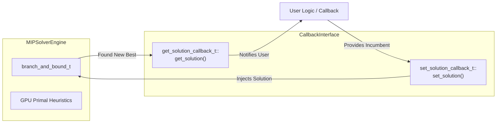

<!-- source: DeepWiki mcp.deepwiki.com · repo NVIDIA/cuopt · page 7.4 Warm Starting and Solution Reuse · fetched 2026-10-26 -->

# Warm Starting and Solution Reuse

Relevant source files

The following files were used as context for generating this wiki page:

- [cpp/include/cuopt/mathematical_optimization/utilities/barrier_cache.hpp](cpp/include/cuopt/mathematical_optimization/utilities/barrier_cache.hpp)
- [cpp/src/barrier/barrier_cache.cu](cpp/src/barrier/barrier_cache.cu)
- [cpp/src/barrier/barrier_transform.hpp](cpp/src/barrier/barrier_transform.hpp)
- [cpp/src/mip_heuristics/diversity/diversity_manager.cuh](cpp/src/mip_heuristics/diversity/diversity_manager.cuh)
- [docs/cuopt/source/cuopt-server/client-api/sh-cli-api.rst](docs/cuopt/source/cuopt-server/client-api/sh-cli-api.rst)
- [docs/cuopt/source/cuopt-server/examples/lp-examples.rst](docs/cuopt/source/cuopt-server/examples/lp-examples.rst)
- [docs/cuopt/source/cuopt-server/examples/milp-examples.rst](docs/cuopt/source/cuopt-server/examples/milp-examples.rst)
- [docs/cuopt/source/cuopt-server/examples/milp/examples/incumbent_callback_example.py](docs/cuopt/source/cuopt-server/examples/milp/examples/incumbent_callback_example.py)
- [python/cuopt/cuopt/linear_programming/data_model/data_model.py](python/cuopt/cuopt/linear_programming/data_model/data_model.py)
- [python/cuopt/cuopt/linear_programming/data_model/data_model_wrapper.pyx](python/cuopt/cuopt/linear_programming/data_model/data_model_wrapper.pyx)
- [python/cuopt/cuopt/tests/linear_programming/test_barrier_sequence_solve.py](python/cuopt/cuopt/tests/linear_programming/test_barrier_sequence_solve.py)
- [python/cuopt_self_hosted/cuopt_sh_client/__init__.py](python/cuopt_self_hosted/cuopt_sh_client/__init__.py)
- [python/cuopt_self_hosted/cuopt_sh_client/thin_client_solution.py](python/cuopt_self_hosted/cuopt_sh_client/thin_client_solution.py)
- [python/cuopt_server/cuopt_server/tests/test_incumbents.py](python/cuopt_server/cuopt_server/tests/test_incumbents.py)
- [python/cuopt_server/cuopt_server/tests/test_pdlp_warmstart.py](python/cuopt_server/cuopt_server/tests/test_pdlp_warmstart.py)

## Purpose and Scope

This document explains the mechanisms in cuOpt for warm starting solvers and reusing solution information across multiple solve operations. Warm starting allows solvers to begin from a previously computed solution state rather than starting from scratch, potentially reducing solve time when solving similar or related problems sequentially.

This page covers:
- PDLP warm start data structures and server-side storage mechanisms (`pdlp_warm_start_data_t`, `warmstartId`).
- Barrier cache and sequence solves (`barrier_cache_t`, `barrier_transform_t`, `update_linear_objective`, and `update_rhs`).
- MIP incumbent injection via callbacks and solution injection.
- LP state reuse within MIP branch-and-bound and crossover.

Sources: [cpp/include/cuopt/linear_programming/pdlp/pdlp_warm_start_data.hpp:20-41](), [cpp/include/cuopt/mathematical_optimization/utilities/barrier_cache.hpp:33-95](), [python/cuopt_server/cuopt_server/tests/test_pdlp_warmstart.py:30-90](), [python/cuopt/cuopt/tests/linear_programming/test_barrier_sequence_solve.py:4-36]()

---

## Overview of Warm Start Mechanisms

cuOpt provides multiple mechanisms for warm starting and solution reuse, depending on the solver method and problem type:

Diagram: Warm Start Architecture and Mechanisms

**Warm Start Mechanism Summary**

| Mechanism | Applicable Solvers | Primary Use Case |
|-----------|-------------------|------------------|
| `pdlp_warm_start_data_t` | PDLP | Sequential similar LP problems (server `warmstartId`) |
| `barrier_cache_t` | Barrier | Sequence solves with updated objective/RHS without re-presolve |
| Initial Primal/Dual Solutions | PDLP, MIP | User-provided starting points and MIP incumbent injection |
| `lp_state_t` | MIP (internal) | LP relaxation reuse across B&B nodes |

Sources: [cpp/include/cuopt/linear_programming/pdlp/pdlp_warm_start_data.hpp:20-41](), [cpp/include/cuopt/mathematical_optimization/utilities/barrier_cache.hpp:33-95](), [python/cuopt_server/cuopt_server/tests/test_pdlp_warmstart.py:30-90]()

---

## PDLP Warm Start Data and Server-Side Storage

### Data Structure and Components

The PDLP solver supports comprehensive warm starting through `pdlp_warm_start_data_t`, which captures the complete algorithmic state from a previous solve. This enables efficient resolution of similar or slightly modified problems by maintaining the momentum and scaling factors of the Primal-Dual Hybrid Gradient (PDHG) iterations.

Diagram: PDLP Warm Start Data Flow

**Key Components:**
1. **Current Iterates**: `current_primal_solution_` and `current_dual_solution_` store the most recent primal and dual solutions [cpp/include/cuopt/linear_programming/pdlp/pdlp_warm_start_data.hpp:22-26]().
2. **Averages and Sums**: `initial_primal_average_`, `initial_dual_average_`, `sum_primal_solutions_`, and `sum_dual_solutions_` maintain history for ergodic solution computation [cpp/include/cuopt/linear_programming/pdlp/pdlp_warm_start_data.hpp:27-31]().
3. **Cached Computations**: `current_ATY_` stores $A^T y$, avoiding redundant sparse matrix-vector multiplies [cpp/include/cuopt/linear_programming/pdlp/pdlp_warm_start_data.hpp:29-29]().

Sources: [cpp/include/cuopt/linear_programming/pdlp/pdlp_warm_start_data.hpp:20-41]()

### Continuation-Based Optimization (Server API)

The `cuopt_server` facilitates warm starting through the `warmstartId` parameter and `/cuopt/solution/{reqId}/warmstart` endpoint [python/cuopt_server/cuopt_server/tests/test_pdlp_warmstart.py:72-88]().

Diagram: Server Warm Start Sequence

Sources: [python/cuopt_server/cuopt_server/tests/test_pdlp_warmstart.py:30-90]()

---

## Barrier Cache and Sequence Solves

For the interior-point barrier method, cuOpt provides a GPU solve cache (`barrier_cache_t`) managed by `DataModel` when `CUOPT_SEQUENCE_SOLVE` is enabled [cpp/include/cuopt/mathematical_optimization/utilities/barrier_cache.hpp:37-44]().

### Architecture of Barrier Cache

After an optimal solve, `barrier_cache_t` stores the `iteration_data_t` workspace and the user-to-presolve transform (`barrier_transform_t`) [cpp/include/cuopt/mathematical_optimization/utilities/barrier_cache.hpp:38-40](), [cpp/src/barrier/barrier_transform.hpp:26-30](). When objective coefficients or constraint right-hand sides (RHS) are updated via `update_linear_objective` or `update_rhs`, the changes are crushed directly into the cached iteration workspace, marking the cache dirty so the next solve bypasses conversion, presolve, and scaling [cpp/include/cuopt/mathematical_optimization/utilities/barrier_cache.hpp:78-89](), [python/cuopt/cuopt/linear_programming/data_model/data_model_wrapper.pyx:170-182]().

Diagram: Barrier Cache and Sequence Solve Pipeline
DataModel -> barrier_cache_t -> barrier_transform_t -> iteration_data_t -> Barrier Solver

### Validation and Reuse Gates

Before reusing the barrier cache, `can_reuse_barrier_cache` validates that matrix dimensions, bound-free variables, and cone structures match the cached transform [cpp/src/barrier/barrier_transform.hpp:77-96](). If valid, subsequent resolves avoid expensive re-factorization and presolving overheads, as verified in `test_barrier_sequence_solve.py` [python/cuopt/cuopt/tests/linear_programming/test_barrier_sequence_solve.py:4-173]().

Sources: [cpp/include/cuopt/mathematical_optimization/utilities/barrier_cache.hpp:33-95](), [cpp/src/barrier/barrier_cache.cu:50-253](), [cpp/src/barrier/barrier_transform.hpp:26-96](), [python/cuopt/cuopt/linear_programming/data_model/data_model_wrapper.pyx:28-32,170-182](), [python/cuopt/cuopt/tests/linear_programming/test_barrier_sequence_solve.py:4-173]()

---

## MIP Incumbent Injection

For Mixed Integer Programming (MIP), warm starting primarily involves injecting a known feasible integer solution (incumbent) into the solver. This improves the primal bound early, allowing the branch-and-bound tree to be pruned more aggressively.

### Incumbent Callbacks

The MIP solver utilizes a callback system defined in `cuopt/linear_programming/utilities/internals.hpp` to interact with solutions during search:
- **`get_solution_callback_t`**: Exports new incumbent solutions found during search [cpp/include/cuopt/linear_programming/utilities/internals.hpp:46-56]().
- **`set_solution_callback_t`**: Requests/injects an incumbent solution provided by the user [cpp/include/cuopt/linear_programming/utilities/internals.hpp:58-68]().

Diagram: MIP Incumbent Callback Architecture

Sources: [cpp/include/cuopt/linear_programming/utilities/internals.hpp:46-68](), [cpp/tests/mip/incumbent_callback_test.cu:37-62](), [python/cuopt_server/cuopt_server/tests/test_incumbents.py:41-80]()

---

## Performance Benefits and Constraints

### Warm Start Performance
- **LP Refinement & Sequences**: PDLP warm-starts and barrier cache sequence solves skip matrix conversion, presolve, and factorization, drastically lowering iteration times [python/cuopt_server/cuopt_server/tests/test_pdlp_warmstart.py:90](), [python/cuopt/cuopt/tests/linear_programming/test_barrier_sequence_solve.py:160-173]().
- **MIP Search Pruning**: Injecting an incumbent allows the solver to prune subtrees whose bounds exceed the known solution cost [cpp/tests/mip/incumbent_callback_test.cu:45-58]().

### Constraints and Compatibility

| Feature | Support Status | Notes |
| :--- | :--- | :--- |
| **LP Warm Start** | PDLP & Barrier | PDLP via `pdlp_warm_start_data_t`; Barrier via `barrier_cache_t` sequence solve |
| **MIP Warm Start** | Incumbent Only | Full branch-and-bound tree state warm start is not supported; only primal solution injection |
| **Presolve** | Limited | Presolve may be bypassed or configured (`CUOPT_PRESOLVE = 0`) to ensure mapping consistency in warm starts [python/cuopt_server/cuopt_server/tests/test_pdlp_warmstart.py:40-43]() |

Sources: [docs/cuopt/source/cuopt-server/examples/lp-examples.rst:147-148](), [docs/cuopt/source/cuopt-server/examples/milp-examples.rst:66-67](), [python/cuopt_server/cuopt_server/tests/test_pdlp_warmstart.py:40-43]()

---

