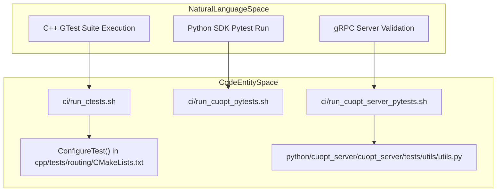
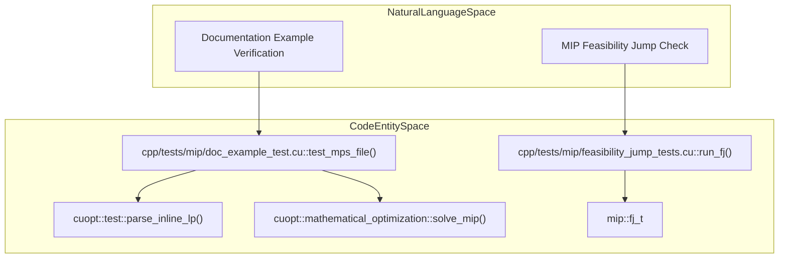

<!-- source: DeepWiki mcp.deepwiki.com · repo NVIDIA/cuopt · page 7.5 Testing and Quality Assurance · fetched 2026-10-26 -->

# Testing and Quality Assurance

Relevant source files

The following files were used as context for generating this wiki page:

- [.coderabbit.yaml](.coderabbit.yaml)
- [.github/.coderabbit_review_guide.md](.github/.coderabbit_review_guide.md)
- [ci/run_ctests.sh](ci/run_ctests.sh)
- [ci/run_cuopt_pytests.sh](ci/run_cuopt_pytests.sh)
- [ci/run_cuopt_server_pytests.sh](ci/run_cuopt_server_pytests.sh)
- [cpp/src/routing/route/capacity_route.cuh](cpp/src/routing/route/capacity_route.cuh)
- [cpp/tests/distance_engine/CMakeLists.txt](cpp/tests/distance_engine/CMakeLists.txt)
- [cpp/tests/mip/doc_example_test.cu](cpp/tests/mip/doc_example_test.cu)
- [cpp/tests/mip/feasibility_jump_tests.cu](cpp/tests/mip/feasibility_jump_tests.cu)
- [cpp/tests/mip/semi_continuous_test.cu](cpp/tests/mip/semi_continuous_test.cu)
- [cpp/tests/mip/server_test.cu](cpp/tests/mip/server_test.cu)
- [cpp/tests/mip/unit_test.cu](cpp/tests/mip/unit_test.cu)
- [cpp/tests/qp/CMakeLists.txt](cpp/tests/qp/CMakeLists.txt)
- [cpp/tests/qp/unit_tests/no_constraints.cu](cpp/tests/qp/unit_tests/no_constraints.cu)
- [cpp/tests/qp/unit_tests/two_variable_test.cu](cpp/tests/qp/unit_tests/two_variable_test.cu)
- [cpp/tests/routing/CMakeLists.txt](cpp/tests/routing/CMakeLists.txt)
- [cpp/tests/routing/unit_tests/capacity_route_resize.cu](cpp/tests/routing/unit_tests/capacity_route_resize.cu)
- [cpp/tests/utilities/inline_lp_test_utils.hpp](cpp/tests/utilities/inline_lp_test_utils.hpp)
- [python/cuopt/cuopt/routing/utils.py](python/cuopt/cuopt/routing/utils.py)
- [python/cuopt/cuopt/tests/routing/test_solver_settings.py](python/cuopt/cuopt/tests/routing/test_solver_settings.py)
- [python/cuopt_server/cuopt_server/tests/test_server_health.py](python/cuopt_server/cuopt_server/tests/test_server_health.py)
- [python/cuopt_server/cuopt_server/tests/utils/utils.py](python/cuopt_server/cuopt_server/tests/utils/utils.py)

## Purpose and Scope

This document describes the testing infrastructure, test organization, and quality assurance processes for the cuOpt codebase. It covers C++ unit and internal test suites (`GTest`), Python integration and unit tests (`pytest`), gRPC service tests, determinism verification, notebook and doc-example validation (`cpp/tests/mip/doc_example_test.cu`), as well as linting and code review policies (`.coderabbit.yaml`).

---

## Testing Infrastructure and Tooling

cuOpt employs a multi-layered testing framework spanning low-level C++ CUDA kernels, Python SDK bindings, gRPC servers, and microservice APIs.

### Test Execution Frameworks and Entry Points

| Testing Layer | Framework | Primary Location | Execution Script / Target |
|---------------|-----------|------------------|---------------------------|
| C++ Core & Routing | GTest | `cpp/tests/` | [ci/run_ctests.sh]() |
| Python SDK | pytest | `python/cuopt/cuopt/tests/` | [ci/run_cuopt_pytests.sh]() |
| cuOpt Server | pytest | `python/cuopt_server/cuopt_server/tests/` | [ci/run_cuopt_server_pytests.sh]() |
| MIP Heuristics | GTest | `cpp/tests/mip/` | [cpp/tests/mip/feasibility_jump_tests.cu]() |
| Doc Examples | GTest | `cpp/tests/mip/doc_example_test.cu` | [cpp/tests/mip/doc_example_test.cu]() |

### Natural Language to Code Entity Mapping: Test Orchestration

The following diagram bridges natural language test execution concepts to specific codebase entities, highlighting how CMake target configurations and bash scripts orchestrate validation.

Sources: [ci/run_ctests.sh](), [cpp/tests/routing/CMakeLists.txt](), [ci/run_cuopt_pytests.sh](), [ci/run_cuopt_server_pytests.sh](), [python/cuopt_server/cuopt_server/tests/utils/utils.py]()

---

## C++ GTest Suites and Unit Testing

C++ unit and regression tests are implemented using Google Test (`GTest`). CMake configuration macros (`ConfigureTest`) aggregate individual test files into static binaries to prevent explosive binary sizing from multi-architecture CUDA device code embedding [cpp/tests/routing/CMakeLists.txt:6-20]().

### Routing and MIP Test Organization
- **Routing Unit Tests**: Level-0 and unit test suites validate components like `top_k`, vehicle types, breaks, and objective functions (`cpp/tests/routing/unit_tests/`) [cpp/tests/routing/CMakeLists.txt:11-60]().
- **MIP Heuristics Tests**: Feasibility Jump (`FJ`) and scaling tests evaluate local search mechanics, preventing objective/violation numerical explosions [cpp/tests/mip/feasibility_jump_tests.cu:115-134]().
- **Documentation Example Tests**: Documentation snippets are actively compiled and verified against expected outputs, such as testing mixed-integer linear programming examples and user problem file serialization [cpp/tests/mip/doc_example_test.cu:24-74]().

Sources: [cpp/tests/routing/CMakeLists.txt:1-66](), [cpp/tests/mip/doc_example_test.cu:24-74](), [cpp/tests/mip/feasibility_jump_tests.cu:63-113]()

---

## Python Pytest and Service Testing

Python tests are partitioned into package-level pytest suites and server-level integration tests.

### Execution Scripts
- **Python SDK Tests**: [ci/run_cuopt_pytests.sh]() changes directory into `python/cuopt/cuopt/`, handling `pytest-xdist` workers (`-n 4`), load grouping, and night-run rerun XML integration (`-p cuopt_rerun_xml`) [ci/run_cuopt_pytests.sh:16-42]().
- **cuOpt Server Tests**: [ci/run_cuopt_server_pytests.sh]() executes tests in `python/cuopt_server/cuopt_server/tests/`, utilizing worker port allocation and request polling helpers (`poll_request`, `get_routes`) [ci/run_cuopt_server_pytests.sh:1-40](), [python/cuopt_server/cuopt_server/tests/utils/utils.py:43-170]().

Sources: [ci/run_cuopt_pytests.sh:1-61](), [ci/run_cuopt_server_pytests.sh:1-54](), [python/cuopt_server/cuopt_server/tests/utils/utils.py:1-170]()

---

## CI Test Resilience and Retries

The C++ test harness [ci/run_ctests.sh]() incorporates advanced failure analysis and retry mechanisms for nightly and pull-request builds:
- **Binary Failure Recording**: Captures process crashes (e.g., `SIGSEGV`, exit codes $\ge 128$) and writes synthetic JUnit crash XML markers via `write_binary_crash_marker` [ci/run_ctests.sh:68-84]().
- **Granular Test Case Retries**: Under nightly execution modes (`IS_NIGHTLY=nightly`), failing test binaries parse JUnit outputs or query `--gtest_list_tests` to isolate and retry individual flaky test cases up to `GTEST_MAX_RETRIES` times [ci/run_ctests.sh:120-180]().

Sources: [ci/run_ctests.sh:1-180]()

---

## Code Quality, Linting, and CodeRabbit Integration

Quality assurance is automated through pre-commit hooks, linters, and CodeRabbit AI review configurations (`.coderabbit.yaml`).

### Automated Lint Policies
- **C++/CUDA Formatting**: Enforced via `clang-format` (Google-based style with a 100-character column limit).
- **Python Linting**: Handled by `ruff` (`E, F, W` rules ignoring line length `E501`) and `pydocstyle` for docstring formatting [.github/.coderabbit_review_guide.md:20-25]().
- **CodeRabbit Review Scope**: `.coderabbit.yaml` defines path-specific review instructions, focusing code reviews on correctness, GPU safety, numerical stability, and API changes while ignoring automated formatting noise [.coderabbit.yaml:34-153]().

Sources: [.coderabbit.yaml:1-153](), [.github/.coderabbit_review_guide.md:1-110]()

---

