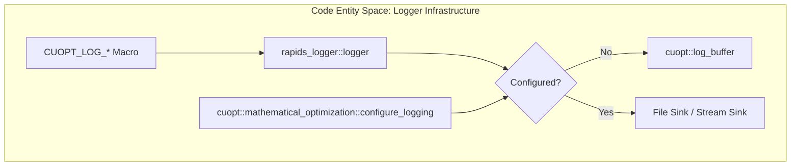
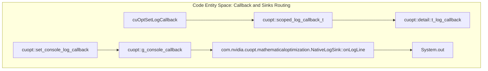

<!-- source: DeepWiki mcp.deepwiki.com · repo NVIDIA/cuopt · page 7.6 Logging and Diagnostics · fetched 2026-10-26 -->

# Logging and Diagnostics

<details>
<summary>Relevant source files</summary>

The following files were used as context for generating this wiki page:

- [cpp/include/cuopt/mathematical_optimization/backend_selection.hpp](cpp/include/cuopt/mathematical_optimization/backend_selection.hpp)
- [cpp/src/math_optimization/logger_entry.cpp](cpp/src/math_optimization/logger_entry.cpp)
- [cpp/src/pdlp/backend_selection.cpp](cpp/src/pdlp/backend_selection.cpp)
- [cpp/src/routing/solve.cu](cpp/src/routing/solve.cu)
- [cpp/src/utilities/build_info.hpp.in](cpp/src/utilities/build_info.hpp.in)
- [cpp/src/utilities/logger.hpp](cpp/src/utilities/logger.hpp)
- [cpp/src/utilities/version_info.cpp](cpp/src/utilities/version_info.cpp)
- [cpp/src/utilities/version_info.hpp](cpp/src/utilities/version_info.hpp)
- [cpp/tests/utilities/CMakeLists.txt](cpp/tests/utilities/CMakeLists.txt)
- [cpp/tests/utilities/test_cli.cpp](cpp/tests/utilities/test_cli.cpp)
- [cpp/tests/utilities/test_console_log_callback.cpp](cpp/tests/utilities/test_console_log_callback.cpp)
- [java/cuopt/src/main/java/com/nvidia/cuopt/mathematicaloptimization/NativeLogSink.java](java/cuopt/src/main/java/com/nvidia/cuopt/mathematicaloptimization/NativeLogSink.java)
- [java/cuopt/src/main/native/cuopt_jni.cpp](java/cuopt/src/main/native/cuopt_jni.cpp)
- [java/cuopt/src/test/java/com/nvidia/cuopt/mathematicaloptimization/NativeLogSinkTest.java](java/cuopt/src/test/java/com/nvidia/cuopt/mathematicaloptimization/NativeLogSinkTest.java)

</details>


This page documents the cuOpt logging and diagnostics subsystem. The subsystem encompasses `rapids-logger` integration, thread-safe log sinks, callback mechanisms, remote solve log streaming, hardware telemetry collection, and build/version reporting structures across C++, Python, and Java wrappers.

---

## 1. Logging Subsystem Architecture (`rapids-logger` Integration)

The cuOpt logging framework builds upon `rapids_logger` (`cpp/src/utilities/logger.hpp`) to provide structured, multi-level severity logging across components (`libcuopt-client`, `libcuopt-mathopt`, `libcuopt-routing`) [cpp/src/utilities/logger.hpp:14](). 

Because components are compiled into distinct shared libraries with hidden visibility, header-only inline mechanisms are utilized. Static local instances are declared inline to ensure each library defines its own logger context while preventing symbol collapsing across dynamic library boundaries via `STB_GNU_UNIQUE` symbols [cpp/src/utilities/logger.hpp:28-32](). 

### Log Buffering and Initialization

Messages generated prior to explicit configuration are intercepted by a memory-backed buffer (`log_buffer`) [cpp/src/utilities/logger.hpp:151-189](). Once `configure_logging()` is invoked (`cpp/src/math_optimization/logger_entry.cpp`), buffered lines are flushed or routed to the configured sink:


*Diagram 1: Flow of log events through the buffering and configuration layer.*

Sources: `cpp/src/utilities/logger.hpp:1-197`, `cpp/src/math_optimization/logger_entry.cpp:1-24`, `cpp/src/routing/solve.cu:1-35`

---

## 2. Callbacks and Thread-Safe Sinks

cuOpt supports per-thread log callback registrations to isolate concurrent optimization tasks running within the same process. 

### Thread-Local Callbacks

Thread-safety is achieved using a thread-local registration structure `detail::thread_log_callback_t` (`t_log_callback`) decorated with `CUOPT_EXPORT` to allow dynamic linkage visibility across library boundaries (`cuopt_mathopt` to `cuopt_client`) [cpp/src/utilities/logger.hpp:63-83](). The RAII helper `scoped_log_callback_t` manages callback scopes per thread:

```cpp
class scoped_log_callback_t {
 public:
  scoped_log_callback_t(log_callback_with_data_t cb, void* user_data);
  ~scoped_log_callback_t();
  // ...
};
```
[cpp/src/utilities/logger.hpp:96-118]()

### Console Sinks and JNI Integration

When `settings.log_to_console` is enabled, messages target standard output streams. Language bindings (such as Java via JNI) override default stdout/stderr routing using `set_console_log_callback` (`cuopt::log_console_callback_t`) to prevent process-level stream corruption or integration conflicts with frameworks like Maven Surefire [java/cuopt/src/main/java/com/nvidia/cuopt/mathematicaloptimization/NativeLogSink.java:8-17]().


*Diagram 2: Routing native callback logs to language runtimes.*

Sources: `cpp/src/utilities/logger.hpp:43-148`, `java/cuopt/src/main/native/cuopt_jni.cpp:35-110`, `java/cuopt/src/main/java/com/nvidia/cuopt/mathematicaloptimization/NativeLogSink.java:1-24`

---

## 3. Solver Log Streaming and Execution Diagnostics

Solvers instantiate internal log handlers on entry. For instance, the routing solver initializes an error logging mode via `init_logger_t` to capture runtime exceptions and memory allocation faults before returning error statuses [cpp/src/routing/solve.cu:20-33]().

### Backend Selection and Conditional Logging

During problem initialization, `cuopt::mathematical_optimization::get_memory_backend_type()` determines whether to use GPU memory via RMM or fallback to CPU memory [cpp/src/pdlp/backend_selection.cpp:29-54]()]. If a local execution mode lacks visible CUDA devices, a diagnostic warning is emitted exactly once using `CUOPT_LOG_ONCE` to avoid log spamming during repeated solve-time queries [cpp/src/pdlp/backend_selection.cpp:45-53]():

```cpp
CUOPT_LOG_ONCE(
  INFO,
  "cuOpt selected CPU memory backend: no usable CUDA device "
  "(cudaGetDeviceCount err=%d (%s) count=%d, CUDA_VISIBLE_DEVICES=%s)",
  static_cast<int>(err),
  cudaGetErrorString(err),
  cuda_count,
  std::getenv("CUDA_VISIBLE_DEVICES") ? std::getenv("CUDA_VISIBLE_DEVICES") : "(unset)");
```
[cpp/src/pdlp/backend_selection.cpp:45-53]()

Sources: `cpp/src/pdlp/backend_selection.cpp:1-56`, `cpp/include/cuopt/mathematical_optimization/backend_selection.hpp:1-58`

---

## 4. Version, Build, and Diagnostics Reporting

Diagnostics functions (`cuopt::print_version_info`) gather host telemetry, hardware properties, and compiler metadata to aid support and debugging [cpp/src/utilities/version_info.hpp:13]().

### Collected Telemetry Metrics

| Diagnostic Category | Source Function / File | Captured Information |
| :--- | :--- | :--- |
| **CPU Topology** | `get_allowed_cpus()` / `get_physical_cores()` [cpp/src/utilities/version_info.cpp:113-157]() | Effective CPU affinity masks (`sched_getaffinity`), online CPU lists, physical core counts vs SMT threads. |
| **SIMD Architecture** | `get_simd_target()` [cpp/src/utilities/version_info.cpp:212-224]() | Instruction set dispatch targets using Google Highway (`hwy::DispatchedTarget`), normalized to names like AVX-512 [cpp/src/utilities/version_info.cpp:214-222](). |
| **Memory Status** | `get_host_memory_info()` [cpp/src/utilities/version_info.cpp:231-237]() | Total and available RAM from `/proc/meminfo`. |
| **Build Configuration** | `CUOPT_GIT_COMMIT_HASH` [cpp/src/utilities/build_info.hpp.in:14]() | CMake-injected Git commit hash representing the exact source revision. |

Sources: `cpp/src/utilities/version_info.cpp:1-237`, `cpp/src/utilities/version_info.hpp:1-14`, `cpp/src/utilities/build_info.hpp.in:1-15`

---

