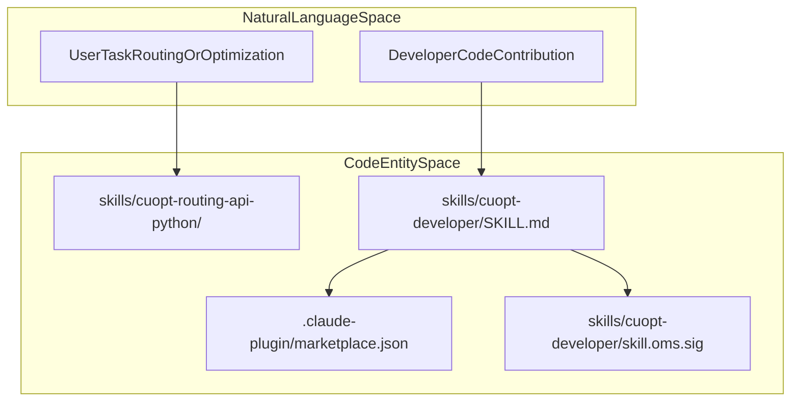
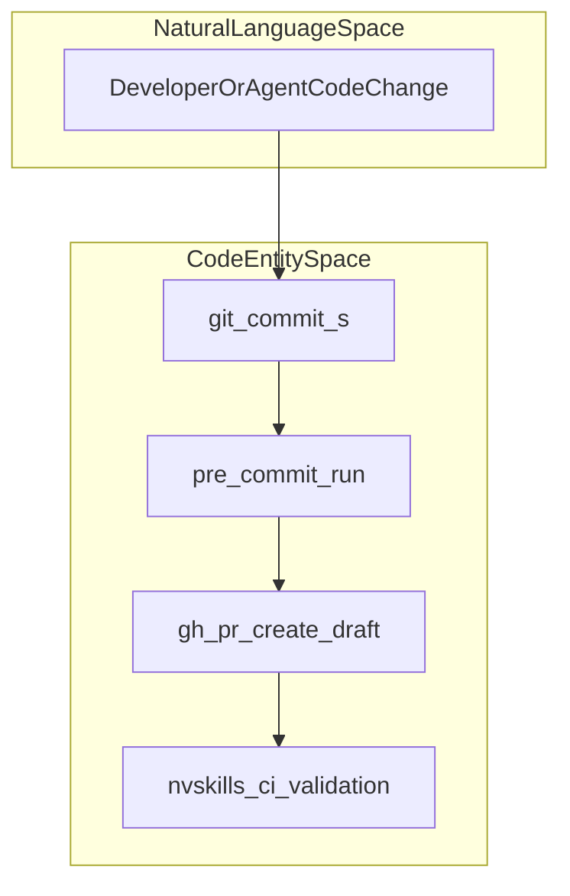

<!-- source: DeepWiki mcp.deepwiki.com · repo NVIDIA/cuopt · page 8 Agent Skills and Contributor Tooling · fetched 2026-10-26 -->

# Agent Skills and Contributor Tooling

Relevant source files

The following files were used as context for generating this wiki page:

- [.agents/rules/cuopt-skill-evolution.mdc](.agents/rules/cuopt-skill-evolution.mdc)
- [.claude-plugin/marketplace.json](.claude-plugin/marketplace.json)
- [AGENTS.md](AGENTS.md)
- [SECURITY.md](SECURITY.md)
- [skills/cuopt-developer/BENCHMARK.md](skills/cuopt-developer/BENCHMARK.md)
- [skills/cuopt-developer/SKILL.md](skills/cuopt-developer/SKILL.md)
- [skills/cuopt-developer/benchmark/evals.json](skills/cuopt-developer/benchmark/evals.json)
- [skills/cuopt-developer/evals/evals.json](skills/cuopt-developer/evals/evals.json)
- [skills/cuopt-developer/references/contributing.md](skills/cuopt-developer/references/contributing.md)
- [skills/cuopt-developer/references/conventions.md](skills/cuopt-developer/references/conventions.md)
- [skills/cuopt-developer/references/first_time_setup.md](skills/cuopt-developer/references/first_time_setup.md)
- [skills/cuopt-developer/skill-card.md](skills/cuopt-developer/skill-card.md)
- [skills/cuopt-developer/skill.oms.sig](skills/cuopt-developer/skill.oms.sig)
- [skills/cuopt-multi-objective-exploration/evals/evals.json](skills/cuopt-multi-objective-exploration/evals/evals.json)
- [skills/cuopt-skill-evolution/BENCHMARK.md](skills/cuopt-skill-evolution/BENCHMARK.md)
- [skills/cuopt-skill-evolution/SKILL.md](skills/cuopt-skill-evolution/SKILL.md)
- [skills/cuopt-skill-evolution/evals/evals.json](skills/cuopt-skill-evolution/evals/evals.json)
- [skills/cuopt-skill-evolution/skill-card.md](skills/cuopt-skill-evolution/skill-card.md)
- [skills/cuopt-skill-evolution/skill.oms.sig](skills/cuopt-skill-evolution/skill.oms.sig)

The purpose of this section is to provide an overview of the `skills/` ecosystem, which hosts specialized AI-agent capabilities, and the contributor-facing workflow files (`AGENTS.md`, `.claude/marketplace.json`, `CONTRIBUTING.md`) that govern code modifications, style conventions, and validation pipelines within NVIDIA cuOpt [AGENTS.md:1-53](), [.claude-plugin/marketplace.json:1-66]().

Sources: [AGENTS.md:1-53](), [.claude-plugin/marketplace.json:1-66]()

---

## Skill Catalog and Structure

AI-agent skills in NVIDIA cuOpt are structured around a flat directory model under `skills/`, providing domain-specific instructions, evaluation benchmarks, and cryptographic signatures for LLM agents [AGENTS.md:1-53](). Each skill package integrates structured metadata (`SKILL.md`, `skill-card.md`), evaluation suites (`evals/`), benchmarks (`BENCHMARK.md`), and digital signature bundles (`skill.oms.sig`) to ensure traceability and security across agent executions [skills/cuopt-developer/SKILL.md:1-14](), [skills/cuopt-developer/skill-card.md:1-48](), [skills/cuopt-developer/skill.oms.sig:1-1]().

For details, see [Skill Catalog and Structure](#8.1).

### Skill Architecture Mapping

*Figure 1: Mapping Natural Language requests to skill directories and metadata structures.*

Sources: [AGENTS.md:1-53](), [.claude-plugin/marketplace.json:1-66](), [skills/cuopt-developer/SKILL.md:1-14](), [skills/cuopt-developer/skill.oms.sig:1-1]()

---

## Domain Skills

The cuOpt agent framework includes a comprehensive catalog of domain-specific skills tailored for installation, numerical optimization formulations, routing APIs, server deployments, and internal code modifications [AGENTS.md:1-53](), [.claude-plugin/marketplace.json:1-66](). Skills such as `cuopt-developer`, `cuopt-routing-api-python`, and `cuopt-numerical-optimization-formulation` encapsulate specialized guidance required for solving complex mathematical programming tasks and maintaining the codebase [AGENTS.md:1-25]().

For details, see [Domain Skills](#8.2).

| Skill Name | Target Domain / Interface | Primary Reference File |
| :--- | :--- | :--- |
| `cuopt-developer` | C++/CUDA internals, PR workflows, style conventions | `skills/cuopt-developer/SKILL.md` [skills/cuopt-developer/SKILL.md:1-14]() |
| `cuopt-routing-api-python` | Vehicle routing (VRP, TSP, PDP) in Python | `skills/cuopt-routing-api-python/` [.claude-plugin/marketplace.json:48-52]() |
| `cuopt-install` | User installation via pip, conda, and Docker | `skills/cuopt-install/` [.claude-plugin/marketplace.json:24-28]() |
| `cuopt-skill-evolution` | Self-correction and skill update proposals | `skills/cuopt-skill-evolution/SKILL.md` [AGENTS.md:26-39]() |

Sources: [AGENTS.md:1-39](), [.claude-plugin/marketplace.json:10-66](), [skills/cuopt-developer/SKILL.md:1-14]()

---

## Contributing and Issue Workflow

Contributing code or skill updates to cuOpt requires strict adherence to GitHub etiquette, Developer Certificate of Origin (DCO) sign-offs, pre-commit validation hooks, and dedicated branch workflows [skills/cuopt-developer/references/contributing.md:1-126](). While code contributions follow a standard personal-fork workflow, updates to `skills/` must originate from upstream branches within `NVIDIA/cuopt` to satisfy NVSkills CI validation [skills/cuopt-developer/references/contributing.md:28-32]().

For details, see [Contributing and Issue Workflow](#8.3).

### Contributor and Agent Validation Pipeline

*Figure 2: End-to-end contribution pipeline detailing DCO signing, pre-commit hooks, draft PR creation, and NVSkills CI execution.*

Sources: [skills/cuopt-developer/references/contributing.md:36-86]()

---

