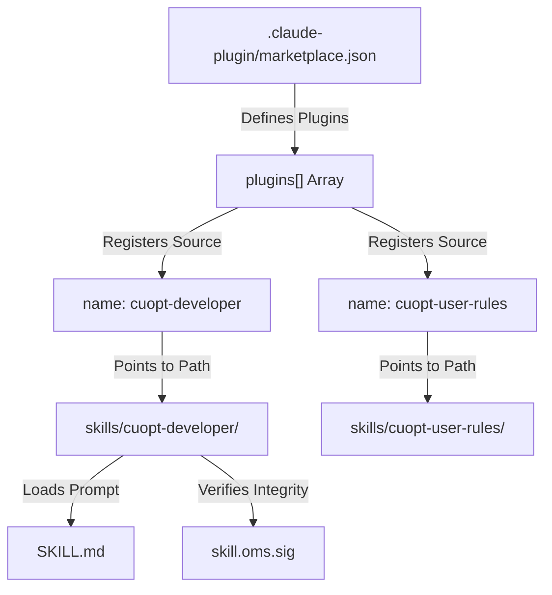
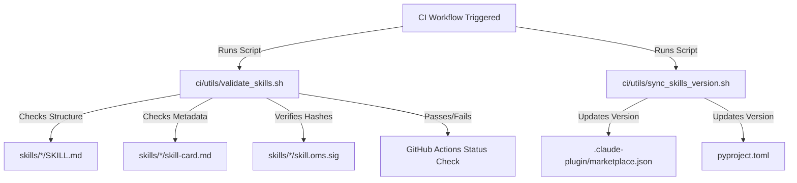

<!-- source: DeepWiki mcp.deepwiki.com · repo NVIDIA/cuopt · page 8.1 Skill Catalog and Structure · fetched 2026-10-26 -->

# Skill Catalog and Structure

<details>
<summary>Relevant source files</summary>

The following files were used as context for generating this wiki page:

- [.agents/rules/cuopt-skill-evolution.mdc](.agents/rules/cuopt-skill-evolution.mdc)
- [.claude-plugin/marketplace.json](.claude-plugin/marketplace.json)
- [AGENTS.md](AGENTS.md)
- [SECURITY.md](SECURITY.md)
- [ci/utils/sync_skills_version.sh](ci/utils/sync_skills_version.sh)
- [ci/utils/validate_skills.sh](ci/utils/validate_skills.sh)
- [skills/cuopt-developer/BENCHMARK.md](skills/cuopt-developer/BENCHMARK.md)
- [skills/cuopt-developer/SKILL.md](skills/cuopt-developer/SKILL.md)
- [skills/cuopt-developer/benchmark/evals.json](skills/cuopt-developer/benchmark/evals.json)
- [skills/cuopt-developer/evals/evals.json](skills/cuopt-developer/evals/evals.json)
- [skills/cuopt-developer/references/contributing.md](skills/cuopt-developer/references/contributing.md)
- [skills/cuopt-developer/references/conventions.md](skills/cuopt-developer/references/conventions.md)
- [skills/cuopt-developer/references/first_time_setup.md](skills/cuopt-developer/references/first_time_setup.md)
- [skills/cuopt-developer/skill-card.md](skills/cuopt-developer/skill-card.md)
- [skills/cuopt-developer/skill.oms.sig](skills/cuopt-developer/skill.oms.sig)
- [skills/cuopt-multi-objective-exploration/evals/evals.json](skills/cuopt-multi-objective-exploration/evals/evals.json)
- [skills/cuopt-numerical-optimization-api/BENCHMARK.md](skills/cuopt-numerical-optimization-api/BENCHMARK.md)
- [skills/cuopt-numerical-optimization-api/SKILL.md](skills/cuopt-numerical-optimization-api/SKILL.md)
- [skills/cuopt-numerical-optimization-api/skill-card.md](skills/cuopt-numerical-optimization-api/skill-card.md)
- [skills/cuopt-numerical-optimization-api/skill.oms.sig](skills/cuopt-numerical-optimization-api/skill.oms.sig)
- [skills/cuopt-skill-evolution/BENCHMARK.md](skills/cuopt-skill-evolution/BENCHMARK.md)
- [skills/cuopt-skill-evolution/SKILL.md](skills/cuopt-skill-evolution/SKILL.md)
- [skills/cuopt-skill-evolution/evals/evals.json](skills/cuopt-skill-evolution/evals/evals.json)
- [skills/cuopt-skill-evolution/skill-card.md](skills/cuopt-skill-evolution/skill-card.md)
- [skills/cuopt-skill-evolution/skill.oms.sig](skills/cuopt-skill-evolution/skill.oms.sig)

</details>


## Purpose and Scope
This page details the architecture, file layout, marketplace registration, and validation pipelines for the AI agent skill catalog embedded within the NVIDIA cuOpt repository. The skill catalog establishes a structured, machine-readable domain knowledge base and behavioral ruleset that enables AI agents (such as `claude-code` and `codex`) to interact accurately with cuOpt solver internals, Python bindings, C APIs, and server infrastructure. Skills reside in the `skills/` directory at the repository root using a flat, domain-partitioned architecture [.claude-plugin/marketplace.json:1-66](), [AGENTS.md:1-7]().

---

## 1. Skill Directory Layout and Components
Each skill in the catalog is encapsulated within its own directory under `skills/` (e.g., `skills/cuopt-developer/`, `skills/cuopt-routing-api-python/`). A fully specified skill bundle contains distinct structural files governing agent instructions, metadata cards, benchmarks, evaluation datasets, cryptographic signatures, and reference documentation.

```
skills/
└── cuopt-developer/
    ├── SKILL.md
    ├── skill-card.md
    ├── BENCHMARK.md
    ├── skill.oms.sig
    ├── evals/
    │   └── evals.json
    ├── benchmark/
    │   └── evals.json
    └── references/
        ├── contributing.md
        └── conventions.md
```

### Core Skill Files
*   **`SKILL.md`**: The primary executable prompt file loaded by agents. It contains YAML frontmatter defining name, version, description, and tags, followed by strict refusal rules, behavioral constraints, and core operating procedures [skills/cuopt-developer/SKILL.md:1-117]().
*   **`skill-card.md`**: A standardized metadata specification card documenting skill descriptions, ownership (NVIDIA), licenses (Apache 2.0), deployment geographies, external credential requirements, known risks/mitigations, and empirical evaluation metrics [skills/cuopt-developer/skill-card.md:1-89]().
*   **`BENCHMARK.md`**: Summarizes 3-tier static validation and runtime evaluation results from `NVSkills-Eval`, reporting scores across security, correctness, discoverability, effectiveness, and efficiency [skills/cuopt-developer/BENCHMARK.md:1-83]().
*   **`evals/evals.json`**: Contains test datasets consisting of evaluation items with unique IDs, user questions, expected skill activations, ground truth descriptions, and strict expected behavior assertions [skills/cuopt-multi-objective-exploration/evals/evals.json:1-61](), [skills/cuopt-developer/evals/evals.json:1-64]().
*   **`skill.oms.sig`**: A cryptographic Sigstore bundle (`application/vnd.dev.sigstore.bundle.v0.3+json`) containing an in-toto DSSE envelope with SHA-256 file digests for all files within the skill directory, verified during CI execution [skills/cuopt-developer/skill.oms.sig:1-1]().

Sources: [skills/cuopt-developer/SKILL.md:1-117](), [skills/cuopt-developer/skill-card.md:1-89](), [skills/cuopt-developer/BENCHMARK.md:1-83](), [skills/cuopt-developer/skill.oms.sig:1-1](), [AGENTS.md:1-7]()

---

## 2. Marketplace Manifest Architecture
The top-level marketplace manifest located at `.claude-plugin/marketplace.json` aggregates individual skill directories into discoverable plugins for AI client ecosystems. It defines metadata for the entire skill suite and exposes an array of plugin registrations.

```json
{
  "name": "nvidia-cuopt-skills",
  "owner": { "name": "NVIDIA" },
  "metadata": {
    "description": "Agent skills for NVIDIA cuOpt...",
    "version": "26.10.00"
  },
  "plugins": [
    {
      "name": "cuopt-developer",
      "source": "./skills/cuopt-developer",
      "skills": "./",
      "description": "Modify, build, test, debug..."
    }
  ]
}
```

### Marketplace Schema Elements
*   `name`: Global namespace identifier (`nvidia-cuopt-skills`) [.claude-plugin/marketplace.json:1-2]().
*   `owner`: Publisher entity descriptor [.claude-plugin/marketplace.json:1-5]().
*   `metadata.version`: Synchronized release version string across plugins [.claude-plugin/marketplace.json:1-9]().
*   `plugins`: Array of plugin definition objects mapping logical names (`name`), local path sources (`source`), skill roots (`skills`), and descriptive summaries (`description`) [.claude-plugin/marketplace.json:1-10]().

Diagram: Marketplace Manifest to Agent Skill Routing

Sources: [.claude-plugin/marketplace.json:1-66]()

---

## 3. Validation and Version-Sync CI Scripts
To maintain consistency across skill metadata, code versions, and cryptographic signatures, the repository utilizes automated CI utility scripts located in `ci/utils/`.

### Validation Pipeline (`validate_skills.sh`)
The `validate_skills.sh` script executes structural and semantic checks across all directories inside `skills/`:
1.  **Schema Compliance**: Verifies that every skill contains required sections (`## Instructions`, `## Examples`) and valid frontmatter.
2.  **Author Format Check**: Ensures author fields conform to the `Name <email@host>` specification.
3.  **Sigstore Verification**: Validates that `skill.oms.sig` cryptographic bundles match the current file hashes of the skill directory.

### Version Synchronization (`sync_skills_version.sh`)
The `sync_skills_version.sh` script ensures that version strings across all `SKILL.md` frontmatters, `skill-card.md` headers, and `marketplace.json` match the core project version file or `pyproject.toml`.

Diagram: Skill Validation and CI Execution Pipeline

Sources: [ci/utils/sync_skills_version.sh:1-1](), [ci/utils/validate_skills.sh:1-1](), [.claude-plugin/marketplace.json:1-66]()

---

