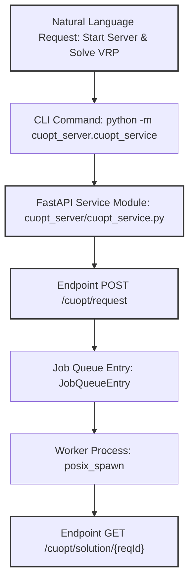
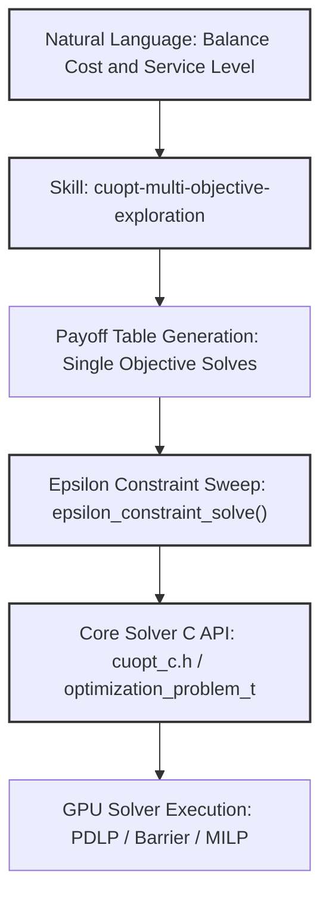

<!-- source: DeepWiki mcp.deepwiki.com · repo NVIDIA/cuopt · page 8.2 Domain Skills · fetched 2026-10-26 -->

# Domain Skills

Relevant source files

The following files were used as context for generating this wiki page:

- [skills/cuopt-install/BENCHMARK.md](skills/cuopt-install/BENCHMARK.md)
- [skills/cuopt-install/SKILL.md](skills/cuopt-install/SKILL.md)
- [skills/cuopt-install/evals/evals.json](skills/cuopt-install/evals/evals.json)
- [skills/cuopt-install/skill-card.md](skills/cuopt-install/skill-card.md)
- [skills/cuopt-install/skill.oms.sig](skills/cuopt-install/skill.oms.sig)
- [skills/cuopt-multi-objective-exploration/BENCHMARK.md](skills/cuopt-multi-objective-exploration/BENCHMARK.md)
- [skills/cuopt-multi-objective-exploration/SKILL.md](skills/cuopt-multi-objective-exploration/SKILL.md)
- [skills/cuopt-multi-objective-exploration/skill-card.md](skills/cuopt-multi-objective-exploration/skill-card.md)
- [skills/cuopt-multi-objective-exploration/skill.oms.sig](skills/cuopt-multi-objective-exploration/skill.oms.sig)
- [skills/cuopt-numerical-optimization-formulation/BENCHMARK.md](skills/cuopt-numerical-optimization-formulation/BENCHMARK.md)
- [skills/cuopt-numerical-optimization-formulation/SKILL.md](skills/cuopt-numerical-optimization-formulation/SKILL.md)
- [skills/cuopt-numerical-optimization-formulation/evals/evals.json](skills/cuopt-numerical-optimization-formulation/evals/evals.json)
- [skills/cuopt-numerical-optimization-formulation/skill-card.md](skills/cuopt-numerical-optimization-formulation/skill-card.md)
- [skills/cuopt-numerical-optimization-formulation/skill.oms.sig](skills/cuopt-numerical-optimization-formulation/skill.oms.sig)
- [skills/cuopt-routing-api-python/BENCHMARK.md](skills/cuopt-routing-api-python/BENCHMARK.md)
- [skills/cuopt-routing-api-python/SKILL.md](skills/cuopt-routing-api-python/SKILL.md)
- [skills/cuopt-routing-api-python/evals/evals.json](skills/cuopt-routing-api-python/evals/evals.json)
- [skills/cuopt-routing-api-python/skill-card.md](skills/cuopt-routing-api-python/skill-card.md)
- [skills/cuopt-routing-api-python/skill.oms.sig](skills/cuopt-routing-api-python/skill.oms.sig)
- [skills/cuopt-server-api-python/BENCHMARK.md](skills/cuopt-server-api-python/BENCHMARK.md)
- [skills/cuopt-server-api-python/SKILL.md](skills/cuopt-server-api-python/SKILL.md)
- [skills/cuopt-server-api-python/assets/pdp_basic/client.py](skills/cuopt-server-api-python/assets/pdp_basic/client.py)
- [skills/cuopt-server-api-python/evals/evals.json](skills/cuopt-server-api-python/evals/evals.json)
- [skills/cuopt-server-api-python/skill-card.md](skills/cuopt-server-api-python/skill-card.md)
- [skills/cuopt-server-api-python/skill.oms.sig](skills/cuopt-server-api-python/skill.oms.sig)
- [skills/cuopt-user-rules/BENCHMARK.md](skills/cuopt-user-rules/BENCHMARK.md)
- [skills/cuopt-user-rules/SKILL.md](skills/cuopt-user-rules/SKILL.md)
- [skills/cuopt-user-rules/evals/evals.json](skills/cuopt-user-rules/evals/evals.json)
- [skills/cuopt-user-rules/skill-card.md](skills/cuopt-user-rules/skill-card.md)
- [skills/cuopt-user-rules/skill.oms.sig](skills/cuopt-user-rules/skill.oms.sig)

## Purpose and Scope
This section summarizes the catalog of AI agent skills maintained in the `skills/` directory of the cuOpt codebase. These skills formalize operational domains, workflows, installation procedures, and API interaction patterns for users and AI agents interacting with NVIDIA cuOpt.

Sources: [skills/cuopt-install/SKILL.md:1-21](), [skills/cuopt-user-rules/SKILL.md:1-21]()

---

## Skill Catalog Overview
The skill ecosystem provides structured guidance across installation, formulation, solver APIs, server deployment, and multi-objective workflows.

| Skill Name | Primary Domain | Core Focus / Target |
| :--- | :--- | :--- |
| `cuopt-install` | Installation & Deployment | Package installation (pip, conda, Docker) for Python, C, and REST server; verification [skills/cuopt-install/SKILL.md:1-21](). |
| `cuopt-numerical-optimization-formulation` | Mathematical Modeling | Problem text parsing, classification (parameter, constraint, decision, objective), LP/MILP/QP patterns [skills/cuopt-numerical-optimization-formulation/SKILL.md:1-23](). |
| `cuopt-multi-objective-exploration` | Advanced Workflow | Pareto frontier exploration via weighted-sum and $\varepsilon$-constraint methods using repeated single cuOpt solves [skills/cuopt-multi-objective-exploration/SKILL.md:1-44](). |
| `cuopt-user-rules` | User Guidelines | Base rules for end users: clarifying requirements, environment checks, verification, exact output formatting [skills/cuopt-user-rules/SKILL.md:1-24](). |
| `cuopt-server-api-python` | Server Deployment | REST server startup, endpoints (`/cuopt/request`, `/cuopt/solution/{reqId}`), Python/curl client integration [skills/cuopt-server-api-python/SKILL.md:1-30](). |

Sources: [skills/cuopt-install/SKILL.md:1-21](), [skills/cuopt-numerical-optimization-formulation/SKILL.md:1-23](), [skills/cuopt-multi-objective-exploration/SKILL.md:1-44](), [skills/cuopt-user-rules/SKILL.md:1-24](), [skills/cuopt-server-api-python/SKILL.md:1-30]()

---

## Installation and Developer Skills
The installation skill (`cuopt-install`) manages user-facing environment verification and package installation options.
- **System Requirements**: NVIDIA GPU with Compute Capability $\geq 7.0$ (Volta or newer), CUDA 12.x or 13.x, and compatible NVIDIA drivers [skills/cuopt-install/SKILL.md:22-26]().
- **Dependency Hierarchy**: Python packages (`cuopt-cu12`/`cuopt-cu13`) depend on the underlying C library package (`libcuopt-cu12`/`libcuopt-cu13`). Installing the Python package automatically pulls in C headers (`cuopt_c.h`) and shared libraries (`libcuopt.so`), whereas installing `libcuopt` standalone does not include Python bindings [skills/cuopt-install/SKILL.md:27-28]().

Sources: [skills/cuopt-install/SKILL.md:22-28]()

---

## Numerical Optimization and Multi-Objective Exploration
The numerical optimization skill (`cuopt-numerical-optimization-formulation`) establishes problem parsing and classification rules.
- **Sentence Classification**: Sentences in problem descriptions are classified into **parameters/givens**, **constraints**, **decisions**, or **objectives** [skills/cuopt-numerical-optimization-formulation/SKILL.md:71-93]().
- **Problem Types**: Differentiates LP (linear objective/constraints, continuous variables), MILP (adds integer/binary variables), and QP (quadratic objective $x^T Q x + c^T x$, convex quadratic constraints via second-order cones) [skills/cuopt-numerical-optimization-formulation/SKILL.md:23-38]().

The multi-objective skill (`cuopt-multi-objective-exploration`) orchestrates repeated single-objective solves:
- **Payoff Table**: Solves each objective independently to establish bounds and normalization scales [skills/cuopt-multi-objective-exploration/SKILL.md:49-65]().
- **Scalarization Methods**: Weighted-sum (convex hull only) and $\varepsilon$-constraint methods (full Pareto frontier including non-convex regions) [skills/cuopt-multi-objective-exploration/SKILL.md:69-99]().

Sources: [skills/cuopt-numerical-optimization-formulation/SKILL.md:23-38](), [skills/cuopt-numerical-optimization-formulation/SKILL.md:71-93](), [skills/cuopt-multi-objective-exploration/SKILL.md:49-99]()

---

## Routing and Server Python APIs
The server API skill (`cuopt-server-api-python`) details the deployment and request/response workflow of the FastAPI backend (`cuopt_server.cuopt_service`) [skills/cuopt-server-api-python/SKILL.md:1-53]().
- **Workflow**: Clients submit optimization payloads via `POST /cuopt/request`, receive a unique `reqId`, and poll `GET /cuopt/solution/{reqId}` until completion [skills/cuopt-server-api-python/SKILL.md:67-73]().
- **Field Mappings**: Translates between Python SDK terminology and REST schema fields (e.g., Python `order_locations` maps to REST `task_locations`) [skills/cuopt-server-api-python/SKILL.md:93-101]().

Sources: [skills/cuopt-server-api-python/SKILL.md:1-101]()

---

## User Rules and Skill Evolution
The user rules skill (`cuopt-user-rules`) governs interaction standards:
- **Clarification**: Ambiguous requirements regarding problem type, language, constraints, or data format must be clarified before implementation [skills/cuopt-user-rules/SKILL.md:24-36]().
- **Verification & Result Summary**: Always verify solver status (`Optimal`, `FeasibleFound`, `SUCCESS`) and present a prominent objective value summary [skills/cuopt-user-rules/SKILL.md:108-121]().

Sources: [skills/cuopt-user-rules/SKILL.md:24-36](), [skills/cuopt-user-rules/SKILL.md:108-121]()

---

## Natural Language Space to Code Entity Space Mappings
To bridge high-level optimization goals and server deployment requests with actual codebase entities, the following diagrams associate natural language intents with code structures and REST endpoints.

### Diagram 1: Server REST API Workflow to Code Entities

Sources: [skills/cuopt-server-api-python/SKILL.md:48-73]()

### Diagram 2: Multi-Objective Exploration to Solver Execution

Sources: [skills/cuopt-multi-objective-exploration/SKILL.md:21-93]()

---

