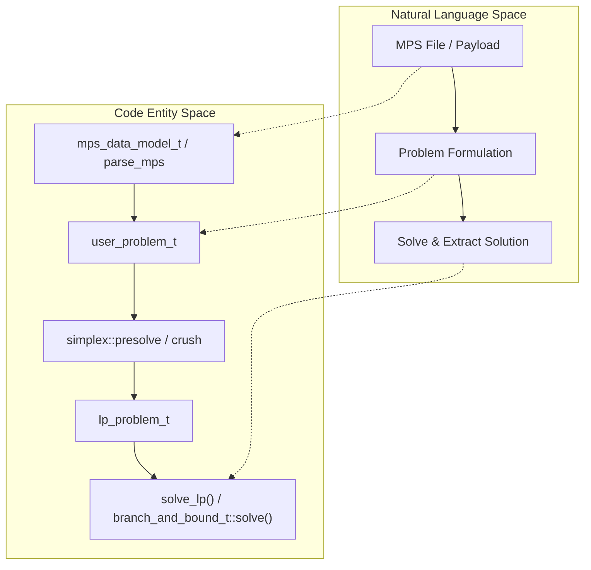
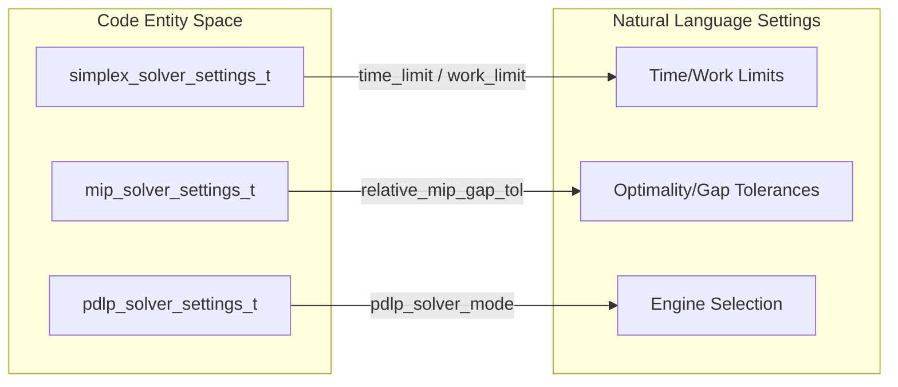

<!-- source: DeepWiki mcp.deepwiki.com · repo NVIDIA/cuopt · page 9 Glossary · fetched 2026-10-26 -->

# Glossary

Relevant source files

The following files were used as context for generating this wiki page:

- [conda/environments/all_cuda-129_arch-aarch64.yaml](conda/environments/all_cuda-129_arch-aarch64.yaml)
- [conda/environments/all_cuda-129_arch-x86_64.yaml](conda/environments/all_cuda-129_arch-x86_64.yaml)
- [conda/environments/all_cuda-133_arch-aarch64.yaml](conda/environments/all_cuda-133_arch-aarch64.yaml)
- [conda/environments/all_cuda-133_arch-x86_64.yaml](conda/environments/all_cuda-133_arch-x86_64.yaml)
- [conda/recipes/cuopt-server/recipe.yaml](conda/recipes/cuopt-server/recipe.yaml)
- [conda/recipes/cuopt-sh-client/recipe.yaml](conda/recipes/cuopt-sh-client/recipe.yaml)
- [conda/recipes/cuopt/recipe.yaml](conda/recipes/cuopt/recipe.yaml)
- [conda/recipes/libcuopt/recipe.yaml](conda/recipes/libcuopt/recipe.yaml)
- [cpp/include/cuopt/mathematical_optimization/constants.h](cpp/include/cuopt/mathematical_optimization/constants.h)
- [cpp/include/cuopt/mathematical_optimization/mip/solver_settings.hpp](cpp/include/cuopt/mathematical_optimization/mip/solver_settings.hpp)
- [cpp/include/cuopt/mathematical_optimization/pdlp/solver_settings.hpp](cpp/include/cuopt/mathematical_optimization/pdlp/solver_settings.hpp)
- [cpp/src/dual_simplex/presolve.cpp](cpp/src/dual_simplex/presolve.cpp)
- [cpp/src/dual_simplex/presolve.hpp](cpp/src/dual_simplex/presolve.hpp)
- [cpp/src/dual_simplex/simplex_solver_settings.hpp](cpp/src/dual_simplex/simplex_solver_settings.hpp)
- [cpp/src/dual_simplex/solve.cpp](cpp/src/dual_simplex/solve.cpp)
- [cpp/src/dual_simplex/solve.hpp](cpp/src/dual_simplex/solve.hpp)
- [cpp/src/dual_simplex/user_problem.hpp](cpp/src/dual_simplex/user_problem.hpp)
- [cpp/src/grpc/server/grpc_incumbent_proto.hpp](cpp/src/grpc/server/grpc_incumbent_proto.hpp)
- [cpp/src/grpc/server/grpc_pipe_io.cpp](cpp/src/grpc/server/grpc_pipe_io.cpp)
- [cpp/src/grpc/server/grpc_pipe_serialization.hpp](cpp/src/grpc/server/grpc_pipe_serialization.hpp)
- [cpp/src/grpc/server/grpc_server_logger.hpp](cpp/src/grpc/server/grpc_server_logger.hpp)
- [cpp/src/grpc/server/grpc_server_main.cpp](cpp/src/grpc/server/grpc_server_main.cpp)
- [cpp/src/grpc/server/grpc_server_threads.cpp](cpp/src/grpc/server/grpc_server_threads.cpp)
- [cpp/src/grpc/server/grpc_server_types.hpp](cpp/src/grpc/server/grpc_server_types.hpp)
- [cpp/src/grpc/server/grpc_service_impl.cpp](cpp/src/grpc/server/grpc_service_impl.cpp)
- [cpp/src/grpc/server/grpc_worker.cpp](cpp/src/grpc/server/grpc_worker.cpp)
- [cpp/src/grpc/server/grpc_worker_infra.cpp](cpp/src/grpc/server/grpc_worker_infra.cpp)
- [cpp/src/math_optimization/solver_settings.cu](cpp/src/math_optimization/solver_settings.cu)
- [cpp/src/pdlp/solve.cu](cpp/src/pdlp/solve.cu)
- [cpp/tests/linear_programming/grpc/CMakeLists.txt](cpp/tests/linear_programming/grpc/CMakeLists.txt)
- [cpp/tests/linear_programming/grpc/grpc_integration_test.cpp](cpp/tests/linear_programming/grpc/grpc_integration_test.cpp)
- [cpp/tests/linear_programming/grpc/grpc_worker_spawn_test.cpp](cpp/tests/linear_programming/grpc/grpc_worker_spawn_test.cpp)
- [cpp/tests/linear_programming/pdlp_test.cu](cpp/tests/linear_programming/pdlp_test.cu)
- [dependencies.yaml](dependencies.yaml)
- [python/cuopt/pyproject.toml](python/cuopt/pyproject.toml)
- [python/cuopt_self_hosted/pyproject.toml](python/cuopt_self_hosted/pyproject.toml)
- [python/cuopt_server/pyproject.toml](python/cuopt_server/pyproject.toml)
- [python/libcuopt/pyproject.toml](python/libcuopt/pyproject.toml)

## Purpose and Scope

This glossary defines codebase-specific terms, optimization jargon, architecture components, abbreviations, and domain concepts used across the NVIDIA cuOpt project. It provides technical definitions and direct source code pointers for engineers navigating the C++ core, solver engines, and associated API interfaces.

## Optimization Terminology

| Term | Definition | Code Pointers |
| :--- | :--- | :--- |
| **LP** | **Linear Programming**: Optimization of a linear objective function subject to linear equality and inequality constraints. | `lp_problem_t` in [cpp/src/dual_simplex/user_problem.hpp:1-10](), solve functions in [cpp/src/pdlp/solve.cu:80-105]() |
| **MILP / MIP** | **Mixed Integer Linear Programming**: An LP where a subset of variables are restricted to take integer values. | `mip_solver_settings_t` in [cpp/src/math_optimization/solver_settings.cu:103-110](), [cpp/include/cuopt/mathematical_optimization/constants.h:67-90]() |
| **QP** | **Quadratic Programming**: Optimization with a quadratic objective function and linear constraints. | Quadratic processing in [cpp/src/dual_simplex/presolve.cpp:31-78]() |
| **SOCP** | **Second-Order Cone Programming**: Convex optimization involving linear objectives and second-order cone constraints. | Cone variables in [cpp/src/dual_simplex/presolve.cpp:25-29](), [cpp/src/pdlp/solve.cu:99-103]() |
| **VRP** | **Vehicle Routing Problem**: Combinatorial optimization finding optimal routes for a fleet servicing customer nodes. | Routing headers and integration in [cpp/tests/linear_programming/grpc/grpc_integration_test.cpp:47-50]() |
| **PDLP** | **Primal-Dual Linear Programming**: A first-order method solver based on PDHG designed for massive-scale LP problems. | `pdlp_solver_settings_t` in [cpp/src/math_optimization/solver_settings.cu:30-87]() |
| **PDHG** | **Primal-Dual Hybrid Gradient**: The underlying mathematical first-order iterative scheme used by the PDLP engine. | [cpp/src/pdlp/solve.cu:80-105]() |
| **MPS** | **Mathematical Programming System**: Industry standard plain-text file format for defining linear and mixed-integer programs. | `mps_data_model_t` in [cpp/src/pdlp/solve.cu:40-45]() |
| **Crossover** | **Crossover**: The conversion phase transforming a non-basic interior solution (from PDLP or Barrier) into a basic solution suitable for Simplex. | [cpp/src/pdlp/solve.cu:49-51]() |
| **Crush / Uncrush** | **Crush / Uncrush**: Presolve transformation routines that compress problem dimensions by removing fixed/redundant variables ("crush") and map solutions back to original space ("uncrush"). | `uncrush_solution` in [cpp/src/dual_simplex/solve.cpp:78-87]() |

Sources: [cpp/src/pdlp/solve.cu:40-105](), [cpp/src/math_optimization/solver_settings.cu:30-110](), [cpp/src/dual_simplex/presolve.cpp:25-78](), [cpp/src/dual_simplex/solve.cpp:78-90]().

## Solver Concepts

* **Branch-and-Bound (B&B)**: The core tree-search strategy for solving MIPs on the CPU, partitioning solution space and pruning subtrees using LP relaxations.
* **Pseudo-Costs**: History-based metrics tracking objective improvements when branching on variables, used to guide variable selection.
* **Presolve**: Pre-processing transformation steps removing redundancies, tightening bounds, and simplifying constraints before solving.
* **PaPILO / PSLP**: External parallel presolve library integration used for advanced MIP presolving and domain reduction.
* **Feasibility Jump**: Fast GPU/CPU local search metaheuristic designed to locate or repair integer-feasible solutions.
* **RINS / RENS**: Relaxation Induced Neighborhood Search / Relaxation Enforced Neighborhood Search heuristics exploring local neighborhoods around current incumbents.
* **Cuts (MIR, Gomory, Clique)**: Cutting planes added to linear relaxations to cut off fractional solutions without removing integer feasible points.
* **Clique Table / Conflict Graph**: Data structures modeling mutually exclusive variable assignments to generate strong clique inequalities.

Sources: [cpp/src/dual_simplex/simplex_solver_settings.hpp:100-115](), [cpp/src/dual_simplex/solve.cpp:10-25](), [cpp/src/pdlp/solve.cu:25-30]().

## CUDA/GPU and Infrastructure Terms

| Term | Definition | Code Pointers |
| :--- | :--- | :--- |
| **RMM** | **RAPIDS Memory Manager**: GPU memory allocation framework providing pools and asynchronous resource adaptors. | [cpp/src/math_optimization/solver_settings.cu:20-25]() |
| **cuDSS** | **NVIDIA cuDSS**: GPU-accelerated direct sparse solver library performing sparse Cholesky and LDLT factorizations. | [cpp/src/pdlp/solve.cu:47-48]() |
| **cuSparse** | **NVIDIA cuSparse**: Library providing sparse matrix kernels (SpMV, sparse triangular solves) across GPU solvers. | [cpp/src/pdlp/solve.cu:54-56]() |
| **RAFT** | **NVIDIA RAFT**: Reusable primitives library providing CUDA device management, stream wrappers, and NVTX telemetry. | [cpp/src/pdlp/solve.cu:57-60]() |
| **NCCL** | **NVIDIA Collective Communications Library**: Multi-GPU communication primitives used in multi-GPU distributed PDLP execution. | [conda/recipes/libcuopt/recipe.yaml:90-95]() |
| **KaMinPar** | **KaMinPar**: Graph partitioning library used for multi-GPU work distribution and sharding in parallel PDLP. | [cpp/include/cuopt/mathematical_optimization/constants.h:100-106]() |
| **libcuopt-split** | **libcuopt-split**: Architecture dividing `libcuopt` into decoupled modular components (`libcuopt-client`, `libcuopt-mathopt`, `libcuopt-routing`) to minimize unneeded dependencies. | [conda/recipes/libcuopt/recipe.yaml:15-108]() |
| **rapids-dependency-file-generator** | **rapids-dependency-file-generator**: Tool that manages `dependencies.yaml` as the single source of truth for conda/pip requirements across CI matrices. | [dependencies.yaml:1-15](), [python/libcuopt/pyproject.toml:6-10]() |
| **JobQueueEntry** | **JobQueueEntry**: Shared-memory or IPC structure tracking asynchronous solve jobs inside the gRPC/HTTP server worker pools. | [cpp/tests/linear_programming/grpc/grpc_integration_test.cpp:80-100]() |
| **Chunked Upload** | **Chunked Upload**: Data transfer protocol breaking large problem payloads into manageable chunks to bypass gRPC message size limits. | [cpp/tests/linear_programming/grpc/grpc_integration_test.cpp:15-20]() |
| **Field Registry** | **Field Registry**: YAML-driven metadata configuration (`field_registry.yaml`) driving protocol buffer message generation and serialization converters. | [cpp/tests/linear_programming/grpc/grpc_integration_test.cpp:55-65]() |

Sources: [dependencies.yaml:1-40](), [conda/recipes/libcuopt/recipe.yaml:15-110](), [cpp/src/pdlp/solve.cu:47-60](), [cpp/tests/linear_programming/grpc/grpc_integration_test.cpp:10-100]().

## cuOpt-Specific Identifiers

* `optimization_problem_t`: High-level templated container managing problem coefficients, variables, and objectives on host/device.
* `lp_problem_t`: Internal canonical sparse representation of linear and quadratic programs utilized by simplex and barrier engines.
* `user_problem_t`: Raw problem description parsed from file or API input before presolve transformations.
* `mip_solver_settings_t`: Configuration object controlling branch-and-bound limits, tolerances, cut passes, and heuristics.
* `pdlp_solver_settings_t`: Parameter structure governing PDLP iterations, scaling methods, and restart heuristics.
* `simplex_solver_settings_t`: Configuration structure defining pivot tolerances, pricing rules, barrier options, and simplex limits.
* `grpc_client_t`: C++ client class responsible for establishing gRPC connections, streaming payloads, and invoking remote solvers.

Sources: [cpp/src/pdlp/solve.cu:80-105](), [cpp/src/math_optimization/solver_settings.cu:30-110](), [cpp/src/dual_simplex/simplex_solver_settings.hpp:30-45](), [cpp/tests/linear_programming/grpc/grpc_integration_test.cpp:50-55]().

## System Mapping Diagrams

### Problem Translation Pipeline
This diagram maps natural-language problem loading concepts to the underlying code entities in the translation and presolve pipeline.

**Problem Translation Pipeline Mapping**

Sources: [cpp/src/pdlp/solve.cu:40-45](), [cpp/src/dual_simplex/user_problem.hpp:1-10](), [cpp/src/dual_simplex/solve.cpp:20-30]().

### Solver Settings Hierarchy
This diagram associates user-facing configuration categories with internal C++ setting structures.

**Settings Structure Hierarchy**

Sources: [cpp/src/math_optimization/solver_settings.cu:120-137](), [cpp/src/dual_simplex/simplex_solver_settings.hpp:32-50](), [cpp/include/cuopt/mathematical_optimization/constants.h:30-40]().