# Page: Overview

# Overview

<details>
<summary>Relevant source files</summary>

The following files were used as context for generating this wiki page:

- [README.md](README.md)
- [conda/environments/all_cuda-129_arch-aarch64.yaml](conda/environments/all_cuda-129_arch-aarch64.yaml)
- [conda/environments/all_cuda-129_arch-x86_64.yaml](conda/environments/all_cuda-129_arch-x86_64.yaml)
- [conda/environments/all_cuda-133_arch-aarch64.yaml](conda/environments/all_cuda-133_arch-aarch64.yaml)
- [conda/environments/all_cuda-133_arch-x86_64.yaml](conda/environments/all_cuda-133_arch-x86_64.yaml)
- [conda/recipes/cuopt-server/recipe.yaml](conda/recipes/cuopt-server/recipe.yaml)
- [conda/recipes/cuopt-sh-client/recipe.yaml](conda/recipes/cuopt-sh-client/recipe.yaml)
- [conda/recipes/cuopt/recipe.yaml](conda/recipes/cuopt/recipe.yaml)
- [conda/recipes/libcuopt/recipe.yaml](conda/recipes/libcuopt/recipe.yaml)
- [dependencies.yaml](dependencies.yaml)
- [docs/cuopt/source/convex-features.rst](docs/cuopt/source/convex-features.rst)
- [docs/cuopt/source/cuopt-c/mip/index.rst](docs/cuopt/source/cuopt-c/mip/index.rst)
- [docs/cuopt/source/cuopt-c/quick-start.rst](docs/cuopt/source/cuopt-c/quick-start.rst)
- [docs/cuopt/source/cuopt-cli/index.rst](docs/cuopt/source/cuopt-cli/index.rst)
- [docs/cuopt/source/cuopt-cli/quick-start.rst](docs/cuopt/source/cuopt-cli/quick-start.rst)
- [docs/cuopt/source/cuopt-python/index.rst](docs/cuopt/source/cuopt-python/index.rst)
- [docs/cuopt/source/cuopt-python/mip/index.rst](docs/cuopt/source/cuopt-python/mip/index.rst)
- [docs/cuopt/source/cuopt-python/quick-start.rst](docs/cuopt/source/cuopt-python/quick-start.rst)
- [docs/cuopt/source/cuopt-server/quick-start.rst](docs/cuopt/source/cuopt-server/quick-start.rst)
- [docs/cuopt/source/index.rst](docs/cuopt/source/index.rst)
- [docs/cuopt/source/introduction.rst](docs/cuopt/source/introduction.rst)
- [docs/cuopt/source/milp-features.rst](docs/cuopt/source/milp-features.rst)
- [docs/cuopt/source/mip-settings.rst](docs/cuopt/source/mip-settings.rst)
- [docs/cuopt/source/thirdparty_modeling_languages/index.rst](docs/cuopt/source/thirdparty_modeling_languages/index.rst)
- [python/cuopt/pyproject.toml](python/cuopt/pyproject.toml)
- [python/cuopt_self_hosted/pyproject.toml](python/cuopt_self_hosted/pyproject.toml)
- [python/cuopt_server/pyproject.toml](python/cuopt_server/pyproject.toml)
- [python/libcuopt/pyproject.toml](python/libcuopt/pyproject.toml)

</details>


This document introduces NVIDIA cuOpt, a GPU-accelerated optimization engine designed for high-performance combinatorial and continuous optimization. It covers the system's core capabilities (Linear Programming, Quadratic Programming, Mixed Integer Linear Programming, Second-Order Cone Programming, and Vehicle Routing Problems), design philosophy, package ecosystem, and positioning within the NVIDIA AI Enterprise ecosystem [README.md:15-17](). 

As a parent page, this document provides a high-level summary of cuOpt's architecture and deployment options. For deep technical details, refer to the child pages:
- Installation and system requirements: [Installation and Getting Started](#1.1)
- Component layering and library splitting: [Package Architecture](#1.2)
- Internal solver hierarchy, hybrid execution, and data flow: [System Architecture](#1.3)

---

## Capabilities and Design Philosophy

NVIDIA cuOpt leverages massively parallel GPU architectures to deliver near real-time solutions for large-scale mathematical optimization problems. The core engine is implemented in C++ and exposes multiple integration interfaces, including a low-level C API (`cuopt_c.h`), high-level Python bindings, REST/FastAPI microservices, and gRPC remote services [README.md:21-42]().

### Supported Problem Types
*   **Linear Programming (LP)** & **Quadratic Programming (QP)**: Solved concurrently via GPU first-order methods (PDLP), GPU interior-point barrier methods (using cuDSS), and CPU revised dual simplex [README.md:15-17]().
*   **Mixed Integer Programming (MILP)**: Hybrid GPU/CPU solver combining GPU primal heuristics (Feasibility Jump, RINS) with CPU branch-and-bound [README.md:15-17]().
*   **Second-Order Cone Programming (SOCP)** & **Quadratically Constrained QP (QCQP)**: Supported in beta via advanced barrier and conic solvers [README.md:15-17]().
*   **Vehicle Routing Problems (VRP)**: Supports Traveling Salesperson (TSP), Capacitated VRP (CVRP), and Pickup and Delivery with Time Windows (PDPTW) using population-based metaheuristics [README.md:36-36]().

```mermaid
graph TB
    subgraph ProblemSpace["Problem Formulations"]
        LP["Linear / Quadratic / Conic (LP/QP/SOCP)"]
        MILP["Mixed Integer Linear / Quadratic (MILP)"]
        VRP["Vehicle Routing (TSP/CVRP/PDPTW)"]
    end

    subgraph SolverEngines["cuOpt Core Engines (libcuopt)"]
        MathOpt["libcuopt-mathopt<br/>pdlp::PDLPSolver<br/>barrier::BarrierSolver<br/>dual_simplex::DualSimplexSolver"]
        MIPEngine["Hybrid MIP Engine<br/>mip_heuristics::*<br/>branch_and_bound::BranchAndBound"]
        RoutingEngine["libcuopt-routing<br/>Routing population metaheuristics"]
    end

    subgraph HardwareExecution["Hybrid GPU / CPU Execution"]
        GPU["NVIDIA GPU<br/>RMM, cuDSS, cuSPARSE, NCCL"]
        CPU["Multi-Core CPU<br/>Revised Simplex & Branch-and-Bound"]
    end

    LP --> MathOpt
    MILP --> MIPEngine
    VRP --> RoutingEngine

    MathOpt --> GPU
    MathOpt --> CPU
    MIPEngine --> GPU
    MIPEngine --> CPU
    RoutingEngine --> GPU

    Sources: [README.md:15-17](), [conda/recipes/libcuopt/recipe.yaml:106-115]()
```

Sources: [README.md:15-17](), [conda/recipes/libcuopt/recipe.yaml:106-115]()

---

## 1.1. Installation and Getting Started

cuOpt supports multiple installation channels including pip wheels (from the NVIDIA Python Package Index), conda packages (from the `rapidsai` channel), and pre-built Docker containers on Docker Hub and NVIDIA NGC [README.md:82-143](). 

System requirements include:
*   **GPU Architecture**: Volta architecture or later (Compute Capability ≥ 7.0) [README.md:66-66]().
*   **CUDA Toolkit**: CUDA 12.x or CUDA 13.x [README.md:64-64]().
*   **Operating System**: Linux (x86_64, aarch64) or Windows via WSL2 [README.md:74-76]().
*   **Python**: Python 3.11 through 3.14 [README.md:70-70]().

For step-by-step installation instructions, smoke tests, and interface quickstarts, see [Installation and Getting Started](#1.1).

Sources: [README.md:62-143]()

---

## 1.2. Package Architecture

The cuOpt repository is structured around a modular package ecosystem that separates client communication, mathematical optimization solvers, and routing engines. This modularity reduces dependency footprints for specialized deployments [dependencies.yaml:40-63]().

```mermaid
graph TB
    subgraph PythonLayer["Python SDK & Services"]
        PythonSDK["cuopt (Python SDK)<br/>Cython wrappers"]
        Server["cuopt_server<br/>FastAPI Microservice"]
        ShClient["cuopt_sh_client<br/>Self-hosted client"]
        MCP["cuopt_mcp<br/>Model Context Protocol"]
    end

    subgraph CppSplitLibs["Split C++ Shared Libraries (libcuopt metapackage)"]
        ClientLib["libcuopt-client<br/>RPC & client helpers"]
        MathOptLib["libcuopt-mathopt<br/>LP/QP/MILP solver engines<br/>(cuDSS, cuSparse, NCCL)"]
        RoutingLib["libcuopt-routing<br/>VRP solver engine"]
        GrpcServer["cuopt_grpc_server<br/>libcuopt._grpc_server_wrapper"]
    end

    PythonSDK --> ClientLib
    PythonSDK --> MathOptLib
    PythonSDK --> RoutingLib
    Server --> PythonSDK
    ShClient --> ClientLib
    MCP --> PythonSDK
    GrpcServer --> ClientLib

    Sources: [dependencies.yaml:40-63](), [python/libcuopt/pyproject.toml:33-36]()
```

For detailed component descriptions, see [Package Architecture](#1.2).

Sources: [dependencies.yaml:40-63](), [python/libcuopt/pyproject.toml:33-36]()

---

## 1.3. System Architecture

Internally, cuOpt manages optimization problems through a rigorous translation and execution pipeline. Problems are ingested via API layers (`cuopt_c.h` or Python wrappers), translated into internal representation structures (`optimization_problem_t`, `user_problem_t`), preprocessed (using PaPILO or internal presolvers), and dispatched to GPU-accelerated or hybrid CPU/GPU solver backends [README.md:21-21]().

```mermaid
graph TB
    subgraph APILayer["API Layers"]
        CAPI["C API (cuopt_c.h)"]
        PyAPI["Python SDK API"]
        ServerAPI["gRPC / HTTP Server API"]
    end

    subgraph TranslationPipeline["Problem Translation Pipeline"]
        Parser["MPS / LP Parser<br/>mps_parser"]
        Translator["Problem Translator<br/>user_problem_t -> lp_problem_t"]
        Presolve["Presolver<br/>PaPILO / PSLP"]
    end

    subgraph ExecutionCore["Execution Core"]
        RMM["RMM Memory Manager<br/>Device Memory Pools"]
        SolverDispatch["Solver Dispatcher<br/>Concurrent LP / MIP / VRP"]
    end

    CAPI --> Parser
    PyAPI --> Parser
    ServerAPI --> Parser

    Parser --> Translator
    Translator --> Presolve
    Presolve --> SolverDispatch
    
    RMM -.-> SolverDispatch

    Sources: [README.md:21-21](), [conda/recipes/libcuopt/recipe.yaml:80-94]()
```

For full architectural details on solver hierarchies, memory management via RMM, and remote gRPC execution, see [System Architecture](#1.3).

Sources: [README.md:21-21](), [conda/recipes/libcuopt/recipe.yaml:80-94]()

---

# Page: Installation and Getting Started

# Installation and Getting Started

<details>
<summary>Relevant source files</summary>

The following files were used as context for generating this wiki page:

- [.github/workflows/build.yaml](.github/workflows/build.yaml)
- [.github/workflows/build_test_publish_images.yaml](.github/workflows/build_test_publish_images.yaml)
- [.github/workflows/cloud_ci.yaml](.github/workflows/cloud_ci.yaml)
- [.github/workflows/multi_gpu_cpp_test.yaml](.github/workflows/multi_gpu_cpp_test.yaml)
- [.github/workflows/nightly-summary.yaml](.github/workflows/nightly-summary.yaml)
- [.github/workflows/pr.yaml](.github/workflows/pr.yaml)
- [.github/workflows/test.yaml](.github/workflows/test.yaml)
- [.github/workflows/trigger-breaking-change-alert.yaml](.github/workflows/trigger-breaking-change-alert.yaml)
- [RAPIDS_BRANCH](RAPIDS_BRANCH)
- [README.md](README.md)
- [docs/cuopt/source/cuopt-c/quick-start.rst](docs/cuopt/source/cuopt-c/quick-start.rst)
- [docs/cuopt/source/cuopt-cli/quick-start.rst](docs/cuopt/source/cuopt-cli/quick-start.rst)
- [docs/cuopt/source/cuopt-python/quick-start.rst](docs/cuopt/source/cuopt-python/quick-start.rst)
- [docs/cuopt/source/cuopt-server/quick-start.rst](docs/cuopt/source/cuopt-server/quick-start.rst)
- [docs/cuopt/source/faq.rst](docs/cuopt/source/faq.rst)
- [docs/cuopt/source/index.rst](docs/cuopt/source/index.rst)
- [docs/cuopt/source/system-requirements.rst](docs/cuopt/source/system-requirements.rst)
- [skills/cuopt-install/BENCHMARK.md](skills/cuopt-install/BENCHMARK.md)
- [skills/cuopt-install/SKILL.md](skills/cuopt-install/SKILL.md)
- [skills/cuopt-install/evals/evals.json](skills/cuopt-install/evals/evals.json)
- [skills/cuopt-install/skill-card.md](skills/cuopt-install/skill-card.md)
- [skills/cuopt-install/skill.oms.sig](skills/cuopt-install/skill.oms.sig)

</details>


## Purpose and Scope

This page provides comprehensive installation instructions for NVIDIA cuOpt across all supported distribution mechanisms: pip, conda, Docker containers, and building from source. It details system requirements, verification procedures, and initial setup workflows for both development and production environments. For detailed API usage, refer to the Python API documentation ([4.2]()), Server API documentation ([4.3]()), and C API documentation ([4.1]()). For build system architecture and CI/CD pipelines, see [5]().

Sources: [README.md:1-22](), [skills/cuopt-install/SKILL.md:1-21]()

---

## System Requirements

### Minimum Hardware and Software Specifications

| Component | Requirement |
|-----------|-------------|
| **GPU Architecture** | Volta or newer (Compute Capability ≥ 7.0; e.g., V100, A100, H100, RTX series). Pascal (GTX 10xx) is not supported. |
| **CUDA Toolkit** | CUDA 12.0+ or CUDA 13.0+ |
| **NVIDIA Driver** | ≥ 525.60.13 (Linux), ≥ 527.41 (Windows) |
| **Python Version** | Python ≥ 3.11, ≤ 3.14 |
| **System Architecture** | x86_64 (64-bit) or aarch64 (64-bit) |
| **Operating System** | Linux (native) or Windows via WSL2 |

**Note:** WSL2 is supported for running cuOpt workloads, but source code compilation should be performed on a native Linux environment.

Sources: [README.md:62-79](), [skills/cuopt-install/SKILL.md:22-28]()

---

## Installation Methods Overview

The following diagram maps high-level user installation channels to internal code packages and deployment targets within the codebase.

```mermaid
graph TB
    subgraph "Natural Language Space"
        PipChannel[""PyPI Wheel Installation""]
        CondaChannel[""Conda Package Manager""]
        DockerChannel[""Docker / NGC Containers""]
        SourceBuild[""Source Compilation""]
    end

    subgraph "Code Entity Space"
        LibCuOpt[""python/libcuopt""]
        CuOptPy[""python/cuopt""]
        CuServer[""python/cuopt_server""]
        CuClient[""python/cuopt_self_hosted""]
        CliTool[""cuopt_cli (C++)""]
    end

    PipChannel --> LibCuOpt
    PipChannel --> CuOptPy
    PipChannel --> CuServer
    PipChannel --> CuClient

    CondaChannel --> LibCuOpt
    CondaChannel --> CuOptPy
    CondaChannel --> CuServer
    CondaChannel --> CuClient

    DockerChannel --> LibCuOpt
    DockerChannel --> CuOptPy
    DockerChannel --> CuServer
    DockerChannel --> CuClient
    DockerChannel --> CliTool

    SourceBuild --> LibCuOpt
    SourceBuild --> CuOptPy
    SourceBuild --> CuServer
    SourceBuild --> CuClient
    SourceBuild --> CliTool
```

Sources: [README.md:82-149](), [.github/workflows/build.yaml:50-108]()

---

## Installation via pip

The Python and C components are distributed as precompiled wheels via the NVIDIA Python Package Index. The package CUDA suffix must match the runtime CUDA version installed on the host.

### Installation Steps for CUDA 12.x

```bash
pip install \
  --extra-index-url=https://pypi.nvidia.com \
  nvidia-cuda-runtime-cu12==12.9.* \
  cuopt-server-cu12==26.10.* cuopt-sh-client==26.10.*
```

Sources: [README.md:90-97](), [skills/cuopt-install/SKILL.md:48-51]()

### Installation Steps for CUDA 13.x

```bash
pip install \
  --extra-index-url=https://pypi.nvidia.com \
  cuopt-server-cu13==26.10.* cuopt-sh-client==26.10.*
```

Sources: [README.md:107-113](), [skills/cuopt-install/SKILL.md:44-47]()

### Package Dependency Mapping

Pip wheels resolve dependencies through package manifest files:

| Package Name | Key Dependencies | Configuration Path |
|--------------|------------------|-------------------|
| `libcuopt` | `librmm`, `rapids-logger`, `cuopt-mps-parser`, `nvidia-cudss` | [python/libcuopt/pyproject.toml:32-44]() |
| `cuopt` | `libcuopt`, `cudf`, `cupy-cuda13x`, `pylibraft`, `rmm`, `numba` | [python/cuopt/pyproject.toml:21-36]() |
| `cuopt_server` | `cuopt`, `fastapi`, `uvicorn`, `msgpack-numpy`, `psutil` | [python/cuopt_server/pyproject.toml:23-34]() |
| `cuopt_sh_client` | `cuopt-mps-parser`, `msgpack-numpy`, `requests` | [python/cuopt_self_hosted/pyproject.toml:22-27]() |

Sources: [python/libcuopt/pyproject.toml:32-44](), [python/cuopt/pyproject.toml:21-36](), [python/cuopt_server/pyproject.toml:23-34](), [python/cuopt_self_hosted/pyproject.toml:22-27]()

---

## Installation via conda

Conda packages are published via the `rapidsai` channel and automatically provision all shared library dependencies.

### Installation Command

```bash
conda install -c rapidsai -c conda-forge -c nvidia cuopt-server=26.10.* cuopt-sh-client=26.10.*
```

Sources: [README.md:130-132](), [skills/cuopt-install/SKILL.md:104-106]()

### Environment Generation Pipeline

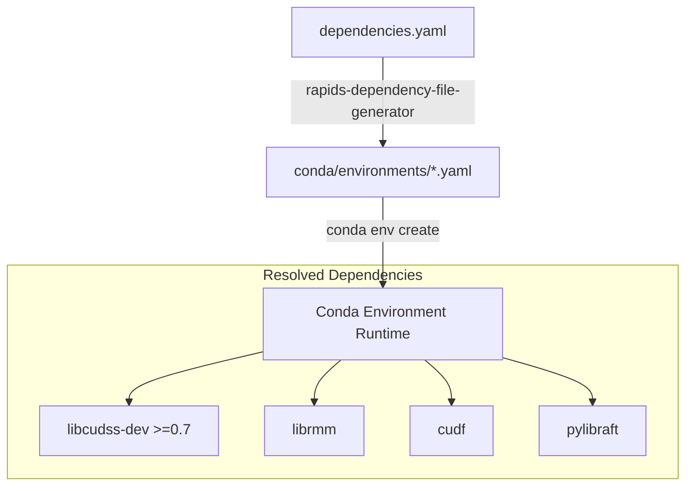

Sources: [.github/workflows/build_test_publish_images.yaml:44-80](), [conda/environments/all_cuda-129_arch-x86_64.yaml:21-62]()

---

## Installation via Docker

Pre-built Ubuntu and Red Hat UBI container images are hosted on Docker Hub and the NVIDIA NGC registry.

### Pulling Container Images

```bash
# For CUDA 12.x
docker pull nvidia/cuopt:latest-cu12

# For CUDA 13.x
docker pull nvidia/cuopt:latest-cu13
```

Sources: [README.md:143-149](), [docs/cuopt/source/cuopt-server/quick-start.rst:45-50]()

### Running the Server Container

```bash
docker run --gpus all -it --rm -p 5000:5000 nvidia/cuopt:latest-cu12
```

Sources: [docs/cuopt/source/cuopt-server/quick-start.rst:47-50]()

---

## Building from Source

Source compilation is handled via `build.sh` and CMake for developers modifying the C++ core or Python extensions.

### Environment Setup

```bash
git clone https://github.com/NVIDIA/cuopt.git
cd cuopt
conda env create --name cuopt_dev --file conda/environments/all_cuda-129_arch-x86_64.yaml
conda activate cuopt_dev
```

Sources: [.github/workflows/build.yaml:50-66](), [.github/workflows/build_test_publish_images.yaml:44-62]()

---

## Verification and Smoke Tests

The validation workflow ensures that the runtime environment, GPU bindings, and serving interfaces are correctly wired.

```mermaid
graph TB
    subgraph "Validation Entry Points"
        SmokeScript[""smoke_test_example.sh""]
        HealthEndpoint[""/cuopt/health (HTTP)""]
        RequestEndpoint[""/cuopt/request (HTTP)""]
    end

    subgraph "Internal Execution Flow"
        SmokeScript -->|imports| PyCuOpt[""cuopt.routing.DataModel""]
        HealthEndpoint -->|invokes| ServicePing[""cuopt_server.cuopt_service""]
        RequestEndpoint -->|dispatches| SolverEngine[""libcuopt Solver Kernels""]
    end
```

Sources: [docs/cuopt/source/cuopt-python/quick-start.rst:20-42](), [docs/cuopt/source/cuopt-server/quick-start.rst:80-148]()

### Python Routing Smoke Test

Execute the verification script to confirm package imports and routing execution:

```bash
bash docs/cuopt/source/cuopt-python/routing/examples/smoke_test_example.sh
```

Sources: [docs/cuopt/source/cuopt-python/quick-start.rst:25-31]()

### Server API Smoke Test

Start the server process and query the health endpoint:

```bash
python3 -m cuopt_server.cuopt_service --ip 0.0.0.0 --port 8000 &
curl -s http://localhost:8000/cuopt/health
```

Sources: [docs/cuopt/source/cuopt-server/quick-start.rst:80-97]()

---

# Page: Package Architecture

# Package Architecture

<details>
<summary>Relevant source files</summary>

The following files were used as context for generating this wiki page:

- [ci/build_wheel_libcuopt_client.sh](ci/build_wheel_libcuopt_client.sh)
- [conda/environments/all_cuda-129_arch-aarch64.yaml](conda/environments/all_cuda-129_arch-aarch64.yaml)
- [conda/environments/all_cuda-129_arch-x86_64.yaml](conda/environments/all_cuda-129_arch-x86_64.yaml)
- [conda/environments/all_cuda-133_arch-aarch64.yaml](conda/environments/all_cuda-133_arch-aarch64.yaml)
- [conda/environments/all_cuda-133_arch-x86_64.yaml](conda/environments/all_cuda-133_arch-x86_64.yaml)
- [conda/recipes/cuopt-server/recipe.yaml](conda/recipes/cuopt-server/recipe.yaml)
- [conda/recipes/cuopt-sh-client/recipe.yaml](conda/recipes/cuopt-sh-client/recipe.yaml)
- [conda/recipes/cuopt/recipe.yaml](conda/recipes/cuopt/recipe.yaml)
- [conda/recipes/libcuopt/recipe.yaml](conda/recipes/libcuopt/recipe.yaml)
- [cpp/src/CMakeLists.txt](cpp/src/CMakeLists.txt)
- [dependencies.yaml](dependencies.yaml)
- [python/cuopt/cuopt/CMakeLists.txt](python/cuopt/cuopt/CMakeLists.txt)
- [python/cuopt/cuopt/distance_engine/CMakeLists.txt](python/cuopt/cuopt/distance_engine/CMakeLists.txt)
- [python/cuopt/cuopt/linear_programming/data_model/CMakeLists.txt](python/cuopt/cuopt/linear_programming/data_model/CMakeLists.txt)
- [python/cuopt/cuopt/linear_programming/internals/CMakeLists.txt](python/cuopt/cuopt/linear_programming/internals/CMakeLists.txt)
- [python/cuopt/cuopt/linear_programming/io/CMakeLists.txt](python/cuopt/cuopt/linear_programming/io/CMakeLists.txt)
- [python/cuopt/cuopt/linear_programming/solver/CMakeLists.txt](python/cuopt/cuopt/linear_programming/solver/CMakeLists.txt)
- [python/cuopt/cuopt/linear_programming/solver_settings/CMakeLists.txt](python/cuopt/cuopt/linear_programming/solver_settings/CMakeLists.txt)
- [python/cuopt/cuopt/routing/CMakeLists.txt](python/cuopt/cuopt/routing/CMakeLists.txt)
- [python/cuopt/pyproject.toml](python/cuopt/pyproject.toml)
- [python/cuopt_self_hosted/pyproject.toml](python/cuopt_self_hosted/pyproject.toml)
- [python/cuopt_server/pyproject.toml](python/cuopt_server/pyproject.toml)
- [python/libcuopt/pyproject.toml](python/libcuopt/pyproject.toml)
- [python/libcuopt_client/libcuopt_client/VERSION](python/libcuopt_client/libcuopt_client/VERSION)
- [python/libcuopt_client/pyproject.toml](python/libcuopt_client/pyproject.toml)
- [python/libcuopt_mathopt/libcuopt_mathopt/VERSION](python/libcuopt_mathopt/libcuopt_mathopt/VERSION)
- [python/libcuopt_routing/libcuopt_routing/VERSION](python/libcuopt_routing/libcuopt_routing/VERSION)

</details>


## Purpose and Scope

This document details the cuOpt package ecosystem, explaining the split `libcuopt` native components (`libcuopt-client`, `libcuopt-mathopt`, `libcuopt-routing`, and the gRPC server wrapper), the `cuopt` Python SDK, `cuopt_server`, `cuopt_sh_client`, `cuopt_mcp`, and their layering relationships. It focuses on the modular distribution structure, component boundaries, and dependency management. For internal solver mechanisms, see [System Architecture](#1.3); for compilation mechanics, see [Build System](#5.1).

---

## Package Ecosystem Overview

The cuOpt repository is engineered as a modular ecosystem of Python packages and native C++ shared libraries. The native core is split into granular components via `libcuopt-split` to isolate heavy CUDA dependencies (such as `cudss`, `nccl`, and `nvjitlink`) from lightweight client components [conda/recipes/libcuopt/recipe.yaml:102-105](), [dependencies.yaml:161-163]().

| Package Name | Component Type | Primary Role & Code References | Target Audience / Usage |
|--------------|----------------|--------------------------------|-------------------------|
| `libcuopt-client` | C++ Shared Library / Wheel | RPC communication, client stubs, and logging [`conda/recipes/libcuopt/recipe.yaml:106-121]() | Lightweight clients needing no direct GPU math libs [conda/recipes/libcuopt/recipe.yaml:114-115]() |
| `libcuopt-mathopt` | C++ Shared Library / Wheel | LP, MILP, QP, SOCP solvers, cuDSS, and sparse algebra [dependencies.yaml:161-163]() | Mathematical programming solvers |
| `libcuopt-routing` | C++ Shared Library / Wheel | Vehicle routing optimization engines [python/libcuopt_routing/libcuopt_routing/VERSION]() | VRP and logistics users |
| `lib` metapackage | Python Wheel / Conda | Bundles native components and header assets [python/libcuopt/pyproject.toml:32-37]() | C++ developers and dependency graph resolution [dependencies.yaml:71-78]() |
| `cuopt` | Python SDK | High-level routing, LP/MILP/QP APIs, and Cython bridges [python/cuopt/pyproject.toml:12-34]() | Python data scientists and operations researchers |
| `cuopt_server` | Python Microservice | FastAPI asynchronous optimization microservice [python/cuopt_server/pyproject.toml:13-33]() | HTTP API consumers and enterprise service deployments |
| `cuopt_sh_client` | Python CLI / Client | Command-line utility (`cuopt_sh`) for client-server workflows [python/cuopt_self_hosted/pyproject.toml:11-25]() | Terminal users and self-hosted orchestration clients |
| `cuopt_mcp` | Python MCP Server | Model Context Protocol server exposing cuOpt tools to LLM agents | AI agents and LLM-driven optimization pipelines |

**Diagram: Ecosystem Layering (Natural Language to Code Entity Space)**
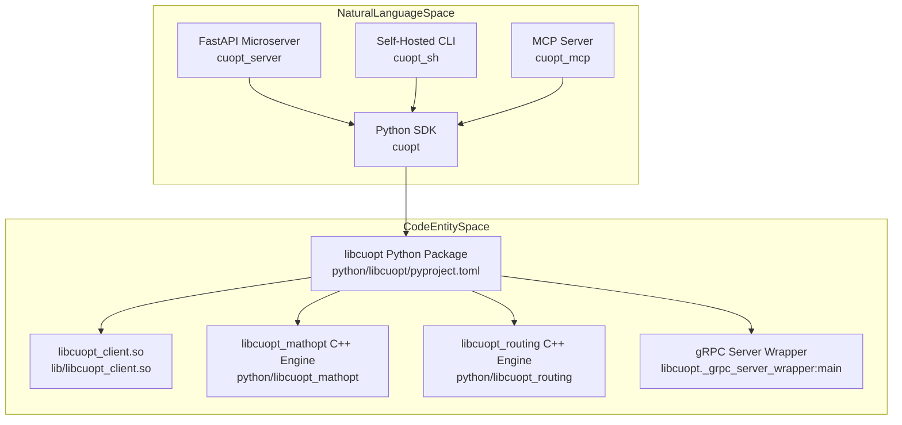

**Sources:** [dependencies.yaml:40-163](), [conda/recipes/libcuopt/recipe.yaml:102-168](), [python/libcuopt/pyproject.toml:32-50](), [python/cuopt/pyproject.toml:21-34](), [python/cuopt_server/pyproject.toml:13-34](), [python/cuopt_self_hosted/pyproject.toml:11-25]()

---

## Split `libcuopt` Components

To prevent routing-only or client-only installations from unnecessarily linking massive GPU runtime libraries (such as cuDSS or NCCL), `libcuopt` is decoupled into distinct C++ shared libraries packaged independently [conda/recipes/libcuopt/recipe.yaml:102-105](), [dependencies.yaml:161-163]().

### `libcuopt-client`
`libcuopt-client` compiles the base communication, logging (`rapids-logger`), and gRPC client stubs into `libcuopt_client.so` [conda/recipes/libcuopt/recipe.yaml:106-121](). It is built as a leaf package requirement that operates without direct dependency on RMM or CUDA math runtimes, allowing remote execution clients to resolve cleanly [conda/recipes/libcuopt/recipe.yaml:114-115]().

### `libcuopt-mathopt`
`libcuopt-mathopt` provides the mathematical programming engines (LP, MILP, QP, SOCP). It links against NVIDIA cuDSS (`libcudss`), cuSPARSE (`libcusparse`), and NCCL for multi-GPU linear algebra operations [conda/recipes/libcuopt/recipe.yaml:87-91]().

### `libcuopt-routing`
`libcuopt-routing` contains the routing solver engines for Vehicle Routing Problems (VRP), time-window routing, and distance engine integrations.

### `cuopt-grpc-server` and Wrapper
Distributed as part of the `libcuopt` wheel, the `cuopt_grpc_server` executable entry point is mapped to `libcuopt._grpc_server_wrapper:main` [python/libcuopt/pyproject.toml:48-50](). It handles remote gRPC client requests via shared-memory job queues and worker process spawning.

**Sources:** [dependencies.yaml:43-63](), [conda/recipes/libcuopt/recipe.yaml:102-168](), [python/libcuopt/pyproject.toml:48-50]()

---

## Python SDK and Microservices

### `cuopt` Python SDK
The `cuopt` package provides high-level abstractions for linear programming, quadratic programming, mixed-integer programming, and vehicle routing [python/cuopt/pyproject.toml:12-34](). It integrates deeply with the RAPIDS ecosystem via `cudf`, `rmm`, `pylibraft`, and `cupy` [python/cuopt/pyproject.toml:21-34]().

### `cuopt_server`
`cuopt_server` implements a FastAPI-based microservice that exposes endpoints for asynchronous optimization tasks [python/cuopt_server/pyproject.toml:13-34](). It serializes payload data using `msgpack` and `msgpack-numpy` and manages background execution pools using `psutil` [python/cuopt_server/pyproject.toml:23-34]().

### `cuopt_sh_client`
`cuopt_sh_client` provides the `cuopt_sh` command-line utility [python/cuopt_self_hosted/pyproject.toml:51-52]() and a lightweight client library for interfacing with self-hosted cuOpt microservice endpoints without requiring local GPU acceleration [python/cuopt_self_hosted/pyproject.toml:10-26]().

### `cuopt_mcp`
`cuopt_mcp` is a Model Context Protocol server integration that exposes cuOpt optimization tools as discoverable primitives to LLM agents and assistant runtimes.

**Sources:** [python/cuopt/pyproject.toml:12-34](), [python/cuopt_server/pyproject.toml:13-34](), [python/cuopt_self_hosted/pyproject.toml:10-52]()

---

## Dependency Management and Build Layering

All package requirements are centrally managed through `dependencies.yaml`, which acts as the single source of truth [dependencies.yaml:4-6](). The `rapids-dependency-file-generator` parses `dependencies.yaml` to project dependencies across `pyproject.toml` manifests and Conda environment configuration files [dependencies.yaml:4-6](), [conda/environments/all_cuda-129_arch-x86_64.yaml:1-2]().

**Diagram: Build and Dependency Resolution Flow**
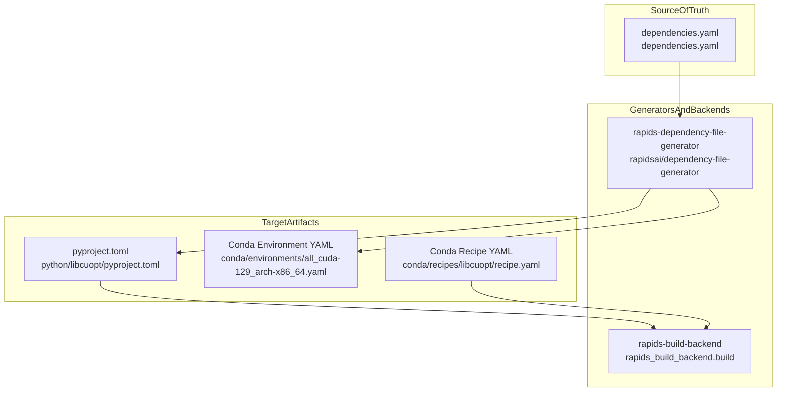

**Sources:** [dependencies.yaml:1-6](), [conda/recipes/libcuopt/recipe.yaml:1-168](), [python/libcuopt/pyproject.toml:4-9](), [conda/environments/all_cuda-129_arch-x86_64.yaml:1-80]()

---

# Page: System Architecture

# System Architecture

<details>
<summary>Relevant source files</summary>

The following files were used as context for generating this wiki page:

- [CONTRIBUTING.md](CONTRIBUTING.md)
- [build.sh](build.sh)
- [cpp/CMakeLists.txt](cpp/CMakeLists.txt)
- [cpp/include/cuopt/mathematical_optimization/constants.h](cpp/include/cuopt/mathematical_optimization/constants.h)
- [cpp/include/cuopt/mathematical_optimization/mip/solver_settings.hpp](cpp/include/cuopt/mathematical_optimization/mip/solver_settings.hpp)
- [cpp/include/cuopt/mathematical_optimization/pdlp/solver_settings.hpp](cpp/include/cuopt/mathematical_optimization/pdlp/solver_settings.hpp)
- [cpp/src/dual_simplex/simplex_solver_settings.hpp](cpp/src/dual_simplex/simplex_solver_settings.hpp)
- [cpp/src/grpc/server/grpc_incumbent_proto.hpp](cpp/src/grpc/server/grpc_incumbent_proto.hpp)
- [cpp/src/grpc/server/grpc_pipe_io.cpp](cpp/src/grpc/server/grpc_pipe_io.cpp)
- [cpp/src/grpc/server/grpc_pipe_serialization.hpp](cpp/src/grpc/server/grpc_pipe_serialization.hpp)
- [cpp/src/grpc/server/grpc_server_logger.hpp](cpp/src/grpc/server/grpc_server_logger.hpp)
- [cpp/src/grpc/server/grpc_server_main.cpp](cpp/src/grpc/server/grpc_server_main.cpp)
- [cpp/src/grpc/server/grpc_server_threads.cpp](cpp/src/grpc/server/grpc_server_threads.cpp)
- [cpp/src/grpc/server/grpc_server_types.hpp](cpp/src/grpc/server/grpc_server_types.hpp)
- [cpp/src/grpc/server/grpc_service_impl.cpp](cpp/src/grpc/server/grpc_service_impl.cpp)
- [cpp/src/grpc/server/grpc_worker.cpp](cpp/src/grpc/server/grpc_worker.cpp)
- [cpp/src/grpc/server/grpc_worker_infra.cpp](cpp/src/grpc/server/grpc_worker_infra.cpp)
- [cpp/src/math_optimization/solver_settings.cu](cpp/src/math_optimization/solver_settings.cu)
- [cpp/src/mip_heuristics/feasibility_jump/fj_types.hpp](cpp/src/mip_heuristics/feasibility_jump/fj_types.hpp)
- [cpp/src/mip_heuristics/feasibility_jump/load_balancing.cuh](cpp/src/mip_heuristics/feasibility_jump/load_balancing.cuh)
- [cpp/src/pdlp/solve.cu](cpp/src/pdlp/solve.cu)
- [cpp/tests/CMakeLists.txt](cpp/tests/CMakeLists.txt)
- [cpp/tests/examples/routing/CMakeLists.txt](cpp/tests/examples/routing/CMakeLists.txt)
- [cpp/tests/linear_programming/CMakeLists.txt](cpp/tests/linear_programming/CMakeLists.txt)
- [cpp/tests/linear_programming/grpc/CMakeLists.txt](cpp/tests/linear_programming/grpc/CMakeLists.txt)
- [cpp/tests/linear_programming/grpc/grpc_integration_test.cpp](cpp/tests/linear_programming/grpc/grpc_integration_test.cpp)
- [cpp/tests/linear_programming/grpc/grpc_worker_spawn_test.cpp](cpp/tests/linear_programming/grpc/grpc_worker_spawn_test.cpp)
- [cpp/tests/linear_programming/unit_tests/lp_solution_test.cu](cpp/tests/linear_programming/unit_tests/lp_solution_test.cu)

</details>


## Purpose and Scope

This document provides a technical deep dive into NVIDIA cuOpt's internal architecture, covering the solver hierarchy, API layers, GPU/CPU hybrid execution model, remote gRPC execution infrastructure, and the end-to-end data flow from problem input to solution. The architecture is designed to deliver high-performance mathematical optimization (LP, QP, MILP, and VRP) by combining massive GPU parallelism via CUDA with a robust CPU-based control plane.

Key architectural components include:
1.  **Concurrent Solver Execution**: Simultaneous execution of multiple solvers (PDLP, Barrier, and Dual Simplex) with automatic selection of the fastest converging result.
2.  **Hybrid Memory Management**: Dynamic allocation via `rmm::device_uvector` for device memory and `std::vector` for host memory structures.
3.  **Layered API and Remote Services**: Unified abstractions across C/C++ core engines, Cython bindings, Python SDKs, and a high-performance gRPC remote execution server (`cuopt_grpc_server`) utilizing POSIX shared memory and pipe-based IPC.

Sources: [cpp/src/pdlp/solve.cu:30-42](), [cpp/src/grpc/server/grpc_server_main.cpp:6-16]()

---

## Core Solver Architecture

cuOpt organizes its optimization capabilities into specialized solver engines managed through unified configuration and problem structures.

### Solver Type Hierarchy

The following diagram bridges the mathematical optimization problem space to the internal C++ solver classes and configuration structs.

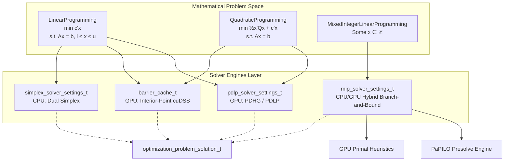

Sources: [cpp/include/cuopt/mathematical_optimization/pdlp/solver_settings.hpp:121-125](), [cpp/src/dual_simplex/simplex_solver_settings.hpp:31-35]()

### Concurrent Solver Execution

For Linear and Quadratic Programming, cuOpt supports a concurrent solver mode (`method_t::Concurrent`). When invoked, the solver spawns parallel execution threads for `PDLP` (GPU), `Barrier` (GPU), and `Dual Simplex` (CPU). The first thread to reach optimality or satisfy termination criteria publishes the solution, and cancellation signals terminate the remaining solver tasks.

Sources: [cpp/include/cuopt/mathematical_optimization/pdlp/solver_settings.hpp:71-78](), [cpp/src/pdlp/solve.cu:30-45]()

---

## API Layers and Interface Design

cuOpt presents a structured hierarchy of API layers, translating high-level Python and remote requests into core C++ data structures.

### API Entity Mapping

This diagram maps public API abstractions to internal C++ classes, memory backends, and bridging mechanisms.

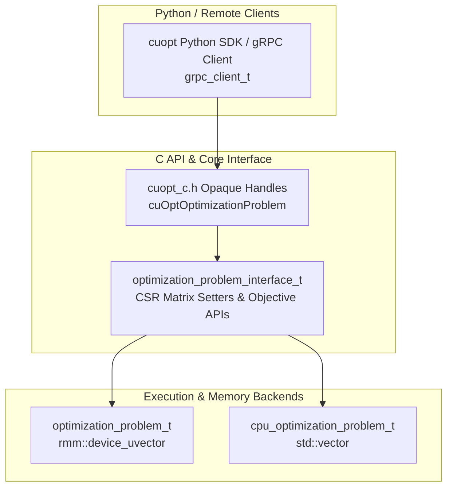

Sources: [cpp/src/math_optimization/solver_settings.cu:30-45](), [cpp/src/grpc/server/grpc_worker.cpp:192-193]()

### Memory Backends and Execution Modes

Depending on whether execution is local (GPU-accelerated) or remote (via gRPC server workers), problem data is instantiated using specialized containers:
*   **Device Memory (`optimization_problem_t`)**: Utilizes `rmm::device_uvector` for high-throughput GPU memory operations managed via RAPIDS Memory Manager (RMM).
*   **Host Memory (`cpu_optimization_problem_t`)**: Utilizes standard host vectors (`std::vector`), employed during serialization, client-side preparation, and CPU-fallback processing.

Sources: [cpp/src/pdlp/solve.cu:83-105](), [cpp/src/grpc/server/grpc_worker.cpp:192-193]()

---

## Remote gRPC Execution Architecture

Remote execution is handled by `cuopt_grpc_server`, which coordinates client connections, multi-process worker isolation, and low-latency IPC.

### gRPC Server Internal Topology

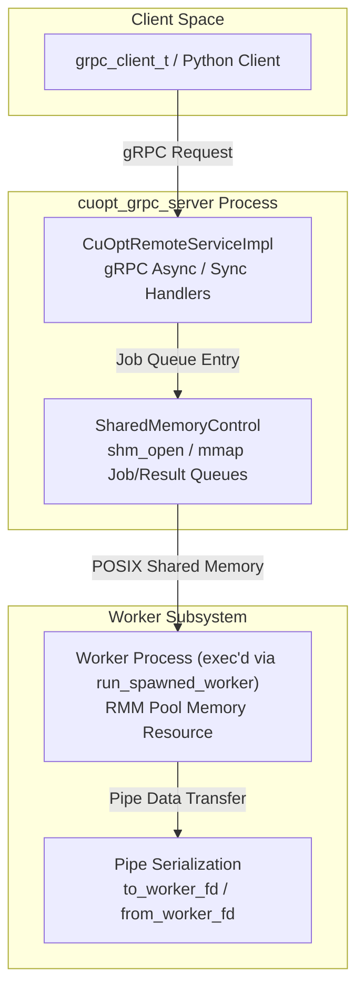

Sources: [cpp/src/grpc/server/grpc_server_main.cpp:65-72](), [cpp/src/grpc/server/grpc_server_types.hpp:86-121](), [cpp/src/grpc/server/grpc_worker.cpp:145-160]()

*   **Shared Memory Queues**: Fixed-size job and result circular buffers (`JobQueueEntry` and `ResultQueueEntry`) allocated via POSIX shared memory (`shm_open`, `mmap`) coordinate tasks between the main gRPC server thread and worker processes.
*   **Worker Spawning & Isolation**: Worker processes are spawned via `run_spawned_worker` with isolated CUDA device assignments (`cudaSetDevice`) and private RMM memory pools (`pool_memory_resource`).
*   **Pipe Serialization & Streaming**: Problem definition payloads and intermediate incumbent solutions are transferred across dedicated UNIX pipes (`WorkerPipes`), enabling real-time stream updates back to the client.

Sources: [cpp/src/grpc/server/grpc_server_main.cpp:65-72](), [cpp/src/grpc/server/grpc_server_types.hpp:86-187](), [cpp/src/grpc/server/grpc_worker.cpp:145-186]()

---

## Execution and Data Flow

### Hybrid GPU/CPU Orchestration

cuOpt coordinates workload distribution between the GPU and CPU depending on the algorithm stage:
*   **GPU Execution**: Sparse matrix-vector multiplications (SpMV), PDLP gradient updates, Cholesky/LDLT factorizations via `cuDSS`, and parallel MIP feasibility heuristics (Feasibility Jump).
*   **CPU Execution**: Revised dual simplex basis updates, LU factorization, Branch-and-Bound tree node scheduling, and PaPILO presolving routines.
*   **Synchronization**: Atomic primitives (`omp_atomic_t`) and mutexes (`omp_mutex_t`) ensure thread-safe updates to global incumbents and stopping flags across concurrent workers.

Sources: [cpp/src/pdlp/solve.cu:30-50](), [cpp/src/math_optimization/solver_settings.cu:30-45]()

### Problem Transformation Pipeline

1.  **Parsing**: Input formats (such as MPS, QPS, or LP files) are ingested by `mps_parser` and mapped into intermediate data models (`mps_data_model_t`).
2.  **Problem Population**: Data is loaded into `optimization_problem_interface_t` implementations, defining variable types, constraint bounds, and objective coefficients.
3.  **Presolving & Transformation**: The problem undergoes presolving reductions (via PaPILO/PSLP) before being translated into solver-specific formats (`lp_problem_t` or `user_problem_t`).
4.  **Execution & Solution Retrieval**: Solvers execute either locally on device memory or remotely via gRPC. Results are returned through `optimization_problem_solution_interface_t` abstractions, providing unified host/device accessors for primal/dual solutions and objective values.

Sources: [cpp/src/pdlp/solve.cu:30-50](), [cpp/src/grpc/server/grpc_worker.cpp:38-48]()

---

# Page: Core Solver Engines

# Core Solver Engines

<details>
<summary>Relevant source files</summary>

The following files were used as context for generating this wiki page:

- [cpp/include/cuopt/mathematical_optimization/constants.h](cpp/include/cuopt/mathematical_optimization/constants.h)
- [cpp/include/cuopt/mathematical_optimization/mip/solver_settings.hpp](cpp/include/cuopt/mathematical_optimization/mip/solver_settings.hpp)
- [cpp/include/cuopt/mathematical_optimization/pdlp/solver_settings.hpp](cpp/include/cuopt/mathematical_optimization/pdlp/solver_settings.hpp)
- [cpp/src/dual_simplex/simplex_solver_settings.hpp](cpp/src/dual_simplex/simplex_solver_settings.hpp)
- [cpp/src/math_optimization/solver_settings.cu](cpp/src/math_optimization/solver_settings.cu)
- [cpp/src/mip_heuristics/diversity/diversity_manager.cu](cpp/src/mip_heuristics/diversity/diversity_manager.cu)
- [cpp/src/mip_heuristics/diversity/population.cu](cpp/src/mip_heuristics/diversity/population.cu)
- [cpp/src/mip_heuristics/diversity/population.cuh](cpp/src/mip_heuristics/diversity/population.cuh)
- [cpp/src/mip_heuristics/presolve/third_party_presolve.cpp](cpp/src/mip_heuristics/presolve/third_party_presolve.cpp)
- [cpp/src/mip_heuristics/presolve/third_party_presolve.hpp](cpp/src/mip_heuristics/presolve/third_party_presolve.hpp)
- [cpp/src/mip_heuristics/solve.cu](cpp/src/mip_heuristics/solve.cu)
- [cpp/src/mip_heuristics/solver.cu](cpp/src/mip_heuristics/solver.cu)
- [cpp/src/pdlp/solve.cu](cpp/src/pdlp/solve.cu)
- [cpp/tests/internal/CMakeLists.txt](cpp/tests/internal/CMakeLists.txt)
- [cpp/tests/linear_programming/unit_tests/presolve_test.cu](cpp/tests/linear_programming/unit_tests/presolve_test.cu)
- [cpp/tests/mip/incumbent_callback_test.cu](cpp/tests/mip/incumbent_callback_test.cu)
- [cpp/tests/mip/population_test.cu](cpp/tests/mip/population_test.cu)

</details>


## Purpose and Scope

This document provides a high-level overview of cuOpt's core solver engines: the Linear Programming and Quadratic/Second-Order Cone Programming (LP/QP/SOCP) solver, the Mixed Integer Linear Programming (MILP) solver, and the Vehicle Routing Problem (VRP) solver. It outlines their design principles, GPU acceleration strategies, and concurrent execution models.

For detailed technical descriptions of specific algorithms and components, refer to the child pages:
- [Linear Programming Solver](#2.1) — Concurrent methods (PDLP, Barrier, Dual Simplex) and automatic backend selection.
- [Mixed Integer Programming Solver](#2.2) — Hybrid GPU/CPU branch-and-bound and GPU primal heuristics.
- [Routing Solver](#2.3) — Population metaheuristics, local search operators, and VRP variants.

For API configurations and parameters, see [C/C++ API](#4.1), [Python API](#4.2), and [Solver Configuration and Parameter Tuning](#7.3).

Sources: `[cpp/tests/linear_programming/pdlp_test.cu:68-72]()`, `[cpp/src/branch_and_bound/branch_and_bound.hpp:75-147]()`

---

## Solver Engine Architecture

The cuOpt library implements three distinct solver engines coordinated through shared data structures like `optimization_problem_t` and `cpu_optimization_problem_t` [cpp/src/pdlp/solve.cu:32-35](). Each engine targets specific mathematical formulations while leveraging NVIDIA GPU acceleration via `raft::handle_t`, `cuDSS`, and custom CUDA kernels.

Diagram: Solver Problem Mapping to Code Entities
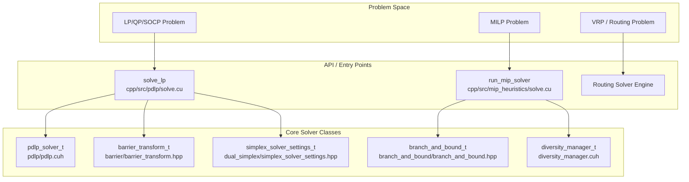
Sources: `[cpp/src/pdlp/solve.cu:32-35]()`, `[cpp/src/mip_heuristics/solve.cu:117-125](), [cpp/src/mip_heuristics/diversity/diversity_manager.cu:53-98]()`

---

## Linear Programming (LP/QP) Solver

The LP/QP solver engine handles continuous optimization with linear constraints and optional quadratic objectives. It supports multiple solution methods defined in `method_t`: `PDLP`, `Barrier`, `DualSimplex`, and `Concurrent` [cpp/include/cuopt/mathematical_optimization/pdlp/solver_settings.hpp:71-78](). 

In `Concurrent` mode, the solver executes PDLP and Barrier on the GPU alongside Dual Simplex on the CPU simultaneously, using an atomic synchronization flag (`concurrent_halt`) to terminate remaining tasks once the fastest method succeeds.

Diagram: LP Concurrent Execution Workflow
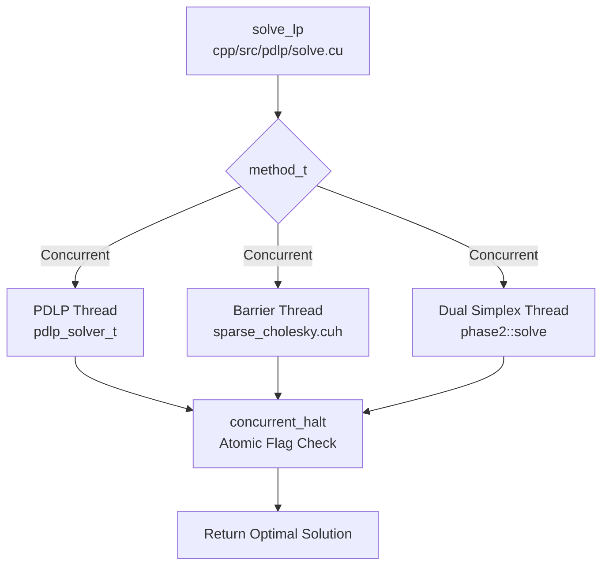
Sources: `[cpp/src/pdlp/solve.cu:32-47](), [cpp/include/cuopt/mathematical_optimization/pdlp/solver_settings.hpp:71-78]()`

For full details, see [Linear Programming Solver](#2.1).

---

## Mixed Integer Programming (MILP) Solver

The MILP solver (`mip_solver_t`) utilizes a hybrid CPU/GPU architecture to solve problems containing both continuous and discrete integer variables [cpp/src/mip_heuristics/solver.cu:54-63](). 

The architecture decouples primal bound discovery from dual bound improvement:
- **Primal Bound (GPU Heuristics):** `diversity_manager_t` and `population_t` coordinate GPU-accelerated feasibility pumps, feasibility jumps, and local search operators to rapidly discover high-quality integer-feasible solutions [cpp/src/mip_heuristics/diversity/diversity_manager.cu:53-98](), `[cpp/src/mip_heuristics/diversity/population.cu:33-51]()`.
- **Dual Bound (CPU Branch-and-Bound):** `branch_and_bound_t` executes tree search and LP relaxations on the CPU to close the optimality gap. Solutions and bounds are shared asynchronously between threads [cpp/src/mip_heuristics/solve.cu:117-125]().

For full details, see [Mixed Integer Programming Solver](#2.2).

Sources: `[cpp/src/mip_heuristics/solver.cu:54-63](), [cpp/src/mip_heuristics/solve.cu:117-125](), [cpp/src/mip_heuristics/diversity/diversity_manager.cu:53-98](), [cpp/src/mip_heuristics/diversity/population.cu:33-51]()`

---

## Routing Solver (VRP)

The Routing solver engine addresses Vehicle Routing Problems (VRP), Traveling Salesman Problems (TSP), and Pickup and Delivery Problems with Time Windows (PDPTW). It implements population-based metaheuristics and local search operators accelerated on the GPU.

Key components include:
- **Population Management:** Maintains a diverse pool of route solutions evaluated against capacity and time window constraints.
- **Recombination Operators:** Utilizes specialized crossover techniques (such as OX and EAX) to breed new route configurations.
- **Local Search:** Applies GPU-parallelized neighborhood moves (e.g., relocate, exchange, 2-opt) to escape local optima.

For full details, see [Routing Solver](#2.3).

Sources: `[cpp/tests/linear_programming/pdlp_test.cu:68-72]()`

---

## Solver Selection Guide

| Problem Characteristics | Recommended Engine | Primary Code Entry Point / Class |
|-------------------------|--------------------|----------------------------------|
| Continuous, Linear | LP Solver | `solve_lp` (`pdlp_solver_t`) `[cpp/src/pdlp/solve.cu:39]()` |
| Continuous, Quadratic / SOCP | LP/SOCP Solver | `solve_lp` with `method_t::Barrier` `[cpp/include/cuopt/mathematical_optimization/pdlp/solver_settings.hpp:71-78]()` |
| Discrete / Integer Variables | MILP Solver | `mip_solver_t` `[cpp/src/mip_heuristics/solver.cu:54-63]()` |
| Routing / Vehicle Scheduling | Routing Solver | Routing Python/C++ API |

Sources: `[cpp/src/pdlp/solve.cu:39](), [cpp/include/cuopt/mathematical_optimization/pdlp/solver_settings.hpp:71-78](), [cpp/src/mip_heuristics/solver.cu:54-63]()`

---

# Page: Linear Programming Solver

# Linear Programming Solver

<details>
<summary>Relevant source files</summary>

The following files were used as context for generating this wiki page:

- [cpp/include/cuopt/mathematical_optimization/constants.h](cpp/include/cuopt/mathematical_optimization/constants.h)
- [cpp/include/cuopt/mathematical_optimization/mip/solver_settings.hpp](cpp/include/cuopt/mathematical_optimization/mip/solver_settings.hpp)
- [cpp/include/cuopt/mathematical_optimization/pdlp/solver_settings.hpp](cpp/include/cuopt/mathematical_optimization/pdlp/solver_settings.hpp)
- [cpp/src/dual_simplex/presolve.cpp](cpp/src/dual_simplex/presolve.cpp)
- [cpp/src/dual_simplex/presolve.hpp](cpp/src/dual_simplex/presolve.hpp)
- [cpp/src/dual_simplex/simplex_solver_settings.hpp](cpp/src/dual_simplex/simplex_solver_settings.hpp)
- [cpp/src/dual_simplex/solve.cpp](cpp/src/dual_simplex/solve.cpp)
- [cpp/src/dual_simplex/solve.hpp](cpp/src/dual_simplex/solve.hpp)
- [cpp/src/dual_simplex/user_problem.hpp](cpp/src/dual_simplex/user_problem.hpp)
- [cpp/src/math_optimization/solver_settings.cu](cpp/src/math_optimization/solver_settings.cu)
- [cpp/src/pdlp/solve.cu](cpp/src/pdlp/solve.cu)
- [cpp/tests/linear_programming/pdlp_test.cu](cpp/tests/linear_programming/pdlp_test.cu)

</details>


## Purpose and Scope

This page provides a high-level overview of cuOpt's Linear Programming (LP) and Quadratic Programming (QP) solver engine. The solver employs a flexible dispatch system supporting multiple underlying algorithms—**PDLP**, **Barrier**, and **Dual Simplex**—and features a **three-method concurrent approach** that races these solvers simultaneously to automatically return the fastest optimal solution [cpp/include/cuopt/mathematical_optimization/pdlp/solver_settings.hpp:71-78]().

As a parent page, this document outlines the core solver engines and architectural components. Detailed technical specifications are maintained in the respective child pages linked below.

```
├── 2.1.1 PDLP Algorithm
├── 2.1.2 Dual Simplex Algorithm
├── 2.1.3 Barrier Method and Conic Solving
├── 2.1.4 Concurrent Solver Execution
└── 2.1.5 Presolving and Scaling
```

Sources: [cpp/include/cuopt/mathematical_optimization/pdlp/solver_settings.hpp:71-78]()

---

## Architecture and Solver Dispatch

The solver architecture normalizes incoming problem formulations into internal representations (`lp_problem_t` and `user_problem_t`) and dispatches them according to user configuration (`method_t`) or quadratic objective presence [cpp/src/dual_simplex/presolve.hpp:42-57](), [cpp/src/dual_simplex/user_problem.hpp:47-86]().

### Natural Language to Code Entity Mapping

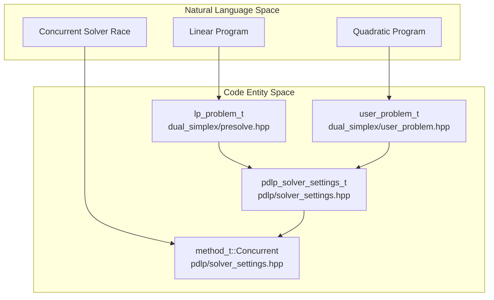

Sources: [cpp/src/dual_simplex/presolve.hpp:42-57](), [cpp/src/dual_simplex/user_problem.hpp:47-86](), [cpp/include/cuopt/mathematical_optimization/pdlp/solver_settings.hpp:71-78]()

---

## Core Solver Sub-Topics

### 2.1.1 PDLP Algorithm
PDLP (Primal-Dual Hybrid Gradient) is a GPU-accelerated first-order method designed for extremely large-scale linear programs. It features adaptive step sizing, sophisticated restart strategies, automated convergence/infeasibility detection, CUDA graph optimization, and multi-GPU distributed execution [cpp/src/pdlp/solve.cu:126-149](). For deep technical details, see [PDLP Algorithm](#2.1.1).

Sources: [cpp/src/pdlp/solve.cu:126-149]()

### 2.1.2 Dual Simplex Algorithm
The CPU-based revised dual simplex method handles Phase 1 and Phase 2 solving phases, robust LU factorization, basis updates, steepest-edge pricing, ratio tests, and folding transformations [cpp/src/dual_simplex/presolve.cpp:8-14](). For deep technical details, see [Dual Simplex Algorithm](#2.1.2).

Sources: [cpp/src/dual_simplex/presolve.cpp:8-14]()

### 2.1.3 Barrier Method and Conic Solving
The interior-point barrier method utilizes GPU-accelerated sparse Cholesky and LDLT factorizations via `cuDSS`, iterative refinement, barrier caching, crossover routines, and full support for second-order cone programming (SOCP) and quadratic programs (QP) [cpp/src/dual_simplex/solve.cpp:30-32](). For deep technical details, see [Barrier Method and Conic Solving](#2.1.3).

Sources: [cpp/src/dual_simplex/solve.cpp:30-32]()

### 2.1.4 Concurrent Solver Execution
By default, LP problems are solved using concurrent execution where PDLP, Barrier, and Dual Simplex run simultaneously across GPU streams and CPU worker threads [cpp/tests/linear_programming/pdlp_test.cu:160-167](). A synchronization halt mechanism monitors worker threads and immediately returns the result of the first solver to reach optimality. For deep technical details, see [Concurrent Solver Execution](#2.1.4).

Sources: [cpp/tests/linear_programming/pdlp_test.cu:160-167]()

### 2.1.5 Presolving and Scaling
Before entering the core solver engines, optimization problems undergo rigorous presolve transformations, bounds strengthening, dualization decisions, and matrix equilibration scaling (Ruiz and Pock-Chambolle algorithms) to improve numerical conditioning [cpp/src/pdlp/solve.cu:128-132](), [cpp/src/dual_simplex/presolve.cpp:10-11](). For deep technical details, see [Presolving and Scaling](#2.1.5).

Sources: [cpp/src/pdlp/solve.cu:128-132](), [cpp/src/dual_simplex/presolve.cpp:10-11]()

---

## Solver Dispatch Architecture

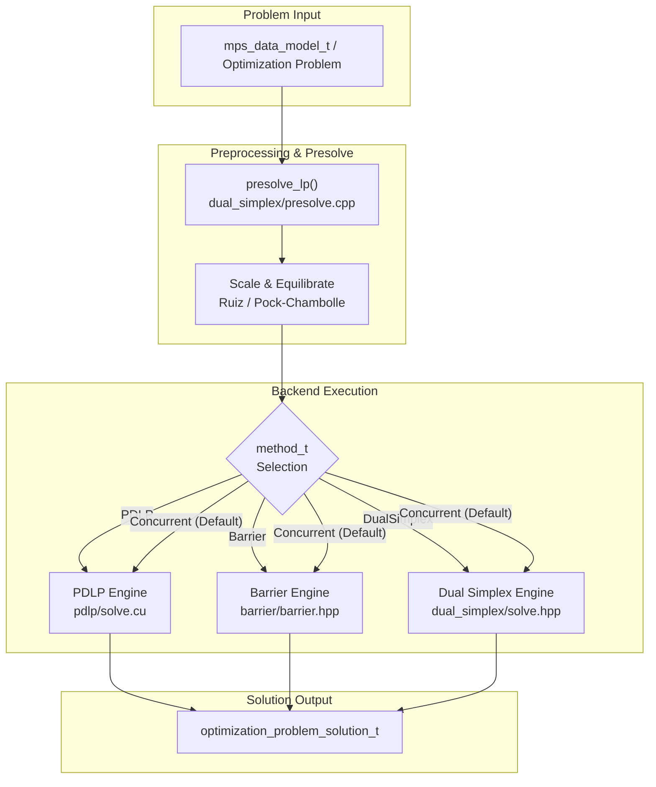

Sources: [cpp/src/pdlp/solve.cu:126-149](), [cpp/src/dual_simplex/presolve.cpp:8-14](), [cpp/include/cuopt/mathematical_optimization/pdlp/solver_settings.hpp:71-78]()

---

# Page: PDLP Algorithm

# PDLP Algorithm

<details>
<summary>Relevant source files</summary>

The following files were used as context for generating this wiki page:

- [ci/test_cpp_multi_gpu.sh](ci/test_cpp_multi_gpu.sh)
- [cpp/cmake/thirdparty/get_kaminpar.cmake](cpp/cmake/thirdparty/get_kaminpar.cmake)
- [cpp/src/pdlp/cusparse_view.cu](cpp/src/pdlp/cusparse_view.cu)
- [cpp/src/pdlp/cusparse_view.hpp](cpp/src/pdlp/cusparse_view.hpp)
- [cpp/src/pdlp/distributed_pdlp/distributed_algorithms.cu](cpp/src/pdlp/distributed_pdlp/distributed_algorithms.cu)
- [cpp/src/pdlp/distributed_pdlp/multi_gpu_engine.cu](cpp/src/pdlp/distributed_pdlp/multi_gpu_engine.cu)
- [cpp/src/pdlp/distributed_pdlp/multi_gpu_engine.hpp](cpp/src/pdlp/distributed_pdlp/multi_gpu_engine.hpp)
- [cpp/src/pdlp/distributed_pdlp/partitioner.cpp](cpp/src/pdlp/distributed_pdlp/partitioner.cpp)
- [cpp/src/pdlp/distributed_pdlp/partitioner.hpp](cpp/src/pdlp/distributed_pdlp/partitioner.hpp)
- [cpp/src/pdlp/distributed_pdlp/shard.cu](cpp/src/pdlp/distributed_pdlp/shard.cu)
- [cpp/src/pdlp/distributed_pdlp/shard.hpp](cpp/src/pdlp/distributed_pdlp/shard.hpp)
- [cpp/src/pdlp/initial_scaling_strategy/initial_scaling.cu](cpp/src/pdlp/initial_scaling_strategy/initial_scaling.cu)
- [cpp/src/pdlp/initial_scaling_strategy/initial_scaling.cuh](cpp/src/pdlp/initial_scaling_strategy/initial_scaling.cuh)
- [cpp/src/pdlp/optimal_batch_size_handler/optimal_batch_size_handler.cu](cpp/src/pdlp/optimal_batch_size_handler/optimal_batch_size_handler.cu)
- [cpp/src/pdlp/pdhg.cu](cpp/src/pdlp/pdhg.cu)
- [cpp/src/pdlp/pdhg.hpp](cpp/src/pdlp/pdhg.hpp)
- [cpp/src/pdlp/pdlp.cu](cpp/src/pdlp/pdlp.cu)
- [cpp/src/pdlp/pdlp.cuh](cpp/src/pdlp/pdlp.cuh)
- [cpp/src/pdlp/restart_strategy/pdlp_restart_strategy.cu](cpp/src/pdlp/restart_strategy/pdlp_restart_strategy.cu)
- [cpp/src/pdlp/restart_strategy/pdlp_restart_strategy.cuh](cpp/src/pdlp/restart_strategy/pdlp_restart_strategy.cuh)
- [cpp/src/pdlp/restart_strategy/weighted_average_solution.cu](cpp/src/pdlp/restart_strategy/weighted_average_solution.cu)
- [cpp/src/pdlp/restart_strategy/weighted_average_solution.hpp](cpp/src/pdlp/restart_strategy/weighted_average_solution.hpp)
- [cpp/src/pdlp/solve.cuh](cpp/src/pdlp/solve.cuh)
- [cpp/src/pdlp/step_size_strategy/adaptive_step_size_strategy.cu](cpp/src/pdlp/step_size_strategy/adaptive_step_size_strategy.cu)
- [cpp/src/pdlp/termination_strategy/convergence_information.cu](cpp/src/pdlp/termination_strategy/convergence_information.cu)
- [cpp/src/pdlp/termination_strategy/convergence_information.hpp](cpp/src/pdlp/termination_strategy/convergence_information.hpp)
- [cpp/src/pdlp/termination_strategy/infeasibility_information.cu](cpp/src/pdlp/termination_strategy/infeasibility_information.cu)
- [cpp/src/pdlp/termination_strategy/termination_strategy.cu](cpp/src/pdlp/termination_strategy/termination_strategy.cu)
- [cpp/src/pdlp/utilities/ping_pong_graph.cu](cpp/src/pdlp/utilities/ping_pong_graph.cu)
- [cpp/src/pdlp/utilities/ping_pong_graph.cuh](cpp/src/pdlp/utilities/ping_pong_graph.cuh)
- [cpp/src/pdlp/utils.cuh](cpp/src/pdlp/utils.cuh)
- [cpp/src/utilities/device_scalar_init.hpp](cpp/src/utilities/device_scalar_init.hpp)
- [cpp/src/utilities/manual_cuda_graph.cuh](cpp/src/utilities/manual_cuda_graph.cuh)
- [cpp/tests/linear_programming/pdlp_distributed_test.cu](cpp/tests/linear_programming/pdlp_distributed_test.cu)

</details>


This page provides a comprehensive technical deep dive into the Primal-Dual Hybrid Gradient (PDLP) algorithm implementation within cuOpt's linear programming solver. PDLP serves as the primary GPU-accelerated first-order solver for large-scale linear and quadratic programming problems.

For details on the CPU revised dual simplex algorithm, see [2.1.2](). For the interior-point barrier method, see [2.1.3](). For the concurrent execution orchestrator, see [2.1.4]().

## Algorithm Overview and Architecture

The PDLP algorithm solves linear programs in saddle-point form by iteratively updating primal and dual variables via projected gradient steps. The implementation is anchored by `pdlp_solver_t` [cpp/src/pdlp/pdlp.cuh:48-50]() and delegates specific subtasks to specialized engine classes such as `pdhg_solver_t` [cpp/src/pdlp/pdhg.hpp](), `pdlp_restart_strategy_t` [cpp/src/pdlp/restart_strategy/pdlp_restart_strategy.cuh](), and `pdlp_initial_scaling_strategy_t` [cpp/src/pdlp/initial_scaling_strategy/initial_scaling.cuh]().

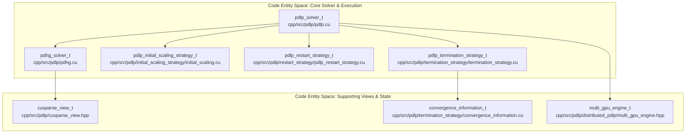

Sources: [cpp/src/pdlp/pdlp.cu:1-50](), [cpp/src/pdlp/pdlp.cuh:48-50](), [cpp/src/pdlp/initial_scaling_strategy/initial_scaling.cuh:26-28]()

---

## PDHG Iterations and Projections

The inner loop executes Primal-Dual Hybrid Gradient (PDHG) iterations via `pdhg_solver_t`. Each iteration updates the primal vector `x` and dual vector `y` using sparse matrix-vector products (`SpMV`) through `cusparse_view_t` [cpp/src/pdlp/cusparse_view.hpp:142-154]() and custom projection kernels.


Sources: [cpp/src/pdlp/pdhg.cu:50-117](), [cpp/src/pdlp/cusparse_view.hpp:142-154]()

### Reflected Primal-Dual Updates
Enabled via `use_reflected_primal_dual` in `pdlp_hyper_params_t`, the solver uses an extrapolated primal iterate (`2 * x'' - x`) when evaluating the dual gradient. This stabilization technique significantly enhances convergence velocity and is integral to the `Stable3` solver mode.

Sources: [cpp/src/pdlp/pdhg.cu:76-87](), [cpp/src/pdlp/restart_strategy/pdlp_restart_strategy.cu:80-87]()

Sources: [cpp/src/pdlp/pdhg.cu:50-117](), [cpp/src/pdlp/cusparse_view.hpp:142-154]()

---

## Adaptive Step Sizing

The step size manager adjusts the primal step size parameter `s` dynamically based on movement and interaction metrics.

- **Interaction**: Measures the coupling between primal and dual changes via `δy^T * A * δx`.
- **Movement**: Combines weighted L2 norms of primal changes (`||δx||²`) and dual changes (`||δy||²`).

These calculations utilize batched cuBLAS operations and `cub::DeviceSegmentedReduce` to maintain high throughput on the GPU.

Sources: [cpp/src/pdlp/step_size_strategy/adaptive_step_size_strategy.cu:1-101]()

---

## Restart Strategies

`pdlp_restart_strategy_t` implements advanced restart mechanisms to discard stale momentum and accelerate convergence [cpp/src/pdlp/restart_strategy/pdlp_restart_strategy.cuh:26-28]().

### Restart Modes
1. **KKT-Based Adaptive Restart**: Monitors KKT residual decay and triggers restarts when sufficient progress is achieved.
2. **Trust Region Restart (cuPDLPx)**: Computes localized duality gaps at current and average iterates, solving a bound-constrained trust region subproblem (`solve_bound_constrained_trust_region_kernel`) to re-center the trajectory.

Sources: [cpp/src/pdlp/restart_strategy/pdlp_restart_strategy.cu:61-138](), [cpp/src/pdlp/restart_strategy/pdlp_restart_strategy.cu:320-409]()

Sources: [cpp/src/pdlp/restart_strategy/pdlp_restart_strategy.cuh:26-28](), [cpp/src/pdlp/restart_strategy/pdlp_restart_strategy.cu:61-138]()

---

## Convergence and Infeasibility Detection

Convergence and infeasibility monitoring are managed by `convergence_information_t` and `infeasibility_information_t` [cpp/src/pdlp/termination_strategy/convergence_information.cu:47-55](), [cpp/src/pdlp/termination_strategy/infeasibility_information.cu:42-54]().

### Convergence Metrics
- **Primal & Dual Objectives**: Computed using reduction kernels over objective coefficients and right-hand sides.
- **Residuals**: Evaluates L2 and L-infinity norms for both primal residuals (`Ax - b` within bounds) and dual residuals (reduced costs).

### Infeasibility Detection
When enabled, the solver evaluates homogeneous primal and dual ray systems to certify primal or dual infeasibility, computing ray infinity norms and maximum constraint violations on device.

Sources: [cpp/src/pdlp/termination_strategy/convergence_information.cu:47-125](), [cpp/src/pdlp/termination_strategy/infeasibility_information.cu:42-120]()

---

## Initial Scaling Strategies

Prior to iteration, `pdlp_initial_scaling_strategy_t` equilibrates the problem matrix to improve conditioning [cpp/src/pdlp/initial_scaling_strategy/initial_scaling.cuh:26-28]().

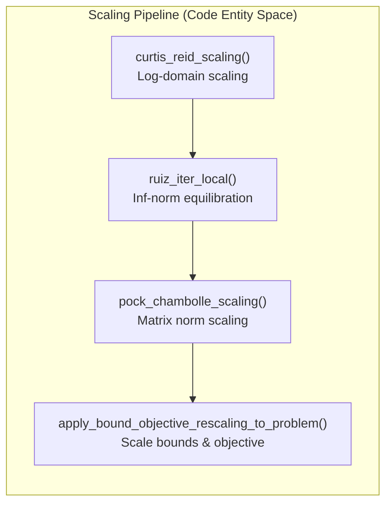

Sources: [cpp/src/pdlp/initial_scaling_strategy/initial_scaling.cu:63-137](), [cpp/src/pdlp/initial_scaling_strategy/initial_scaling.cuh:26-28]()

1. **Curtis-Reid Prescaling**: A log-domain global magnitude fitting pass that removes broad row/column skew.
2. **Ruiz Equilibration**: Iteratively scales rows and columns using L-infinity norms.
3. **Pock-Chambolle Scaling**: Matrix-norm scaling governed by scaling parameter `alpha`.

Sources: [cpp/src/pdlp/initial_scaling_strategy/initial_scaling.cu:63-137](), [cpp/src/pdlp/initial_scaling_strategy/initial_scaling.cuh:110-144]()

---

## CUDA Graphs and Performance Optimization

To minimize kernel launch overhead during the tight PDHG iteration loop, cuOpt uses `ping_pong_graph_t` and CUDA graph capture [cpp/src/pdlp/pdhg.cu:90-107]().

- **Precision Modes**: Supports FP32 (`SinglePrecision`), FP64 (`DoublePrecision`), and mixed-precision SpMV (FP32 sparse matrix with FP64 vectors) via `cusparse_view_t` [cpp/src/pdlp/cusparse_view.hpp:142-154]().
- **Dynamic Loading**: Runtime resolution of `cusparse` symbols via `dlsym` ensures compatibility across minor CUDA toolkit versions.

Sources: [cpp/src/pdlp/pdhg.cu:90-111](), [cpp/src/pdlp/cusparse_view.cu:37-123]()

---

## Multi-GPU Distributed PDLP

For extremely large problems, `multi_gpu_engine_t` distributes PDLP computation across multiple GPUs using KaMinPar graph partitioning and NCCL/peer-to-peer communication [cpp/src/pdlp/distributed_pdlp/distributed_algorithms.cu:30-150]().

- **Sharding**: The problem matrix `A` is partitioned by rows and columns into local shards assigned to individual GPUs.
- **Distributed Scaling**: Shards coordinate globally-coherent Ruiz and Curtis-Reid scaling iterations by exchanging scaling vectors across halo boundaries [cpp/src/pdlp/distributed_pdlp/distributed_algorithms.cu:105-165]().
- **Solution Gathering**: Potential next solutions and reduced costs are gathered back to the master rank for termination and status verification [cpp/src/pdlp/distributed_pdlp/distributed_algorithms.cu:30-48]().

Sources: [cpp/src/pdlp/distributed_pdlp/distributed_algorithms.cu:30-165](), [cpp/tests/linear_programming/pdlp_distributed_test.cu:32-81]()

---

# Page: Dual Simplex Algorithm

# Dual Simplex Algorithm

<details>
<summary>Relevant source files</summary>

The following files were used as context for generating this wiki page:

- [cpp/src/barrier/translate_soc.hpp](cpp/src/barrier/translate_soc.hpp)
- [cpp/src/dual_simplex/basis_solves.cpp](cpp/src/dual_simplex/basis_solves.cpp)
- [cpp/src/dual_simplex/basis_solves.hpp](cpp/src/dual_simplex/basis_solves.hpp)
- [cpp/src/dual_simplex/basis_updates.cpp](cpp/src/dual_simplex/basis_updates.cpp)
- [cpp/src/dual_simplex/basis_updates.hpp](cpp/src/dual_simplex/basis_updates.hpp)
- [cpp/src/dual_simplex/crossover.cpp](cpp/src/dual_simplex/crossover.cpp)
- [cpp/src/dual_simplex/folding.cpp](cpp/src/dual_simplex/folding.cpp)
- [cpp/src/dual_simplex/phase2.cpp](cpp/src/dual_simplex/phase2.cpp)
- [cpp/src/dual_simplex/phase2.hpp](cpp/src/dual_simplex/phase2.hpp)
- [cpp/src/dual_simplex/presolve.cpp](cpp/src/dual_simplex/presolve.cpp)
- [cpp/src/dual_simplex/presolve.hpp](cpp/src/dual_simplex/presolve.hpp)
- [cpp/src/dual_simplex/primal.cpp](cpp/src/dual_simplex/primal.cpp)
- [cpp/src/dual_simplex/right_looking_lu.cpp](cpp/src/dual_simplex/right_looking_lu.cpp)
- [cpp/src/dual_simplex/right_looking_lu.hpp](cpp/src/dual_simplex/right_looking_lu.hpp)
- [cpp/src/dual_simplex/solve.cpp](cpp/src/dual_simplex/solve.cpp)
- [cpp/src/dual_simplex/solve.hpp](cpp/src/dual_simplex/solve.hpp)
- [cpp/src/dual_simplex/user_problem.hpp](cpp/src/dual_simplex/user_problem.hpp)
- [cpp/src/linear_algebra/vector_math.hpp](cpp/src/linear_algebra/vector_math.hpp)
- [cpp/tests/dual_simplex/unit_tests/right_looking_ldlt.cpp](cpp/tests/dual_simplex/unit_tests/right_looking_ldlt.cpp)
- [cpp/tests/linear_programming/pdlp_test.cu](cpp/tests/linear_programming/pdlp_test.cu)
- [cpp/tests/socp/general_quadratic_test.cu](cpp/tests/socp/general_quadratic_test.cu)

</details>


## Purpose and Scope

This document describes the CPU-based **revised dual simplex** LP solver in cuOpt, implemented in the `cpp/src/dual_simplex/` directory. The dual simplex method is one of three LP solving approaches available in cuOpt, alongside PDLP (GPU first-order method, see page 2.1.1) and the Barrier method (GPU interior point, see page 2.1.3).

The term "revised" refers to maintaining an LU factorization of the basis matrix $B$ rather than explicitly storing $B^{-1}$. This representation enables efficient basis updates via rank-one modifications and reduces memory requirements. The `basis_update_mpf_t` class manages the middle product form LU factorization with Forrest-Tomlin updates [cpp/src/dual_simplex/basis_updates.hpp:169-184]().

The core implementation centers on the `dual_phase2()` function which performs the main simplex iteration. This method maintains dual feasibility ($A'y + z = c$ with appropriate signs on $z$) while iteratively driving primal infeasibility to zero, producing exact basic solutions at optimality. These vertex solutions are essential for warm-starting the MIP branch-and-bound solver where small bound changes from branching decisions typically preserve dual feasibility, enabling fast reoptimization at each node [cpp/src/dual_simplex/phase2.cpp:1-50]().

**Key characteristics:**
- CPU-based with OpenMP parallelization for matrix operations [cpp/src/dual_simplex/phase2.cpp:1-50]().
- Exact basic solutions (vertices of feasible region).
- Steepest edge pricing for selecting leaving variables [cpp/src/dual_simplex/phase2.cpp:879-913]().
- Harris ratio test with bound flipping for selecting entering variables [cpp/src/dual_simplex/phase2.cpp:1030-1135]().
- Refactorization every 100 iterations (default) to maintain numerical stability [cpp/src/dual_simplex/solve.cpp:8-43]().

Sources: [cpp/src/dual_simplex/phase2.cpp:1-50](), [cpp/src/dual_simplex/basis_updates.hpp:169-184](), [cpp/src/dual_simplex/solve.cpp:8-43]()

---

## Algorithm Overview

The revised dual simplex method solves linear programs of the form:

```
minimize    c'x
subject to  Ax = b
            l ≤ x ≤ u
```

by maintaining a basis matrix $B = A(:, basic\_list)$ and its LU factorization $P \cdot B = L \cdot U$, where:
- **L** is lower triangular with unit diagonal.
- **U** is upper triangular.
- **P** is a row permutation matrix [cpp/src/dual_simplex/basis_updates.cpp:39-58]().

Variables are partitioned into:
- **Basic variables** ($m$ variables, stored in `basic_list[m]`): Can violate bounds, form basis $B$ [cpp/src/dual_simplex/basis_solves.cpp:33-59]().
- **Nonbasic variables** ($n-m$ variables, stored in `nonbasic_list[n-m]`): Fixed at bounds (lower, upper, or free at 0) [cpp/src/dual_simplex/basis_solves.cpp:46-52]().

The algorithm maintains dual feasibility ($A'y + z = c$, with $z_j \ge 0$ for variables at lower bounds, $z_j \le 0$ for variables at upper bounds, $z_j = 0$ for basic variables) while iteratively reducing primal infeasibility in the basic variables.

**Diagram: Phase 2 Iteration Flow with Code Entities**
```mermaid
graph TB
    subgraph "IterationState"
        State[""vstatus[n]<br/>basic_list[m]<br/>nonbasic_list[n-m]<br/>x[n], y[m], z[n]<br/>dy_steepest_edge[m]""]
    end
    
    subgraph "PricingStage"
        CheckInfeas{"primal_inf_squared > 0?"}
        Pricing[""steepest_edge_pricing_with_infeasibilities()<br/>leaving_index, direction<br/>max (squared_infeas[j] / dy_steepest_edge[j])""]
    end
    
    subgraph "BTRANStage"
        BTRAN[""ft.b_transpose_solve_sparse()<br/>e_leaving → delta_y_sparse<br/>Solves B'·δy = e_leaving""]
    end
    
    subgraph "ReducedCostStage"
        ComputeDZ[""compute_delta_z()<br/>A_transpose, delta_y_sparse<br/>→ delta_z[n-m]<br/>δz[j] = -A(:,j)'·δy""]
    end
    
    subgraph "RatioTestStage"
        FirstStage[""first_stage_harris()<br/>Compute α_max""]
        SecondStage[""second_stage_harris()<br/>Select entering_index<br/>with max |δz[j]|""]
        BoundFlip[""bound_flipping_ratio_test()<br/>Allow nonbasic bound flips""]
    end
    
    subgraph "FTRANStage"
        FTRAN[""ft.b_solve()<br/>a_entering → delta_xB<br/>Solves B·δx = a_entering""]
    end
    
    subgraph "SolutionUpdateStage"
        UpdatePrimal[""x[j] += α·δx[j] for j in basic_list<br/>x[entering] = l or u""]
        UpdateDual[""y[i] += α·δy[i]<br/>z[j] += α·δz[j]""]
    end
    
    subgraph "BasisUpdateStage"
        SwapVars[""vstatus[leaving] = NONBASIC_*<br/>vstatus[entering] = BASIC<br/>basic_list[leaving_pos] = entering""]
        UpdateLU[""ft.update(delta_xB, leaving_pos)<br/>Rank-1 update: S_.col_start[k]++""]
        CheckRefactor{"ft.num_updates_ >= refactor_frequency?"}
        Refactor[""factorize_basis()<br/>Rebuild L0_, U0_<br/>Reset num_updates_ = 0""]
    end
    
    subgraph "EdgeWeightStage"
        UpdateEdge[""update_steepest_edge_weights()<br/>dy_steepest_edge[j] updated<br/>using delta_y pattern""]
    end
    
    State --> CheckInfeas
    CheckInfeas -->|"Yes"| Pricing
    CheckInfeas -->|"No"| Optimal["return OPTIMAL"]
    
    Pricing --> BTRAN
    BTRAN --> ComputeDZ
    ComputeDZ --> FirstStage
    FirstStage --> SecondStage
    SecondStage --> BoundFlip
    
    BoundFlip --> FTRAN
    FTRAN --> UpdatePrimal
    UpdatePrimal --> UpdateDual
    UpdateDual --> SwapVars
    SwapVars --> UpdateLU
    UpdateLU --> CheckRefactor
    CheckRefactor -->|"Yes"| Refactor
    CheckRefactor -->|"No"| UpdateEdge
    Refactor --> UpdateEdge
    UpdateEdge --> State
```
Sources: [cpp/src/dual_simplex/phase2.cpp:879-913](), [cpp/src/dual_simplex/basis_solves.cpp:846-878](), [cpp/src/dual_simplex/phase2.cpp:372-442](), [cpp/src/dual_simplex/phase2.cpp:1030-1135](), [cpp/src/dual_simplex/basis_solves.cpp:803-843](), [cpp/src/dual_simplex/basis_updates.cpp:525-545](), [cpp/src/dual_simplex/basis_solves.cpp:160-193]()

---

## Phase 2: Optimization

Once dual feasibility is established, Phase 2 runs the main dual simplex algorithm via `dual_phase2()` on the original problem. At each iteration:

1. **Pricing**: Call `steepest_edge_pricing()` or `steepest_edge_pricing_with_infeasibilities()` to select a primal-infeasible basic variable (leaving variable) with maximum (infeasibility)²/edge_weight ratio [cpp/src/dual_simplex/phase2.cpp:879-913]().

2. **BTRAN (Backward Transformation)**: Solve $B' \cdot \delta y = e_{leaving}$ using `b_transpose_solve()` or `b_transpose_solve_sparse()` to compute the dual simplex direction [cpp/src/dual_simplex/basis_solves.cpp:846-878]().

3. **Update reduced costs**: Compute $\delta z$ for nonbasic variables via `compute_delta_z()` which uses $A\_transpose$ to compute $\delta z_j = -A(:,j)' \cdot \delta y$ [cpp/src/dual_simplex/phase2.cpp:372-442]().

4. **Ratio test**: Call `phase2_ratio_test()` with Harris two-stage procedure or `bound_flipping_ratio_test()` to determine step length $\alpha$ and entering variable [cpp/src/dual_simplex/phase2.cpp:1030-1135]().

5. **FTRAN (Forward Transformation)**: Solve $B \cdot \delta x = a_{entering}$ using `b_solve()` to compute the primal direction for the entering column [cpp/src/dual_simplex/basis_solves.cpp:803-843]().

6. **Update primal solution**: $x \leftarrow x + \alpha \cdot \delta x$ where $\alpha$ is the step length from ratio test [cpp/src/dual_simplex/phase2.cpp:1-50]().

7. **Update dual solution**: $y \leftarrow y + \alpha \cdot \delta y, z \leftarrow z + \alpha \cdot \delta z$ [cpp/src/dual_simplex/phase2.cpp:1-50]().

8. **Update basis**: Swap entering/leaving variables, update `vstatus` array, call `ft.update()` to perform rank-one update of LU factorization [cpp/src/dual_simplex/basis_updates.hpp:106-109]().

9. **Update steepest edge weights**: Incrementally update edge norms via `update_steepest_edge_weights()` using the sparse pattern from BTRAN/FTRAN [cpp/src/dual_simplex/phase2.cpp:1-50]().

10. **Check refactorization**: If update count exceeds frequency, call `factorize_basis()` to rebuild $L \cdot U = P \cdot B$ [cpp/src/dual_simplex/basis_solves.cpp:160-172]().

Sources: [cpp/src/dual_simplex/phase2.cpp:1-50](), [cpp/src/dual_simplex/basis_updates.hpp:106-109](), [cpp/src/dual_simplex/basis_solves.cpp:160-172]()

---

## Basis Factorization and Updates

The dual simplex method maintains an LU factorization of the basis matrix $B$ with incremental rank-one updates. This is managed by the `basis_update_mpf_t` class (middle product form).

**Key Data Members:**
| Member | Type | Purpose |
|--------|------|---------|
| `L0_` | `csc_matrix_t` | Initial lower triangular factor from LU decomposition, unit diagonal [cpp/src/dual_simplex/basis_updates.hpp:172-172]() |
| `U0_` | `csc_matrix_t` | Initial upper triangular factor (column swaps applied during updates) [cpp/src/dual_simplex/basis_updates.hpp:173-173]() |
| `S_` | `csc_matrix_t` | Stores update vectors $d_i$ as columns: $S_(:, i)$ is the spike for $R_i$ [cpp/src/dual_simplex/basis_updates.hpp:176-176]() |
| `row_permutation_` | `std::vector<i_t>` | Row permutation $P$ from $P \cdot B = L \cdot U$ [cpp/src/dual_simplex/basis_updates.hpp:174-174]() |
| `refactor_frequency_` | `i_t` | Count threshold of rank-one updates before full refactorization [cpp/src/dual_simplex/basis_updates.hpp:181-181]() |

### basis_update_mpf_t Class

The `basis_update_mpf_t` class maintains the middle product form LU factorization:

```
L = L0 · R1^{-1} · R2^{-1} · ... · Rk^{-1}
U = U0 (modified in-place)

where Ri = I + ei·di'  (rank-one elementary matrices)
```

Sources: [cpp/src/dual_simplex/basis_updates.hpp:169-184](), [cpp/src/dual_simplex/basis_solves.cpp:160-193]()

---

## Pricing Strategies

Pricing determines which primal-infeasible basic variable should leave the basis. cuOpt implements **steepest edge pricing**, which selects the variable that gives the largest improvement in dual objective per simplex iteration.

### Steepest Edge Pricing

The steepest edge rule selects the leaving variable $j$ that maximizes:

$$(infeasibility_j)^2 / \|B^{-T} \cdot e_j\|^2$$

where $\|B^{-T} \cdot e_j\|^2$ is the steepest edge weight (stored in `dy_steepest_edge[j]`) [cpp/src/dual_simplex/phase2.cpp:879-913]().

Sources: [cpp/src/dual_simplex/phase2.cpp:879-913]()

---

## Ratio Test

The ratio test determines how far to move in the dual simplex direction before a nonbasic variable reaches its bound, which identifies the entering variable.

### Harris Ratio Test

The Harris ratio test is a numerically stable two-stage procedure implemented in `first_stage_harris()` and `second_stage_harris()` [cpp/src/dual_simplex/phase2.cpp:1030-1135]():

**Stage 1: Determine maximum step length** [cpp/src/dual_simplex/phase2.cpp:1030-1062]()  
Computes $\alpha_{max}$ by scanning nonbasic variables and determining the step length that maintains dual feasibility within `dual_tol`.

**Stage 2: Select entering variable** [cpp/src/dual_simplex/phase2.cpp:1065-1135]()  
Among all nonbasic variables $j$ with ratio $\alpha_j < \alpha_{max}$, selects the one with largest $|\delta z_j|$ to improve numerical stability.

### Bound Flipping Ratio Test

The bound flipping ratio test extends the standard ratio test by allowing bounded variables to flip from one bound to the other without entering the basis, reducing the total number of iterations [cpp/src/dual_simplex/phase2.cpp:1138-1157]().

Sources: [cpp/src/dual_simplex/phase2.cpp:1030-1157]()

---

## Presolve and Scaling

Before the simplex iterations begin, the problem undergoes presolving and scaling to improve numerical stability and reduce problem size via transformation utilities [cpp/src/dual_simplex/presolve.cpp:1-50]().

Sources: [cpp/src/dual_simplex/presolve.cpp:1-50]()

---

## Key Data Structures

### lp_problem_t
Represents the LP problem in standard equality form used internally by the dual simplex algorithm [cpp/src/dual_simplex/presolve.hpp:41-72]().

```cpp
template <typename i_t, typename f_t>
struct lp_problem_t {
  i_t num_rows;
  i_t num_cols;
  std::vector<f_t> objective;
  csc_matrix_t<i_t, f_t> A;
  std::vector<f_t> rhs;
  std::vector<f_t> lower;
  std::vector<f_t> upper;
  f_t obj_constant;
  f_t obj_scale;
};
```

Sources: [cpp/src/dual_simplex/presolve.hpp:41-72]()

---

# Page: Barrier Method and Conic Solving

# Barrier Method and Conic Solving

<details>
<summary>Relevant source files</summary>

The following files were used as context for generating this wiki page:

- [benchmarks/linear_programming/cuopt/run_cpufj.cu](benchmarks/linear_programming/cuopt/run_cpufj.cu)
- [cpp/src/barrier/augmented_matvec.cuh](cpp/src/barrier/augmented_matvec.cuh)
- [cpp/src/barrier/barrier.cu](cpp/src/barrier/barrier.cu)
- [cpp/src/barrier/barrier.hpp](cpp/src/barrier/barrier.hpp)
- [cpp/src/barrier/cusparse_view.cu](cpp/src/barrier/cusparse_view.cu)
- [cpp/src/barrier/cusparse_view.hpp](cpp/src/barrier/cusparse_view.hpp)
- [cpp/src/barrier/device_sparse_matrix.cuh](cpp/src/barrier/device_sparse_matrix.cuh)
- [cpp/src/barrier/iterative_refinement.hpp](cpp/src/barrier/iterative_refinement.hpp)
- [cpp/src/barrier/scaling_gpu.cu](cpp/src/barrier/scaling_gpu.cu)
- [cpp/src/barrier/second_order_cone_kernels.cuh](cpp/src/barrier/second_order_cone_kernels.cuh)
- [cpp/src/barrier/sparse_cholesky.cuh](cpp/src/barrier/sparse_cholesky.cuh)
- [cpp/src/barrier/sparse_matrix_kernels.cuh](cpp/src/barrier/sparse_matrix_kernels.cuh)
- [cpp/src/linear_algebra/vector_math.cuh](cpp/src/linear_algebra/vector_math.cuh)
- [cpp/src/mip_heuristics/presolve/trivial_presolve.cuh](cpp/src/mip_heuristics/presolve/trivial_presolve.cuh)
- [cpp/src/mip_heuristics/presolve/trivial_presolve_helpers.cuh](cpp/src/mip_heuristics/presolve/trivial_presolve_helpers.cuh)
- [cpp/src/mip_heuristics/problem/presolve_data.cu](cpp/src/mip_heuristics/problem/presolve_data.cu)
- [cpp/src/mip_heuristics/problem/presolve_data.cuh](cpp/src/mip_heuristics/problem/presolve_data.cuh)
- [cpp/tests/socp/barrier_kernels_test.cu](cpp/tests/socp/barrier_kernels_test.cu)
- [cpp/tests/socp/solve_barrier_socp.cu](cpp/tests/socp/solve_barrier_socp.cu)
- [docs/cuopt/source/convex-settings.rst](docs/cuopt/source/convex-settings.rst)
- [docs/cuopt/source/cuopt-c/convex/convex-c-api.rst](docs/cuopt/source/cuopt-c/convex/convex-c-api.rst)

</details>


## Purpose and Scope

This page provides full technical documentation for NVIDIA cuOpt’s interior-point barrier method, covering linear programming (LP), quadratic programming (QP), and second-order cone programming (SOCP) solving. It details the primal-dual path-following algorithm implementation, GPU-accelerated sparse Cholesky and LDLT factorizations via cuDSS, iterative refinement and GMRES preconditioning, conic layout constraints, barrier caching for warm-started sequence solves, and crossover routines.

---

## Overview of the Interior-Point Barrier Method

The barrier method solves convex optimization problems—including linear programs, convex quadratic programs, and second-order cone programs—by transforming inequality constraints into logarithmic barrier terms in the objective function. It tracks a primal-dual central path parameterized by barrier parameter $\mu$, maintaining strict interior feasibility with respect to non-negative orthants and cone bounds.

The primary controller for this execution path is the `barrier_solver_t` class [cpp/src/barrier/barrier.hpp:62-80](), which coordinates iteration steps, linear system matrix assemblies, and convergence checks.

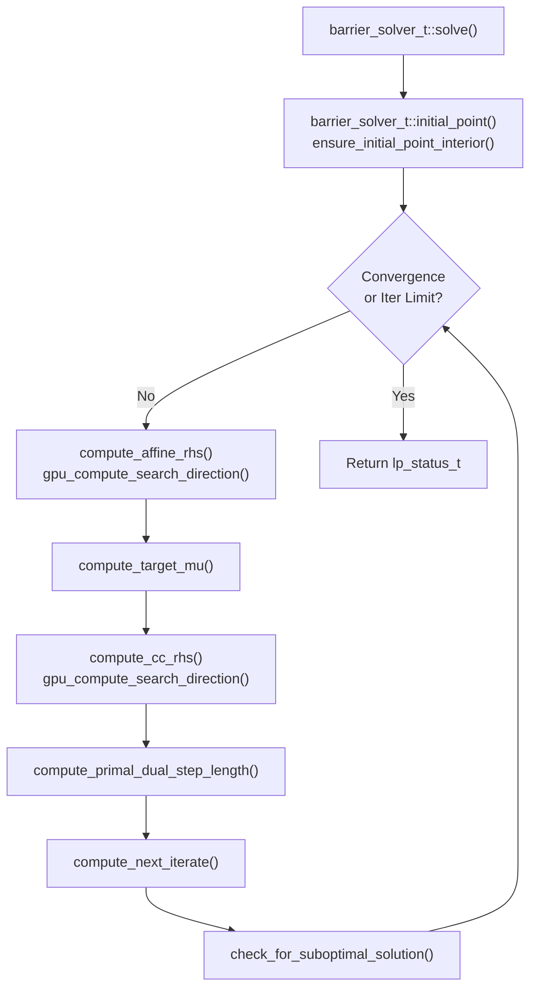

Sources: [cpp/src/barrier/barrier.cu:89-195](), [cpp/src/barrier/barrier.hpp:62-80]()

---

## GPU Sparse Cholesky and LDLT via cuDSS

At each barrier iteration, the system solves a linear KKT system whose coefficient matrix changes due to diagonal scaling variables derived from primal-dual slacks. cuOpt leverages NVIDIA's cuDSS (CUDA Direct Sparse Solver) for GPU-accelerated sparse Cholesky and LDLT factorizations.

The factorization interface is anchored by the `sparse_cholesky_base_t` abstract class [cpp/src/sparse_cholesky.cuh:52-63]() and implemented for cuDSS. To prevent teardown race conditions with OpenMP threads during library unloading, cuOpt pins the threading layer using `detail::pin_cudss_threading_layer()` [cpp/src/sparse_cholesky.cuh:36-48]().

```mermaid
graph TB
    Sub["sparse_cholesky_base_t"] --> Impl["sparse_cholesky_cudss_t"]
    Impl --> Pin["detail::pin_cudss_threading_layer()<br/>dlopen(RTLD_NODELETE)"]
    Pin --> Alloc["cudss_device_alloc()<br/>cudaMallocAsync()"]
    Alloc --> Exec["cudssExecute()<br/>Analysis -> Factorization -> Solve"]
```

### Key Lifecycle Operations in `sparse_cholesky_cudss_t`
1. **Memory Management**: Uses `cudaMallocAsync` via `cudss_device_alloc()` to mitigate RMM pool fragmentation during large workspace allocations [cpp/src/sparse_cholesky.cuh:115-132]().
2. **Symbolic Analysis**: Computes fill-reducing orderings and sparsity patterns once or upon structural changes.
3. **Numerical Factorization**: Updates matrix coefficients dynamically as barrier weights evolve.

Sources: [cpp/src/sparse_cholesky.cuh:28-63](), [cpp/src/sparse_cholesky.cuh:115-132]()

---

## Iterative Refinement and GMRES Workspace

To maintain numerical stability when solving ill-conditioned KKT systems, cuOpt combines direct sparse solves with iterative refinement and preconditioned GMRES.

The `gmres_workspace_t` struct allocates and reuses device memory across affine/corrector solves and GMRES restarts [cpp/src/iterative_refinement.hpp:57-74]():

```mermaid
graph TB
    GMRES["gmres_workspace_t"] --> Alloc["Allocate vectors:<br/>r, x_sav, d_column, V[], Z[]"]
    Alloc --> Ortho["orthogonalize(k)<br/>Modified Gram-Schmidt"]
    Ortho --> Update["update(x, coefficients, count)<br/>gmres_update_op kernel"]
```

Simple iterative refinement is implemented in `iterative_refinement_simple()`, which computes residual vectors $r = b - Ax$ on the device and applies correction steps until convergence or the iteration ceiling ($\le 30$) is reached [cpp/src/iterative_refinement.hpp:157-199]().

Sources: [cpp/src/iterative_refinement.hpp:57-131](), [cpp/src/iterative_refinement.hpp:157-199]()

---

## Second-Order Cone (SOCP) and Quadratic Programming (QP) Support

cuOpt's barrier engine natively supports convex quadratic programs and Second-Order Cone Programs (SOCP).

### Conic Layout Validation
Before executing barrier presolve or solves on problems with second-order cones, cuOpt validates that conic variables reside in a contiguous trailing block (`[linear | cone]`) and lack explicit individual bounds that violate cone definitions. This is checked by `validate_barrier_cone_layout()` [cpp/src/barrier/barrier.cu:83-116]().

```mermaid
graph TB
    Call["validate_barrier_cone_layout()"] --> CheckDims["Verify q_k >= 2<br/>(Reject Q^1 cones)"]
    CheckDims --> CheckTrailing["Verify cone block forms trailing columns<br/>[linear | cone]"]
    CheckTrailing --> CheckBounds["Verify no explicit lower/upper bounds<br/>on conic variables"]
    CheckBounds --> Valid["Return boolean status"]
```

### Initial Point Interior Guarantee
To ensure the starting point lies strictly within the interior of the nonnegative orthant and second-order cones, `ensure_initial_point_interior()` adjusts variable vectors using cone norms [cpp/src/barrier/barrier.cu:119-144]():
- Linear variables are shifted by $\epsilon$ adjustment [cpp/src/barrier/barrier.cu:129]().
- Conic variables $Q^k$ are checked against tail norms: if $x_0 \le \sqrt{\sum_{j=1}^{k-1} x_j^2} + \epsilon$, $x_0$ is adjusted accordingly [cpp/src/barrier/barrier.cu:133-143]().

Sources: [cpp/src/barrier/barrier.cu:83-144](), [cpp/tests/socp/solve_barrier_socp.cu:49-87]()

---

## Barrier Cache and Warm Starting

When solving sequences of related problems (such as in branch-and-bound nodes or parametric optimization), cuOpt leverages `barrier_cache_t` to reuse factorization structures, scaling data, and iterate states.

The `solve_with_cache()` method resets iterate states, computes a new initial point using cached factorizations where applicable, and executes the barrier solve without repeating expensive symbolic analyses [cpp/src/barrier/barrier.hpp:73-80]().

```mermaid
graph TB
    CacheSolve["barrier_solver_t::solve_with_cache()"] --> CheckCache["Access barrier_cache_t"]
    CheckCache --> Reuse["Reuse symbolic analysis<br/>and structural metadata"]
    Reuse --> ResetIter["Reset iterate states"]
    ResetIter --> InitPoint["Compute fresh initial point"]
    InitPoint --> RunBarrier["Run barrier solver iterations"]
```

Sources: [cpp/src/barrier/barrier.hpp:70-80](), [cpp/src/barrier/barrier.cu:34]()

---

## Crossover and Solution Recovery

Interior-point methods converge to interior points that may not lie on the vertices of the polytope. When an exact basic solution is requested (or required for MIP integration), cuOpt invokes a **crossover** procedure.

- **Phase**: Transition from the interior solution to a basic feasible solution.
- **Mechanism**: Identifies active constraints based on primal-dual tolerances and hands off the reduced basis to the dual simplex engine ([2.1.2]()).

Sources: [docs/cuopt/source/convex-settings.rst:78-88](), [cpp/src/barrier/barrier.hpp:62-80]()

---

## Code Entity Reference

### Key Classes and Functions

| Entity Name | File Path | Role and Description |
|-------------|-----------|----------------------|
| `barrier_solver_t` | `[cpp/src/barrier/barrier.hpp:62-80]()` | Main barrier solver controller managing iterations, steps, and status. |
| `validate_barrier_cone_layout` | `[cpp/src/barrier/barrier.cu:83-116]()` | Validates second-order cone structures and trailing layout. |
| `ensure_initial_point_interior` | `[cpp/src/barrier/barrier.cu:119-144]()` | Shifts initial points into the strict interior of cones and orthants. |
| `sparse_cholesky_base_t` | `[cpp/src/sparse_cholesky.cuh:52-63]()` | Abstract interface for GPU sparse Cholesky/LDLT solvers. |
| `gmres_workspace_t` | `[cpp/src/iterative_refinement.hpp:57-74]()` | Workspace manager for GMRES iterations and orthogonalization. |
| `iterative_refinement_simple` | `[cpp/src/iterative_refinement.hpp:157-162]()` | Performs device-side iterative refinement on linear solves. |

Sources: [cpp/src/barrier/barrier.hpp:62-80](), [cpp/src/barrier/barrier.cu:83-144](), [cpp/src/sparse_cholesky.cuh:52-63](), [cpp/src/iterative_refinement.hpp:57-162]()

---

# Page: Concurrent Solver Execution

# Concurrent Solver Execution

<details>
<summary>Relevant source files</summary>

The following files were used as context for generating this wiki page:

- [cpp/include/cuopt/mathematical_optimization/backend_selection.hpp](cpp/include/cuopt/mathematical_optimization/backend_selection.hpp)
- [cpp/include/cuopt/mathematical_optimization/constants.h](cpp/include/cuopt/mathematical_optimization/constants.h)
- [cpp/include/cuopt/mathematical_optimization/mip/solver_settings.hpp](cpp/include/cuopt/mathematical_optimization/mip/solver_settings.hpp)
- [cpp/include/cuopt/mathematical_optimization/pdlp/solver_settings.hpp](cpp/include/cuopt/mathematical_optimization/pdlp/solver_settings.hpp)
- [cpp/src/dual_simplex/simplex_solver_settings.hpp](cpp/src/dual_simplex/simplex_solver_settings.hpp)
- [cpp/src/math_optimization/logger_entry.cpp](cpp/src/math_optimization/logger_entry.cpp)
- [cpp/src/math_optimization/solver_settings.cu](cpp/src/math_optimization/solver_settings.cu)
- [cpp/src/pdlp/backend_selection.cpp](cpp/src/pdlp/backend_selection.cpp)
- [cpp/src/pdlp/solve.cu](cpp/src/pdlp/solve.cu)
- [cpp/src/routing/solve.cu](cpp/src/routing/solve.cu)
- [cpp/src/utilities/logger.hpp](cpp/src/utilities/logger.hpp)
- [cpp/tests/utilities/CMakeLists.txt](cpp/tests/utilities/CMakeLists.txt)
- [cpp/tests/utilities/test_console_log_callback.cpp](cpp/tests/utilities/test_console_log_callback.cpp)
- [java/cuopt/src/main/java/com/nvidia/cuopt/mathematicaloptimization/NativeLogSink.java](java/cuopt/src/main/java/com/nvidia/cuopt/mathematicaloptimization/NativeLogSink.java)
- [java/cuopt/src/main/native/cuopt_jni.cpp](java/cuopt/src/main/native/cuopt_jni.cpp)
- [java/cuopt/src/test/java/com/nvidia/cuopt/mathematicaloptimization/NativeLogSinkTest.java](java/cuopt/src/test/java/com/nvidia/cuopt/mathematicaloptimization/NativeLogSinkTest.java)

</details>


## Purpose and Scope

This page explains how cuOpt executes Linear Programming (LP) solver methods concurrently across GPU and CPU resources. The concurrent solver execution feature runs multiple complementary algorithms—specifically PDLP and Barrier on the GPU, and Dual Simplex on the CPU—simultaneously. It monitors their progress and automatically selects and returns the solution from whichever backend completes first. This design addresses the variability in LP problem structures, ensuring robust performance across diverse problem classes without requiring manual algorithm selection.

Sources: [cpp/include/cuopt/mathematical_optimization/pdlp/solver_settings.hpp:71-78](), [cpp/include/cuopt/mathematical_optimization/constants.h:38]()

---

## Concurrent Mode Overview and Configuration

By default, cuOpt is configured to use `method_t::Concurrent` for linear programming and mixed-integer programming relaxations. The solver settings allow users to specify or inspect the solving method via `method_t` enum values (`Concurrent`, `PDLP`, `DualSimplex`, `Barrier`, `PrimalSimplex`) [cpp/include/cuopt/mathematical_optimization/pdlp/solver_settings.hpp:71-78]().

When remote execution is enabled or fallback logic determines that no usable CUDA device is present, execution mode handling shifts via `get_execution_mode()` and `get_memory_backend_type()` [cpp/src/pdlp/backend_selection.cpp:17-54]().

```mermaid
graph TB
    subgraph "Natural Language Space"
        UserProblem["User Optimization Problem"]
        ConcurrentMode["Concurrent Solver Execution"]
        FastestResult["Automatic Fastest Result Selection"]
    end

    subgraph "Code Entity Space"
        Settings["method_t::Concurrent<br/>[solver_settings.hpp:72]"]
        BackendSel["get_memory_backend_type()<br/>[backend_selection.cpp:29]"]
        SolveKernel["run_pdlp / barrier / dual_simplex<br/>[solve.cu:14-50]"]
    end

    UserProblem --> ConcurrentMode
    ConcurrentMode --> FastestResult
    
    Settings --> ConcurrentMode
    BackendSel --> ConcurrentMode
    SolveKernel --> ConcurrentMode
```
*Figure 1: Bridging natural language concepts of concurrent execution to code entities.*

Sources: [cpp/include/cuopt/mathematical_optimization/pdlp/solver_settings.hpp:71-78](), [cpp/src/pdlp/backend_selection.cpp:17-54](), [cpp/src/pdlp/solve.cu:14-50]()

---

## Concurrent Solver Backends

Concurrent execution dispatches three distinct solver implementations to run in parallel threads or device streams, leveraging specialized hardware for each algorithm class.

| Method | Target Hardware | Core Algorithm | Primary File / Class References |
|--------|----------------|----------------|---------------------------------|
| **PDLP** | GPU | First-Order Primal-Dual Hybrid Gradient | `pdlp::solve` [cpp/src/pdlp/solve.cu:14]() |
| **Barrier** | GPU | Interior-Point Method with cuDSS sparse factorization | `barrier::sparse_cholesky` [cpp/src/pdlp/solve.cu:30-47]() |
| **Dual Simplex** | CPU | Revised Dual Simplex with LU basis updates | `simplex::simplex_solver_settings_t` [cpp/src/dual_simplex/simplex_solver_settings.hpp:32]() |

```mermaid
graph TB
    subgraph "Execution Orchestration"
        Entry["Concurrent Solve Request"] --> Dispatch["Thread / Stream Dispatcher"]
    end

    subgraph "Concurrent Workers"
        Dispatch --> PDLPWorker["GPU: PDLP Engine<br/>[pdlp.cuh]"]
        Dispatch --> BarrierWorker["GPU: Barrier Engine<br/>[sparse_cholesky.cuh]"]
        Dispatch --> SimplexWorker["CPU: Dual Simplex Engine<br/>[simplex_solver_settings.hpp]"]
    end

    subgraph "Completion & Selection"
        PDLPWorker --> CheckHalt["Check global_concurrent_halt"]
        BarrierWorker --> CheckHalt
        SimplexWorker --> CheckHalt
        CheckHalt --> ReturnFirst["Return First Valid Solution"]
    end
```
*Figure 2: Data flow and thread dispatching across concurrent solver backends.*

Sources: [cpp/src/pdlp/solve.cu:14-50](), [cpp/src/dual_simplex/simplex_solver_settings.hpp:32-134]()

---

## Backend Selection and Execution Modes

The solver infrastructure inspects environment variables and hardware availability to decide whether local GPU acceleration, CPU fallback, or remote gRPC dispatch should be used.

```mermaid
graph LR
    Env["CUOPT_REMOTE_HOST set?"] -->|Yes| Remote["execution_mode_t::REMOTE<br/>[backend_selection.cpp:26]"]
    Env -->|No| CheckGPU["cudaGetDeviceCount()"]
    
    CheckGPU -->|Count > 0| LocalGPU["memory_backend_t::GPU<br/>[backend_selection.cpp:36]"]
    CheckGPU -->|Count == 0| FallbackCPU["memory_backend_t::CPU<br/>[backend_selection.cpp:53]"]
```

Sources: [cpp/src/pdlp/backend_selection.cpp:17-54]()

---

## Synchronization and Early Termination

To avoid wasting computational resources once one solver successfully finds an optimal, infeasible, or unbounded status, concurrent execution relies on shared atomic flags and thread coordination. 

- **Thread-safe logging and callbacks**: The logging subsystem uses thread-local structures (`detail::t_log_callback`) to ensure concurrent solver threads do not interleave or corrupt callback execution [cpp/src/utilities/logger.hpp:82]().
- **Settings Propagation**: Hyperparameters, tolerances (such as `absolute_dual_tolerance`, `relative_dual_tolerance`, `absolute_primal_tolerance`, `relative_primal_tolerance`), and iteration limits are broadcast to all concurrent solver configurations upon initialization [cpp/src/math_optimization/solver_settings.cu:125-137]().

Sources: [cpp/src/math_optimization/solver_settings.cu:125-137](), [cpp/src/utilities/logger.hpp:82]()

---

# Page: Presolving and Scaling

# Presolving and Scaling

<details>
<summary>Relevant source files</summary>

The following files were used as context for generating this wiki page:

- [.gitignore](.gitignore)
- [benchmarks/linear_programming/run_mps_files.sh](benchmarks/linear_programming/run_mps_files.sh)
- [cpp/include/cuopt/mathematical_optimization/io/data_model_view.hpp](cpp/include/cuopt/mathematical_optimization/io/data_model_view.hpp)
- [cpp/include/cuopt/mathematical_optimization/io/mps_data_model.hpp](cpp/include/cuopt/mathematical_optimization/io/mps_data_model.hpp)
- [cpp/include/cuopt/mathematical_optimization/io/parser.hpp](cpp/include/cuopt/mathematical_optimization/io/parser.hpp)
- [cpp/src/dual_simplex/presolve.cpp](cpp/src/dual_simplex/presolve.cpp)
- [cpp/src/dual_simplex/presolve.hpp](cpp/src/dual_simplex/presolve.hpp)
- [cpp/src/dual_simplex/scaling.cpp](cpp/src/dual_simplex/scaling.cpp)
- [cpp/src/dual_simplex/scaling.hpp](cpp/src/dual_simplex/scaling.hpp)
- [cpp/src/dual_simplex/solve.cpp](cpp/src/dual_simplex/solve.cpp)
- [cpp/src/dual_simplex/solve.hpp](cpp/src/dual_simplex/solve.hpp)
- [cpp/src/dual_simplex/user_problem.hpp](cpp/src/dual_simplex/user_problem.hpp)
- [cpp/src/io/parser.cpp](cpp/src/io/parser.cpp)
- [cpp/src/linear_algebra/sparse_matrix.hpp](cpp/src/linear_algebra/sparse_matrix.hpp)
- [cpp/tests/dual_simplex/unit_tests/solve.cpp](cpp/tests/dual_simplex/unit_tests/solve.cpp)
- [cpp/tests/dual_simplex/unit_tests/solve_barrier.cu](cpp/tests/dual_simplex/unit_tests/solve_barrier.cu)
- [cpp/tests/linear_programming/pdlp_test.cu](cpp/tests/linear_programming/pdlp_test.cu)
- [datasets/quadratic_programming/min_x_squared.mps](datasets/quadratic_programming/min_x_squared.mps)

</details>


## Purpose and Scope

This page details the presolving transformations, dualization decisions, and scaling strategies (including Ruiz equilibration and column pre-scaling) implemented in the cuOpt linear and quadratic programming solver backend. Presolving reduces problem dimensions by identifying redundant constraints, fixing variables, and standardizing inequality representations, while scaling improves the conditioning of the coefficient matrix $A$ and Hessian $Q$ for interior-point, simplex, and first-order solvers.

For details on the core linear programming solvers that consume these processed problems, see [2.1](). For MIP-specific presolving integrations using PaPILO, see [2.2.4]().

---

## Presolve System Architecture

The presolve and scaling subsystem translates user-space optimization models (`user_problem_t`) into standardized internal solver instances (`lp_problem_t`), applies numerical scaling, and later uncrushes solutions back to the original problem space.

```mermaid
graph TB
    subgraph "User Space"
        UserProblem["user_problem_t<br/>cpp/src/dual_simplex/user_problem.hpp"]
    end
    
    subgraph "Presolve Pipeline"
        EmptyCols["remove_empty_cols<br/>cpp/src/dual_simplex/presolve.cpp"]
        EmptyRows["remove_empty_rows<br/>cpp/src/dual_simplex/presolve.cpp"]
        FixedVars["remove_fixed_variables<br/>cpp/src/dual_simplex/presolve.cpp"]
        ConstraintConv["convert_user_problem<br/>cpp/src/dual_simplex/presolve.cpp"]
    end
    
    subgraph "Scaling Engine"
        ScalingFunc["scaling<br/>cpp/src/dual_simplex/scaling.cpp"]
        RuizEq["Ruiz Equilibration<br/>cpp/src/dual_simplex/scaling.cpp"]
    end
    
    subgraph "Solver Space"
        LPProblem["lp_problem_t<br/>cpp/src/dual_simplex/presolve.hpp"]
    end
    
    UserProblem --> EmptyCols
    EmptyCols --> EmptyRows
    EmptyRows --> FixedVars
    FixedVars --> ConstraintConv
    ConstraintConv --> ScalingFunc
    ScalingFunc --> RuizEq
    RuizEq --> LPProblem
```

**Diagram 1: Presolve and Scaling Pipeline Architecture**

Sources: [cpp/src/dual_simplex/presolve.cpp:23-814](), [cpp/src/dual_simplex/scaling.cpp:30-163](), [cpp/src/dual_simplex/user_problem.hpp:46-86]()

---

## Problem Representation Data Structures

The pipeline manages core data structures that bridge user specifications to internal solver representations.

```mermaid
classDiagram
    class user_problem_t {
        +i_t num_rows
        +i_t num_cols
        +vector~f_t~ objective
        +csc_matrix_t A
        +vector~f_t~ rhs
        +vector~char~ row_sense
        +vector~f_t~ lower
        +vector~f_t~ upper
        +vector~variable_type_t~ var_types
    }
    
    class lp_problem_t {
        +i_t num_rows
        +i_t num_cols
        +vector~f_t~ objective
        +csr_matrix_t Q
        +csc_matrix_t A
        +vector~f_t~ rhs
        +vector~f_t~ lower
        +vector~f_t~ upper
        +f_t obj_constant
        +f_t obj_scale
        +i_t cone_var_start
    }
    
    class substitution_matrix_t {
        +i_t num_rows
        +i_t num_cols
        +vector~i_t~ row_col
        +vector~f_t~ row_val
        +vector~i_t~ row_start
        +vector~i_t~ row_len
        +vector~i_t~ scatter
        +build()
    }
    
    user_problem_t --> lp_problem_t : "converted via presolve"
    lp_problem_t --> substitution_matrix_t : "used during free-var elimination"
```

**Diagram 2: Core Data Structures in Presolve**

### user_problem_t

Defined in [cpp/src/dual_simplex/user_problem.hpp:46-86](), `user_problem_t` holds raw problem specifications including row senses (`'L'`, `'G'`, `'E'`), variable bounds, objectives, range rows, quadratic matrix components (`Q_offsets`, `Q_indices`, `Q_values`), and second-order cone dimensions (`second_order_cone_dims`).

### lp_problem_t

Defined in [cpp/src/dual_simplex/presolve.hpp:41-157](), `lp_problem_t` represents the standardized internal problem format where inequality constraints are converted to equalities, variables are non-negative or shifted, and sparse matrix representations (`csc_matrix_t` for $A$, `csr_matrix_t` for $Q$) are established. It also provides problem serialization and MPS export via `write_mps()` [cpp/src/dual_simplex/presolve.hpp:82-156]().

Sources: [cpp/src/dual_simplex/presolve.hpp:41-157](), [cpp/src/dual_simplex/user_problem.hpp:46-86]()

---

## Presolve Transformations

### Empty Row and Column Removal

Variables with no entries in constraint matrix $A$ are eliminated based on their objective coefficients and bounds [cpp/src/dual_simplex/presolve.cpp:23-130](). Constraints with no variables are checked for feasibility [cpp/src/dual_simplex/presolve.cpp:172-198]().

### Substitution Matrix (`substitution_matrix_t`)

To eliminate free variables efficiently, cuOpt uses `substitution_matrix_t` defined in [cpp/src/dual_simplex/presolve.cpp:107-197](). It organizes rows and columns in flat arenas (`row_col`, `row_val`, `row_start`, `row_len`) with column scatter maps to achieve amortized $O(1)$ appends and efficient row updates during variable substitutions.

Sources: [cpp/src/dual_simplex/presolve.cpp:23-258]()

---

## Scaling Strategies

### Column Scaling and Bound Pre-Conditioning

Scaling routines normalize constraint matrix rows and columns. In [cpp/src/dual_simplex/scaling.cpp:30-163](), `scaling()` computes infinity norms of rows (`compute_row_inf_norms`) and applies Ruiz equilibration when quadratic terms or second-order cones are present.

To prevent interior-point stalls caused by variables spanning extreme orders of magnitude (e.g., $10^4$ to $10^{11}$), `scaling()` applies bound-magnitude column pre-scaling before Ruiz iterations [cpp/src/dual_simplex/scaling.cpp:131-163]().

Sources: [cpp/src/dual_simplex/scaling.cpp:30-163]()

---

## Solution Recovery (Uncrushing)

After the solver computes a solution on the presolved and scaled `lp_problem_t`, `unscale_uncrush_barrier_to_user` [cpp/src/dual_simplex/solve.cpp:48-97]() and related uncrushing routines reverse scaling factors and reconstruct primal ($x$), dual ($y$), and reduced cost ($z$) vectors for the original `user_problem_t`.

Sources: [cpp/src/dual_simplex/solve.cpp:48-97]()

---

## Key Functions Reference

| Function / Class | Location | Purpose |
|------------------|----------|---------|
| `user_problem_t` | [cpp/src/dual_simplex/user_problem.hpp:46-86]() | User-facing optimization problem structure |
| `lp_problem_t` | [cpp/src/dual_simplex/presolve.hpp:41-157]() | Standardized internal LP/QP problem container |
| `substitution_matrix_t` | [cpp/src/dual_simplex/presolve.cpp:107-197]() | Sparse arena structure for eliminating free variables |
| `scaling()` | [cpp/src/dual_simplex/scaling.cpp:30-163]() | Matrix scaling and Ruiz equilibration implementation |
| `unscale_uncrush_barrier_to_user()` | [cpp/src/dual_simplex/solve.cpp:48-97]() | Reverses scaling and uncrushes barrier solution to user space |

Sources: [cpp/src/dual_simplex/presolve.cpp:107-197](), [cpp/src/dual_simplex/presolve.hpp:41-157](), [cpp/src/dual_simplex/scaling.cpp:30-163](), [cpp/src/dual_simplex/solve.cpp:48-97](), [cpp/src/dual_simplex/user_problem.hpp:46-86]()

---

# Page: Mixed Integer Programming Solver

# Mixed Integer Programming Solver

<details>
<summary>Relevant source files</summary>

The following files were used as context for generating this wiki page:

- [cpp/src/mip_heuristics/diversity/diversity_manager.cu](cpp/src/mip_heuristics/diversity/diversity_manager.cu)
- [cpp/src/mip_heuristics/diversity/population.cu](cpp/src/mip_heuristics/diversity/population.cu)
- [cpp/src/mip_heuristics/diversity/population.cuh](cpp/src/mip_heuristics/diversity/population.cuh)
- [cpp/src/mip_heuristics/feasibility_jump/cpu/audit.cpp](cpp/src/mip_heuristics/feasibility_jump/cpu/audit.cpp)
- [cpp/src/mip_heuristics/feasibility_jump/cpu/audit.hpp](cpp/src/mip_heuristics/feasibility_jump/cpu/audit.hpp)
- [cpp/src/mip_heuristics/feasibility_jump/cpu/setup/structure.hpp](cpp/src/mip_heuristics/feasibility_jump/cpu/setup/structure.hpp)
- [cpp/src/mip_heuristics/feasibility_jump/early_cpufj.cu](cpp/src/mip_heuristics/feasibility_jump/early_cpufj.cu)
- [cpp/src/mip_heuristics/feasibility_jump/early_cpufj.cuh](cpp/src/mip_heuristics/feasibility_jump/early_cpufj.cuh)
- [cpp/src/mip_heuristics/feasibility_jump/fj_cpu_bridge.cu](cpp/src/mip_heuristics/feasibility_jump/fj_cpu_bridge.cu)
- [cpp/src/mip_heuristics/mip_constants.hpp](cpp/src/mip_heuristics/mip_constants.hpp)
- [cpp/src/mip_heuristics/presolve/third_party_presolve.cpp](cpp/src/mip_heuristics/presolve/third_party_presolve.cpp)
- [cpp/src/mip_heuristics/presolve/third_party_presolve.hpp](cpp/src/mip_heuristics/presolve/third_party_presolve.hpp)
- [cpp/src/mip_heuristics/solve.cu](cpp/src/mip_heuristics/solve.cu)
- [cpp/src/mip_heuristics/solver.cu](cpp/src/mip_heuristics/solver.cu)
- [cpp/src/mip_heuristics/solver_context.cuh](cpp/src/mip_heuristics/solver_context.cuh)
- [cpp/src/mip_heuristics/utils.hpp](cpp/src/mip_heuristics/utils.hpp)
- [cpp/tests/internal/CMakeLists.txt](cpp/tests/internal/CMakeLists.txt)
- [cpp/tests/linear_programming/unit_tests/presolve_test.cu](cpp/tests/linear_programming/unit_tests/presolve_test.cu)
- [cpp/tests/mip/incumbent_callback_test.cu](cpp/tests/mip/incumbent_callback_test.cu)
- [cpp/tests/mip/population_test.cu](cpp/tests/mip/population_test.cu)

</details>


## Purpose and Scope

This page provides an overview of cuOpt's Mixed Integer Programming (MIP) solver architecture, which combines exact methods with GPU-accelerated primal heuristics to solve optimization problems containing integer variables. The solver uses a hybrid CPU/GPU approach where:

- **CPU threads** execute branch-and-bound tree search using dual simplex to maintain globally valid dual bounds
- **GPU threads** execute population-based primal heuristics to rapidly discover high-quality integer-feasible solutions

These components run concurrently and exchange solutions bidirectionally, with termination occurring when the gap between primal and dual bounds satisfies user-specified tolerances.

For detailed component documentation:
- **Branch and Bound**: see [Branch and Bound](#2.2.1)
- **GPU Primal Heuristics**: see [GPU Primal Heuristics](#2.2.2)
- **Local Search Methods**: see [Local Search Methods](#2.2.3)
- **MIP Presolving with PaPILO**: see [MIP Presolving with PaPILO](#2.2.4)
- **Constraint Propagation and Bounds Strengthening**: see [Constraint Propagation and Bounds Strengthening](#2.2.5)
- **Cutting Planes and Conflict Graphs**: see [Cutting Planes and Conflict Graphs](#2.2.6)

Sources: [cpp/src/branch_and_bound/branch_and_bound.cpp:1-43](), [cpp/src/mip_heuristics/solve.cu:117-125]()

## Overall Architecture

The MIP solver uses a hybrid architecture where CPU-based branch-and-bound runs concurrently with GPU-based primal heuristics, managed via `mip_solver_t` [cpp/src/mip_heuristics/solver.cu:54-63]() and `diversity_manager_t` [cpp/src/mip_heuristics/diversity/diversity_manager.cu:53-98]().

**MIP Solver Component Architecture**

```mermaid
graph TB
    subgraph EntryPoint["Entry Point"]
        solve_mip["solve_mip()"]
    end
    
    subgraph PresolveLayer["Presolve Layer"]
        papilo["third_party_presolve_t::apply()"]
        trivial["trivial_presolve()"]
    end
    
    subgraph SolverCore["Solver Core"]
        mip_solver["mip_solver_t::run_solver()"]
        context["mip_solver_context_t"]
    end
    
    subgraph CPUThread["CPU Thread: Branch and Bound"]
        bb["branch_and_bound_t::solve()"]
        bb_heap["mip_node_heap_t heap_"]
        bb_simplex["dual_phase2()"]
        bb_upper["upper_bound_"]
    end
    
    subgraph GPUThread["GPU Thread: Primal Heuristics"]
        dm["diversity_manager_t::run_solver()"]
        pop["population_t"]
        fj["feasibility_jump_t"]
        fp["feasibility_pump_t"]
    end
    
    subgraph Exchange["Solution Exchange"]
        mutex["omp_mutex_t mutex_upper_"]
        incumbent["mip_solution_t incumbent_"]
    end
    
    solve_mip --> papilo
    papilo --> trivial
    trivial --> context
    context --> mip_solver
    
    mip_solver --> bb
    mip_solver --> dm
    
    bb --> bb_heap
    bb --> bb_simplex
    bb --> bb_upper
    
    dm --> pop
    dm --> fj
    dm --> fp
    
    bb -->|"set_new_solution()"| mutex
    dm -->|"add_external_solution()"| mutex
    mutex --> incumbent
    incumbent --> bb_upper
    incumbent --> pop
```

Sources: [cpp/src/mip_heuristics/solver.cu:54-63](), [cpp/src/mip_heuristics/diversity/diversity_manager.cu:53-98]()

## Solving Pipeline and Sub-Topics

The MIP solver coordinates presolving, parallel heuristic exploration, and branch-and-bound optimization. Below is an overview of the core sub-systems and their child page references.

### 2.2.1 Branch and Bound
The CPU-based branch-and-bound subsystem explores the MIP search tree using LP relaxations solved via dual simplex. It manages node selection, variable branching decisions, worker pools, and sub-MIP heuristics (such as RINS and RENS) to close the dual bound.
For details, see [Branch and Bound](#2.2.1).

Sources: [cpp/src/mip_heuristics/solver.cu:65-86]()

### 2.2.2 GPU Primal Heuristics
GPU heuristics operate within the `diversity_manager_t` and `population_t` classes to rapidly generate integer-feasible solutions. Techniques include feasibility pump, feasibility jump, simple rounding, and diversity-driven population management running concurrently with the search tree.
For details, see [GPU Primal Heuristics](#2.2.2).

Sources: [cpp/src/mip_heuristics/diversity/diversity_manager.cu:53-98](), [cpp/src/mip_heuristics/diversity/population.cu:33-53]()

### 2.2.3 Local Search Methods
Local search methods repair constraint violations and refine incumbent solutions through specialized neighborhood structures, move evaluations, and line-segment searches integrated directly into the MIP heuristic pipeline.
For details, see [Local Search Methods](#2.2.3).

Sources: [cpp/src/mip_heuristics/diversity/diversity_manager.cu:68-80]()

### 2.2.4 MIP Presolving with PaPILO
Before solving, problems are reduced using PaPILO and PSLP presolver integrations alongside trivial presolving and custom variable eliminations. This layer simplifies constraints, removes redundant variables, and maintains postsolve storage for uncrushing solutions back to the original problem space.
For details, see [MIP Presolving with PaPILO](#2.2.4).

Sources: [cpp/src/mip_heuristics/presolve/third_party_presolve.hpp:73-111]()

### 2.2.5 Constraint Propagation and Bounds Strengthening
Constraint propagation and domain reduction techniques strengthen variable bounds during presolve and local search repair. Probing caches and domain tightening reduce the feasible search space prior to entering the branch-and-bound phase.
For details, see [Constraint Propagation and Bounds Strengthening](#2.2.5).

Sources: [cpp/src/mip_heuristics/solver.cu:88-135]()

### 2.2.6 Cutting Planes and Conflict Graphs
The cut generation subsystem derives valid inequalities—including MIR, Gomory, and clique cuts—using clique tables and conflict graphs. These cuts tighten the LP relaxation bounds within the branch-and-bound nodes.
For details, see [Cutting Planes and Conflict Graphs](#2.2.6).

Sources: [cpp/src/mip_heuristics/diversity/diversity_manager.cu:16-20]()

---

# Page: Branch and Bound

# Branch and Bound

<details>
<summary>Relevant source files</summary>

The following files were used as context for generating this wiki page:

- [cpp/include/cuopt/mathematical_optimization/mip/submip_hyper_params.hpp](cpp/include/cuopt/mathematical_optimization/mip/submip_hyper_params.hpp)
- [cpp/src/branch_and_bound/CMakeLists.txt](cpp/src/branch_and_bound/CMakeLists.txt)
- [cpp/src/branch_and_bound/branch_and_bound.cpp](cpp/src/branch_and_bound/branch_and_bound.cpp)
- [cpp/src/branch_and_bound/branch_and_bound.hpp](cpp/src/branch_and_bound/branch_and_bound.hpp)
- [cpp/src/branch_and_bound/constants.hpp](cpp/src/branch_and_bound/constants.hpp)
- [cpp/src/branch_and_bound/degenerate_pivots.cpp](cpp/src/branch_and_bound/degenerate_pivots.cpp)
- [cpp/src/branch_and_bound/degenerate_pivots.hpp](cpp/src/branch_and_bound/degenerate_pivots.hpp)
- [cpp/src/branch_and_bound/deterministic_workers.hpp](cpp/src/branch_and_bound/deterministic_workers.hpp)
- [cpp/src/branch_and_bound/diving_heuristics.cpp](cpp/src/branch_and_bound/diving_heuristics.cpp)
- [cpp/src/branch_and_bound/diving_heuristics.hpp](cpp/src/branch_and_bound/diving_heuristics.hpp)
- [cpp/src/branch_and_bound/fractional.hpp](cpp/src/branch_and_bound/fractional.hpp)
- [cpp/src/branch_and_bound/pseudo_costs.cpp](cpp/src/branch_and_bound/pseudo_costs.cpp)
- [cpp/src/branch_and_bound/pseudo_costs.hpp](cpp/src/branch_and_bound/pseudo_costs.hpp)
- [cpp/src/branch_and_bound/reduced_cost_bounds.hpp](cpp/src/branch_and_bound/reduced_cost_bounds.hpp)
- [cpp/src/branch_and_bound/worker.hpp](cpp/src/branch_and_bound/worker.hpp)
- [cpp/src/branch_and_bound/worker_pool.hpp](cpp/src/branch_and_bound/worker_pool.hpp)
- [cpp/src/mip_heuristics/root_heuristics.hpp](cpp/src/mip_heuristics/root_heuristics.hpp)

</details>


This page details the CPU-based branch-and-bound (B&B) engine in NVIDIA cuOpt (`branch_and_bound_t`), which systematically explores the mixed-integer linear programming (MILP) solution space. The engine integrates dual simplex LP relaxations, advanced variable selection (pseudo-costs and reliability branching), deterministic parallel best-first search (BSP) workers, thread-safe worker pools, diving heuristics, and recursive sub-MIP heuristics such as RINS and RENS.

---

## Core Architecture and Data Structures

The branch-and-bound solver is coordinated by the `branch_and_bound_t` class template [cpp/src/branch_and_bound/branch_and_bound.hpp:98]() and operates on search nodes represented by `mip_node_t` [cpp/src/branch_and_bound/mip_node.hpp](). Parallel exploration relies on worker abstractions and pools.

### Key Classes and Data Structures

| Component | Code Entity & Location | Role / Responsibility |
|-----------|------------------------|------------------------|
| **B&B Orchestrator** | `branch_and_bound_t<i_t, f_t>` [cpp/src/branch_and_bound/branch_and_bound.hpp:98]() | Manages global bounds, incumbent solutions, node queues, and worker orchestration. |
| **Search Tree Node** | `mip_node_t<i_t, f_t>` [cpp/src/branch_and_bound/mip_node.hpp]() | Represents a single node in the B&B tree, storing variable bounds, LP lower bounds, and branching history. |
| **Pseudo-Costs** | `pseudo_costs_t<i_t, f_t>` [cpp/src/branch_and_bound/pseudo_costs.hpp:109]() | Tracks objective degradation per unit change for variables to guide branching decisions. |
| **B&B Worker Base** | `branch_and_bound_worker_t<i_t, f_t>` [cpp/src/branch_and_bound/worker.hpp:53]() | Base worker holding local LP problem state, basis factors, node presolvers, and random number generators. |
| **Deterministic BFS Worker** | `deterministic_bfs_worker_t<i_t, f_t>` [cpp/src/branch_and_bound/deterministic_workers.hpp:117]() | Implements deterministic best-first search, plunge stacks, backlogs, and event logging. |
| **Worker Pool** | `worker_pool_t<WorkerType>` [cpp/src/branch_and_bound/worker_pool.hpp:16]() | Manages thread-safe acquisition and return of idle workers (`bfs_worker_pool_t`, `diving_worker_pool_t`). |
| **Sub-MIP Hyperparameters** | `mip_submip_hyper_params_t<i_t, f_t>` [cpp/include/cuopt/mathematical_optimization/mip/submip_hyper_params.hpp:14]() | Tuning knobs for RINS, RENS, fix-rates, recursion levels, and node/iteration limits. |

Sources: [cpp/src/branch_and_bound/branch_and_bound.hpp:98](), [cpp/src/branch_and_bound/pseudo_costs.hpp:109](), [cpp/src/branch_and_bound/worker.hpp:53](), [cpp/src/branch_and_bound/deterministic_workers.hpp:117](), [cpp/src/branch_and_bound/worker_pool.hpp:16](), [cpp/include/cuopt/mathematical_optimization/mip/submip_hyper_params.hpp:14]()

### Bridge: Natural Language Space to Code Entity Space (Worker & Pool Architecture)

```mermaid
graph TB
    subgraph "NaturalLanguageSpace:WorkerManagement"
        A["Global B&B Orchestrator"]
        B["Worker Pool (BFS / Diving)"]
        C["Deterministic Worker Thread"]
        D["Local LP Problem State"]
    end

    subgraph "CodeEntitySpace:Implementation"
        E["cuopt::mathematical_optimization::mip::branch_and_bound_t"] --> F["cuopt::mathematical_optimization::mip::worker_pool_t"]
        F --> G["cuopt::mathematical_optimization::mip::deterministic_bfs_worker_t"]
        G --> H["cuopt::mathematical_optimization::mip::branch_and_bound_worker_t::leaf_problem"]
    end

    A -.-> E
    B -.-> F
    C -.-> G
    D -.-> H
```
Sources: [cpp/src/branch_and_bound/branch_and_bound.hpp:98](), [cpp/src/branch_and_bound/worker_pool.hpp:16](), [cpp/src/branch_and_bound/deterministic_workers.hpp:117](), [cpp/src/branch_and_bound/worker.hpp:53]()

---

## Node Selection and LP Relaxations

At each node of the search tree, the solver extracts variable bounds (`set_lp_variable_bounds` [cpp/src/branch_and_bound/worker.hpp:152]()), updates node-local presolvers (`bounds_strengthening_t` [cpp/src/branch_and_bound/worker.hpp:72]()), and solves the continuous LP relaxation using the dual simplex method.

### LP Relaxation Workflow
1. **Bound Propagation**: The node's branched bounds are applied to `leaf_problem`, followed by bound tightening (`node_presolver.bounds_strengthening` [cpp/src/branch_and_bound/worker.hpp:169]()).
2. **Simplex Solve**: The dual simplex algorithm solves the relaxed linear program. If optimal, the objective value serves as the node's lower bound.
3. **Primal Check**: The solution is checked for integer feasibility (`check_guess` [cpp/src/branch_and_bound/branch_and_bound.cpp:100]()). If all integer variables are integral within tolerance, an incumbent solution update is attempted.
4. **Pruning**: If the LP relaxation is infeasible, unbounded, or its objective exceeds the global upper bound (`upper_bound_`), the node is pruned. Otherwise, branching occurs.

Sources: [cpp/src/branch_and_bound/branch_and_bound.cpp:100-142](), [cpp/src/branch_and_bound/worker.hpp:152-171]()

---

## Variable Selection and Pseudo-Costs

When a node's LP solution is fractional, the solver must select a branching variable. This is governed by pseudo-costs and reliability branching (`reliability_branching_settings_t` [cpp/src/branch_and_bound/pseudo_costs.hpp:40]()).

### Pseudo-Costs Mechanics
`pseudo_costs_t` [cpp/src/branch_and_bound/pseudo_costs.hpp:109]() tracks the historical objective change per unit fractional change when branching downward or upward on variables:
* **Initialization**: Estimates objective changes via single dual simplex pivots (`single_pivot_objective_change_estimate` [cpp/src/branch_and_bound/pseudo_costs.cpp:79]()).
* **Updates**: `update_pseudo_costs` [cpp/src/branch_and_bound/pseudo_costs.hpp:143]() refines pseudo-cost averages as nodes are explored and actual objective deltas are observed.
* **Concurrency**: Thread-safe merging of updates across workers is handled via `merge_updates` [cpp/src/branch_and_bound/pseudo_costs.hpp:145]().

Sources: [cpp/src/branch_and_bound/pseudo_costs.hpp:40-145](), [cpp/src/branch_and_bound/pseudo_costs.cpp:79-142]()

---

## Deterministic BSP Workers and Worker Pools

To guarantee reproducibility across parallel executions, cuOpt implements deterministic best-first search (BSP) workers (`deterministic_bfs_worker_t` [cpp/src/branch_and_bound/deterministic_workers.hpp:117]()).

### Worker Pool and Work Distribution
* **`worker_pool_t`**: Manages a fixed collection of worker instances (`bfs_worker_pool_t`, `diving_worker_pool_t` [cpp/src/branch_and_bound/worker_pool.hpp:118]()). Idle workers are tracked using a thread-safe `circular_deque_t` and acquired via `pop_idle_worker()` [cpp/src/branch_and_bound/worker_pool.hpp:59]().
* **Deterministic Event Queues**: Workers record deterministic event batches (`bb_event_batch_t` [cpp/src/branch_and_bound/deterministic_workers.hpp:129]()) and sequence IDs (`creation_seq` [cpp/src/branch_and_bound/deterministic_workers.hpp:187]()), ensuring identical execution paths regardless of OS thread scheduling.

Sources: [cpp/src/branch_and_bound/deterministic_workers.hpp:117-193](), [cpp/src/branch_and_bound/worker_pool.hpp:16-117]()

---

## Diving Heuristics and Sub-MIPs (RINS / RENS)

To rapidly discover high-quality integer solutions, the solver employs diving heuristics (`search_strategy_t` [cpp/src/branch_and_bound/constants.hpp:30]()) and recursive sub-MIP methods.

### Diving Heuristics
Diving workers perform focused DFS-like descents (`diving_worker_t`) without backtracking (or with strict backtracking limits). Supported strategies include:
* `PSEUDOCOST_DIVING` [cpp/src/branch_and_bound/constants.hpp:32]()
* `GUIDED_DIVING` [cpp/src/branch_and_bound/constants.hpp:34]()
* `COEFFICIENT_DIVING` [cpp/src/branch_and_bound/constants.hpp:35]()
* `VECTOR_LENGTH_DIVING` [cpp/src/branch_and_bound/constants.hpp:37]()

### Sub-MIP Methods: RINS and RENS
Relaxation Induced Neighborhood Search (RINS) and Relaxation Enforced Neighborhood Search (RENS) restrict the search space around the current LP relaxation or incumbent solution:
* **RINS (`search_strategy_t::RINS` [cpp/src/branch_and_bound/constants.hpp:38]())**: Fixes integer variables that share identical values in both the current LP relaxation and the best incumbent solution, solving a restricted sub-MIP.
* **RENS (`search_strategy_t::RENS` [cpp/src/branch_and_bound/constants.hpp:39]())**: Fixes all integer variables whose LP relaxation values are integer, rounding fractional variables based on relaxation values.
* **Hyperparameters**: Controlled by `mip_submip_hyper_params_t` [cpp/include/cuopt/mathematical_optimization/mip/submip_hyper_params.hpp:14](), which defines target fix-rates (`base_target_fixrate`), recursion level limits (`max_level = 10`), and sub-MIP iteration/node budgets.

Sources: [cpp/src/branch_and_bound/constants.hpp:30-41](), [cpp/include/cuopt/mathematical_optimization/mip/submip_hyper_params.hpp:14-60]()

### Bridge: Natural Language Space to Code Entity Space (Sub-MIP / RINS Flow)

```mermaid
graph TB
    subgraph "NaturalLanguageSpace:SubMIPExecution"
        A["Incumbent Solution & LP Relaxation"]
        B["Variable Fixing (RINS / RENS)"]
        C["Restricted Sub-MIP Search"]
        D["Improved Incumbent Discovered"]
    end

    subgraph "CodeEntitySpace:Implementation"
        E["cuopt::mathematical_optimization::mip::branch_and_bound_t"] --> F["cuopt::mathematical_optimization::mip::mip_submip_hyper_params_t"]
        F --> G["cuopt::mathematical_optimization::mip::diving_worker_t"]
        G --> H["cuopt::mathematical_optimization::mip::branch_and_bound_t::set_solution_from_heuristics"]
    end

    A -.-> E
    B -.-> F
    C -.-> G
    D -.-> H
```
Sources: [cpp/src/branch_and_bound/branch_and_bound.hpp:98](), [cpp/include/cuopt/mathematical_optimization/mip/submip_hyper_params.hpp:14](), [cpp/src/mip_heuristics/root_heuristics.hpp:37](), [cpp/src/branch_and_bound/branch_and_bound.hpp:138]()

---

Sources: [cpp/src/branch_and_bound/branch_and_bound.hpp](), [cpp/src/branch_and_bound/branch_and_bound.cpp](), [cpp/src/branch_and_bound/pseudo_costs.cpp](), [cpp/src/branch_and_bound/pseudo_costs.hpp](), [cpp/src/branch_and_bound/worker.hpp](), [cpp/src/mip_heuristics/root_heuristics.hpp](), [cpp/src/branch_and_bound/deterministic_workers.hpp](), [cpp/src/branch_and_bound/worker_pool.hpp](), [cpp/src/branch_and_bound/constants.hpp](), [cpp/include/cuopt/mathematical_optimization/mip/submip_hyper_params.hpp]()

---

# Page: GPU Primal Heuristics

# GPU Primal Heuristics

<details>
<summary>Relevant source files</summary>

The following files were used as context for generating this wiki page:

- [cpp/src/mip_heuristics/diversity/diversity_manager.cu](cpp/src/mip_heuristics/diversity/diversity_manager.cu)
- [cpp/src/mip_heuristics/diversity/population.cu](cpp/src/mip_heuristics/diversity/population.cu)
- [cpp/src/mip_heuristics/diversity/population.cuh](cpp/src/mip_heuristics/diversity/population.cuh)
- [cpp/src/mip_heuristics/feasibility_jump/feasibility_jump.cu](cpp/src/mip_heuristics/feasibility_jump/feasibility_jump.cu)
- [cpp/src/mip_heuristics/feasibility_jump/feasibility_jump.cuh](cpp/src/mip_heuristics/feasibility_jump/feasibility_jump.cuh)
- [cpp/src/mip_heuristics/feasibility_jump/feasibility_jump_kernels.cu](cpp/src/mip_heuristics/feasibility_jump/feasibility_jump_kernels.cu)
- [cpp/src/mip_heuristics/local_search/local_search.cu](cpp/src/mip_heuristics/local_search/local_search.cu)
- [cpp/src/mip_heuristics/presolve/probing_cache.cu](cpp/src/mip_heuristics/presolve/probing_cache.cu)
- [cpp/src/mip_heuristics/presolve/third_party_presolve.cpp](cpp/src/mip_heuristics/presolve/third_party_presolve.cpp)
- [cpp/src/mip_heuristics/presolve/third_party_presolve.hpp](cpp/src/mip_heuristics/presolve/third_party_presolve.hpp)
- [cpp/src/mip_heuristics/solve.cu](cpp/src/mip_heuristics/solve.cu)
- [cpp/src/mip_heuristics/solver.cu](cpp/src/mip_heuristics/solver.cu)
- [cpp/src/mip_heuristics/utils.cuh](cpp/src/mip_heuristics/utils.cuh)
- [cpp/src/routing/util_kernels/runtime_checks.cu](cpp/src/routing/util_kernels/runtime_checks.cu)
- [cpp/src/utilities/macros.cuh](cpp/src/utilities/macros.cuh)
- [cpp/tests/internal/CMakeLists.txt](cpp/tests/internal/CMakeLists.txt)
- [cpp/tests/linear_programming/unit_tests/presolve_test.cu](cpp/tests/linear_programming/unit_tests/presolve_test.cu)
- [cpp/tests/mip/incumbent_callback_test.cu](cpp/tests/mip/incumbent_callback_test.cu)
- [cpp/tests/mip/population_test.cu](cpp/tests/mip/population_test.cu)

</details>


## Purpose and Scope

This page details the GPU-accelerated primal heuristics subsystem within NVIDIA cuOpt's Mixed Integer Programming (MIP) solver engine. These heuristics operate concurrently with the CPU-based branch-and-bound tree search (`branch_and_bound_t`), focusing on discovering high-quality feasible integer solutions rapidly to tighten the global primal bound (upper bound in minimization problems). 

For overarching MIP architecture context, see [2.2](). For the CPU branch-and-bound implementation details, see [2.2.1](). For local search repair and rounding techniques, see [2.2.3]().

Sources: [cpp/src/mip_heuristics/solver.cu:42-125](), [cpp/src/mip_heuristics/diversity/diversity_manager.cuh:35-107]()

## Concurrency with Branch-and-Bound

The MIP solver utilizes a hybrid CPU/GPU architecture managed by `mip_solver_t`. While the CPU executes tree exploration via `branch_and_bound_t`, the GPU runs asynchronous primal heuristics through `diversity_manager_t`. Bidirectional communication is established using `branch_and_bound_solution_helper_t`, which bridges incumbent solutions and LP relaxation outcomes between the CPU and GPU.

### Concurrency and Solution Flow Architecture
Title: "mip_solver_t Concurrent Execution and Solution Flow"
```mermaid
graph TB
    subgraph "Entry Point"
        A["solve_mip()"] --> B["mip_solver_t::run_solver()"]
    end

    subgraph "CPU Execution Domain"
        B --> C["branch_and_bound_t"]
        C --> D["branch_and_bound_solution_helper_t"]
    end

    subgraph "GPU Execution Domain"
        B --> E["diversity_manager_t"]
        E --> F["population_t"]
        E --> G["fj_t"]
    end

    D -->|"add_external_solution()"| F
    F -->|"publish_if_better()"| H["base_solution_callback_t"]
    G -->|"run_local_search()"| F
```
Sources: [cpp/src/mip_heuristics/solver.cu:53-125](), [cpp/src/mip_heuristics/solver.cu:200-300]()

## Diversity Manager and Population Management

The `diversity_manager_t` acts as the orchestrator for all GPU-based heuristic strategies, maintaining a diverse pool of integer solutions (`population_t`). 

### Population Structure and Invariants

The `population_t` class stores candidate solutions, maintaining a strict distinction between objective quality and solution distance (diversity) across integer variable assignments.

| Class / Component | Role / Responsibility |
|-------------------|----------------------|
| `diversity_manager_t` | Coordinates heuristic execution, MAB (Multi-Armed Bandit) weight tuning, and local search routines [cpp/src/mip_heuristics/diversity/diversity_manager.cuh:35-107](). |
| `population_t` | Manages the solution archive, filtering duplicate points via hashing (`population_hash_map`) and evaluating distance thresholds [cpp/src/mip_heuristics/diversity/population.cuh:33-53](). |
| `branch_and_bound_solution_helper_t` | Injects external incumbent solutions discovered during tree search into `population_t` [cpp/src/mip_heuristics/solver.cu:66-74](). |

Sources: [cpp/src/mip_heuristics/diversity/diversity_manager.cuh:35-107](), [cpp/src/mip_heuristics/diversity/population.cuh:33-53]()

## GPU Primal Heuristic Algorithms

### Feasibility Jump (`fj_t`)

`fj_t` is a GPU-accelerated local search metaheuristic designed to eliminate constraint violations by performing variable flip and move operations.
- **Implementation**: Implemented across `fj_t` in `feasibility_jump.cuh` and `feasibility_jump.cu`, utilizing parallel GPU kernels to evaluate move scores across binary and non-binary variables [cpp/src/mip_heuristics/feasibility_jump/feasibility_jump.cuh:98-140]().
- **Weight Adaptation**: Dynamically adjusts constraint weights (`cstr_weights`) when local minima are reached, escaping plateau regions and constraint violation stalls [cpp/src/mip_heuristics/feasibility_jump/feasibility_jump.cu:129-140]().

Sources: [cpp/src/mip_heuristics/feasibility_jump/feasibility_jump.cuh:98-140](), [cpp/src/mip_heuristics/feasibility_jump/feasibility_jump.cu:129-140]()

### Feasibility Pump and Recombiners

Feasibility pump (`fp_recombiner`) bridges continuous LP relaxations and discrete integer space.
- **Mechanism**: Iteratively alternates between rounding fractional solutions to nearest integers and solving a distance-minimization LP model.
- **Recombination**: Combines parent solutions from `population_t` by inheriting variable assignments from one parent while driving feasibility via local search or sub-MIP solves (`sub_mip_recombiner`) [cpp/src/mip_heuristics/diversity/diversity_manager.cuh:70-87]().

Sources: [cpp/src/mip_heuristics/diversity/diversity_manager.cuh:70-87]()

### Relaxation Induced Neighborhood Search (RINS) and Sub-MIPs

RINS exploits agreement between the current incumbent solution and LP relaxation solutions.
- **Sub-MIP Construction**: Variables taking identical values in both the LP relaxation and the incumbent are fixed, creating a smaller restricted sub-MIP.
- **Triggering**: Invoked asynchronously via solution callbacks (`solution_callback()`) and node processing notifications from branch-and-bound [cpp/src/mip_heuristics/solver.cu:66-79]().

Sources: [cpp/src/mip_heuristics/solver.cu:58-84](), [cpp/src/mip_heuristics/diversity/diversity_manager.cuh:101]()

### Simple Rounding

Simple rounding (`simple_rounding.cuh`) provides lightweight, deterministic variable rounding.
- **Execution**: Evaluates objective coefficients and bound structures to quickly snap fractional assignments to valid integer bounds without invoking heavier local search loops [cpp/src/mip_heuristics/solver.cu:11]().

Sources: [cpp/src/mip_heuristics/solver.cu:11](), [cpp/src/mip_heuristics/local_search/rounding/simple_rounding.cuh:1-20]()

## Solution Exchange and Callbacks

Solutions discovered by GPU heuristics are validated against constraint tolerances and published back to the solver context.

### Solution Exchange Sequence
Title: "Solution Exchange and Callback Pipeline"
Source Code Space to Natural Language Space
```mermaid
sequenceDiagram
    participant FJ as fj_t
    participant POP as population_t
    participant CB as base_solution_callback_t
    participant BB as branch_and_bound_t

    FJ->>POP: add_external_solution()
    POP->>CB: publish_if_better()
    CB->>BB: Inject Incumbent Solution
    BB->>FJ: preempt_heuristic_solver() (if optimal)
```
Sources: [cpp/src/mip_heuristics/diversity/population.cu:147-171](), [cpp/src/mip_heuristics/solver.cu:65-84]()

---

# Page: Local Search Methods

# Local Search Methods

<details>
<summary>Relevant source files</summary>

The following files were used as context for generating this wiki page:

- [cpp/src/mip_heuristics/CMakeLists.txt](cpp/src/mip_heuristics/CMakeLists.txt)
- [cpp/src/mip_heuristics/feasibility_jump/cpu/portfolio.cpp](cpp/src/mip_heuristics/feasibility_jump/cpu/portfolio.cpp)
- [cpp/src/mip_heuristics/feasibility_jump/cpu/state.hpp](cpp/src/mip_heuristics/feasibility_jump/cpu/state.hpp)
- [cpp/src/mip_heuristics/feasibility_jump/feasibility_jump.cu](cpp/src/mip_heuristics/feasibility_jump/feasibility_jump.cu)
- [cpp/src/mip_heuristics/feasibility_jump/feasibility_jump.cuh](cpp/src/mip_heuristics/feasibility_jump/feasibility_jump.cuh)
- [cpp/src/mip_heuristics/feasibility_jump/feasibility_jump_kernels.cu](cpp/src/mip_heuristics/feasibility_jump/feasibility_jump_kernels.cu)
- [cpp/src/mip_heuristics/feasibility_jump/fj_cpu.cuh](cpp/src/mip_heuristics/feasibility_jump/fj_cpu.cuh)
- [cpp/src/mip_heuristics/feasibility_jump/fj_cpu_binary.cu](cpp/src/mip_heuristics/feasibility_jump/fj_cpu_binary.cu)
- [cpp/src/mip_heuristics/feasibility_jump/fj_cpu_binary.cuh](cpp/src/mip_heuristics/feasibility_jump/fj_cpu_binary.cuh)
- [cpp/src/mip_heuristics/feasibility_jump/fj_cpu_binary_kernels.cpp](cpp/src/mip_heuristics/feasibility_jump/fj_cpu_binary_kernels.cpp)
- [cpp/src/mip_heuristics/feasibility_jump/fj_cpu_binary_preprocess.cu](cpp/src/mip_heuristics/feasibility_jump/fj_cpu_binary_preprocess.cu)
- [cpp/src/mip_heuristics/feasibility_jump/fj_cpu_binary_utils.hpp](cpp/src/mip_heuristics/feasibility_jump/fj_cpu_binary_utils.hpp)
- [cpp/src/mip_heuristics/feasibility_jump/sat/cdcl_sat.cpp](cpp/src/mip_heuristics/feasibility_jump/sat/cdcl_sat.cpp)
- [cpp/src/mip_heuristics/feasibility_jump/sat/cdcl_sat_utils.hpp](cpp/src/mip_heuristics/feasibility_jump/sat/cdcl_sat_utils.hpp)
- [cpp/src/mip_heuristics/local_search/local_search.cu](cpp/src/mip_heuristics/local_search/local_search.cu)
- [cpp/src/mip_heuristics/presolve/probing_cache.cu](cpp/src/mip_heuristics/presolve/probing_cache.cu)
- [cpp/src/mip_heuristics/utils.cuh](cpp/src/mip_heuristics/utils.cuh)
- [cpp/src/routing/util_kernels/runtime_checks.cu](cpp/src/routing/util_kernels/runtime_checks.cu)
- [cpp/src/utilities/macros.cuh](cpp/src/utilities/macros.cuh)

</details>


## Purpose and Scope

This document describes local search techniques used within cuOpt's Mixed Integer Programming (MIP) solver to improve primal bounds and find feasible solutions. Local search methods explore neighborhoods of candidate solutions by making small modifications to variable assignments, guided by constraint violations and objective improvements. These techniques complement the [Branch and Bound](2.2.1) algorithm's dual bound improvement and work alongside [GPU Primal Heuristics](2.2.2) to rapidly find high-quality feasible solutions.

The primary local search engines in cuOpt include both GPU-accelerated Feasibility Jump (`fj_t`) and CPU-based Feasibility Jump portfolios (`fj_cpu_climber_t`), orchestrating asynchronous workers, weight adaptation, and probing-based repair mechanisms.

Sources: [cpp/src/mip_heuristics/local_search/local_search.cu:30-66](), [cpp/src/mip_heuristics/feasibility_jump/feasibility_jump.cuh:98-120]()

---

## Local Search Architecture and System Integration

Local search in cuOpt operates as part of a hybrid CPU/GPU optimization strategy. The `local_search_t` class manages multiple concurrent search threads, including scratch threads starting from random points and LNS improvement threads [cpp/src/mip_heuristics/local_search/local_search.cu:30-66]().

### System Components and Code Mapping

The local search subsystem bridges natural language search concepts directly to concrete classes and routines:

Diagram Title: Local Search Pipeline and Code Entities
```mermaid
graph TB
    subgraph "Host Control Space"
        LocalSearch["local_search_t<br/>cpp/src/mip_heuristics/local_search/local_search.cu"]
        CPUWorker["fj_cpu_worker_t<br/>cpp/src/mip_heuristics/feasibility_jump/cpu/portfolio.cpp"]
        SharedIncumbent["fj_cpu_shared_incumbent_t<br/>cpp/src/mip_heuristics/feasibility_jump/cpu/state.hpp"]
    end

    subgraph "Engine Space"
        GpuFJ["fj_t<br/>cpp/src/mip_heuristics/feasibility_jump/feasibility_jump.cuh"]
        CpuClimber["fj_cpu_climber_t<br/>cpp/src/mip_heuristics/feasibility_jump/cpu/state.hpp"]
        BinaryEngine["fj_bin_engine_t<br/>cpp/src/mip_heuristics/feasibility_jump/fj_cpu_binary.cuh"]
    end

    subgraph "Repair & Support"
        ProbingCache["probing_cache_t<br/>cpp/src/mip_heuristics/presolve/probing_cache.cu"]
        ConstraintProp["constraint_prop_t<br/>cpp/src/mip_heuristics/local_search/rounding/constraint_prop.cuh"]
    end

    LocalSearch --> CPUWorker
    LocalSearch --> GpuFJ
    CPUWorker --> CpuClimber
    CpuClimber --> BinaryEngine
    CpuClimber --> SharedIncumbent
    LocalSearch --> ProbingCache
    LocalSearch --> ConstraintProp
```
Sources: [cpp/src/mip_heuristics/local_search/local_search.cu:30-160](), [cpp/src/mip_heuristics/feasibility_jump/feasibility_jump.cuh:98-120](), [cpp/src/mip_heuristics/feasibility_jump/cpu/state.hpp:56-87]()

---

## Move Types and Neighborhood Structures

Local search explores neighborhoods by modifying variable values. cuOpt implements specialized move types and data structures across both GPU and CPU execution paths:

| Move Type | Purpose | Constraint Selection | Objective Impact | Implementation Source |
|-----------|---------|---------------------|------------------|----------------------|
| **Lift Move** | Objective improvement | Satisfied constraints only | Direct minimization | `find_lift_move()` [cpp/src/mip_heuristics/feasibility_jump/feasibility_jump_kernels.cu:34-56]() |
| **MTM Violated** | Feasibility restoration | Violated constraints only | Weighted penalty reduction | `find_mtm_move_viol()` [cpp/src/mip_heuristics/feasibility_jump/feasibility_jump.cuh:51-56]() |
| **MTM Satisfied** | Diversification | Satisfied constraints only | Exploration vs exploitation | `find_mtm_move_sat()` [cpp/src/mip_heuristics/feasibility_jump/feasibility_jump.cuh:51-56]() |

### Move-To-Minimum (MTM) Strategy and Scoring

The MTM strategy computes optimal deltas along constraint gradients. For constraints with bounds, moves are scored using a staged scoring function combining a base feasibility metric and a breakthrough bonus [cpp/src/mip_heuristics/feasibility_jump/fj_cpu_binary.cuh:185-191](). Weight adaptation (`update_weights`) increases penalties on persistently violated constraints to escape local minima [cpp/src/mip_heuristics/feasibility_jump/feasibility_jump_kernels.cu:83-144]().

Sources: [cpp/src/mip_heuristics/feasibility_jump/feasibility_jump_kernels.cu:34-144](), [cpp/src/mip_heuristics/feasibility_jump/fj_cpu_binary.cuh:167-191]()

---

## GPU vs CPU Feasibility Jump Engines

cuOpt implements Feasibility Jump in two distinct execution environments: GPU-accelerated kernel loops (`fj_t`) and a high-performance CPU portfolio (`fj_cpu_climber_t`).

### CPU Portfolio and Lane Diversification

The CPU portfolio instantiates multiple workers via `fj_cpu_worker_t::create_worker()` [cpp/src/mip_heuristics/feasibility_jump/cpu/portfolio.cpp:30-50](). Each worker lane is assigned specific structural personas and heuristics using `apply_lane_diversification()` [cpp/src/mip_heuristics/feasibility_jump/cpu/portfolio.cpp:94-137]().

Diagram Title: Portfolio Lane Dispatch and Binary Engine Flow
```mermaid
graph TD
    StartPortfolio["build_climber_portfolio()<br/>cpp/src/mip_heuristics/feasibility_jump/fj_cpu.cuh"] --> LaneLoop["Apply Lane Diversification<br/>apply_lane_diversification()"]
    LaneLoop --> CheckBinary{"All Binary & Int Coeffs?"}
    
    CheckBinary -->|Yes| FastBinary["try_cpufj_binary_solve()<br/>fj_bin_engine_t"]
    CheckBinary -->|No| GeneralEngine["General CPU Climber<br/>cpufj_solve()"]

    FastBinary --> PublishIncumbent["Publish to Shared Incumbent<br/>fj_cpu_shared_incumbent_t"]
    GeneralEngine --> PublishIncumbent
```
Sources: [cpp/src/mip_heuristics/feasibility_jump/fj_cpu.cuh:38-42](), [cpp/src/mip_heuristics/feasibility_jump/cpu/portfolio.cpp:94-137](), [cpp/src/mip_heuristics/feasibility_jump/fj_cpu_binary.cuh:159-161]()

### Fast Binary SIMD Engine

When instances consist entirely of binary variables with integer coefficients within `int16` range, cuOpt dispatches to a specialized SIMD engine (`fj_bin_engine_t`) inside `try_cpufj_binary_solve()` [cpp/src/mip_heuristics/feasibility_jump/fj_cpu_binary.cuh:16-19, 153-161](). This engine maintains exact integer row slacks and live per-variable scores without floating-point overhead.

Sources: [cpp/src/mip_heuristics/feasibility_jump/fj_cpu_binary.cuh:16-21, 153-161]()

---

## Probing Cache and Constraint Violation Repair

When local search or rounding produces constraint violations, repair routines leverage implied bounds stored in the `probing_cache_t` [cpp/src/mip_heuristics/presolve/probing_cache.cuh:8-12]() to restore feasibility with minimal conflicts.

### Probing Cache Workflow

The probing cache evaluates alternative roundings by inspecting cached implications:
1.  **Cache Lookup**: `probing_cache_t::contains()` checks if implied bounds exist for variable `var_id` [cpp/src/mip_heuristics/presolve/probing_cache.cu:154-157]().
2.  **Conflict Counting**: `check_number_of_conflicting_vars()` evaluates how many variable bounds would be violated if a specific probe value were applied [cpp/src/mip_heuristics/presolve/probing_cache.cu:33-51]().
3.  **Least-Conflicting Selection**: `get_least_conflicting_rounding()` selects the probe value resulting in the fewest conflicts and updates global bounds [cpp/src/mip_heuristics/presolve/probing_cache.cu:77-151]().

Sources: [cpp/src/mip_heuristics/presolve/probing_cache.cu:33-151](), [cpp/src/mip_heuristics/presolve/probing_cache.cuh:64]()

---

## Performance Optimization and Locality

Local search performance relies heavily on memory locality and incremental updates:
*   **Incremental LHS Maintenance**: On both GPU and CPU climbers, constraint left-hand sides are updated incrementally when a variable changes by $\Delta_j$, avoiding full $O(\text{NNZ})$ recomputations [cpp/src/mip_heuristics/feasibility_jump/feasibility_jump_kernels.cu:147-166]().
*   **Argmax Tile Optimization**: The binary engine utilizes L1 cache-aware tiling (`fj_bin_argmax_tile()`) to accelerate global argmax move selection across large variable neighborhoods [cpp/src/mip_heuristics/feasibility_jump/fj_cpu_binary.cu:134-147]().

Sources: [cpp/src/mip_heuristics/feasibility_jump/feasibility_jump_kernels.cu:147-166](), [cpp/src/mip_heuristics/feasibility_jump/fj_cpu_binary.cu:134-147]()

---

# Page: MIP Presolving with PaPILO

# MIP Presolving with PaPILO

<details>
<summary>Relevant source files</summary>

The following files were used as context for generating this wiki page:

- [benchmarks/linear_programming/cuopt/run_cpufj.cu](benchmarks/linear_programming/cuopt/run_cpufj.cu)
- [cpp/src/barrier/cusparse_view.cu](cpp/src/barrier/cusparse_view.cu)
- [cpp/src/barrier/cusparse_view.hpp](cpp/src/barrier/cusparse_view.hpp)
- [cpp/src/barrier/scaling_gpu.cu](cpp/src/barrier/scaling_gpu.cu)
- [cpp/src/barrier/sparse_matrix_kernels.cuh](cpp/src/barrier/sparse_matrix_kernels.cuh)
- [cpp/src/mip_heuristics/diversity/diversity_manager.cu](cpp/src/mip_heuristics/diversity/diversity_manager.cu)
- [cpp/src/mip_heuristics/diversity/population.cu](cpp/src/mip_heuristics/diversity/population.cu)
- [cpp/src/mip_heuristics/diversity/population.cuh](cpp/src/mip_heuristics/diversity/population.cuh)
- [cpp/src/mip_heuristics/presolve/gf2_presolve.cpp](cpp/src/mip_heuristics/presolve/gf2_presolve.cpp)
- [cpp/src/mip_heuristics/presolve/gf2_presolve.hpp](cpp/src/mip_heuristics/presolve/gf2_presolve.hpp)
- [cpp/src/mip_heuristics/presolve/third_party_presolve.cpp](cpp/src/mip_heuristics/presolve/third_party_presolve.cpp)
- [cpp/src/mip_heuristics/presolve/third_party_presolve.hpp](cpp/src/mip_heuristics/presolve/third_party_presolve.hpp)
- [cpp/src/mip_heuristics/presolve/trivial_presolve.cuh](cpp/src/mip_heuristics/presolve/trivial_presolve.cuh)
- [cpp/src/mip_heuristics/presolve/trivial_presolve_helpers.cuh](cpp/src/mip_heuristics/presolve/trivial_presolve_helpers.cuh)
- [cpp/src/mip_heuristics/problem/presolve_data.cu](cpp/src/mip_heuristics/problem/presolve_data.cu)
- [cpp/src/mip_heuristics/problem/presolve_data.cuh](cpp/src/mip_heuristics/problem/presolve_data.cuh)
- [cpp/src/mip_heuristics/solve.cu](cpp/src/mip_heuristics/solve.cu)
- [cpp/src/mip_heuristics/solver.cu](cpp/src/mip_heuristics/solver.cu)
- [cpp/tests/internal/CMakeLists.txt](cpp/tests/internal/CMakeLists.txt)
- [cpp/tests/linear_programming/unit_tests/presolve_test.cu](cpp/tests/linear_programming/unit_tests/presolve_test.cu)
- [cpp/tests/mip/gf2_presolve_test.cpp](cpp/tests/mip/gf2_presolve_test.cpp)
- [cpp/tests/mip/incumbent_callback_test.cu](cpp/tests/mip/incumbent_callback_test.cu)
- [cpp/tests/mip/population_test.cu](cpp/tests/mip/population_test.cu)
- [cpp/tests/mip/presolve_test.cu](cpp/tests/mip/presolve_test.cu)
- [cpp/tests/mip/termination_test.cu](cpp/tests/mip/termination_test.cu)

</details>


## Purpose and Scope

This page documents the integration of the PaPILO (Parallel Presolve for Integer and Linear Optimization) library and PSLP into cuOpt's Mixed Integer Programming (MIP) solver subsystem. Presolve is a problem reduction technique that simplifies mixed-integer linear programming (MILP) instances before solving by eliminating redundant constraints, fixing singleton variables, tightening bounds, performing domain reduction via probing, and detecting structural properties like GF2 (Galois Field 2) equations. 

This page covers the architectural integration, data conversion pipelines, specialized presolvers (GF2 and trivial presolve), probing cache mechanisms, crush/uncrush solution mappings, and build/test configuration.

---

## System Architecture and PaPILO/PSLP Integration

The cuOpt MIP presolving framework wraps the PaPILO and PSLP libraries inside the `third_party_presolve_t` class. This class acts as the bridge between device-side or host-side problem representations and PaPILO's sparse problem structures.

**Architecture Diagram: PaPILO and PSLP Integration Flow**

```mermaid
graph TB
    subgraph "cuOpt Problem Space"
        OptProb["optimization_problem_t<br/>cpp/src/mip/presolve/third_party_presolve.hpp"]
        MPSModel["mps_data_model_t<br/>cuopt/mathematical_optimization/io/mps_data_model.hpp"]
    end
    
    subgraph "Bridge and Translation Layer"
        PresolveClass["third_party_presolve_t<br/>cpp/src/mip/presolve/third_party_presolve.hpp"]
        Normalize["normalize_for_presolve<br/>cpp/src/mip/presolve/third_party_presolve.cpp"]
        Builder["build_papilo_problem<br/>cpp/src/mip/presolve/third_party_presolve.cpp"]
    end
    
    subgraph "Presolve Engines"
        PapiloEngine["papilo::Presolve<br/>papilo/core/Presolve.hpp"]
        GF2Engine["GF2Presolve<br/>cpp/src/mip/presolve/gf2_presolve.hpp"]
        TrivialPresolve["trivial_presolve<br/>cpp/src/mip/presolve/trivial_presolve.cuh"]
        ProbingCache["probing_cache_t<br/>cpp/src/mip/presolve/probing_cache.cuh"]
    end
    
    OptProb --> PresolveClass
    MPSModel --> Normalize
    Normalize --> Builder
    Builder --> PapiloEngine
    PapiloEngine --> GF2Engine
    PapiloEngine --> TrivialPresolve
    PapiloEngine --> ProbingCache
    
    style PresolveClass fill:#ffe1e1
    style PapiloEngine fill:#e1f5ff
    style GF2Engine fill:#fff4e1
```

Sources: [cpp/src/mip/presolve/third_party_presolve.hpp:33-146](), [cpp/src/mip/presolve/third_party_presolve.cpp:58-184]()

---

## Trivial Presolve and GF2 Presolve

Before invoking heavy PaPILO reduction passes, cuOpt applies specialized lightweight presolvers to eliminate trivial structures and exploit binary XOR (Galois Field 2) structures.

### Trivial Presolve
Trivial presolve handles immediate reductions such as fixed variables, empty rows/columns, and singleton constraints without invoking the full PaPILO engine. It validates basic problem feasibility and simplifies bounds.
- **Source Files:** `cpp/src/mip/presolve/trivial_presolve.cuh` and `cpp/src/mip/presolve/trivial_presolve_helpers.cuh`.
- **Test Coverage:** Verified via unit tests in `cpp/tests/mip/termination_test.cu:41-56` (`trivial_presolve_optimality_test`, `trivial_presolve_no_obj_vars_test`).

### GF2 Presolve
GF2 presolve identifies sets of binary variables involved in linear equations modulo 2 (XOR constraints). It applies Gaussian elimination over GF2 to detect linear dependencies, fix redundant binary variables, and discover infeasibilities early.
- **Header:** `cpp/src/mip/presolve/gf2_presolve.hpp`
- **Implementation:** `cpp/src/mip/presolve/gf2_presolve.cpp`
- **Test Coverage:** Tested via `cpp/tests/mip/termination_test.cu:109-120` (`gf2_presolve_optimal`, `gf2_presolve_infeasible`).

Sources: [cpp/src/mip/presolve/third_party_presolve.cpp:31-42](), [cpp/tests/mip/termination_test.cu:41-120]()

---

## Probing Cache and Implied Bounds

Probing explores the consequences of fixing binary variables to $0$ or $1$. The probing subsystem records implied bounds and variable domain reductions in a cache (`probing_cache_t`).

### Extracting Probing Implied Bounds
During branch-and-bound setup, the probing cache is translated into a CPU-only compressed sparse row (CSR) structure (`probing_implied_bound_t`) via `extract_probing_implied_bounds()`. This structure maps binary variables to the implied bound updates they trigger on other variables.

```mermaid
graph LR
    ProbingCache["probing_cache_t<br/>cpp/src/mip/presolve/probing_cache.cuh"]
    Remap["Reverse ID Remapping<br/>cpp/src/mip/solver.cu"]
    CSRStruct["probing_implied_bound_t<br/>cpp/src/mip/solver.cu"]
    BranchAndBound["Branch-and-Bound Subsystem<br/>branch_and_bound/branch_and_bound.hpp"]
    
    ProbingCache --> Remap
    Remap --> CSRStruct
    CSRStruct --> BranchAndBound
    
    style ProbingCache fill:#e1f5ff
    style CSRStruct fill:#ffe1e1
```

**Extraction Logic:**
1. Iterates over entries in `probing_cache.probing_cache` [cpp/src/mip/solver.cu:116-134]()
2. Remaps raw variable indices back to post-presolve (branch-and-bound) space using `op_problem.reverse_original_ids` [cpp/src/mip/solver.cu:104-108]()
3. Fills CSR offsets and flat arrays (`zero_variables`, `zero_lower_bound`, `one_variables`, etc.) to accelerate cut generation and domain propagation [cpp/src/mip/solver.cu:136-164]()

Sources: [cpp/src/mip/solver.cu:89-164]()

---

## Crush and Uncrush Operations

When a problem is presolved, solutions computed in the reduced problem space must be mapped back to the original problem space (**uncrush**), and original solutions or subproblem assignments must be projected down to the reduced space (**crush**).

### Crush and Uncrush Methods in `third_party_presolve_t`
The `third_party_presolve_t` class provides explicit methods for transforming primal, dual, and reduced-cost vectors across problem spaces:

| Function Signature | Description | Source Reference |
|----------------|-------------|------------------|
| `uncrush_primal_solution(...)` | Maps reduced primal solution back to full primal dimensions | [cpp/src/mip/presolve/third_party_presolve.hpp:147-149]() |
| `crush_primal_solution(...)` | Projects original primal solution onto the reduced problem space | [cpp/src/mip/presolve/third_party_presolve.hpp:156-162]() |
| `crush_primal_dual_solution(...)` | Transforms primal, dual, and reduced-cost vectors simultaneously | [cpp/src/mip/presolve/third_party_presolve.hpp:164-171]() |
| `undo(...)` / `undo_from_device(...)` | Full postsolve restoration of primal/dual/reduced costs on host/device | [cpp/src/mip/presolve/third_party_presolve.hpp:129-146]() |

Sources: [cpp/src/mip/presolve/third_party_presolve.hpp:129-171]()

---

## Build Configuration and Test Integration

The PaPILO and PSLP integration is built as part of the C++ core libraries and tested extensively via the internal test harness.

### Build and Test Targets
- **Internal Test Suite Configuration:** Declared in `cpp/tests/internal/CMakeLists.txt:35-41`, which includes test targets such as:
  - `cpp/tests/mip/presolve_test.cu`
  - `cpp/tests/mip/gf2_presolve_test.cpp`
  - `cpp/tests/mip/block_bve_test.cu`
  - `cpp/tests/mip/single_lock_dual_aggregation_test.cpp`
- **Presolve File Debugging:** Solver settings allow dumping presolve outputs to temporary MPS files (e.g., `settings.presolve_file`), validated in callback and termination tests (`cpp/tests/mip/incumbent_callback_test.cu:144-150`).

Sources: [cpp/tests/internal/CMakeLists.txt:8-43](), [cpp/tests/mip/incumbent_callback_test.cu:141-150]()

---

# Page: Constraint Propagation and Bounds Strengthening

# Constraint Propagation and Bounds Strengthening

<details>
<summary>Relevant source files</summary>

The following files were used as context for generating this wiki page:

- [cpp/src/mip_heuristics/feasibility_jump/cpu/audit.cpp](cpp/src/mip_heuristics/feasibility_jump/cpu/audit.cpp)
- [cpp/src/mip_heuristics/feasibility_jump/cpu/audit.hpp](cpp/src/mip_heuristics/feasibility_jump/cpu/audit.hpp)
- [cpp/src/mip_heuristics/feasibility_jump/cpu/setup/structure.hpp](cpp/src/mip_heuristics/feasibility_jump/cpu/setup/structure.hpp)
- [cpp/src/mip_heuristics/feasibility_jump/early_cpufj.cu](cpp/src/mip_heuristics/feasibility_jump/early_cpufj.cu)
- [cpp/src/mip_heuristics/feasibility_jump/early_cpufj.cuh](cpp/src/mip_heuristics/feasibility_jump/early_cpufj.cuh)
- [cpp/src/mip_heuristics/feasibility_jump/feasibility_jump.cu](cpp/src/mip_heuristics/feasibility_jump/feasibility_jump.cu)
- [cpp/src/mip_heuristics/feasibility_jump/feasibility_jump.cuh](cpp/src/mip_heuristics/feasibility_jump/feasibility_jump.cuh)
- [cpp/src/mip_heuristics/feasibility_jump/feasibility_jump_kernels.cu](cpp/src/mip_heuristics/feasibility_jump/feasibility_jump_kernels.cu)
- [cpp/src/mip_heuristics/feasibility_jump/fj_cpu_bridge.cu](cpp/src/mip_heuristics/feasibility_jump/fj_cpu_bridge.cu)
- [cpp/src/mip_heuristics/local_search/local_search.cu](cpp/src/mip_heuristics/local_search/local_search.cu)
- [cpp/src/mip_heuristics/mip_constants.hpp](cpp/src/mip_heuristics/mip_constants.hpp)
- [cpp/src/mip_heuristics/presolve/probing_cache.cu](cpp/src/mip_heuristics/presolve/probing_cache.cu)
- [cpp/src/mip_heuristics/solver_context.cuh](cpp/src/mip_heuristics/solver_context.cuh)
- [cpp/src/mip_heuristics/utils.cuh](cpp/src/mip_heuristics/utils.cuh)
- [cpp/src/mip_heuristics/utils.hpp](cpp/src/mip_heuristics/utils.hpp)
- [cpp/src/routing/util_kernels/runtime_checks.cu](cpp/src/routing/util_kernels/runtime_checks.cu)
- [cpp/src/utilities/macros.cuh](cpp/src/utilities/macros.cuh)

</details>


## Purpose and Overview

This section details the constraint propagation, bounds tightening, domain reduction mechanisms, and their critical role within both MIP presolving and local search repair strategies in NVIDIA cuOpt. These techniques analyze constraint matrix structures, infer tight variable bounds, test tentative assignments via probing caches, and repair infeasibilities during heuristic execution. 

Bounds strengthening reduces the effective search space for branch-and-bound trees and enables primal heuristics (such as Feasibility Jump and Local Search) to discover and restore feasible integer solutions efficiently.

**Sources:** [cpp/src/mip_heuristics/mip_constants.hpp:60-76](), [cpp/src/mip_heuristics/presolve/probing_cache.cu:33-74]()

---

## Core Components and Architecture

The constraint propagation and bounds strengthening subsystem spans CPU-side presolving structures and GPU-accelerated local search repair pipelines. 

### Natural Language to Code Entity Mapping

The following diagram bridges high-level constraint propagation concepts to specific C++ and CUDA classes within the codebase.

```mermaid
graph TB
    subgraph "Natural Language Space"
        NLP_BS["Bounds Strengthening"]
        NLP_CP["Constraint Propagation"]
        NLP_PR["Probing & Caching"]
        NLP_AR["Activity Analysis"]
    end

    subgraph "Code Entity Space (cuopt::*)"
        CODE_PC["probing_cache_t<br/>(cpp/src/mip_heuristics/presolve/probing_cache.cu)"]
        CODE_FJ["fj_t<br/>(cpp/src/mip_heuristics/feasibility_jump/feasibility_jump.cuh)"]
        CODE_EC["early_cpufj_t<br/>(cpp/src/mip_heuristics/feasibility_jump/early_cpufj.cuh)"]
        CODE_CNST["rng_id_t::constraint_prop<br/>(cpp/src/mip_heuristics/mip_constants.hpp)"]
    end

    NLP_BS --- CODE_PC
    NLP_CP --- CODE_FJ
    NLP_PR --- CODE_PC
    NLP_AR --- CODE_EC
    NLP_CP --- CODE_CNST
```

**Sources:** [cpp/src/mip_heuristics/mip_constants.hpp:60-76](), [cpp/src/mip_heuristics/presolve/probing_cache.cu:33-157](), [cpp/src/mip_heuristics/feasibility_jump/feasibility_jump.cuh:98-120]()

---

## Probing Cache and Domain Reduction

During local search repair and probing phases, cuOpt maintains implied bounds and cached domain restrictions to evaluate rounding decisions. The `probing_cache_t` class manages cached bound intervals and evaluates conflicts when rounding fractional solution values.

### Probing Cache Data Flow

```mermaid
graph LR
    subgraph "Input State"
        Var["Variable ID & Probes<br/>(first_probe, second_probe)"]
        Bounds["Host Bounds<br/>(host_lb, host_ub)"]
    end

    subgraph "Probing Analysis (`probing_cache_t`)"
        CacheLookup["Lookup Probing Cache<br/>(probing_cache[var_id])"]
        CheckConflicts["Check Conflicting Variables<br/>(check_number_of_conflicting_vars)"]
        SelectLeast["Select Least Conflicting Rounding<br/>(get_least_conflicting_rounding)"]
    end

    subgraph "Output State"
        Upd["Update Bounds<br/>(update_bounds_with_selected)"]
        Res["Return Best Probe Value"]
    end

    Var --> CacheLookup
    Bounds --> CheckConflicts
    CacheLookup --> CheckConflicts
    CheckConflicts --> SelectLeast
    SelectLeast --> Upd
    SelectLeast --> Res
```

**Sources:** [cpp/src/mip_heuristics/presolve/probing_cache.cu:33-151]()

The key functions implemented in `probing_cache_t` include:
* `check_number_of_conflicting_vars`: Evaluates how many cached implied bounds violate the current host bounds given an integrality tolerance [cpp/src/mip_heuristics/presolve/probing_cache.cu:33-51]().
* `update_bounds_with_selected`: Applies cached bounds to host vectors when a valid non-conflicting probe region is identified [cpp/src/mip_heuristics/presolve/probing_cache.cu:54-74]().
* `get_least_conflicting_rounding`: Compares candidate probe intervals and returns the assignment that minimizes constraint violations and bound conflicts [cpp/src/mip_heuristics/presolve/probing_cache.cu:77-151]().

**Sources:** [cpp/src/mip_heuristics/presolve/probing_cache.cu:33-151]()

---

## Role in Local Search Repair and Feasibility Jump

Constraint propagation and bounds strengthening directly feed into heuristics like Feasibility Jump (`fj_t`) and early CPU feasibility workers (`early_cpufj_t`). 

### Natural Language to Code Entity Mapping: Heuristics & Propagation

```mermaid
graph TB
    subgraph "Natural Language Space"
        NLP_HEUR["Feasibility Jump Heuristics"]
        NLP_REP["Constraint Repair & Smoothing"]
        NLP_SEED["Random Seed & Stream Derivation"]
    end

    subgraph "Code Entity Space (cuopt::*)"
        CODE_FJ_CU["fj_t<br/>(cpp/src/mip_heuristics/feasibility_jump/feasibility_jump.cu)"]
        CODE_KERN["update_weights / smooth_weights<br/>(cpp/src/mip_heuristics/feasibility_jump/feasibility_jump_kernels.cu)"]
        CODE_CONST["derive_seed / derive_stream<br/>(cpp/src/mip_heuristics/mip_constants.hpp)"]
    end

    NLP_HEUR --- CODE_FJ_CU
    NLP_REP --- CODE_KERN
    NLP_SEED --- CODE_CONST
```

**Sources:** [cpp/src/mip_heuristics/mip_constants.hpp:78-94](), [cpp/src/mip_heuristics/feasibility_jump/feasibility_jump.cu:48-114](), [cpp/src/mip_heuristics/feasibility_jump/feasibility_jump_kernels.cu:59-144]()

### Mechanics of Feasibility Jump Propagation Integration
1. **Constraint Weights and Smoothing**: When constraints are violated during local search, their weights are dynamically adjusted using `update_weights` [cpp/src/mip_heuristics/feasibility_jump/feasibility_jump_kernels.cu:83-144](). Satisfied constraints undergo weight smoothing via `smooth_weights` to prevent stagnation [cpp/src/mip_heuristics/feasibility_jump/feasibility_jump_kernels.cu:59-79]().
2. **Deterministic Seed Derivation**: Random number generators and streams for propagation and probing are deterministically derived using `derive_seed` and `derive_stream` based on `rng_id_t` enumerations [cpp/src/mip_heuristics/mip_constants.hpp:78-94]().

**Sources:** [cpp/src/mip_heuristics/mip_constants.hpp:78-94](), [cpp/src/mip_heuristics/feasibility_jump/feasibility_jump_kernels.cu:59-144]()

---

# Page: Cutting Planes and Conflict Graphs

# Cutting Planes and Conflict Graphs

<details>
<summary>Relevant source files</summary>

The following files were used as context for generating this wiki page:

- [cpp/src/branch_and_bound/mip_node.hpp](cpp/src/branch_and_bound/mip_node.hpp)
- [cpp/src/cuts/cuts.cpp](cpp/src/cuts/cuts.cpp)
- [cpp/src/cuts/cuts.hpp](cpp/src/cuts/cuts.hpp)
- [cpp/src/mip_heuristics/presolve/conflict_graph/clique_table.cu](cpp/src/mip_heuristics/presolve/conflict_graph/clique_table.cu)
- [cpp/src/mip_heuristics/presolve/conflict_graph/clique_table.cuh](cpp/src/mip_heuristics/presolve/conflict_graph/clique_table.cuh)
- [cpp/tests/mip/cuts_test.cu](cpp/tests/mip/cuts_test.cu)

</details>


This document details the cut generation subsystem and conflict graph infrastructure within NVIDIA cuOpt's Mixed Integer Programming (MIP) solver. The cutting plane engine strengthens LP relaxations by separating invalid fractional solutions, while the conflict graph and clique table subsystem detects logical incompatibilities among binary variables to generate clique cuts, bound tightenings, and domain reductions.

---

## 1. Cut Types and Subsystem Architecture

The cuOpt cut generation framework defines a unified taxonomy of cutting plane types via the `cut_type_t` enumeration [cpp/src/cuts/cuts.hpp:40-50](). These cuts are represented internally using sparse inequality data structures that support normalization, scaling, and coefficient manipulation.

The core data structures supporting cut generation include:
- `cut_type_t`: Enumerates supported cut classes including Mixed-Integer Gomory, MIR, Knapsack, Chvátal-Gomory, Clique, Implied Bounds, Zero-Half, and Flow Cover [cpp/src/cuts/cuts.hpp:40-50]().
- `inequality_t`: A sparse inequality representation wrapping `sparse_vector_t` alongside a right-hand side (`rhs`) scalar, providing utilities for scaling, negation, and coefficient squeezing [cpp/src/cuts/cuts.hpp:115-165]().
- `cut_gap_closure_t`: Computes and tracks objective gap reduction metrics before and after cut application [cpp/src/cuts/cuts.hpp:52-71]().
- `probing_implied_bound_t`: Stores logical probing implications in Compressed Sparse Row (CSR) format, mapping variable assignments to bound tightenings [cpp/src/cuts/cuts.hpp:73-112]().

### Diagram: Cut Subsystem Entity Relationships

```mermaid
classDiagram
direction TB
class cut_type_t {
  <<enumeration>>
  MIXED_INTEGER_GOMORY
  MIXED_INTEGER_ROUNDING
  KNAPSACK
  CHVATAL_GOMORY
  CLIQUE
  IMPLIED_BOUND
  ZERO_HALF
  FLOW_COVER
}

class inequality_t {
  +sparse_vector_t vector
  +f_t rhs
  +push_back(i_j, f_x)
  +negate()
  +scale(factor)
}

class cut_gap_closure_t {
  +f_t initial_gap
  +f_t final_gap
  +f_t gap_closed
  +f_t gap_closed_ratio
}

class probing_implied_bound_t {
  +vector<i_t> zero_offsets
  +vector<i_t> zero_variables
  +vector<f_t> zero_lower_bound
  +vector<f_t> zero_upper_bound
}

inequality_t --> cut_type_t : "separates for"
cut_gap_closure_t --> inequality_t : "measures impact of"
```
*Sources: `cpp/src/cuts/cuts.hpp:40-112`*

---

## 2. Conflict Graphs and Clique Tables

Logical constraints and set-packing relationships are compiled into a conflict graph managed by `clique_table_t` [cpp/src/mip_heuristics/presolve/conflict_graph/clique_table.cuh:141-183](). The conflict graph represents mutual exclusions between binary variables (and their complements), enabling rapid clique cut generation and domain reduction.

### Conflict Graph Data Structures
- `csr_var_map_t`: A CSR-backed per-vertex adjacency map that stores sorted, deduplicated adjacency slices for conflict graph vertices [cpp/src/mip_heuristics/presolve/conflict_graph/clique_table.cuh:63-139]().
- `clique_config_t`: Configuration structure defining thresholds such as `min_clique_size`, `max_clique_size_for_extension`, and work budgets (`min_extend_work`, `max_extend_work`) [cpp/src/mip_heuristics/presolve/conflict_graph/clique_table.cuh:25-37]().
- `knapsack_constraint_t`: Represents a normalized knapsack inequality during preprocessing and clique extraction [cpp/src/mip_heuristics/presolve/conflict_graph/clique_table.cuh:47-54]().

### Knapsack and Clique Extraction Workflow
Constraints are converted into knapsack form, coefficients are normalized to be positive (handling variable complementations via $x_j \to 1 - x_j$), and set-packing structures are identified [cpp/src/mip_heuristics/presolve/conflict_graph/clique_table.cu:83-123]().

### Diagram: Conflict Graph Building Pipeline

```mermaid
flowchart TD
    subcode["mps_data_model_to_optimization_problem"] --> mipProblem["mip::problem_t"]
    mipProblem --> hostUserProb["simplex::user_problem_t"]
    hostUserProb --> addKnapsack["add_knapsack_side"]
    addKnapsack --> makePositive["make_coeff_positive_knapsack_constraint"]
    makePositive --> sortConstraints["sort_csr_by_constraint_coefficients"]
    sortConstraints --> findCliques["find_cliques_from_constraint"]
    findCliques --> cliqueTable["mip::clique_table_t"]
```
*Sources: `cpp/tests/mip/cuts_test.cu:217-235`, `cpp/src/mip_heuristics/presolve/conflict_graph/clique_table.cu:27-123`*

---

## 3. Cut Generation and Separation Subsystem

Once cliques and conflict relations are established, separation routines construct cutting planes. A primary example is `build_clique_cut()`, which translates clique vertices into valid cut inequalities [cpp/src/cuts/cuts.cpp:80-92]().

### Separation Mechanics and Work Budgets
- **Work Estimation**: Clique cut generation evaluates estimated work complexity based on clique size ($O(K \log K)$ sorting and dot-product overheads) and aborts if `max_work_estimate` is exceeded [cpp/src/cuts/cuts.cpp:97-106]().
- **Complement Validation**: The routine tracks original and complement variable appearances (`seen_original`, `seen_complement`) [cpp/src/cuts/cuts.cpp:121-125]().
- **Infeasibility Detection**: If two distinct variables appear with both themselves and their complements (`complement_pairs.size() >= 2`), the node is proven LP-infeasible [cpp/src/cuts/cuts.cpp:150-154]().
- **Fixing Cuts**: Exactly one complement pair forces a variable fixing, reducing the clique support and adjusting the right-hand side [cpp/src/cuts/cuts.cpp:156-159]().

### Diagram: Clique Cut Generation Flow

```mermaid
flowchart TD
    start["build_clique_cut"] --> checkSize{"clique_vertices.size() < 2?"}
    checkSize -->|Yes| noCut["clique_cut_build_status_t::NO_CUT"]
    checkSize -->|No| workBudget["Evaluate work estimate vs max_work_estimate"]
    workBudget --> budgetExceeded{"Exceeds limit?"}
    budgetExceeded -->|Yes| noCut
    budgetExceeded -->|No| scanVertices["First pass: collect literals & complements"]
    scanVertices --> checkPairs{"complement_pairs.size() >= 2?"}
    checkPairs -->|Yes| infeasible["clique_cut_build_status_t::INFEASIBLE"]
    checkPairs -->|No| checkSingle{"complement_pairs.size() == 1?"}
    checkSingle -->|Yes| fixingCut["Drop paired var, bump RHS by 1"]
    checkSingle -->|No| standardCut["Generate standard clique inequality"]
    fixingCut --> cutAdded["clique_cut_build_status_t::CUT_ADDED"]
    standardCut --> cutAdded
```
*Sources: `cpp/src/cuts/cuts.cpp:80-159`*

---

## 4. Cut Management and Selection in Branch-and-Bound Nodes

Cuts generated during branch-and-bound are managed locally within tree nodes (`mip_node_t`) [cpp/src/branch_and_bound/mip_node.hpp:41-42](). 

### Bound Inheritance and Node Context
- `mip_node_t` records branching decisions (`branch_var`, `branch_dir`, `branch_var_lower`, `branch_var_upper`) and compresses basis statuses (`packed_vstatus`) [cpp/src/branch_and_bound/mip_node.hpp:103-129]().
- When exploring a node, variable bounds are recursively updated by traversing up the parent chain via `get_variable_bounds()` and `update_branched_variable_bounds()` [cpp/src/branch_and_bound/mip_node.hpp:131-167]().
- Cuts separated at ancestor nodes can be filtered or inherited depending on local slack and active constraints, avoiding redundant separation passes across deep subtrees.

### Sources
- `cpp/src/cuts/cuts.cpp:33-159`
- `cpp/src/cuts/cuts.hpp:33-165`
- `cpp/tests/mip/cuts_test.cu:217-241`
- `cpp/src/mip_heuristics/presolve/conflict_graph/clique_table.cuh:25-183`
- `cpp/src/mip_heuristics/presolve/conflict_graph/clique_table.cu:27-123`
- `cpp/src/branch_and_bound/mip_node.hpp:41-167`

---

# Page: Routing Solver

# Routing Solver

<details>
<summary>Relevant source files</summary>

The following files were used as context for generating this wiki page:

- [cpp/include/cuopt/routing/cython/cython.hpp](cpp/include/cuopt/routing/cython/cython.hpp)
- [cpp/include/cuopt/routing/data_model_view.hpp](cpp/include/cuopt/routing/data_model_view.hpp)
- [cpp/src/mip_heuristics/feasibility_jump/feasibility_jump_kernels.cuh](cpp/src/mip_heuristics/feasibility_jump/feasibility_jump_kernels.cuh)
- [cpp/src/routing/crossovers/eax_recombiner.hpp](cpp/src/routing/crossovers/eax_recombiner.hpp)
- [cpp/src/routing/crossovers/ox_kernels.cuh](cpp/src/routing/crossovers/ox_kernels.cuh)
- [cpp/src/routing/crossovers/ox_recombiner.cuh](cpp/src/routing/crossovers/ox_recombiner.cuh)
- [cpp/src/routing/data_model_view.cu](cpp/src/routing/data_model_view.cu)
- [cpp/src/routing/generator/generator.cu](cpp/src/routing/generator/generator.cu)
- [cpp/src/routing/generator/generator.hpp](cpp/src/routing/generator/generator.hpp)
- [cpp/src/routing/ges/compute_fragment_ejections.cu](cpp/src/routing/ges/compute_fragment_ejections.cu)
- [cpp/src/routing/ges/compute_fragment_ejections.cuh](cpp/src/routing/ges/compute_fragment_ejections.cuh)
- [cpp/src/routing/ges/execute_insertion.cu](cpp/src/routing/ges/execute_insertion.cu)
- [cpp/src/routing/ges/lexicographic_search/brute_force_lexico.cu](cpp/src/routing/ges/lexicographic_search/brute_force_lexico.cu)
- [cpp/src/routing/ges/lexicographic_search/lexicographic_search.cu](cpp/src/routing/ges/lexicographic_search/lexicographic_search.cu)
- [cpp/src/routing/ges/lexicographic_search/node_stack.cuh](cpp/src/routing/ges/lexicographic_search/node_stack.cuh)
- [cpp/src/routing/local_search/local_search.cu](cpp/src/routing/local_search/local_search.cu)
- [cpp/src/routing/local_search/local_search.cuh](cpp/src/routing/local_search/local_search.cuh)
- [cpp/src/routing/local_search/sliding_tsp.cu](cpp/src/routing/local_search/sliding_tsp.cu)
- [cpp/src/routing/local_search/vrp/fragment_kernels.cuh](cpp/src/routing/local_search/vrp/fragment_kernels.cuh)
- [cpp/src/routing/local_search/vrp/vrp_search.cu](cpp/src/routing/local_search/vrp/vrp_search.cu)
- [cpp/src/routing/node/node.cuh](cpp/src/routing/node/node.cuh)
- [cpp/src/routing/node/pdp_node.cuh](cpp/src/routing/node/pdp_node.cuh)
- [cpp/src/routing/node/vehicle_fixed_cost_node.cuh](cpp/src/routing/node/vehicle_fixed_cost_node.cuh)
- [cpp/src/routing/route/route.cuh](cpp/src/routing/route/route.cuh)
- [cpp/src/routing/utilities/cython.cu](cpp/src/routing/utilities/cython.cu)
- [cpp/tests/linear_programming/utilities/pdlp_test_utilities.cuh](cpp/tests/linear_programming/utilities/pdlp_test_utilities.cuh)
- [cpp/tests/routing/level0/l0_objective_function_test.cu](cpp/tests/routing/level0/l0_objective_function_test.cu)
- [cpp/tests/routing/level0/l0_vehicle_order_match.cu](cpp/tests/routing/level0/l0_vehicle_order_match.cu)
- [cpp/tests/routing/level0/l0_vehicle_types_test.cu](cpp/tests/routing/level0/l0_vehicle_types_test.cu)
- [cpp/tests/routing/unit_tests/order_locations.cu](cpp/tests/routing/unit_tests/order_locations.cu)
- [python/cuopt/cuopt/routing/structure/routing_utilities.pxd](python/cuopt/cuopt/routing/structure/routing_utilities.pxd)

</details>


The Routing Solver is cuOpt's specialized optimization engine designed to solve large-scale Vehicle Routing Problems (VRP), including the Traveling Salesperson Problem (TSP), Capacitated Vehicle Routing Problem (CVRP), and Pickup and Delivery Problems with Time Windows (PDPTW). The solver combines GPU-accelerated population metaheuristics, Guided Ejection Search (GES), exact lexicographic insertion evaluation, and genetic recombination operators (OX and EAX) to achieve near-optimal solutions efficiently.

---

## 1. Architecture and Data Flow

The routing solver is implemented in C++/CUDA within the `cuopt::routing` namespace. Input problems are modeled through `data_model_view_t`, which passes non-owning views of matrices and constraints down to the device-side solver engine (`guided_ejection_search_t`) and solution structures (`solution_t`).

```mermaid
graph TD
    subgraph "Data Input Space"
        DMV["data_model_view_t<br/>(Container for Matrices/Constraints)"]
        FI["fleet_info_t<br/>(Vehicle Types & Capacities)"]
    end

    subgraph "Solver Core Space"
        GES["guided_ejection_search_t<br/>(Main Search Engine)"]
        SOL["solution_t<br/>(Device Solution State)"]
        ROUTE["route_t<br/>(Individual Vehicle Route)"]
        RNM["route_node_map_t<br/>(Node-to-Route Mapping)"]
    end

    subgraph "Heuristic Space"
        LS["find_sliding_moves_tsp<br/>(Local Search Kernel)"]
        LEX["lexicographic_search<br/>(Insertion Kernel)"]
        EP["ejection_pool_t<br/>(Candidate Storage)"]
    end

    DMV --> GES
    FI --> ROUTE
    GES --> SOL
    SOL --> ROUTE
    SOL --> RNM
    RNM --> LS
    RNM --> LEX
    LS --> EP
    LEX --> EP
```
**Diagram: Routing Solver Entity Mapping**

Sources: [cpp/include/cuopt/routing/data_model_view.hpp:27-56](), [cpp/src/routing/route/route.cuh:20-35](), [cpp/src/routing/local_search/sliding_tsp.cu:96-101]()

---

## 2. Supported Problem Variants and Dimensions

The solver uses C++ template metaprogramming via the `request_t` enumeration (distinguishing between standard VRP and Pickup and Delivery PDP logic) and an extensible dimension framework inside `route_t`.

| Problem Variant | Core Implementation | Key Constraints & Characteristics |
| :--- | :--- | :--- |
| **TSP** | `sliding_tsp.cu` | Single-route sequence optimization using sliding windows and reverse costs. |
| **CVRP** | `route_t` with `dim_t::CAPACITY` | Multi-dimensional demand tracking against vehicle capacity limits. |
| **PDPTW** | `request_t::PDP` | Strict pairing between pickup and delivery nodes, precedence, and time windows. |
| **Breaks** | `dim_t::BREAK` | Uniform and heterogeneous vehicle break intervals and restricted break locations. |

Sources: [cpp/src/routing/route/route.cuh:161-187](), [cpp/src/routing/local_search/sliding_tsp.cu:23-33](), [cpp/src/routing/data_model_view.hpp:125-158]()

---

## 3. Guided Ejection Search (GES) and Lexicographic Search

The core metaheuristic engine is **Guided Ejection Search (GES)**. GES attempts to iteratively insert unassigned orders into existing routes. When an insertion violates capacity or time window constraints, orders are ejected into an ejection pool (`ejection_pool_t`) to be resolved in subsequent iterations.

### Lexicographic Insertion Search
The `lexicographic_search` kernel evaluates all possible insertion positions for pickup and delivery nodes in parallel [cpp/src/routing/ges/lexicographic_search/lexicographic_search.cu:115-122](). Each thread block handles a specific pickup insertion position (`get_route_id_and_insertion_idx`), utilizing `node_stack_t` to manage state exploration on shared memory.

```mermaid
graph LR
    subgraph "Lexicographic Evaluation Pipeline"
        GR["get_route_id_and_insertion_idx<br/>(Block Mapping)"]
        NS["node_stack_t<br/>(Shared Memory State)"]
        LEX["lexicographic_search<br/>(Parallel Insertion Kernel)"]
        BF["brute_force_lexico<br/>(Validation Routine)"]
    end

    subgraph "Execution & Ejection"
        EX["execute_feasible_insert<br/>(Apply Move)"]
        EP["ejection_pool_t<br/>(Store Ejected Requests)"]
    end

    GR --> LEX
    LEX --> NS
    LEX --> BF
    BF --> EX
    EX --> EP
```
**Diagram: Lexicographic Search and Insertion Flow**

Sources: [cpp/src/routing/ges/lexicographic_search/lexicographic_search.cu:73-105](), [cpp/src/routing/ges/lexicographic_search/node_stack.cuh:96-118](), [cpp/src/routing/ges/execute_insertion.cu:31-62]()

---

## 4. Local Search Operators

The `local_search_t` class coordinates intra-route and inter-route optimization operators to refine solutions produced by GES [cpp/src/routing/local_search/local_search.cu:28-47]().

* **Sliding TSP / Sliding Window Search**: Evaluates local neighborhood permutations within a window (default maximum window size 20) via `find_sliding_moves_tsp` and `eval_move` [cpp/src/routing/local_search/sliding_tsp.cu:20-81]().
* **Cross Moves**: Explores inter-route exchanges by finding compatible route segments and updating insertion paths (`run_cross_search`) [cpp/src/routing/local_search/local_search.cu:104-136]().
* **Prize Collection**: Optimizes unserved order selection when the objective includes a prize dimension (`run_collect_prizes`) [cpp/src/routing/local_search/local_search.cu:87-101]().

Sources: [cpp/src/routing/local_search/local_search.cu:28-136](), [cpp/src/routing/local_search/sliding_tsp.cu:20-41]()

---

## 5. Recombination Operators (OX and EAX)

To maintain population diversity, the solver uses genetic recombination algorithms, notably **Order Crossover (OX)** based on Christian Prins' VRP evolutionary algorithm [cpp/src/routing/crossovers/ox_recombiner.cuh:147-159]().

* **OX Recombiner**: The `OX` struct extracts route segments from parent genomes (Parent A and Parent B), restricts fragment destruction thresholds, and solves a shortest-path / Bellman-Ford formulation to reconstruct valid offspring [cpp/src/routing/crossovers/ox_recombiner.cuh:38-134](). It supports a fixed-route mode where fleet size constraints are strictly preserved.
* **EAX Recombiner**: Edge Assembly Crossover (`eax_recombiner.hpp`) builds AB-cycles from parent adjacency graphs to generate diverse, high-quality offspring routes.

Sources: [cpp/src/routing/crossovers/ox_recombiner.cuh:38-180]()

---

## 6. Python Integration and Cython Bridges

Python APIs wrap the underlying C++ routing engine through Cython interfaces (`cpp/src/routing/utilities/cython.cu`) [cpp/src/routing/utilities/cython.cu:8-15]().

* **Single Solve**: `call_solve` converts a Python `data_model_view_t` and `solver_settings_t` into native C++ solver calls, returning a managed `vehicle_routing_ret_t` buffer [cpp/src/routing/utilities/cython.cu:70-92]().
* **Batch Solve**: `call_batch_solve` uses OpenMP and CUDA stream pools to execute multiple independent routing solves concurrently across available hardware [cpp/src/routing/utilities/cython.cu:101-150]().

Sources: [cpp/src/routing/utilities/cython.cu:70-150]()

---

## 7. GPU Memory and Performance Optimization

The routing solver relies heavily on RAPIDS Memory Manager (`rmm`) for device memory management. 
* **Views**: Heavy solver states (`solution_t`, `route_t`) expose lightweight `view_t` counterparts containing raw device pointers, avoiding host-device synchronization overhead during kernel execution [cpp/src/routing/route/route.cuh:119-135]().
* **Shared Memory Caching**: Kernels like `find_sliding_moves_tsp` and `lexicographic_search` copy active route dimensions into dynamic shared memory (`__shared__`) to accelerate inner-loop cost evaluations and delta checks [cpp/src/routing/local_search/sliding_tsp.cu:127-133](), [cpp/src/routing/ges/lexicographic_search/lexicographic_search.cu:147-150]().

Sources: [cpp/src/routing/route/route.cuh:119-135](), [cpp/src/routing/local_search/sliding_tsp.cu:127-133](), [cpp/src/routing/ges/lexicographic_search/lexicographic_search.cu:147-150]()

---

# Page: Problem Representation

# Problem Representation

<details>
<summary>Relevant source files</summary>

The following files were used as context for generating this wiki page:

- [cpp/include/cuopt/mathematical_optimization/cpu_optimization_problem.hpp](cpp/include/cuopt/mathematical_optimization/cpu_optimization_problem.hpp)
- [cpp/include/cuopt/mathematical_optimization/optimization_problem.hpp](cpp/include/cuopt/mathematical_optimization/optimization_problem.hpp)
- [cpp/include/cuopt/mathematical_optimization/optimization_problem_utils.hpp](cpp/include/cuopt/mathematical_optimization/optimization_problem_utils.hpp)
- [cpp/include/cuopt/mathematical_optimization/pdlp/pdlp_warm_start_data.hpp](cpp/include/cuopt/mathematical_optimization/pdlp/pdlp_warm_start_data.hpp)
- [cpp/src/grpc/codegen/generated/generated_build_array_chunks.inc](cpp/src/grpc/codegen/generated/generated_build_array_chunks.inc)
- [cpp/src/grpc/codegen/generated/generated_chunked_arrays_to_problem.inc](cpp/src/grpc/codegen/generated/generated_chunked_arrays_to_problem.inc)
- [cpp/src/grpc/codegen/generated/generated_estimate_problem_size.inc](cpp/src/grpc/codegen/generated/generated_estimate_problem_size.inc)
- [cpp/src/grpc/codegen/generated/generated_problem_to_proto.inc](cpp/src/grpc/codegen/generated/generated_problem_to_proto.inc)
- [cpp/src/grpc/codegen/generated/generated_proto_to_problem.inc](cpp/src/grpc/codegen/generated/generated_proto_to_problem.inc)
- [cpp/src/io/CMakeLists.txt](cpp/src/io/CMakeLists.txt)
- [cpp/src/math_optimization/CMakeLists.txt](cpp/src/math_optimization/CMakeLists.txt)
- [cpp/src/math_optimization/solver_settings.cpp](cpp/src/math_optimization/solver_settings.cpp)
- [cpp/src/mip_heuristics/problem/problem.cu](cpp/src/mip_heuristics/problem/problem.cu)
- [cpp/src/mip_heuristics/problem/problem.cuh](cpp/src/mip_heuristics/problem/problem.cuh)
- [cpp/src/mip_heuristics/relaxed_lp/lp_state.cuh](cpp/src/mip_heuristics/relaxed_lp/lp_state.cuh)
- [cpp/src/pdlp/CMakeLists.txt](cpp/src/pdlp/CMakeLists.txt)
- [cpp/src/pdlp/cpu_optimization_problem.cpp](cpp/src/pdlp/cpu_optimization_problem.cpp)
- [cpp/src/pdlp/optimization_problem.cu](cpp/src/pdlp/optimization_problem.cu)
- [cpp/src/pdlp/problem_memory.cuh](cpp/src/pdlp/problem_memory.cuh)
- [cpp/tests/linear_programming/unit_tests/solution_interface_test.cu](cpp/tests/linear_programming/unit_tests/solution_interface_test.cu)
- [cpp/tests/linear_programming/unit_tests/solver_settings_test.cu](cpp/tests/linear_programming/unit_tests/solver_settings_test.cu)

</details>


This page provides an overview of how mathematical optimization problems (Linear Programming, Quadratic Programming, Mixed Integer Linear Programming, and Routing) are represented internally within cuOpt [cpp/include/cuopt/mathematical_optimization/optimization_problem.hpp:39-72](). It covers internal data structures, memory layouts on GPU (`rmm::device_uvector`) [cpp/src/mip_heuristics/problem/problem.cu:86-90]() and CPU (`std::vector`) [cpp/src/pdlp/cpu_optimization_problem.cpp:61-63](), transformation pipelines, file parsing, and solution representations.

For deep technical details, refer to the child pages:
- **[Core Data Structures](#3.1)** — Detail `optimization_problem_t`, `cpu_optimization_problem_t`, `lp_problem_t`, `user_problem_t`, MIP `problem_t`, and CSR/CSC layouts.
- **[Problem Translation Pipeline](#3.2)** — Explain parsing, validation, conversion to `user_problem_t`, presolve to `lp_problem_t`, and final solver formatting.
- **[MPS/LP File Support](#3.3)** — Describe MPS/QPS/LP parsing, the `mps_parser` implementation, experimental fast FP64 parser, and integration with the problem pipeline.
- **[Solution Structures](#3.4)** — Detail solution data structures, termination statuses, primal/dual solutions, and warm start data.

---

## Purpose and Scope

Problem representation in cuOpt bridges high-level user formulations with performance-oriented GPU and CPU execution engines. The pipeline manages memory allocations, sparse matrix compression, scaling, presolve reductions, and dualization.

**Diagram: Natural Language Space to Code Entity Space - Problem Pipeline**

```mermaid
graph TB
    subgraph "Natural Language Space"
        UserProblemDesc["User Problem Formulation<br/>(Min/Max, Constraints, Variables)"]
        FileStream["Raw MPS / QPS / LP Files"]
    end

    subgraph "Code Entity Space"
        MPSParser["cuopt::mps_parser::mps_parser_t<br/>[cpp/libmps_parser/src/mps_parser.hpp:64]()"]
        DataModel["cuopt::mathematical_optimization::io::mps_data_model_t<br/>[cpp/include/cuopt/mathematical_optimization/io/mps_data_model.hpp]()"]
        CPUProblem["cuopt::mathematical_optimization::cpu_optimization_problem_t<br/>[cpp/include/cuopt/mathematical_optimization/cpu_optimization_problem.hpp:51]()"]
        GPUProblem["cuopt::mathematical_optimization::optimization_problem_t<br/>[cpp/include/cuopt/mathematical_optimization/optimization_problem.hpp:72]()"]
        MIPProblem["cuopt::mathematical_optimization::mip::problem_t<br/>[cpp/src/mip_heuristics/problem/problem.cuh:57]()"]
    end

    FileStream --> MPSParser
    MPSParser --> DataModel
    DataModel --> CPUProblem
    CPUProblem --> GPUProblem
    GPUProblem --> MIPProblem

    UserProblemDesc --> CPUProblem
```
Sources:
- [cpp/include/cuopt/mathematical_optimization/optimization_problem.hpp:72-72]()
- [cpp/include/cuopt/mathematical_optimization/cpu_optimization_problem.hpp:51-51]()
- [cpp/src/mip_heuristics/problem/problem.cuh:57-57]()

---

## Core Data Structures

cuOpt defines distinct abstractions for host-only problem storage, GPU-resident optimization problems, and mixed-integer extensions. The `optimization_problem_interface_t` defines a unified virtual interface implemented by both `optimization_problem_t` (GPU memory via RMM) [cpp/include/cuopt/mathematical_optimization/optimization_problem.hpp:44-46]() and `cpu_optimization_problem_t` (CPU memory via `std::vector`) [cpp/include/cuopt/mathematical_optimization/cpu_optimization_problem.hpp:44-46]().

For MIP solvers, `mip::problem_t` extends the representation by maintaining both Compressed Sparse Row (CSR) and Compressed Sparse Column (CSC) matrix views, alongside binary and integer variable tracking [cpp/src/mip_heuristics/problem/problem.cu:101-112]().

For details, see [Core Data Structures](#3.1).

Sources:
- [cpp/include/cuopt/mathematical_optimization/optimization_problem.hpp:39-72]()
- [cpp/include/cuopt/mathematical_optimization/cpu_optimization_problem.hpp:43-52]()
- [cpp/src/mip_heuristics/problem/problem.cu:101-112]()

---

## Problem Translation Pipeline

The translation pipeline takes inputs from the Python SDK, C API, or file parsers and prepares them for solver engines. Raw inputs are validated, converted into `user_problem_t`, passed through presolve routines (using PaPILO/PSLP) and scaling passes (Ruiz, Pock-Chambolle), and finally materialized into `lp_problem_t` or `optimization_problem_t` structures.

**Diagram: Natural Language Space to Code Entity Space - Translation Flow**

```mermaid
graph LR
    subgraph "Code Entity Space"
        PopulateMPS["cuopt::mathematical_optimization::populate_from_mps_data_model()<br/>[cpp/include/cuopt/mathematical_optimization/optimization_problem_utils.hpp:135]()"]
        SetCSR["optimization_problem_t::set_csr_constraint_matrix()<br/>[cpp/src/pdlp/optimization_problem.cu:145]()"]
        CPUToGPU["cuopt::mathematical_optimization::cpu_optimization_problem_to_gpu()<br/>[cpp/src/pdlp/cpu_optimization_problem_to_gpu.cpp]()"]
        SolveFunc["cuopt::mathematical_optimization::solve()<br/>[cpp/src/pdlp/solve.cu]()"]
    end

    PopulateMPS --> SetCSR
    SetCSR --> CPUToGPU
    CPUToGPU --> SolveFunc
```
Sources:
- [cpp/include/cuopt/mathematical_optimization/optimization_problem_utils.hpp:135-136]()
- [cpp/src/pdlp/optimization_problem.cu:145-151]()
- [cpp/src/pdlp/cpu_optimization_problem_to_gpu.cpp:1-12]()

For details, see [Problem Translation Pipeline](#3.2).

Sources:
- [cpp/include/cuopt/mathematical_optimization/optimization_problem_utils.hpp:135-136]()
- [cpp/src/pdlp/optimization_problem.cu:145-151]()

---

## MPS/LP File Support

File support modules provide high-performance parsing of standard mathematical optimization file formats, including MPS, QPS, and CPLEX LP files. The `mps_parser_t` implementation supports fixed and free format MPS files, reader utilities with compression detection, and direct population helpers.

For details, see [MPS/LP File Support](#3.3).

Sources:
- [cpp/src/pdlp/cpu_optimization_problem.cpp:12-18]()

---

## Solution Structures

Solutions resulting from LP, QP, MILP, or routing solves are encapsulated in dedicated solution containers. These structures hold primal solutions, dual solutions, reduced costs, termination statuses (`pdlp_termination_status_t`, `mip_termination_status_t`), objective values, and warm-start data (`pdlp_warm_start_data_t`) to enable efficient sequential solves.

For details, see [Solution Structures](#3.4).

Sources:
- [cpp/include/cuopt/mathematical_optimization/pdlp/pdlp_warm_start_data.hpp:1-15]()
- [cpp/tests/linear_programming/unit_tests/solution_interface_test.cu:74-127]()

---

# Page: Core Data Structures

# Core Data Structures

<details>
<summary>Relevant source files</summary>

The following files were used as context for generating this wiki page:

- [cpp/include/cuopt/mathematical_optimization/cpu_optimization_problem.hpp](cpp/include/cuopt/mathematical_optimization/cpu_optimization_problem.hpp)
- [cpp/include/cuopt/mathematical_optimization/optimization_problem.hpp](cpp/include/cuopt/mathematical_optimization/optimization_problem.hpp)
- [cpp/include/cuopt/mathematical_optimization/optimization_problem_utils.hpp](cpp/include/cuopt/mathematical_optimization/optimization_problem_utils.hpp)
- [cpp/include/cuopt/mathematical_optimization/pdlp/pdlp_warm_start_data.hpp](cpp/include/cuopt/mathematical_optimization/pdlp/pdlp_warm_start_data.hpp)
- [cpp/include/cuopt/routing/cpu_routing_problem.hpp](cpp/include/cuopt/routing/cpu_routing_problem.hpp)
- [cpp/src/grpc/codegen/generated/generated_build_array_chunks.inc](cpp/src/grpc/codegen/generated/generated_build_array_chunks.inc)
- [cpp/src/grpc/codegen/generated/generated_chunked_arrays_to_problem.inc](cpp/src/grpc/codegen/generated/generated_chunked_arrays_to_problem.inc)
- [cpp/src/grpc/codegen/generated/generated_estimate_problem_size.inc](cpp/src/grpc/codegen/generated/generated_estimate_problem_size.inc)
- [cpp/src/grpc/codegen/generated/generated_problem_to_proto.inc](cpp/src/grpc/codegen/generated/generated_problem_to_proto.inc)
- [cpp/src/grpc/codegen/generated/generated_proto_to_problem.inc](cpp/src/grpc/codegen/generated/generated_proto_to_problem.inc)
- [cpp/src/grpc/routing/cuopt_routing.proto](cpp/src/grpc/routing/cuopt_routing.proto)
- [cpp/src/grpc/routing/cuopt_routing_solution.proto](cpp/src/grpc/routing/cuopt_routing_solution.proto)
- [cpp/src/grpc/routing/grpc_routing_problem_mapper.cpp](cpp/src/grpc/routing/grpc_routing_problem_mapper.cpp)
- [cpp/src/grpc/routing/grpc_routing_solution_mapper.cpp](cpp/src/grpc/routing/grpc_routing_solution_mapper.cpp)
- [cpp/src/io/CMakeLists.txt](cpp/src/io/CMakeLists.txt)
- [cpp/src/math_optimization/CMakeLists.txt](cpp/src/math_optimization/CMakeLists.txt)
- [cpp/src/math_optimization/solver_settings.cpp](cpp/src/math_optimization/solver_settings.cpp)
- [cpp/src/mip_heuristics/problem/problem.cu](cpp/src/mip_heuristics/problem/problem.cu)
- [cpp/src/mip_heuristics/problem/problem.cuh](cpp/src/mip_heuristics/problem/problem.cuh)
- [cpp/src/mip_heuristics/relaxed_lp/lp_state.cuh](cpp/src/mip_heuristics/relaxed_lp/lp_state.cuh)
- [cpp/src/pdlp/CMakeLists.txt](cpp/src/pdlp/CMakeLists.txt)
- [cpp/src/pdlp/cpu_optimization_problem.cpp](cpp/src/pdlp/cpu_optimization_problem.cpp)
- [cpp/src/pdlp/optimization_problem.cu](cpp/src/pdlp/optimization_problem.cu)
- [cpp/src/pdlp/problem_memory.cuh](cpp/src/pdlp/problem_memory.cuh)
- [cpp/src/routing/cpu_routing_problem.cu](cpp/src/routing/cpu_routing_problem.cu)
- [cpp/tests/linear_programming/unit_tests/solution_interface_test.cu](cpp/tests/linear_programming/unit_tests/solution_interface_test.cu)
- [cpp/tests/linear_programming/unit_tests/solver_settings_test.cu](cpp/tests/linear_programming/unit_tests/solver_settings_test.cu)
- [cpp/tests/routing/grpc/grpc_vrp_test_driver.cpp](cpp/tests/routing/grpc/grpc_vrp_test_driver.cpp)

</details>


This page details the fundamental data structures used to represent mathematical optimization and vehicle routing problems in cuOpt. These structures bridge user-facing APIs (Python, C, gRPC) and internal GPU/CPU solver engines.

---

## Overview of Problem Representations

cuOpt uses a hierarchical problem architecture. User input is parsed into host data models or CPU problem structures, translated into GPU-accelerated representations (`optimization_problem_t`), and further specialized for MIP heuristics (`problem_t`) or routing solvers (`cpu_routing_problem_t`).

### Natural Language Space to Code Entity Space

```mermaid
graph TD
    subgraph "NaturalLanguageSpace"
        Input["UserInputMPS/JSON/Arrays"]
        Parser["MPSParser/DataModel"]
    end

    subgraph "CodeEntitySpace"
        Input --> CPUProb["cpu_optimization_problem_t<br/>(cpp/src/pdlp/cpu_optimization_problem.cpp)"]
        Parser --> MPSData["mps_data_model_t<br/>(cpp/include/cuopt/mathematical_optimization/io/mps_data_model.hpp)"]
        CPUProb --> OptProb["optimization_problem_t<br/>(cpp/include/cuopt/mathematical_optimization/optimization_problem.hpp)"]
        OptProb --> MIPProb["mip::problem_t<br/>(cpp/src/mip_heuristics/problem/problem.cuh)"]
        CPUProb --> RoutingProb["cpu_routing_problem_t<br/>(cpp/include/cuopt/routing/cpu_routing_problem.hpp)"]
    end

    subgraph "Files"
        CPUProb --- F1["cpu_optimization_problem.cpp"]
        OptProb --- F2["optimization_problem.cu"]
        MIPProb --- F3["problem.cu"]
        RoutingProb --- F4["cpu_routing_problem.hpp"]
    end
```

**Sources:** [cpp/include/cuopt/mathematical_optimization/optimization_problem.hpp:71-120](), [cpp/include/cuopt/mathematical_optimization/cpu_optimization_problem.hpp:50-149](), [cpp/src/mip_heuristics/problem/problem.cuh:57-160](), [cpp/include/cuopt/routing/cpu_routing_problem.hpp:74-136]()

---

## Core Optimization Problem Interfaces

### `optimization_problem_t` (GPU Storage)
`optimization_problem_t` is the primary GPU-backed container for linear, quadratic, and mixed-integer problems. All matrix and vector data are stored using `rmm::device_uvector` on a specified CUDA stream.

*   **View Struct (`view_t`):** Strips RAII metadata to expose raw `raft::device_span` pointers for execution inside CUDA kernels [cpp/include/cuopt/mathematical_optimization/optimization_problem.hpp:90-119]().
*   **Fields:** Contains CSR constraint matrix (`A`, `A_indices`, `A_offsets`), objective coefficients (`c`), right-hand side (`b`), variable bounds (`variable_lower_bounds`, `variable_upper_bounds`), constraint bounds, and variable types [cpp/src/pdlp/optimization_problem.cu:60-112]().

**Sources:** [cpp/include/cuopt/mathematical_optimization/optimization_problem.hpp:71-120](), [cpp/src/pdlp/optimization_problem.cu:60-112]()

### `cpu_optimization_problem_t` (CPU Storage)
`cpu_optimization_problem_t` implements `optimization_problem_interface_t` using standard CPU containers (`std::vector`). 
*   **Role:** Used by gRPC clients, thin clients, and remote serialization layers where GPU memory is unavailable or unneeded until transfer [cpp/include/cuopt/mathematical_optimization/cpu_optimization_problem.hpp:50-51]().
*   **Integration:** Adopts parsed storage directly from `mps_data_model_t` without copying array/string data [cpp/include/cuopt/mathematical_optimization/cpu_optimization_problem.hpp:108-111]().

**Sources:** [cpp/include/cuopt/mathematical_optimization/cpu_optimization_problem.hpp:50-149](), [cpp/src/pdlp/cpu_optimization_problem.cpp:60-164]()

---

## Mixed Integer Programming Problem Structures (`mip::problem_t`)

The MIP solver utilizes `cuopt::mathematical_optimization::mip::problem_t` to manage variables, constraints, and presolve operations on the GPU.

### Implementation Details
*   **Construction:** Initializes sparse CSR arrays, computes integer/binary classifications, bounds sanity checks, and objective scaling [cpp/src/mip_heuristics/problem/problem.cu:60-118]().
*   **Auxiliary Structures:** Manages transposition of constraints (`reverse_coefficients`, `reverse_constraints`, `reverse_offsets`), clique tables (`clique_table`), and PaPILO presolve mappings [cpp/src/mip_heuristics/problem/problem.cu:139-161](), [cpp/src/mip_heuristics/problem/problem.cuh:116-148]().

```mermaid
graph TD
    subgraph "MIPProblem"
        OptRef["const optimization_problem_t&"] --> Cstr["op_problem_cstr_body()"]
        Cstr --> Check["check_bounds_sanity()"]
        Check --> Classify["compute_binary_var_table()<br/>compute_n_integer_vars()"]
        Classify --> Transpose["compute_transpose_of_problem()"]
        Transpose --> Presolve["presolve_data & clique_table"]
    end

    subgraph "Files"
        Cstr --- F1["problem.cu"]
        Transpose --- F2["problem.cuh"]
    end
```

**Sources:** [cpp/src/mip_heuristics/problem/problem.cuh:57-160](), [cpp/src/mip_heuristics/problem/problem.cu:60-118]()

---

## Routing Problem Structures (`cpu_routing_problem_t`)

Vehicle Routing Problems (VRP) are managed via `cpu_routing_problem_t`, which holds host-side definitions of fleet structures, cost matrices, time windows, and capacities.

### Routing Architecture and Conversion

```mermaid
graph TD
    subgraph "NaturalLanguageSpace"
        Request["gRPC / Python VRP Request"] --> CPUVRPR["cpu_routing_problem_t"]
    end

    subgraph "CodeEntitySpace"
        CPUVRPR --> CostMat["std::vector<cpu_cost_matrix_t>"]
        CPUVRPR --> Breaks["vehicle_breaks & uniform_breaks"]
        CPUVRPR --> ToDev["cpu_routing_problem_t::to_device()"]
        ToDev --> DataModelView["data_model_view_t<int, float>"]
    end

    subgraph "Files"
        CPUVRPR --- F1["cpu_routing_problem.hpp"]
        ToDev --- F2["cpu_routing_problem.cu"]
    end
```

*   **`cpu_cost_matrix_t`**: Stores vehicle-type specific cost or transit time matrices in row-major `std::vector<float>` format [cpp/include/cuopt/routing/cpu_routing_problem.hpp:36-40]().
*   **`cpu_capacity_dimension_t`**: Manages multidimensional capacities per vehicle and demands per order [cpp/include/cuopt/routing/cpu_routing_problem.hpp:41-45]().
*   **`to_device()`**: Marshals host vectors onto device memory, returning a non-owning `data_model_view_t` used by GPU routing kernels [cpp/include/cuopt/routing/cpu_routing_problem.hpp:131-136]().

**Sources:** [cpp/include/cuopt/routing/cpu_routing_problem.hpp:74-136]()

---

## CSR and CSC Sparse Matrix Layouts

Internal solvers rely heavily on Compressed Sparse Row (CSR) and Compressed Sparse Column (CSC) formats for sparse matrix-vector products and factorizations.

*   **CSR Layout:** Uses `A` (values), `A_indices` (column indices), and `A_offsets` (row start pointers) to represent row-oriented constraints [cpp/include/cuopt/mathematical_optimization/optimization_problem.hpp:98-104]().
*   **CSC Layout:** Column-oriented format storing column start pointers, row indices, and values, utilized in dual residual computations and $A^T y$ products.

**Sources:** [cpp/include/cuopt/mathematical_optimization/optimization_problem.hpp:98-104](), [cpp/src/pdlp/optimization_problem.cu:145-168]()

---

# Page: Problem Translation Pipeline

# Problem Translation Pipeline

<details>
<summary>Relevant source files</summary>

The following files were used as context for generating this wiki page:

- [cpp/src/io/mps_writer.cpp](cpp/src/io/mps_writer.cpp)
- [cpp/src/pdlp/swap_and_resize_helper.cuh](cpp/src/pdlp/swap_and_resize_helper.cuh)
- [cpp/src/pdlp/translate.hpp](cpp/src/pdlp/translate.hpp)
- [cpp/src/routing/solution/route_node_map.cuh](cpp/src/routing/solution/route_node_map.cuh)
- [cpp/src/routing/utilities/check_input.cu](cpp/src/routing/utilities/check_input.cu)
- [cpp/src/utilities/copy_helpers.hpp](cpp/src/utilities/copy_helpers.hpp)
- [cpp/tests/linear_programming/parser_test.cpp](cpp/tests/linear_programming/parser_test.cpp)
- [cpp/tests/qp/unit_tests/lp_parser_solve_test.cu](cpp/tests/qp/unit_tests/lp_parser_solve_test.cu)
- [cpp/tests/qp/unit_tests/mps_ranged_rows_test.cu](cpp/tests/qp/unit_tests/mps_ranged_rows_test.cu)
- [cpp/tests/qp/unit_tests/mps_writer_test.cpp](cpp/tests/qp/unit_tests/mps_writer_test.cpp)
- [python/cuopt/cuopt/linear_programming/problem.py](python/cuopt/cuopt/linear_programming/problem.py)
- [python/cuopt/cuopt/linear_programming/solver/solver.py](python/cuopt/cuopt/linear_programming/solver/solver.py)
- [python/cuopt/cuopt/tests/linear_programming/test_python_API.py](python/cuopt/cuopt/tests/linear_programming/test_python_API.py)

</details>


## Purpose and Scope

This document details the transformation pipeline that converts user-provided optimization problems from file formats (MPS/LP), Python APIs, or C++ structures into internal representations suitable for GPU-accelerated solving. The pipeline encompasses parsing, data validation, conversion into `simplex::user_problem_t`, presolving, and mapping into internal solver formats such as `lp_problem_t` or device-optimized `problem_t` structures. Additionally, this section covers memory reuse strategies and host-device copy utilities.

For core data structures, see [Core Data Structures](#3.1). For file support details, see [MPS/LP File Support](#3.3). For solver execution, see [Linear Programming Solver](#2.1).

Sources: `[cpp/src/pdlp/translate.hpp:30-111]()`, `[python/cuopt/cuopt/linear_programming/problem.py:93-163]()`

---

## Parsing and Validation

Optimization problems enter the codebase via parsers that read MPS or LP string buffers and files into intermediate data models. The parser validates tokens, dimensions, matrix non-zeros, bound types, and objective senses.

```mermaid
graph TD
    subgraph "NaturalLanguageSpace"
        MPS_FILE["MPSFileBuffer"]
        LP_TEXT["LpTextString"]
    end

    subgraph "CodeEntitySpace"
        PARSER["io::read_lp_from_string<int, double>()"]
        DATA_MODEL["mps_data_model_t<int, double>"]
        OPT_PROBLEM["optimization_problem_t<int, double>"]
    end

    MPS_FILE --> PARSER
    LP_TEXT --> PARSER
    PARSER --> DATA_MODEL
    DATA_MODEL --> OPT_PROBLEM
```

**Natural Language to Code Entity Mapping for Parsers**

Validation checks include ensuring constraint matrix offsets match row counts, verifying quadratic objective format (upper-triangular CSR representation for $H = Q + Q^T$), and verifying variable types (`VType::CONTINUOUS`, `VType::INTEGER`, `VType::SEMI_CONTINUOUS`).

Sources: `[cpp/tests/qp/unit_tests/lp_parser_solve_test.cu:41-84]`, `[cpp/tests/linear_programming/parser_test.cpp:143-158]()`

---

## Conversion to `user_problem_t`

Once parsed or built via the Python/C++ API, problem data is converted into a unified intermediate structure: `simplex::user_problem_t<i_t, f_t>`. This container standardizes row senses, objective offsets, sparse matrix layouts, and quadratic constraints.

```mermaid
graph TB
    subgraph "Source Representations"
        API_PROB["optimization_problem_interface_t<i_t, f_t>"]
        MIP_PROB["mip::problem_t<i_t, f_t>"]
    end

    subgraph "Translation Function"
        TRANSLATE["cuopt_problem_to_user_problem()"]
    end

    subgraph "Target Structure"
        USER_PROB["simplex::user_problem_t<i_t, f_t>"]
    end

    API_PROB --> TRANSLATE
    MIP_PROB --> TRANSLATE
    TRANSLATE --> USER_PROB
```

**Conversion Flow to `user_problem_t`**

### Transformation Logic

1. **Matrix Extraction**: Host-side CSR constraint matrix components (`A_values`, `A_indices`, `A_offsets`) are extracted from the source problem interface (`[cpp/src/pdlp/translate.hpp:38-40]()`).
2. **Row Sense Decoding**: Lower and upper constraint bounds are evaluated to determine row sense (`'E'`, `'G'`, `'L'`) and handle range constraints (`[cpp/src/pdlp/translate.hpp:59-80]()`):
   - $cl == cu \implies$ `'E'` (Equality)
   - $cu == \infty \implies$ `'G'` (Greater-than)
   - $cl == -\infty \implies$ `'L'` (Less-than)
   - Finite interval $\implies$ `'E'` with range row tracking (`range_rows`, `range_value`).
3. **Quadratic Cones**: Quadratic constraints are converted into second-order cone formats when present (`[cpp/src/pdlp/translate.hpp:103-106]()`).

Sources: `[cpp/src/pdlp/translate.hpp:30-111]()`, `[cpp/src/pdlp/translate.hpp:113-165]()`

---

## Presolve and Conversion to Solver Format

From `user_problem_t`, the pipeline executes presolve transformations to reduce problem dimensions before dispatching to solver-specific structures like `lp_problem_t` or GPU-resident `problem_t` instances.

| Pipeline Stage | Input Structure | Output Structure | Key Operations |
|----------------|-----------------|------------------|----------------|
| **Parsing** | File / String | `mps_data_model_t` | Tokenization, bounds checking |
| **Intermediate** | `mps_data_model_t` | `simplex::user_problem_t` | Sense normalization, bound categorization |
| **Presolve** | `user_problem_t` | `lp_problem_t` | Fixed variable elimination, coefficient scaling (Ruiz/Pock-Chambolle), redundancy checks |
| **Solver Dispatch** | `lp_problem_t` / `problem_t` | Solution Object | GPU/CPU concurrent execution (PDLP, Barrier, Simplex, B&B) |

```mermaid
graph LR
    subgraph "TranslationPipeline"
        UP["simplex::user_problem_t"] --> PS["PresolveStage"]
        PS --> LP["lp_problem_t / problem_t"]
        LP --> SOLVE["Solver Execution<br/>solve_lp() / solve_mip()"]
    end
```

**Presolve and Solver Format Transition**

Sources: `[cpp/tests/qp/unit_tests/lp_parser_solve_test.cu:67-72]()`, `[cpp/src/io/mps_writer.cpp:40-128]()`

---

## Copy Helpers and Memory Reuse

To minimize host-device allocation overhead and memory fragmentation during translation loops, cuOpt relies on centralized copy helpers and `rmm::device_uvector` containers.

### Key Copy Utilities

- `host_copy()`: Transfers device pointers or `rmm::device_uvector` buffers back to host `std::vector` objects asynchronously across a `cuda::stream_ref` (`[cpp/src/utilities/copy_helpers.hpp:56-115]()`).
- `device_copy()`: Allocates device memory using RMM and copies host `std::vector` data to the device (`[cpp/src/utilities/copy_helpers.hpp:153-193]()`).
- `make_span_2()`: Creates type-punned `raft::device_span` views over device uvectors for vectorized operations (`[cpp/src/utilities/copy_helpers.hpp:28-45]()`).

```mermaid
graph TD
    subgraph "HostMemory"
        H_VEC["std::vector<T>"]
    end

    subgraph "Utilities"
        DC["device_copy()"]
        HC["host_copy()"]
        SPAN["make_span_2()"]
    end

    subgraph "DeviceMemory"
        RMM_VEC["rmm::device_uvector<T>"]
        SPAN_OUT["raft::device_span<T2>"]
    end

    H_VEC --> DC --> RMM_VEC
    RMM_VEC --> HC --> H_VEC
    RMM_VEC --> SPAN --> SPAN_OUT
```

**Memory Copy and View Abstractions**

Sources: `[cpp/src/utilities/copy_helpers.hpp:28-224]()`, `[python/cuopt/cuopt/linear_programming/problem.py:178-189]()`

---

# Page: MPS/LP File Support

# MPS/LP File Support

<details>
<summary>Relevant source files</summary>

The following files were used as context for generating this wiki page:

- [ci/utils/aggregate_nightly.py](ci/utils/aggregate_nightly.py)
- [cpp/src/io/experimental_mps_fast/fast_fp64_parser.hpp](cpp/src/io/experimental_mps_fast/fast_fp64_parser.hpp)
- [cpp/src/io/experimental_mps_fast/fast_parser.cpp](cpp/src/io/experimental_mps_fast/fast_parser.cpp)
- [cpp/src/io/experimental_mps_fast/lz4_file_reader.cpp](cpp/src/io/experimental_mps_fast/lz4_file_reader.cpp)
- [cpp/src/io/file_to_string.cpp](cpp/src/io/file_to_string.cpp)
- [cpp/src/io/mps_data_model.cpp](cpp/src/io/mps_data_model.cpp)
- [cpp/src/io/mps_parser.cpp](cpp/src/io/mps_parser.cpp)
- [cpp/src/io/mps_parser_internal.hpp](cpp/src/io/mps_parser_internal.hpp)
- [cpp/src/io/mps_writer.cpp](cpp/src/io/mps_writer.cpp)
- [cpp/src/pdlp/translate.hpp](cpp/src/pdlp/translate.hpp)
- [cpp/src/utilities/pcgenerator.hpp](cpp/src/utilities/pcgenerator.hpp)
- [cpp/tests/linear_programming/experimental_mps_fast/fast_parser_edge_test.cpp](cpp/tests/linear_programming/experimental_mps_fast/fast_parser_edge_test.cpp)
- [cpp/tests/linear_programming/parser_test.cpp](cpp/tests/linear_programming/parser_test.cpp)
- [cpp/tests/qp/unit_tests/lp_parser_solve_test.cu](cpp/tests/qp/unit_tests/lp_parser_solve_test.cu)
- [cpp/tests/qp/unit_tests/mps_ranged_rows_test.cu](cpp/tests/qp/unit_tests/mps_ranged_rows_test.cu)
- [cpp/tests/qp/unit_tests/mps_writer_test.cpp](cpp/tests/qp/unit_tests/mps_writer_test.cpp)
- [python/cuopt/cuopt/linear_programming/problem.py](python/cuopt/cuopt/linear_programming/problem.py)
- [python/cuopt/cuopt/linear_programming/solver/solver.py](python/cuopt/cuopt/linear_programming/solver/solver.py)
- [python/cuopt/cuopt/tests/linear_programming/test_python_API.py](python/cuopt/cuopt/tests/linear_programming/test_python_API.py)

</details>


## Purpose and Scope

This page details cuOpt's file parsing and writing infrastructure for linear programming (LP), quadratic programming (QP), and mixed-integer programming (MIP) problems. It covers standard MPS, QPS, and LP file formats, the core `mps_parser` implementation, the experimental fast FP64 parser (`fast_parser.cpp`), compressed file and LZ4 stream reading (`file_to_string.cpp`), MPS output generation (`mps_writer.cpp`), and how parsed data models integrate into the solver pipeline (`translate.hpp`).

Sources: `[cpp/src/io/mps_parser.cpp:1-40]()`, `[cpp/src/io/mps_writer.cpp:8-26]()`, `[cpp/src/pdlp/translate.hpp:10-20]()`

## Core Parsers: mps_parser and LP Parser

The `mps_parser` subsystem handles standard Mathematical Programming System (MPS) and quadratic programming (QPS) files, as well as LP format strings. It parses coordinate triples (rows, columns, values) and flattens them into compressed sparse row (CSR) or compressed sparse column (CSC) representations using helper functions like `triples_to_csr_flat` `[cpp/src/io/mps_parser.cpp:50-158]()`.

Parser Diagram:
```mermaid
graph TD
    subgraph "File Input Space"
        InputFile["file_to_string()"]
    end

    subgraph "Parser Entity Space"
        MPSParser["mps_parser_t"]
        LPParser["read_lp_from_string()"]
        Scratch["triples_to_csr_flat()"]
    end

    subgraph "Data Model Space"
        DataModel["mps_data_model_t"]
    end

    InputFile --> MPSParser
    InputFile --> LPParser
    MPSParser --> Scratch
    LPParser --> Scratch
    Scratch --> DataModel
```
Sources: `[cpp/src/io/mps_parser.cpp:44-158]()`, `[cpp/tests/linear_programming/parser_test.cpp:40-85]()`

## Experimental Fast FP64 Parser and LZ4 Reader

For high-performance ingestion of very large MPS files, cuOpt includes an experimental multithreaded fast FP64 parser implemented in `fast_parser.cpp` and `fast_fp64_parser.hpp`. It leverages OpenMP for parallel section scanning and column parsing, string memory arenas (`chunk_name_arena_t`), and hugepage materialization (`materialize_hugepages`) to minimize memory allocation overhead `[cpp/src/io/experimental_mps_fast/fast_parser.cpp:52-128, 174-206]()`.

Additionally, file readers support compressed formats such as `.gz`, `.bz2`, and `.lz4` streams via `file_to_string.cpp`, dynamically loading compression libraries (`libz.so`, `libbz2.so`) via `dlopen` `[cpp/src/io/file_to_string.cpp:19-140]()`.

Fast Parser & Reader Diagram:
```mermaid
graph TD
    subgraph "Stream Input Space"
        LZ4Stream["LZ4 / GZ / BZ2 File Stream"]
    end

    subgraph "Reader Entity Space"
        FileReader["file_to_string.cpp"]
        FastParser["fast_parser.cpp"]
        Arena["chunk_name_arena_t"]
    end

    subgraph "Memory Subsystem Space"
        HugePages["materialize_hugepages()"]
    end

    LZ4Stream --> FileReader
    FileReader --> FastParser
    FastParser --> Arena
    FastParser --> HugePages
```
Sources: `[cpp/src/io/experimental_mps_fast/fast_parser.cpp:52-128]`, `[cpp/src/io/file_to_string.cpp:19-181]()`

## MPS Writer

The `mps_writer_t` class serializes optimization problem instances—including linear constraints, variable bounds, objective coefficients, and quadratic objective matrices (`QUADOBJ`)—back into standard MPS format `[cpp/src/io/mps_writer.cpp:40-128]()`. It handles matrix symmetry conversions where quadratic terms are scaled or represented as upper-triangular matrices `[cpp/tests/qp/unit_tests/mps_writer_test.cpp:8-46]()`.

Writer Diagram:
```mermaid
graph TD
    subgraph "Problem Entity Space"
        OptimizationProblem["optimization_problem_t"]
        DataModelView["data_model_view_t"]
    end

    subgraph "Writer Entity Space"
        MPSWriter["mps_writer_t::write()"]
    end

    subgraph "File Output Space"
        MPSFile["Output .mps File"]
    end

    OptimizationProblem --> DataModelView
    DataModelView --> MPSWriter
    MPSWriter --> MPSFile
```
Sources: `[cpp/src/io/mps_writer.cpp:40-140]`, `[cpp/tests/qp/unit_tests/mps_writer_test.cpp:8-46]()`

## Integration with the Problem Pipeline

Parsed MPS data models are translated into internal solver formats via `cuopt_problem_to_user_problem` and `mps_data_model_to_optimization_problem` defined in `translate.hpp` and associated headers `[cpp/src/pdlp/translate.hpp:30-111]()`. These translation functions convert sparse constraint matrices, variable bounds, and objective offsets into structures consumed by the PDLP, Barrier, Dual Simplex, and MIP solver pipelines `[cpp/src/pdlp/translate.hpp:113-165]()`.

Pipeline Integration Diagram:
```mermaid
graph TD
    subgraph "Parsed Model Space"
        ParsedModel["mps_data_model_t"]
    end

    subgraph "Translation Entity Space"
        Translate["cuopt_problem_to_user_problem()<br/>translate.hpp:30"]
        ProblemInterface["optimization_problem_interface_t"]
    end

    subgraph "Solver Engine Space"
        PDLP["PDLP / Barrier / Simplex"]
        MIP["mip::problem_t"]
    end

    ParsedModel --> Translate
    Translate --> ProblemInterface
    ProblemInterface --> PDLP
    ProblemInterface --> MIP
```
Sources: `[cpp/src/pdlp/translate.hpp:30-165]`, `[python/cuopt/cuopt/linear_programming/problem.py:194-205]()`

---

# Page: Solution Structures

# Solution Structures

<details>
<summary>Relevant source files</summary>

The following files were used as context for generating this wiki page:

- [ci/check_symbols.sh](ci/check_symbols.sh)
- [cpp/include/cuopt/mathematical_optimization/optimization_problem_solution.hpp](cpp/include/cuopt/mathematical_optimization/optimization_problem_solution.hpp)
- [cpp/include/cuopt/mathematical_optimization/optimization_problem_solution_interface.hpp](cpp/include/cuopt/mathematical_optimization/optimization_problem_solution_interface.hpp)
- [cpp/include/cuopt/mathematical_optimization/utilities/cython_types_gpu.hpp](cpp/include/cuopt/mathematical_optimization/utilities/cython_types_gpu.hpp)
- [cpp/src/pdlp/solution_conversion.cu](cpp/src/pdlp/solution_conversion.cu)
- [python/cuopt/cuopt/grpc/client/CMakeLists.txt](python/cuopt/cuopt/grpc/client/CMakeLists.txt)
- [python/cuopt/cuopt/linear_programming/solution/solution.py](python/cuopt/cuopt/linear_programming/solution/solution.py)

</details>


This page details the data structures used to represent optimization solutions within NVIDIA cuOpt. It covers C++ core solution classes (`optimization_problem_solution_t`, `mip_solution_t`, `gpu_lp_solution_t`), unified polymorphism interfaces (`optimization_problem_solution_interface_t`), termination statuses, primal/dual solutions, reduced costs, MIP incumbents/solution pools, warm start data structures, and their Python SDK counterpart containers.

---

## 1. Purpose and Scope

The solution subsystem bridges raw solver outputs from GPU/CPU backends to client-facing representations. Its core responsibilities include:
- Storing final primal and dual vectors, slack variables, and reduced costs in GPU memory via `rmm::device_uvector` or host containers.
- Providing unified polymorphism via `optimization_problem_solution_interface_t` for both LP and MIP solvers.
- Tracking convergence metrics, termination codes, and solver statistics.
- Preserving algorithm states in `pdlp_warm_start_data_t` to enable efficient warm-starting and iterative solve reuse.

Sources: `[cpp/include/cuopt/mathematical_optimization/optimization_problem_solution_interface.hpp:33-43]`, `[python/cuopt/cuopt/linear_programming/solution/solution.py:58-130]`

---

## 2. Core C++ Solution Data Structures

cuOpt defines distinct solution representations depending on whether the problem category is a Linear Program (LP/PDLP) or a Mixed-Integer Linear Program (MILP/MIP). To support a uniform C API and polymorphic handling, these classes inherit from abstract interfaces.

### Title: Solution Class Hierarchy and Polymorphism
```mermaid
classDiagram
    class optimization_problem_solution_interface_t~i_t_f_t~ {
        +is_mip() bool
        +get_error_status() logic_error
        +get_solve_time() f_t
        +get_solution_host() vector~f_t~
        +get_termination_status_int() int
        +get_objective_value() f_t
        +get_mip_gap() f_t
        +get_solution_bound() f_t
        +get_dual_solution() vector~f_t~
        +get_dual_objective_value() f_t
        +get_reduced_costs() vector~f_t~
    }

    class lp_solution_interface_t~i_t_f_t~ {
        +get_primal_solution_size() i_t
        +get_dual_solution_size() i_t
        +get_reduced_cost_size() i_t
        +get_primal_solution_host() vector~f_t~
    }

    class gpu_lp_solution_t~i_t_f_t~ {
        -optimization_problem_solution_t~i_t_f_t~ solution_
        +get_primal_solution_host() vector~f_t~
        +get_dual_solution_host() vector~f_t~
        +get_reduced_cost_host() vector~f_t~
        +get_pdlp_warm_start_data() pdlp_warm_start_data_t
    }

    optimization_problem_solution_interface_t <|-- lp_solution_interface_t
    lp_solution_interface_t <|-- gpu_lp_solution_t
```
Sources: `[cpp/include/cuopt/mathematical_optimization/optimization_problem_solution_interface.hpp:42-157]`, `[cpp/include/cuopt/mathematical_optimization/optimization_problem_solution.hpp:28-142]`

### LP and MIP Backend Solutions
- `optimization_problem_solution_t`: Manages GPU device memory buffers (`rmm::device_uvector`) for primal vectors, dual vectors, reduced costs, and associated PDLP iteration states [cpp/src/pdlp/solution_conversion.cu:28-44]().
- `mip_solution_t`: Encapsulates integer solutions, objective bounds, MIP gaps, node counts, and solution pools for branch-and-bound engines [cpp/src/pdlp/solution_conversion.cu:110-133]().

Sources: `[cpp/src/pdlp/solution_conversion.cu:28-133]`, `[cpp/include/cuopt/mathematical_optimization/optimization_problem_solution.hpp:28-42]`

---

## 3. Termination Statuses

Termination statuses inform callers why a solver run terminated. Both PDLP and MIP engines map internal enums into standardized integer codes and status enumerations.

| Status Category | LP Enum (`pdlp_termination_status_t`) | MIP Enum (`mip_termination_status_t`) | Description |
| :--- | :--- | :--- | :--- |
| **Optimal** | `Optimal` | `Optimal` | Solution satisfies primal/dual feasibility and optimality tolerances. |
| **Infeasible** | `PrimalInfeasible` | `Infeasible` | Proven that no feasible solution exists. |
| **Unbounded** | `DualInfeasible` | `Unbounded` | Objective function can be improved indefinitely. |
| **Time Limit** | `TimeLimit` | `TimeLimit` | Execution halted because the user time limit was reached. |
| **Feasible Found** | `PrimalFeasible` | `FeasibleFound` | A valid feasible solution was found before stopping. |
| **Numerical Error** | `NumericalError` | `NumericalError` | Solver encountered numerical instability or breakdown. |

Sources: `[python/cuopt/cuopt/linear_programming/solver/solver_wrapper.py:8-10]`, `[cpp/include/cuopt/mathematical_optimization/optimization_problem_solution_interface.hpp:75-82]`

---

## 4. Primal/Dual Solutions, Slack, and Reduced Costs

For Linear Programming problems solved via PDLP or Simplex:
- **Primal Solution**: Represented as a vector of variable values of size equal to the number of decision variables (`get_primal_solution_size()`) [cpp/include/cuopt/mathematical_optimization/optimization_problem_solution_interface.hpp:143-145]().
- **Dual Solution**: Dual multipliers corresponding to the linear constraints, matching the number of constraints (`get_dual_solution_size()`) [cpp/include/cuopt/mathematical_optimization/optimization_problem_solution_interface.hpp:148-150]().
- **Reduced Costs**: Associated with lower/upper variable bounds, indicating the rate of change of the objective per unit change in variable bounds [python/cuopt/cuopt/linear_programming/solution/solution.py:73-76]().
- **Slack / Residuals**: L2 norms of primal and dual residuals (`l2_primal_residual`, `l2_dual_residual`) measure infeasibility [cpp/src/pdlp/solution_conversion.cu:93-94]().

Sources: `[python/cuopt/cuopt/linear_programming/solution/solution.py:68-87]`, `[cpp/src/pdlp/solution_conversion.cu:28-104]`

---

## 5. Incumbents and MIP Solution Pools

For Mixed-Integer Programming, solutions track incumbent improvements and alternative points:
- **Incumbent Solution**: The best integer-feasible solution found during the branch-and-bound search, retrieved via `get_solution_host()` [cpp/include/cuopt/mathematical_optimization/optimization_problem_solution_interface.hpp:66-72]().
- **MIP Gap & Bounds**: Tracks `mip_gap_`, `solution_bound_` (lower bound for minimization), and `objective_` [cpp/src/pdlp/solution_conversion.cu:121-124]().
- **Solution Pools**: Alternative feasible solutions discovered during heuristic searches or tree exploration.

Sources: `[cpp/src/pdlp/solution_conversion.cu:110-133]`, `[python/cuopt/cuopt/linear_programming/solution/solution.py:97-106]`

---

## 6. Warm Start Data Structures

To accelerate sequential solves or resume interrupted PDLP iterations, cuOpt captures algorithm state inside `pdlp_warm_start_data_t`.

### Title: PDLP Warm Start Data Layout
```mermaid
graph TD
    WS["pdlp_warm_start_data_t"] --> CPS["current_primal_solution_"]
    WS --> CDS["current_dual_solution_"]
    WS --> IPA["initial_primal_average_"]
    WS --> IDA["initial_dual_average_"]
    WS --> ATY["current_ATY_"]
    WS --> SPS["sum_primal_solution_weights"]
    WS --> META["Iterations & KKT Scores"]
```
Sources: `[python/cuopt/cuopt/linear_programming/solution/solution.py:14-34]`, `[cpp/src/pdlp/solution_conversion.cu:44-72]`

The warm start buffer includes:
- Current primal and dual iterate vectors (`current_primal_solution_`, `current_dual_solution_`) [cpp/src/pdlp/solution_conversion.cu:45-49]().
- Averaging accumulators (`initial_primal_average_`, `initial_dual_average_`, `sum_primal_solutions_`) [cpp/src/pdlp/solution_conversion.cu:50-58]().
- Scaling parameters and iteration counters (`initial_primal_weight_`, `total_pdlp_iterations_`) [cpp/src/pdlp/solution_conversion.cu:64-67]().

Sources: `[python/cuopt/cuopt/linear_programming/solution/solution.py:14-56]`, `[cpp/src/pdlp/solution_conversion.cu:44-82]`

---

## 7. Python SDK Solution Containers

At the Python layer, `Solution` and `PDLPWarmStartData` wrap the C++ Cython return structures (`linear_programming_ret_t`, `mip_ret_t`) [python/cuopt/cuopt/linear_programming/solution/solution.py:14-176]().

```python
class Solution:
    def __init__(
        self,
        problem_category,
        vars,
        solve_time=0.0,
        primal_solution=None,
        dual_solution=None,
        reduced_cost=None,
        ...
    ):
        ...
```
Sources: `[python/cuopt/cuopt/linear_programming/solution/solution.py:58-176]`, `[cpp/src/pdlp/solution_conversion.cu:28-133]`

---

# Page: APIs and Interfaces

# APIs and Interfaces

<details>
<summary>Relevant source files</summary>

The following files were used as context for generating this wiki page:

- [cpp/include/cuopt/linear_programming/cuopt_c.h](cpp/include/cuopt/linear_programming/cuopt_c.h)
- [cpp/include/cuopt/mathematical_optimization/cuopt_c.h](cpp/include/cuopt/mathematical_optimization/cuopt_c.h)
- [cpp/include/cuopt/mathematical_optimization/solve.hpp](cpp/include/cuopt/mathematical_optimization/solve.hpp)
- [cpp/include/cuopt/mathematical_optimization/utilities/cython_solve.hpp](cpp/include/cuopt/mathematical_optimization/utilities/cython_solve.hpp)
- [cpp/include/cuopt/mathematical_optimization/utilities/cython_types.hpp](cpp/include/cuopt/mathematical_optimization/utilities/cython_types.hpp)
- [cpp/src/pdlp/cuopt_c.cpp](cpp/src/pdlp/cuopt_c.cpp)
- [cpp/src/pdlp/utilities/cython_solve.cu](cpp/src/pdlp/utilities/cython_solve.cu)
- [cpp/tests/linear_programming/c_api_tests/c_api_test.c](cpp/tests/linear_programming/c_api_tests/c_api_test.c)
- [cpp/tests/linear_programming/c_api_tests/c_api_tests.cpp](cpp/tests/linear_programming/c_api_tests/c_api_tests.cpp)
- [cpp/tests/linear_programming/c_api_tests/c_api_tests.h](cpp/tests/linear_programming/c_api_tests/c_api_tests.h)
- [python/cuopt/cuopt/distance_engine/waypoint_matrix_wrapper.pyx](python/cuopt/cuopt/distance_engine/waypoint_matrix_wrapper.pyx)
- [python/cuopt/cuopt/linear_programming/solver/solver.pxd](python/cuopt/cuopt/linear_programming/solver/solver.pxd)
- [python/cuopt/cuopt/linear_programming/solver/solver_wrapper.pyx](python/cuopt/cuopt/linear_programming/solver/solver_wrapper.pyx)
- [python/cuopt/cuopt/routing/utils_wrapper.pyx](python/cuopt/cuopt/routing/utils_wrapper.pyx)
- [python/cuopt/cuopt/utilities/__init__.py](python/cuopt/cuopt/utilities/__init__.py)
- [python/cuopt/cuopt/utilities/utils.py](python/cuopt/cuopt/utilities/utils.py)
- [python/cuopt/distance_engine/waypoint_matrix_wrapper.pyx](python/cuopt/distance_engine/waypoint_matrix_wrapper.pyx)

</details>


This page provides a high-level overview of the API layers available in the cuOpt codebase, spanning the C API, Python SDK, Java bindings, gRPC remote service, HTTP server, MCP server, and command-line tools. Each interface targets distinct integration patterns and deployment scenarios, bridging user workflows with the underlying C++ optimization core.

For deep technical details, see the child pages:
- [C/C++ API](#4.1)
- [Python API](#4.2)
- [Remote Execution: gRPC Service](#4.3)
- [HTTP Server API](#4.4)
- [Command Line and Thin Clients](#4.5)
- [Java API](#4.6)
- [Third-Party Integrations and MCP Server](#4.7)

Sources: [cpp/include/cuopt/mathematical_optimization/cuopt_c.h:25-47](), [python/cuopt/cuopt/linear_programming/solver/solver_wrapper.pyx:40-61]()

## API Layers and Architecture Overview

cuOpt's multi-tier architecture exposes identical underlying solver capabilities through specialized wrappers and protocol layers. The following diagram maps high-level interface concepts to their corresponding code entities.

**Interface to Code Entity Mapping**
```mermaid
graph TD
    subgraph "Interface Layer"
        CAPI["cuOptCreateProblem<br/>cpp/src/pdlp/cuopt_c.cpp"]
        PySDK["Problem / DataModel<br/>python/cuopt/cuopt/linear_programming/solver/solver_wrapper.pyx"]
        GrpcSrv["CuOptRemoteServiceImpl<br/>grpc server"]
        HttpSrv["cuopt_server<br/>FastAPI application"]
    end
    
    subgraph "Bridge and Serialization Layer"
        CythonBridges["Cython Layer<br/>python/cuopt/cuopt/linear_programming/solver/solver_wrapper.pyx"]
        ProtoCodegen["Protobuf / Field Registry<br/>field_registry.yaml"]
        Codecs["msgpack/zlib Codecs<br/>HTTP server"]
    end
    
    subgraph "Core Solver Engine"
        Cores["call_solve / call_solve_lp<br/>cpp/src/pdlp/utilities/cython_solve.cu"]
        Settings["solver_settings_t<br/>cpp/include/cuopt/mathematical_optimization/solver_settings.hpp"]
    end

    CAPI --> Cores
    PySDK --> CythonBridges
    CythonBridges --> Cores
    GrpcSrv --> ProtoCodegen
    ProtoCodegen --> Cores
    HttpSrv --> Codecs
    Codecs --> Cores
    Cores --> Settings
```

Sources: [cpp/src/pdlp/cuopt_c.cpp:92-100](), [python/cuopt/cuopt/linear_programming/solver/solver_wrapper.pyx:40-61](), [cpp/src/pdlp/utilities/cython_solve.cu:54-74]()

## C/C++ API

The native C API (`libcuopt`) provides direct access to linear, mixed-integer, and quadratic optimization solvers using an opaque handle design pattern.

- **Interface Definition**: Defined in `cpp/include/cuopt/mathematical_optimization/cuopt_c.h` [cpp/include/cuopt/mathematical_optimization/cuopt_c.h:1-47]().
- **Opaque Handles**: Uses types like `cuOptOptimizationProblem`, `cuOptSolverSettings`, and `cuOptSolution` to hide internal C++ implementations and maintain ABI stability.
- **Lifecycle Functions**: Problems are created via `cuOptReadProblem` or creation helpers, configured via parameter setters, and freed using destructor calls [cpp/tests/linear_programming/c_api_tests/c_api_test.c:70-75]().

For detailed interface documentation, opaque handle patterns, callbacks, and usage examples, see [C/C++ API](#4.1).

Sources: [cpp/include/cuopt/mathematical_optimization/cuopt_c.h:25-47](), [cpp/tests/linear_programming/c_api_tests/c_api_test.c:70-75]()

## Python API

The Python SDK exposes cuOpt's capabilities via high-level object-oriented wrappers backed by Cython.

- **Package Structure**: Organized into `cuopt.linear_programming` for LP/MILP/QP solving and `cuopt.routing` for vehicle routing and distance engines [python/cuopt/cuopt/linear_programming/solver/solver_wrapper.pyx:40-61]().
- **Cython Bridges**: Translates Python structures and CuPy/NumPy arrays into C++ data models (`data_model_view_t`) and execution calls (`call_solve`, `call_solve_lp`, `call_solve_mip`) [python/cuopt/cuopt/linear_programming/solver/solver_wrapper.pyx:40-61](), [cpp/src/pdlp/utilities/cython_solve.cu:54-102]().
- **Routing & Distance Engine**: Integrates waypoint matrices (`WaypointMatrix`) and fleet routing structures [python/cuopt/distance_engine/waypoint_matrix_wrapper.pyx:29-33]().

For detailed classes, data models, warm starting, and Cython integration, see [Python API](#4.2).

Sources: [python/cuopt/cuopt/linear_programming/solver/solver_wrapper.pyx:40-61](), [cpp/src/pdlp/utilities/cython_solve.cu:54-102](), [python/cuopt/distance_engine/waypoint_matrix_wrapper.pyx:29-33]()

## Remote Execution: gRPC Service

The gRPC remote service architecture enables distributed and containerized offloading of compute-heavy solve workloads.

- **Server Internals**: `CuOptRemoteServiceImpl` manages shared-memory job queues, `posix_spawn` worker processes, and pipe-based serialization [cpp/src/pdlp/cuopt_c.cpp:92-100]().
- **Clients**: C++ (`grpc_client_t`) and Python bindings provide remote solve endpoints (`solve_lp_remote`, `solve_mip_remote`) [cpp/tests/linear_programming/c_api_tests/c_api_tests.h:83-87]().
- **Codegen**: Uses `field_registry.yaml` to generate Protocol Buffer definitions and converters automatically.

For server architecture, client wrappers, and protocol generation, see [Remote Execution: gRPC Service](#4.3).

Sources: [cpp/tests/linear_programming/c_api_tests/c_api_tests.h:83-87](), [python/cuopt/cuopt/linear_programming/solver/solver_wrapper.pyx:40-61]()

## HTTP Server API

The `cuopt_server` microservice provides a FastAPI-based REST interface for lightweight integration.

- **Endpoints & Pydantic**: Exposes REST endpoints backed by Pydantic data definitions for constraints, objectives, and solver parameters.
- **Codecs & Serialization**: Utilizes optimized `msgpack` and `zlib` codecs alongside async job handlers and health check routes.

For API endpoints, schema definitions, and codecs, see [HTTP Server API](#4.4).

Sources: [cpp/include/cuopt/mathematical_optimization/cuopt_c.h:25-47]()

## Command Line and Thin Clients

Command-line utilities and thin clients offer standalone execution and self-hosted client connections.

- **`cuopt_cli`**: A standalone C++ executable for solving linear and mixed-integer programming problems directly from MPS/LP files.
- **`cuopt_sh`**: A self-hosted client utility facilitating connection to remote cuOpt server instances.

For argument parsing, solver settings, and usage examples, see [Command Line and Thin Clients](#4.5).

Sources: [cpp/tests/linear_programming/c_api_tests/c_api_tests.cpp:37-45]()

## Java API

Java bindings permit integration into enterprise JVM environments.

- **JNI Layer**: Implemented via `cuopt_jni.cpp` bridging native C/C++ operations.
- **Classes**: Exposes Java-native wrappers for `SolverSettings`, problem definitions, and `NativeLogSink` log handlers, packaged via custom build scripts and published to Maven.

For class hierarchies, JNI bridging details, and build scripts, see [Java API](#4.6).

Sources: [cpp/include/cuopt/mathematical_optimization/cuopt_c.h:25-47]()

## Third-Party Integrations and MCP Server

Extends cuOpt's reach into modeling languages and agentic workflows.

- **Modeling Frameworks**: Connects with standard algebraic modeling systems such as AMPL, GAMS, PuLP, Pyomo, CVXPY, and JuMP.
- **MCP Server**: Implements the Model Context Protocol (`cuopt_mcp`), exposing optimization tools directly to large language model agents.

For integration guides and MCP server protocols, see [Third-Party Integrations and MCP Server](#4.7).

Sources: [cpp/include/cuopt/mathematical_optimization/cuopt_c.h:25-47]()

---

# Page: C/C++ API

# C/C++ API

<details>
<summary>Relevant source files</summary>

The following files were used as context for generating this wiki page:

- [cpp/include/cuopt/linear_programming/cuopt_c.h](cpp/include/cuopt/linear_programming/cuopt_c.h)
- [cpp/include/cuopt/mathematical_optimization/cpu_optimization_problem.hpp](cpp/include/cuopt/mathematical_optimization/cpu_optimization_problem.hpp)
- [cpp/include/cuopt/mathematical_optimization/cuopt_c.h](cpp/include/cuopt/mathematical_optimization/cuopt_c.h)
- [cpp/include/cuopt/mathematical_optimization/optimization_problem_utils.hpp](cpp/include/cuopt/mathematical_optimization/optimization_problem_utils.hpp)
- [cpp/src/grpc/codegen/generated/generated_build_array_chunks.inc](cpp/src/grpc/codegen/generated/generated_build_array_chunks.inc)
- [cpp/src/grpc/codegen/generated/generated_chunked_arrays_to_problem.inc](cpp/src/grpc/codegen/generated/generated_chunked_arrays_to_problem.inc)
- [cpp/src/grpc/codegen/generated/generated_estimate_problem_size.inc](cpp/src/grpc/codegen/generated/generated_estimate_problem_size.inc)
- [cpp/src/grpc/codegen/generated/generated_problem_to_proto.inc](cpp/src/grpc/codegen/generated/generated_problem_to_proto.inc)
- [cpp/src/grpc/codegen/generated/generated_proto_to_problem.inc](cpp/src/grpc/codegen/generated/generated_proto_to_problem.inc)
- [cpp/src/io/CMakeLists.txt](cpp/src/io/CMakeLists.txt)
- [cpp/src/math_optimization/CMakeLists.txt](cpp/src/math_optimization/CMakeLists.txt)
- [cpp/src/math_optimization/solver_settings.cpp](cpp/src/math_optimization/solver_settings.cpp)
- [cpp/src/pdlp/CMakeLists.txt](cpp/src/pdlp/CMakeLists.txt)
- [cpp/src/pdlp/cpu_optimization_problem.cpp](cpp/src/pdlp/cpu_optimization_problem.cpp)
- [cpp/src/pdlp/cuopt_c.cpp](cpp/src/pdlp/cuopt_c.cpp)
- [cpp/tests/linear_programming/c_api_tests/c_api_test.c](cpp/tests/linear_programming/c_api_tests/c_api_test.c)
- [cpp/tests/linear_programming/c_api_tests/c_api_tests.cpp](cpp/tests/linear_programming/c_api_tests/c_api_tests.cpp)
- [cpp/tests/linear_programming/c_api_tests/c_api_tests.h](cpp/tests/linear_programming/c_api_tests/c_api_tests.h)
- [cpp/tests/linear_programming/unit_tests/solution_interface_test.cu](cpp/tests/linear_programming/unit_tests/solution_interface_test.cu)
- [cpp/tests/linear_programming/unit_tests/solver_settings_test.cu](cpp/tests/linear_programming/unit_tests/solver_settings_test.cu)

</details>


## Purpose and Scope

The cuOpt C/C++ API provides a high-performance interface for solving Linear Programming (LP), Quadratic Programming (QP), and Mixed Integer Programming (MILP) problems. The core of the library is implemented in C++ and exposed via a stable C ABI (`cuopt_c.h`) and a template-based C++ interface [cpp/include/cuopt/mathematical_optimization/cuopt_c.h:1-131](). This API allows for fine-grained control over solver settings, memory management via RMM, and integration with GPU-accelerated sparse solvers like cuDSS and cuSparse.

The C API is designed around an **opaque handle pattern**, ensuring binary compatibility while allowing the underlying C++ implementation to evolve [cpp/include/cuopt/mathematical_optimization/cuopt_c.h:33-46]().

Sources: [cpp/include/cuopt/mathematical_optimization/cuopt_c.h:1-131]()

---

## C API Interface (`cuopt_c.h`)

The C API provides a simplified entry point for users who require a stable ABI or are integrating cuOpt into non-C++ environments. It manages primary object types via opaque pointers [cpp/include/cuopt/mathematical_optimization/cuopt_c.h:33-46]().

### Key Opaque Handles

| Handle Type | Description |
| :--- | :--- |
| `cuOptOptimizationProblem` | Holds the problem definition (A, b, c, bounds, types). Created via `cuOptCreateProblem`, `cuOptCreateRangedProblem`, or `cuOptReadProblem` [cpp/include/cuopt/mathematical_optimization/cuopt_c.h:25-33](). |
| `cuOptSolverSettings` | Stores solver parameters (tolerances, time limits, methods). Created via `cuOptCreateSolverSettings` [cpp/include/cuopt/mathematical_optimization/cuopt_c.h:35-40](). |
| `cuOptSolution` | Contains the results of a solve (primal/dual values, status, objective). Created by `cuOptSolve` [cpp/include/cuopt/mathematical_optimization/cuopt_c.h:42-46](). |

Sources: [cpp/include/cuopt/mathematical_optimization/cuopt_c.h:25-46]()

### C API Data Flow

The following diagram illustrates the typical lifecycle of a problem solved via the C API.

```mermaid
graph TD
    subgraph "Initialization"
        CreateProb["cuOptReadProblem()"]
        CreateSet["cuOptCreateSolverSettings()"]
    end

    subgraph "Configuration"
        SetParam["cuOptSetIntegerParameter() / cuOptSetFloatParameter()"]
        SetCB["cuOptSetMipGetSolutionCallback()"]
    end

    subgraph "Execution"
        Solve["cuOptSolve()"]
    end

    subgraph "Result Retrieval"
        GetStatus["cuOptGetTerminationStatus()"]
        GetPrimal["cuOptGetPrimalSolution()"]
        GetObj["cuOptGetObjectiveValue()"]
    end

    subgraph "Cleanup"
        Destroy["cuOptDestroyProblem() / cuOptDestroySolution()"]
    end

    CreateProb --> SetCB
    CreateSet --> SetParam
    SetCB --> Solve
    SetParam --> Solve
    Solve --> GetStatus
    GetStatus --> GetPrimal
    GetPrimal --> GetObj
    GetObj --> Destroy
```

Sources: [cpp/include/cuopt/mathematical_optimization/cuopt_c.h:130-144](), [cpp/src/pdlp/cuopt_c.cpp:92-100]()

---

## Problem Creation and Management

Problems can be defined manually by providing matrices in Compressed Sparse Row (CSR) format or loaded from standard files (`.mps`, `.qps`, `.lp`) [cpp/include/cuopt/mathematical_optimization/cuopt_c.h:111-131]().

### Creation Functions

| Function | Purpose |
| :--- | :--- |
| `cuOptReadProblem` | Loads a problem from an MPS, QPS, or LP file with case-insensitive format dispatch [cpp/include/cuopt/mathematical_optimization/cuopt_c.h:111-131](). |
| `cuOptCreateProblem` | Defines a linear problem with constraints, objective coefficients, and variable types [cpp/include/cuopt/mathematical_optimization/cuopt_c.h:146-175](). |
| `cuOptWriteProblem` | Serializes an optimization problem back to a file format (such as MPS) [cpp/include/cuopt/mathematical_optimization/cuopt_c.h:142-145](). |

Sources: [cpp/include/cuopt/mathematical_optimization/cuopt_c.h:111-175]()

### Code Entity Mapping: Problem Representation

This diagram bridges the natural language concepts of an optimization problem to the specific C structures and interface functions.

```mermaid
classDiagram
    class cuOptOptimizationProblem {
        <<Opaque Handle>>
    }
    class ProblemInterface {
        +set_maximize()
        +set_csr_constraint_matrix()
        +set_objective_coefficients()
        +set_variable_lower_bounds()
    }
    class CpuOptimizationProblem {
        +cpu_optimization_problem_t()
        +adopt_from_mps_data_model()
    }
    cuOptOptimizationProblem --> ProblemInterface : "Wraps"
    ProblemInterface <|-- CpuOptimizationProblem : "Implemented by"
```

Sources: [cpp/include/cuopt/mathematical_optimization/cpu_optimization_problem.hpp:50-55](), [cpp/src/pdlp/cuopt_c.cpp:111-120]()

---

## Solver Settings and Callbacks

Solver behavior is controlled via the `cuOptSolverSettings` opaque handle [cpp/include/cuopt/mathematical_optimization/cuopt_c.h:35-40](). Parameters can be set via helper functions or string keys [cpp/tests/linear_programming/c_api_tests/c_api_test.c:77-131]().

### Parameter Setting Example (C)
```c
cuOptSolverSettings settings = NULL;
cuOptCreateSolverSettings(&settings);

// Set time limit and method parameters
cuOptSetFloatParameter(settings, "time_limit", 60.0);
cuOptSetIntegerParameter(settings, "method", 1);
```
Sources: [cpp/tests/linear_programming/c_api_tests/c_api_test.c:77-131]()

### Callback System
For MILP problems, the C API supports callbacks to retrieve intermediate solutions or inject heuristic solutions [cpp/src/pdlp/cuopt_c.cpp:51-89]().
- `c_get_solution_callback_t`: Wraps `cuOptMIPGetSolutionCallback` to pass incumbent solutions and bounds to user code [cpp/src/pdlp/cuopt_c.cpp:51-69]().
- `c_set_solution_callback_t`: Wraps `cuOptMIPSetSolutionCallback` to allow user-defined solution injection during branch-and-bound [cpp/src/pdlp/cuopt_c.cpp:71-89]().

Sources: [cpp/src/pdlp/cuopt_c.cpp:51-89]()

---

## Internal Implementation: `cpu_optimization_problem_t`

The underlying C++ implementation manages problem definitions using `cpu_optimization_problem_t` on the host and interfaces directly with GPU solvers when hardware is present [cpp/include/cuopt/mathematical_optimization/cpu_optimization_problem.hpp:50-65]().

### Memory Layout and Data Flow
Data provided via the C API is validated and stored in host structures (`std::vector`) or transferred to device vectors (`rmm::device_uvector`) [cpp/src/pdlp/cpu_optimization_problem.cpp:76-110]() [cpp/include/cuopt/mathematical_optimization/cpu_optimization_problem.hpp:46-55]().

```mermaid
graph LR
    subgraph "C API Call"
        C_API["cuOptCreateProblem() / cuOptReadProblem()"]
    end

    subgraph "CPU Problem Layer"
        CPU_Prob["cpu_optimization_problem_t"]
        VectorStore["std::vector storage"]
    end

    subgraph "Solver Execution"
        SolveEngine["solve() / pdlp / mip"]
    end

    C_API --> CPU_Prob
    CPU_Prob --> VectorStore
    VectorStore --> SolveEngine
```

Sources: [cpp/include/cuopt/mathematical_optimization/cpu_optimization_problem.hpp:46-65](), [cpp/src/pdlp/cpu_optimization_problem.cpp:76-110]()

---

## Example Usage: MPS File Solve Test

The following snippet from the test suite illustrates a standard C API flow for loading an MPS file and checking termination status [cpp/tests/linear_programming/c_api_tests/c_api_tests.cpp:37-45]().

```cpp
TEST(c_api, afiro)
{
  const std::string& rapidsDatasetRootDir = cuopt::test::get_rapids_dataset_root_dir();
  std::string filename = rapidsDatasetRootDir + "/linear_programming/" + "afiro_original.mps";
  int termination_status;
  EXPECT_EQ(solve_mps_file(filename.c_str(), 60, CUOPT_INFINITY, &termination_status),
            CUOPT_SUCCESS);
  EXPECT_EQ(termination_status, CUOPT_TERMINATION_STATUS_OPTIMAL);
}
```

Sources: [cpp/tests/linear_programming/c_api_tests/c_api_tests.cpp:37-45]()

---

## Summary of Key C API Functions

| Function | File Reference |
| :--- | :--- |
| `cuOptReadProblem` | [cpp/include/cuopt/mathematical_optimization/cuopt_c.h:130]() |
| `cuOptCreateProblem` | [cpp/include/cuopt/mathematical_optimization/cuopt_c.h:176]() |
| `cuOptSolve` | [cpp/include/cuopt/mathematical_optimization/cuopt_c.h:200]() |
| `cuOptGetPrimalSolution` | [cpp/include/cuopt/mathematical_optimization/cuopt_c.h:250]() |
| `cuOptSetIntegerParameter` | [cpp/include/cuopt/mathematical_optimization/cuopt_c.h:320]() |

Sources: [cpp/include/cuopt/mathematical_optimization/cuopt_c.h:1-400]()

---

# Page: Python API

# Python API

<details>
<summary>Relevant source files</summary>

The following files were used as context for generating this wiki page:

- [cpp/src/io/mps_writer.cpp](cpp/src/io/mps_writer.cpp)
- [cpp/src/pdlp/translate.hpp](cpp/src/pdlp/translate.hpp)
- [cpp/tests/linear_programming/parser_test.cpp](cpp/tests/linear_programming/parser_test.cpp)
- [cpp/tests/qp/unit_tests/lp_parser_solve_test.cu](cpp/tests/qp/unit_tests/lp_parser_solve_test.cu)
- [cpp/tests/qp/unit_tests/mps_ranged_rows_test.cu](cpp/tests/qp/unit_tests/mps_ranged_rows_test.cu)
- [cpp/tests/qp/unit_tests/mps_writer_test.cpp](cpp/tests/qp/unit_tests/mps_writer_test.cpp)
- [cpp/tests/routing/routing_test.cuh](cpp/tests/routing/routing_test.cuh)
- [python/cuopt/cuopt/linear_programming/problem.py](python/cuopt/cuopt/linear_programming/problem.py)
- [python/cuopt/cuopt/linear_programming/solver/solver.py](python/cuopt/cuopt/linear_programming/solver/solver.py)
- [python/cuopt/cuopt/routing/validation.py](python/cuopt/cuopt/routing/validation.py)
- [python/cuopt/cuopt/routing/vehicle_routing.pxd](python/cuopt/cuopt/routing/vehicle_routing.pxd)
- [python/cuopt/cuopt/routing/vehicle_routing.py](python/cuopt/cuopt/routing/vehicle_routing.py)
- [python/cuopt/cuopt/routing/vehicle_routing_wrapper.pyx](python/cuopt/cuopt/routing/vehicle_routing_wrapper.pyx)
- [python/cuopt/cuopt/tests/linear_programming/test_python_API.py](python/cuopt/cuopt/tests/linear_programming/test_python_API.py)
- [python/cuopt/cuopt/tests/routing/test_host_arrays.py](python/cuopt/cuopt/tests/routing/test_host_arrays.py)
- [python/cuopt/cuopt/tests/routing/test_routing_grpc_serialization.py](python/cuopt/cuopt/tests/routing/test_routing_grpc_serialization.py)

</details>


## Purpose and Scope

The Python API provides user-facing interfaces for solving optimization problems using cuOpt. This page covers the overall Python API architecture, package structure, and how the Python layer integrates with the underlying C++ core engine. For detailed API documentation of specific problem types, see [Linear Programming Python API](#4.2.1) for LP/MILP problems and [Routing Python API](#4.2.2) for vehicle routing problems. For implementation details of the Python-C++ bridge, see [Cython Bridges and Type Conversion](#4.2.3).

The Python SDK is organized into two primary sub-packages: `cuopt.linear_programming` for algebraic modeling of LP/MILP/QP problems and `cuopt.routing` for specialized vehicle routing solvers.

Sources: [python/cuopt/cuopt/linear_programming/problem.py:12-14](), [python/cuopt/cuopt/routing/vehicle_routing_wrapper.pyx:12-20]()

## Python API Architecture

The cuOpt Python API is built as a wrapper layer over the C++ core engine. The architecture follows a layered design where Python packages expose high-level interfaces that communicate with the C++ implementation via Cython bindings.

### System Integration

```mermaid
graph TB
    subgraph "Python User Space"
        UserCode["User Python Code"]
        RouteAPI["cuopt.routing<br/>DataModel, SolverSettings, Solve"]
        LPAPI["cuopt.linear_programming<br/>Problem, Variable, Constraint"]
    end
    
    subgraph "Python Package Layer"
        CuOptPkg["cuopt package<br/>python/cuopt/"]
        MPSParserPy["cuopt_mps_parser<br/>MPS File Support"]
    end
    
    subgraph "Cython Bridge Layer"
        RoutingWrapper["vehicle_routing_wrapper.pyx<br/>Routing Bindings"]
        LPWrapper["solver_wrapper.pyx<br/>LP/MILP Bindings"]
        ParamWrapper["solver_parameters.pyx<br/>Settings Bindings"]
    end
    
    subgraph "C++ Core"
        CPPCore["C++ Engine<br/>Solvers & Algorithms"]
        CAPI["C++ Headers<br/>solver_settings.hpp"]
    end
    
    UserCode --> RouteAPI
    UserCode --> LPAPI
    
    RouteAPI --> RoutingWrapper
    LPAPI --> LPWrapper
    LPAPI --> ParamWrapper
    
    LPWrapper --> CPPCore
    RoutingWrapper --> CPPCore
    ParamWrapper --> CAPI
```

**Architecture Diagram: Python API Layers and Dependencies**

The Python API consists of multiple packages organized hierarchically:

1.  **High-Level Modeling**: `cuopt.linear_programming.problem.Problem` provides an object-oriented way to define variables and constraints [python/cuopt/cuopt/linear_programming/problem.py:53-66]().
2.  **Solver Control**: `cuopt.linear_programming.SolverSettings` manages parameters like time limits and algorithm selection [python/cuopt/cuopt/linear_programming/solver_settings/solver_settings.py:69-74]().
3.  **Bridge layer**: Cython wrappers (e.g., `solver_wrapper.pyx`) translate Python objects to C++ `solver_settings_t` and `data_model_view_t` [python/cuopt/cuopt/linear_programming/solver/solver_wrapper.pyx:163-170]().

Sources: [python/cuopt/cuopt/linear_programming/problem.py:12-14](), [python/cuopt/cuopt/linear_programming/solver/solver_wrapper.pyx:30-50]()

## API Surfaces

### Linear Programming API

The LP API allows for algebraic modeling of optimization problems. It supports continuous and integer variables, linear and quadratic expressions, and a variety of solver parameters.

| Class | Role | Key Methods |
| :--- | :--- | :--- |
| `Problem` | Main container for the model | `addVariable`, `addConstraint`, `solve` |
| `Variable` | Represents a decision variable | `setLowerBound`, `setUpperBound`, `getValue` |
| `SolverSettings` | Configures the solver engine | `set_parameter`, `set_optimality_tolerance` |
| `Solution` | Container for solver output | `primal_solution`, `obj_value`, `status` |

**Code Entity Mapping: LP API**
```mermaid
graph LR
    subgraph "Modeling Entities"
        P["Problem class<br/>problem.py"]
        V["Variable class<br/>problem.py"]
        C["Constraint class<br/>problem.py"]
    end

    subgraph "Solver Interface"
        SS["SolverSettings<br/>solver_settings.py"]
        SW["solver_wrapper.pyx<br/>call_solve"]
    end

    P -->|contains| V
    P -->|contains| C
    P -->|uses| SS
    SS -->|marshals to| SW
```

Sources: [python/cuopt/cuopt/linear_programming/problem.py:53-66](), [python/cuopt/cuopt/linear_programming/problem.py:69-105](), [python/cuopt/cuopt/linear_programming/solver_settings/solver_settings.py:69-132]()

### Routing API

The routing API is specialized for Vehicle Routing Problems (VRP). It uses a `DataModel` to ingest cost matrices and constraints, and a `Solve` function to trigger the GPU-accelerated metaheuristics.

*   **Data Ingestion**: Supports `cudf.Series` and `numpy.ndarray` for efficient GPU data transfer [python/cuopt/cuopt/routing/vehicle_routing_wrapper.pyx:127-135]().
*   **Objectives**: Supports multiple optimization goals including `COST`, `TRAVEL_TIME`, and `VARIANCE_ROUTE_SIZE` [python/cuopt/cuopt/routing/vehicle_routing_wrapper.pyx:104-133]().
*   **Constraints**: Handles capacity, time windows, and pickup/delivery pairs [python/cuopt/cuopt/routing/vehicle_routing_wrapper.pyx:171-186]().

Sources: [python/cuopt/cuopt/routing/vehicle_routing_wrapper.pyx:104-133](), [python/cuopt/cuopt/routing/vehicle_routing_wrapper.pyx:151-167]()

## Integration with pandas, NumPy, and cuDF

The Python SDK is designed for high-performance data interchange:

1.  **NumPy/cuDF to C++**: The `get_data_ptr` function extracts raw memory addresses from `cudf.Series` or `np.ndarray` to pass to the C++ core [python/cuopt/cuopt/linear_programming/solver/solver_wrapper.pyx:127-135]().
2.  **Type Casting**: The `type_cast` utility ensures Python data types match the expected C++ precision (e.g., `float32` for routing, `float64` for LP) [python/cuopt/cuopt/routing/vehicle_routing_wrapper.pyx:64-82]().
3.  **CSR Format**: For LP problems, the API supports Compressed Sparse Row (CSR) format for constraint matrices, facilitating integration with `scipy.sparse` [python/cuopt_server/cuopt_server/utils/linear_programming/data_definition.py:96-120]().

Sources: [python/cuopt/cuopt/linear_programming/solver/solver_wrapper.pyx:127-135](), [python/cuopt/cuopt/routing/vehicle_routing_wrapper.pyx:64-82](), [python/cuopt_server/cuopt_server/utils/linear_programming/data_definition.py:122-137]()

## Solver Configuration and Settings

Solver behavior is controlled via the `SolverSettings` class, which interacts with the C++ `solver_settings_t` structure.

*   **Parameter Management**: Parameters are set using string keys (e.g., `"time_limit"`) which are validated against the available C++ parameter names [python/cuopt/cuopt/linear_programming/solver_settings/solver_settings.py:132-147]().
*   **Method Selection**: Users can choose between `Concurrent`, `PDLP`, `DualSimplex`, or `Barrier` methods via the `SolverMethod` enum [python/cuopt/cuopt/linear_programming/solver_settings/solver_settings.py:12-20]().
*   **Warm Starting**: The `set_pdlp_warm_start_data` method allows passing solution context from a previous solve to accelerate convergence on similar problems [python/cuopt/cuopt/linear_programming/solver_settings/solver_settings.py:183-207]().

Sources: [python/cuopt/cuopt/linear_programming/solver_settings/solver_settings.py:12-20](), [python/cuopt/cuopt/linear_programming/solver_settings/solver_settings.py:132-147](), [python/cuopt/cuopt/linear_programming/solver_settings/solver_settings.py:183-207]()

## Child Pages

For more in-depth information, refer to the following sub-pages:

*   [Linear Programming Python API](#4.2.1) — Detailed guide on `Problem`, `Variable`, and `Constraint` usage.
*   [Routing Python API](#4.2.2) — Configuration of cost matrices, time windows, and fleet data.
*   [Cython Bridges and Type Conversion](#4.2.3) — Technical details on how Python data is marshaled to C++ and GPU memory.

---

# Page: Linear Programming Python API

# Linear Programming Python API

<details>
<summary>Relevant source files</summary>

The following files were used as context for generating this wiki page:

- [cpp/include/cuopt/grpc/grpc_client_env.hpp](cpp/include/cuopt/grpc/grpc_client_env.hpp)
- [cpp/src/grpc/client/grpc_client_env.cpp](cpp/src/grpc/client/grpc_client_env.cpp)
- [cpp/src/io/mps_writer.cpp](cpp/src/io/mps_writer.cpp)
- [cpp/src/pdlp/translate.hpp](cpp/src/pdlp/translate.hpp)
- [cpp/tests/linear_programming/parser_test.cpp](cpp/tests/linear_programming/parser_test.cpp)
- [cpp/tests/qp/unit_tests/lp_parser_solve_test.cu](cpp/tests/qp/unit_tests/lp_parser_solve_test.cu)
- [cpp/tests/qp/unit_tests/mps_ranged_rows_test.cu](cpp/tests/qp/unit_tests/mps_ranged_rows_test.cu)
- [cpp/tests/qp/unit_tests/mps_writer_test.cpp](cpp/tests/qp/unit_tests/mps_writer_test.cpp)
- [python/cuopt/cuopt/grpc/linear_programming/__init__.py](python/cuopt/cuopt/grpc/linear_programming/__init__.py)
- [python/cuopt/cuopt/linear_programming/problem.py](python/cuopt/cuopt/linear_programming/problem.py)
- [python/cuopt/cuopt/linear_programming/solver/solver.py](python/cuopt/cuopt/linear_programming/solver/solver.py)
- [python/cuopt/cuopt/linear_programming/solver_settings/solver_settings.pxd](python/cuopt/cuopt/linear_programming/solver_settings/solver_settings.pxd)
- [python/cuopt/cuopt/linear_programming/solver_settings/solver_settings.pyx](python/cuopt/cuopt/linear_programming/solver_settings/solver_settings.pyx)
- [python/cuopt/cuopt/tests/fixtures/grpc_server_fixtures.py](python/cuopt/cuopt/tests/fixtures/grpc_server_fixtures.py)
- [python/cuopt/cuopt/tests/linear_programming/test_cpu_only_execution.py](python/cuopt/cuopt/tests/linear_programming/test_cpu_only_execution.py)
- [python/cuopt/cuopt/tests/linear_programming/test_grpc_client.py](python/cuopt/cuopt/tests/linear_programming/test_grpc_client.py)
- [python/cuopt/cuopt/tests/linear_programming/test_incumbent_callbacks.py](python/cuopt/cuopt/tests/linear_programming/test_incumbent_callbacks.py)
- [python/cuopt/cuopt/tests/linear_programming/test_lp_solver.py](python/cuopt/cuopt/tests/linear_programming/test_lp_solver.py)
- [python/cuopt/cuopt/tests/linear_programming/test_python_API.py](python/cuopt/cuopt/tests/linear_programming/test_python_API.py)

</details>


## Purpose and Scope

This document details the Python API for Linear Programming (LP), Quadratic Programming (QP), and Mixed Integer Linear Programming (MILP) in NVIDIA cuOpt (`cuopt.linear_programming`). The interface provides high-level mathematical modeling abstractions, solver settings management, callback integration, warm starting, batch solving, and CPU-only remote execution via gRPC. 

Sources: `[python/cuopt/cuopt/linear_programming/problem.py:1-26]`, `[python/cuopt/cuopt/linear_programming/solver/solver.py:1-30]`, `[python/cuopt/cuopt/tests/linear_programming/test_python_API.py:9-37]()`

---

## Modeling API: Problem, Variable, and Expressions

The modeling subsystem allows users to build mathematical optimization models programmatically using classes such as `Problem`, `Variable`, `LinearExpression`, and `QuadraticExpression`. 

### Natural-to-Code Architecture: Problem Modeling Entity Mapping

The following diagram bridges natural language concepts of mathematical optimization to the concrete Python and C++ code entities implemented in the codebase.

```mermaid
graph TB
    subgraph "Natural Language Space"
        NLP["Optimization Problem Model"]
        NVar["Decision Variable (Continuous/Integer)"]
        NCon["Linear/Quadratic Constraint"]
        NObj["Objective Function (Min/Max)"]
    end

    subgraph "Code Entity Space"
        CodeProb["Problem <br/> `python/cuopt/cuopt/linear_programming/problem.py:Problem`"]
        CodeVar["Variable <br/> `python/cuopt/cuopt/linear_programming/problem.py:Variable`"]
        CodeCon["Constraint <br/> `python/cuopt/cuopt/linear_programming/problem.py:addConstraint`"]
        CodeExpr["LinearExpression / QuadraticExpression <br/> `python/cuopt/cuopt/linear_programming/problem.py:LinearExpression`"]
        CodeTrans["Translation Pipeline <br/> `cpp/src/pdlp/translate.hpp:cuopt_problem_to_user_problem`"]
    end

    NLP --> CodeProb
    NVar --> CodeVar
    NCon --> CodeCon
    NObj --> CodeExpr
    CodeProb --> CodeTrans

    classDef default fill:#fff,stroke:#333,stroke-width:2px;
```

Sources: `[python/cuopt/cuopt/linear_programming/problem.py:93-163]`, `[cpp/src/pdlp/translate.hpp:30-111]()`

### Variable Types and Normalization

Variables are instantiated via `Problem.addVariable()` with lower bounds (`lb`), upper bounds (`ub`), objective coefficients (`obj`), types (`vtype`), and names (`name`) [python/cuopt/cuopt/linear_programming/problem.py:93-163](). Variable types are normalized to the `VType` enum (`CONTINUOUS = "C"`, `INTEGER = "I"`, `SEMI_CONTINUOUS = "S")` [python/cuopt/cuopt/linear_programming/problem.py:20-56]().

Sources: `[python/cuopt/cuopt/linear_programming/problem.py:20-56]`, `[python/cuopt/cuopt/tests/linear_programming/test_python_API.py:44-59]()`

---

## Solver Configuration (`SolverSettings`)

The `SolverSettings` class configures algorithm selection, tolerances, time limits, presolve levels, and algorithmic modes.

### Natural-to-Code Architecture: Solver Configuration Mapping

```mermaid
graph TB
    subgraph "Natural Language Space"
        NSettings["Solver Parameter Configuration"]
        NMethod["Algorithm Selection (PDLP/Barrier/Simplex)"]
        NTolerances["Optimality and Feasibility Tolerances"]
    end

    subgraph "Code Entity Space"
        PySettings["SolverSettings <br/> `python/cuopt/cuopt/linear_programming/solver_settings/solver_settings.pyx:SolverSettings`"]
        ParamEnum["Solver Parameters Module <br/> `python/cuopt/cuopt/linear_programming/solver/solver_parameters.pyx`"]
        CppSettings["C++ Settings Class <br/> `cpp/include/cuopt/mathematical_optimization/pdlp/solver_settings.hpp`"]
    end

    NSettings --> PySettings
    NMethod --> ParamEnum
    NTolerances --> PySettings
    PySettings --> CppSettings

    classDef default fill:#fff,stroke:#333,stroke-width:2px;
```

Sources: `[python/cuopt/cuopt/linear_programming/solver_settings/solver_settings.pyx:115-212]`, `[cpp/tests/qp/unit_tests/lp_parser_solve_test.cu:40-44]()`

Parameters are set via `SolverSettings.set_parameter(name, value)` or helper methods like `set_optimality_tolerance(eps_optimal)` [python/cuopt/cuopt/linear_programming/solver_settings/solver_settings.pyx:179-212](). Valid parameter names are dynamically registered from the C++ layer into `solver_params` [python/cuopt/cuopt/linear_programming/solver_settings/solver_settings.pyx:35-54]().

Sources: `[python/cuopt/cuopt/linear_programming/solver_settings/solver_settings.pyx:35-212]()`

---

## Execution APIs: `Solve()`, `BatchSolve()`, and CPU-Only Solving

### Single and Batch Execution

The main entry point for solving optimization problems is `cuopt.linear_programming.solver.Solve()`, which accepts a `DataModel` or `Problem` object alongside optional `SolverSettings` [python/cuopt/cuopt/linear_programming/solver/solver.py:13-110](). 

`BatchSolve()` executes multiple models in parallel across underlying C++ execution threads [python/cuopt/cuopt/linear_programming/solver/solver.py:112-185](). 

Sources: `[python/cuopt/cuopt/linear_programming/solver/solver.py:13-185]()`

### CPU-Only and Remote gRPC Execution

When running on host systems without GPU hardware or CUDA drivers (`CUDA_VISIBLE_DEVICES=""`), cuOpt automatically routes problem evaluation and solving to a remote `cuopt_grpc_server` or local subprocess fallback [python/cuopt/cuopt/tests/linear_programming/test_cpu_only_execution.py:108-142](). Solution polymorphism ensures that primal/dual solution vectors and status structures match in-process GPU execution.

Sources: `[python/cuopt/cuopt/tests/linear_programming/test_cpu_only_execution.py:1-142]`, `[python/cuopt/cuopt/tests/linear_programming/test_grpc_client.py:77-86]()`

---

## Callbacks and Warm Starting

### Callback Integration

For Mixed Integer Programming (MIP), the Python API supports callback hooks registered via `SolverSettings.set_mip_callback()` [python/cuopt/cuopt/tests/linear_programming/test_incumbent_callbacks.py:82-86]().
- `GetSolutionCallback`: Triggered upon discovering new incumbent solutions during branch-and-bound search, providing access to solution vectors, objective costs, and bounds [python/cuopt/cuopt/tests/linear_programming/test_incumbent_callbacks.py:28-50]().
- `SetSolutionCallback`: Allows injection of custom heuristic or warm-start solutions back into the solver engine [python/cuopt/cuopt/tests/linear_programming/test_incumbent_callbacks.py:52-70]().

Sources: `[python/cuopt/cuopt/tests/linear_programming/test_incumbent_callbacks.py:28-86]()`

### Warm Starting

PDLP and iterative solvers support warm-starting via stored solution states (`pdlp_warm_start_data`), enabling faster convergence when resolving closely related model instances [python/cuopt/cuopt/linear_programming/solver_settings/solver_settings.pyx:115-119]().

Sources: `[python/cuopt/cuopt/linear_programming/solver_settings/solver_settings.pyx:115-119]()`

---

# Page: Routing Python API

# Routing Python API

<details>
<summary>Relevant source files</summary>

The following files were used as context for generating this wiki page:

- [cpp/src/routing/adapters/assignment_adapter.cuh](cpp/src/routing/adapters/assignment_adapter.cuh)
- [cpp/src/routing/local_search/cycle_finder/cycle_finder.hpp](cpp/src/routing/local_search/cycle_finder/cycle_finder.hpp)
- [cpp/src/routing/local_search/move_candidates/move_candidates.cuh](cpp/src/routing/local_search/move_candidates/move_candidates.cuh)
- [cpp/src/routing/local_search/move_candidates/random_move_candidates.cuh](cpp/src/routing/local_search/move_candidates/random_move_candidates.cuh)
- [cpp/src/routing/local_search/move_candidates/vrp_move_candidates.cuh](cpp/src/routing/local_search/move_candidates/vrp_move_candidates.cuh)
- [cpp/src/routing/solution/solution.cu](cpp/src/routing/solution/solution.cu)
- [cpp/src/routing/solution/solution.cuh](cpp/src/routing/solution/solution.cuh)
- [cpp/tests/routing/routing_test.cuh](cpp/tests/routing/routing_test.cuh)
- [python/cuopt/cuopt/routing/__init__.py](python/cuopt/cuopt/routing/__init__.py)
- [python/cuopt/cuopt/routing/validation.py](python/cuopt/cuopt/routing/validation.py)
- [python/cuopt/cuopt/routing/vehicle_routing.pxd](python/cuopt/cuopt/routing/vehicle_routing.pxd)
- [python/cuopt/cuopt/routing/vehicle_routing.py](python/cuopt/cuopt/routing/vehicle_routing.py)
- [python/cuopt/cuopt/routing/vehicle_routing_wrapper.pyx](python/cuopt/cuopt/routing/vehicle_routing_wrapper.pyx)
- [python/cuopt/cuopt/tests/routing/test_batch_solve.py](python/cuopt/cuopt/tests/routing/test_batch_solve.py)
- [python/cuopt/cuopt/tests/routing/test_distance_engine.py](python/cuopt/cuopt/tests/routing/test_distance_engine.py)
- [python/cuopt/cuopt/tests/routing/test_gpu_free_import.py](python/cuopt/cuopt/tests/routing/test_gpu_free_import.py)
- [python/cuopt/cuopt/tests/routing/test_host_arrays.py](python/cuopt/cuopt/tests/routing/test_host_arrays.py)
- [python/cuopt/cuopt/tests/routing/test_routing_grpc_serialization.py](python/cuopt/cuopt/tests/routing/test_routing_grpc_serialization.py)
- [python/cuopt/cuopt/tests/routing/test_solver.py](python/cuopt/cuopt/tests/routing/test_solver.py)

</details>


## Purpose and Scope

This page documents the Python API for solving Vehicle Routing Problems (VRP), Traveling Salesman Problems (TSP), and Pickup-Delivery Problems (PDP) using NVIDIA cuOpt. The routing API is centered around the `DataModel` class in `python/cuopt/cuopt/routing/vehicle_routing.py`, which provides methods to specify problem constraints, objectives, and vehicle/task properties.

The routing API supports a wide variety of VRP variants including:
- Time windows (`VRPTW`) [python/cuopt/cuopt/routing/vehicle_routing.py:550-621]()
- Capacity constraints (`CVRP`) [python/cuopt/cuopt/routing/vehicle_routing.py:988-1059]()
- Pickup and delivery (`PDP`) [python/cuopt/cuopt/routing/vehicle_routing.py:512-547]()
- Heterogeneous fleet and vehicle types [python/cuopt/cuopt/routing/vehicle_routing.py:474-509]()
- Multiple objectives [python/cuopt/cuopt/routing/vehicle_routing.py:394-421]()
- Vehicle breaks (Homogeneous and Heterogeneous) [python/cuopt/cuopt/routing/vehicle_routing.py:262-391]()
- Vehicle-task matching constraints [python/cuopt/cuopt/routing/vehicle_routing.py:845-934]()

---

## DataModel Class Architecture

The `DataModel` class is the primary interface for specifying routing problems. It inherits from `vehicle_routing_wrapper.DataModel` defined in `python/cuopt/cuopt/routing/vehicle_routing_wrapper.pyx`, serving as a Cython-based bridge to the C++ routing engine.

**Diagram: DataModel Entity Relationship and Code Mapping**

```mermaid
graph TB
    subgraph "PythonSDKSpace"
        DataModel["class DataModel<br/>(python/cuopt/cuopt/routing/vehicle_routing.py)"]
        SolverSettings["class SolverSettings"]
        WaypointMatrix["class WaypointMatrix<br/>(python/cuopt/cuopt/distance_engine.py)"]
        BatchSolve["function BatchSolve<br/>(vehicle_routing.py)"]
    end
    
    subgraph "CythonBridgeSpace"
        WrapperDM["class vehicle_routing_wrapper.DataModel<br/>(vehicle_routing_wrapper.pyx)"]
        WrapperUtils["module vehicle_routing_wrapper"]
    end
    
    subgraph "CPPCoreSpace"
        CPPEngine["Routing Solver Engine<br/>(cpp/src/routing)"]
        CostComp["Shortest Path Matrix Computation"]
    end
    
    DataModel -- "inherits" --> WrapperDM
    DataModel -- "uses" --> WaypointMatrix
    WrapperDM -- "calls" --> CPPEngine
    WaypointMatrix -- "calls" --> CostComp
    WrapperUtils -- "calls" --> CPPEngine
    BatchSolve -- "invokes" --> WrapperDM
```

Sources: [python/cuopt/cuopt/routing/vehicle_routing.py:22-57](), [python/cuopt/cuopt/routing/vehicle_routing_wrapper.pyx:1-21]()

---

## Problem Specification Workflow

Setting up a routing problem involves initializing the `DataModel`, adding cost matrices, validating arrays via `prepare_matrix`, and defining fleet/task constraints.

**Diagram: Routing Data Flow and Code Entity Mapping**

```mermaid
graph TD
    Input["Input Data (cudf.DataFrame/Series)"] --> Init["DataModel(n_locations, n_fleet, n_orders)<br/>(vehicle_routing.py)"]
    Init --> Matrix["add_cost_matrix()<br/>add_transit_time_matrix()"]
    
    subgraph "ConstraintDefinition"
        Matrix --> Prep["prepare_matrix()<br/>(vehicle_routing_wrapper.pyx)"]
        Prep --> Fleet["set_vehicle_locations()<br/>set_vehicle_time_windows()<br/>set_vehicle_types()"]
        Fleet --> Tasks["set_order_locations()<br/>set_order_time_windows()<br/>set_order_service_times()"]
        Tasks --> Advanced["add_capacity_dimension()<br/>add_vehicle_break()<br/>add_vehicle_order_match()"]
    end
    
    Advanced --> Solve["routing.Solve(data_model, settings)<br/>or routing.BatchSolve()"]
    Solve --> Output["Assignment / Solution Object<br/>get_route() / get_objective_values()"]
```

Sources: [python/cuopt/cuopt/routing/vehicle_routing.py:22-1177](), [python/cuopt/cuopt/routing/vehicle_routing_wrapper.pyx:112-141]()

---

## DataModel Initialization

The `DataModel` constructor defines the core problem dimensions. Inputs can be provided as `cudf` objects, NumPy arrays, or Pandas objects (which are automatically moved to device memory); Python lists and tuples are rejected by `_reject_list` [python/cuopt/cuopt/routing/vehicle_routing.py:47-51](), [python/cuopt/cuopt/routing/vehicle_routing_wrapper.pyx:65-71]().

```python
DataModel(n_locations, n_fleet, n_orders=-1)
```

- `n_locations`: Total unique physical locations (depots + customer sites). [python/cuopt/cuopt/routing/vehicle_routing.py:31-32]()
- `n_fleet`: Number of vehicles available. [python/cuopt/cuopt/routing/vehicle_routing.py:33-34]()
- `n_orders`: Number of tasks. Defaults to `n_locations - 1`. [python/cuopt/cuopt/routing/vehicle_routing.py:35-36]()

Sources: [python/cuopt/cuopt/routing/vehicle_routing.py:22-57](), [python/cuopt/cuopt/routing/vehicle_routing_wrapper.pyx:65-90]()

---

## Cost and Time Matrices

### Cost Matrix
The cost matrix is **mandatory**. It defines the travel cost (distance, time, or custom metric) between all locations.

```python
add_cost_matrix(cost_mat, vehicle_type=0, *, skip_validation=False)
```
- `cost_mat`: Square matrix of size `n_locations × n_locations` (float32). Processed via `prepare_matrix` to ensure C-contiguous device layout [python/cuopt/cuopt/routing/vehicle_routing.py:96-104](), [python/cuopt/cuopt/routing/vehicle_routing_wrapper.pyx:112-141]().
- `vehicle_type`: Identifier for heterogeneous fleet support (e.g., bikes vs. trucks) [python/cuopt/cuopt/routing/vehicle_routing.py:85-87]().

Sources: [python/cuopt/cuopt/routing/vehicle_routing.py:60-151](), [python/cuopt/cuopt/routing/vehicle_routing_wrapper.pyx:112-141]()

### Transit Time Matrix
An optional matrix used for time window validation if travel time differs from the optimization cost.

```python
add_transit_time_matrix(mat, vehicle_type=0)
```
Sources: [python/cuopt/cuopt/routing/vehicle_routing.py:153-205]()

---

## Fleet and Task Constraints

### Vehicle and Order Locations
- `set_vehicle_locations(start_locations, return_locations)`: Sets start/end points for each vehicle. [python/cuopt/cuopt/routing/vehicle_routing.py:624-674]()
- `set_order_locations(order_locations)`: Maps each order index to a physical location index. [python/cuopt/cuopt/routing/vehicle_routing.py:430-471]()

### Time Windows and Service Times
- `set_vehicle_time_windows(earliest, latest)`: Vehicle availability windows. [python/cuopt/cuopt/routing/vehicle_routing.py:550-621]()
- `set_order_time_windows(earliest, latest)`: Customer service windows. [python/cuopt/cuopt/routing/vehicle_routing.py:677-749]()
- `set_order_service_times(service_times, vehicle_id=-1)`: Duration spent at customer site. [python/cuopt/cuopt/routing/vehicle_routing.py:937-985]()

### Capacity Constraints
Supports multi-dimensional constraints (e.g., weight and volume).
```python
add_capacity_dimension(name, demand, capacity)
```
- `demand`: `cudf.Series` (int32) for each order. [python/cuopt/cuopt/routing/vehicle_routing.py:1017-1018]()
- `capacity`: `cudf.Series` (int32) for each vehicle. [python/cuopt/cuopt/routing/vehicle_routing.py:1019-1020]()

Sources: [python/cuopt/cuopt/routing/vehicle_routing.py:988-1059]()

---

## Vehicle Breaks

### Heterogeneous Breaks
Allows defining specific breaks for individual vehicles.
```python
add_vehicle_break(vehicle_id, earliest, latest, duration, locations=cudf.Series())
```
- `locations`: Optional series of location indices where the break can be taken. [python/cuopt/cuopt/routing/vehicle_routing.py:359-360]()

Sources: [python/cuopt/cuopt/routing/vehicle_routing.py:347-391]()

---

## Distance Engine and WaypointMatrix

The `WaypointMatrix` class manages graph-based cost computations for large-scale routing.

```python
WaypointMatrix(offsets, edges, weights)
```
- `offsets`, `edges`, `weights`: CSR representation of the road network graph [python/cuopt/cuopt/tests/routing/test_distance_engine.py:44-48]().

**Key Methods:**
- `compute_cost_matrix(target_locations)`: Generates a square cost matrix for the subset of locations involved in the VRP [python/cuopt/cuopt/tests/routing/test_distance_engine.py:52]().
- `compute_waypoint_sequence(target_locations, solution_df)`: Converts the optimized order sequence back into a full path of graph vertices for navigation [python/cuopt/cuopt/tests/routing/test_distance_engine.py:78]().

Sources: [python/cuopt/cuopt/tests/routing/test_distance_engine.py:44-90]()

---

## Batch Solving

cuOpt supports solving multiple routing problem instances in a batch via `routing.BatchSolve`. This interface accepts a list of `DataModel` instances and a shared `SolverSettings` object, executing solves across problems efficiently [python/cuopt/cuopt/tests/routing/test_batch_solve.py:57]().

```python
solutions = routing.BatchSolve(data_models, settings)
```

Sources: [python/cuopt/cuopt/tests/routing/test_batch_solve.py:19-67]()

---

## Solution Output and Structures

The C++ core constructs solution objects (`solution_t` in `cpp/src/routing/solution/solution.cuh`) that manage route allocations (`check_and_allocate_routes`), node sequences, and objective values. In Python, the solution object exposes methods like:
- `get_status()`: Returns execution error codes or success (`0`) [python/cuopt/cuopt/tests/routing/test_batch_solve.py:62]()
- `get_vehicle_count()`: Number of vehicles utilized in the routes [python/cuopt/cuopt/tests/routing/test_batch_solve.py:65]()
- `get_objective_values()`: Dictionary or breakdown of objective components (cost, prize, vehicle fixed cost, etc.) [python/cuopt/cuopt/tests/routing/test_solver.py:116]()
- `get_route()`: Returns a DataFrame containing route sequencing, arrival times, and cumulative loads [python/cuopt/cuopt/tests/routing/test_distance_engine.py:76]()

Sources: [cpp/src/routing/solution/solution.cuh:39-70](), [cpp/src/routing/solution/solution.cu:16-37](), [python/cuopt/cuopt/tests/routing/test_solver.py:116-121]()

---

## Validation Logic

The routing API performs extensive input validation in `python/cuopt/cuopt/routing/validation.py` and `vehicle_routing.py` to ensure GPU solver stability.

**Validation Rules:**
- **Type Checking**: `_reject_list` ensures inputs are NumPy arrays, Pandas objects, or cuDF objects, rejecting Python lists and tuples [python/cuopt/cuopt/routing/validation.py:7-14]().
- **Matrix Checks**: `validate_matrix` ensures cost matrices are square, match the expected location count, and contain no null/NaN values [python/cuopt/cuopt/routing/validation.py:28-42]().
- **Time Windows**: `validate_time_windows` verifies non-negative timestamps and ensures `earliest <= latest` [python/cuopt/cuopt/routing/validation.py:86-94]().

Sources: [python/cuopt/cuopt/routing/validation.py:1-122](), [python/cuopt/cuopt/routing/vehicle_routing.py:12-19]()

---

# Page: Cython Bridges and Type Conversion

# Cython Bridges and Type Conversion

<details>
<summary>Relevant source files</summary>

The following files were used as context for generating this wiki page:

- [ci/build_wheel_libcuopt_client.sh](ci/build_wheel_libcuopt_client.sh)
- [cpp/include/cuopt/mathematical_optimization/solve.hpp](cpp/include/cuopt/mathematical_optimization/solve.hpp)
- [cpp/include/cuopt/mathematical_optimization/utilities/barrier_cache.hpp](cpp/include/cuopt/mathematical_optimization/utilities/barrier_cache.hpp)
- [cpp/include/cuopt/mathematical_optimization/utilities/cython_solve.hpp](cpp/include/cuopt/mathematical_optimization/utilities/cython_solve.hpp)
- [cpp/include/cuopt/mathematical_optimization/utilities/cython_types.hpp](cpp/include/cuopt/mathematical_optimization/utilities/cython_types.hpp)
- [cpp/src/CMakeLists.txt](cpp/src/CMakeLists.txt)
- [cpp/src/barrier/barrier_cache.cu](cpp/src/barrier/barrier_cache.cu)
- [cpp/src/barrier/barrier_transform.hpp](cpp/src/barrier/barrier_transform.hpp)
- [cpp/src/pdlp/utilities/cython_solve.cu](cpp/src/pdlp/utilities/cython_solve.cu)
- [python/cuopt/cuopt/CMakeLists.txt](python/cuopt/cuopt/CMakeLists.txt)
- [python/cuopt/cuopt/distance_engine/CMakeLists.txt](python/cuopt/cuopt/distance_engine/CMakeLists.txt)
- [python/cuopt/cuopt/distance_engine/waypoint_matrix_wrapper.pyx](python/cuopt/cuopt/distance_engine/waypoint_matrix_wrapper.pyx)
- [python/cuopt/cuopt/linear_programming/data_model/CMakeLists.txt](python/cuopt/cuopt/linear_programming/data_model/CMakeLists.txt)
- [python/cuopt/cuopt/linear_programming/data_model/data_model.py](python/cuopt/cuopt/linear_programming/data_model/data_model.py)
- [python/cuopt/cuopt/linear_programming/data_model/data_model_wrapper.pyx](python/cuopt/cuopt/linear_programming/data_model/data_model_wrapper.pyx)
- [python/cuopt/cuopt/linear_programming/internals/CMakeLists.txt](python/cuopt/cuopt/linear_programming/internals/CMakeLists.txt)
- [python/cuopt/cuopt/linear_programming/io/CMakeLists.txt](python/cuopt/cuopt/linear_programming/io/CMakeLists.txt)
- [python/cuopt/cuopt/linear_programming/solver/CMakeLists.txt](python/cuopt/cuopt/linear_programming/solver/CMakeLists.txt)
- [python/cuopt/cuopt/linear_programming/solver/solver.pxd](python/cuopt/cuopt/linear_programming/solver/solver.pxd)
- [python/cuopt/cuopt/linear_programming/solver/solver_wrapper.pyx](python/cuopt/cuopt/linear_programming/solver/solver_wrapper.pyx)
- [python/cuopt/cuopt/linear_programming/solver_settings/CMakeLists.txt](python/cuopt/cuopt/linear_programming/solver_settings/CMakeLists.txt)
- [python/cuopt/cuopt/routing/CMakeLists.txt](python/cuopt/cuopt/routing/CMakeLists.txt)
- [python/cuopt/cuopt/routing/utils_wrapper.pyx](python/cuopt/cuopt/routing/utils_wrapper.pyx)
- [python/cuopt/cuopt/tests/linear_programming/test_barrier_sequence_solve.py](python/cuopt/cuopt/tests/linear_programming/test_barrier_sequence_solve.py)
- [python/cuopt/cuopt/utilities/__init__.py](python/cuopt/cuopt/utilities/__init__.py)
- [python/cuopt/cuopt/utilities/utils.py](python/cuopt/cuopt/utilities/utils.py)
- [python/cuopt/distance_engine/waypoint_matrix_wrapper.pyx](python/cuopt/distance_engine/waypoint_matrix_wrapper.pyx)
- [python/libcuopt_client/pyproject.toml](python/libcuopt_client/pyproject.toml)

</details>


The purpose and scope of this page are to detail the Cython layer (`.pyx` and `.pxd` files) that bridges Python code and C++ solver engines in cuOpt. This includes Python-to-C++ type conversion, data marshalling across boundaries, memory management semantics using RMM and C++ `std::unique_ptr`, caching mechanisms (`barrier_cache_t`), and the `scikit-build-core` / CMake integration pipeline.

Sources: [python/cuopt/cuopt/linear_programming/data_model/data_model_wrapper.pyx:1-25](), [python/cuopt/cuopt/linear_programming/solver/solver_wrapper.pyx:1-61](), [cpp/include/cuopt/mathematical_optimization/utilities/cython_solve.hpp:22-42]()

---

## Cython Layer Architecture

The Cython layer acts as the translation boundary between the high-level Python SDK (`cuopt.linear_programming` and `cuopt.routing`) and the compiled C++ core engines (`libcuopt_mathopt`, `libcuopt_routing`, and `libcuopt_client`).

### Package Structure and File Organization

```mermaid
graph TB
    subgraph "Python Entity Space"
        DataModelPy["python/cuopt/cuopt/linear_programming/data_model/data_model.py::DataModel"]
        SolverWrapperPy["python/cuopt/cuopt/linear_programming/solver/solver_wrapper.pyx::call_solve()"]
        DataModelWrapperPy["python/cuopt/cuopt/linear_programming/data_model/data_model_wrapper.pyx::type_cast()"]
    end

    subgraph "C++ Bridge Entity Space"
        CythonSolveH["cpp/include/cuopt/mathematical_optimization/utilities/cython_solve.hpp::call_solve()"]
        CythonSolveCu["cpp/src/pdlp/utilities/cython_solve.cu::call_solve_lp()"]
        BarrierCacheH["cpp/include/cuopt/mathematical_optimization/utilities/barrier_cache.hpp::barrier_cache_t"]
    end

    DataModelPy --> DataModelWrapperPy
    DataModelWrapperPy --> SolverWrapperPy
    SolverWrapperPy -- "cimport / extern" --> CythonSolveH
    CythonSolveH -.-> CythonSolveCu
    DataModelWrapperPy -.-> BarrierCacheH
```

**Diagram: Code Entity Bridge for Cython Layer**

The Cython implementation files (`.pyx`) declare external C++ symbols via definition files (`.pxd`). For example, `solver_wrapper.pyx` imports structures from `solver.pxd` to invoke C++ entry points like `call_solve` and `call_solve_lp`.

Sources: [python/cuopt/cuopt/linear_programming/data_model/data_model_wrapper.pyx:10-33](), [python/cuopt/cuopt/linear_programming/solver/solver_wrapper.pyx:40-61](), [cpp/include/cuopt/mathematical_optimization/utilities/cython_solve.hpp:54-60]()

### Cython File Types and Compilation

| File Type | Extension | Role in Build Pipeline | Code Reference |
|-----------|-----------|------------------------|----------------|
| Cython Implementation | `.pyx` | Compiled into C++ extension modules via Cython | `python/cuopt/cuopt/linear_programming/solver/solver_wrapper.pyx` [python/cuopt/cuopt/linear_programming/solver/solver_wrapper.pyx:1-12]() |
| Cython Declaration | `.pxd` | Exposes C++ declarations for `cimport` | `python/cuopt/cuopt/linear_programming/solver/solver.pxd` [python/cuopt/cuopt/linear_programming/solver/solver.pxd:1-15]() |
| C++ Header | `.hpp` | Native C++ function signatures and interfaces | `cpp/include/cuopt/mathematical_optimization/utilities/cython_solve.hpp` [cpp/include/cuopt/mathematical_optimization/utilities/cython_solve.hpp:35-69]() |

Sources: [python/cuopt/cuopt/linear_programming/solver/solver_wrapper.pyx:1-12](), [python/cuopt/cuopt/linear_programming/solver/solver.pxd:1-15](), [cpp/include/cuopt/mathematical_optimization/utilities/cython_solve.hpp:35-69]()

---

## Type Conversion and Marshalling

Passing data between Python (NumPy, CuPy, cuDF) and C++ (dense vectors, CSR/CSC sparse matrices, and `data_model_view_t`) requires explicit type coercion and memory pointer extraction.

### Array Marshalling Pipeline

```mermaid
graph LR
    subgraph "Python Space"
        NP["numpy.ndarray / cupy.ndarray / cudf.Series"]
    end
    
    subgraph "python/cuopt/cuopt/linear_programming/data_model/data_model_wrapper.pyx"
        TypeCast["type_cast()"]
    end

    subgraph "python/cuopt/cuopt/utilities/__init__.py"
        GetPtr["get_data_ptr()"]
    end

    subgraph "C++ Native Space"
        RawPtr["const f_t* / uintptr_t"]
        DataModelView["cuopt::mathematical_optimization::io::data_model_view_t"]
    end

    NP --> TypeCast
    TypeCast --> GetPtr
    GetPtr --> RawPtr
    RawPtr --> DataModelView
```

**Diagram: Data Marshalling Flow from Python to C++**

### Type Casting and Memory Access Helpers

NumPy arrays and cuDF series are validated and type-cast using `type_cast` before pointers are passed to C++. Floating-point and integer types are strictly enforced to match C++ expectations (`double` for coefficients/bounds, `int32` for indices/offsets).

```python
def type_cast(np_obj, np_type, name):
    if not isinstance(np_obj, np.ndarray):
        np_obj = np.asarray(np_obj)
    obj_type = np_obj.dtype
    if ((np.issubdtype(np_type, np.floating) and (not np.issubdtype(obj_type, np.floating)))
       or (np.issubdtype(np_type, np.integer) and (not np.issubdtype(obj_type, np.integer)))):
        warnings.warn("Casting " + name + " from " + str(obj_type) + " to " + str(np.dtype(np_type)))
    np_obj = np_obj.astype(np.dtype(np_type))
    return np_obj
```

Sources: [python/cuopt/cuopt/linear_programming/data_model/data_model_wrapper.pyx:34-46](), [python/cuopt/cuopt/linear_programming/solver/solver_wrapper.pyx:176-198]()

---

## Key Bridge Classes and Functions

### `DataModel` and `barrier_cache_t` Interoperability

The `DataModel` Cython class maintains a C++ `data_model_view_t` and optionally manages a `barrier_cache_t` capsule (`barrier_cache_capsule`) for warm-starting or sequence solves (e.g. updating objective coefficients or RHS without re-running presolve).

```cython
cdef class DataModel:
    def __init__(self):
        self.c_data_model_view.reset(new data_model_view_t[int, double]())
        self.barrier_cache_capsule = None
        ...
```

When linear objectives are updated via `update_linear_objective`, the data is crushed directly into the cached C++ `iteration_data_t` structure if a prior barrier solve cache exists:

```cython
    def update_linear_objective(self, coefficients):
        cdef barrier_cache_t[int, double]* cache
        cdef double[::1] c_view
        new_c = type_cast(coefficients, np.float64, "coefficients")
        ...
```

Sources: [python/cuopt/cuopt/linear_programming/data_model/data_model_wrapper.pyx:49-182](), [cpp/include/cuopt/mathematical_optimization/utilities/barrier_cache.hpp:43-89]()

### Solver Entry Points (`call_solve`)

The C++ entry point `call_solve` in `cython_solve.cu` handles execution dispatch. It determines the memory backend (`GPU` vs `CPU`), configures ephemeral RAFT handles and CUDA streams, manages `barrier_cache_t` lifecycle, and dispatches to `solve_lp` or `solve_mip`.

```cpp
std::unique_ptr<solver_ret_t> call_solve(
  cuopt::mathematical_optimization::io::data_model_view_t<int, double>* data_model,
  cuopt::mathematical_optimization::solver_settings_t<int, double>* solver_settings,
  unsigned int flags,
  bool is_batch_mode,
  barrier_cache_t* cache_in)
{
    ...
}
```

Sources: [cpp/src/pdlp/utilities/cython_solve.cu:104-156](), [cpp/include/cuopt/mathematical_optimization/utilities/cython_solve.hpp:54-60]()

---

## Memory Management and Ownership Semantics

Memory across the Cython boundary is managed through strict ownership conventions:

1. **Unique Pointers (`std::unique_ptr`)**: C++ functions such as `call_solve` return `std::unique_ptr<solver_ret_t>`, transferring full ownership of solution structures and metadata to Cython wrappers.
2. **Raw Pointers**: Functions like `call_solve_lp` and `call_solve_mip` return raw pointers (`lp_solution_interface_t*`) backed by the container object (`solver_ret_t`), ensuring the parent structure outlives any derived views.
3. **GPU Device Buffers**: GPU solution arrays use `rmm::device_buffer` encapsulated in C++ solution structs (`lp_gpu_solutions_t`), which are seamlessly converted into CuPy or cuDF views in Python without host-side memory roundtrips.

Sources: [python/cuopt/cuopt/linear_programming/solver/solver.pxd:67-96](), [cpp/include/cuopt/mathematical_optimization/utilities/cython_solve.hpp:37-41](), [cpp/src/pdlp/utilities/cython_solve.cu:54-74]()

---

## scikit-build-core and CMake Integration

The compilation of Cython extension modules is driven by CMake targets and `scikit-build-core` configuration files.

- **Component Libraries**: Core math optimization sources are compiled into `cuopt_mathopt` and routing sources into `cuopt_routing` within `cpp/src/CMakeLists.txt`.
- **Cython Extension Generation**: RAPIDS CMake macros (`rapids_cython_create_modules`) automate the translation and linking of `.pyx` modules against `cuopt::cuopt` and dependent libraries (`libmps_parser`, `libcudss`, `librmm`).

Sources: [cpp/src/CMakeLists.txt:37-56](), [python/cuopt/cuopt/CMakeLists.txt:33-37](), [ci/build_wheel_libcuopt_client.sh:81-92]()

---

# Page: Remote Execution: gRPC Service

# Remote Execution: gRPC Service

<details>
<summary>Relevant source files</summary>

The following files were used as context for generating this wiki page:

- [ci/docker/entrypoint.sh](ci/docker/entrypoint.sh)
- [cpp/docs/grpc-server-architecture.md](cpp/docs/grpc-server-architecture.md)
- [cpp/src/grpc/server/grpc_incumbent_proto.hpp](cpp/src/grpc/server/grpc_incumbent_proto.hpp)
- [cpp/src/grpc/server/grpc_pipe_io.cpp](cpp/src/grpc/server/grpc_pipe_io.cpp)
- [cpp/src/grpc/server/grpc_pipe_serialization.hpp](cpp/src/grpc/server/grpc_pipe_serialization.hpp)
- [cpp/src/grpc/server/grpc_server_logger.hpp](cpp/src/grpc/server/grpc_server_logger.hpp)
- [cpp/src/grpc/server/grpc_server_main.cpp](cpp/src/grpc/server/grpc_server_main.cpp)
- [cpp/src/grpc/server/grpc_server_threads.cpp](cpp/src/grpc/server/grpc_server_threads.cpp)
- [cpp/src/grpc/server/grpc_server_types.hpp](cpp/src/grpc/server/grpc_server_types.hpp)
- [cpp/src/grpc/server/grpc_service_impl.cpp](cpp/src/grpc/server/grpc_service_impl.cpp)
- [cpp/src/grpc/server/grpc_worker.cpp](cpp/src/grpc/server/grpc_worker.cpp)
- [cpp/src/grpc/server/grpc_worker_infra.cpp](cpp/src/grpc/server/grpc_worker_infra.cpp)
- [cpp/tests/linear_programming/grpc/CMakeLists.txt](cpp/tests/linear_programming/grpc/CMakeLists.txt)
- [cpp/tests/linear_programming/grpc/grpc_integration_test.cpp](cpp/tests/linear_programming/grpc/grpc_integration_test.cpp)
- [cpp/tests/linear_programming/grpc/grpc_worker_spawn_test.cpp](cpp/tests/linear_programming/grpc/grpc_worker_spawn_test.cpp)
- [docs/cuopt/source/_static/large-rubric.css](docs/cuopt/source/_static/large-rubric.css)
- [docs/cuopt/source/cuopt-grpc/advanced.rst](docs/cuopt/source/cuopt-grpc/advanced.rst)
- [docs/cuopt/source/cuopt-grpc/api.rst](docs/cuopt/source/cuopt-grpc/api.rst)
- [docs/cuopt/source/cuopt-grpc/examples.rst](docs/cuopt/source/cuopt-grpc/examples.rst)
- [docs/cuopt/source/cuopt-grpc/examples/incumbent_stream_demo.py](docs/cuopt/source/cuopt-grpc/examples/incumbent_stream_demo.py)
- [docs/cuopt/source/cuopt-grpc/examples/remote_lp_demo.mps](docs/cuopt/source/cuopt-grpc/examples/remote_lp_demo.mps)
- [docs/cuopt/source/cuopt-grpc/examples/remote_lp_demo.py](docs/cuopt/source/cuopt-grpc/examples/remote_lp_demo.py)
- [docs/cuopt/source/cuopt-grpc/grpc-server-architecture.md](docs/cuopt/source/cuopt-grpc/grpc-server-architecture.md)
- [docs/cuopt/source/cuopt-grpc/index.rst](docs/cuopt/source/cuopt-grpc/index.rst)
- [docs/cuopt/source/cuopt-grpc/python-async-client-api.rst](docs/cuopt/source/cuopt-grpc/python-async-client-api.rst)
- [docs/cuopt/source/cuopt-grpc/python-async-client.rst](docs/cuopt/source/cuopt-grpc/python-async-client.rst)
- [docs/cuopt/source/cuopt-grpc/quick-start.rst](docs/cuopt/source/cuopt-grpc/quick-start.rst)

</details>


## Purpose and Scope

The NVIDIA cuOpt gRPC service provides a scalable, multi-process remote execution architecture designed to offload compute-intensive mathematical optimization solves (Linear Programming, Mixed Integer Programming, Quadratic Programming, and Vehicle Routing Problems) to GPU-accelerated servers (`cuopt_grpc_server`). 

This parent page introduces the high-level architecture connecting remote clients to worker pools, while deep technical internals are partitioned across dedicated child pages:
- **Server Internals**: Detailed in [gRPC Server Internals](#4.3.1) (`CuOptRemoteServiceImpl`, shared memory queues, `posix_spawn` worker processes, and pipe IPC).
- **Client Interfaces**: Detailed in [gRPC Clients (C++, Python, Routing)](#4.3.2) (`grpc_client_t`, language-specific clients, and TLS configurations).
- **Protocol Codegen**: Detailed in [Protocol Buffers and Field Registry Codegen](#4.3.3) (`field_registry.yaml`-driven schema compilation).

Sources: [`cpp/docs/grpc-server-architecture.md:1-17`(), `docs/cuopt/source/cuopt-grpc/quick-start.rst:9-31`()]

---

## 1. Server Architecture and Worker Lifecycle

The server process model is built around a main gRPC service router (`CuOptRemoteServiceImpl`) that manages request dispatch, background monitoring threads, and an isolated pool of GPU worker processes [cpp/docs/grpc-server-architecture.md:20-53](). 

To ensure fault tolerance and eliminate GPU context pollution between distinct client requests, each worker executes in a separate process container joined via POSIX shared-memory control blocks (`SharedMemoryControl`, `JobQueueEntry`, `ResultQueueEntry`) [cpp/src/grpc/server/grpc_server_types.hpp:86-120](). Worker health is continuously audited by `worker_monitor_thread()`, which handles process respawns upon encountering unexpected termination or CUDA liveness failures [cpp/src/grpc/server/grpc_server_threads.cpp:58-138]().

```mermaid
graph TD
    sub5["Natural Language Space: GPU Worker Isolation"] --> sub6["Code Entity Space: Process Model"]
    sub6 --> A["cuopt_grpc_server"]
    A --> B["CuOptRemoteServiceImpl"]
    B --> C["JobQueueEntry"]
    C --> D["worker_monitor_thread"]
    D --> E["spawn_single_worker"]
    E --> F["worker_process"]

    style A fill:#none,stroke:#333,stroke-width:2px
    style B fill:#none,stroke:#333,stroke-width:2px
    style C fill:#none,stroke:#333,stroke-width:2px
    style D fill:#none,stroke:#333,stroke-width:2px
    style E fill:#none,stroke:#333,stroke-width:2px
    style F fill:#none,stroke:#333,stroke-width:2px
```

For full details on queue structures, pipe serialization, and worker supervision, see [gRPC Server Internals](#4.3.1).

Sources: [`cpp/docs/grpc-server-architecture.md:20-53`(), `cpp/src/grpc/server/grpc_server_types.hpp:86-120`(), `cpp/src/grpc/server/grpc_server_threads.cpp:58-138`()]

---

## 2. Client Interfaces and Remote Solving

Remote execution allows standard Python, C++, and CLI workflows to target a remote GPU server with minimal or zero code alterations [docs/cuopt/source/cuopt-grpc/quick-start.rst:9-44](). When environment variables such as `CUOPT_REMOTE_HOST` and `CUOPT_REMOTE_PORT` are configured, the underlying client libraries route mathematical optimization problems through `grpc_client_t` wrappers [docs/cuopt/source/cuopt-grpc/advanced.rst:70-127]().

In addition to integrated remote hooks for LP and MIP solvers, dedicated asynchronous clients (such as Python's `Client` and `RoutingClient`) offer explicit job submission, status polling, and incumbent streaming capabilities [docs/cuopt/source/cuopt-grpc/quick-start.rst:146-169]().

```mermaid
graph TD
    sub7["Natural Language Space: Client Invocation"] --> sub8["Code Entity Space: Client Routing"]
    sub8 --> G["Client API Call"]
    G --> H["grpc_client_t"]
    H --> I["SubmitJob / solve_lp_remote"]
    I --> J["CuOptRemoteService Stub"]
    J --> K["HTTP Proxy / TLS Channel"]

    style G fill:#none,stroke:#333,stroke-width:2px
    style H fill:#none,stroke:#333,stroke-width:2px
    style I fill:#none,stroke:#333,stroke-width:2px
    style J fill:#none,stroke:#333,stroke-width:2px
    style K fill:#none,stroke:#333,stroke-width:2px
```

For complete documentation on client classes, cython bridges, routing clients, and TLS/mTLS configurations, see [gRPC Clients (C++, Python, Routing)](#4.3.2).

Sources: [`docs/cuopt/source/cuopt-grpc/quick-start.rst:9-44`(), `docs/cuopt/source/cuopt-grpc/advanced.rst:70-127`(), `cpp/tests/linear_programming/grpc/grpc_integration_test.cpp:52`()]

---

## 3. Protocol, Serialization, and Code Generation

To handle multi-gigabyte problem instances and solution tensors efficiently without exhausting protocol buffer limits, the gRPC layer relies on chunked binary streaming and specialized pipe serialization strategies [cpp/src/grpc/server/grpc_pipe_serialization.hpp:71-89](). 

Problem descriptors, settings, and structural metadata are compiled from a single source of truth (`field_registry.yaml`), which automatically drives code generation for protocol buffer definitions, conversion utilities, chunked array builders, and schema validators [cpp/src/grpc/server/grpc_pipe_serialization.hpp:111-158]().

For detailed mechanics on field registry compilation, chunked message handlers, and serialization code generation, see [Protocol Buffers and Field Registry Codegen](#4.3.3).

Sources: [`cpp/src/grpc/server/grpc_pipe_serialization.hpp:71-158`()]

---

# Page: gRPC Server Internals

# gRPC Server Internals

<details>
<summary>Relevant source files</summary>

The following files were used as context for generating this wiki page:

- [cpp/include/cuopt/mathematical_optimization/backend_selection.hpp](cpp/include/cuopt/mathematical_optimization/backend_selection.hpp)
- [cpp/src/grpc/server/grpc_incumbent_proto.hpp](cpp/src/grpc/server/grpc_incumbent_proto.hpp)
- [cpp/src/grpc/server/grpc_pipe_io.cpp](cpp/src/grpc/server/grpc_pipe_io.cpp)
- [cpp/src/grpc/server/grpc_pipe_serialization.hpp](cpp/src/grpc/server/grpc_pipe_serialization.hpp)
- [cpp/src/grpc/server/grpc_server_logger.hpp](cpp/src/grpc/server/grpc_server_logger.hpp)
- [cpp/src/grpc/server/grpc_server_main.cpp](cpp/src/grpc/server/grpc_server_main.cpp)
- [cpp/src/grpc/server/grpc_server_threads.cpp](cpp/src/grpc/server/grpc_server_threads.cpp)
- [cpp/src/grpc/server/grpc_server_types.hpp](cpp/src/grpc/server/grpc_server_types.hpp)
- [cpp/src/grpc/server/grpc_service_impl.cpp](cpp/src/grpc/server/grpc_service_impl.cpp)
- [cpp/src/grpc/server/grpc_worker.cpp](cpp/src/grpc/server/grpc_worker.cpp)
- [cpp/src/grpc/server/grpc_worker_infra.cpp](cpp/src/grpc/server/grpc_worker_infra.cpp)
- [cpp/src/math_optimization/logger_entry.cpp](cpp/src/math_optimization/logger_entry.cpp)
- [cpp/src/pdlp/backend_selection.cpp](cpp/src/pdlp/backend_selection.cpp)
- [cpp/src/routing/solve.cu](cpp/src/routing/solve.cu)
- [cpp/src/utilities/logger.hpp](cpp/src/utilities/logger.hpp)
- [cpp/tests/linear_programming/grpc/CMakeLists.txt](cpp/tests/linear_programming/grpc/CMakeLists.txt)
- [cpp/tests/linear_programming/grpc/grpc_integration_test.cpp](cpp/tests/linear_programming/grpc/grpc_integration_test.cpp)
- [cpp/tests/linear_programming/grpc/grpc_worker_spawn_test.cpp](cpp/tests/linear_programming/grpc/grpc_worker_spawn_test.cpp)
- [cpp/tests/utilities/CMakeLists.txt](cpp/tests/utilities/CMakeLists.txt)
- [cpp/tests/utilities/test_console_log_callback.cpp](cpp/tests/utilities/test_console_log_callback.cpp)
- [java/cuopt/src/main/java/com/nvidia/cuopt/mathematicaloptimization/NativeLogSink.java](java/cuopt/src/main/java/com/nvidia/cuopt/mathematicaloptimization/NativeLogSink.java)
- [java/cuopt/src/main/native/cuopt_jni.cpp](java/cuopt/src/main/native/cuopt_jni.cpp)
- [java/cuopt/src/test/java/com/nvidia/cuopt/mathematicaloptimization/NativeLogSinkTest.java](java/cuopt/src/test/java/com/nvidia/cuopt/mathematicaloptimization/NativeLogSinkTest.java)

</details>


## Purpose and Scope

This document details the architectural internals of the NVIDIA cuOpt remote gRPC server (`cuopt_grpc_server`). It covers the implementation of `CuOptRemoteServiceImpl`, POSIX shared-memory job and result queues, `posix_spawn`-based worker process execution, pipe serialization protocols, chunked transfer mechanics, incumbent streaming, and worker monitoring subsystems.

---

## 1. Architecture of `CuOptRemoteServiceImpl`

The gRPC remote service endpoint is implemented by `CuOptRemoteServiceImpl`, which inherits from the generated Protobuf service base class `cuopt::remote::CuOptRemoteService::Service` [cpp/src/grpc/server/grpc_service_impl.cpp:12-12](). It intercepts remote solve requests (`SubmitJob`), manages chunked data upload sessions (`StartChunkedUpload`, `SendArrayChunk`), and dispatches structured work payloads to background worker processes.

```mermaid
graph TD
    Client["Client Application"] -->|gRPC Remote Call| Service["CuOptRemoteServiceImpl"]
    Service -->|SubmitJob / Unary| PipeSerialize["serialize_submit_request_to_pipe"]
    Service -->|StartChunkedUpload| SessionMgr["chunked_uploads Map"]
    Service -->|SendArrayChunk| SessionMgr
    PipeSerialize -->|Job Data| JobQueue["JobQueueEntry Shared Memory"]
    JobQueue -->|Claim & Solve| Worker["Worker Process"]

    style Client fill:none,stroke:#000,stroke-width:1px
    style Service fill:none,stroke:#000,stroke-width:1px
    style PipeSerialize fill:none,stroke:#000,stroke-width:1px
    style SessionMgr fill:none,stroke:#000,stroke-width:1px
    style JobQueue fill:none,stroke:#000,stroke-width:1px
    style Worker fill:none,stroke:#000,stroke-width:1px
```
*Figure 1: `CuOptRemoteServiceImpl` request routing and translation pipeline.*

Sources: `cpp/src/grpc/server/grpc_service_impl.cpp:12-12`, `cpp/src/grpc/server/grpc_service_impl.cpp:17-67`, `cpp/src/grpc/server/grpc_service_impl.cpp:73-107`

---

## 2. Shared-Memory Job and Result Queues

Inter-process communication (IPC) for job dispatch and result collection relies on POSIX shared memory segments created in the main server process [cpp/src/grpc/server/grpc_server_main.cpp:34-63]() and mapped by each worker process.

### Shared Memory Layout Constants

The queue capacities are fixed at startup using global configuration constants:
* `MAX_JOBS = 100`: Maximum simultaneous queued or executing jobs [cpp/src/grpc/server/grpc_server_types.hpp:71-71]().
* `MAX_RESULTS = 100`: Maximum simultaneous completed results buffer entries [cpp/src/grpc/server/grpc_server_types.hpp:72-72]().

### Control and Entry Structures

| Structure Name | Code Symbol | Role & Description |
| :--- | :--- | :--- |
| **Job Queue Entry** | `JobQueueEntry` | Contains `job_id`, `problem_category`, `data_size`, and atomic flags (`ready`, `claimed`, `cancelled`, `data_sent`, `is_chunked`) [cpp/src/grpc/server/grpc_server_types.hpp:86-97](). |
| **Result Queue Entry** | `ResultQueueEntry` | Tracks completed job outcomes via `ResultStatus` (`RESULT_SUCCESS`, `RESULT_ERROR`, `RESULT_CANCELLED`), error strings, and synchronization atomics (`claimed`, `ready`, `retrieved`) [cpp/src/grpc/server/grpc_server_types.hpp:100-115](). |
| **Shared Control** | `SharedMemoryControl` | Global server state flags including `shutdown_requested` and `active_workers` counters [cpp/src/grpc/server/grpc_server_types.hpp:117-120](). |

Sources: `cpp/src/grpc/server/grpc_server_main.cpp:34-63`, `cpp/src/grpc/server/grpc_server_types.hpp:70-120`

---

## 3. Worker Lifecycle & `posix_spawn` / Exec Process Management

Workers are initialized as independent executions of the server binary rather than simple forks, using `/proc/self/exe` combined with internal argument switches [cpp/src/grpc/server/grpc_server_main.cpp:67-71]().

```mermaid
graph TD
    MainServer["main (Server Parent)"] -->|spawn_single_worker| PosixSpawn["posix_spawn / execv"]
    PosixSpawn -->|Exec Mode --worker| WorkerEntry["run_spawned_worker"]
    WorkerEntry -->|Init CUDA Device| CudaInit["init_worker_cuda_environment"]
    CudaInit -->|Allocate Memory| RmmPool["init_worker_rmm_pool"]
    RmmPool -->|Poll Queue| WorkerLoop["Worker Execution Loop"]

    style MainServer fill:none,stroke:#000,stroke-width:1px
    style PosixSpawn fill:none,stroke:#000,stroke-width:1px
    style WorkerEntry fill:none,stroke:#000,stroke-width:1px
    style CudaInit fill:none,stroke:#000,stroke-width:1px
    style RmmPool fill:none,stroke:#000,stroke-width:1px
    style WorkerLoop fill:none,stroke:#000,stroke-width:1px
```
*Figure 2: Worker process instantiation and initialization flow.*

### File Descriptor Redirection

During worker spawn, standard file descriptors are restricted and pipe ends are bound to fixed lower identifiers [cpp/src/grpc/src/server/grpc_worker_infra.cpp:29-32]():
* `kSpawnedJobReadFd` (`3`): Read end of the problem payload pipe.
* `kSpawnedResultWriteFd` (`4`): Write end of the solution result pipe.
* `kSpawnedIncumbentWriteFd` (`5`): Write end of the intermediate incumbent streaming pipe.

Sources: `cpp/src/grpc/server/grpc_server_main.cpp:67-71`, `cpp/src/grpc/server/grpc_worker_infra.cpp:29-33`, `cpp/src/grpc/server/grpc_server_threads.cpp:58-138`

---

## 4. Pipe Serialization and Chunked Transfers

Problem instances and solutions are transferred between the parent gRPC server and worker processes using bidirectional anonymous pipes configured with enhanced buffer limits (`kPipeBufferSize = 1 MiB`) [cpp/src/grpc/src/server/grpc_pipe_serialization.hpp:24-24]().

### Protobuf Pipe I/O Primitives
* `write_protobuf_to_pipe`: Prefixes a serialized `google::protobuf::MessageLite` with a `uint32_t` length header before writing to the descriptor [cpp/src/grpc/src/server/grpc_pipe_serialization.hpp:47-57]().
* `read_protobuf_from_pipe`: Reads the `uint32_t` size header and deserializes the payload into a target Protobuf object [cpp/src/grpc/src/server/grpc_pipe_serialization.hpp:59-68]().

### Chunked Transfer Validation

Chunked array streams are pre-flight validated via `validate_field_chunks` to ensure exact disjoint coverage of logical arrays without gaps or overlaps before any bytes traverse the worker pipe [cpp/src/grpc/src/server/grpc_pipe_serialization.hpp:121-157]().

### Tri-State Pipe Write Status

`write_chunked_request_to_pipe` returns a `PipeWriteStatus` enum [cpp/src/grpc/src/server/grpc_pipe_serialization.hpp:95-105]():
1. `PipeWriteStatus::Success`: Transfer completed successfully.
2. `PipeWriteStatus::ValidationFailed`: Pre-pipe checks rejected the request; worker process remains unaffected.
3. `PipeWriteStatus::PipeFailed`: Stream interruption occurred mid-write; the worker must be terminated due to desynchronization.

Sources: `cpp/src/grpc/src/server/grpc_pipe_serialization.hpp:21-157`, `cpp/src/grpc/server/grpc_service_impl.cpp:73-160`

---

## 5. Incumbent Streaming

During Mixed Integer Programming (MIP) or complex routing solves, workers stream intermediate feasible solutions (incumbents) asynchronously to the parent server using `build_incumbent_proto` and `parse_incumbent_proto` [cpp/src/grpc/server/grpc_incumbent_proto.hpp:21-59](). These updates are delivered through the dedicated worker incumbent pipe (`incumbent_from_worker_fd`) [cpp/src/grpc/server/grpc_server_types.hpp:185-186]() and appended to the active `JobInfo` state tracking structures [cpp/src/grpc/server/grpc_server_types.hpp:128-145]().

Sources: `cpp/src/grpc/server/grpc_incumbent_proto.hpp:21-59`, `cpp/src/grpc/server/grpc_server_types.hpp:128-187`

---

## 6. Worker Monitoring and Health Checks

The background worker monitor thread (`worker_monitor_thread`) oversees worker health by evaluating process exit codes and performing periodic GPU liveness probes [cpp/src/grpc/server/grpc_server_threads.cpp:58-138](), [cpp/src/grpc/server/grpc_worker.cpp:80-118]().

### GPU Health Diagnostics

Before taking jobs or during idle periods, workers execute `probe_worker_gpu_liveness`, which allocates a test buffer via the Rapid Memory Manager (RMM) pool and executes an asynchronous `cudaMemsetAsync` coupled with a stream synchronization check [cpp/src/grpc/server/grpc_worker.cpp:80-118](). If a CUDA driver failure or RMM exception occurs, the worker exits with `kGpuUnhealthyExitCode` [cpp/src/grpc/server/grpc_worker.cpp:121-126](), triggering a clean server-wide shutdown via `request_fatal_worker_shutdown` [cpp/src/grpc/server/grpc_server_threads.cpp:39-50]().

Sources: `cpp/src/grpc/server/grpc_server_threads.cpp:39-138`, `cpp/src/grpc/server/grpc_worker.cpp:80-126`

---

# Page: gRPC Clients (C++, Python, Routing)

# gRPC Clients (C++, Python, Routing)

<details>
<summary>Relevant source files</summary>

The following files were used as context for generating this wiki page:

- [cpp/cuopt_cli.cpp](cpp/cuopt_cli.cpp)
- [cpp/include/cuopt/grpc/cython_grpc_client.hpp](cpp/include/cuopt/grpc/cython_grpc_client.hpp)
- [cpp/include/cuopt/mathematical_optimization/solve_remote.hpp](cpp/include/cuopt/mathematical_optimization/solve_remote.hpp)
- [cpp/src/grpc/client/cython_grpc_client.cpp](cpp/src/grpc/client/cython_grpc_client.cpp)
- [cpp/src/grpc/client/grpc_client.cpp](cpp/src/grpc/client/grpc_client.cpp)
- [cpp/src/grpc/client/grpc_client.hpp](cpp/src/grpc/client/grpc_client.hpp)
- [cpp/src/grpc/client/solve_remote.cpp](cpp/src/grpc/client/solve_remote.cpp)
- [cpp/src/grpc/cuopt_remote_service.proto](cpp/src/grpc/cuopt_remote_service.proto)
- [cpp/src/grpc/grpc_service_mapper.cpp](cpp/src/grpc/grpc_service_mapper.cpp)
- [cpp/src/grpc/grpc_service_mapper.hpp](cpp/src/grpc/grpc_service_mapper.hpp)
- [cpp/src/grpc/grpc_settings_mapper.cpp](cpp/src/grpc/grpc_settings_mapper.cpp)
- [cpp/src/grpc/grpc_settings_mapper.hpp](cpp/src/grpc/grpc_settings_mapper.hpp)
- [cpp/tests/linear_programming/grpc/grpc_client_test.cpp](cpp/tests/linear_programming/grpc/grpc_client_test.cpp)
- [docs/cuopt/source/cuopt-grpc/examples/remote_routing_demo.py](docs/cuopt/source/cuopt-grpc/examples/remote_routing_demo.py)
- [docs/cuopt/source/cuopt-grpc/routing.rst](docs/cuopt/source/cuopt-grpc/routing.rst)
- [python/cuopt/cuopt/grpc/client/grpc_client.pxd](python/cuopt/cuopt/grpc/client/grpc_client.pxd)
- [python/cuopt/cuopt/grpc/client/grpc_client.pyx](python/cuopt/cuopt/grpc/client/grpc_client.pyx)
- [python/cuopt/cuopt/grpc/routing/__init__.py](python/cuopt/cuopt/grpc/routing/__init__.py)
- [python/cuopt/cuopt/grpc/routing/grpc_client.py](python/cuopt/cuopt/grpc/routing/grpc_client.py)
- [python/cuopt/cuopt/tests/routing/test_routing_grpc_client.py](python/cuopt/cuopt/tests/routing/test_routing_grpc_client.py)
- [python/cuopt/cuopt/tests/routing/test_routing_grpc_client_tls.py](python/cuopt/cuopt/tests/routing/test_routing_grpc_client_tls.py)
- [python/cuopt_server/cuopt_server/proxy_webserver.py](python/cuopt_server/cuopt_server/proxy_webserver.py)
- [python/cuopt_server/cuopt_server/tests/test_grpc_http_proxy.py](python/cuopt_server/cuopt_server/tests/test_grpc_http_proxy.py)

</details>


## Purpose and Scope
This page details the remote gRPC execution architecture in cuOpt, focusing on the C++ `grpc_client_t` client interface, remote solve wrappers (`solve_lp_remote`/`solve_mip_remote`), the Cython-to-C++ bridge (`grpc_python_client_t`), the routing gRPC client integration, transport layer security (TLS/mTLS) configurations, and the FastAPI-based HTTP proxy webserver bridge (`cuopt_server`).

---

## 1. C++ `grpc_client_t` Architecture and Implementation

The C++ client core is encapsulated by `grpc_client_t`, which communicates with the cuOpt gRPC remote service using a PIMPL design pattern (`impl_t`) to isolate gRPC dependency headers from public APIs.

Configuration parameters are specified via `grpc_client_config_t` [cpp/src/grpc/client/grpc_client.hpp:61-107](), which governs timeout behaviors, message sizing floors/ceilings, chunking thresholds, and TLS options.

```mermaid
graph TD
    subgraph Natural Language Space
        A[""User C++ Code""] --> B[""gRPC Client Configuration""]
        B --> C[""Chunked / Unary RPC Submission""]
    end
    subgraph Code Entity Space
        D[""cuopt::mathematical_optimization::grpc_client_t"""] --> E[""grpc_client_config_t"""]
        E --> F[""impl_t PIMPL Struct"""]
        F --> G[""cuopt::remote::CuOptRemoteService::StubInterface"""]
    end
    A -.-> D
    B -.-> E
    C -.-> G
```
*Diagram: Bridging user-facing gRPC client configuration to `grpc_client_t` and `StubInterface`.*

Sources: `[cpp/src/grpc/client/grpc_client.hpp:61-107]()`, `[cpp/src/grpc/client/grpc_client.cpp:78-85]()`

---

## 2. Remote Solve Helpers (`solve_lp_remote`, `solve_mip_remote`)

Remote invocation helpers (`solve_lp_remote` and `solve_mip_remote`) handle translation of local optimization problems into gRPC requests, dispatching jobs, polling for completion status, and fetching final solutions or streaming intermediate incumbents.

- **Unary vs. Chunked Transfers**: For payloads smaller than `max_message_bytes`, the client uses unary `SubmitJob` calls. For payloads exceeding the threshold, it switches to the chunked array protocol (`StartChunkedUpload`, multiple `SendArrayChunk` calls, and `FinishChunkedUpload`) [cpp/src/grpc/client/grpc_client.hpp:61]().
- **Incumbent Streaming**: MIP solves can register an incumbent callback via `grpc_client_config_t::incumbent_callback` to receive better-feasible solutions incrementally [cpp/src/grpc/client/grpc_client.hpp:68-74]().

Sources: `[cpp/src/grpc/client/grpc_client.hpp:61-90]()`, `[cpp/tests/linear_programming/grpc/grpc_client_test.cpp:57-107]()`

---

## 3. Cython Bridge (`grpc_python_client_t`) and Type Conversion

Python bindings interact with the C++ gRPC core via the owning wrapper `grpc_python_client_t`, defined in C++ [cpp/include/cuopt/grpc/cython_grpc_client.hpp:121-202]() and exposed through Cython in `grpc_client.pyx` [python/cuopt/cuopt/grpc/client/grpc_client.pyx:22-43]().

```mermaid
graph TD
    subgraph Natural Language Space
        A[""Python Application""] --> B[""Job Status Polling Loop""]
        B --> C[""Log & Incumbent Callbacks""]
    end
    subgraph Code Entity Space
        D[""cuopt::cython::grpc_python_client_t"""] --> E[""_wait_poll_loop()""]
        E --> F[""_invoke_log_callback()""]
    end
    A -.-> D
    B -.-> E
    C -.-> F
```
*Diagram: Python job lifecycle management through `grpc_python_client_t`.*

- **GIL Management**: Python-side polling (`_wait_poll_loop`) executes `time.sleep` in Python, releasing the GIL between short status RPCs so concurrent background threads (such as log or incumbent streams) remain responsive [python/cuopt/cuopt/grpc/client/grpc_client.pyx:101-131]().

Sources: `[cpp/include/cuopt/grpc/cython_grpc_client.hpp:121-202]()`, `[python/cuopt/cuopt/grpc/client/grpc_client.pyx:79-154]()`

---

## 4. Routing gRPC Client Integration

The routing client arm utilizes the same underlying `grpc_python_client_t` structure but targets Vehicle Routing Problem (VRP) payloads. 

- Problems are defined using `cpu_routing_problem_t` [cpp/src/grpc/client/grpc_client.hpp:12]() and submitted via `submit_vrp` [cpp/include/cuopt/grpc/cython_grpc_client.hpp:166-167]() using unary request structures.
- Solutions are retrieved and unpacked into `cpu_routing_solution_t` via `result_vrp` [cpp/include/cuopt/grpc/cython_grpc_client.hpp:171-172]().

Sources: `[cpp/include/cuopt/grpc/cython_grpc_client.hpp:166-172]()`, `[python/cuopt/cuopt/grpc/client/grpc_client.pyx:1-20]()`

---

## 5. Transport Security and TLS Configuration

Client connections support unencrypted transport, server-side TLS, or mutual TLS (mTLS) configured via `TlsConfig` and mapped to `grpc_python_client_connect_options_t` [python/cuopt/cuopt/grpc/client/grpc_client.pyx:175-199]().

```cpp
// Modes defined in C++ cython_grpc_client.hpp
enum class grpc_python_tls_mode_t : int {
  ENV      = 0,
  DISABLED = 1,
  EXPLICIT = 2,
};
```

- **PEM Resolution**: The `_load_pem` helper accepts raw PEM string text or file paths containing certificates/keys [python/cuopt/cuopt/grpc/client/grpc_client.pyx:164-173]().

Sources: `[python/cuopt/cuopt/grpc/client/grpc_client.pyx:164-199]()`, `[cpp/src/grpc/client/cython_grpc_client.cpp:53-73]()`

---

## 6. HTTP Proxy Webserver Bridge (`cuopt_server`)

The `cuopt_server` FastAPI application acts as a REST-to-gRPC proxy, translating incoming HTTP JSON/MessagePack requests into gRPC calls executed by `_grpc_client` and `_routing_client` [python/cuopt_server/cuopt_server/proxy_webserver.py:115-186]().

- **Async Status Polling**: Managed POST requests poll job statuses asynchronously from the FastAPI event loop rather than blocking thread pool workers with synchronous waits, ensuring health check endpoints remain responsive [python/cuopt_server/cuopt_server/proxy_webserver.py:139-145]().

Sources: `[python/cuopt_server/cuopt_server/proxy_webserver.py:115-186]`, `[python/cuopt_server/cuopt_server/tests/test_grpc_http_proxy.py:195-238]()`

---

# Page: Protocol Buffers and Field Registry Codegen

# Protocol Buffers and Field Registry Codegen

<details>
<summary>Relevant source files</summary>

The following files were used as context for generating this wiki page:

- [cpp/include/cuopt/mathematical_optimization/cpu_optimization_problem.hpp](cpp/include/cuopt/mathematical_optimization/cpu_optimization_problem.hpp)
- [cpp/include/cuopt/mathematical_optimization/optimization_problem_utils.hpp](cpp/include/cuopt/mathematical_optimization/optimization_problem_utils.hpp)
- [cpp/include/cuopt/mathematical_optimization/pdlp/solver_solution.hpp](cpp/include/cuopt/mathematical_optimization/pdlp/solver_solution.hpp)
- [cpp/src/grpc/codegen/FIELD_REGISTRY_REFERENCE.md](cpp/src/grpc/codegen/FIELD_REGISTRY_REFERENCE.md)
- [cpp/src/grpc/codegen/field_registry.yaml](cpp/src/grpc/codegen/field_registry.yaml)
- [cpp/src/grpc/codegen/generate_conversions.py](cpp/src/grpc/codegen/generate_conversions.py)
- [cpp/src/grpc/codegen/generated/cuopt_mcp_schema.json](cpp/src/grpc/codegen/generated/cuopt_mcp_schema.json)
- [cpp/src/grpc/codegen/generated/cuopt_remote_data.proto](cpp/src/grpc/codegen/generated/cuopt_remote_data.proto)
- [cpp/src/grpc/codegen/generated/generated_build_array_chunks.inc](cpp/src/grpc/codegen/generated/generated_build_array_chunks.inc)
- [cpp/src/grpc/codegen/generated/generated_chunked_arrays_to_problem.inc](cpp/src/grpc/codegen/generated/generated_chunked_arrays_to_problem.inc)
- [cpp/src/grpc/codegen/generated/generated_enum_converters_settings.inc](cpp/src/grpc/codegen/generated/generated_enum_converters_settings.inc)
- [cpp/src/grpc/codegen/generated/generated_estimate_problem_size.inc](cpp/src/grpc/codegen/generated/generated_estimate_problem_size.inc)
- [cpp/src/grpc/codegen/generated/generated_problem_to_proto.inc](cpp/src/grpc/codegen/generated/generated_problem_to_proto.inc)
- [cpp/src/grpc/codegen/generated/generated_proto_to_problem.inc](cpp/src/grpc/codegen/generated/generated_proto_to_problem.inc)
- [cpp/src/io/CMakeLists.txt](cpp/src/io/CMakeLists.txt)
- [cpp/src/math_optimization/CMakeLists.txt](cpp/src/math_optimization/CMakeLists.txt)
- [cpp/src/math_optimization/solver_settings.cpp](cpp/src/math_optimization/solver_settings.cpp)
- [cpp/src/pdlp/CMakeLists.txt](cpp/src/pdlp/CMakeLists.txt)
- [cpp/src/pdlp/cpu_optimization_problem.cpp](cpp/src/pdlp/cpu_optimization_problem.cpp)
- [cpp/tests/linear_programming/unit_tests/pdlp_memory_test.cu](cpp/tests/linear_programming/unit_tests/pdlp_memory_test.cu)
- [cpp/tests/linear_programming/unit_tests/solution_interface_test.cu](cpp/tests/linear_programming/unit_tests/solution_interface_test.cu)
- [cpp/tests/linear_programming/unit_tests/solver_settings_test.cu](cpp/tests/linear_programming/unit_tests/solver_settings_test.cu)
- [python/cuopt_mcp/tests/test_schema.py](python/cuopt_mcp/tests/test_schema.py)

</details>


This page details the metadata-driven code generation pipeline used in the `cuopt_grpc_server` remote solve infrastructure. NVIDIA cuOpt centralizes all gRPC protocol definitions, C++ structure-to-proto converters, chunked array serialization routines, and Model Context Protocol (MCP) JSON schemas into a single configuration file: `cpp/src/grpc/codegen/field_registry.yaml` [cpp/src/grpc/codegen/field_registry.yaml:1-12](). A Python script, `cpp/src/grpc/codegen/generate_conversions.py` [cpp/src/grpc/codegen/generate_conversions.py:1-17](), processes this registry to emit protocol buffer specifications, enum translation routines [cpp/src/grpc/codegen/generate_conversions.py:7-13](), and LLM integration schemas [cpp/src/grpc/codegen/generated/cuopt_mcp_schema.json:1-3]().

---

## 1. Codegen Architecture and Design Philosophy

The remote execution engine relies on convention-over-configuration mapping between C++ optimization problems (`cpu_optimization_problem_t`), solver settings, solutions, and protobuf messages (`OptimizationProblem`, `PDLPSolverSettings`, `ChunkedResultHeader`). Instead of hand-maintaining synchronized C++ serialization boilerplates and `.proto` files—which frequently drift—cuOpt treats `field_registry.yaml` as the single source of truth [cpp/src/grpc/codegen/field_registry.yaml:4-10]().

The generator script parses the YAML definitions and emits the following artifacts into `cpp/src/grpc/codegen/generated/`:
1. `cuopt_remote_data.proto` — The wire-level protobuf schema [cpp/src/grpc/codegen/generate_conversions.py:8]() defining enums (`PDLPTerminationStatus`, `VariableType`, `ArrayFieldId`, `ResultFieldId`) and messages (`OptimizationProblem`, `QuadraticConstraint`, solver settings).
2. `generated_enum_converters_settings.inc` — C++ switch routines translating between remote wire enums and internal C++ enums [cpp/src/grpc/codegen/generate_conversions.py:10]().
3. `generated_*_to_*.inc` — C++ inline bodies for settings, solutions, and problem conversions [cpp/src/grpc/codegen/generate_conversions.py:11-13](), including `generated_proto_to_problem.inc` [cpp/src/grpc/codegen/generated/generated_proto_to_problem.inc:1-114]().
4. `cuopt_mcp_schema.json` — JSON Schema definition containing parameter descriptions and metadata consumed by the Model Context Protocol server (`cuopt_mcp`) [cpp/src/grpc/codegen/generated/cuopt_mcp_schema.json:1-8]().

```mermaid
graph TD
    YAML["cpp/src/grpc/codegen/field_registry.yaml"] -->|Reads metadata| GEN["cpp/src/grpc/codegen/generate_conversions.py"]
    GEN -->|Emits proto| PROTO["cpp/src/grpc/codegen/generated/cuopt_remote_data.proto"]
    GEN -->|Emits C++ inc| INC["cpp/src/grpc/codegen/generated/*.inc"]
    GEN -->|Emits JSON schema| MCP["cpp/src/grpc/codegen/generated/cuopt_mcp_schema.json"]
    PROTO -->|Compiles to stub| CXX["cuopt_grpc_server / cuopt_client"]
    INC -->|Included by compilation units| CXX
    MCP -->|Loaded by agent runtime| MCP_SRV["python/cuopt_mcp"]

    classDef default fill:none,stroke:#000,stroke-width:1px;
```
*Figure 1: Pipeline mapping `field_registry.yaml` to protocol buffers, C++ translation units, and MCP JSON schemas.*

Sources:
- `cpp/src/grpc/codegen/field_registry.yaml:1-12`
- `cpp/src/grpc/codegen/generate_conversions.py:1-17`
- `cpp/src/grpc/codegen/generated/cuopt_remote_data.proto:1-83`
- `cpp/src/grpc/codegen/generated/cuopt_mcp_schema.json:1-8`

---

## 2. Field Registry Schema and Attributes

The `field_registry.yaml` file is divided into top-level sections: `enums:`, `optimization_problem:`, `pdlp_settings:`, `mip_settings:`, `lp_solution:`, `mip_solution:`, and `chunked_result_header:` [cpp/src/grpc/codegen/FIELD_REGISTRY_REFERENCE.md:47-60](). Each section specifies scalars, arrays, nested sub-structures, and mapping attributes [cpp/src/grpc/codegen/FIELD_REGISTRY_REFERENCE.md:58-60]().

Each entry supports rich metadata attributes controlling wire compatibility and C++ binding generation [cpp/src/grpc/codegen/field_registry.yaml:38-98]:
- `field_num`: Protobuf message tag ID. Contiguous within each proto message [cpp/src/grpc/codegen/field_registry.yaml:18-32].
- `array_id`: Enum value mapped to `ArrayFieldId` or `ResultFieldId`, utilized during chunked array transfers (`SendArrayChunk` / `GetResultChunk`) [cpp/src/grpc/codegen/field_registry.yaml:22-25, 70].
- `type`: Protobuf wire type (`double`, `int32`, `int64`, `bool`, `string`, or an enum type) [cpp/src/grpc/codegen/field_registry.yaml:68].
- `getter` / `setter`: C++ method names or expressions used to extract or inject values into `cpu_optimization_problem_t`, solver settings, or solution objects [cpp/src/grpc/codegen/field_registry.yaml:71-73].
- `optional`: Emits proto3 `optional` presence tracking, guarding reads with `.has_X()` to prevent C++ default values from overwriting solver defaults [cpp/src/grpc/codegen/field_registry.yaml:80-85].
- `from_proto_cast` / `to_proto_cast`: Explicit type casting between wire integers and C++ enum classes (e.g., casting wire `int32` to `presolver_t` or `char` row types) [cpp/src/grpc/codegen/field_registry.yaml:91-98].
- `description`: Human-readable text emitted into `cuopt_mcp_schema.json` for LLM agent prompt contexts [cpp/src/grpc/codegen/field_registry.yaml:41-45].
- `param_name`: Maps settings fields to their string parameter constants (defined in `constants.h`), exposed in the MCP schema as `x-parameter-name` [cpp/src/grpc/codegen/field_registry.yaml:57-67].

```mermaid
graph TD
    YAML_ENTRY["field_registry.yaml scalar/array entry"] -->|Attribute parser| PARSER["generate_conversions.py parse_field"]
    PARSER -->|Wire Tag & Type| PROTO_EMIT["cuopt_remote_data.proto"]
    PARSER -->|Getter/Setter expressions| INC_EMIT["generated_proto_to_problem.inc"]
    PARSER -->|Description & param_name| MCP_EMIT["cuopt_mcp_schema.json"]

    classDef default fill:none,stroke:#000,stroke-width:1px;
```
*Figure 2: Code generation flow from individual YAML registry entries to target artifacts.*

Sources:
- `cpp/src/grpc/codegen/field_registry.yaml:38-112`
- `cpp/src/grpc/codegen/FIELD_REGISTRY_REFERENCE.md:45-122`

---

## 3. Problem and Settings Converters

The generated C++ include files bridge protobuf deserialization objects (`pb_problem`) directly into host structures like `cpu_optimization_problem_t` without requiring intermediate GPU allocations [cpp/src/grpc/codegen/generated/generated_proto_to_problem.inc:5-21](), adhering to optimization problem pipeline utilities (`populate_from_mps_data_model`) [cpp/include/cuopt/mathematical_optimization/optimization_problem_utils.hpp:134-142]().

For instance, scalar fields, sparse constraint matrices (CSR format with `A_values`, `A_indices`, `A_offsets`), quadratic objective matrices (`Q_values`), and variable bounds are unpacked via generated code [cpp/src/grpc/codegen/generated/generated_proto_to_problem.inc:5-64]():

```cpp
  cpu_problem.set_problem_name(pb_problem.problem_name());
  cpu_problem.set_objective_name(pb_problem.objective_name());
  cpu_problem.set_maximize(pb_problem.maximize());
  if (pb_problem.has_objective_scaling_factor()) {
    cpu_problem.set_objective_scaling_factor(pb_problem.objective_scaling_factor());
  }
  cpu_problem.set_objective_offset(pb_problem.objective_offset());

  if (pb_problem.a_offsets_size() > 0) {
    std::vector<f_t> A_values(pb_problem.a_values().begin(), pb_problem.a_values().end());
    std::vector<i_t> A_indices(pb_problem.a_indices().begin(), pb_problem.a_indices().end());
    std::vector<i_t> A_offsets(pb_problem.a_offsets().begin(), pb_problem.a_offsets().end());
    cpu_problem.set_csr_constraint_matrix(A_values.data(), static_cast<i_t>(A_values.size()), 
                                         A_indices.data(), static_cast<i_t>(A_indices.size()), 
                                         A_offsets.data(), static_cast<i_t>(A_offsets.size()));
  }
```
*(Cited from `cpp/src/grpc/codegen/generated/generated_proto_to_problem.inc:5-21`)*

Enum values (such as `VariableType` or solver modes) are converted via auto-generated helper functions [cpp/src/grpc/codegen/generated/generated_proto_to_problem.inc:70-76]:
```cpp
  if (pb_problem.variable_types_size() > 0) {
    std::vector<var_t> variable_types;
    variable_types.reserve(pb_problem.variable_types_size());
    for (const auto& v : pb_problem.variable_types()) {
      variable_types.push_back(from_proto_variable_type(static_cast<cuopt::remote::VariableType>(v)));
    }
    cpu_problem.set_variable_types(variable_types.data(), static_cast<i_t>(variable_types.size()));
  }
```
*(Cited from `cpp/src/grpc/codegen/generated/generated_proto_to_problem.inc:69-76`)*

Sources:
- `cpp/src/grpc/codegen/generated/generated_proto_to_problem.inc:1-114`
- `cpp/include/cuopt/mathematical_optimization/optimization_problem_utils.hpp:134-164`

---

## 4. Chunked Array Building and Streaming Routing

For massive optimization models that exceed gRPC unary message size limits, cuOpt utilizes a chunked array transfer protocol driven by `ArrayFieldId` and `ResultFieldId` enums defined in `cuopt_remote_data.proto` [cpp/src/grpc/codegen/generated/cuopt_remote_data.proto:60-112].

Each `ArrayFieldId` entry explicitly documents the raw byte layout expected by the server [cpp/src/grpc/codegen/generated/cuopt_remote_data.proto:85-93]:
- `FIELD_VARIABLE_NAMES` / `FIELD_ROW_NAMES`: NUL-terminated UTF-8 strings concatenated; total elements equal byte length [cpp/src/grpc/codegen/generated/cuopt_remote_data.proto:94-95].
- `FIELD_A_VALUES` / `FIELD_C` / `FIELD_B`: Raw IEEE-754 fixed64 little-endian bytes (8 bytes/element), `memcpy`'d directly from `std::vector` without protobuf encoding overhead [cpp/src/grpc/codegen/generated/cuopt_remote_data.proto:96-100].
- `FIELD_A_INDICES` / `FIELD_A_OFFSETS`: Raw `int32` little-endian bytes (4 bytes/element) [cpp/src/grpc/codegen/generated/cuopt_remote_data.proto:97-98].

```mermaid
sequenceDiagram
    participant Client as cuopt_client
    participant Server as CuOptRemoteServiceImpl
    participant Problem as cpu_optimization_problem_t

    Client->>Server: SendArrayChunk(ArrayChunk { field_id: FIELD_A_VALUES, data: raw_bytes })
    Server->>Server: Route via ArrayFieldId switch
    Server->>Problem: Unpack raw bytes (memcpy to vector)
    Server->>Client: Acknowledgment (ChunkAck)

    classDef default fill:none,stroke:#000,stroke-width:1px;
```
*Figure 3: Data flow for chunked array streaming via `ArrayFieldId` routing.*

Sources:
- `cpp/src/grpc/codegen/generated/cuopt_remote_data.proto:85-112`
- `cpp/src/grpc/codegen/field_registry.yaml:18-37`

---

## 5. MCP JSON Schema Generation for LLM Agents

The `cuopt_mcp` server exposes cuOpt optimization capabilities via the Model Context Protocol, enabling LLM agents to configure solver parameters dynamically. `generate_conversions.py` compiles `field_registry.yaml` settings definitions into `cuopt_mcp_schema.json` [cpp/src/grpc/codegen/generated/cuopt_mcp_schema.json:1-121]().

Each setting entry incorporates its configured `description`, JSON type (`number`, `integer`, `boolean`, `string`), enum mappings (`x-enum-values`), and string parameter bindings (`x-parameter-name`) [cpp/src/grpc/codegen/generated/cuopt_mcp_schema.json:10-121](). For instance, PDLP solver modes and infeasibility detection parameters are structured as follows:

```json
        "pdlp_solver_mode": {
          "type": "string",
          "enum": [
            "Stable1",
            "Stable2",
            "Methodical1",
            "Fast1",
            "Stable3"
          ],
          "x-enum-values": {
            "Stable1": 0,
            "Stable2": 1,
            "Methodical1": 2,
            "Fast1": 3,
            "Stable3": 4
          },
          "description": "Mode under which PDLP operates... Default: Stable3."
        },
        "detect_infeasibility": {
          "type": "boolean",
          "description": "Whether PDLP attempts to detect infeasibility... Default: false.",
          "x-parameter-name": "infeasibility_detection"
        }
```
*(Cited from `cpp/src/grpc/codegen/generated/cuopt_mcp_schema.json:63-80, 54-58`)*

Sources:
- `cpp/src/grpc/codegen/generated/cuopt_mcp_schema.json:1-121`
- `cpp/src/grpc/codegen/field_registry.yaml:41-67`

---

## 6. Drift Prevention and CI Verification

Because generated files (`cuopt_remote_data.proto`, `.inc` bodies, and `cuopt_mcp_schema.json`) are committed to version control to simplify downstream builds, cuOpt enforces strict drift checks in CI [cpp/src/grpc/codegen/FIELD_REGISTRY_REFERENCE.md:68-74]. 

Developers invoke the generator script and verify repository cleanliness [cpp/src/grpc/codegen/FIELD_REGISTRY_REFERENCE.md:68-70]:
```bash
python cpp/src/grpc/codegen/generate_conversions.py
bash ci/verify_grpc_codegen.sh           # Fails if generated artifacts differ from git HEAD
```

Any modification to solver settings or data schemas must be performed exclusively within `cpp/src/grpc/codegen/field_registry.yaml` [cpp/src/grpc/codegen/field_registry.yaml:4-10](), followed by regeneration, ensuring that C++, gRPC wire serialization, and LLM agent tool definitions remain perfectly synchronized.

Sources:
- `cpp/src/grpc/codegen/FIELD_REGISTRY_REFERENCE.md:68-75`
- `cpp/src/grpc/codegen/generate_conversions.py:7-17`

---

# Page: HTTP Server API

# HTTP Server API

<details>
<summary>Relevant source files</summary>

The following files were used as context for generating this wiki page:

- [cmake/RAPIDS.cmake](cmake/RAPIDS.cmake)
- [cmake/rapids_config.cmake](cmake/rapids_config.cmake)
- [conda/recipes/cuopt/conda_build_config.yaml](conda/recipes/cuopt/conda_build_config.yaml)
- [conda/recipes/libcuopt/conda_build_config.yaml](conda/recipes/libcuopt/conda_build_config.yaml)
- [cpp/doxygen/Doxyfile](cpp/doxygen/Doxyfile)
- [docs/cuopt/source/conf.py](docs/cuopt/source/conf.py)
- [python/cuopt/CMakeLists.txt](python/cuopt/CMakeLists.txt)
- [python/cuopt_server/cuopt_server/__init__.py](python/cuopt_server/cuopt_server/__init__.py)
- [python/cuopt_server/cuopt_server/cuopt_proxy.py](python/cuopt_server/cuopt_server/cuopt_proxy.py)
- [python/cuopt_server/cuopt_server/tests/test_client_version.py](python/cuopt_server/cuopt_server/tests/test_client_version.py)
- [python/cuopt_server/cuopt_server/tests/test_http_codec.py](python/cuopt_server/cuopt_server/tests/test_http_codec.py)
- [python/cuopt_server/cuopt_server/tests/test_lp_conversion.py](python/cuopt_server/cuopt_server/tests/test_lp_conversion.py)
- [python/cuopt_server/cuopt_server/tests/test_lp_data_transformation.py](python/cuopt_server/cuopt_server/tests/test_lp_data_transformation.py)
- [python/cuopt_server/cuopt_server/tests/test_routing_conversion.py](python/cuopt_server/cuopt_server/tests/test_routing_conversion.py)
- [python/cuopt_server/cuopt_server/tests/test_utils_deprecated_boundary.py](python/cuopt_server/cuopt_server/tests/test_utils_deprecated_boundary.py)
- [python/cuopt_server/cuopt_server/utils/client_version.py](python/cuopt_server/cuopt_server/utils/client_version.py)
- [python/cuopt_server/cuopt_server/utils/deprecated/job_queue.py](python/cuopt_server/cuopt_server/utils/deprecated/job_queue.py)
- [python/cuopt_server/cuopt_server/utils/deprecated/linear_programming/solver.py](python/cuopt_server/cuopt_server/utils/deprecated/linear_programming/solver.py)
- [python/cuopt_server/cuopt_server/utils/deprecated/routing/conversion.py](python/cuopt_server/cuopt_server/utils/deprecated/routing/conversion.py)
- [python/cuopt_server/cuopt_server/utils/deprecated/routing/solver.py](python/cuopt_server/cuopt_server/utils/deprecated/routing/solver.py)
- [python/cuopt_server/cuopt_server/utils/deprecated/solver.py](python/cuopt_server/cuopt_server/utils/deprecated/solver.py)
- [python/cuopt_server/cuopt_server/utils/http_codec.py](python/cuopt_server/cuopt_server/utils/http_codec.py)
- [python/cuopt_server/cuopt_server/utils/http_envelope.py](python/cuopt_server/cuopt_server/utils/http_envelope.py)
- [python/cuopt_server/cuopt_server/utils/linear_programming/conversion.py](python/cuopt_server/cuopt_server/utils/linear_programming/conversion.py)
- [python/cuopt_server/cuopt_server/utils/linear_programming/data_definition.py](python/cuopt_server/cuopt_server/utils/linear_programming/data_definition.py)
- [python/cuopt_server/cuopt_server/utils/linear_programming/data_transformation.py](python/cuopt_server/cuopt_server/utils/linear_programming/data_transformation.py)
- [python/cuopt_server/cuopt_server/utils/routing/conversion.py](python/cuopt_server/cuopt_server/utils/routing/conversion.py)
- [python/cuopt_server/cuopt_server/utils/routing/data_definition.py](python/cuopt_server/cuopt_server/utils/routing/data_definition.py)
- [python/cuopt_server/cuopt_server/utils/routing/host_optimization_data_model.py](python/cuopt_server/cuopt_server/utils/routing/host_optimization_data_model.py)
- [python/cuopt_server/cuopt_server/utils/utils.py](python/cuopt_server/cuopt_server/utils/utils.py)
- [python/cuopt_server/cuopt_server/webserver.py](python/cuopt_server/cuopt_server/webserver.py)
- [python/libcuopt/CMakeLists.txt](python/libcuopt/CMakeLists.txt)

</details>


## Purpose and Scope

The `cuopt_server` is a FastAPI-based microservice that provides a RESTful HTTP and gRPC-backed proxy interface to NVIDIA cuOpt's optimization engines. It supports Linear Programming (LP), Mixed Integer Linear Programming (MILP), and Vehicle Routing Problems (VRP). The server handles request validation via Pydantic models, multi-format codec streaming (`msgpack`, `zlib`, `json`, `pickle`), and asynchronous job dispatching or direct gRPC forwarding.

Key components documented in this section include:
*   **FastAPI Microservice & Endpoints**: REST routes for problem submission, solution retrieval, warm starting, and health checks [python/cuopt_server/cuopt_server/webserver.py:114-183]().
*   **HTTP Codecs**: Flexible content negotiation and buffer streaming supporting `application/json`, `application/vnd.msgpack`, `application/zlib`, and `application/octet-stream` [python/cuopt_server/cuopt_server/utils/http_codec.py:27-143]().
*   **Pydantic Data Definitions**: Strict schema enforcement for sparse matrices (`CSRConstraintMatrix`), objective functions, constraint/variable bounds, and solver configurations [python/cuopt_server/cuopt_server/utils/linear_programming/data_definition.py:18-140]().
*   **Conversion Utilities**: Translation layers mapping HTTP DTOs into cuOpt Python SDK `DataModel` and `SolverSettings` objects [python/cuopt_server/cuopt_server/utils/linear_programming/conversion.py:25-151]().
*   **gRPC Proxy Architecture**: The `cuopt_proxy` service bridging HTTP clients directly to `cuopt_grpc_server` workers [python/cuopt_server/cuopt_server/cuopt_proxy.py:4-8]().

**Sources:** [python/cuopt_server/cuopt_server/webserver.py:114-183](), [python/cuopt_server/cuopt_server/utils/http_codec.py:27-143](), [python/cuopt_server/cuopt_server/utils/linear_programming/data_definition.py:18-140](), [python/cuopt_server/cuopt_server/utils/linear_programming/conversion.py:25-151](), [python/cuopt_server/cuopt_server/cuopt_proxy.py:4-8]()

## System Architecture and gRPC Proxy

The server architecture supports both self-hosted multi-process job queues and lightweight gRPC-backed HTTP proxying (`cuopt_proxy.py`), which forwards incoming REST requests directly to `cuopt_grpc_server`.

Title: "cuOpt HTTP Proxy and Server Flow"
```mermaid
graph TD
    subgraph "ClientSpace"
        Client["HttpClientOrSh"]
    end

    subgraph "ProxyProcess[cuopt_proxy.py]"
        ProxyWeb["ProxyWebserver[proxy_webserver.py]"]
        GrpcClient["cuopt.grpc.linear_programming.Client"]
        GrpcRouting["cuopt.grpc.routing.RoutingClient"]
    end

    subgraph "BackendService"
        GrpcServer["cuopt_grpc_server"]
    end

    Client -->|"HTTPPOST/GET"| ProxyWeb
    ProxyWeb -->|"gRPC Forward"| GrpcClient
    ProxyWeb -->|"gRPC Routing"| GrpcRouting
    GrpcClient --> GrpcServer
    GrpcRouting --> GrpcServer
```

**Sources:** [python/cuopt_server/cuopt_server/cuopt_proxy.py:4-8](), [python/cuopt_server/cuopt_proxy.py:191-218]()

## REST API Endpoints and FastAPI Microservice

The FastAPI application (`webserver.py`) defines endpoints for server health checks, optimization problem submission, log retrieval, and warm-start management.

### Core Endpoints Table

| Endpoint | Method | Description | Source Reference |
| :--- | :--- | :--- | :--- |
| `/`, `/cuopt/health`, `/v2/health/ready`, `/v2/health/live` | `GET` | Health and readiness check returning server status and version. | [python/cuopt_server/cuopt_server/webserver.py:149-183]() |
| `/cuopt/log/{id}` | `GET` | Query solver execution logs by request UUID (self-hosted). | [python/cuopt_server/cuopt_server/webserver.py:218-238]() |
| `/cuopt/request` | `POST` | Submit an optimization request (LP/MILP/VRP). | [python/cuopt_server/cuopt_server/webserver.py:433-450]() |
| `/cuopt/solution/{reqId}` | `GET` | Retrieve solution status and results for a job ID. | [python/cuopt_server/cuopt_server/webserver.py:488-510]() |
| `/cuopt/solution/{reqId}/warmstart` | `GET` | Retrieve PDLP warm-start data for a completed job. | [python/cuopt_server/cuopt_server/webserver.py:537-543]() |

**Sources:** [python/cuopt_server/cuopt_server/webserver.py:114-183](), [python/cuopt_server/cuopt_server/webserver.py:218-238]()

## Data Serialization, Codecs, and MIME Types

The `http_codec.py` module manages content types, payload decoding, buffer streaming, and serialization across HTTP entry points.

### Supported MIME Types and Codecs

*   `application/json` (`mime_json`): Standard JSON serialization [python/cuopt_server/cuopt_server/utils/http_codec.py:27]().
*   `application/vnd.msgpack` (`mime_msgpack`): MessagePack binary serialization with NumPy array patching via `msgpack_numpy` [python/cuopt_server/cuopt_server/utils/http_codec.py:24](), [python/cuopt_server/cuopt_server/utils/http_codec.py:28]().
*   `application/zlib` (`mime_zlib`): Zlib-compressed JSON payloads [python/cuopt_server/cuopt_server/utils/http_codec.py:29]().
*   `application/octet-stream` (`mime_pickle`): Python pickle deserialized securely via `SafeUnpickler` restricting classes to `numpy.ndarray` and `numpy.core.multiarray._reconstruct` [python/cuopt_server/cuopt_server/utils/http_codec.py:30](), [python/cuopt_server/cuopt_server/utils/http_codec.py:38-70]().

Title: "HTTP Codec and Serialization Pipeline"
```mermaid
graph LR
    subgraph "HTTPTransport"
        Incoming["IncomingRequestStream"]
        HeaderCheck["Accept/Content-TypeHeader"]
    end

    subgraph "Codecs[http_codec.py]"
        GetBuffer["get_data()"]
        DecodeRouter["decode()"]
        SafeUnpickle["SafeUnpickler()"]
        MsgpackLoad["msgpack.loads()"]
        ZlibDecomp["zlib.decompress()"]
    end

    Incoming --> GetBuffer
    HeaderCheck --> DecodeRouter
    GetBuffer --> DecodeRouter
    DecodeRouter -->|mime_zlib| ZlibDecomp
    DecodeRouter -->|mime_msgpack| MsgpackLoad
    DecodeRouter -->|mime_pickle| SafeUnpickle
```

**Sources:** [python/cuopt_server/cuopt_server/utils/http_codec.py:24-113](), [python/cuopt_server/cuopt_server/utils/http_codec.py:116-143]()

## Pydantic Data Definitions and Schema Validation

Problem inputs are validated against strict Pydantic models inheriting from `StrictModel` (which forbids extra attributes) (`data_definition.py`).

### Key Data Structures

*   `CSRConstraintMatrix`: Encapsulates sparse constraint matrices using compressed sparse row format with `indices`, `offsets`, and `values` arrays validated by `listint` and `listfloat` validators [python/cuopt_server/cuopt_server/utils/linear_programming/data_definition.py:18-140]().
*   `ObjectiveData`: Specifies objective coefficients `c`, scalability factors, and function offsets [python/cuopt_server/cuopt_server/utils/linear_programming/data_definition.py:142-174]().
*   `ConstraintBounds`: Defines right-hand side `bounds`, upper bounds, lower bounds, and row types supporting numeric values and infinity literals (`inf`, `ninf`) [python/cuopt_server/cuopt_server/utils/linear_programming/data_definition.py:176-240]().

Title: "Pydantic Model Structure"
```mermaid
graph TD
    subgraph "DataDefinitions[data_definition.py]"
        StrictModel["StrictModel(BaseModel)"]
        CSR["CSRConstraintMatrix"]
        Obj["ObjectiveData"]
        Bounds["ConstraintBounds"]
        LPData["LPDataContainer"]
    end

    StrictModel --> CSR
    StrictModel --> Obj
    StrictModel --> Bounds
    CSR --> LPData
    Obj --> LPData
    Bounds --> LPData
```

**Sources:** [python/cuopt_server/cuopt_server/utils/linear_programming/data_definition.py:18-240]()

## Conversion Utilities and Solver Translation

The `conversion.py` and `utils.py` modules translate validated Pydantic models into native Python SDK `DataModel` and `SolverSettings` instances.

### Translation Functions

*   `create_data_model(LP_data)`: Populates a `linear_programming.DataModel` instance from `LPData`, setting CSR constraint matrices, objective coefficients, bounds, variable types, and initial primal/dual solutions [python/cuopt_server/cuopt_server/utils/linear_programming/conversion.py:25-87]().
*   `create_solver(LP_data, warmstart_data)`: Configures `linear_programming.SolverSettings`, parsing tolerances, limits (`time_limit`, `iteration_limit`), and attaching PDLP warm-start data (`pdlp_from_http_warmstart`) [python/cuopt_server/cuopt_server/utils/linear_programming/conversion.py:90-151]().
*   `build_lp_datamodel_from_json(data)`: Parses raw JSON or file dictionaries into validated `LPData`, applies data transformations, and returns the constructed `DataModel` and `SolverSettings` [python/cuopt_server/cuopt_server/utils/utils.py:59-85]().

Title: "Conversion Pipeline"
```mermaid
graph TD
    subgraph "InputSpace"
        RawJSON["RawJSONDictOrFile"]
    end

    subgraph "Transformation[conversion.py & utils.py]"
        ParseLP["LPData.parse_obj()"]
        TransformLP["transform_lp_data()"]
        CreateDM["create_data_model()"]
        CreateSolver["create_solver()"]
    end

    subgraph "SolverSDK"
        DataModel["linear_programming.DataModel"]
        SolverSettings["linear_programming.SolverSettings"]
    end

    RawJSON --> ParseLP
    ParseLP --> TransformLP
    TransformLP --> CreateDM
    TransformLP --> CreateSolver
    CreateDM --> DataModel
    CreateSolver --> SolverSettings
```

**Sources:** [python/cuopt_server/cuopt_server/utils/linear_programming/conversion.py:25-151](), [python/cuopt_server/cuopt_server/utils/utils.py:59-85](), [python/cuopt_server/cuopt_server/tests/test_lp_conversion.py:36-69]()

## Configuration Parameters

Server behavior is configured via environment variables and command-line arguments in `cuopt_proxy.py` and `cuopt_service.py`:

| Environment Variable | CLI Flag / Option | Default | Description |
| :--- | :--- | :--- | :--- |
| `CUOPT_SERVER_IP` | `-i`, `--ip` | `0.0.0.0` | Bind IP address for the HTTP service. | [python/cuopt_server/cuopt_server/cuopt_proxy.py:36-73]() |
| `CUOPT_SERVER_PORT` | `-p`, `--port` | `5000` | Port for the HTTP service. | [python/cuopt_server/cuopt_server/cuopt_proxy.py:37-79]() |
| `CUOPT_GRPC_HOST` | `--grpc-host` | `127.0.0.1` | Host address of `cuopt_grpc_server`. | [python/cuopt_server/cuopt_proxy.py:38-86]() |
| `CUOPT_GRPC_PORT` | `--grpc-port` | `5001` | Port of `cuopt_grpc_server`. | [python/cuopt_server/cuopt_proxy.py:39-91]() |
| `CUOPT_SERVER_LOG_LEVEL`| `-l`, `--log-level` | `info` | Logging verbosity (`critical`, `error`, `warning`, `info`, `debug`). | [python/cuopt_server/cuopt_proxy.py:40-99]() |
| `CUOPT_DATA_DIR` | `-d`, `--data-dir` | `""` | Directory for file-based input uploads. | [python/cuopt_server/cuopt_proxy.py:42-113]() |
| `CUOPT_MAX_REQUEST_SIZE`| `--max-request-size`| `1GB` | Maximum HTTP request body size in bytes. | [python/cuopt_server/cuopt_proxy.py:45-133]() |

**Sources:** [python/cuopt_server/cuopt_server/cuopt_proxy.py:30-156]()

---

# Page: Command Line and Thin Clients

# Command Line and Thin Clients

<details>
<summary>Relevant source files</summary>

The following files were used as context for generating this wiki page:

- [cpp/cuopt_cli.cpp](cpp/cuopt_cli.cpp)
- [cpp/include/cuopt/mathematical_optimization/solve_remote.hpp](cpp/include/cuopt/mathematical_optimization/solve_remote.hpp)
- [cpp/src/grpc/client/grpc_client.cpp](cpp/src/grpc/client/grpc_client.cpp)
- [cpp/src/grpc/client/grpc_client.hpp](cpp/src/grpc/client/grpc_client.hpp)
- [cpp/src/grpc/client/solve_remote.cpp](cpp/src/grpc/client/solve_remote.cpp)
- [cpp/src/grpc/grpc_service_mapper.cpp](cpp/src/grpc/grpc_service_mapper.cpp)
- [cpp/src/grpc/grpc_service_mapper.hpp](cpp/src/grpc/grpc_service_mapper.hpp)
- [cpp/src/grpc/grpc_settings_mapper.cpp](cpp/src/grpc/grpc_settings_mapper.cpp)
- [cpp/src/grpc/grpc_settings_mapper.hpp](cpp/src/grpc/grpc_settings_mapper.hpp)
- [cpp/tests/linear_programming/grpc/grpc_client_test.cpp](cpp/tests/linear_programming/grpc/grpc_client_test.cpp)
- [python/cuopt_self_hosted/cuopt_sh_client/cuopt_self_host_client.py](python/cuopt_self_hosted/cuopt_sh_client/cuopt_self_host_client.py)
- [python/cuopt_self_hosted/cuopt_sh_client/cuopt_sh.py](python/cuopt_self_hosted/cuopt_sh_client/cuopt_sh.py)
- [python/cuopt_self_hosted/cuopt_sh_client/thin_client_solver_settings.py](python/cuopt_self_hosted/cuopt_sh_client/thin_client_solver_settings.py)
- [python/cuopt_server/cuopt_server/cuopt_service.py](python/cuopt_server/cuopt_server/cuopt_service.py)
- [python/cuopt_server/cuopt_server/tests/test_lp.py](python/cuopt_server/cuopt_server/tests/test_lp.py)
- [python/cuopt_server/cuopt_server/utils/deprecated/health_check.py](python/cuopt_server/cuopt_server/utils/deprecated/health_check.py)
- [python/cuopt_server/cuopt_server/utils/deprecated/process_handler.py](python/cuopt_server/cuopt_server/utils/deprecated/process_handler.py)
- [python/cuopt_server/cuopt_server/utils/deprecated/request_filter.py](python/cuopt_server/cuopt_server/utils/deprecated/request_filter.py)

</details>


The Command Line Interface (CLI) and thin client components provide terminal and remote integration mechanisms for solving optimization problems without writing native C++ or direct API orchestration code. This page details `cuopt_cli` (the C++ LP/MILP solver executable), `cuopt_sh` (the self-hosted client infrastructure), thin client solver configuration structures, and serialization pipelines.

---

## 1. Overview of CLI and Thin Client Infrastructure

cuOpt offers two distinct execution wrappers for terminal and thin client workflows:
1. **`cuopt_cli`**: A C++ executable utilizing `argparse` to parse MPS, QPS, or LP files, configure solver settings, and invoke the native solver backends (`cuopt::mathematical_optimization::optimization_problem_t` or `cpu_optimization_problem_t`) [cpp/cuopt_cli.cpp:37-47]().
2. **`cuopt_sh`**: A Python-based client (`cuopt_self_host_client.py`) that serializes optimization payloads via `msgpack`, `pickle`, or `zlib` and dispatches them to a self-hosted `cuopt_server` instance via HTTP/REST [python/cuopt_self_hosted/cuopt_sh_client/cuopt_self_host_client.py:43-62]().

```mermaid
graph TD
    subgraph "Code Entity Space"
        CLI_MAIN["cuopt_cli.cpp:main()"]
        RUN_FILE["cuopt_cli.cpp:run_single_file()"]
        SH_CLIENT["cuopt_self_host_client.py:do_serialize()"]
        PARSER["cuopt_self_host_client.py:_parse_file_to_data_model()"]
        SETTINGS["thin_client_solver_settings.py:ThinClientSolverSettings"]
    end

    subgraph "Execution Flow"
        CLI_MAIN --> RUN_FILE
        SH_CLIENT --> HTTP["HTTP POST /cuopt/request"]
        PARSER --> SETTINGS
    end
```
Sources: [cpp/cuopt_cli.cpp:37-47](), [python/cuopt_self_hosted/cuopt_sh_client/cuopt_self_host_client.py:43-62]()

---

## 2. C++ Command-Line Solver (`cuopt_cli`)

`cuopt_cli` acts as a direct interface to the cuOpt mathematical optimization libraries [cpp/cuopt_cli.cpp:37-41](). It handles automatic file-extension dispatch, memory backend selection, and argument mapping.

### Execution Pipeline and File Dispatch

Input files are dispatched by extension inside `run_single_file` [cpp/cuopt_cli.cpp:98-103]():
* `.lp`, `.lp.gz`, `.lp.bz2`: Routed to the LP parser.
* `.mps`, `.qps`, and compressed variants: Routed to the MPS parser (`cuopt::mathematical_optimization::io::read`) [cpp/cuopt_cli.cpp:121-124]().

```mermaid
graph TD
    subgraph "Code Entity Space"
        CLI["cuopt_cli.cpp:run_single_file()"] --> PARSE["cuopt::mathematical_optimization::io::read()"]
        PARSE --> MEM["cuopt::mathematical_optimization::get_memory_backend_type()"]
        MEM -->|GPU| PROB_GPU["optimization_problem_t"]
        MEM -->|CPU| PROB_CPU["cpu_optimization_problem_t"]
        PROB_GPU --> SOLVE["Solve Execution"]
        PROB_CPU --> SOLVE
    end
```
Sources: [cpp/cuopt_cli.cpp:98-151]()

### CUDA Module Loading Optimization
When running multi-GPU or concurrent solver tasks, `cuopt_cli` enforces `CUDA_MODULE_LOADING=EAGER` to load required kernels during initialization, avoiding runtime latency spikes [cpp/cuopt_cli.cpp:36-36]().

Sources: [cpp/cuopt_cli.cpp:36-36]()

---

## 3. Self-Hosted Thin Client (`cuopt_sh`)

The self-hosted client (`cuopt_self_host_client.py`) manages client-side payload serialization, file parsing, and communication with self-hosted REST services [python/cuopt_self_hosted/cuopt_sh_client/cuopt_self_host_client.py:43-62]().

### Serialization and Codec Selection
Depending on environment variables (`CUOPT_PREFER_PICKLE` and `CUOPT_USE_ZLIB`), `do_serialize()` determines the serialization format [python/cuopt_self_hosted/cuopt_sh_client/cuopt_self_host_client.py:43-62]():

| Environment Variable | Condition | Serialization Method | MIME Type |
| :--- | :--- | :--- | :--- |
| `CUOPT_USE_ZLIB=True` | `use_zlib == True` | `zlib.compress(json.dumps(data))` | `application/zlib` |
| `CUOPT_PREFER_PICKLE=True` | `pickle_first == True` | `pickle.dumps` (fallback to `msgpack`) | `application/octet-stream` |
| Default | `pickle_first == False` | `msgpack.dumps` (fallback to `pickle`) | `application/vnd.msgpack` |

Sources: [python/cuopt_self_hosted/cuopt_sh_client/cuopt_self_host_client.py:43-85]()

---

## 4. Thin Client Solver Settings

Thin clients configure optimization jobs using `ThinClientSolverSettings` and associated enumeration types defined in `thin_client_solver_settings.py` [python/cuopt_self_hosted/cuopt_sh_client/thin_client_solver_settings.py:10-71]().

### Solver Methods and Modes
* **`SolverMethod`**: Specifies the algorithm (`Concurrent = 0`, `PDLP`, `DualSimplex`, `Barrier`, `PrimalSimplex`) [python/cuopt_self_hosted/cuopt_sh_client/thin_client_solver_settings.py:10-20]().
* **`PDLPSolverMode`**: Controls PDLP parameter profiles (`Stable1`, `Stable2`, `Methodical1`, `Fast1`, `Stable3`) [python/cuopt_self_hosted/cuopt_sh_client/thin_client_solver_settings.py:34-59]().

### Parameter Dictionary Mapping
The `ThinClientSolverSettings.toDict()` method separates tolerances into a nested dictionary structure while keeping general solver configurations at the root [python/cuopt_self_hosted/cuopt_sh_client/thin_client_solver_settings.py:152-183]().

Sources: [python/cuopt_self_hosted/cuopt_sh_client/thin_client_solver_settings.py:10-183]()

---

# Page: Java API

# Java API

<details>
<summary>Relevant source files</summary>

The following files were used as context for generating this wiki page:

- [.github/workflows/maven-publish.yaml](.github/workflows/maven-publish.yaml)
- [docs/cuopt/source/cuopt-java/convex/convex-api.rst](docs/cuopt/source/cuopt-java/convex/convex-api.rst)
- [docs/cuopt/source/cuopt-java/convex/convex-examples.rst](docs/cuopt/source/cuopt-java/convex/convex-examples.rst)
- [docs/cuopt/source/cuopt-java/mip/mip-examples.rst](docs/cuopt/source/cuopt-java/mip/mip-examples.rst)
- [docs/cuopt/source/cuopt-java/quick-start.rst](docs/cuopt/source/cuopt-java/quick-start.rst)
- [java/cuopt/.mvn/maven.config](java/cuopt/.mvn/maven.config)
- [java/cuopt/README.md](java/cuopt/README.md)
- [java/cuopt/TESTS.md](java/cuopt/TESTS.md)
- [java/cuopt/ci/assemble_maven_repo.sh](java/cuopt/ci/assemble_maven_repo.sh)
- [java/cuopt/ci/build_cuopt_java_jar.sh](java/cuopt/ci/build_cuopt_java_jar.sh)
- [java/cuopt/ci/maven-publish/argparse.sh](java/cuopt/ci/maven-publish/argparse.sh)
- [java/cuopt/ci/maven-publish/maven_central_publish.sh](java/cuopt/ci/maven-publish/maven_central_publish.sh)
- [java/cuopt/ci/maven-publish/maven_central_publish_steps.sh](java/cuopt/ci/maven-publish/maven_central_publish_steps.sh)
- [java/cuopt/ci/maven-publish/maven_snapshot_publish.sh](java/cuopt/ci/maven-publish/maven_snapshot_publish.sh)
- [java/cuopt/ci/maven-publish/maven_snapshot_publish_in_container.sh](java/cuopt/ci/maven-publish/maven_snapshot_publish_in_container.sh)
- [java/cuopt/ci/maven-publish/maven_snapshot_publish_steps.sh](java/cuopt/ci/maven-publish/maven_snapshot_publish_steps.sh)
- [java/cuopt/ci/maven-publish/maven_utils.sh](java/cuopt/ci/maven-publish/maven_utils.sh)
- [java/cuopt/pom.xml](java/cuopt/pom.xml)
- [java/cuopt/scripts/java_home.sh](java/cuopt/scripts/java_home.sh)
- [java/cuopt/src/main/java/com/nvidia/cuopt/mathematicaloptimization/SolverSettings.java](java/cuopt/src/main/java/com/nvidia/cuopt/mathematicaloptimization/SolverSettings.java)
- [java/cuopt/src/test/java/com/nvidia/cuopt/mathematicaloptimization/NativeIntegrationTest.java](java/cuopt/src/test/java/com/nvidia/cuopt/mathematicaloptimization/NativeIntegrationTest.java)
- [java/cuopt/src/test/java/com/nvidia/cuopt/mathematicaloptimization/ProblemIntegrationTest.java](java/cuopt/src/test/java/com/nvidia/cuopt/mathematicaloptimization/ProblemIntegrationTest.java)

</details>


## Purpose and Scope

The cuOpt Java API provides high-performance GPU- and CPU-accelerated mathematical optimization capabilities (Linear Programming, Mixed Integer Programming, Quadratic Programming, and Second-Order Cone Programming) directly to JVM-based applications. This page documents the technical implementation of the Java bindings, including the JNI native layer, core Java modeling classes (`Problem`, `SolverSettings`, `Solution`), native logging integration, classifier JAR build scripts, and Maven repository assembly and publishing workflows.

Sources: [docs/cuopt/source/cuopt-java/quick-start.rst:1-147](), [java/cuopt/pom.xml:1-182]()

---

## 1. Core Java Classes and Modeling API

The cuOpt Java API resides in the package `com.nvidia.cuopt.mathematicaloptimization`. The high-level modeling layer mimics the fluent structure of algebraic modeling systems while maintaining direct zero-copy mapping to underlying native handles.

### Problem and Expressions
The `Problem` class serves as the primary entry point for formulating optimization problems in Java. Variables (`Variable`), linear expressions (`LinearExpression`), and quadratic expressions (`QuadraticExpression`) are built using fluent method chains (`plus`, `minus`, `le`, `ge`, `eq`). 

- **Variables**: Created via `problem.addVariable(lowerBound, upperBound, objectiveCoefficient, variableType, name)` [docs/cuopt/source/cuopt-java/convex/convex-api.rst:62-64]().
- **Constraints**: Formed by comparing expressions against bounds (`le`, `ge`, `eq`), returning a `Constraint` object which is registered to the problem [docs/cuopt/source/cuopt-java/convex/convex-api.rst:68-69]().
- **MPS I/O**: Problems can be loaded from or written to MPS, QPS, or LP files via `Problem.read(String)` and `Problem.write(String)` [docs/cuopt/source/cuopt-java/convex/convex-api.rst:38-40]().

### Solver Settings
`SolverSettings` manages native solver parameters and implements `AutoCloseable` [java/cuopt/src/main/java/com/nvidia/cuopt/mathematicaloptimization/SolverSettings.java:14-23](). It wraps a native settings handle created via `NativeCuOpt.createSolverSettings()` and registered with Java's `Cleaner` mechanism [java/cuopt/src/main/java/com/nvidia/cuopt/mathematicaloptimization/SolverSettings.java:15-22]().

```java
try (SolverSettings settings = new SolverSettings()) {
    settings.setSetting(CuOptConstants.CUOPT_TIME_LIMIT, 12.5);
    settings.setSetting(CuOptConstants.CUOPT_METHOD, SolverMethod.PDLP.nativeValue());
    settings.setOptimalityTolerance(1.0e-6);
}
```
*Source code reference: [java/cuopt/src/test/java/com/nvidia/cuopt/mathematicaloptimization/NativeIntegrationTest.java:24-32]().*

Sources: [java/cuopt/src/main/java/com/nvidia/cuopt/mathematicaloptimization/SolverSettings.java:1-180](), [docs/cuopt/source/cuopt-java/convex/convex-api.rst:1-150]()

---

## 2. Natural Language to Code Entity Space

The following diagram bridges conceptual problem specification in natural language to concrete Java and JNI code entities in the cuOpt codebase.

```mermaid
graph TD
    ProblemDef[""Problem Specification (LP/MIP/QP)""] --> JavaProb[""Problem.java (Model Builder)""]
    JavaProb --> FluentExpr[""LinearExpression / QuadraticExpression""]
    FluentExpr --> NativeBridge[""NativeCuOpt.java (JNI Interface)""]
    NativeBridge --> CppLayer[""cuopt_jni.cpp (Native Layer)""]
    CppLayer --> Engine[""libcuopt Solver Engines (PDLP/Barrier/Simplex)""]

    subgraph "Java Space"
        JavaProb
        FluentExpr
        NativeBridge
    end

    subgraph "Native C++ Space"
        CppLayer
        Engine
    end
```
*Figure 1: Architectural bridge from Java modeling classes down to native solver engines.*

Sources: [java/cuopt/src/main/java/com/nvidia/cuopt/mathematicaloptimization/SolverSettings.java:20-48](), [docs/cuopt/source/cuopt-java/convex/convex-api.rst:10-52]()

---

## 3. JNI Native Layer and Lifecycle Management

The Java native layer links JVM method calls to the underlying C/C++ cuOpt C API. 

### Native Handle Lifecycle
Classes that wrap native resources (`SolverSettings`, `Problem`, `Solution`) implement `AutoCloseable` and coordinate deterministic disposal with garbage collection safety:
1. **Explicit Disposal**: Calling `.close()` invokes a custom `Runnable` cleaner task (e.g., `NativeCuOpt.destroySolverSettings(handle)`) [java/cuopt/src/main/java/com/nvidia/cuopt/mathematicaloptimization/SolverSettings.java:155-178]().
2. **Safe Guarding**: `NativeHandle.requireOpen()` checks if the native handle is zero, throwing an `IllegalStateException` if accessed post-closure [java/cuopt/src/main/java/com/nvidia/cuopt/mathematicaloptimization/SolverSettings.java:166-170]().
3. **Cleaner Fallback**: Java's `java.lang.ref.Cleaner` acts as a safety net to free native memory if `close()` is omitted by the user [java/cuopt/src/main/java/com/nvidia/cuopt/mathematicaloptimization/SolverSettings.java:15-22]().

### Exception Translation
Native execution errors return non-zero status codes which are intercepted by the JNI layer and raised as `CuOptException`, exposing the specific error code via `getStatusCode()` [docs/cuopt/source/cuopt-java/convex/convex-api.rst:147-150]().

Sources: [java/cuopt/src/main/java/com/nvidia/cuopt/mathematicaloptimization/SolverSettings.java:14-180](), [docs/cuopt/source/cuopt-java/convex/convex-api.rst:144-150]()

---

## 4. JAR Build Scripts and Packaging Architecture

Because cuOpt relies heavily on GPU libraries and native binaries, Java distribution uses **classifier JARs** bound to specific CUDA major versions and hardware architectures (e.g., `cuda12`, `cuda13`, `cuda12-arm64`) [docs/cuopt/source/cuopt-java/quick-start.rst:24-26]().

### Classifier JAR Construction (`build_cuopt_java_jar.sh`)
The script `java/cuopt/ci/build_cuopt_java_jar.sh` packages a self-contained classifier JAR [java/cuopt/ci/build_cuopt_java_jar.sh:5-10]:
- Validates that `libcuopt_jni.so` has no unresolved external dependency on `libcuopt.so` (enforcing static linking of core components) [java/cuopt/ci/build_cuopt_java_jar.sh:71-76].
- Automatically inspects `DT_NEEDED` dynamic tags to discover and bundle required runtime companion libraries (such as TBB, NCCL, cuDSS threading layers, and custom GCC runtimes) into the JAR resource hierarchy [java/cuopt/ci/build_cuopt_java_jar.sh:91-115].
- Excludes baseline system libraries (`libc`, `libm`, `pthread`) and CUDA math runtimes (`libcublas`, `libcusparse`), which are expected from the host CUDA environment [java/cuopt/ci/build_cuopt_java_jar.sh:118-120].

Sources: [java/cuopt/ci/build_cuopt_java_jar.sh:1-140](), [docs/cuopt/source/cuopt-java/quick-start.rst:21-68]()

---

## 5. Maven Assembly and Publishing Workflow

The publishing pipeline gathers built classifier artifacts, generates POMs, signs binaries with GPG, and deploys them either to Maven Central (for release tags) or Sonatype Snapshots (for nightly builds) [.github/workflows/maven-publish.yaml:4-10].

```mermaid
graph TD
    BuildJars[""build_cuopt_java_jar.sh (Per Classifier)""] --> AssembleRepo[""assemble_maven_repo.sh (Maven Layout)""]
    AssembleRepo --> PrepareBundle[""prepare_maven_bundle.sh (GPG Signing)""]
    PrepareBundle --> CheckDest{{"rapids-is-release-build?"}}
    CheckDest -- Yes --> CentralPub[""maven_central_publish.sh (OSSRH Staging)""]
    CheckDest -- No --> SnapshotPub[""maven_snapshot_publish_in_container.sh (Snapshot HTTP PUT)""]

    subgraph "Packaging & Publishing Pipeline"
        BuildJars
        AssembleRepo
        PrepareBundle
        CheckDest
        CentralPub
        SnapshotPub
    end
```
*Figure 2: Data flow for assembling and publishing signed multi-classifier cuOpt Maven artifacts.*

### Maven Repository Assembly (`assemble_maven_repo.sh`)
The script `java/cuopt/ci/assemble_maven_repo.sh` takes scattered per-classifier JAR directories and organizes them into a standard Maven repository layout under `com/nvidia/cuopt/cuopt/<version>/` [java/cuopt/ci/assemble_maven_repo.sh:5-8]. It seeds an unclassified primary artifact by copying the broadest compatible classifier (`cuda12`) to satisfy Maven Central requirements [java/cuopt/ci/assemble_maven_repo.sh:90-99].

### Snapshot Deployment (`maven_snapshot_publish_in_container.sh`)
Snapshots are published directly to the Sonatype snapshot repository via `mvn deploy-file` utilizing custom authentication profiles (`ossrh`) [java/cuopt/ci/maven-publish/maven_snapshot_publish_steps.sh:21-108, java/cuopt/ci/maven-publish/maven_snapshot_publish_in_container.sh:52-54].

Sources: [java/cuopt/ci/assemble_maven_repo.sh:1-127](), [java/cuopt/ci/maven-publish/maven_snapshot_publish_steps.sh:1-156](), [java/cuopt/ci/maven-publish/maven_snapshot_publish_in_container.sh:1-65](), [.github/workflows/maven-publish.yaml:1-175]()

---

# Page: Third-Party Integrations and MCP Server

# Third-Party Integrations and MCP Server

<details>
<summary>Relevant source files</summary>

The following files were used as context for generating this wiki page:

- [ci/thirdparty-testing/run_cvxpy_tests.sh](ci/thirdparty-testing/run_cvxpy_tests.sh)
- [ci/thirdparty-testing/run_pulp_tests.sh](ci/thirdparty-testing/run_pulp_tests.sh)
- [ci/thirdparty-testing/run_pyomo_tests.sh](ci/thirdparty-testing/run_pyomo_tests.sh)
- [cpp/include/cuopt/mathematical_optimization/pdlp/solver_solution.hpp](cpp/include/cuopt/mathematical_optimization/pdlp/solver_solution.hpp)
- [cpp/src/grpc/codegen/FIELD_REGISTRY_REFERENCE.md](cpp/src/grpc/codegen/FIELD_REGISTRY_REFERENCE.md)
- [cpp/src/grpc/codegen/field_registry.yaml](cpp/src/grpc/codegen/field_registry.yaml)
- [cpp/src/grpc/codegen/generate_conversions.py](cpp/src/grpc/codegen/generate_conversions.py)
- [cpp/src/grpc/codegen/generated/cuopt_mcp_schema.json](cpp/src/grpc/codegen/generated/cuopt_mcp_schema.json)
- [cpp/src/grpc/codegen/generated/cuopt_remote_data.proto](cpp/src/grpc/codegen/generated/cuopt_remote_data.proto)
- [cpp/src/grpc/codegen/generated/generated_enum_converters_settings.inc](cpp/src/grpc/codegen/generated/generated_enum_converters_settings.inc)
- [cpp/tests/linear_programming/unit_tests/pdlp_memory_test.cu](cpp/tests/linear_programming/unit_tests/pdlp_memory_test.cu)
- [docs/cuopt/source/convex-features.rst](docs/cuopt/source/convex-features.rst)
- [docs/cuopt/source/cuopt-c/mip/index.rst](docs/cuopt/source/cuopt-c/mip/index.rst)
- [docs/cuopt/source/cuopt-cli/index.rst](docs/cuopt/source/cuopt-cli/index.rst)
- [docs/cuopt/source/cuopt-python/index.rst](docs/cuopt/source/cuopt-python/index.rst)
- [docs/cuopt/source/cuopt-python/mip/index.rst](docs/cuopt/source/cuopt-python/mip/index.rst)
- [docs/cuopt/source/introduction.rst](docs/cuopt/source/introduction.rst)
- [docs/cuopt/source/milp-features.rst](docs/cuopt/source/milp-features.rst)
- [docs/cuopt/source/mip-settings.rst](docs/cuopt/source/mip-settings.rst)
- [docs/cuopt/source/thirdparty_modeling_languages/index.rst](docs/cuopt/source/thirdparty_modeling_languages/index.rst)
- [python/cuopt_mcp/tests/test_schema.py](python/cuopt_mcp/tests/test_schema.py)

</details>


## Purpose and Scope

NVIDIA cuOpt provides integrations with leading mathematical modeling languages, allowing users to leverage GPU-accelerated optimization within existing workflows. These integrations target **Linear Programming (LP)**, **Mixed-Integer Linear Programming (MILP)**, **Quadratic Programming (QP)**, and **Second-Order Cone Programming (SOCP)** problems, enabling a "near-zero code change" experience where cuOpt acts as a drop-in replacement for traditional CPU-based solvers.

Additionally, cuOpt features the `cuopt_mcp` Model Context Protocol (MCP) server, which exposes cuOpt solver capabilities and parameter schemas directly to Large Language Model (LLM) agents, enabling natural language problem formulation and automated solver tuning.

**Key capabilities supported via integrations:**
- **LP/QP/SOCP Solving**: Concurrent execution of PDLP (GPU), Barrier (GPU with cuDSS/cuSparse), and Dual Simplex (CPU). [docs/cuopt/source/introduction.rst:69-78](), [docs/cuopt/source/thirdparty_modeling_languages/index.rst:39-42]()
- **MILP Solving**: Hybrid GPU primal heuristics (Feasibility Pump/Jump) combined with CPU Branch-and-Bound. [docs/cuopt/source/introduction.rst:102-105]()
- **LLM Agent Integration (`cuopt_mcp`)**: Schema-driven tool exposition via JSON Schema generated from `field_registry.yaml`. [cpp/src/grpc/codegen/field_registry.yaml:1-45](), [cpp/src/grpc/codegen/generated/cuopt_mcp_schema.json:1-12]()

Sources: [docs/cuopt/source/introduction.rst:1-121](), [docs/cuopt/source/milp-features.rst:1-24](), [docs/cuopt/source/thirdparty_modeling_languages/index.rst:1-42]()

---

## Integration Architecture

The integration layer bridges high-level algebraic modeling languages and agent frameworks to the cuOpt C++ core via the C API (`cuopt_c.h`) or gRPC services.

### System Entity Mapping

The following diagram maps modeling language concepts and agent tools to specific code entities within the cuOpt repository.

**Diagram: Natural Language and Modeling Space to Code Entity Space**
```mermaid
graph TD
    subgraph "Modeling Language / Agent Space"
        User_Model["User Model (AMPL/PuLP/JuMP/Pyomo/CVXPY)"]
        LLM_Agent["LLM Agent (cuopt_mcp)"]
        Obj_Func["Objective Function"]
        Cons_Set["Constraint Set"]
    end

    subgraph "cuOpt C API & MCP Space"
        MCP_Server["cuopt_mcp Server"]
        MCP_Schema["cuopt_mcp_schema.json"]
        Handle_Prob["cuOptOptimizationProblem*"]
        Func_SolveLP["cuOptSolveLP()"]
    end

    subgraph "cuOpt Internal Space"
        Core_Prob["optimization_problem_t"]
        Field_Reg["cpp/src/grpc/codegen/field_registry.yaml"]
        LP_Dispatcher["lp_solver_t (Concurrent)"]
        MIP_Dispatcher["mip_solver_t (Hybrid)"]
    end

    User_Model -->|"FFI / MPS Parser"| Handle_Prob
    LLM_Agent -->|"JSON RPC Tools"| MCP_Server
    MCP_Server -->|"Reads"| MCP_Schema
    Field_Reg -->|"Generates via generate_conversions.py"| MCP_Schema
    
    Obj_Func -->|"cuOptSetObjectiveCoefficients()"| Handle_Prob
    Cons_Set -->|"cuOptSetConstraintMatrix() (CSR)"| Handle_Prob
    
    Handle_Prob --> Func_SolveLP
    Func_SolveLP --> Core_Prob
    
    Core_Prob --> LP_Dispatcher
    Core_Prob --> MIP_Dispatcher
```
Sources: [cpp/src/grpc/codegen/field_registry.yaml:1-45](), [cpp/src/grpc/codegen/generated/cuopt_mcp_schema.json:1-12](), [cpp/src/grpc/codegen/generate_conversions.py:1-17](), [docs/cuopt/source/thirdparty_modeling_languages/index.rst:1-42]()

---

## Supported Modeling Languages

### AMPL
AMPL users can switch to cuOpt by modifying the `solver` option. The integration supports both LP and MILP. [docs/cuopt/source/thirdparty_modeling_languages/index.rst:7-10]()
- **Configuration**: `option solver cuopt;`
- **Data Flow**: AMPL communicates with cuOpt via the NL interface or by generating an MPS file ingested by the parser. [docs/cuopt/source/thirdparty_modeling_languages/index.rst:7-10]()

### GAMS and GAMSPy
GAMS requires a specific solver link built using `cuoptlink-builder`. [docs/cuopt/source/thirdparty_modeling_languages/index.rst:13-16]()
- **Usage**: `gams model_name lp=cuopt` [docs/cuopt/source/thirdparty_modeling_languages/index.rst:13-16]()
- **Implementation**: Translates GAMS GDX structures into `optimization_problem_t` CSR format. [docs/cuopt/source/thirdparty_modeling_languages/index.rst:13-16]()

### PuLP (Python)
PuLP interfaces with cuOpt as an external solver. Tested via nightly CI scripts (`ci/thirdparty-testing/run_pulp_tests.sh`). [ci/thirdparty-testing/run_pulp_tests.sh:1-65](), [docs/cuopt/source/thirdparty_modeling_languages/index.rst:19-23]()
- **Usage**: `prob.solve(CUOPT())` [docs/cuopt/source/thirdparty_modeling_languages/index.rst:19-23]()
- **Data Flow**: Exports model to MPS format and solves via `cuopt_cli` or C API. [docs/cuopt/source/thirdparty_modeling_languages/index.rst:19-23]()

### Pyomo (Python)
Pyomo provides a direct solver wrapper (`cuopt_direct`) tested in CI (`ci/thirdparty-testing/run_pyomo_tests.sh`). [ci/thirdparty-testing/run_pyomo_tests.sh:1-51](), [docs/cuopt/source/thirdparty_modeling_languages/index.rst:33-37]()
- **Usage**: `SolverFactory('cuopt_direct')` [docs/cuopt/source/thirdparty_modeling_languages/index.rst:33-37]()

### CVXPY (Python)
CVXPY supports cuOpt for linear, quadratic, and conic (QCQP/SOCP) optimization problems, validated through `ci/thirdparty-testing/run_cvxpy_tests.sh`. [ci/thirdparty-testing/run_cvxpy_tests.sh:1-75](), [docs/cuopt/source/thirdparty_modeling_languages/index.rst:39-42]()
- **Usage**: `problem.solve(solver=cvxpy.CUOPT)` [docs/cuopt/source/thirdparty_modeling_languages/index.rst:39-42]()

### JuMP (Julia)
JuMP uses the `cuOpt.jl` package implementing the MathOptInterface (MOI) standard. [docs/cuopt/source/thirdparty_modeling_languages/index.rst:26-30]()
- **Usage**: `Model(cuOpt.Optimizer)` [docs/cuopt/source/thirdparty_modeling_languages/index.rst:26-30]()

Sources: [ci/thirdparty-testing/run_pulp_tests.sh:1-65](), [ci/thirdparty-testing/run_pyomo_tests.sh:1-51](), [ci/thirdparty-testing/run_cvxpy_tests.sh:1-75](), [docs/cuopt/source/thirdparty_modeling_languages/index.rst:1-42]()

---

## Technical Implementation: Data Translation

The primary challenge in third-party integration is converting algebraic expressions into the **Compressed Sparse Row (CSR)** format and constraint bounds used by cuOpt. [docs/cuopt/source/milp-features.rst:34-62]()

### Data Flow Diagram: Matrix Translation

**Diagram: CSR Data Flow for Integrations**
```mermaid
graph LR
    subgraph "Third-Party Environment"
        Expr["Algebraic Expression<br/>(e.g., 2x + 4y >= 230)"]
    end

    subgraph "Translation Layer"
        Row_Ptr["offsets[]<br/>(Row pointer array)"]
        Col_Idx["columns[]<br/>(Variable index array)"]
        Vals["values[]<br/>(Coefficient array)"]
    end

    subgraph "cuOpt Core"
        CSR_Struct["optimization_problem_t"]
        Solver["GPU/CPU Solver"]
    end

    Expr -->|"Parser/Adapter"| Row_Ptr
    Expr -->|"Parser/Adapter"| Col_Idx
    Expr -->|"Parser/Adapter"| Vals
    
    Row_Ptr --> CSR_Struct
    Col_Idx --> CSR_Struct
    Vals --> CSR_Struct
    
    CSR_Struct --> Solver
```

Sources: [docs/cuopt/source/milp-features.rst:34-62](), [cpp/tests/linear_programming/unit_tests/pdlp_memory_test.cu:31-46]()

---

## Model Context Protocol (MCP) Server (`cuopt_mcp`)

The `cuopt_mcp` package is a Model Context Protocol server that exposes cuOpt optimization tools, solvers, and parameter schemas to LLM agents. 

### Schema Generation Pipeline
The MCP server relies on `cuopt_mcp_schema.json`, which is auto-generated from `cpp/src/grpc/codegen/field_registry.yaml` via `cpp/src/grpc/codegen/generate_conversions.py`. [cpp/src/grpc/codegen/field_registry.yaml:1-45](), [cpp/src/grpc/codegen/generated/cuopt_mcp_schema.json:1-12](), [cpp/src/grpc/codegen/generate_conversions.py:1-17]()

Each field entry in `field_registry.yaml` can specify an `description`, `default`, and `param_name` (emitted as `x-parameter-name` in JSON Schema), which instructs LLM agents on how to construct solver payloads and configure parameters like `pdlp_solver_mode`, `time_limit`, and tolerances. [cpp/src/grpc/codegen/field_registry.yaml:38-67](), [cpp/src/grpc/codegen/generated/cuopt_mcp_schema.json:10-80]()

### MCP Server Architecture

**Diagram: LLM Agent to cuOpt MCP Server Data Flow**
```mermaid
graph TD
    subgraph "LLM Agent Space"
        Prompt["Natural Language Request"]
        Agent_Client["MCP Client / LLM Agent"]
    end

    subgraph "cuopt_mcp Server Space"
        MCP_Server["cuopt_mcp Server"]
        JSON_Schema["cuopt_mcp_schema.json"]
    end

    subgraph "cuOpt Remote Execution Space"
        Grpc_Server["cuopt_grpc_server"]
        Solver_Core["cuOpt C++ Core Engines"]
    end

    Prompt -->|"Query"| Agent_Client
    Agent_Client -->|"Tool Calls / JSON-RPC"| MCP_Server
    MCP_Server -->|"Validates against"| JSON_Schema
    MCP_Server -->|"gRPC SubmitJob / Solve"| Grpc_Server
    Grpc_Server --> Solver_Core
```
Sources: [cpp/src/grpc/codegen/field_registry.yaml:38-67](), [cpp/src/grpc/codegen/generated/cuopt_mcp_schema.json:1-120](), [cpp/src/grpc/codegen/generate_conversions.py:1-17]()

---

# Page: Build and Distribution

# Build and Distribution

<details>
<summary>Relevant source files</summary>

The following files were used as context for generating this wiki page:

- [CONTRIBUTING.md](CONTRIBUTING.md)
- [build.sh](build.sh)
- [conda/environments/all_cuda-129_arch-aarch64.yaml](conda/environments/all_cuda-129_arch-aarch64.yaml)
- [conda/environments/all_cuda-129_arch-x86_64.yaml](conda/environments/all_cuda-129_arch-x86_64.yaml)
- [conda/environments/all_cuda-133_arch-aarch64.yaml](conda/environments/all_cuda-133_arch-aarch64.yaml)
- [conda/environments/all_cuda-133_arch-x86_64.yaml](conda/environments/all_cuda-133_arch-x86_64.yaml)
- [conda/recipes/cuopt-server/recipe.yaml](conda/recipes/cuopt-server/recipe.yaml)
- [conda/recipes/cuopt-sh-client/recipe.yaml](conda/recipes/cuopt-sh-client/recipe.yaml)
- [conda/recipes/cuopt/recipe.yaml](conda/recipes/cuopt/recipe.yaml)
- [conda/recipes/libcuopt/recipe.yaml](conda/recipes/libcuopt/recipe.yaml)
- [cpp/CMakeLists.txt](cpp/CMakeLists.txt)
- [cpp/src/mip_heuristics/feasibility_jump/fj_types.hpp](cpp/src/mip_heuristics/feasibility_jump/fj_types.hpp)
- [cpp/src/mip_heuristics/feasibility_jump/load_balancing.cuh](cpp/src/mip_heuristics/feasibility_jump/load_balancing.cuh)
- [cpp/tests/CMakeLists.txt](cpp/tests/CMakeLists.txt)
- [cpp/tests/examples/routing/CMakeLists.txt](cpp/tests/examples/routing/CMakeLists.txt)
- [cpp/tests/linear_programming/CMakeLists.txt](cpp/tests/linear_programming/CMakeLists.txt)
- [cpp/tests/linear_programming/unit_tests/lp_solution_test.cu](cpp/tests/linear_programming/unit_tests/lp_solution_test.cu)
- [dependencies.yaml](dependencies.yaml)
- [python/cuopt/pyproject.toml](python/cuopt/pyproject.toml)
- [python/cuopt_self_hosted/pyproject.toml](python/cuopt_self_hosted/pyproject.toml)
- [python/cuopt_server/pyproject.toml](python/cuopt_server/pyproject.toml)
- [python/libcuopt/pyproject.toml](python/libcuopt/pyproject.toml)

</details>


This document describes the build system, dependency management, CI/CD pipelines, package distribution mechanisms, documentation generation, and version control procedures for NVIDIA cuOpt. It covers how C++ libraries and Python packages are compiled, tested, and published across multiple platforms, architectures, and CUDA versions.

For information about the runtime architecture of built packages, see [Package Architecture](#1.2). For end-user installation guides, see [Installation and Getting Started](#1.1).

## Overview

cuOpt utilizes a multi-layered build system that compiles core C++ engines (`libcuopt-client`, `libcuopt-mathopt`, `libcuopt-routing`) [conda/recipes/libcuopt/recipe.yaml:107-164]() and Python packages (`cuopt`, `cuopt_server`, `cuopt_sh_client`) [build.sh:24-26](). The build process supports multiple CUDA runtimes (e.g., CUDA 12.x and 13.x) [dependencies.yaml:10](), Python versions (3.11-3.14) [python/libcuopt/pyproject.toml:27-30](), and target CPU architectures (`x86_64`, `aarch64`) [dependencies.yaml:11](). All dependency versions are centrally declared in `dependencies.yaml` [dependencies.yaml:1-4]() and translated via `rapids-dependency-file-generator` into environment files and `pyproject.toml` configurations. The `build.sh` script orchestrates local compilation [build.sh:14-64](), while GitHub Actions workflows automate continuous integration, testing, and distribution.

### System Mapping: Build Components to Code Entities

The following diagram bridges natural language build concepts to specific files and scripts within the codebase.

```mermaid
graph TB
    subgraph "Source Code & Metadata Space"
        cpp_src["cpp/CMakeLists.txt<br/>C++ Build Configuration"]
        deps_yaml["dependencies.yaml<br/>Single Source of Truth"]
        py_proj["python/libcuopt/pyproject.toml<br/>Python Packaging Spec"]
    end
    
    subgraph "Build Orchestration Space"
        build_sh["build.sh<br/>Local Compilation Script"]
        skbuild["scikit-build-core<br/>CMake-Python Bridge"]
    end
    
    subgraph "CI/CD Pipeline Space"
        pr_workflow[".github/workflows/pr.yaml<br/>Pull Request Validation"]
        build_workflow[".github/workflows/build.yaml<br/>Artifact Generation"]
    end
    
    subgraph "Distribution Space"
        conda_recipe["conda/recipes/libcuopt/recipe.yaml<br/>Conda Split Package Recipe"]
        wheel_artifact["PyPI Wheels<br/>cu12 / cu13 Distributions"]
    end
    
    deps_yaml --> build_sh
    deps_yaml --> py_proj
    cpp_src --> build_sh
    py_proj --> skbuild
    build_sh --> cpp_src
    pr_workflow --> build_workflow
    build_workflow --> conda_recipe
    build_workflow --> wheel_artifact
```

**Sources:** [cpp/CMakeLists.txt:1-51](), [dependencies.yaml:1-25](), [build.sh:1-60](), [python/libcuopt/pyproject.toml:1-40](), [conda/recipes/libcuopt/recipe.yaml:1-120]()

---

## 5.1. Build System

The cuOpt build system combines CMake for C++ libraries and `scikit-build-core` for Python extensions. The `cpp/CMakeLists.txt` file defines object libraries for client components, mathopt (LP/MIP), and routing [cpp/CMakeLists.txt:51-56](). The top-level `build.sh` script coordinates environment setup, compiler flags, and target generation [build.sh:1-64](). 

Third-party dependencies are integrated via RAPIDS CMake extensions and CPM package management [cpp/CMakeLists.txt:16-19](). GPU architecture selection is handled automatically through `rapids_cuda_init_architectures(CUOPT)` [cpp/CMakeLists.txt:21](), supporting target options such as `--allgpuarch` and `--ci-only-arch` [build.sh:54-55]().

For deep technical details on the CMake structure, compilation flags, and custom build targets, see [Build System](#5.1).

**Sources:** [cpp/CMakeLists.txt:16-56](), [build.sh:14-64]()

---

## 5.2. Dependency Management

Dependency management is centralized around `dependencies.yaml`, which serves as the single source of truth for all C++, Python, and testing requirements [dependencies.yaml:1-15](). The file is parsed by `rapids-dependency-file-generator` to produce conda environment specifications (e.g., `conda/environments/all_cuda-129_arch-x86_64.yaml`) and dynamic `pyproject.toml` entries [python/libcuopt/pyproject.toml:5-10]().

The system manages version constraints, CUDA-suffixed package routing (separating core dependencies from mathopt-specific accelerated libraries like cuDSS and NCCL), and matrix-based conditional dependencies across different target platforms [conda/recipes/libcuopt/recipe.yaml:149-164]().

For detailed information on dependency generation and constraint handling, see [Dependency Management](#5.2).

**Sources:** [dependencies.yaml:1-40](), [python/libcuopt/pyproject.toml:5-10](), [conda/recipes/libcuopt/recipe.yaml:149-164](), [conda/environments/all_cuda-129_arch-x86_64.yaml:1-25]()

---

## 5.3. CI/CD Workflows

Continuous integration and delivery are implemented via GitHub Actions workflows and shell scripts located in `ci/`. The pipeline uses matrix strategies to validate pull requests across multiple CUDA versions, operating systems, and architectures.

Workflows execute automated builds, GTest-based C++ unit tests, pytest-based Python test suites, and style/lint checks (including SonarQube integrations and pre-commit hooks). Nightly runs ensure ongoing compatibility with upstream RAPIDS libraries and nightly CUDA toolchains.

For complete documentation on workflow definitions, build scripts, and test triggers, see [CI/CD Workflows](#5.3).

**Sources:** [CONTRIBUTING.md:70-84](), [build.sh:1-64]()

---

## 5.4. Package Distribution and Deployment

cuOpt distributes its components through multiple packaging channels to support diverse deployment scenarios. Split C++ libraries and Python bindings are packaged as PyPI wheels with CUDA-specific tags (e.g., `cu12`, `cu13`) and as modular Conda packages via recipes in `conda/recipes/` [conda/recipes/libcuopt/recipe.yaml:15-122]().

In addition to Python packages, the distribution pipeline builds Docker and Red Hat UBI container images with multi-architecture manifests, Helm charts, and deployment configurations for the NVIDIA NIM Operator.

### Distribution Entity Mapping

The following diagram maps cuOpt build output directories and package recipes to their respective distribution formats.

```mermaid
graph LR
    subgraph "Build Targets & Recipes"
        libcuopt_recipe["conda/recipes/libcuopt/recipe.yaml<br/>libcuopt-split"]
        cuopt_py["python/libcuopt/pyproject.toml<br/>scikit-build-core target"]
        server_py["python/cuopt_server/pyproject.toml<br/>FastAPI Microservice"]
    end

    subgraph "Distribution Output"
        conda_pkgs["Conda Channels<br/>libcuopt-client, libcuopt-mathopt"]
        pypi_wheels["PyPI Wheels<br/>libcuopt, cuopt, cuopt_server"]
        docker_img["Container Images<br/>NGC / Docker Hub UBI"]
    end

    libcuopt_recipe --> conda_pkgs
    cuopt_py --> pypi_wheels
    server_py --> pypi_wheels
    server_py --> docker_img
```

For detailed instructions on packaging, container builds, and deployment options, see [Package Distribution and Deployment](#5.4).

**Sources:** [conda/recipes/libcuopt/recipe.yaml:1-122](), [python/libcuopt/pyproject.toml:1-50](), [python/cuopt_server/pyproject.toml:1-40]()

---

## 5.5. Documentation Generation

Documentation is generated using Sphinx and hosted as part of the official RAPIDS documentation suite. The documentation source layout under `docs/cuopt/` includes Sphinx configuration (`conf.py`), Markdown/reStructuredText pages, and API references extracted from C++ sources via Doxygen and Breathe.

The documentation pipeline also validates code examples and notebooks during test runs, and maintains version switcher JSON configurations for historical documentation versions.

For details on building and configuring documentation, see [Documentation Generation](#5.5).

**Sources:** [conda/environments/all_cuda-129_arch-x86_64.yaml:8-84]()

---

## 5.6. Version Management and Release Process

cuOpt adheres to the RAPIDS release cycle and versioning scheme [CONTRIBUTING.md:36-38](). Version numbers are synchronized across the repository using `update-version.sh`, tracking files like `VERSION` and `RAPIDS_BRANCH`. 

The contribution model follows standard Git branching practices (targeting `main` during development and `release/YY.MM` during burn-down phases), enforced by pre-commit hooks, DCO sign-offs, CODEOWNERS policies, and automated release notes generation [CONTRIBUTING.md:21-45]().

For further details on versioning scripts and the release lifecycle, see [Version Management and Release Process](#5.6).

**Sources:** [CONTRIBUTING.md:21-87]()

---

# Page: Build System

# Build System

<details>
<summary>Relevant source files</summary>

The following files were used as context for generating this wiki page:

- [CONTRIBUTING.md](CONTRIBUTING.md)
- [build.sh](build.sh)
- [ci/build_wheel_libcuopt_client.sh](ci/build_wheel_libcuopt_client.sh)
- [ci/build_wheel_libcuopt_mathopt.sh](ci/build_wheel_libcuopt_mathopt.sh)
- [ci/build_wheel_libcuopt_routing.sh](ci/build_wheel_libcuopt_routing.sh)
- [ci/utils/install_openssl3_runtime.sh](ci/utils/install_openssl3_runtime.sh)
- [ci/utils/install_protobuf_grpc.sh](ci/utils/install_protobuf_grpc.sh)
- [cpp/CMakeLists.txt](cpp/CMakeLists.txt)
- [cpp/src/CMakeLists.txt](cpp/src/CMakeLists.txt)
- [cpp/src/mip_heuristics/feasibility_jump/fj_types.hpp](cpp/src/mip_heuristics/feasibility_jump/fj_types.hpp)
- [cpp/src/mip_heuristics/feasibility_jump/load_balancing.cuh](cpp/src/mip_heuristics/feasibility_jump/load_balancing.cuh)
- [cpp/tests/CMakeLists.txt](cpp/tests/CMakeLists.txt)
- [cpp/tests/examples/routing/CMakeLists.txt](cpp/tests/examples/routing/CMakeLists.txt)
- [cpp/tests/linear_programming/CMakeLists.txt](cpp/tests/linear_programming/CMakeLists.txt)
- [cpp/tests/linear_programming/unit_tests/lp_solution_test.cu](cpp/tests/linear_programming/unit_tests/lp_solution_test.cu)
- [python/cmake/cuopt_wheel_build.cmake](python/cmake/cuopt_wheel_build.cmake)
- [python/cuopt/cuopt/CMakeLists.txt](python/cuopt/cuopt/CMakeLists.txt)
- [python/cuopt/cuopt/distance_engine/CMakeLists.txt](python/cuopt/cuopt/distance_engine/CMakeLists.txt)
- [python/cuopt/cuopt/linear_programming/data_model/CMakeLists.txt](python/cuopt/cuopt/linear_programming/data_model/CMakeLists.txt)
- [python/cuopt/cuopt/linear_programming/internals/CMakeLists.txt](python/cuopt/cuopt/linear_programming/internals/CMakeLists.txt)
- [python/cuopt/cuopt/linear_programming/io/CMakeLists.txt](python/cuopt/cuopt/linear_programming/io/CMakeLists.txt)
- [python/cuopt/cuopt/linear_programming/solver/CMakeLists.txt](python/cuopt/cuopt/linear_programming/solver/CMakeLists.txt)
- [python/cuopt/cuopt/linear_programming/solver_settings/CMakeLists.txt](python/cuopt/cuopt/linear_programming/solver_settings/CMakeLists.txt)
- [python/cuopt/cuopt/routing/CMakeLists.txt](python/cuopt/cuopt/routing/CMakeLists.txt)
- [python/libcuopt_client/pyproject.toml](python/libcuopt_client/pyproject.toml)

</details>


## Purpose and Scope
This page details the CMake build architecture for NVIDIA cuOpt, centered around `cpp/CMakeLists.txt` and `build.sh`. It covers the component-level object libraries (`cuopt_client`, `cuopt_mathopt`, `cuopt_routing`), third-party dependency resolution via `rapids-cpm` and CPM, orchestration logic in `build.sh`, and CUDA architecture selection macros.

Sources: [cpp/CMakeLists.txt:1-120](), [build.sh:1-100]()

## Build Orchestration via `build.sh`
The `build.sh` script coordinates the build of the core C++ libraries, Python bindings, and servers. It parses arguments against `VALIDARGS`, establishes build types, configures sanitizers, and invokes CMake and Ninja.

```mermaid
graph TD
    subgraph "Code Entity Space: build.sh Orchestration"
        CLI["User CLI Invocation"] --> Parse["parseArguments()"]
        Parse --> Validate["Validate Against VALIDARGS"]
        Validate --> Clean{"clean target?"}
        Clean -->|Yes| Rm["Remove build artifacts in ${LIBCUOPT_BUILD_DIR}"]
        Clean -->|No| Setup["Configure CMake Environment<br/>CUDA_VERSION, SKBUILD_CMAKE_ARGS"]
        Setup --> Targets["Build Targets:<br/>libcuopt, cuopt, cuopt_server"]
    end
```

Sources: [build.sh:9-122](), [build.sh:65-70]()

## CMake Configuration & Component Libraries (`cpp/CMakeLists.txt`)
The root C++ build configuration in `cpp/CMakeLists.txt` establishes the project properties, compiler standards (C++20 and CUDA C++20), and organizes compilation into distinct object and shared libraries including `cuopt_client`, `cuopt_mathopt`, and `cuopt_routing`.

```mermaid
graph TB
    subgraph "Code Entity Space: CMake Targets and Subdirectories"
        CMakeLists["cpp/CMakeLists.txt"] --> MathOpt["add_subdirectory(src)<br/>CUOPT_MATHOPT_SRC_FILES"]
        CMakeLists --> Routing["CUOPT_ROUTING_SRC_FILES"]
        MathOpt --> MathOptTarget["cuopt_mathopt<br/>(LP, MILP, Simplex, Barrier)"]
        Routing --> RoutingTarget["cuopt_routing<br/>(VRP, Distance Engine)"]
        CMakeLists --> ClientTarget["cuopt_client<br/>(Parsers, IO)"]
        CMakeLists --> StaticTarget["cuopt_static<br/>(libcuopt_static.a)"]
    end
```

Sources: [cpp/CMakeLists.txt:26-80](), [cpp/src/CMakeLists.txt:37-47]()

## Third-Party CPM Packages and Dependencies
cuOpt leverages RAPIDS CMake utilities (`rapids-cmake`, `rapids-cpm`) to fetch and build external dependencies such as PaPILO (`papilo`), PSLP (`pslp`), and others via CPM and `FetchContent`.

```mermaid
graph TB
    subgraph "Code Entity Space: RAPIDS and CPM Dependencies"
        RapidsInit["rapids_cpm_init()"] --> FetchPapilo["FetchContent_Declare(papilo)<br/>cpp/CMakeLists.txt"]
        RapidsInit --> FetchPslp["FetchContent_Declare(pslp)<br/>cpp/tests/CMakeLists.txt"]
        RapidsInit --> FindCUDSS["find_package(CUDSS REQUIRED)"]
    end
```

Sources: [cpp/CMakeLists.txt:14-20](), [cpp/tests/CMakeLists.txt:107-109]()

## CUDA Architecture Selection
CUDA architectures are managed using RAPIDS CMake architecture helpers, translating user flags like `--allgpuarch` or `--ci-only-arch` into standard CMake CUDA architecture lists (`CMAKE_CUDA_ARCHITECTURES`).

```mermaid
graph TD
    subgraph "Code Entity Space: CUDA Architecture Selection"
        BuildShFlag["build.sh flags<br/>--allgpuarch / --ci-only-arch"] --> InitArch["rapids_cuda_init_architectures(CUOPT)<br/>cpp/CMakeLists.txt:21"]
        InitArch --> CMakeArch["CMAKE_CUDA_ARCHITECTURES"]
    end
```

Sources: [cpp/CMakeLists.txt:21](), [build.sh:54-55]()

---

# Page: Dependency Management

# Dependency Management

<details>
<summary>Relevant source files</summary>

The following files were used as context for generating this wiki page:

- [cmake/RAPIDS.cmake](cmake/RAPIDS.cmake)
- [cmake/rapids_config.cmake](cmake/rapids_config.cmake)
- [conda/environments/all_cuda-129_arch-aarch64.yaml](conda/environments/all_cuda-129_arch-aarch64.yaml)
- [conda/environments/all_cuda-129_arch-x86_64.yaml](conda/environments/all_cuda-129_arch-x86_64.yaml)
- [conda/environments/all_cuda-133_arch-aarch64.yaml](conda/environments/all_cuda-133_arch-aarch64.yaml)
- [conda/environments/all_cuda-133_arch-x86_64.yaml](conda/environments/all_cuda-133_arch-x86_64.yaml)
- [conda/recipes/cuopt-server/recipe.yaml](conda/recipes/cuopt-server/recipe.yaml)
- [conda/recipes/cuopt-sh-client/recipe.yaml](conda/recipes/cuopt-sh-client/recipe.yaml)
- [conda/recipes/cuopt/conda_build_config.yaml](conda/recipes/cuopt/conda_build_config.yaml)
- [conda/recipes/cuopt/recipe.yaml](conda/recipes/cuopt/recipe.yaml)
- [conda/recipes/libcuopt/conda_build_config.yaml](conda/recipes/libcuopt/conda_build_config.yaml)
- [conda/recipes/libcuopt/recipe.yaml](conda/recipes/libcuopt/recipe.yaml)
- [cpp/doxygen/Doxyfile](cpp/doxygen/Doxyfile)
- [dependencies.yaml](dependencies.yaml)
- [docs/cuopt/source/conf.py](docs/cuopt/source/conf.py)
- [python/cuopt/CMakeLists.txt](python/cuopt/CMakeLists.txt)
- [python/cuopt/pyproject.toml](python/cuopt/pyproject.toml)
- [python/cuopt_self_hosted/pyproject.toml](python/cuopt_self_hosted/pyproject.toml)
- [python/cuopt_server/cuopt_server/utils/linear_programming/data_definition.py](python/cuopt_server/cuopt_server/utils/linear_programming/data_definition.py)
- [python/cuopt_server/cuopt_server/utils/routing/data_definition.py](python/cuopt_server/cuopt_server/utils/routing/data_definition.py)
- [python/cuopt_server/pyproject.toml](python/cuopt_server/pyproject.toml)
- [python/libcuopt/CMakeLists.txt](python/libcuopt/CMakeLists.txt)
- [python/libcuopt/pyproject.toml](python/libcuopt/pyproject.toml)

</details>


## Purpose and Scope

This document details the dependency management architecture for the cuOpt codebase. The system centers on `dependencies.yaml` as the single source of truth, processed via `rapids-dependency-file-generator` to automatically synthesize Conda environment files, package `pyproject.toml` manifests, and build backend configurations [dependencies.yaml:1-5](). This ensures rigorous consistency across multi-architecture targets (`x86_64`, `aarch64`), CUDA versions (`12.9`, `13.3`), and package distribution channels [dependencies.yaml:6-11]().

For the broader build orchestration that consumes these dependencies, see [Build System](#5.1). For details on continuous integration pipelines validating these environments, see [CI/CD Workflows](#5.3).

---

## Single Source of Truth: `dependencies.yaml`

The `dependencies.yaml` file defines all package dependencies, version constraints, and conditional inclusion rules for the repository [dependencies.yaml:1-5]()]. It is partitioned into output target blocks under the `files` key, defining how individual dependency tags map to specific package generators [dependencies.yaml:6-39]().

```mermaid
graph TD
    depYAML["dependencies.yaml"]
    secFiles["files: section"]
    secDeps["dependencies: section"]
    
    depYAML --> secFiles
    depYAML --> secDeps
    
    secFiles --> targetAll["all<br/>output: conda"]
    secFiles --> targetClient["test_libcuopt_client<br/>output: none"]
    secFiles --> targetPyBuild["py_rapids_build_libcuopt<br/>output: pyproject"]
    
    secDeps --> incBuildCommon["build_common"]
    secDeps --> incCuda["cuda"]
    secDeps --> incRmm["depends_on_librmm"]
    secDeps --> incLogger["depends_on_rapids_logger"]
```

**Sources:** [dependencies.yaml:6-39]()

---

## Dependency Generation and Code Entity Mapping

The `rapids-dependency-file-generator` tool reads `dependencies.yaml` and materializes environment specifications and build configuration files across the codebase [dependencies.yaml:4](). 

The following diagram bridges the high-level dependency concepts to specific code entities and generated files within the repository:

```mermaid
graph LR
    subgraph NaturalLanguageSpace ["Natural Language Space"]
        SingleSource["Single Source of Truth"]
        Generator["Dependency File Generator"]
        CondaEnvs["Conda Environments"]
        PyprojectManifests["Python Project Manifests"]
    end

    subgraph CodeEntitySpace ["Code Entity Space"]
        YamlFile["dependencies.yaml"]
        GenTool["rapids-dependency-file-generator"]
        EnvFile["conda/environments/all_cuda-129_arch-x86_64.yaml"]
        LibcuoptPyproject["python/libcuopt/pyproject.toml"]
        CuoptPyproject["python/cuopt/pyproject.toml"]
    end

    SingleSource --> YamlFile
    Generator --> GenTool
    CondaEnvs --> EnvFile
    PyprojectManifests --> LibcuoptPyproject
    PyprojectManifests --> CuoptPyproject

    YamlFile --> GenTool
    GenTool --> EnvFile
    GenTool --> LibcuoptPyproject
    GenTool --> CuoptPyproject
```

**Sources:** [dependencies.yaml:4](), [python/libcuopt/pyproject.toml:9](), [python/cuopt/pyproject.toml:9](), [conda/environments/all_cuda-129_arch-x86_64.yaml:1-2]()

All auto-generated artifacts contain explicit header comments pointing back to `dependencies.yaml` to prevent manual drift:
* `python/libcuopt/pyproject.toml` [python/libcuopt/pyproject.toml:9]()
* `python/cuopt/pyproject.toml` [python/cuopt/pyproject.toml:9]()
* `conda/environments/all_cuda-129_arch-x86_64.yaml` [conda/environments/all_cuda-129_arch-x86_64.yaml:1-2]()

---

## Component Splitting Architecture

To minimize the runtime and distribution footprint, `libcuopt` is split into independent component packages and shared libraries (`libcuopt-client`, `libcuopt-mathopt`, `libcuopt-routing`) [dependencies.yaml:40-63](), [conda/recipes/libcuopt/recipe.yaml:102-105](). Each component declares only its precise downstream requirements.

The relationship between the high-level component split concept and the underlying package metadata and shared libraries is mapped below:

```mermaid
graph TD
    subgraph NaturalLanguageSpace ["Natural Language Space"]
        Metapackage["Python Metapackage"]
        ComponentWheels["Split Component Wheels"]
        SharedObjects["C++ Shared Objects"]
    end

    subgraph CodeEntitySpace ["Code Entity Space"]
        MetaPyproject["python/libcuopt/pyproject.toml"]
        RecipeYaml["conda/recipes/libcuopt/recipe.yaml"]
        ClientSO["cpp/build/libcuopt_client.so"]
        ClientInclude["depends_on_libcuopt_client"]
        MathOptInclude["depends_on_libcuopt_mathopt"]
        RoutingInclude["depends_on_libcuopt_routing"]
    end

    Metapackage --> MetaPyproject
    ComponentWheels --> RecipeYaml
    SharedObjects --> ClientSO

    MetaPyproject --> ClientInclude
    MetaPyproject --> MathOptInclude
    MetaPyproject --> RoutingInclude
    RecipeYaml --> ClientSO
```

**Sources:** [dependencies.yaml:145-163](), [python/libcuopt/pyproject.toml:32-40](), [conda/recipes/libcuopt/recipe.yaml:102-122]()

---

## Matrix-Based Conditional Dependencies and CUDA Suffix Handling

The `files` block in `dependencies.yaml` configures matrix expansions across supported CUDA versions and target CPU architectures [dependencies.yaml:6-11]().

### Matrix Parameters
* **CUDA Versions:** `12.9`, `13.3` [dependencies.yaml:10]()
* **Architectures:** `x86_64`, `aarch64` [dependencies.yaml:11]()

### CUDA Suffixes and Wheel Builds
For PyPI and wheel distributions, package names and dependencies adjust dynamically via `cuda_suffixed` and `use_cuda_wheels` matrix entries [dependencies.yaml:131-133](). For instance, `libcuopt` build requirements incorporate specific toolchain constraints and version bounds [python/libcuopt/pyproject.toml:79-92](). Similarly, CuPy dependencies within `cuopt` select architecture-specific execution targets like `cupy-cuda13x` [python/cuopt/pyproject.toml:23]().

**Sources:** [dependencies.yaml:6-39](), [python/libcuopt/pyproject.toml:79-92](), [python/cuopt/pyproject.toml:21-34]()

---

## Build, Host, and Runtime Dependencies

Dependencies are segregated into build-time tooling, host compilation headers, and runtime packages within Conda recipes and `pyproject.toml` configurations [conda/recipes/libcuopt/recipe.yaml:65-101](), [conda/recipes/cuopt/recipe.yaml:67-108]().

| Dependency Tier | Scope / Purpose | Key Code References |
|-----------------|---------------- | ------------------- |
| **Build** | Compilers, CMake, Ninja, and build backends | `cmake`, `ninja`, `scikit-build-core` [conda/recipes/libcuopt/recipe.yaml:66-75]() |
| **Host** | Development headers, linking libraries, and SDK interfaces | `libraft-headers`, `librmm`, `libcudss-dev`, `libgrpc` [conda/recipes/libcuopt/recipe.yaml:80-101]() |
| **Runtime** | Dynamic libraries, Python SDK dependencies, and microservice frameworks | `cudf`, `cupy`, `fastapi`, `uvicorn`, `rapids-logger` [conda/recipes/cuopt/recipe.yaml:87-104](), [conda/recipes/cuopt-server/recipe.yaml:30-40]() |

**Sources:** [conda/recipes/libcuopt/recipe.yaml:65-101](), [conda/recipes/cuopt/recipe.yaml:67-108](), [conda/recipes/cuopt-server/recipe.yaml:24-41]()

---

# Page: CI/CD Workflows

# CI/CD Workflows

<details>
<summary>Relevant source files</summary>

The following files were used as context for generating this wiki page:

- [.github/workflows/build.yaml](.github/workflows/build.yaml)
- [.github/workflows/build_test_publish_images.yaml](.github/workflows/build_test_publish_images.yaml)
- [.github/workflows/cloud_ci.yaml](.github/workflows/cloud_ci.yaml)
- [.github/workflows/multi_gpu_cpp_test.yaml](.github/workflows/multi_gpu_cpp_test.yaml)
- [.github/workflows/nightly-summary.yaml](.github/workflows/nightly-summary.yaml)
- [.github/workflows/pr.yaml](.github/workflows/pr.yaml)
- [.github/workflows/test.yaml](.github/workflows/test.yaml)
- [.github/workflows/trigger-breaking-change-alert.yaml](.github/workflows/trigger-breaking-change-alert.yaml)
- [RAPIDS_BRANCH](RAPIDS_BRANCH)
- [ci/build_cpp.sh](ci/build_cpp.sh)
- [ci/build_docs.sh](ci/build_docs.sh)
- [ci/build_python.sh](ci/build_python.sh)
- [ci/build_wheel.sh](ci/build_wheel.sh)
- [ci/build_wheel_cuopt.sh](ci/build_wheel_cuopt.sh)
- [ci/build_wheel_cuopt_server.sh](ci/build_wheel_cuopt_server.sh)
- [ci/build_wheel_cuopt_sh_client.sh](ci/build_wheel_cuopt_sh_client.sh)
- [ci/build_wheel_libcuopt.sh](ci/build_wheel_libcuopt.sh)
- [ci/check_style.sh](ci/check_style.sh)
- [ci/test_cpp.sh](ci/test_cpp.sh)
- [ci/test_cpp_memcheck.sh](ci/test_cpp_memcheck.sh)
- [ci/test_notebooks.sh](ci/test_notebooks.sh)
- [ci/test_python.sh](ci/test_python.sh)
- [ci/test_self_hosted_service.sh](ci/test_self_hosted_service.sh)
- [ci/test_wheel_cuopt.sh](ci/test_wheel_cuopt.sh)
- [ci/test_wheel_cuopt_server.sh](ci/test_wheel_cuopt_server.sh)
- [ci/utils/crash_helpers.sh](ci/utils/crash_helpers.sh)
- [ci/utils/nbtest.sh](ci/utils/nbtest.sh)
- [ci/utils/notebook_command_extractor.py](ci/utils/notebook_command_extractor.py)
- [ci/utils/notebook_list.py](ci/utils/notebook_list.py)
- [ci/utils/pr_test_summary.py](ci/utils/pr_test_summary.py)
- [datasets/mip/swath1.mps](datasets/mip/swath1.mps)
- [datasets/solomon/In/r107.txt](datasets/solomon/In/r107.txt)
- [docs/cuopt/source/faq.rst](docs/cuopt/source/faq.rst)
- [docs/cuopt/source/system-requirements.rst](docs/cuopt/source/system-requirements.rst)
- [sonar-project.properties](sonar-project.properties)
- [sonarqube/README.md](sonarqube/README.md)
- [sonarqube/run-sonar-analysis.sh](sonarqube/run-sonar-analysis.sh)
- [sonarqube/sonar-branches.txt](sonarqube/sonar-branches.txt)

</details>


## Purpose and Scope

This page documents the GitHub Actions-based CI/CD pipeline for the cuOpt repository (`https://github.com/NVIDIA/cuopt`). It covers build workflows, test orchestration, matrix strategies, nightly automation, artifact publishing, and code validation scripts located in `.github/workflows/` and the `ci/` directory. For details on CMake configuration and dependency management, refer to [Build System](#5.1). For package distribution and deployment, see [Package Distribution and Deployment](#5.4).

---

## Workflow Architecture and Orchestration

The CI/CD pipeline is orchestrated via GitHub Actions workflows that trigger on pushes, pull requests, scheduled cron intervals, or manual `workflow_dispatch` events [.github/workflows/build.yaml:6-13]().

Title: cuOpt Workflow Orchestration and Code Mapping
```mermaid
graph TB
    subgraph "Natural Language: Triggers"
        push["Push to main/release"]
        pr["Pull Request"]
        schedule["Nightly Schedule"]
    end
    
    subgraph "Code Entity Space: Workflows & Scripts"
        build_wf[".github/workflows/build.yaml"]
        pr_wf[".github/workflows/pr.yaml"]
        test_wf[".github/workflows/test.yaml"]
        nightly_wf[".github/workflows/nightly.yaml"]
        build_cpp_sh["ci/build_cpp.sh"]
        test_cpp_sh["ci/test_cpp.sh"]
        test_python_sh["ci/test_python.sh"]
        test_wheel_sh["ci/test_wheel_cuopt.sh"]
    end
    
    push --> build_wf
    pr --> pr_wf
    schedule --> nightly_wf
    nightly_wf -.-> build_wf
    build_wf --> test_wf
    
    build_wf --> build_cpp_sh
    test_wf --> test_cpp_sh
    test_wf --> test_python_sh
    test_wf --> test_wheel_sh
```
Sources: [.github/workflows/build.yaml:4-40](), [.github/workflows/pr.yaml:4-15](), [.github/workflows/test.yaml:4-27](), [.github/workflows/nightly.yaml:4-15]()

---

## Main Build Workflow (`build.yaml`)

The `build.yaml` workflow executes on pushes to `main`, `release/*` branches, and release tags, compiling all C++ libraries, Python bindings, Java static classifiers, and CUDA wheel packages [.github/workflows/build.yaml:4-13]().

### Build Job Structure and Matrix Strategies

`build.yaml` invokes shared workflows from `rapidsai/shared-workflows` combined with local build scripts [.github/workflows/build.yaml:50-66](). For instance, C++ conda builds invoke `ci/build_cpp.sh` [.github/workflows/build.yaml:66](). Java static builds utilize a custom matrix strategy built over Rocky 8/Wheel containers to ensure binary compatibility with standard `libstdc++` and GNU OpenMP runtimes [.github/workflows/build.yaml:76-110]().

Title: Build Pipeline Data Flow
```mermaid
graph TB
    subgraph "Code Entity Space: Build Jobs"
        cpp_job["cpp-build<br/>ci/build_cpp.sh"]
        java_job["java-static-build<br/>ci/build_java_static.sh"]
        gather_job["java-static-gather<br/>java/cuopt/ci/assemble_maven_repo.sh"]
        publish_job["java-maven-publish<br/>.github/workflows/maven-publish.yaml"]
    end
    
    cpp_job --> gather_job
    java_job --> gather_job
    gather_job --> publish_job
```
Sources: [.github/workflows/build.yaml:50-165]()

---

## Test Orchestration and Execution Workflows (`test.yaml`)

Test execution is decoupled into `test.yaml`, which runs after build artifacts are successfully published [.github/workflows/test.yaml:7-27]().

Title: Test Execution and Script Mapping
```mermaid
graph TB
    subgraph "Natural Language: Test Suites"
        cpp_tests["C++ GTests"]
        python_tests["Python Pytests"]
        wheel_tests["Wheel Integration Tests"]
        server_tests["Self-Hosted Service Tests"]
    end
    
    subgraph "Code Entity Space: Test Scripts"
        test_cpp_script["ci/test_cpp.sh"]
        test_python_script["ci/test_python.sh"]
        test_wheel_script["ci/test_wheel_cuopt.sh"]
        test_server_script["ci/test_self_hosted_service.sh"]
        run_ctests["ci/run_ctests.sh"]
        run_pytests["ci/run_cuopt_pytests.sh"]
    end
    
    cpp_tests --> test_cpp_script
    test_cpp_script --> run_ctests
    python_tests --> test_python_script
    test_python_script --> run_pytests
    wheel_tests --> test_wheel_script
    server_tests --> test_server_script
```
Sources: [.github/workflows/test.yaml:31-183](), [ci/test_cpp.sh:1-80](), [ci/test_python.sh:1-109](), [ci/test_wheel_cuopt.sh:1-114](), [ci/test_self_hosted_service.sh:1-160]()

### C++ and Python Test Suites

* **C++ Testing (`ci/test_cpp.sh`)**: Configures conda environments via `rapids-dependency-file-generator`, downloads test datasets (PDLP, MIPLIB, QPLIB), and executes GTests through `ci/run_ctests.sh` [ci/test_cpp.sh:15-65](). Specific gRPC cancel tests are filtered out during standard runs to prevent asynchronous job cancellation race conditions [ci/test_cpp.sh:62-65]().
* **Python Testing (`ci/test_python.sh`)**: Installs test dependencies, sets up coverage reports via `.coveragerc`, and executes pytest on `cuopt` and `cuopt_server` modules [ci/test_python.sh:17-92]().
* **Wheel Testing (`ci/test_wheel_cuopt.sh` & `ci/test_wheel_cuopt_server.sh`)**: Installs generated wheels into a fresh virtual environment using strict pip constraints and executes verification scripts, CLI tests, and third-party solver integration tests (`jump`, `cvxpy`, `pulp`, `pyomo`) during nightly runs [ci/test_wheel_cuopt.sh:29-100]().
* **Self-Hosted Service Testing (`ci/test_self_hosted_service.sh`)**: Boots up `cuopt_grpc_server` and `cuopt_server.cuopt_proxy`, checks service health via `/cuopt/health`, and executes `cuopt_sh` CLI routines across JSON, MPS, and compressed inputs [ci/test_self_hosted_service.sh:90-155]().

Sources: [ci/test_cpp.sh:1-80](), [ci/test_python.sh:1-109](), [ci/test_wheel_cuopt.sh:1-114](), [ci/test_self_hosted_service.sh:1-160]()

---

## Pull Request Validation and Lean CI (`pr.yaml`)

Pull requests are processed through `pr.yaml`, which evaluates matrix filters (`compute-matrix-filters`) to optimize CI compute usage [.github/workflows/pr.yaml:18-74]().

### Matrix Filtering Logic

To prevent resource exhaustion, output filters group builds by architecture, CUDA version, and Python version:
* `libcuopt_filter`: Groups by architecture and major CUDA version, selecting the maximum Python version [.github/workflows/pr.yaml:67]()
* `cuopt_filter`: Groups by CUDA version and architecture, selecting the minimum Python version [.github/workflows/pr.yaml:70]()
* `cuopt_server_filter`: Restricts builds to `amd64` and maximum Python/CUDA versions [.github/workflows/pr.yaml:71]()

**Sources:** [.github/workflows/pr.yaml:52-74]()

---

## Specialized Build Steps: Custom cuDSS Threading Layer

During wheel builds (`ci/build_wheel_libcuopt.sh`), cuOpt compiles a custom cuDSS threading layer (`-DCUOPT_BUILD_CUSTOM_CUDSS_MTLAYER=ON`) linked against a modern GNU `libgomp` fetched from conda-forge (`ci/utils/install_modern_libgomp.py`) [ci/build_wheel_libcuopt.sh:44-54](). This unifies the OpenMP runtime between cuOpt and cuDSS to prevent dual-runtime symbol conflicts and locking failures [ci/build_wheel_libcuopt.sh:44-54](). Furthermore, `auditwheel repair` explicitly excludes foundational libraries (e.g., `libcuda.so.1`, `libcudss.so.*`, `libssl.so.3`, `libcrypto.so.3`) to preserve runtime FIPS compliance and dynamic linking integrity against the host environment [ci/build_wheel_libcuopt.sh:106-130]().

Sources: [ci/build_wheel_libcuopt.sh:1-140]()

---

# Page: Package Distribution and Deployment

# Package Distribution and Deployment

<details>
<summary>Relevant source files</summary>

The following files were used as context for generating this wiki page:

- [.github/workflows/build_images.yaml](.github/workflows/build_images.yaml)
- [.github/workflows/test_images.yaml](.github/workflows/test_images.yaml)
- [ci/docker/Dockerfile](ci/docker/Dockerfile)
- [ci/docker/Dockerfile.ubi](ci/docker/Dockerfile.ubi)
- [ci/docker/JavaSmokeTest.java](ci/docker/JavaSmokeTest.java)
- [ci/docker/README.md](ci/docker/README.md)
- [ci/docker/build_java_dynamic.sh](ci/docker/build_java_dynamic.sh)
- [ci/docker/context/README.md](ci/docker/context/README.md)
- [ci/docker/create_multiarch_manifest.sh](ci/docker/create_multiarch_manifest.sh)
- [ci/docker/smoke_image.sh](ci/docker/smoke_image.sh)
- [ci/docker/test_image.sh](ci/docker/test_image.sh)
- [ci/validate_wheel.sh](ci/validate_wheel.sh)
- [docs/cuopt/source/_static/install-selector.css](docs/cuopt/source/_static/install-selector.css)
- [docs/cuopt/source/_static/install-selector.js](docs/cuopt/source/_static/install-selector.js)
- [docs/cuopt/source/cuopt-server/index.rst](docs/cuopt/source/cuopt-server/index.rst)
- [docs/cuopt/source/cuopt-server/nim-operator/configuration.rst](docs/cuopt/source/cuopt-server/nim-operator/configuration.rst)
- [docs/cuopt/source/cuopt-server/nim-operator/deployment.rst](docs/cuopt/source/cuopt-server/nim-operator/deployment.rst)
- [docs/cuopt/source/cuopt-server/nim-operator/guide/cuopt-nimservice-full.yaml](docs/cuopt/source/cuopt-server/nim-operator/guide/cuopt-nimservice-full.yaml)
- [docs/cuopt/source/cuopt-server/nim-operator/guide/cuopt-nimservice.yaml](docs/cuopt/source/cuopt-server/nim-operator/guide/cuopt-nimservice.yaml)
- [docs/cuopt/source/cuopt-server/nim-operator/guide/deploy.sh](docs/cuopt/source/cuopt-server/nim-operator/guide/deploy.sh)
- [docs/cuopt/source/cuopt-server/nim-operator/guide/namespace.yaml](docs/cuopt/source/cuopt-server/nim-operator/guide/namespace.yaml)
- [docs/cuopt/source/cuopt-server/nim-operator/index.rst](docs/cuopt/source/cuopt-server/nim-operator/index.rst)
- [docs/cuopt/source/cuopt-server/nim-operator/prerequisites.rst](docs/cuopt/source/cuopt-server/nim-operator/prerequisites.rst)
- [docs/cuopt/source/install.rst](docs/cuopt/source/install.rst)
- [helmchart/cuopt-server/README.md](helmchart/cuopt-server/README.md)
- [helmchart/cuopt-server/templates/NOTES.txt](helmchart/cuopt-server/templates/NOTES.txt)
- [helmchart/cuopt-server/templates/_helpers.tpl](helmchart/cuopt-server/templates/_helpers.tpl)
- [helmchart/cuopt-server/templates/deployment.yaml](helmchart/cuopt-server/templates/deployment.yaml)
- [helmchart/cuopt-server/templates/ingress.yaml](helmchart/cuopt-server/templates/ingress.yaml)
- [helmchart/cuopt-server/templates/service.yaml](helmchart/cuopt-server/templates/service.yaml)
- [helmchart/cuopt-server/templates/serviceaccount.yaml](helmchart/cuopt-server/templates/serviceaccount.yaml)
- [helmchart/cuopt-server/values.yaml](helmchart/cuopt-server/values.yaml)
- [java/cuopt/CMakeLists.txt](java/cuopt/CMakeLists.txt)
- [java/cuopt/ci/build_static_libcuopt.sh](java/cuopt/ci/build_static_libcuopt.sh)
- [python/libcuopt_mathopt/pyproject.toml](python/libcuopt_mathopt/pyproject.toml)
- [python/libcuopt_routing/pyproject.toml](python/libcuopt_routing/pyproject.toml)
- [regression/config.sh](regression/config.sh)

</details>


## Purpose and Scope

This document details the multi-channel distribution architecture for NVIDIA cuOpt. It covers PyPI binary wheels (with CUDA 12 and CUDA 13 suffixes), Conda packages, Ubuntu and Red Hat Enterprise Linux (RHEL) UBI 10 container images, multiarch manifest orchestration, Helm charts for Kubernetes, and container validation frameworks.

For details on the underlying CMake build configuration, see [Build System](#5.1). For CI/CD orchestration pipelines, see [CI/CD Workflows](#5.3).

---

## Distribution Channels Overview

cuOpt packages are distributed across four primary distribution channels to support developer environments, enterprise containerized deployments, and Kubernetes orchestration:

```mermaid
graph TB
    subgraph "Source Repository"
        REPO["cuOpt GitHub Repository"]
    end
    
    subgraph "Build Systems"
        WHEEL_BUILD["ci/validate_wheel.sh<br/>scikit-build-core"]
        DOCKER_UBUNTU["ci/docker/Dockerfile"]
        DOCKER_UBI["ci/docker/Dockerfile.ubi"]
    end
    
    subgraph "Distribution Artifacts"
        PYPI_CH["PyPI / NVIDIA Index<br/>pip install cuopt-cu12/cu13"]
        CONDA_CH["Conda Channels<br/>rapidsai / conda-forge"]
        DOCKER_REG["Docker Hub / NGC<br/>nvidia/cuopt"]
    end
    
    subgraph "Deployment Targets"
        HELM_DEP["Helm Charts<br/>helmchart/cuopt-server"]
        NIM_DEP["NIM Operator<br/>cuopt-nimservice.yaml"]
    end

    REPO --> WHEEL_BUILD
    REPO --> DOCKER_UBUNTU
    REPO --> DOCKER_UBI
    
    WHEEL_BUILD --> PYPI_CH
    WHEEL_BUILD --> CONDA_CH
    DOCKER_UBUNTU --> DOCKER_REG
    DOCKER_UBI --> DOCKER_REG
    
    DOCKER_REG --> HELM_DEP
    DOCKER_REG --> NIM_DEP
```

Sources: [.github/workflows/build_images.yaml:1-104](), [ci/docker/Dockerfile:1-160](), [ci/docker/Dockerfile.ubi:1-139](), [ci/validate_wheel.sh:1-77]()

---

## PyPI Wheels and Split Component Distribution

cuOpt separates its C++ core libraries and Python SDK into specialized wheel packages. This granular packaging keeps download sizes manageable and allows fine-grained dependency tracking.

### Component Split Layout
- `libcuopt-client`: Lightweight client stubs and IPC communication utilities [ci/validate_wheel.sh:45-50]().
- `libcuopt_mathopt`: Mathematical optimization (LP, MILP, QP, SOCP) C++ binaries and solvers [python/libcuopt_routing/pyproject.toml:12-14]().
- `libcuopt_routing`: Vehicle Routing Problem (VRP, TSP, PDP) C++ engine and spatial data structures [python/libcuopt_routing/pyproject.toml:12-14]().
- `libcuopt`: Meta-package binding mathopt, routing, and client components into a unified interface [ci/docker/build_java_dynamic.sh:15-18]().
- `cuopt`: Python SDK wrapper and Cython bindings [ci/validate_wheel.sh:51-54]().
- `cuopt-server`: FastAPI-based optimization microservice [ci/docker/Dockerfile:84]().
- `cuopt-sh-client`: Self-hosted thin client bindings [ci/docker/Dockerfile:87]().

### Wheel Validation Pipeline
Before publishing to PyPI or the NVIDIA index, generated wheels undergo rigorous inspection via `ci/validate_wheel.sh`. The script executes three main validation utilities:
1. `pydistcheck`: Enforces strict compressed size ceilings (e.g., 725MiB for CUDA 12 `libcuopt`, 50MiB for `libcuopt_client`) [ci/validate_wheel.sh:22-50]().
2. `twine check --strict`: Validates package metadata and long descriptions [ci/validate_wheel.sh:63-68]().
3. `abi3audit`: Verifies that shared libraries correctly conform to stable ABI standards where applicable [ci/validate_wheel.sh:69-77]().

```mermaid
graph TD
    subgraph "Wheel Validation"
        WHEEL_IN["Generated .whl File"] --> PDIST["pydistcheck<br/>ci/validate_wheel.sh"]
        PDIST --> TWINE["twine check --strict<br/>ci/validate_wheel.sh"]
        TWINE --> ABI["abi3audit<br/>ci/validate_wheel.sh"]
        ABI --> PASS["Validated Wheel Ready"]
    end
```

Sources: [ci/validate_wheel.sh:1-77](), [python/libcuopt_routing/pyproject.toml:1-84]()

---

## Conda Package Distribution

Conda packages are generated using `rattler-build` recipes defined across the workspace. Recipes specify matrix entries for CUDA versions (`cuda-version=12.9` or `cuda-version=13.0`) and target Python runtimes (`>=3.11`, `<3.15`) [docs/cuopt/source/_static/install-selector.js:26-51](). Dependencies are managed centrally via `dependencies.yaml` and synchronized using the RAPIDS dependency generator.

Sources: [docs/cuopt/source/_static/install-selector.js:1-183]()

---

## Docker and UBI Container Images

cuOpt publishes two primary container image variants optimized for different enterprise environments: Ubuntu-based images for general deployment and Red Hat UBI 10 (RHEL 10) images for FIPS 140-3 compliance [ci/docker/README.md:7-14].

### Multi-Stage Build Architecture
Both `ci/docker/Dockerfile` (Ubuntu) and `ci/docker/Dockerfile.ubi` (UBI 10) employ multi-stage builds to strip build toolchains from production images:
1. `cuda-libs`: Extracts runtime CUDA libraries (`libnvrtc`, `libnvJitLink`) [ci/docker/Dockerfile:10-14](), [ci/docker/Dockerfile.ubi:9-10]().
2. `cuda-headers`: Mounts CUDA headers for runtime JIT compilation via CuPy/NVRTC [ci/docker/Dockerfile:15](), [ci/docker/Dockerfile.ubi:12]().
3. `install-env`: Installs Python, system dependencies (`gcc`, `libgomp1`), and pip-installs cuOpt packages [ci/docker/Dockerfile:18-90](), [ci/docker/Dockerfile.ubi:15-63]().
4. `java-build`: Compiles `libcuopt_jni.so` and `cuopt.jar` dynamically against the installed pip libraries using `ci/docker/build_java_dynamic.sh` [ci/docker/Dockerfile:93-121](), [ci/docker/build_java_dynamic.sh:1-69]().
5. `cuopt-final`: Assembles the production container, configures `LD_LIBRARY_PATH`, and exposes entrypoints [ci/docker/Dockerfile:122-160](), [ci/docker/Dockerfile.ubi:83-139]().

### RHEL / UBI 10 Dynamic Linker Handling
On RHEL and UBI 10 distributions, Python's native layout places pure-Python wheels in `lib` and compiled extensions (`platlib`) in `lib64`. Because `libcuopt` RPATHs expect a unified layout, `Dockerfile.ubi` explicitly indexes NVIDIA wheel library directories into the dynamic linker configuration (`/etc/ld.so.conf.d/cuopt-nvidia-wheels.conf`) and invokes `ldconfig` to ensure `libnccl.so.2` and other dependencies resolve correctly [ci/docker/Dockerfile.ubi:97-115]().

```mermaid
graph TD
    subgraph "Container Build Pipeline"
        BASE["nvidia/cuda:base-ubuntu / ubi10"] --> INSTALL_ENV["install-env<br/>Pip Install cuOpt Wheels"]
        INSTALL_ENV --> JAVA_BUILD["java-build<br/>ci/docker/build_java_dynamic.sh"]
        JAVA_BUILD --> FINAL["cuopt-final<br/>Configure LD_LIBRARY_PATH & Entrypoint"]
        FINAL --> RUNTIME["Production Container<br/>ci/docker/entrypoint.sh"]
    end
```

Sources: [ci/docker/Dockerfile:1-160](), [ci/docker/Dockerfile.ubi:1-139](), [ci/docker/build_java_dynamic.sh:1-69](), [ci/docker/README.md:1-43]()

---

## Multiarch Manifests and CI/CD Workflows

Cross-architecture publishing is orchestrated via GitHub Actions workflows (`.github/workflows/build_images.yaml` and `.github/workflows/test_images.yaml`) and the manifest creation script `ci/docker/create_multiarch_manifest.sh`.

### Manifest Orchestration Flow
1. **Per-Arch Builds**: Individual worker nodes build and push architecture-specific images (`amd64` and `arm64`) to Docker Hub and NGC staging (`nvcr.io/nvstaging/nvaie/cuopt`) [.github/workflows/build_images.yaml:33-124]().
2. **Manifest Creation**: `ci/docker/create_multiarch_manifest.sh` inspects image existence, creates docker manifest lists, explicitly annotates architectures (`--arch amd64`, `--arch arm64`), and pushes unified tags along with shorthand major-version aliases (`cu12`, `cu13`) [ci/docker/create_multiarch_manifest.sh:9-84]().
3. **Image Testing**: Post-build jobs (`ci/docker/test_image.sh` and `ci/docker/smoke_image.sh`) spin up the containerized runtime to execute test suites, Java smoke tests, and server startup verification [.github/workflows/test_images.yaml:56-122](), [ci/docker/test_image.sh:1-68]().

```mermaid
graph TB
    subgraph "Multiarch Pipeline"
        BUILD_AMD["Build amd64 Image"] --> PUSH_AMD["Push amd64 Tag"]
        BUILD_ARM["Build arm64 Image"] --> PUSH_ARM["Push arm64 Tag"]
        
        PUSH_AMD --> MANIFEST["ci/docker/create_multiarch_manifest.sh"]
        PUSH_ARM --> MANIFEST
        
        MANIFEST --> CREATE["docker manifest create"]
        CREATE --> ANNOTATE["docker manifest annotate"]
        ANNOTATE --> PUSH_MANIFEST["docker manifest push<br/>nvidia/cuopt:latest-cu13"]
    end
```

Sources: [.github/workflows/build_images.yaml:1-148](), [.github/workflows/test_images.yaml:1-122](), [ci/docker/create_multiarch_manifest.sh:1-156]()

---

## Kubernetes Deployment and Helm Charts

For orchestration in cloud-native environments, cuOpt provides a Helm chart located under `helmchart/cuopt-server/`.

### Configuration and Deployment Settings
The chart exposes runtime tuning via `helmchart/cuopt-server/values.yaml`:
- **GPU Resources**: Requests and limits explicitly bind NVIDIA GPUs (`nvidia.com/gpu: 1`) [helmchart/cuopt-server/values.yaml:64-70]().
- **Server Modes**: The `serverType` parameter controls the entrypoint behavior (`proxy`, `grpc`, or `legacy`), mapping health probes appropriately [helmchart/cuopt-server/values.yaml:96-107]().
- **Service & Networking**: Configures `ClusterIP` services, ingress controllers, and gRPC ports (`5001`) [helmchart/cuopt-server/values.yaml:43-63, 108-110]().

Sources: [helmchart/cuopt-server/values.yaml:1-121]()

---

## Sources

- [.github/workflows/build_images.yaml]()
- [.github/workflows/test_images.yaml]()
- [ci/docker/Dockerfile]()
- [ci/docker/Dockerfile.ubi]()
- [ci/docker/README.md]()
- [ci/docker/build_java_dynamic.sh]()
- [ci/docker/create_multiarch_manifest.sh]()
- [ci/docker/test_image.sh]()
- [ci/validate_wheel.sh]()
- [docs/cuopt/source/_static/install-selector.js]()
- [helmchart/cuopt-server/values.yaml]()
- [python/libcuopt_routing/pyproject.toml]()

---

# Page: Documentation Generation

# Documentation Generation

<details>
<summary>Relevant source files</summary>

The following files were used as context for generating this wiki page:

- [ci/test_doc_examples.sh](ci/test_doc_examples.sh)
- [ci/test_skills_assets.sh](ci/test_skills_assets.sh)
- [cmake/RAPIDS.cmake](cmake/RAPIDS.cmake)
- [cmake/rapids_config.cmake](cmake/rapids_config.cmake)
- [conda/recipes/cuopt/conda_build_config.yaml](conda/recipes/cuopt/conda_build_config.yaml)
- [conda/recipes/libcuopt/conda_build_config.yaml](conda/recipes/libcuopt/conda_build_config.yaml)
- [cpp/doxygen/Doxyfile](cpp/doxygen/Doxyfile)
- [docs/cuopt/source/conf.py](docs/cuopt/source/conf.py)
- [docs/cuopt/source/cuopt-c/convex/examples/Makefile](docs/cuopt/source/cuopt-c/convex/examples/Makefile)
- [docs/cuopt/source/cuopt-c/mip/examples/Makefile](docs/cuopt/source/cuopt-c/mip/examples/Makefile)
- [docs/cuopt/source/cuopt-c/mip/mip-examples.rst](docs/cuopt/source/cuopt-c/mip/mip-examples.rst)
- [docs/cuopt/source/cuopt-python/mip/mip-examples.rst](docs/cuopt/source/cuopt-python/mip/mip-examples.rst)
- [docs/cuopt/source/cuopt-server/csp-guides/csp-aws.rst](docs/cuopt/source/cuopt-server/csp-guides/csp-aws.rst)
- [docs/cuopt/source/cuopt-server/examples/lp/examples/basic_lp_example.py](docs/cuopt/source/cuopt-server/examples/lp/examples/basic_lp_example.py)
- [docs/cuopt/source/cuopt-server/examples/lp/examples/batch_mode_example.sh](docs/cuopt/source/cuopt-server/examples/lp/examples/batch_mode_example.sh)
- [docs/cuopt/source/cuopt-server/examples/routing-examples.rst](docs/cuopt/source/cuopt-server/examples/routing-examples.rst)
- [docs/cuopt/source/cuopt-server/examples/routing/examples/initial_solution_example.py](docs/cuopt/source/cuopt-server/examples/routing/examples/initial_solution_example.py)
- [docs/cuopt/source/hidden/limitations.rst](docs/cuopt/source/hidden/limitations.rst)
- [docs/cuopt/source/resources.rst](docs/cuopt/source/resources.rst)
- [docs/cuopt/source/versions1.json](docs/cuopt/source/versions1.json)
- [python/cuopt/CMakeLists.txt](python/cuopt/CMakeLists.txt)
- [python/cuopt_server/cuopt_server/utils/linear_programming/data_definition.py](python/cuopt_server/cuopt_server/utils/linear_programming/data_definition.py)
- [python/cuopt_server/cuopt_server/utils/routing/data_definition.py](python/cuopt_server/cuopt_server/utils/routing/data_definition.py)
- [python/libcuopt/CMakeLists.txt](python/libcuopt/CMakeLists.txt)
- [python/libcuopt/libcuopt/load.py](python/libcuopt/libcuopt/load.py)

</details>


## Purpose and Scope

This page describes the documentation generation and validation system for NVIDIA cuOpt. The system builds comprehensive technical documentation from multiple sources—including C++ Doxygen XML comments, Python docstrings, CLI help strings, FastAPI OpenAPI specifications, and executable code snippets—using Sphinx as the core documentation engine (`docs/cuopt/source/conf.py`) [docs/cuopt/source/conf.py:1-48]().

---

## Documentation Build Pipeline and Orchestration

The documentation build process is orchestrated through build scripts that set up the required environment via `rapids-dependency-file-generator`, invoke Doxygen for C++ sources (`cpp/doxygen/Doxyfile`), and execute Sphinx to produce HTML artifacts [docs/cuopt/source/conf.py:186]().

### Build Pipeline and Code Entities

```mermaid
graph TB
    subgraph "NaturalLanguageSpace"
        DependencyMgmt["Dependency Environment Setup"]
        CppDocs["C++ API Documentation"]
        PythonDocs["Python SDK Docstrings"]
        RestAPI["REST API Spec"]
        CliHelp["CLI Help Capture"]
    end

    subgraph "CodeEntitySpace"
        DepFile["dependencies.yaml"]
        DoxyConfig["cpp/doxygen/Doxyfile"]
        ConfPy["docs/cuopt/source/conf.py"]
        ProxyApp["cuopt_server.proxy_webserver:app"]
        ServiceCli["cuopt_server.cuopt_service"]
    end

    DependencyMgmt --> DepFile
    CppDocs --> DoxyConfig
    PythonDocs --> ConfPy
    RestAPI --> ProxyApp
    CliHelp --> ServiceCli
    ConfPy --> DoxyConfig
```

**Sources:** [docs/cuopt/source/conf.py:21-49](), [cpp/doxygen/Doxyfile:35-41]()

---

## Sphinx Configuration and Dynamic Artifact Generation

The Sphinx configuration file `docs/cuopt/source/conf.py` acts as the execution entry point during documentation builds. It dynamically generates auxiliary files required by Sphinx extensions before building the documentation pages [docs/cuopt/source/conf.py:21-49]().

### Dynamic File Generation
During initialization, `conf.py` invokes shell commands and Python modules to capture up-to-date help output and schema definitions:
1. **Server CLI Help**: Executes `python -m cuopt_server.cuopt_service --help` and saves the output to `cuopt-server/server-api/server-cli-help.txt` [docs/cuopt/source/conf.py:23-26]().
2. **Self-Hosted Client Help**: Executes `cuopt_sh --help` and saves it to `cuopt-server/client-api/sh-cli-help.txt` [docs/cuopt/source/conf.py:28-31]().
3. **C++ CLI Help**: Executes `cuopt_cli --help` and saves it to `cuopt-cli/cuopt-cli-help.txt` [docs/cuopt/source/conf.py:33-36]().
4. **OpenAPI Specification**: Imports `cuopt_server.proxy_webserver:app` (`cuoptapp`), extracts routes via FastAPI's `get_openapi`, and serializes the schema to `cuopt_spec.yaml` [docs/cuopt/source/conf.py:5-49]().

### Doxygen and Breathe Integration for C++
C++ headers and sources are parsed using Doxygen (`cpp/doxygen/Doxyfile`) [cpp/doxygen/Doxyfile:35-48](). The generated XML output is consumed by Sphinx via the `breathe` extension (`doxygen_xml_path = Path("../../../cpp/doxygen/xml")`) [docs/cuopt/source/conf.py:185-186](). To ensure compatibility with Sphinx function-pointer typedef parsing, `conf.py` defines a normalization function `normalize_function_pointer_typedefs` that post-processes Doxygen XML nodes [docs/cuopt/source/conf.py:189-213]().

| Extension / Tool | Target Source | Purpose in Sphinx |
|------------------|---------------|-------------------|
| `breathe` | C++ Doxygen XML (`cpp/doxygen/xml`) | Renders C++ classes, functions, and structs [docs/cuopt/source/conf.py:63](), [docs/cuopt/source/conf.py:186]() |
| `sphinx.ext.autodoc` | Python packages (`cuopt`, `cuopt_server`) | Extracts inline module docstrings [docs/cuopt/source/conf.py:67]() |
| `swagger_plugin_for_sphinx` | OpenAPI YAML (`cuopt_spec.yaml`) | Renders interactive Swagger UI for REST endpoints [docs/cuopt/source/conf.py:76](), [docs/cuopt/source/conf.py:85]() |
| `myst_parser` | Markdown (`.md`) files | Enables MyST Markdown formatting [docs/cuopt/source/conf.py:74]() |

**Sources:** [docs/cuopt/source/conf.py:5-49](), [docs/cuopt/source/conf.py:61-92](), [docs/cuopt/source/conf.py:185-213](), [cpp/doxygen/Doxyfile:35-48]()

---

## Example Testing Infrastructure

To prevent documentation drift, code examples and snippets embedded or referenced within the docs source tree are automatically validated using test harnesses such as `ci/test_doc_examples.sh` [ci/test_doc_examples.sh:1-125]().

### Example Testing Workflow

```mermaid
graph TD
    subgraph "NaturalLanguageSpace"
        DocExamples["Documentation Code Snippets"]
        SkipMarkers["TEST_SKIP Directives"]
    end

    subgraph "CodeEntitySpace"
        TestScript["ci/test_doc_examples.sh"]
        ServerStart["start_server()"]
        PythonTest["test_python_examples()"]
        CleanupTrap["cleanup()"]
    end

    DocExamples --> TestScript
    SkipMarkers --> TestScript
    TestScript --> ServerStart
    ServerStart --> PythonTest
    PythonTest --> CleanupTrap
```

The script `ci/test_doc_examples.sh` scans documentation examples, checks for `# TEST_SKIP:` markers to bypass unconfigured or manual templates [ci/test_doc_examples.sh:130-149](), starts temporary gRPC and proxy servers if required [ci/test_doc_examples.sh:72-92](), and executes Python scripts within strict environment boundaries [ci/test_doc_examples.sh:190-232]().

**Sources:** [ci/test_doc_examples.sh:1-125](), [ci/test_doc_examples.sh:130-149](), [ci/test_doc_examples.sh:190-232]()

---

## Version Management and Switcher JSON

The documentation supports multi-version deployments via a dynamic version switcher widget configured in `conf.py` and backed by `docs/cuopt/source/versions1.json` [docs/cuopt/source/conf.py:152-157](), [docs/cuopt/source/versions1.json:1-48]().

### Version Registry Structure
The file `docs/cuopt/source/versions1.json` maintains an array of published versions, URLs, and preference flags [docs/cuopt/source/versions1.json:1-8](). The Sphinx theme options map the active release version to this registry:

```python
html_theme_options = {
    "switcher": {
        "json_url": "../versions1.json",
        "version_match": release,
    },
    ...
}
```
[docs/cuopt/source/conf.py:152-157]()

**Sources:** [docs/cuopt/source/conf.py:118-169](), [docs/cuopt/source/versions1.json:1-48]()

---

# Page: Version Management and Release Process

# Version Management and Release Process

<details>
<summary>Relevant source files</summary>

The following files were used as context for generating this wiki page:

- [.github/CODEOWNERS](.github/CODEOWNERS)
- [.github/workflows/nightly.yaml](.github/workflows/nightly.yaml)
- [.pre-commit-config.yaml](.pre-commit-config.yaml)
- [.yamllint.yaml](.yamllint.yaml)
- [RELEASE-NOTES.md](RELEASE-NOTES.md)
- [ci/release/update-version.sh](ci/release/update-version.sh)
- [ci/run-vale.sh](ci/run-vale.sh)
- [codecov.yml](codecov.yml)
- [cpp/src/utilities/build_info.hpp.in](cpp/src/utilities/build_info.hpp.in)
- [cpp/src/utilities/version_info.cpp](cpp/src/utilities/version_info.cpp)
- [cpp/src/utilities/version_info.hpp](cpp/src/utilities/version_info.hpp)
- [cpp/tests/utilities/test_cli.cpp](cpp/tests/utilities/test_cli.cpp)
- [docs/cuopt/source/cuopt-python/routing/examples/tsp_batch_example.py](docs/cuopt/source/cuopt-python/routing/examples/tsp_batch_example.py)
- [docs/cuopt/source/cuopt-server/examples/lp/examples/warmstart_example.py](docs/cuopt/source/cuopt-server/examples/lp/examples/warmstart_example.py)
- [python/.coveragerc](python/.coveragerc)

</details>


This page documents the version management system, release workflow, build/version inspection subsystem, pre-commit quality checks, and code ownership policies for cuOpt. It covers version file structures, automated version updates via `update-version.sh`, C++ build-time version metadata generation, release notes maintenance, and CI/CD distribution mechanisms.

For information about dependency management across packages, see [Dependency Management](#5.2). For CI/CD workflow details beyond releases, see [CI/CD Workflows](#5.3).

---

## 1. Version Scheme and Version Files

cuOpt uses a calendar-based versioning scheme aligned with the RAPIDS ecosystem.

### Version Format

| Format | Example | Usage |
|--------|---------|-------|
| Full Version | `26.08.00` | YY.MM.PP format stored in `VERSION` file |
| Short Version | `26.08` | YY.MM format for dependency ranges |
| PEP440 Normalized | `26.8` | Python packaging (removes leading zeros) |
| Docker Tag | `26.8.0` | Container images (removes leading zeros) |
| Git Tag | `v26.08.00` | Release tags with `v` prefix |

### Core Version Files

```mermaid
graph TB
    subgraph "Repository Root"
        VERSION["VERSION<br/>(26.08.00)"]
        RAPIDS_BRANCH["RAPIDS_BRANCH<br/>(main or release/26.08)"]
    end
    
    subgraph "Dependency Files"
        dependencies["dependencies.yaml"]
        pyproject_cuopt["python/cuopt/pyproject.toml"]
        pyproject_server["python/cuopt_server/pyproject.toml"]
        conda_env["conda/environments/*.yaml"]
    end
    
    subgraph "Documentation & Helm"
        conf["docs/cuopt/source/conf.py"]
        versions["docs/cuopt/source/versions1.json"]
        readme["README.md"]
        helm_chart["helmchart/cuopt-server/Chart.yaml"]
        helm_values["helmchart/cuopt-server/values.yaml"]
    end
    
    VERSION --> dependencies
    VERSION --> pyproject_cuopt
    VERSION --> pyproject_server
    VERSION --> conda_env
    VERSION --> conf
    VERSION --> helm_chart
    VERSION --> helm_values
    VERSION --> readme
    
    RAPIDS_BRANCH --> dependencies
```

**Sources:** [VERSION:1-1](), [RAPIDS_BRANCH:1-1](), [ci/release/update-version.sh:96-98]()

---

## 2. Version Update Automation (`update-version.sh`)

The `[ci/release/update-version.sh]()` script is the centralized tool for updating versions across the repository. It operates in two contexts: `main` (development) and `release` (release branch preparation).

### Script Execution and Code Entity Mapping

The script validates execution preconditions, parses the new target tag, updates package arrays, updates Java Maven artifacts using specific comment markers, and adjusts documentation and CI workflow file references.

```mermaid
graph TD
    Start["ci/release/update-version.sh"] --> ParseArgs["Parse CLI/Environment<--run-context=main|release>"]
    ParseArgs --> ValidateContext{Validate Context}
    
    ValidateContext -->|Valid| ReadTag["Get current tag & parse NEXT_FULL_TAG"]
    ReadTag --> SetBranch["Set RAPIDS_BRANCH_NAME (main or release/YY.MM)"]
    
    SetBranch --> WriteFiles["Write VERSION & RAPIDS_BRANCH files"]
    WriteFiles --> LoopDeps["Iterate DEPENDENCIES array (cudf, cuopt, libcuopt, etc.)"]
    
    LoopDeps --> SedYaml["sed_runner on dependencies.yaml & pyproject.toml"]
    SedYaml --> SedJava["Update java/*/pom.xml via CUOPT_JAVA#VERSION_UPDATE_MARKER"]
    SedJava --> SedHelm["Update helmchart/cuopt-server values.yaml/Chart.yaml"]
    SedHelm --> End["Version update complete"]
```

**Sources:** [ci/release/update-version.sh:1-166]()

### Key Update Operations

| Target File | Code Pattern / Mechanism | Update Target |
|-------------|-------------------------|---------------|
| `VERSION` | Direct write | `26.08.00` |
| `RAPIDS_BRANCH` | Direct write | `release/26.08` |
| `dependencies.yaml` | `sed_runner` regex substitution | `==YY.MM.*,>=0.0.0a0` |
| `java/*/pom.xml` | `CUOPT_JAVA#VERSION_UPDATE_MARKER` | `<version>YY.MM.P-SNAPSHOT</version>` |
| `helmchart/.../Chart.yaml` | `appVersion:` and `version:` fields | `26.8.0` |

**Sources:** [ci/release/update-version.sh:96-154]()

---

## 3. Build and Version Info Subsystem (`version_info.cpp`)

At runtime and build-time, cuOpt queries system properties, hardware constraints (CPU cores, NUMA topologies, instruction sets like AVX-512 via Highway), and embedded Git commit hashes.

### C++ Version and Build Metadata Subsystem

```mermaid
graph TD
    subgraph "Build-Time Generation"
        CMake["CMakeLists.txt"] --> ConfigureFile["configure_file(build_info.hpp.in)"]
        ConfigureFile --> BuildInfoHeader["cpp/include/utilities/build_info.hpp<br/>#define CUOPT_GIT_COMMIT_HASH '@GIT_COMMIT_HASH@'"]
    end

    subgraph "Runtime Inspection (version_info.cpp)"
        VersionInfo["cuopt::version_info.cpp"] --> ReadFileBuf["read_file_buf()"]
        VersionInfo --> GetAllowedCPUs["get_allowed_cpus()"]
        VersionInfo --> GetPhysicalCores["get_physical_cores()"]
        VersionInfo --> GetCPUModel["get_cpu_model()"]
        VersionInfo --> GetSIMD["get_simd_target() (HWY_AVX3)"]
    end

    BuildInfoHeader --> VersionInfo
```

**Sources:** [cpp/src/utilities/version_info.cpp:29-224](), [cpp/src/utilities/build_info.hpp.in:1-14]()

---

## 4. Pre-Commit Hooks and Quality Enforcement

Pre-commit hooks enforce formatting, copyright compliance, version constraints, and agent skill synchronization.

### Pre-Commit Pipeline Architecture

```mermaid
graph TD
    Commit["git commit"] --> PreCommitConfig[".pre-commit-config.yaml"]
    
    PreCommitConfig --> Hooks
    subgraph "Hooks"
        direction TB
        Hook1["ruff-check / ruff-format"]
        Hook2["clang-format"]
        Hook3["rapids-dependency-file-generator"]
        Hook4["verify-hardcoded-version"]
        Hook5["update-versions (versions1.json)"]
        Hook6["sync-skills-version (VERSION)"]
        Hook7["validate-skills"]
    end
    
    Hooks --> Success["Commit passes validation"]
```

**Sources:** [.pre-commit-config.yaml:11-156]()

---

## 5. Release Notes and Code Ownership

### Release Notes Structure

Release notes are maintained in `[RELEASE-NOTES.md]()` and categorized by release version (e.g., `26.08`, `26.06`). Each entry contains:
* **New Features**: Major capability additions (e.g., Multi-GPU PDLP, quadratic constraints, Python pandas/NumPy routing inputs).
* **Breaking Changes**: API deprecations or modifications requiring user migration.
* **Improvements**: Performance optimizations, numerical stability tweaks, refactorings.
* **Bug Fixes**: Resolved edge cases, numerical instabilities, and crash bugs.
* **Documentation & New Contributors**: Acknowledgments and documentation updates.

**Sources:** [RELEASE-NOTES.md:1-117]()

### Code Owners (`CODEOWNERS`)

Repository paths are governed by specific GitHub teams defined in `[.github/CODEOWNERS]()`:

| Path Pattern | Assigned Owners | Scope |
|--------------|----------------|-------|
| `*` | `@nvidia/cuopt-infra-codeowners` | Default fallback |
| `cpp/`, `benchmarks/` | `@nvidia/cuopt-solver-codeowners` | C++ solver engines |
| `cpp/src/grpc/`, `cpp/include/cuopt/grpc/` | `@nvidia/cuopt-infra-codeowners` | gRPC transport layer |
| `python/`, `notebooks/`, `docs/` | `@nvidia/cuopt-infra-codeowners` | Python SDK & docs |
| `ci/`, `.github/` | `@nvidia/cuopt-ci-codeowners` | CI pipelines & workflows |
| `skills/`, `AGENTS.md` | `@nvidia/cuopt-infra-codeowners` | Agent skills & contributor tools |

**Sources:** [.github/CODEOWNERS:1-46]()

---

## 6. CI/CD Release Pipelines & Nightly Runs

The release and nightly pipelines are driven by GitHub Actions workflows. The nightly scheduler [`[.github/workflows/nightly.yaml]()`]() triggers builds daily at 5:00 UTC.

```mermaid
graph LR
    Schedule["Cron: 0 5 * * *"] --> NightlyWorkflow[".github/workflows/nightly.yaml"]
    NightlyWorkflow --> GetSHA["gh api: retrieve commit SHA for main"]
    GetSHA --> TriggerBuild["gh workflow run build.yaml<br/>build_type=nightly"]
    TriggerBuild --> BuildYAML[".github/workflows/build.yaml"]
```

**Sources:** [.github/workflows/nightly.yaml:1-47]()

---

**Sources:**
- [.github/workflows/nightly.yaml:1-47]()
- [.pre-commit-config.yaml:1-159]()
- [ci/release/update-version.sh:1-166]()
- [.github/CODEOWNERS:1-46]()
- [RELEASE-NOTES.md:1-117]()
- [cpp/src/utilities/version_info.cpp:29-224]()
- [cpp/src/utilities/build_info.hpp.in:1-14]()
- [VERSION:1-1]()
- [RAPIDS_BRANCH:1-1]()

---

# Page: GPU Acceleration and Performance

# GPU Acceleration and Performance

<details>
<summary>Relevant source files</summary>

The following files were used as context for generating this wiki page:

- [benchmarks/linear_programming/cuopt/benchmark_helper.hpp](benchmarks/linear_programming/cuopt/benchmark_helper.hpp)
- [benchmarks/linear_programming/cuopt/run_mip.cpp](benchmarks/linear_programming/cuopt/run_mip.cpp)
- [benchmarks/linear_programming/cuopt/run_pdlp.cu](benchmarks/linear_programming/cuopt/run_pdlp.cu)
- [cpp/src/pdlp/cusparse_view.cu](cpp/src/pdlp/cusparse_view.cu)
- [cpp/src/pdlp/cusparse_view.hpp](cpp/src/pdlp/cusparse_view.hpp)
- [cpp/src/pdlp/optimal_batch_size_handler/optimal_batch_size_handler.cu](cpp/src/pdlp/optimal_batch_size_handler/optimal_batch_size_handler.cu)
- [cpp/src/pdlp/pdhg.cu](cpp/src/pdlp/pdhg.cu)
- [cpp/src/pdlp/pdhg.hpp](cpp/src/pdlp/pdhg.hpp)
- [cpp/src/pdlp/pdlp.cuh](cpp/src/pdlp/pdlp.cuh)
- [cpp/src/pdlp/restart_strategy/pdlp_restart_strategy.cu](cpp/src/pdlp/restart_strategy/pdlp_restart_strategy.cu)
- [cpp/src/pdlp/restart_strategy/pdlp_restart_strategy.cuh](cpp/src/pdlp/restart_strategy/pdlp_restart_strategy.cuh)
- [cpp/src/pdlp/restart_strategy/weighted_average_solution.cu](cpp/src/pdlp/restart_strategy/weighted_average_solution.cu)
- [cpp/src/pdlp/restart_strategy/weighted_average_solution.hpp](cpp/src/pdlp/restart_strategy/weighted_average_solution.hpp)
- [cpp/src/pdlp/step_size_strategy/adaptive_step_size_strategy.cu](cpp/src/pdlp/step_size_strategy/adaptive_step_size_strategy.cu)
- [cpp/src/pdlp/termination_strategy/convergence_information.hpp](cpp/src/pdlp/termination_strategy/convergence_information.hpp)
- [cpp/src/pdlp/termination_strategy/termination_strategy.cu](cpp/src/pdlp/termination_strategy/termination_strategy.cu)
- [cpp/src/pdlp/utilities/ping_pong_graph.cu](cpp/src/pdlp/utilities/ping_pong_graph.cu)
- [cpp/src/pdlp/utilities/ping_pong_graph.cuh](cpp/src/pdlp/utilities/ping_pong_graph.cuh)
- [cpp/src/routing/ges_solver.cu](cpp/src/routing/ges_solver.cu)
- [cpp/src/utilities/cuda_helpers.cuh](cpp/src/utilities/cuda_helpers.cuh)
- [cpp/src/utilities/device_scalar_init.hpp](cpp/src/utilities/device_scalar_init.hpp)
- [cpp/src/utilities/manual_cuda_graph.cuh](cpp/src/utilities/manual_cuda_graph.cuh)
- [cpp/tests/mip/determinism_test.cu](cpp/tests/mip/determinism_test.cu)
- [cpp/tests/mip/load_balancing_test.cu](cpp/tests/mip/load_balancing_test.cu)
- [cpp/tests/mip/multi_probe_test.cu](cpp/tests/mip/multi_probe_test.cu)
- [cpp/tests/routing/unit_tests/set_shmem_of_kernel.cu](cpp/tests/routing/unit_tests/set_shmem_of_kernel.cu)
- [cpp/tests/utilities/base_fixture.hpp](cpp/tests/utilities/base_fixture.hpp)

</details>


## Purpose and Scope

This page describes cuOpt's GPU acceleration strategies, memory management, and integration with NVIDIA libraries (cuDSS, cuSparse, cuBLAS, RAFT). It covers how different solvers leverage GPU resources, memory allocation patterns, and concurrent execution coordination. 

*   For details on memory resource adaptors and pool sizing per worker process, see [GPU Memory Management](#6.1).
*   For details on cuDSS sparse Cholesky/LDLT factorization, device sparse matrix abstractions, augmented matvec, and vector math kernels, see [cuDSS and Sparse Linear Algebra](#6.2).
*   For details on `cusparse_view_t` abstractions, SpMV, CSR/CSC handling, manual/ping-pong CUDA graphs, and kernel-level performance tuning, see [cuSparse Operations and CUDA Graphs](#6.3).
*   For details on multi-GPU PDLP, MIP GPU queue management, and concurrent LP/heuristic execution, see [Multi-GPU and Concurrent Execution](#6.4).
*   For details on benchmarks/ harness (`run_pdlp`, `run_mip`, `run_cpufj`), dataset download scripts, and MIPLIB/Netlib datasets, see [Benchmarking and Regression Testing](#6.5).

---

## GPU Acceleration Strategy Overview

cuOpt employs a multi-layered GPU acceleration approach where different solver components have varying degrees of GPU utilization:

**GPU-First Solvers:**
*   PDLP solver (`pdlp_solver_t`) maintains all data on GPU and performs all computations there [cpp/src/pdlp/pdlp.cuh:48-69]().
*   Uses `device_csr_matrix_t` for matrix storage in `problem_t` [cpp/src/pdlp/pdlp.cuh:66-69]().
*   Minimizes host-device transfers through persistent GPU memory.
*   Employs CUDA graphs to optimize repetitive operations [cpp/src/pdlp/pdhg.cu:105-106]().

**Hybrid CPU-GPU Solvers:**
*   **Barrier Method**: Can operate in both pure GPU mode and CPU mode with GPU acceleration [benchmarks/linear_programming/cuopt/run_pdlp.cu:54-60]().
*   **Dual Simplex**: Keeps data on CPU but offloads factorizations to cuDSS on GPU.
*   **MIP Solver**: Uses GPU for LP relaxations and local search heuristics (`mip_heuristics`). In the MIP solver, `run_mip` [benchmarks/linear_programming/cuopt/run_mip.cpp:17-18]() orchestrates concurrent execution of GPU heuristics and CPU branch-and-bound.

**Initialization:**
The system initializes GPU contexts early to avoid overhead during solving. This sets cuBLAS and cuSparse to device pointer mode, enabling GPU-resident scalar parameters.

### GPU Execution Path Decision Flow

```mermaid
graph TD
    Problem["Problem Input<br/>(optimization_problem_t)"]
    SolverChoice{"Solver<br/>Selection"}
    
    PDLP["PDLP Solver<br/>(pdlp_solver_t)"]
    DualSimplex["Dual Simplex<br/>(simplex_solver_settings_t)"]
    Barrier["Barrier Method<br/>(iteration_data_t)"]
    
    PDLPGPUPath["GPU-First Path<br/>device_csr_matrix_t<br/>All data on device"]
    
    BarrierChoice{"use_augmented<br/>flag?"}
    BarrierGPU["GPU Path<br/>device_ADAT<br/>form_adat()"]
    BarrierCPU["CPU Path<br/>ADAT (host)<br/>H2D transfers"]
    
    DualGPU["CPU Data + GPU Calls<br/>sparse_cholesky_cudss_t<br/>cudaMemcpy for cuDSS"]
    
    Problem --> SolverChoice
    SolverChoice -->|"run_pdlp_solver"| PDLP
    SolverChoice -->|"run_dual_simplex"| DualSimplex
    SolverChoice -->|"run_barrier"| Barrier
    
    PDLP --> PDLPGPUPath
    
    Barrier --> BarrierChoice
    BarrierChoice -->|"false"| BarrierGPU
    BarrierChoice -->|"true"| BarrierCPU
    
    DualSimplex --> DualGPU
```

**Sources:** [benchmarks/linear_programming/cuopt/run_mip.cpp:17-18](), [cpp/src/pdlp/pdlp.cuh:48-69](), [cpp/src/pdlp/pdhg.cu:105-106]()

---

## GPU Memory Management with RMM

cuOpt uses RAPIDS Memory Manager (RMM) for all GPU memory allocations. RMM provides pool-based memory allocation to reduce overhead and stream-ordered memory operations [benchmarks/linear_programming/cuopt/run_mip.cpp:24-28]().

### Core Memory Types and Helpers

| Type | Description | Usage |
|------|-------------|-------|
| `rmm::device_uvector<T>` | Device vector with RAII | Primary container for GPU data [cpp/src/pdlp/pdlp.cuh:34-34]() |
| `rmm::device_scalar<T>` | Single device value | Used for scalar parameters in kernels [cpp/src/pdlp/pdlp.cuh:33-33]() |
| `cudaStream_t` / stream views | Stream wrapper | Stream coordination and async execution [cpp/src/pdlp/pdhg.cu:60-60]() |
| `raft::device_span<T>` | Non-owning view | Used for kernel arguments [cpp/src/utilities/cuda_helpers.cuh:18-18]() |

### Memory Allocation and Transfers

Data movement between host and device uses utility functions and memory resource adaptors (`limiting_resource_adaptor`, `pool_memory_resource`, `cuda_async_memory_resource`) [benchmarks/linear_programming/cuopt/run_mip.cpp:24-28]().

**Memory Limit Tracking:**
The `set_shmem_of_kernel` utility [cpp/src/utilities/cuda_helpers.cuh:200-221]() dynamically manages shared memory allocations with thread-safe caching.

**Sources:** [benchmarks/linear_programming/cuopt/run_mip.cpp:24-28](), [cpp/src/pdlp/pdlp.cuh:33-34](), [cpp/src/utilities/cuda_helpers.cuh:18-21](), [cpp/src/utilities/cuda_helpers.cuh:200-221]()

---

## cuSparse and Linear Algebra Operations

cuOpt leverages cuSparse for high-performance sparse matrix operations, particularly in the PDLP and Barrier solvers [cpp/src/pdlp/cusparse_view.hpp:17-20]().

### Optimization Utilities

The codebase includes specialized kernels and structures to optimize GPU throughput:
*   **Vectorization & SpMV Descriptors:** `cusparse_view_t` [cpp/src/pdlp/cusparse_view.hpp:142-154]() manages matrix descriptors (`cusparseSpMatDescr_t`) [cpp/src/pdlp/cusparse_view.hpp:38-43]() and dense vector views (`cusparseDnVecDescr_t`) [cpp/src/pdlp/cusparse_view.hpp:45-50]() for cuSPARSE SpMV/SpMM operations.
*   **Dynamic Loading:** Runtime loading via `dynamic_load_runtime` [cpp/src/pdlp/cusparse_view.cu:38-73]() handles version mismatches between compiled and runtime cuSPARSE libraries.
*   **CUDA Graphs Integration:** Solvers utilize `ping_pong_graph_t` [cpp/src/pdlp/pdhg.cu:105-106]() and graph capture to minimize CPU launch overhead across PDHG iterations.

### System Mapping: GPU Acceleration Architecture

```mermaid
graph TD
    subgraph "GPU Acceleration Layer"
        RMM["RMM Memory Resources<br/>pool_memory_resource<br/>cuda_async_memory_resource"]
        RAFT["RAFT Framework<br/>handle_t<br/>device_span"]
        CUSPARSE["cuSPARSE Wrappers<br/>cusparse_view_t<br/>make_csr / make_dnvec"]
    end

    subgraph "Solvers (Code Entities)"
        PDLP["PDLP Solver<br/>pdlp_solver_t<br/>pdhg_solver_t"]
        MIP["MIP Solver<br/>solve_mip()<br/>run_mip.cpp"]
        RESTART["Restart Strategy<br/>pdlp_restart_strategy_t"]
    end

    PDLP --> RMM
    PDLP --> RAFT
    PDLP --> CUSPARSE
    MIP --> RMM
    RESTART --> CUSPARSE
```

**Sources:** [cpp/src/pdlp/cusparse_view.cu:38-73](), [cpp/src/pdlp/cusparse_view.hpp:38-50](), [cpp/src/pdlp/cusparse_view.hpp:142-154](), [cpp/src/pdlp/pdhg.cu:105-106]()

---

## Child Pages
*   [GPU Memory Management](#6.1) — Detail RMM integration: memory resource adaptors, pool sizing per worker process, device vectors, copy helpers, and memory tests.
*   [cuDSS and Sparse Linear Algebra](#6.2) — Explain cuDSS sparse Cholesky/LDLT factorization, device sparse matrix abstractions, augmented matvec, and vector math kernels.
*   [cuSparse Operations and CUDA Graphs](#6.3) — Detail `cusparse_view_t` abstractions, SpMV, CSR/CSC handling, manual/ping-pong CUDA graphs, and kernel-level performance tuning.
*   [Multi-GPU and Concurrent Execution](#6.4) — Explain multi-GPU PDLP (NCCL, KaMinPar partitioning, shards), MIP GPU queue management and process forking, and concurrent LP/heuristic execution.
*   [Benchmarking and Regression Testing](#6.5) — Document benchmarks/ harness (`run_pdlp`, `run_mip`, `run_cpufj`), dataset download scripts, MIPLIB/Netlib datasets, and the regression/ benchmark scripts and configs.

---

# Page: GPU Memory Management

# GPU Memory Management

<details>
<summary>Relevant source files</summary>

The following files were used as context for generating this wiki page:

- [benchmarks/linear_programming/cuopt/benchmark_helper.hpp](benchmarks/linear_programming/cuopt/benchmark_helper.hpp)
- [benchmarks/linear_programming/cuopt/run_mip.cpp](benchmarks/linear_programming/cuopt/run_mip.cpp)
- [benchmarks/linear_programming/cuopt/run_pdlp.cu](benchmarks/linear_programming/cuopt/run_pdlp.cu)
- [cpp/src/pdlp/swap_and_resize_helper.cuh](cpp/src/pdlp/swap_and_resize_helper.cuh)
- [cpp/src/routing/ges_solver.cu](cpp/src/routing/ges_solver.cu)
- [cpp/src/routing/solution/route_node_map.cuh](cpp/src/routing/solution/route_node_map.cuh)
- [cpp/src/routing/utilities/check_input.cu](cpp/src/routing/utilities/check_input.cu)
- [cpp/src/utilities/copy_helpers.hpp](cpp/src/utilities/copy_helpers.hpp)
- [cpp/src/utilities/cuda_helpers.cuh](cpp/src/utilities/cuda_helpers.cuh)
- [cpp/tests/mip/determinism_test.cu](cpp/tests/mip/determinism_test.cu)
- [cpp/tests/mip/load_balancing_test.cu](cpp/tests/mip/load_balancing_test.cu)
- [cpp/tests/mip/multi_probe_test.cu](cpp/tests/mip/multi_probe_test.cu)
- [cpp/tests/routing/unit_tests/set_shmem_of_kernel.cu](cpp/tests/routing/unit_tests/set_shmem_of_kernel.cu)
- [cpp/tests/utilities/base_fixture.hpp](cpp/tests/utilities/base_fixture.hpp)

</details>


## Purpose and Scope

This document details the GPU memory management subsystem in cuOpt, focusing on **RAPIDS Memory Manager (RMM)** integration, memory resource adaptors, worker process pool sizing heuristics, device vector abstractions, copy helpers, and memory-related test infrastructures.

Sources: [cpp/tests/utilities/base_fixture.hpp:1-49](), [benchmarks/linear_programming/cuopt/benchmark_helper.hpp:22-46]()

---

## 1. RMM Integration and Memory Resource Adaptors

cuOpt relies heavily on **RMM** for device memory allocation, minimizing overhead via asynchronous streams and custom resource adaptors. The test and benchmark frameworks define several factory functions to instantiate different RMM memory resources [cpp/tests/utilities/base_fixture.hpp:28-48](), [benchmarks/linear_programming/cuopt/benchmark_helper.hpp:22-46]():

* `make_cuda()`: Wraps standard `rmm::mr::cuda_memory_resource()` [cpp/tests/utilities/base_fixture.hpp:29]().
* `make_async()`: Instantiates `rmm::mr::cuda_async_memory_resource()` for stream-ordered memory allocation [cpp/tests/utilities/base_fixture.hpp:31](), [benchmarks/linear_programming/cuopt/benchmark_helper.hpp:36]().
* `make_managed()`: Wraps `rmm::mr::managed_memory_resource()` for unified memory [cpp/tests/utilities/base_fixture.hpp:33]().
* `make_pool()`: Constructs an `rmm::mr::pool_memory_resource` backed by an asynchronous resource [cpp/tests/utilities/base_fixture.hpp:35-40](), [benchmarks/linear_programming/cuopt/benchmark_helper.hpp:37-46]().
* `make_binning()`: Combines a pool resource with a `rmm::mr::binning_memory_resource` for small-granularity bins (256B to 4096KiB) [cpp/tests/utilities/base_fixture.hpp:42-48]().

```mermaid
graph TB
    subgraph "CodeEntitySpace"
        BaseFixture["cpp/tests/utilities/base_fixture.hpp"]
        RunMip["benchmarks/linear_programming/cuopt/run_mip.cpp"]
        BenchHelper["benchmarks/linear_programming/cuopt/benchmark_helper.hpp"]
        
        AsyncMR["cuda_async_memory_resource"]
        PoolMR["pool_memory_resource"]
        LimitAdaptor["limiting_resource_adaptor"]
        TrackAdaptor["tracking_resource_adaptor"]
        LogAdaptor["logging_resource_adaptor"]
        BinningMR["binning_memory_resource"]
    end
    
    BaseFixture --> AsyncMR
    BaseFixture --> PoolMR
    BaseFixture --> BinningMR
    RunMip --> LimitAdaptor
    RunMip --> TrackAdaptor
    RunMip --> LogAdaptor
    BenchHelper --> PoolMR
    BenchHelper --> AsyncMR

    style BaseFixture fill:#f9f9f9
    style RunMip fill:#f9f9f9
    style BenchHelper fill:#f9f9f9
```

Sources: [cpp/tests/utilities/base_fixture.hpp:28-48](), [benchmarks/linear_programming/cuopt/benchmark_helper.hpp:22-46](), [benchmarks/linear_programming/cuopt/run_mip.cpp:24-29]()

---

## 2. Pool Sizing per Worker Process

In distributed or concurrent worker environments (such as benchmarking and multi-process gRPC workers), memory pools must be dynamically sized based on available device memory. The helper function `make_pool()` queries the device status via CUDA runtime APIs [benchmarks/linear_programming/cuopt/benchmark_helper.hpp:37-46]():

```cpp
inline auto make_pool()
{
  size_t free_mem, total_mem;
  RAFT_CUDA_TRY(cudaMemGetInfo(&free_mem, &total_mem));
  size_t rmm_alloc_gran = 256;
  double alloc_ratio    = 0.4;
  // allocate 40%
  size_t initial_pool_size = (size_t(free_mem * alloc_ratio) / rmm_alloc_gran) * rmm_alloc_gran;
  return rmm::mr::pool_memory_resource(make_async(), initial_pool_size);
}
```

This ensures each worker claims an appropriate fraction (40%) of the free device memory aligned to 256-byte granularity blocks.

Sources: [benchmarks/linear_programming/cuopt/benchmark_helper.hpp:37-46]()

---

## 3. Device Vectors and Memory Wrappers

Type-safe device memory containers are managed primarily through `rmm::device_uvector<T>`, supplemented by span wrappers and alignment helpers defined in [cpp/src/utilities/cuda_helpers.cuh:165-173]() and [cpp/src/utilities/copy_helpers.hpp:28-45]().

```mermaid
graph LR
    subgraph "CodeEntitySpace"
        DeviceUVector["rmm::device_uvector&lt;T&gt;<br/>(device_uvector.hpp)"]
        MakeSpan2["cuopt::make_span_2&lt;T&gt;<br/>(copy_helpers.hpp)"]
        WrapPtr["wrap_ptr_as_span&lt;T&gt;<br/>(cuda_helpers.cuh)"]
        DeviceSpan["raft::device_span&lt;T&gt;<br/>(device_span.hpp)"]
    end
    
    DeviceUVector -->|"memory container"| MakeSpan2
    MakeSpan2 -->|"reinterpreted span"| DeviceSpan
    WrapPtr -->|"shared memory span"| DeviceSpan

    style DeviceUVector fill:#f9f9f9
    style MakeSpan2 fill:#f9f9f9
    style WrapPtr fill:#f9f9f9
    style DeviceSpan fill:#f9f9f9
```

For instance, `make_span_2` reinterprets a container into a double-width precision span:
```cpp
template <typename T>
raft::device_span<typename type_2<T>::type> make_span_2(rmm::device_uvector<T>& container)
{
  using T2 = typename type_2<T>::type;
  static_assert(sizeof(T2) == 2 * sizeof(T));
  return raft::device_span<T2>(reinterpret_cast<T2*>(container.data()),
                               sizeof(T) * container.size() / sizeof(T2));
}
```

Sources: [cpp/src/utilities/copy_helpers.hpp:28-45](), [cpp/src/utilities/cuda_helpers.cuh:165-173]()

---

## 4. Copy Helpers and Host-Device Transfer Utilities

Data transfers between host (`std::vector`) and device (`rmm::device_uvector` or raw pointers) are centralized in `cpp/src/utilities/copy_helpers.hpp` [cpp/src/utilities/copy_helpers.hpp:56-218]().

| Function Signature | Direction | Description | Cited Lines |
|---|---|---|---|
| `host_copy(T const* device_ptr, size_t size, cuda::stream_ref)` | Device → Host | Copies raw device pointer data asynchronously/synchronously | [cpp/src/utilities/copy_helpers.hpp:56-64]() |
| `host_copy(bool const* device_ptr, size_t size, cuda::stream_ref)` | Device → Host | Transforms boolean device array to integer vector before copying | [cpp/src/utilities/copy_helpers.hpp:83-98]() |
| `host_copy(rmm::device_uvector<T> const&, cuda::stream_ref)` | Device → Host | Copies device vector contents to host `std::vector` | [cpp/src/utilities/copy_helpers.hpp:108-115]() |
| `device_copy(std::vector<T> const&, cuda::stream_ref)` | Host → Device | Allocates and copies a host vector into a new `rmm::device_uvector` | [cpp/src/utilities/copy_helpers.hpp:187-193]() |
| `device_copy(std::vector<bool> const&, cuda::stream_ref)` | Host → Device | Converts host boolean vector to integer format and copies to device | [cpp/src/utilities/copy_helpers.hpp:202-219]() |

Sources: [cpp/src/utilities/copy_helpers.hpp:56-219]()

---

## 5. Memory Tests and Fixture Infrastructure

Unit tests validate memory allocation modes and catch resource leaks through custom fixtures and macros defined in `cpp/tests/utilities/base_fixture.hpp`.

### Test Configuration and `CUOPT_TEST_PROGRAM_MAIN`

The `CUOPT_TEST_PROGRAM_MAIN()` macro parses command-line options (such as `--rmm_mode` defaulting to `"pool"`), configures the current device RMM resource via `rmm::mr::set_current_device_resource()`, and runs the GoogleTest suite [cpp/tests/utilities/base_fixture.hpp:80-124]().

```cpp
#define CUOPT_TEST_PROGRAM_MAIN()                                        \
  int main(int argc, char** argv)                                        \
  {                                                                      \
    ::testing::InitGoogleTest(&argc, argv);                              \
    auto const cmd_opts = parse_test_options(argc, argv);                \
    auto const rmm_mode = cmd_opts["rmm_mode"].as<std::string>();        \
    auto resource       = cuopt::test::create_memory_resource(rmm_mode); \
    rmm::mr::set_current_device_resource(resource);                      \
    return RUN_ALL_TESTS();                                              \
  }
```

The resource factory `create_memory_resource` supports `"binning"`, `"cuda"`, `"pool"`, and `"managed"` allocation modes [cpp/tests/utilities/base_fixture.hpp:64-75]().

Sources: [cpp/tests/utilities/base_fixture.hpp:64-124]()

---

# Page: cuDSS and Sparse Linear Algebra

# cuDSS and Sparse Linear Algebra

<details>
<summary>Relevant source files</summary>

The following files were used as context for generating this wiki page:

- [benchmarks/linear_programming/cuopt/run_cpufj.cu](benchmarks/linear_programming/cuopt/run_cpufj.cu)
- [cpp/src/barrier/augmented_matvec.cuh](cpp/src/barrier/augmented_matvec.cuh)
- [cpp/src/barrier/barrier.cu](cpp/src/barrier/barrier.cu)
- [cpp/src/barrier/barrier.hpp](cpp/src/barrier/barrier.hpp)
- [cpp/src/barrier/cusparse_view.cu](cpp/src/barrier/cusparse_view.cu)
- [cpp/src/barrier/cusparse_view.hpp](cpp/src/barrier/cusparse_view.hpp)
- [cpp/src/barrier/device_sparse_matrix.cuh](cpp/src/barrier/device_sparse_matrix.cuh)
- [cpp/src/barrier/iterative_refinement.hpp](cpp/src/barrier/iterative_refinement.hpp)
- [cpp/src/barrier/scaling_gpu.cu](cpp/src/barrier/scaling_gpu.cu)
- [cpp/src/barrier/second_order_cone_kernels.cuh](cpp/src/barrier/second_order_cone_kernels.cuh)
- [cpp/src/barrier/sparse_cholesky.cuh](cpp/src/barrier/sparse_cholesky.cuh)
- [cpp/src/barrier/sparse_matrix_kernels.cuh](cpp/src/barrier/sparse_matrix_kernels.cuh)
- [cpp/src/linear_algebra/vector_math.cuh](cpp/src/linear_algebra/vector_math.cuh)
- [cpp/src/mip_heuristics/presolve/trivial_presolve.cuh](cpp/src/mip_heuristics/presolve/trivial_presolve.cuh)
- [cpp/src/mip_heuristics/presolve/trivial_presolve_helpers.cuh](cpp/src/mip_heuristics/presolve/trivial_presolve_helpers.cuh)
- [cpp/src/mip_heuristics/problem/presolve_data.cu](cpp/src/mip_heuristics/problem/presolve_data.cu)
- [cpp/src/mip_heuristics/problem/presolve_data.cuh](cpp/src/mip_heuristics/problem/presolve_data.cuh)
- [cpp/tests/socp/barrier_kernels_test.cu](cpp/tests/socp/barrier_kernels_test.cu)
- [cpp/tests/socp/solve_barrier_socp.cu](cpp/tests/socp/solve_barrier_socp.cu)

</details>


## Purpose and Scope

This page details the integration of NVIDIA cuDSS (CUDA Sparse Direct Solver) and the supporting sparse linear algebra infrastructure within the cuOpt optimization engine. The barrier interior-point solver relies heavily on sparse matrix factorizations (Cholesky and LDLT) to solve the normal and augmented equations arising in each interior-point iteration. This documentation covers cuDSS wrapper classes, device sparse matrix abstractions (`device_csc_matrix_t`, `device_csr_matrix_t`), augmented matrix-vector product kernels (`prepare_augmented_matvec`, `finish_augmented_matvec`), and optimized GPU vector math and reduction workspaces.

**Sources:** [cpp/src/barrier/sparse_cholesky.cuh:1-63](), [cpp/src/barrier/barrier.cu:8-32](), [cpp/src/barrier/augmented_matvec.cuh:1-11]()

---

## 1. cuDSS Sparse Cholesky and LDLT Factorization

cuDSS provides GPU-accelerated sparse direct solvers used by the barrier method for interior-point iterations. The abstract base class `sparse_cholesky_base_t` defines the interface for symbolic analysis, numeric factorization, and linear system solves.

```mermaid
graph TD
    subgraph "Code Entity Space"
        BS["barrier_solver_t<br/>(cpp/src/barrier/barrier.hpp)"] --> SCB["sparse_cholesky_base_t<br/>(cpp/src/barrier/sparse_cholesky.cuh)"]
        SCB --> SCC["sparse_cholesky_cudss_t<br/>(cpp/src/barrier/sparse_cholesky.cuh)"]
        SCC --> DA["cudss_device_alloc<br/>(cpp/src/barrier/sparse_cholesky.cuh)"]
        SCC --> PT["pin_cudss_threading_layer<br/>(cpp/src/barrier/sparse_cholesky.cuh)"]
    end
```

### Threading Layer Pinning and Memory Management
- **Threading Pinning**: `detail::pin_cudss_threading_layer()` pins cuDSS's dlopen'd threading-layer plugin using `dlopen` with `RTLD_NOW | RTLD_NODELETE` to prevent teardown races where `cudssDestroy()` unmaps the library while OpenMP threads are still active [cpp/src/barrier/sparse_cholesky.cuh:30-48]().
- **Memory Allocation**: RMM pool fragmentation can make workspace allocations smaller than requested. CuOpt implements `cudss_device_alloc()` and `cudss_device_dealloc()` using `cudaMallocAsync` and `cudaFreeAsync` specifically for cuDSS workspaces [cpp/src/barrier/sparse_cholesky.cuh:115-133]().

**Sources:** [cpp/src/barrier/sparse_cholesky.cuh:30-63](), [cpp/src/barrier/sparse_cholesky.cuh:115-133]()

---

## 2. Device Sparse Matrix Abstractions

CuOpt uses device-resident sparse matrix representations to avoid host-device transfer overhead during iterative solves.

| Class / Struct | File | Description |
|----------------|------|-------------|
| `device_csc_matrix_t` | `cpp/src/barrier/device_sparse_matrix.cuh` | Device-resident Compressed Sparse Column (CSC) matrix with `col_start`, row indices `i`, and values `x`. Supports move semantics, resizing, and host conversion [cpp/src/barrier/device_sparse_matrix.cuh:126-209](). |
| `csc_view_t` | `cpp/src/barrier/device_sparse_matrix.cuh` | Non-owning span-based view over CSC arrays (`col_start`, `i`, `x`) [cpp/src/barrier/device_sparse_matrix.cuh:119-123](). |
| `device_csr_matrix_t` | `cpp/src/barrier/device_sparse_matrix.cuh` | Device-resident Compressed Sparse Row (CSR) matrix counterpart used for row-oriented operations and cuSparse integration. |

**Sources:** [cpp/src/barrier/device_sparse_matrix.cuh:119-209]()

---

## 3. Augmented Matvec Kernels

During barrier solves, matrix-vector products involving augmented KKT systems or constraint matrices require specialized preparation and post-processing kernels to handle free variables and scaling factors.

```mermaid
graph TD
    subgraph "Augmented Matvec Pipeline"
        PAM["prepare_augmented_matvec<br/>(cpp/src/barrier/augmented_matvec.cuh)"] --> |"Extracts & scales"| SpMV["cuSparse SpMV / KKT Multiply"]
        SpMV --> FAM["finish_augmented_matvec<br/>(cpp/src/barrier/augmented_matvec.cuh)"]
    end
```

### Kernel Functions
- `prepare_augmented_matvec`: Copies primal/dual components into partitioned vectors `x1`, `x2`, `y1`, `y2`, and computes regularized diagonal contributions for linear free variables [cpp/src/barrier/augmented_matvec.cuh:13-44]().
- `finish_augmented_matvec`: Combines partitioned result buffers back into global solver output vectors with scaling factors `alpha` and `beta` [cpp/src/barrier/augmented_matvec.cuh:46-63]().

**Sources:** [cpp/src/barrier/augmented_matvec.cuh:1-64]()

---

## 4. Vector Math Kernels and Reduction Workspaces

GPU-accelerated vector operations are designed around reusable workspace structures to minimize allocation overhead across barrier iterations.

### Key Workspace Structures
- `reduction_workspace_t`: Caches scratch buffers for `cub::DeviceReduce` operations, allowing sequential async reductions on the same CUDA stream without reallocating [cpp/src/linear_algebra/vector_math.cuh:33-92]().
- `transform_reduce_pair_helper_t`: Fuses two independent same-length reductions (such as primal-dual step length pairs `(w, dw)` and `(v, dv)`) into a single kernel launch and host read [cpp/src/barrier/device_sparse_matrix.cuh:72-116]().
- `gmres_workspace_t`: Pre-allocates Krylov subspace bases ($V$ and $Z$) and reduction variables for iterative refinement steps in the barrier solve [cpp/src/barrier/iterative_refinement.hpp:56-131]().

**Sources:** [cpp/src/linear_algebra/vector_math.cuh:33-92](), [cpp/src/barrier/device_sparse_matrix.cuh:72-116](), [cpp/src/barrier/iterative_refinement.hpp:56-131]()

---

## 5. cuSparse Integration and SpMV

Auxiliary matrix-vector multiplications utilize `cuSparse` via the lightweight `cusparse_view_t` wrapper class.

```mermaid
graph LR
    subgraph "cuOpt Barrier Solver"
        A["Matrix A"] --> CV["cusparse_view_t<br/>(cpp/src/barrier/cusparse_view.hpp)"]
    end
    subgraph "cuSparse Execution"
        CV --> |"Alg Selection"| Alg["get_spmv_alg<br/>(cpp/src/barrier/cusparse_view.cu)"]
        Alg --> |"Preprocessing"| Prep["init_spmv_buffer_and_preprocess<br/>(cpp/src/barrier/cusparse_view.cu)"]
        Prep --> Exec["cusparseSpMV"]
    end
```

### Algorithm Selection and Preprocessing
- `get_spmv_alg`: Automatically selects between `CUSPARSE_SPMV_CSR_ALG2` (for deterministic bit-wise results) and `CUSPARSE_SPMV_CSR_ALG1` depending on pre-evaluated beta bug conditions in older cuSparse library versions [cpp/src/barrier/cusparse_view.cu:134-141]().
- `init_spmv_buffer_and_preprocess`: Queries SpMV workspace buffer sizes and invokes optional preprocessing routines to optimize repeated sparse matrix-vector multiplications [cpp/src/barrier/cusparse_view.cu:143-164]().

**Sources:** [cpp/src/barrier/cusparse_view.hpp:1-91](), [cpp/src/barrier/cusparse_view.cu:124-164]()

---

# Page: cuSparse Operations and CUDA Graphs

# cuSparse Operations and CUDA Graphs

<details>
<summary>Relevant source files</summary>

The following files were used as context for generating this wiki page:

- [benchmarks/linear_programming/cuopt/run_cpufj.cu](benchmarks/linear_programming/cuopt/run_cpufj.cu)
- [cpp/src/barrier/cusparse_view.cu](cpp/src/barrier/cusparse_view.cu)
- [cpp/src/barrier/cusparse_view.hpp](cpp/src/barrier/cusparse_view.hpp)
- [cpp/src/barrier/scaling_gpu.cu](cpp/src/barrier/scaling_gpu.cu)
- [cpp/src/barrier/sparse_matrix_kernels.cuh](cpp/src/barrier/sparse_matrix_kernels.cuh)
- [cpp/src/mip_heuristics/presolve/trivial_presolve.cuh](cpp/src/mip_heuristics/presolve/trivial_presolve.cuh)
- [cpp/src/mip_heuristics/presolve/trivial_presolve_helpers.cuh](cpp/src/mip_heuristics/presolve/trivial_presolve_helpers.cuh)
- [cpp/src/mip_heuristics/problem/presolve_data.cu](cpp/src/mip_heuristics/problem/presolve_data.cu)
- [cpp/src/mip_heuristics/problem/presolve_data.cuh](cpp/src/mip_heuristics/problem/presolve_data.cuh)
- [cpp/src/pdlp/cusparse_view.cu](cpp/src/pdlp/cusparse_view.cu)
- [cpp/src/pdlp/cusparse_view.hpp](cpp/src/pdlp/cusparse_view.hpp)
- [cpp/src/pdlp/optimal_batch_size_handler/optimal_batch_size_handler.cu](cpp/src/pdlp/optimal_batch_size_handler/optimal_batch_size_handler.cu)
- [cpp/src/pdlp/pdhg.cu](cpp/src/pdlp/pdhg.cu)
- [cpp/src/pdlp/pdhg.hpp](cpp/src/pdlp/pdhg.hpp)
- [cpp/src/pdlp/pdlp.cuh](cpp/src/pdlp/pdlp.cuh)
- [cpp/src/pdlp/restart_strategy/pdlp_restart_strategy.cu](cpp/src/pdlp/restart_strategy/pdlp_restart_strategy.cu)
- [cpp/src/pdlp/restart_strategy/pdlp_restart_strategy.cuh](cpp/src/pdlp/restart_strategy/pdlp_restart_strategy.cuh)
- [cpp/src/pdlp/restart_strategy/weighted_average_solution.cu](cpp/src/pdlp/restart_strategy/weighted_average_solution.cu)
- [cpp/src/pdlp/restart_strategy/weighted_average_solution.hpp](cpp/src/pdlp/restart_strategy/weighted_average_solution.hpp)
- [cpp/src/pdlp/step_size_strategy/adaptive_step_size_strategy.cu](cpp/src/pdlp/step_size_strategy/adaptive_step_size_strategy.cu)
- [cpp/src/pdlp/termination_strategy/convergence_information.hpp](cpp/src/pdlp/termination_strategy/convergence_information.hpp)
- [cpp/src/pdlp/termination_strategy/termination_strategy.cu](cpp/src/pdlp/termination_strategy/termination_strategy.cu)
- [cpp/src/pdlp/utilities/ping_pong_graph.cu](cpp/src/pdlp/utilities/ping_pong_graph.cu)
- [cpp/src/pdlp/utilities/ping_pong_graph.cuh](cpp/src/pdlp/utilities/ping_pong_graph.cuh)
- [cpp/src/utilities/device_scalar_init.hpp](cpp/src/utilities/device_scalar_init.hpp)
- [cpp/src/utilities/manual_cuda_graph.cuh](cpp/src/utilities/manual_cuda_graph.cuh)

</details>


## Purpose and Scope

This page details the implementation and architecture of NVIDIA cuSparse wrappers (`cusparse_view_t`) across cuOpt's optimization solver subsystems (such as PDLP and Barrier), sparse matrix format conversions (CSR/CSC), manual and ping-pong CUDA graph abstractions (`ping_pong_graph_t`), and kernel-level performance tuning strategies including dynamic symbol loading and algorithm selection.

---

## 1. The cuSparse Abstraction Layer (`cusparse_view_t`)

cuOpt encapsulates cuSparse opaque handles and descriptors within RAII-compliant C++ classes (`cusparse_view_t`) located in both the `pdlp` and `barrier` solver namespaces. These wrappers manage sparse matrix descriptors (`cusparseSpMatDescr_t`), dense vector descriptors (`cusparseDnVecDescr_t`), and dense matrix descriptors (`cusparseDnMatDescr_t`).

To prevent memory leaks and safely manage cuSparse lifetimes, cuOpt defines custom deleters wrapped in `std::unique_ptr` aliases (`cusparse_sp_mat_uptr`, `cusparse_dn_vec_uptr`, `cusparse_dn_mat_uptr`) [cpp/src/pdlp/cusparse_view.hpp:38-65]().

### Dynamic Runtime Symbol Loading

Because compiled CUDA toolkit versions can mismatch the host runtime version where `libcusparse.so` is loaded, cuOpt implements a dynamic runtime loading layer (`dynamic_load_runtime`) using `dlopen` and `dlsym`. This allows optional or post-release cuSparse APIs (such as `cusparseSpMV_preprocess` or SpMVOp descriptors) to be safely queried and invoked if available at runtime [cpp/src/barrier/cusparse_view.cu:35-70](), [cpp/src/pdlp/cusparse_view.cu:38-73]().

```mermaid
graph TB
    subgraph "Code Entity Space: cuSparse Wrappers & Runtime"
        CV["cusparse_view_t<i_t, f_t>"] --> DLR["dynamic_load_runtime"]
        DLR -->|::dlopen / ::dlsym| LCU["libcusparse.so"]
        CV --> UPTR["cusparse_sp_mat_uptr"]
        CV --> VEC["cusparse_dn_vec_uptr"]
        UPTR -->|cusparseDestroySpMat| CSD["cusparseSpMatDescr_t"]
        VEC -->|cusparseDestroyDnVec| CDV["cusparseDnVecDescr_t"]
    end
```

Sources: `[cpp/src/pdlp/cusparse_view.hpp:38-65]()`, `[cpp/src/barrier/cusparse_view.cu:35-70]`, `[cpp/src/pdlp/cusparse_view.cu:38-73]()`

---

## 2. Sparse Matrix Operations and Algorithm Selection (SpMV, CSR/CSC)

Solvers rely heavily on Sparse Matrix-Vector products ($A \times x$ and $A^T \times y$). The `barrier::cusparse_view_t` and `pdlp::cusparse_view_t` classes handle CSR and CSC conversions and dispatch appropriate cuSparse routines [cpp/src/barrier/cusparse_view.hpp:26-90](), [cpp/src/pdlp/cusparse_view.hpp:142-163]().

### Algorithm Selection and the Beta Bug

When executing SpMV operations, cuOpt dynamically chooses between algorithm variants (`CUSPARSE_SPMV_CSR_ALG1` and `CUSPARSE_SPMV_CSR_ALG2`) via `get_spmv_alg`. ALG2 provides bit-wise deterministic results on the GPU, but is guarded against known cuSparse version-dependent "beta bugs" using a row-offset inspection heuristic (`alg2_beta_bug_possible`) [cpp/src/barrier/cusparse_view.cu:122-141]():

```cpp
static cusparseSpMVAlg_t get_spmv_alg(bool beta_bug_possible, double beta)
{
  constexpr int cusparse_version =
    CUSPARSE_VER_MAJOR * 1000 + CUSPARSE_VER_MINOR * 100 + CUSPARSE_VER_PATCH;
  if (beta_bug_possible && beta != 0 && cusparse_version < 13000) { return CUSPARSE_SPMV_CSR_ALG1; }
  return CUSPARSE_SPMV_CSR_ALG2;
}
```

Sources: `[cpp/src/barrier/cusparse_view.cu:122-141]()`, `[cpp/src/barrier/cusparse_view.hpp:26-90]()`

---

## 3. CUDA Graphs: Manual and Ping-Pong Abstractions

To minimize kernel launch overhead across thousands of iterative solver steps, cuOpt constructs and captures execution flows into CUDA Graphs.

### Ping-Pong Graph Architecture

In the PDLP solver (`pdhg_solver_t`), iterative update steps alternate between two buffer states (e.g., current iterate vs. next iterate). cuOpt implements `ping_pong_graph_t` to manage graph capture and re-execution without redundant host-side dispatch overhead [cpp/src/pdlp/pdhg.cu:105-106](), [cpp/src/pdlp/step_size_strategy/adaptive_step_size_strategy.cu:64-64]().

```mermaid
graph TB
    subgraph "Code Entity Space: CUDA Graph Subsystem"
        PS["pdhg_solver_t<i_t, f_t>"] -->|owns| GA["graph_all (ping_pong_graph_t)"]
        AS["adaptive_step_size_strategy_t"] -->|owns| GSS["graph (ping_pong_graph_t)"]
        GA -->|captures| K1["PDHG Primal/Dual Step Kernels"]
        GSS -->|captures| K2["Adaptive Step Reduction Kernels"]
    end
```

Sources: `[cpp/src/pdlp/pdhg.cu:105-106]()`, `[cpp/src/pdlp/step_size_strategy/adaptive_step_size_strategy.cu:64-64]`, `[cpp/src/pdlp/pdhg.hpp:68-68]()`

---

## 4. Kernel-Level Performance Tuning and Runtime Adaptation

cuOpt applies several low-level optimizations around cuSparse and stream execution:

1. **Workspace Allocation & Preprocessing**: External SpMV buffers are queried via `raft::sparse::detail::cusparsespmv_buffersize` and allocated via RMM device buffers to ensure zero dynamic allocation during solving loops [cpp/src/barrier/cusparse_view.cu:151-163]().
2. **Stream Synchronization**: Stream references (`cuda::stream_ref` / `handle_ptr->get_stream()`) are explicitly bound to cuSparse handles via `cusparseSetStream` prior to executing SpMV/SpMM preprocessing and compute calls [cpp/src/barrier/cusparse_view.cu:115-118]().
3. **Graph Guarding**: Graph captures are conditionally disabled when mixed-precision SpMV or certain unsupported multi-stream configurations are active, falling back safely to standard stream queuing [cpp/src/pdlp/pdhg.cu:102-105]().

Sources: `[cpp/src/barrier/cusparse_view.cu:115-163]()`, `[cpp/src/pdlp/pdhg.cu:102-105]()`

---

# Page: Multi-GPU and Concurrent Execution

# Multi-GPU and Concurrent Execution

<details>
<summary>Relevant source files</summary>

The following files were used as context for generating this wiki page:

- [ci/test_cpp_multi_gpu.sh](ci/test_cpp_multi_gpu.sh)
- [cpp/cmake/thirdparty/get_kaminpar.cmake](cpp/cmake/thirdparty/get_kaminpar.cmake)
- [cpp/src/pdlp/distributed_pdlp/distributed_algorithms.cu](cpp/src/pdlp/distributed_pdlp/distributed_algorithms.cu)
- [cpp/src/pdlp/distributed_pdlp/multi_gpu_engine.cu](cpp/src/pdlp/distributed_pdlp/multi_gpu_engine.cu)
- [cpp/src/pdlp/distributed_pdlp/multi_gpu_engine.hpp](cpp/src/pdlp/distributed_pdlp/multi_gpu_engine.hpp)
- [cpp/src/pdlp/distributed_pdlp/partitioner.cpp](cpp/src/pdlp/distributed_pdlp/partitioner.cpp)
- [cpp/src/pdlp/distributed_pdlp/partitioner.hpp](cpp/src/pdlp/distributed_pdlp/partitioner.hpp)
- [cpp/src/pdlp/distributed_pdlp/shard.cu](cpp/src/pdlp/distributed_pdlp/shard.cu)
- [cpp/src/pdlp/distributed_pdlp/shard.hpp](cpp/src/pdlp/distributed_pdlp/shard.hpp)
- [cpp/src/pdlp/initial_scaling_strategy/initial_scaling.cu](cpp/src/pdlp/initial_scaling_strategy/initial_scaling.cu)
- [cpp/src/pdlp/initial_scaling_strategy/initial_scaling.cuh](cpp/src/pdlp/initial_scaling_strategy/initial_scaling.cuh)
- [cpp/src/pdlp/pdlp.cu](cpp/src/pdlp/pdlp.cu)
- [cpp/src/pdlp/solve.cuh](cpp/src/pdlp/solve.cuh)
- [cpp/src/pdlp/termination_strategy/convergence_information.cu](cpp/src/pdlp/termination_strategy/convergence_information.cu)
- [cpp/src/pdlp/termination_strategy/infeasibility_information.cu](cpp/src/pdlp/termination_strategy/infeasibility_information.cu)
- [cpp/src/pdlp/utils.cuh](cpp/src/pdlp/utils.cuh)
- [cpp/tests/linear_programming/pdlp_distributed_test.cu](cpp/tests/linear_programming/pdlp_distributed_test.cu)

</details>


## Purpose and Scope

This document describes cuOpt's multi-GPU support and concurrent execution strategies for both Linear Programming (LP) and Mixed Integer Programming (MIP) problems. The system employs three distinct architectural approaches:

1.  **Multi-GPU Distributed PDLP:** NCCL-backed distributed execution of the First-Order Primal-Dual Hybrid Gradient (PDHG / PDLP) method across multiple GPUs using graph partitioning (`KaMinPar`), shard-local problem representations, and halo exchange routines (`multi_gpu_engine_t`).
2.  **LP Concurrent Execution:** Thread-based parallel execution of PDLP, Barrier, and Dual Simplex solvers with shared-memory coordination via atomic flags (`global_concurrent_halt`).
3.  **MIP Multi-GPU and Concurrent Execution:** Process-based parallelism using `fork()` for distributing MIP problem instances across multiple GPUs, combined with internal GPU-accelerated heuristics running concurrently with CPU-based Branch and Bound.

For information about individual solver methods, see page 2.1. For branch-and-bound details, see page 2.2.1. For sparse linear algebra operations, see page 6.3.

**Sources:** [cpp/src/pdlp/distributed_pdlp/multi_gpu_engine.hpp:64-119](), [cpp/src/linear_programming/solve.cu:650-754](), [benchmarks/linear_programming/cuopt/run_mip.cpp:434-521]()

## Multi-GPU Distributed PDLP Architecture

### Overview and Shard Ownership Model

When a linear program is too large to fit within the memory of a single GPU, cuOpt dispatches the solve to a distributed multi-GPU engine `multi_gpu_engine_t` [cpp/src/pdlp/distributed_pdlp/multi_gpu_engine.hpp:64-88](). The distributed architecture relies on a strict ownership model:

*   **Master:** The top-level `pdlp_solver_t` instance that manages scalar metadata, aggregation buffers, and solution gathering, but does not allocate the full constraint matrix `A` or `A^T` locally when created as a shape-0 placeholder [cpp/src/pdlp/solve.cuh:36-46]().
*   **Shard (`pdlp_shard_t`):** The complete device-local worker assigned to CUDA device `r`. Each shard owns its device stream, RAFT handle, NCCL communicator (`ncclComm_t`), local partitioned optimization problem, and local staging buffers for halo exchanges [cpp/src/pdlp/distributed_pdlp/multi_gpu_engine.hpp:64-86]().
*   **Rank Data (`rank_data_t`):** The host-side partition metadata describing owned variables/constraints, global-to-local index mappings, local CSR matrices, and peer send/receive plans generated during graph partitioning [cpp/src/pdlp/distributed_pdlp/multi_gpu_engine.hpp:64-86]().
*   **Halo Entries:** Local copies of variables or constraints owned by peer ranks but required by a shard's local sparse matrix-vector multiplication (`SpMV`) [cpp/src/pdlp/distributed_pdlp/multi_gpu_engine.hpp:64-86]().

```mermaid
graph TB
    subgraph "Code Entity Space: Multi-GPU Engine & Shards"
        Master["pdlp_solver_t<br/>(Master Placeholder / Aggregator)<br/>solve.cuh:36"]
        Engine["multi_gpu_engine_t<i_t, f_t><br/>multi_gpu_engine.hpp:87"]
        Comm["ncclCommInitAll()<br/>multi_gpu_engine.cu:44"]
        
        subgraph "Shard 0 (Device 0)"
            Shard0["pdlp_shard_t<i_t, f_t><br/>shard.hpp"]
            Rank0["rank_data_t<br/>Owned Vars/Cstrs + Halo"]
            Stream0["cuda::stream / rmm"]
        end
        
        subgraph "Shard R (Device R)"
            ShardR["pdlp_shard_t<i_t, f_t><br/>shard.hpp"]
            RankR["rank_data_t<br/>Owned Vars/Cstrs + Halo"]
            StreamR["cuda::stream / rmm"]
        end
    end

    Master -->|"delegates to"| Engine
    Engine -->|"initializes"| Comm
    Comm -->|"allocates"| Shard0
    Comm -->|"allocates"| ShardR
    Engine -->|"manages"| Shard0
    Engine -->|"manages"| ShardR
    Shard0 -->|"owns"| Rank0
    Shard0 -->|"uses"| Stream0
    ShardR -->|"owns"| RankR
    ShardR -->|"uses"| StreamR
```

**Multi-GPU PDLP Engine and Shard Structure**

**Sources:** [cpp/src/pdlp/distributed_pdlp/multi_gpu_engine.hpp:64-119](), [cpp/src/pdlp/distributed_pdlp/multi_gpu_engine.cu:24-80](), [cpp/src/pdlp/solve.cuh:36-74]()

### Partitioning and Communication Initialization

The multi-GPU engine initializes NCCL communicators across all available target devices via `ncclCommInitAll` [cpp/src/pdlp/distributed_pdlp/multi_gpu_engine.cu:44-50](). Graph partitioning (traditionally via `KaMinPar` or equivalent CSR partitioning utilities) assigns contiguous blocks or graph cuts of rows and columns to each rank [cpp/src/pdlp/distributed_pdlp/multi_gpu_engine.hpp:64-86](). 

During execution, matrix operations and scaling iterations require synchronizing halo regions across device boundaries:
*   **Halo Exchanges (`halo_exchange_var`, `halo_exchange_cstr`):** Gathers owned values needed by peer ranks into staging buffers and executes peer-to-peer transfers [cpp/src/pdlp/distributed_pdlp/multi_gpu_engine.cu:153-172]().
*   **Distributed Scaling:** Cross-shard coordinate equilibration uses `distributed_curtis_reid_scaling`, `distributed_ruiz_inf_scaling`, and `distributed_bound_objective_rescaling` to maintain global numerical stability without requiring a centralized monolithic matrix copy [cpp/src/pdlp/distributed_pdlp/distributed_algorithms.cu:55-150]().
*   **Solution Gathering:** Final primal/dual solutions and reduced costs are gathered from all shards back to the master process via `gather_potential_next_solutions_to_master()` [cpp/src/pdlp/distributed_pdlp/distributed_algorithms.cu:30-48]().

**Sources:** [cpp/src/pdlp/distributed_pdlp/multi_gpu_engine.cu:24-80](), [cpp/src/pdlp/distributed_pdlp/distributed_algorithms.cu:30-150]()

## LP Concurrent Solver Strategy

### Overview

Concurrent mode is the default method for solving linear programs in cuOpt. When concurrent mode is enabled, cuOpt simultaneously executes three different solver algorithms:

| Solver Method | Execution Platform | Primary Use Case |
| :--- | :--- | :--- |
| **PDLP** | GPU | Large-scale problems, first-order method |
| **Barrier (Interior-Point)** | GPU | Medium to large problems, high accuracy |
| **Dual Simplex** | CPU | Small to medium problems, basic solutions |

The first solver to reach an optimal solution terminates the others and returns its result, ensuring automatic selection of the most efficient method.

**Sources:** [cpp/src/linear_programming/solve.cu:650-754]()

### LP Concurrent Execution Architecture

```mermaid
graph TB
    subgraph "User Request"
        UserProblem["optimization_problem_t<br/>LP Problem Data"]
        Settings["pdlp_solver_settings_t<br/>method = Concurrent"]
    end
    
    subgraph "Concurrent Orchestration"
        RunConcurrent["run_concurrent()<br/>solve.cu:650"]
        GlobalHalt["global_concurrent_halt<br/>std::atomic<int><br/>solve.cu:309"]
        SettingsCopy["Settings with<br/>concurrent_halt pointer"]
    end
    
    subgraph "Parallel Solver Threads"
        PDLPThread["PDLP Solver<br/>GPU Thread<br/>run_pdlp()"]
        BarrierThread["Barrier Solver<br/>GPU Thread<br/>run_barrier_thread()"]
        SimplexThread["Dual Simplex<br/>CPU Thread<br/>run_dual_simplex_thread()"]
    end
    
    subgraph "Results"
        FirstSolution["First Optimal<br/>Solution Returned"]
        OthersStopped["Other Solvers<br/>Halted"]
    end
    
    UserProblem --> RunConcurrent
    Settings --> RunConcurrent
    RunConcurrent --> GlobalHalt
    RunConcurrent --> SettingsCopy
    
    SettingsCopy --> PDLPThread
    SettingsCopy --> BarrierThread
    SettingsCopy --> SimplexThread
    
    GlobalHalt -.->|"monitors"| PDLPThread
    GlobalHalt -.->|"monitors"| BarrierThread
    GlobalHalt -.->|"monitors"| SimplexThread
    
    PDLPThread -->|"sets halt=1"| FirstSolution
    BarrierThread -->|"sets halt=1"| FirstSolution
    SimplexThread -->|"sets halt=1"| FirstSolution
    
    FirstSolution --> OthersStopped
```

**Concurrent Solver Coordination Flow**

**Sources:** [cpp/src/linear_programming/solve.cu:650-754]()

### Global Halt Coordination

The concurrent solvers coordinate through a shared atomic variable that enables efficient inter-thread communication. The `global_concurrent_halt` atomic variable serves as the coordination point:

*   **Declaration:** `std::atomic<int> global_concurrent_halt{0};` at [cpp/src/linear_programming/solve.cu:309]().
*   **Initialization:** Set to 0 when concurrent mode starts [cpp/src/linear_programming/solve.cu:663]().
*   **Pointer propagation:** Each solver receives a pointer to this variable via `settings.concurrent_halt` [cpp/src/linear_programming/solve.cu:664]().
*   **Termination signaling:** When a solver finds an optimal solution, it sets `*settings.concurrent_halt = 1` [cpp/src/linear_programming/solve.cu:426](), [cpp/src/linear_programming/solve.cu:500](), [cpp/src/linear_programming/solve.cu:629]().
*   **Status checking:** Other solvers periodically check this value and return with `ConcurrentLimit` status if it's non-zero.

**Sources:** [cpp/src/linear_programming/solve.cu:309](), [cpp/src/linear_programming/solve.cu:650-754]()

## MIP Multi-GPU and Concurrent Execution

### Internal Concurrent Heuristics

The Mixed Integer Programming (MIP) solver utilizes a hybrid concurrency model. While the dual bound is improved via CPU-based Branch and Bound, the primal bound is simultaneously improved using GPU-accelerated heuristics managed by the `diversity_manager_t`.

```mermaid
graph TB
    subgraph "MIP Solver Concurrency"
        MIPSolver["mip_solver_t::run_solver()<br/>solver.cu:87"]
        DivMgr["diversity_manager_t<br/>diversity_manager.cu:41"]
    end

    subgraph "Parallel Execution Paths"
        CPU_BB["Branch and Bound<br/>(CPU Threads)"]
        GPU_Heur["GPU Heuristics<br/>(GPU Context)"]
    end

    subgraph "Communication"
        SolCallback["solution_callback()<br/>solver.cu:63"]
        PopAdd["population.add_external_solution()<br/>solver.cu:65"]
    end

    MIPSolver --> DivMgr
    DivMgr --> CPU_BB
    DivMgr --> GPU_Heur
    CPU_BB --> SolCallback
    SolCallback --> PopAdd
    GPU_Heur --> PopAdd
```

**MIP Internal Concurrency Architecture**

Key implementation details for MIP concurrency:
*   **Diversity Manager:** Orchestrates various recombiners (FP, LS, BP, Sub-MIP) and manages the solution population [cpp/src/mip_heuristics/diversity/diversity_manager.cu:41-81]().
*   **Solution Sharing:** The `branch_and_bound_solution_helper_t` provides a `solution_callback` that allows the CPU-based branch-and-bound process to inject solutions into the GPU-managed population [cpp/src/mip_heuristics/solver.cu:58-84]().
*   **Concurrent LP for MIP:** If a problem is reduced to an LP during MIP presolve, it automatically triggers the `solve_lp_with_method` using `method_t::Concurrent` [cpp/src/mip_heuristics/solver.cu:150-158]().

**Sources:** [cpp/src/mip_heuristics/solver.cu:42-175](), [cpp/src/mip_heuristics/diversity/diversity_manager.cu:41-81]()

### Multi-GPU Process-Based Parallelism

For batch processing of MIP instances, cuOpt provides a process-based multi-GPU strategy using `fork()`. This is implemented in the benchmark harness and allows distributing different problem files across available GPUs.

```mermaid
sequenceDiagram
    participant Main as run_mip (Parent)
    participant Queue as GPU Queue
    participant Proc as Child Process (GPU i)
    
    Main->>Queue: Initialize with n_gpus
    loop For each MPS file
        Main->>Queue: Request next GPU
        Queue-->>Main: GPU ID
        Main->>Proc: fork()
        Note over Proc: run_single_file()
        Proc->>Proc: Set CUDA Device (GPU ID)
        Proc->>Proc: Solve MIP
        Proc->>Main: exit(0)
    end
    Main->>Main: merge_result_files()
```

**MIP Multi-GPU Process Orchestration**

**Sources:** [benchmarks/linear_programming/cuopt/run_mip.cpp:434-521]()

### Implementation Details in `run_mip.cpp`

The multi-GPU benchmark harness handles work distribution and result aggregation:

*   **GPU Queue Management:** Uses a queue of available GPU IDs to distribute processes [benchmarks/linear_programming/cuopt/run_mip.cpp:437-440]().
*   **Process Forking:** Creates a child process for each problem instance using `fork()` [benchmarks/linear_programming/cuopt/run_mip.cpp:457]().
*   **Result Aggregation:** Temporary result files are written by each process and merged into a final report using `merge_result_files` [benchmarks/linear_programming/cuopt/run_mip.cpp:43-68]().
*   **CPU Resource Partitioning:** CPU threads are divided among GPU processes to prevent contention: `num_cpu_threads = omp_get_max_threads() / n_gpus` [benchmarks/linear_programming/cuopt/run_mip.cpp:416]().

**Sources:** [benchmarks/linear_programming/cuopt/run_mip.cpp:43-521]()

## Thread and Synchronization Primitives

CuOpt utilizes specialized wrappers for OpenMP to handle multi-threaded synchronization in CPU-bound portions of the solver (like Dual Simplex and MIP Branch and Bound).

### `omp_mutex_t` and `omp_atomic_t`

These classes provide a safe C++ interface to OpenMP locking and atomic operations:

*   **`omp_mutex_t`:** A wrapper for `omp_lock_t` that follows RAII principles for initialization and destruction [cpp/src/utilities/omp_helpers.hpp:20-55]().
*   **`omp_atomic_t<T>`:** Provides atomic read, write, capture, and fetch-and-add operations using `#pragma omp atomic` [cpp/src/utilities/omp_helpers.hpp:60-127]().
*   **Atomic Min/Max:** Implements atomic comparison and update (CAS) for floating-point values using `#pragma omp atomic compare capture` [cpp/src/utilities/omp_helpers.hpp:137-158]().

**Sources:** [cpp/src/utilities/omp_helpers.hpp:8-163]()

## Summary of Execution Modes

| Feature | Multi-GPU LP Mode | LP Concurrent Mode | MIP Mode |
| :--- | :--- | :--- | :--- |
| **Concurrency Level** | Distributed Shards (NCCL) | Algorithm Level (PDLP/Barrier/Simplex) | Component Level (B&B/Heuristics) |
| **Parallelism Type** | Multi-GPU NCCL collectives | Shared-memory threads | Hybrid (Threads + Multi-process) |
| **GPU Distribution** | Shard-per-GPU assignment [multi_gpu_engine.cu:54]() | Thread-based device selection [solve.cu:683]() | Process-based `fork()` [run_mip.cpp:457]() |
| **Coordination** | NCCL all-reduce / halo exchanges | Atomic halt flag [solve.cu:309]() | Diversity Manager / Population [solver.cu:96]() |
| **Result Merging** | Master solution gather [distributed_algorithms.cu:30]() | First optimal wins [solve.cu:717]() | File-based merge [run_mip.cpp:43]() |

**Sources:** [cpp/src/pdlp/distributed_pdlp/multi_gpu_engine.cu:24-80](), [cpp/src/pdlp/distributed_pdlp/distributed_algorithms.cu:30-48](), [cpp/src/linear_programming/solve.cu:650-754](), [benchmarks/linear_programming/cuopt/run_mip.cpp:43-521](), [cpp/src/mip_heuristics/solver.cu:87-175]()

---

# Page: Benchmarking and Regression Testing

# Benchmarking and Regression Testing

<details>
<summary>Relevant source files</summary>

The following files were used as context for generating this wiki page:

- [.claude/CLAUDE.md](.claude/CLAUDE.md)
- [.gitignore](.gitignore)
- [agents/AGENTS.md](agents/AGENTS.md)
- [benchmarks/README.md](benchmarks/README.md)
- [benchmarks/linear_programming/run_mps_files.sh](benchmarks/linear_programming/run_mps_files.sh)
- [benchmarks/linear_programming/utils/get_datasets.py](benchmarks/linear_programming/utils/get_datasets.py)
- [ci/README.md](ci/README.md)
- [cmake/README.md](cmake/README.md)
- [cpp/include/cuopt/mathematical_optimization/io/data_model_view.hpp](cpp/include/cuopt/mathematical_optimization/io/data_model_view.hpp)
- [cpp/include/cuopt/mathematical_optimization/io/mps_data_model.hpp](cpp/include/cuopt/mathematical_optimization/io/mps_data_model.hpp)
- [cpp/include/cuopt/mathematical_optimization/io/parser.hpp](cpp/include/cuopt/mathematical_optimization/io/parser.hpp)
- [cpp/src/dual_simplex/scaling.cpp](cpp/src/dual_simplex/scaling.cpp)
- [cpp/src/dual_simplex/scaling.hpp](cpp/src/dual_simplex/scaling.hpp)
- [cpp/src/io/parser.cpp](cpp/src/io/parser.cpp)
- [cpp/src/linear_algebra/sparse_matrix.hpp](cpp/src/linear_algebra/sparse_matrix.hpp)
- [cpp/tests/dual_simplex/unit_tests/solve.cpp](cpp/tests/dual_simplex/unit_tests/solve.cpp)
- [cpp/tests/dual_simplex/unit_tests/solve_barrier.cu](cpp/tests/dual_simplex/unit_tests/solve_barrier.cu)
- [cpp/tests/mip/miplib_test.cu](cpp/tests/mip/miplib_test.cu)
- [datasets/get_test_data.sh](datasets/get_test_data.sh)
- [datasets/linear_programming/download_pdlp_test_dataset.sh](datasets/linear_programming/download_pdlp_test_dataset.sh)
- [datasets/mip/dominating_set.mps](datasets/mip/dominating_set.mps)
- [datasets/mip/download_miplib_test_dataset.sh](datasets/mip/download_miplib_test_dataset.sh)
- [datasets/mip/presolve_instance.sh](datasets/mip/presolve_instance.sh)
- [datasets/quadratic_programming/min_x_squared.mps](datasets/quadratic_programming/min_x_squared.mps)
- [notebooks/README.md](notebooks/README.md)
- [print_env.sh](print_env.sh)
- [regression/get_datasets.py](regression/get_datasets.py)

</details>


### Purpose and Scope
This section documents the benchmarking infrastructure, parallel execution harness scripts, dataset download automation, and integration with regression test suites in the cuOpt codebase. It covers the parallel Mathematical Programming System (MPS) execution script (`run_mps_files.sh`), dataset acquisition tools for MIPLIB, Netlib, Mittelmann, and routing suites, and how benchmark and regression instances are integrated into C++ GTest suites.

---

### 1. Parallel Benchmarking Harness (`run_mps_files.sh`)

The script `benchmarks/linear_programming/run_mps_files.sh` provides a parallel benchmarking harness designed to execute LP and MIP problem instances across multiple GPUs [benchmarks/linear_programming/run_mps_files.sh:7-12]. It handles dynamic work distribution, file locking across parallel sub-processes, time/iteration limits, and configuration options such as presolve modes and cut families.

```mermaid
graph TD
    A["CLI Arguments --path --ngpus --time-limit"] --> B["run_mps_files.sh"]
    B --> C["Dynamic Work Distribution & File Locking"]
    C --> D["gpu_instance_worker"]
    D --> E["mps_data_model_t read_mps"]
    E --> F["solve_mip / solve_linear_program"]
    F --> G["Output Log Files in --output-dir"]

    classDef default fill:#fff,stroke:#000,stroke-width:1px;
```
*Figure 1: Execution flow of the parallel MPS benchmarking harness.*

**Key Script Parameters and Configuration:**
* `--path PATH`: Specifies the directory containing `.mps`, `.MPS`, or `.SIF` files [benchmarks/linear_programming/run_mps_files.sh:63].
* `--ngpus N`: Total number of available GPU devices to leverage [benchmarks/linear_programming/run_mps_files.sh:66].
* `--gpus-per-instance N`: Allocates multiple GPUs per benchmark invocation (e.g., setting to 2 enables multi-GPU solver runs) [benchmarks/linear_programming/run_mps_files.sh:67].
* `--time-limit N`: Sets the per-problem wall-clock time limit in seconds [benchmarks/linear_programming/run_mps_files.sh:68].
* `--batch-num N` and `--n-batches N`: Divides benchmark workloads uniformly across batches when resource constraints require distributed execution [benchmarks/linear_programming/run_mps_files.sh:75-76].

Sources: `benchmarks/linear_programming/run_mps_files.sh`, `benchmarks/README.md` [benchmarks/linear_programming/run_mps_files.sh:1-174](), [benchmarks/README.md:1-26]().

---

### 2. Dataset Acquisition and Management Scripts

The codebase provides automated retrieval scripts to pull standard optimization benchmark suites (MIPLIB, Netlib, Mittelmann LP sets, and routing instances) from both authenticated S3 buckets and public HTTP repositories.

#### Dataset Download Architecture
* **S3 Integration (`try_download_from_s3`)**: Scripts check for explicit credentials (`CUOPT_S3_URI`, `CUOPT_AWS_ACCESS_KEY_ID`, `CUOPT_AWS_SECRET_ACCESS_KEY`) to safely sync cached benchmark sets from internal S3 infrastructure without mixing external AWS configurations [datasets/mip/download_miplib_test_dataset.sh:67-116](), [datasets/get_test_data.sh:9-55]().
* **HTTP Fallback**: If S3 variables are unset or validation fails, scripts fall back to public web resources such as the ZIB MIPLIB WebData repository, Netlib, and SINTEF/ASU Plato repositories (`wget` with retry logic and unzipping/gunzipping) [datasets/mip/download_miplib_test_dataset.sh:144-155](), [datasets/get_test_data.sh:193-217]().

```mermaid
graph TD
    A["Dataset Acquisition Request"] --> B{"Check CUOPT_S3_URI & Credentials"}
    B -- Valid --> C["aws s3 sync / cp"]
    C -- Success --> D["Datasets Ready"]
    B -- Missing/Invalid --> E["HTTP Fallback wget / curl"]
    E --> F["Extract gz / bz2 / lz4 / zip"]
    F --> D

    classDef default fill:#fff,stroke:#000,stroke-width:1px;
```
*Figure 2: Fallback logic in dataset download automation scripts.*

#### Dataset Suites Documented:
* **MIPLIB & Netlib**: Managed by `datasets/mip/download_miplib_test_dataset.sh` [datasets/mip/download_miplib_test_dataset.sh:5-61](), `benchmarks/linear_programming/utils/get_datasets.py` [benchmarks/linear_programming/utils/get_datasets.py:22-72](), and `regression/get_datasets.py` [regression/get_datasets.py:21-268]().
* **Routing Suites**: Managed by `datasets/get_test_data.sh` [datasets/get_test_data.sh:98-146](), pulling TSPLIB, CVRP (Vrp-Set-X), ACVRP, CVRPTW (Homberger), Solomon 100-customer instances, and PDPTW datasets.

Sources: `benchmarks/linear_programming/utils/get_datasets.py`, `datasets/mip/download_miplib_test_dataset.sh`, `datasets/get_test_data.sh`, `regression/get_datasets.py` [benchmarks/linear_programming/utils/get_datasets.py:1-213](), [datasets/mip/download_miplib_test_dataset.sh:1-155](), [datasets/get_test_data.sh:1-217](), [regression/get_datasets.py:1-268]().

---

### 3. Regression Testing and Test Suites Integration

Benchmark problem instances are integrated directly into C++ unit and regression tests via Google Test (`GTest`). These tests ensure numerical stability, verify termination statuses, and guard against regressions in presolve, barrier, dual simplex, and branch-and-bound components.

```mermaid
graph TD
    A["GTest Suite miplib_test.cu"] --> B["test_miplib_file"]
    B --> C["make_path_absolute"]
    C --> D["read_mps"]
    D --> E["solve_mip"]
    E --> F["EXPECT_TRUE is_feasible"]
    E --> G["EXPECT_NEAR objective cost"]
    E --> H["test_variable_bounds"]

    classDef default fill:#fff,stroke:#000,stroke-width:1px;
```
*Figure 3: Integration of benchmark problem instances within the Google Test framework.*

#### Key Test Suites and Functions:
* `cpp/tests/mip/miplib_test.cu`: Implements `test_miplib_file()` [cpp/tests/mip/miplib_test.cu:36-61]() which loads MIPLIB instances (e.g., `50v-10.mps`, `neos5.mps`, `swath1.mps`), runs `solve_mip()`, and asserts feasibility, objective value tolerances, and variable bounds validity [cpp/tests/mip/miplib_test.cu:52-60](). It also includes thread-count regression checks (`low_thread_count_test`) [cpp/tests/mip/miplib_test.cu:74-91]() and node-limit verification (`node_limit_test`) [cpp/tests/mip/miplib_test.cu:96-118]().
* `cpp/tests/dual_simplex/unit_tests/solve_barrier.cu`: Exercises barrier solves on canonical and regression models (e.g., `chess set`, `dual_variable_greater_than`) [cpp/tests/dual_simplex/unit_tests/solve_barrier.cu:43-184]().
* `cpp/tests/dual_simplex/unit_tests/solve.cpp`: Verifies dual simplex execution and integer variable handling [cpp/tests/dual_simplex/unit_tests/solve.cpp:24-96]().

Sources: `cpp/tests/mip/miplib_test.cu`, `cpp/tests/dual_simplex/unit_tests/solve_barrier.cu`, `cpp/tests/dual_simplex/unit_tests/solve.cpp` [cpp/tests/mip/miplib_test.cu:1-120](), [cpp/tests/dual_simplex/unit_tests/solve_barrier.cu:1-191](), [cpp/tests/dual_simplex/unit_tests/solve.cpp:1-195]().

---

# Page: Advanced Topics

# Advanced Topics

<details>
<summary>Relevant source files</summary>

The following files were used as context for generating this wiki page:

- [cpp/include/cuopt/mathematical_optimization/constants.h](cpp/include/cuopt/mathematical_optimization/constants.h)
- [cpp/include/cuopt/mathematical_optimization/mip/solver_settings.hpp](cpp/include/cuopt/mathematical_optimization/mip/solver_settings.hpp)
- [cpp/include/cuopt/mathematical_optimization/pdlp/solver_settings.hpp](cpp/include/cuopt/mathematical_optimization/pdlp/solver_settings.hpp)
- [cpp/src/branch_and_bound/branch_and_bound.cpp](cpp/src/branch_and_bound/branch_and_bound.cpp)
- [cpp/src/branch_and_bound/branch_and_bound.hpp](cpp/src/branch_and_bound/branch_and_bound.hpp)
- [cpp/src/branch_and_bound/deterministic_workers.hpp](cpp/src/branch_and_bound/deterministic_workers.hpp)
- [cpp/src/branch_and_bound/pseudo_costs.cpp](cpp/src/branch_and_bound/pseudo_costs.cpp)
- [cpp/src/branch_and_bound/pseudo_costs.hpp](cpp/src/branch_and_bound/pseudo_costs.hpp)
- [cpp/src/branch_and_bound/worker.hpp](cpp/src/branch_and_bound/worker.hpp)
- [cpp/src/branch_and_bound/worker_pool.hpp](cpp/src/branch_and_bound/worker_pool.hpp)
- [cpp/src/dual_simplex/simplex_solver_settings.hpp](cpp/src/dual_simplex/simplex_solver_settings.hpp)
- [cpp/src/math_optimization/solver_settings.cu](cpp/src/math_optimization/solver_settings.cu)
- [cpp/src/mip_heuristics/root_heuristics.hpp](cpp/src/mip_heuristics/root_heuristics.hpp)
- [cpp/src/pdlp/solve.cu](cpp/src/pdlp/solve.cu)

</details>


This page provides a high-level overview of advanced cuOpt features, internal mechanisms, and customization options for experienced users and developers. Topics include metaheuristic implementations, pseudo-cost branching strategies, parameter tuning, warm starting mechanisms, logging subsystems, and testing infrastructure. 

As a PARENT page, this section summarizes core concepts and links to detailed child pages. For basic solver usage, see [Core Solver Engines](#2). For API details, see [APIs and Interfaces](#4).

---

## Local Search and Metaheuristics

cuOpt employs sophisticated local search and metaheuristic methods to rapidly discover and improve primal bounds in Mixed Integer Programming (MIP) and Vehicle Routing Problems (VRP). The system coordinates background CPU heuristics and GPU-accelerated Feasibility Jump routines alongside the exact branch-and-bound tree exploration.

```mermaid
graph TB
    subgraph "Natural Language Space"
        NL1["Exact Branch and Bound"]
        NL2["GPU/CPU Feasibility Jump"]
        NL3["Sub-MIP Diving Heuristics"]
    end
    subgraph "Code Entity Space"
        CE1["branch_and_bound_t"]
        CE2["fj_cpu_worker_t"]
        CE3["diving_worker_t"]
    end
    NL1 --> CE1
    NL2 --> CE2
    NL3 --> CE3
    CE1 --> CE3
    
    style CE1 fill:#f9f9f9,stroke:#333,stroke-width:1px
    style CE2 fill:#f9f9f9,stroke:#333,stroke-width:1px
    style CE3 fill:#f9f9f9,stroke:#333,stroke-width:1px
```

For detailed information on neighborhood exploration, diversity management, recombination operators, and heuristic implementations, see [Local Search and Metaheuristics](#7.1).

**Sources:** [cpp/src/branch_and_bound/branch_and_bound.hpp:98-105](), [cpp/src/mip_heuristics/root_heuristics.hpp:40-40]()

---

## Pseudo-Costs and Branching Strategies

To navigate the combinatorial search space efficiently, the branch-and-bound engine relies on pseudo-cost statistics and reliability branching. These mechanisms estimate the objective penalty of branching up or down on fractional variables before committing to a subtree.

```mermaid
graph LR
    subgraph "Natural Language Space"
        A["Fractional Variable Evaluation"]
        B["Strong Branching & Batch PDLP"]
        C["Reliability Thresholding"]
    end
    subgraph "Code Entity Space"
        D["fractional_variables()"]
        E["pseudo_costs_t"]
        F["reliability_branching_settings_t"]
    end
    A --> D
    D --> E
    E --> F
    
    style D fill:#f9f9f9,stroke:#333,stroke-width:1px
    style E fill:#f9f9f9,stroke:#333,stroke-width:1px
    style F fill:#f9f9f9,stroke:#333,stroke-width:1px
```

For deep dives into pseudo-cost updates, strong branching with batch PDLP, and reliability thresholds, see [Pseudo-Costs and Branching Strategies](#7.2).

**Sources:** [cpp/src/branch_and_bound/pseudo_costs.hpp:40-71](), [cpp/src/branch_and_bound/pseudo_costs.hpp:109-123]()

---

## Solver Configuration and Parameter Tuning

cuOpt exposes a comprehensive hierarchy of configuration options to control solver tolerances, algorithm selection, iteration/node limits, and scaling strategies. These settings are managed via dedicated C++ settings classes and mapped to client APIs.

| Configuration Domain | Primary Class | Key Parameters |
|---|---|---|
| Simplex / LP Settings | `simplex_solver_settings_t` | `pivot_tol`, `primal_tol`, `dual_tol`, `iteration_limit` [cpp/src/dual_simplex/simplex_solver_settings.hpp:43-45]() |
| MIP Settings | `mip_solver_settings_t` | `time_limit`, `node_limit`, `max_cut_passes`, `reliability_branching` [cpp/include/cuopt/mathematical_optimization/mip/solver_settings.hpp:122-130]() |
| PDLP Parameters | `pdlp_solver_settings_t` | Solver modes (`Stable1`, `Fast1`), step sizes, restart strategies [cpp/include/cuopt/mathematical_optimization/pdlp/solver_settings.hpp:50-55]() |

For a complete guide to parameter tables, precision modes, presolve options, and tuning recommendations, see [Solver Configuration and Parameter Tuning](#7.3).

**Sources:** [cpp/src/dual_simplex/simplex_solver_settings.hpp:31-134](), [cpp/include/cuopt/mathematical_optimization/mip/solver_settings.hpp:69-165]()

---

## Warm Starting and Solution Reuse

Solution reuse allows cuOpt to ingest prior states, primal/dual solutions, or PDLP warm-start data to accelerate convergence on related problem instances or consecutive time-horizon solves.

Initial guesses and warm-start structures are registered prior to solver invocation using methods such as `set_initial_pdlp_primal_solution()` and `add_initial_mip_solution()`.

For details on PDLP warm-start containers, barrier caches, incumbent injection, and server-side storage, see [Warm Starting and Solution Reuse](#7.4).

**Sources:** [cpp/src/math_optimization/solver_settings.cu:30-44](), [cpp/src/math_optimization/solver_settings.cu:103-108]()

---

## Testing and Quality Assurance

cuOpt maintains robust quality assurance via automated test suites covering C++ Google Test (`GTest`) frameworks, Python `pytest` integrations, determinism verification, and remote gRPC service tests. Numerical accuracy and solution validity are continuously checked against strict primal and dual tolerances using internal verification utilities like `check_guess()`.

For details on the testing infrastructure, benchmark harnesses, and lint/coverage tools, see [Testing and Quality Assurance](#7.5).

**Sources:** [cpp/src/branch_and_bound/branch_and_bound.cpp:100-143]()

---

## Logging and Diagnostics

The logging subsystem provides granular diagnostic streaming, integration with `rapids-logger`, support for custom logger callbacks, and build/version information reporting. Logs can be streamed concurrently across gRPC and HTTP remote solver sessions.

For details on configuring logging sinks, log levels, and runtime telemetry, see [Logging and Diagnostics](#7.6).

**Sources:** [cpp/src/dual_simplex/simplex_solver_settings.hpp:136-139]()

---

# Page: Local Search and Metaheuristics

# Local Search and Metaheuristics

<details>
<summary>Relevant source files</summary>

The following files were used as context for generating this wiki page:

- [cpp/src/mip_heuristics/diversity/diversity_manager.cu](cpp/src/mip_heuristics/diversity/diversity_manager.cu)
- [cpp/src/mip_heuristics/diversity/population.cu](cpp/src/mip_heuristics/diversity/population.cu)
- [cpp/src/mip_heuristics/diversity/population.cuh](cpp/src/mip_heuristics/diversity/population.cuh)
- [cpp/src/mip_heuristics/presolve/third_party_presolve.cpp](cpp/src/mip_heuristics/presolve/third_party_presolve.cpp)
- [cpp/src/mip_heuristics/presolve/third_party_presolve.hpp](cpp/src/mip_heuristics/presolve/third_party_presolve.hpp)
- [cpp/src/mip_heuristics/solve.cu](cpp/src/mip_heuristics/solve.cu)
- [cpp/src/mip_heuristics/solver.cu](cpp/src/mip_heuristics/solver.cu)
- [cpp/src/routing/crossovers/eax_recombiner.hpp](cpp/src/routing/crossovers/eax_recombiner.hpp)
- [cpp/src/routing/crossovers/ox_kernels.cuh](cpp/src/routing/crossovers/ox_kernels.cuh)
- [cpp/src/routing/crossovers/ox_recombiner.cuh](cpp/src/routing/crossovers/ox_recombiner.cuh)
- [cpp/src/routing/local_search/local_search.cu](cpp/src/routing/local_search/local_search.cu)
- [cpp/src/routing/local_search/local_search.cuh](cpp/src/routing/local_search/local_search.cuh)
- [cpp/src/routing/local_search/sliding_tsp.cu](cpp/src/routing/local_search/sliding_tsp.cu)
- [cpp/src/routing/local_search/vrp/fragment_kernels.cuh](cpp/src/routing/local_search/vrp/fragment_kernels.cuh)
- [cpp/src/routing/local_search/vrp/vrp_search.cu](cpp/src/routing/local_search/vrp/vrp_search.cu)
- [cpp/src/routing/node/node.cuh](cpp/src/routing/node/node.cuh)
- [cpp/src/routing/node/pdp_node.cuh](cpp/src/routing/node/pdp_node.cuh)
- [cpp/src/routing/node/vehicle_fixed_cost_node.cuh](cpp/src/routing/node/vehicle_fixed_cost_node.cuh)
- [cpp/src/routing/route/route.cuh](cpp/src/routing/route/route.cuh)
- [cpp/tests/internal/CMakeLists.txt](cpp/tests/internal/CMakeLists.txt)
- [cpp/tests/linear_programming/unit_tests/presolve_test.cu](cpp/tests/linear_programming/unit_tests/presolve_test.cu)
- [cpp/tests/linear_programming/utilities/pdlp_test_utilities.cuh](cpp/tests/linear_programming/utilities/pdlp_test_utilities.cuh)
- [cpp/tests/mip/incumbent_callback_test.cu](cpp/tests/mip/incumbent_callback_test.cu)
- [cpp/tests/mip/population_test.cu](cpp/tests/mip/population_test.cu)
- [cpp/tests/routing/unit_tests/order_locations.cu](cpp/tests/routing/unit_tests/order_locations.cu)

</details>


The cuOpt optimization engine employs a robust metaheuristic and local search framework across both Mixed Integer Programming (MIP) and Vehicle Routing Problems (VRP). This framework combines population-based diversity management, adaptive strategy selection via Multi-Armed Bandits (MAB), advanced recombination operators, and high-performance local search routines. 

This page provides a high-level overview of the metaheuristic architecture. For deep technical details, refer to the child pages:
- [Feasibility Jump Implementation](#7.1.1) — Detailed breakdown of GPU and CPU feasibility jump, move generation, and acceptance criteria.
- [Constraint Propagation and Repair](#7.1.2) — Explanation of bounds repair, rounding strategies, and probing caches.

---

## Metaheuristic Framework Architecture

The metaheuristic control flow is anchored by the `diversity_manager_t` class, which coordinates the population pool, adaptive recombiners, and local search operators [cpp/src/mip_heuristics/diversity/diversity_manager.cu:53-98](). 

```mermaid
graph TB
diversity_manager_t["diversity_manager_t"]
population_t["population_t"]
local_search_t["local_search_t"]
mab_recombiner["mab_recombiner<br/>mab_t"]
mab_ls["mab_ls<br/>mab_t"]
fj_t["fj_t"]
feasibility_pump_t["feasibility_pump_t"]
constraint_prop_t["constraint_prop_t"]

diversity_manager_t --> population_t
diversity_manager_t --> local_search_t
diversity_manager_t --> mab_recombiner
diversity_manager_t --> mab_ls

local_search_t --> fj_t
local_search_t --> feasibility_pump_t
local_search_t --> constraint_prop_t
```
*Diagram: Core components of the metaheuristic engine managed by `diversity_manager_t`.*

Sources: [cpp/src/mip_heuristics/diversity/diversity_manager.cu:53-98]()

---

## Population-Based Diversity Management

The `population_t` class maintains a collection of diverse feasible and infeasible solutions [cpp/src/mip_heuristics/diversity/population.cuh:42-50](). It tracks population statistics, dynamically updates constraint penalty weights, and filters out redundant local optima using Hamming distance thresholds.

### Key Population Operations

| Component / Function | Role in Codebase | Source Reference |
| :--- | :--- | :--- |
| `population_t` | Core container managing solution arrays and index sorting. | [cpp/src/mip_heuristics/diversity/population.cuh:42-50]() |
| `add_external_solution()` | Thread-safe queue insertion for asynchronous solutions from Branch & Bound or CPU heuristics. | [cpp/src/mip_heuristics/population.cu:147-171]() |
| `update_weights()` | Adjusts constraint violation penalties based on solution feasibility. | [cpp/src/mip_heuristics/diversity/population.cu:126-132]() |
| `run_all_recombiners()` | Triggers crossover and recombination operators on selected parent pairs. | [cpp/src/mip_heuristics/diversity/population.cuh:76-76]() |

Sources: [cpp/src/mip_heuristics/diversity/population.cuh:42-50](), [cpp/src/mip_heuristics/diversity/population.cu:147-171]()

---

## Recombination and Neighborhood Exploration

To generate high-quality offspring, cuOpt utilizes specialized recombiners (such as Feasibility Pump, Line Segment, and Sub-MIP recombiners) alongside VRP-specific operators like the Order Crossover (`OX`) structure [cpp/src/routing/crossovers/ox_recombiner.cuh:38-42]().

```mermaid
graph LR
parent_a["Parent A"] --> ox_recombiner["OX<br/>ox_recombiner.cuh"]
parent_b["Parent B"] --> ox_recombiner
ox_recombiner --> offspring["Offspring Solution"]
offspring --> local_search_t["local_search_t"]
```
*Diagram: Recombination pipeline utilizing `OX` routing crossover.*

Sources: [cpp/src/routing/crossovers/ox_recombiner.cuh:38-42]()

---

## Local Search and Repair

Local search methods refine intermediate solutions and repair constraint violations. These are invoked directly by the diversity manager or embedded inside MIP heuristics.

For granular implementation details on move generation, kernel load balancing, and acceptance criteria, see [Feasibility Jump Implementation](#7.1.1). For details on bounds tightening and domain reduction during repair phases, see [Constraint Propagation and Repair](#7.1.2).

Sources: [cpp/src/mip_heuristics/solve.cu:117-125]()

---

## Child Pages

- [Feasibility Jump Implementation](#7.1.1) — Deep dive into GPU and CPU feasibility jump: move generation, load balancing kernels, SAT/CDCL utilities, portfolio, audit, and acceptance criteria.
- [Constraint Propagation and Repair](#7.1.2) — Explain propagation in local search: bounds repair, rounding strategies, feasibility restoration, and probing caches.

---

# Page: Feasibility Jump Implementation

# Feasibility Jump Implementation

<details>
<summary>Relevant source files</summary>

The following files were used as context for generating this wiki page:

- [cpp/src/mip_heuristics/CMakeLists.txt](cpp/src/mip_heuristics/CMakeLists.txt)
- [cpp/src/mip_heuristics/feasibility_jump/cpu/portfolio.cpp](cpp/src/mip_heuristics/feasibility_jump/cpu/portfolio.cpp)
- [cpp/src/mip_heuristics/feasibility_jump/cpu/state.hpp](cpp/src/mip_heuristics/feasibility_jump/cpu/state.hpp)
- [cpp/src/mip_heuristics/feasibility_jump/feasibility_jump.cu](cpp/src/mip_heuristics/feasibility_jump/feasibility_jump.cu)
- [cpp/src/mip_heuristics/feasibility_jump/feasibility_jump.cuh](cpp/src/mip_heuristics/feasibility_jump/feasibility_jump.cuh)
- [cpp/src/mip_heuristics/feasibility_jump/feasibility_jump_kernels.cu](cpp/src/mip_heuristics/feasibility_jump/feasibility_jump_kernels.cu)
- [cpp/src/mip_heuristics/feasibility_jump/fj_cpu.cuh](cpp/src/mip_heuristics/feasibility_jump/fj_cpu.cuh)
- [cpp/src/mip_heuristics/feasibility_jump/fj_cpu_binary.cu](cpp/src/mip_heuristics/feasibility_jump/fj_cpu_binary.cu)
- [cpp/src/mip_heuristics/feasibility_jump/fj_cpu_binary.cuh](cpp/src/mip_heuristics/feasibility_jump/fj_cpu_binary.cuh)
- [cpp/src/mip_heuristics/feasibility_jump/fj_cpu_binary_kernels.cpp](cpp/src/mip_heuristics/feasibility_jump/fj_cpu_binary_kernels.cpp)
- [cpp/src/mip_heuristics/feasibility_jump/fj_cpu_binary_preprocess.cu](cpp/src/mip_heuristics/feasibility_jump/fj_cpu_binary_preprocess.cu)
- [cpp/src/mip_heuristics/feasibility_jump/fj_cpu_binary_utils.hpp](cpp/src/mip_heuristics/feasibility_jump/fj_cpu_binary_utils.hpp)
- [cpp/src/mip_heuristics/feasibility_jump/sat/cdcl_sat.cpp](cpp/src/mip_heuristics/feasibility_jump/sat/cdcl_sat.cpp)
- [cpp/src/mip_heuristics/feasibility_jump/sat/cdcl_sat_utils.hpp](cpp/src/mip_heuristics/feasibility_jump/sat/cdcl_sat_utils.hpp)
- [cpp/src/mip_heuristics/local_search/local_search.cu](cpp/src/mip_heuristics/local_search/local_search.cu)
- [cpp/src/mip_heuristics/presolve/probing_cache.cu](cpp/src/mip_heuristics/presolve/probing_cache.cu)
- [cpp/src/mip_heuristics/utils.cuh](cpp/src/mip_heuristics/utils.cuh)
- [cpp/src/routing/util_kernels/runtime_checks.cu](cpp/src/routing/util_kernels/runtime_checks.cu)
- [cpp/src/utilities/macros.cuh](cpp/src/utilities/macros.cuh)
- [cpp/tests/distance_engine/CMakeLists.txt](cpp/tests/distance_engine/CMakeLists.txt)
- [cpp/tests/mip/doc_example_test.cu](cpp/tests/mip/doc_example_test.cu)
- [cpp/tests/mip/feasibility_jump_tests.cu](cpp/tests/mip/feasibility_jump_tests.cu)
- [cpp/tests/mip/semi_continuous_test.cu](cpp/tests/mip/semi_continuous_test.cu)
- [cpp/tests/mip/server_test.cu](cpp/tests/mip/server_test.cu)
- [cpp/tests/mip/unit_test.cu](cpp/tests/mip/unit_test.cu)
- [cpp/tests/qp/CMakeLists.txt](cpp/tests/qp/CMakeLists.txt)
- [cpp/tests/qp/unit_tests/no_constraints.cu](cpp/tests/qp/unit_tests/no_constraints.cu)
- [cpp/tests/qp/unit_tests/two_variable_test.cu](cpp/tests/qp/unit_tests/two_variable_test.cu)
- [cpp/tests/utilities/inline_lp_test_utils.hpp](cpp/tests/utilities/inline_lp_test_utils.hpp)

</details>


## Purpose and Scope

This document provides a deep technical dive into the Feasibility Jump (FJ) algorithm implementation within NVIDIA cuOpt. Feasibility Jump is a core metaheuristic employed within the hybrid GPU/CPU Mixed Integer Programming (MIP) solver for repairing infeasibilities and discovering high-quality primal solutions. 

The implementation spans high-performance GPU kernels for massively parallel move evaluation and load balancing, as well as an advanced CPU portfolio engine featuring specialized binary engines, SAT/CDCL utilities, climber diversification, auditing, and acceptance criteria.

Sources: [cpp/src/mip_heuristics/feasibility_jump/feasibility_jump.cuh:14-15](), [cpp/src/mip_heuristics/feasibility_jump/fj_cpu_binary.cuh:16-20]()

---

## Algorithm Overview and Execution Modes

Feasibility Jump is a local search metaheuristic that explores the solution space by changing variable assignments (jumps) to minimize constraint violations and optimize the objective function. The algorithm operates under several distinct modes (`fj_mode_t`), supporting pure feasibility finding, greedy descents, exit criteria based on local minimum counts, and rounding repair phases.

```mermaid
graph TB
    subgraph "Execution Modes Space"
        Start["fj_t::solve()"] --> ModeCheck{"fj_mode_t"}
        ModeCheck -->|"FIRST_FEASIBLE"| FF["Find First Feasible"]
        ModeCheck -->|"GREEDY_DESCENT"| GD["Single Descent to Local Min"]
        ModeCheck -->|"EXIT_NON_IMPROVING"| EN["Run until n_of_minimums_for_exit"]
        ModeCheck -->|"ROUNDING"| RND["Eliminate Fractional Variables"]
    end
    
    subgraph "Code Entity Space"
        FF --> C_Solve["fj_t::solve(solution_t& solution)"]
        GD --> C_Loop["fj_t::host_loop()"]
        EN --> C_Graph["fj_t::run_step_device()"]
        RND --> C_Round["fj_t::round_remaining_fractionals()"]
    end

    Sources: [cpp/src/mip_heuristics/feasibility_jump/feasibility_jump.cuh:109-138](), [cpp/tests/mip/feasibility_jump_tests.cu:121-126]()
```

Sources: [cpp/src/mip_heuristics/feasibility_jump/feasibility_jump.cuh:100-139](), [cpp/tests/mip/feasibility_jump_tests.cu:119-126]()

---

## GPU Architecture and Load Balancing Kernels

The GPU implementation (`fj_t`) manages device-side states using `climber_data_t` structures, leveraging custom kernel launches for score updates, move generation, and load balancing across irregular constraint matrices.

```mermaid
graph TB
    subgraph "GPU System Architecture"
        FJ["cuopt::mathematical_optimization::mip::fj_t"] --> CD["climber_data_t::view_t"]
        CD --> Assign["incumbent_assignment"]
        CD --> LHS["incumbent_lhs"]
        CD --> Weights["cstr_weights"]
        CD --> Scores["jump_move_scores"]
    end

    subgraph "Kernel Execution Space"
        FJ -->|"launch"| LBMap["load_balancing_compute_workid_mappings"]
        FJ -->|"launch"| LBScores["load_balancing_compute_scores_binary"]
        FJ -->|"launch"| MTM["compute_mtm_moves_kernel"]
        FJ -->|"launch"| WeightKernel["handle_local_minimum_kernel"]
    end

    Sources: [cpp/src/mip_heuristics/feasibility_jump/feasibility_jump.cuh:98-183](), [cpp/src/mip_heuristics/feasibility_jump/feasibility_jump.cu:76-105]()
```

### Load Balancing and Move Generation
Irregular sparse matrix structures are handled via work-ID mappings (`fj_load_balancing_workid_mapping_t`), prefix sums (`row_size_bin_prefix_sum`, `row_size_nonbin_prefix_sum`), and distributed parallel reduction kernels (`cub::BlockReduce`). Heavy variables and constraints are partitioned across warps to minimize tail latency during move scoring.

Sources: [cpp/src/mip_heuristics/feasibility_jump/feasibility_jump.cuh:77-83](), [cpp/src/mip_heuristics/feasibility_jump/feasibility_jump.cu:70-104]()

---

## CPU Portfolio, Search, and Audit

The CPU-side feasibility jump architecture (`fj_cpu_worker_t`, `fj_cpu_climber_t`) supports asynchronous multi-threaded execution pools managed via OpenMP tasks. Lane diversification applies distinct personas (e.g., LP starts, network starts, structural completion, weight donation) across parallel workers.

```mermaid
graph LR
    subgraph "CPU Portfolio Orchestration"
        Worker["fj_cpu_worker_t::create_worker()"] --> Climber["fj_cpu_climber_t"]
        Climber --> Lane["apply_lane_diversification()"]
        Lane --> RunAsync["fj_cpu_worker_t::run_async()"]
    end
    
    subgraph "Audit and Verification"
        Climber --> Audit["audit_binary_incumbent()"]
        Audit --> Bounds["check_variable_within_bounds()"]
        Audit --> RowAct["compensated_dot2_csr()"]
    end

    Sources: [cpp/src/mip_heuristics/feasibility_jump/cpu/portfolio.cpp:30-50](), [cpp/src/mip_heuristics/feasibility_jump/fj_cpu_binary.cu:47-87]()
```

### Audit Subsystem
To prevent numerical drift or illegal assignments, the CPU engine runs strict verification routines like `audit_binary_incumbent`. These functions assert that assignments satisfy bounds, integrality constraints, row activity tolerances via compensated summation (`compensated_dot2_csr`), and objective alignment.

Sources: [cpp/src/mip_heuristics/feasibility_jump/fj_cpu_binary.cu:47-87]()

---

## SAT/CDCL Utilities and Binary Engine

For instances containing exclusively binary variables with integer coefficients within `int8` or `int16` ranges, cuOpt invokes a high-speed SIMD-capable integer binary engine (`fj_bin_engine_t`) and Conflict-Driven Clause Learning (CDCL) SAT utilities (`cdcl_sat.cpp`).

```mermaid
graph TB
    subgraph "Binary Engine Pipeline"
        Scan["fj_bin_scan()"] --> Narrow["fj_bin_narrow()"]
        Narrow --> Encode["fj_bin_encode()"]
        Encode --> Engine["fj_bin_engine_t"]
        Engine --> Sat["fj_bin_sat_search()"]
    end

    subgraph "Code Entity Space"
        Scan --> F1["fj_bin_scan_t"]
        Narrow --> F2["try_cpufj_binary_solve()"]
        Sat --> F3["sat_result_t"]
    end

    Sources: [cpp/src/mip_heuristics/feasibility_jump/fj_cpu_binary.cuh:123-161](), [cpp/src/mip_heuristics/feasibility_jump/sat/cdcl_sat.cpp:1-25]()
```

The binary solver pipeline scans coefficients (`fj_bin_scan`), narrows problem bounds, encodes general integers into bit representations (`fj_bin_encode`), and executes specialized local search combined with `fj_bin_sat_search`.

Sources: [cpp/src/mip_heuristics/feasibility_jump/fj_cpu_binary.cuh:123-161](), [cpp/src/mip_heuristics/feasibility_jump/sat/cdcl_sat.cpp:1-50]()

---

## Acceptance Criteria and Quality Assurance

Feasibility Jump solutions undergo rigorous validation against objective targets and feasibility constraints during unit and regression testing (`feasibility_jump_tests.cu`).

| Test Helper / Criterion | Function Signature / Check | Validation Goal |
|-------------------------|----------------------------|-----------------|
| Feasibility Verification | `solution.get_feasible()` | Ensure instance is certified feasible |
| Objective Bound Check | `solution.get_user_objective() <= obj_target` | Verify solution cost does not exceed target threshold |
| Runoff Prevention | `state.incumbent_violation <= 1e60` | Guard against numerical explosion and objective runoff |
| Minimum Tracking | `climber.local_minimums_reached` | Track local search plateau escapes and DDFW weight scaling |

Sources: [cpp/tests/mip/feasibility_jump_tests.cu:117-164]()

---

# Page: Constraint Propagation and Repair

# Constraint Propagation and Repair

<details>
<summary>Relevant source files</summary>

The following files were used as context for generating this wiki page:

- [cpp/src/mip_heuristics/feasibility_jump/cpu/audit.cpp](cpp/src/mip_heuristics/feasibility_jump/cpu/audit.cpp)
- [cpp/src/mip_heuristics/feasibility_jump/cpu/audit.hpp](cpp/src/mip_heuristics/feasibility_jump/cpu/audit.hpp)
- [cpp/src/mip_heuristics/feasibility_jump/cpu/setup/structure.hpp](cpp/src/mip_heuristics/feasibility_jump/cpu/setup/structure.hpp)
- [cpp/src/mip_heuristics/feasibility_jump/early_cpufj.cu](cpp/src/mip_heuristics/feasibility_jump/early_cpufj.cu)
- [cpp/src/mip_heuristics/feasibility_jump/early_cpufj.cuh](cpp/src/mip_heuristics/feasibility_jump/early_cpufj.cuh)
- [cpp/src/mip_heuristics/feasibility_jump/feasibility_jump.cu](cpp/src/mip_heuristics/feasibility_jump/feasibility_jump.cu)
- [cpp/src/mip_heuristics/feasibility_jump/feasibility_jump.cuh](cpp/src/mip_heuristics/feasibility_jump/feasibility_jump.cuh)
- [cpp/src/mip_heuristics/feasibility_jump/feasibility_jump_kernels.cu](cpp/src/mip_heuristics/feasibility_jump/feasibility_jump_kernels.cu)
- [cpp/src/mip_heuristics/feasibility_jump/fj_cpu_bridge.cu](cpp/src/mip_heuristics/feasibility_jump/fj_cpu_bridge.cu)
- [cpp/src/mip_heuristics/local_search/local_search.cu](cpp/src/mip_heuristics/local_search/local_search.cu)
- [cpp/src/mip_heuristics/mip_constants.hpp](cpp/src/mip_heuristics/mip_constants.hpp)
- [cpp/src/mip_heuristics/presolve/probing_cache.cu](cpp/src/mip_heuristics/presolve/probing_cache.cu)
- [cpp/src/mip_heuristics/solver_context.cuh](cpp/src/mip_heuristics/solver_context.cuh)
- [cpp/src/mip_heuristics/utils.cuh](cpp/src/mip_heuristics/utils.cuh)
- [cpp/src/mip_heuristics/utils.hpp](cpp/src/mip_heuristics/utils.hpp)
- [cpp/src/routing/util_kernels/runtime_checks.cu](cpp/src/routing/util_kernels/runtime_checks.cu)
- [cpp/src/utilities/macros.cuh](cpp/src/utilities/macros.cuh)

</details>


This page details constraint propagation and repair mechanisms within cuOpt's Mixed-Integer Programming (MIP) local search and heuristics subsystems, specifically focusing on feasibility jump, bounds repair, rounding strategies, feasibility restoration, and probing caches (`probing_cache_t`).

For broader context on local search metaheuristics, see [Local Search and Metaheuristics](#7.1), and for specific GPU/CPU feasibility jump execution details, see [Feasibility Jump Implementation](#7.1.1).

---

## 1. Purpose and Scope

Constraint propagation and repair are vital for guiding metaheuristics like Feasibility Jump (FJ) and Large Neighborhood Search (LNS) through heavily constrained discrete spaces. The subsystem achieves three core objectives:
1. **Dynamic Bounds Repair & Weight Adaptation**: Dynamically adjusting constraint penalties (`cstr_weights`, `cstr_left_weights`, `cstr_right_weights`) in `fj_t` to escape local infeasibility traps [cpp/src/mip_heuristics/feasibility_jump/feasibility_jump.cu:129-140]().
2. **Rounding Strategies**: Converting fractional heuristic or LP relaxation solutions into valid integral assignments using interval-bounded rounding and probing cache lookups [cpp/src/mip_heuristics/utils.cuh:85-101](), [cpp/src/mip_heuristics/presolve/probing_cache.cu:77-151]().
3. **Probing Caches**: Reusing precomputed implied variable bounds stored in `probing_cache_t` to evaluate rounding choices and minimize constraint conflicts during search initialization [cpp/src/mip_heuristics/presolve/probing_cache.cu:33-51]().

---

## 2. Architecture and Data Flow

The following diagram bridges the natural language concepts of feasibility repair and propagation to the concrete C++ classes and methods handling them across the codebase.

```mermaid
graph TB
    subgraph "NaturalLanguageSpace"
        NS_Search["Feasibility Jump Search"]
        NS_Repair["Feasibility Restoration"]
        NS_Cache["Probing & Implied Bounds"]
    end

    subgraph "CodeEntitySpace"
        CE_FJ["cuopt::mathematical_optimization::mip::fj_t<i_t, f_t><br/>cpp/src/mip_heuristics/feasibility_jump/feasibility_jump.cuh"]
        CE_Cache["cuopt::mathematical_optimization::mip::probing_cache_t<i_t, f_t><br/>cpp/src/mip_heuristics/presolve/probing_cache.cu"]
        CE_Early["cuopt::mathematical_optimization::mip::early_cpufj_t<i_t, f_t><br/>cpp/src/mip_heuristics/feasibility_jump/early_cpufj.cuh"]
        CE_Round["round_nearest<f_t><br/>cpp/src/mip_heuristics/utils.cuh"]
    end

    NS_Search --> CE_FJ
    NS_Repair --> CE_Early
    NS_Cache --> CE_Cache
    NS_Search --> CE_Round

    CE_FJ -->|Updates weights| CE_FJ
    CE_Cache -->|get_least_conflicting_rounding| CE_Round
    CE_Early -->|cpufj_solve| CE_FJ
```
*Diagram 1: Bridging Constraint Propagation and Repair Concepts to Code Entities*

**Sources:** [cpp/src/mip_heuristics/feasibility_jump/feasibility_jump.cuh:98-139](), [cpp/src/mip_heuristics/presolve/probing_cache.cu:77-151](), [cpp/src/mip_heuristics/feasibility_jump/early_cpufj.cuh:21-36](), [cpp/src/mip_heuristics/utils.cuh:85-101]()

---

## 3. Constraint Weight Updates and Bounds Repair in Feasibility Jump

When the Feasibility Jump algorithm (`fj_t`) encounters local minima where constraints remain violated, it avoids stagnation by increasing the penalty weights of violated constraints [cpp/src/mip_heuristics/feasibility_jump/feasibility_jump_kernels.cu:83-144]().

### Weight Adjustment Mechanism
The kernel `update_weights` inspects each violated constraint, measures its excess score relative to lower and upper bounds, and increments the respective directional weight (`cstr_left_weights` or `cstr_right_weights`) [cpp/src/mip_heuristics/feasibility_jump/feasibility_jump_kernels.cu:90-120]():

```mermaid
graph LR
    Violated["Violated Constraint i<br/>curr_incumbent_lhs"] --> CheckExcess["Compute Excess Score<br/>curr_lower_excess / curr_upper_excess"]
    CheckExcess --> SelectWeight["Select Directional Weight<br/>cstr_left_weights or cstr_right_weights"]
    SelectWeight --> IncWeight["Increment Weight<br/>new_weight = old_weight + delta"]
    IncWeight --> AtomicUpdate["Atomic Max Update<br/>atomicMax(fj.max_cstr_weight, new_weight)"]
```
*Diagram 2: Constraint Weight Update Flow in Feasibility Jump Kernels*

**Sources:** [cpp/src/mip_heuristics/feasibility_jump/feasibility_jump_kernels.cu:83-144](), [cpp/src/mip_heuristics/feasibility_jump/feasibility_jump.cuh:152-156]()

### Weight Smoothing
To prevent unbounded weight inflation during long stagnation phases, `smooth_weights` periodically decays satisfied constraint weights and reduces objective penalty weighting when incumbent stagnation is detected [cpp/src/mip_heuristics/feasibility_jump/feasibility_jump_kernels.cu:59-79]():

```cpp
template <typename i_t, typename f_t>
DI void smooth_weights(typename fj_t<i_t, f_t>::climber_data_t::view_t& fj)
{
  for (i_t cstr_idx = TH_ID_X; cstr_idx < fj.pb.n_constraints; cstr_idx += GRID_STRIDE) {
    if (fj.violated_constraints.contains(cstr_idx)) continue;
    f_t weight_l = max((f_t)0, fj.cstr_left_weights[cstr_idx] - 1);
    f_t weight_r = max((f_t)0, fj.cstr_right_weights[cstr_idx] - 1);
    fj.cstr_left_weights[cstr_idx]  = weight_l;
    fj.cstr_right_weights[cstr_idx] = weight_r;
    fj.cstr_weights[cstr_idx]       = max(weight_l, weight_r);
  }
}
```
**Sources:** [cpp/src/mip_heuristics/feasibility_jump/feasibility_jump_kernels.cu:59-79]()

---

## 4. Rounding Strategies and Fractional Elimination

Local search and rounding heuristics often produce fractional assignments for integer variables. cuOpt handles this via bounded randomized rounding functions and specialized post-processing passes (`round_remaining_fractionals`) [cpp/src/mip_heuristics/feasibility_jump/feasibility_jump.cuh:137-138](), [cpp/src/mip_heuristics/utils.cuh:85-101]().

### Bounded Nearest Rounding
The helper `round_nearest` ensures that fractional values are rounded to the nearest integer while strictly respecting variable bounds (`lb`, `ub`) and integrality tolerances (`int_tol`) [cpp/src/mip_heuristics/utils.cuh:85-101]():

| Parameter | Type | Description |
|-----------|------|-------------|
| `val` | `f_t` | Raw fractional assignment value |
| `lb` | `f_t` | Lower bound of the variable |
| `ub` | `f_t` | Upper bound of the variable |
| `int_tol` | `f_t` | Integrality tolerance threshold |
| `rng` | `PCGenerator&` | Pseudorandom number generator for tie-breaking |

```cpp
template <typename f_t>
HDI f_t round_nearest(f_t val, f_t lb, f_t ub, f_t int_tol, raft::random::PCGenerator& rng)
{
  f_t int_lb = ceil(lb - int_tol);
  f_t int_ub = floor(ub + int_tol);

  if (val > ub) {
    return int_ub;
  } else if (val < lb) {
    return int_lb;
  } else {
    f_t w = rng.next_float();
    f_t t = 2 * w * (1 - w);
    if (w > 0.5) { t = 1 - t; }
    f_t result = floor(val + t);
    return raft::max(int_lb, raft::min(result, int_ub));
  }
}
```
**Sources:** [cpp/src/mip_heuristics/utils.cuh:85-101]()

---

## 5. Probing Caches and Implied Bounds (`probing_cache_t`)

During presolve and local search initialization, probing cache structures (`probing_cache_t`) store implied variable bounds derived from probing bound evaluations [cpp/src/mip_heuristics/presolve/probing_cache.cu:33-151]().

### Least-Conflicting Rounding Lookups
When deciding how to round variables while avoiding constraint conflicts, `get_least_conflicting_rounding` queries the probing cache to find caching intervals that match alternative probe values and conflict counts [cpp/src/mip_heuristics/presolve/probing_cache.cu:77-151]():

```mermaid
graph TB
    Start["get_least_conflicting_rounding(...)<br/>cpp/src/mip_heuristics/presolve/probing_cache.cu"] --> QueryCache["Query probing_cache[var_id]"]
    QueryCache --> CheckIntervals["Evaluate val_interval for first/second probe"]
    CheckIntervals --> ConflictCheck["check_number_of_conflicting_vars()"]
    ConflictCheck -->|Zero conflicts| ReturnProbe["Return probe value & apply implied bounds"]
    ConflictCheck -->|Conflicts found| CompareOther["Compare conflict counts with alternative interval"]
    CompareOther --> ReturnBest["Return least conflicting rounding decision"]
```
*Diagram 3: Probing Cache Evaluation and Least-Conflicting Rounding Workflow*

**Sources:** [cpp/src/mip_heuristics/presolve/probing_cache.cu:77-151]()

---

## 6. Feasibility Restoration and Heuristic Portfolios (`early_cpufj_t`)

Early heuristic solvers such as `early_cpufj_t` run concurrent CPU feasibility jump lanes during presolve to quickly discover feasible incumbent solutions before root branch-and-bound optimization [cpp/src/mip_heuristics/feasibility_jump/early_cpufj.cu:20-106]().

### Multi-Lane Coordination
`early_cpufj_t` sets up multiple climber lanes with diversified seeds and shared incumbent thread synchronization (`fj_cpu_shared_incumbent_t`) [cpp/src/mip_heuristics/feasibility_jump/early_cpufj.cu:71-88]():

```cpp
template <typename i_t, typename f_t>
void early_cpufj_t<i_t, f_t>::start(int n_lanes, bool low_latency)
{
  // ...
  for (int k = 0; k < n_lanes; ++k) {
    fj_settings_t settings;
    settings.seed = seed_rng.next_i32();
    if (k == 0) {
      climbers_[0] = init_fj_cpu_from_optimization_problem(
        *this->problem_ptr_, tolerances_, preemption_flag_, settings);
    } else {
      climbers_[k] = init_fj_cpu_clone(*climbers_[0], preemption_flag_, settings);
    }
    climbers_[k]->improvement_callback = report_incumbent;
  }
}
```
**Sources:** [cpp/src/mip_heuristics/feasibility_jump/early_cpufj.cu:40-106](), [cpp/src/mip_heuristics/feasibility_jump/early_cpufj.cuh:21-36]()

---

## 7. Summary of Key Classes and Functions

| Entity Name | Type / Kind | Primary File Path | Role and Responsibilities |
|-------------|-------------|-------------------|---------------------------|
| `fj_t` | C++ Class | `[cpp/src/mip_heuristics/feasibility_jump/feasibility_jump.cuh]()` | Manages GPU feasibility jump state, weights, and move evaluation. |
| `probing_cache_t` | C++ Class | `[cpp/src/mip_heuristics/presolve/probing_cache.cu]()` | Caches implied variable bounds and resolves least-conflicting roundings. |
| `early_cpufj_t` | C++ Class | `[cpp/src/mip_heuristics/feasibility_jump/early_cpufj.cuh]()` | Manages multi-lane CPU feasibility jump portfolios during presolve. |
| `round_nearest` | Host-Device Function | `[cpp/src/mip_heuristics/utils.cuh]()` | Rounds fractional values within valid bounds using random tie-breaking. |
| `update_weights` | CUDA Kernel | `[cpp/src/mip_heuristics/feasibility_jump/feasibility_jump_kernels.cu]()` | Dynamically penalizes violated constraints in feasibility jump search. |

**Sources:** [cpp/src/mip_heuristics/feasibility_jump/feasibility_jump.cuh:98-139](), [cpp/src/mip_heuristics/presolve/probing_cache.cu:33-51](), [cpp/src/mip_heuristics/feasibility_jump/early_cpufj.cuh:21-36](), [cpp/src/mip_heuristics/utils.cuh:85-101](), [cpp/src/mip_heuristics/feasibility_jump/feasibility_jump_kernels.cu:83-144]()

---

# Page: Pseudo-Costs and Branching Strategies

# Pseudo-Costs and Branching Strategies

<details>
<summary>Relevant source files</summary>

The following files were used as context for generating this wiki page:

- [cpp/include/cuopt/mathematical_optimization/mip/submip_hyper_params.hpp](cpp/include/cuopt/mathematical_optimization/mip/submip_hyper_params.hpp)
- [cpp/src/branch_and_bound/CMakeLists.txt](cpp/src/branch_and_bound/CMakeLists.txt)
- [cpp/src/branch_and_bound/branch_and_bound.cpp](cpp/src/branch_and_bound/branch_and_bound.cpp)
- [cpp/src/branch_and_bound/branch_and_bound.hpp](cpp/src/branch_and_bound/branch_and_bound.hpp)
- [cpp/src/branch_and_bound/constants.hpp](cpp/src/branch_and_bound/constants.hpp)
- [cpp/src/branch_and_bound/degenerate_pivots.cpp](cpp/src/branch_and_bound/degenerate_pivots.cpp)
- [cpp/src/branch_and_bound/degenerate_pivots.hpp](cpp/src/branch_and_bound/degenerate_pivots.hpp)
- [cpp/src/branch_and_bound/deterministic_workers.hpp](cpp/src/branch_and_bound/deterministic_workers.hpp)
- [cpp/src/branch_and_bound/diving_heuristics.cpp](cpp/src/branch_and_bound/diving_heuristics.cpp)
- [cpp/src/branch_and_bound/diving_heuristics.hpp](cpp/src/branch_and_bound/diving_heuristics.hpp)
- [cpp/src/branch_and_bound/fractional.hpp](cpp/src/branch_and_bound/fractional.hpp)
- [cpp/src/branch_and_bound/pseudo_costs.cpp](cpp/src/branch_and_bound/pseudo_costs.cpp)
- [cpp/src/branch_and_bound/pseudo_costs.hpp](cpp/src/branch_and_bound/pseudo_costs.hpp)
- [cpp/src/branch_and_bound/reduced_cost_bounds.hpp](cpp/src/branch_and_bound/reduced_cost_bounds.hpp)
- [cpp/src/branch_and_bound/worker.hpp](cpp/src/branch_and_bound/worker.hpp)
- [cpp/src/branch_and_bound/worker_pool.hpp](cpp/src/branch_and_bound/worker_pool.hpp)
- [cpp/src/mip_heuristics/root_heuristics.hpp](cpp/src/mip_heuristics/root_heuristics.hpp)

</details>


## Purpose and Scope

This page documents the pseudo-cost computation, reliability branching, strong branching integration, degenerate pivot handling, reduced-cost bound tightening, and diving heuristics used within cuOpt's Mixed Integer Programming (MIP) Branch and Bound solver. These mechanisms drive variable selection and tree pruning to efficiently close the MIP gap.

---

## 1. Core Data Structures and Configuration

The pseudo-cost system relies on tracking historical objective changes when variables are branched. The core classes and structures are defined in `[cpp/src/branch_and_bound/pseudo_costs.hpp]()`.

*   `pseudo_costs_t<i_t, f_t>`: Manages cumulative pseudo-cost sums (`pseudo_cost_sum_down`, `pseudo_cost_sum_up`) and execution counts (`pseudo_cost_num_down`, `pseudo_cost_num_up`) for each variable `[cpp/src/branch_and_bound/pseudo_costs.hpp:109-123]()`.
*   `reliability_branching_settings_t<i_t, f_t>`: Configures reliability branching parameters, including iteration bounds (`lower_max_lp_iter`, `upper_max_lp_iter`), candidate limits (`max_num_candidates`), and reliability thresholds (`max_reliable_threshold`, `min_reliable_threshold`) `[cpp/src/branch_and_bound/pseudo_costs.hpp:40-71]()`.
*   `batch_pdlp_warm_cache_t<i_t, f_t>`: Caches warm-start data (`initial_primal`, `initial_dual`, step size, primal weight) for batch PDLP evaluations during strong branching `[cpp/src/branch_and_bound/pseudo_costs.hpp:80-89]()`.

**Diagram: PseudoCostArchitecture**
```mermaid
graph TD
    subgraph "cuopt::mathematical_optimization::mip"
        PC["pseudo_costs_t<i_t, f_t>"] --> RBS["reliability_branching_settings_t<i_t, f_t>"]
        PC --> BPC["batch_pdlp_warm_cache_t<i_t, f_t>"]
        PC --> UDS["update_pseudo_costs()"]
        PC --> MBS["merge_updates()"]
    end
```
Sources: `[cpp/src/branch_and_bound/pseudo_costs.hpp:40-123]()`, `[cpp/src/branch_and_bound/pseudo_costs.cpp:143-156]()`

---

## 2. Strong Branching and Reliability Branching

Reliability branching combines pseudo-cost estimates with strong branching. For variables with insufficient historical data (i.e., below the reliability threshold), the solver performs trial LP solves (or single dual simplex pivot estimates) to evaluate objective degradation.

### Single Dual Simplex Pivot Estimates
Before launching full LP solves for strong branching candidates, `single_pivot_objective_change_estimate()` estimates objective changes via a single dual simplex pivot update `[cpp/src/branch_and_bound/pseudo_costs.cpp:79-142]()`:
1. Computes the basis transpose solve (`b_transpose_solve`) for the leaving variable `[cpp/src/branch_and_bound/pseudo_costs.cpp:105-105]()`.
2. Computes the reduced cost update (`compute_delta_z` or `compute_reduced_cost_update`) `[cpp/src/branch_and_bound/pseudo_costs.cpp:119-140]()`.
3. Determines step length and estimated objective change (`delta_obj_down`, `delta_obj_up`) without full re-factorization `[cpp/src/branch_and_bound/pseudo_costs.cpp:157-162]()`.

If `rank_candidates_with_dual_pivot` is enabled, candidates are sorted based on these fast dual pivot estimates before incurring full simplex iterations `[cpp/src/branch_and_bound/pseudo_costs.hpp:70-71]()`.

Sources: `[cpp/src/branch_and_bound/pseudo_costs.hpp:40-71]`, `[cpp/src/branch_and_bound/pseudo_costs.cpp:79-188]()`

---

## 3. Reduced-Cost Bounds and Domain Reduction

The `reduced_cost_bounds_t<i_t, f_t>` class leverages reduced costs from LP relaxations to tighten variable bounds and prune nodes during Branch and Bound `[cpp/src/branch_and_bound/reduced_cost_bounds.hpp:37-50]()`.

*   `add_lower_bound()` / `add_upper_bound()`: Registers objective-bound pairs for variables, tracking whether bounds are accepted, tightened, or dominated `[cpp/src/branch_and_bound/reduced_cost_bounds.hpp:52-100]()`.
*   `update_reduced_cost_bounds()`: Scans non-basic variables with significant reduced costs (`|reduced_costs[j]| > threshold`) relative to the current relaxation objective and incumbent upper bound, deducing tighter integer bounds (`u_tilde_j`, `l_tilde_j`) `[cpp/src/branch_and_bound/reduced_cost_bounds.hpp:102-156]()`.

**Diagram: ReducedCostFlow**
```mermaid
graph TD
    LP["LP Relaxation & Reduced Costs"] --> URB["reduced_cost_bounds_t::update_reduced_cost_bounds()"]
    URB --> ALB["add_lower_bound() / add_upper_bound()"]
    ALB --> BT["Variable Bound Tightening"]
```
Sources: `[cpp/src/branch_and_bound/reduced_cost_bounds.hpp:37-156]()`

---

## 4. Degenerate Pivots

Degenerate pivots in the dual simplex algorithm during branch evaluation can cause stalling or cycling. The codebase includes dedicated degenerate pivot handlers in `[cpp/src/branch_and_bound/degenerate_pivots.hpp]()` and `[cpp/src/branch_and_bound/degenerate_pivots.cpp]()` that perturb bounds or switch pricing strategies when zero step-length pivots occur repeatedly, ensuring progress toward node resolution.

Sources: `[cpp/src/branch_and_bound/branch_and_bound.cpp:9]`, `[cpp/src/branch_and_bound/degenerate_pivots.cpp]()`

---

## 5. Diving Heuristics

Diving heuristics use pseudo-costs and reduced costs to perform a fast, greedy descent into the search tree to find feasible integer solutions. 

*   `search_strategy_t`: Defines various diving and heuristic traversal modes, including `PSEUDOCOST_DIVING`, `LINE_SEARCH_DIVING`, `GUIDED_DIVING`, `COEFFICIENT_DIVING`, `FARKAS_DIVING`, `VECTOR_LENGTH_DIVING`, `RINS`, and `RENS` `[cpp/src/branch_and_bound/constants.hpp:30-41]`.
*   `diving_worker_t`: Executes plunging heuristics utilizing the shared `pseudo_costs_t` instance to prioritize variables with strong pseudo-cost scores `[cpp/src/mip_heuristics/root_heuristics.hpp:37-40]()`.

Sources: `[cpp/src/branch_and_bound/constants.hpp:30-61]`, `[cpp/src/mip_heuristics/root_heuristics.hpp:37-112]()`

---

## Code Entity Reference

| Entity | Location | Role |
| :--- | :--- | :--- |
| `pseudo_costs_t` | `[cpp/src/branch_and_bound/pseudo_costs.hpp:109]()` | Main pseudo-cost storage and merging logic |
| `reliability_branching_settings_t` | `[cpp/src/branch_and_bound/pseudo_costs.hpp:40]()` | Configuration for reliability and strong branching |
| `batch_pdlp_warm_cache_t` | `[cpp/src/branch_and_bound/pseudo_costs.hpp:80]()` | Warm-start caching for batch PDLP evaluations |
| `single_pivot_objective_change_estimate` | `[cpp/src/branch_and_bound/pseudo_costs.cpp:79]()` | Fast dual simplex pivot objective estimation |
| `reduced_cost_bounds_t` | `[cpp/src/branch_and_bound/reduced_cost_bounds.hpp:37]()` | Reduced-cost-based bound tightening |
| `search_strategy_t` | `[cpp/src/branch_and_bound/constants.hpp:30]()` | Enumeration of diving and search strategies |

Sources: `[cpp/src/branch_and_bound/pseudo_costs.hpp]()`, `[cpp/src/branch_and_bound/reduced_cost_bounds.hpp]()`, `[cpp/src/branch_and_bound/constants.hpp]()`

---

# Page: Solver Configuration and Parameter Tuning

# Solver Configuration and Parameter Tuning

<details>
<summary>Relevant source files</summary>

The following files were used as context for generating this wiki page:

- [cpp/include/cuopt/mathematical_optimization/constants.h](cpp/include/cuopt/mathematical_optimization/constants.h)
- [cpp/include/cuopt/mathematical_optimization/mip/solver_settings.hpp](cpp/include/cuopt/mathematical_optimization/mip/solver_settings.hpp)
- [cpp/include/cuopt/mathematical_optimization/pdlp/solver_settings.hpp](cpp/include/cuopt/mathematical_optimization/pdlp/solver_settings.hpp)
- [cpp/src/dual_simplex/simplex_solver_settings.hpp](cpp/src/dual_simplex/simplex_solver_settings.hpp)
- [cpp/src/math_optimization/solver_settings.cu](cpp/src/math_optimization/solver_settings.cu)
- [cpp/src/pdlp/solve.cu](cpp/src/pdlp/solve.cu)
- [docs/cuopt/source/convex-settings.rst](docs/cuopt/source/convex-settings.rst)
- [docs/cuopt/source/cuopt-c/convex/convex-c-api.rst](docs/cuopt/source/cuopt-c/convex/convex-c-api.rst)
- [python/cuopt/cuopt/linear_programming/solver_settings/solver_settings.pxd](python/cuopt/cuopt/linear_programming/solver_settings/solver_settings.pxd)
- [python/cuopt/cuopt/linear_programming/solver_settings/solver_settings.pyx](python/cuopt/cuopt/linear_programming/solver_settings/solver_settings.pyx)

</details>


This page provides comprehensive documentation for configuring cuOpt's LP and MILP solvers, including parameter settings, solver modes, tolerances, method selection, and internal mapping architectures. Proper configuration is essential for achieving optimal performance across different problem types and scales.

## Overview

cuOpt's solver configuration system controls algorithm selection, convergence criteria, resource limits, and optimization strategies. The system provides robust defaults that work well for most problems, but specific problem characteristics benefit from targeted parameter tuning across the C++, Python, and server APIs.

### Configuration Architecture

The configuration subsystem relies on core C++ classes that aggregate solver-specific settings and map string/integer identifiers to underlying algorithm hyper-parameters:
- **`solver_settings_t<i_t, f_t>`**: The central registry class managing parameter tables and configurations [cpp/src/math_optimization/solver_settings.cu:56-122]().
- **`pdlp_solver_settings_t<i_t, f_t>`**: Manages PDLP-specific parameters, tolerances, and warm-start data buffers [cpp/include/cuopt/mathematical_optimization/pdlp/solver_settings.hpp:121-185]().
- **`mip_solver_settings_t<i_t, f_t>`**: Manages branch-and-bound, heuristics, cut generation, and PaPILO presolve options [cpp/include/cuopt/mathematical_optimization/mip/solver_settings.hpp:69-156]().
- **`simplex_solver_settings_t<i_t, f_t>`**: Manages CPU dual simplex and barrier method parameters [cpp/src/dual_simplex/simplex_solver_settings.hpp:31-134]().

### Configuration Interfaces

All user interfaces expose the same underlying parameters with consistent naming conventions. When using the Server/Thin client, the `CUOPT_` prefix is removed and parameter names are converted to lowercase [docs/cuopt/source/convex-settings.rst:9-10]().

| Interface | Parameter Format | Example |
|-----------|------------------|---------|
| Python SDK | `settings.set_parameter("time_limit", 100.0)` | Direct Python types / Cython bridge [python/cuopt/cuopt/linear_programming/solver_settings/solver_settings.pyx:179-195]() |
| C API | `cuOptSetParameter(settings, CUOPT_TIME_LIMIT, "100.0")` | String constants [cpp/include/cuopt/mathematical_optimization/constants.h:34]() |
| Server | `"solver_config": {"time_limit": 100.0}` | JSON dictionary [docs/cuopt/source/convex-settings.rst:9-10]() |
| CLI | `--time-limit 100.0` | Hyphenated command-line flags |

Sources: [cpp/include/cuopt/mathematical_optimization/constants.h:23-115](), [cpp/src/math_optimization/solver_settings.cu:60-137](), [docs/cuopt/source/convex-settings.rst:6-10]()

---

## Parameter Reference

### Common Parameters (LP and MILP)

Parameters applicable to both LP and MILP problems:

| Parameter Constant | Type | Default | Range | Description |
|--------------------|------|---------|-------|-------------|
| `CUOPT_TIME_LIMIT` | double | $\infty$ | $[0, \infty)$ | Maximum solve time in seconds [cpp/src/math_optimization/solver_settings.cu:126-127]() |
| `CUOPT_WORK_LIMIT` | double | $\infty$ | $[0, \infty)$ | Maximum work limit in normalized units [cpp/src/math_optimization/solver_settings.cu:128]() |
| `CUOPT_LOG_TO_CONSOLE` | bool | true | — | Enable console logging output |
| `CUOPT_LOG_FILE` | string | `""` | — | Path to log file (empty = no file) [docs/cuopt/source/convex-settings.rst:38-42]() |
| `CUOPT_SOLUTION_FILE` | string | `""` | — | Path to solution output file [docs/cuopt/source/convex-settings.rst:43-48]() |
| `CUOPT_USER_PROBLEM_FILE` | string | `""` | — | Path to write user problem [docs/cuopt/source/convex-settings.rst:49-54]() |
| `CUOPT_NUM_CPU_THREADS` | int | -1 | $[-1, \text{max}]$ | CPU threads for parallel operations (-1 = auto) [cpp/src/dual_simplex/simplex_solver_settings.hpp:101]() |
| `CUOPT_PRESOLVE` | int | -1 | $[-1, 2]$ | Presolver selection: -1=Default, 0=Off, 1=PaPILO, 2=PSLP [docs/cuopt/source/convex-settings.rst:63-66]() |

### LP-Specific Parameters

Parameters for configuring linear programming and convex solvers:

| Parameter Constant | Type | Default | Range | Description |
|--------------------|------|---------|-------|-------------|
| `CUOPT_METHOD` | int | 0 | $[0, 4]$ | Solving method: 0=Concurrent, 1=PDLP, 2=DualSimplex, 3=Barrier, 4=PrimalSimplex [cpp/include/cuopt/mathematical_optimization/pdlp/solver_settings.hpp:71-78]() |
| `CUOPT_PDLP_SOLVER_MODE` | int | 4 | $[0, 4]$ | PDLP mode: 0=Stable1, 1=Stable2, 2=Methodical1, 3=Fast1, 4=Stable3 [cpp/include/cuopt/mathematical_optimization/pdlp/solver_settings.hpp:50-56]() |
| `CUOPT_ITERATION_LIMIT` | int | max | $[0, \text{max}]$ | Maximum iterations [cpp/src/dual_simplex/simplex_solver_settings.hpp:35]() |
| `CUOPT_NUM_GPUS` | int | 1 | $[1, 2]$ | Number of GPUs for concurrent or multi-GPU execution [cpp/src/dual_simplex/simplex_solver_settings.hpp:82]() |
| `CUOPT_CROSSOVER` | bool | false | — | Convert interior-point barrier solution to basic solution [cpp/src/dual_simplex/simplex_solver_settings.hpp:97]() |
| `CUOPT_PDLP_PRECISION` | int | -1 | $[-1, 2]$ | Precision mode: -1=Default, 0=Single, 1=Double, 2=Mixed [cpp/include/cuopt/mathematical_optimization/pdlp/solver_settings.hpp:101-106]() |

### MILP-Specific Parameters

Parameters for mixed-integer programming:

| Parameter Constant | Type | Default | Range | Description |
|--------------------|------|---------|-------|-------------|
| `CUOPT_MIP_ABSOLUTE_TOLERANCE` | double | 1e-6 | $[0, 0.1]$ | Absolute feasibility tolerance [cpp/src/math_optimization/solver_settings.cu:135]() |
| `CUOPT_MIP_RELATIVE_TOLERANCE` | double | 1e-12 | $[0, 0.1]$ | Relative feasibility tolerance [cpp/src/math_optimization/solver_settings.cu:136]() |
| `CUOPT_MIP_INTEGRALITY_TOLERANCE` | double | 1e-5 | $[0, 0.1]$ | Integer variable integrality violation tolerance [cpp/src/math_optimization/solver_settings.cu:137]() |
| `CUOPT_MIP_ABSOLUTE_GAP` | double | 1e-10 | $[0, \infty)$ | Absolute optimality gap termination tolerance [cpp/include/cuopt/mathematical_optimization/mip/solver_settings.hpp:109]() |
| `CUOPT_MIP_RELATIVE_GAP` | double | 1e-4 | $[0, 0.1]$ | Relative optimality gap termination tolerance [cpp/include/cuopt/mathematical_optimization/mip/solver_settings.hpp:110]() |
| `CUOPT_MIP_HEURISTICS_ONLY` | bool | false | — | Run only primal heuristics without branch-and-bound [cpp/include/cuopt/mathematical_optimization/mip/solver_settings.hpp:126]() |
| `CUOPT_RANDOM_SEED` | int | 0 | $[0, \text{max}]$ | Random number generator seed [cpp/src/dual_simplex/simplex_solver_settings.hpp:121]() |

Sources: [cpp/include/cuopt/mathematical_optimization/constants.h:23-111](), [cpp/src/math_optimization/solver_settings.cu:125-137](), [cpp/include/cuopt/mathematical_optimization/mip/solver_settings.hpp:104-156]()

---

## Solver Settings Architecture

```mermaid
graph TB
    subgraph "User_Interfaces"
        CLI["cuopt_cli"]
        CAPI["C API<br/>cuOptSetParameter"]
        PySDK["Python SDK<br/>SolverSettings"]
    end
    
    subgraph "Core_Settings_Classes"
        SolverSettings["solver_settings_t<i_t, f_t>"]
        PDLPSettings["pdlp_solver_settings_t<i_t, f_t>"]
        MIPSettings["mip_solver_settings_t<i_t, f_t>"]
        
        SolverSettings -->|"contains"| PDLPSettings
        SolverSettings -->|"contains"| MIPSettings
    end
    
    subgraph "Parameter_Mapping"
        FloatParams["float_parameters<br/>vector<parameter_info_t<f_t>>"]
        IntParams["int_parameters<br/>vector<parameter_info_t<i_t>>"]
        BoolParams["bool_parameters<br/>vector<parameter_info_t<bool>>"]
    end
    
    CLI --> SolverSettings
    CAPI --> SolverSettings
    PySDK --> SolverSettings
    
    SolverSettings -.-> FloatParams
    SolverSettings -.-> IntParams
    SolverSettings -.-> BoolParams
    
    FloatParams -->|"points to"| PDLPSettings
    FloatParams -->|"points to"| MIPSettings
    IntParams -->|"points to"| PDLPSettings
    IntParams -->|"points to"| MIPSettings
```
**Figure 1**: Solver settings architecture mapping string constants to underlying member variables in `solver_settings_t`.

Sources: [cpp/src/math_optimization/solver_settings.cu:56-137](), [cpp/include/cuopt/mathematical_optimization/pdlp/solver_settings.hpp:121-185](), [cpp/include/cuopt/mathematical_optimization/mip/solver_settings.hpp:69-156]()

---

## PDLP Solver Modes and Precision Modes

### Solver Modes (`CUOPT_PDLP_SOLVER_MODE`)
PDLP supports five distinct modes that modify internal hyper-parameters (such as adaptive step-sizing factors, restart frequency thresholds, and Ruiz equilibration passes) [cpp/include/cuopt/mathematical_optimization/pdlp/solver_settings.hpp:50-56](), [cpp/src/pdlp/solve.cu:126-149]():
- **`Stable3` (Default)**: Best overall balance between convergence success and solve speed [cpp/include/cuopt/mathematical_optimization/pdlp/solver_settings.hpp:46]().
- **`Stable2` / `Stable1`**: Legacy stability modes for exceptionally ill-conditioned problems [cpp/include/cuopt/mathematical_optimization/pdlp/solver_settings.hpp:41]().
- **`Methodical1`**: Takes smaller, highly conservative steps requiring fewer total major iterations, at the cost of $1.3\times$ to $1.7\times$ higher memory overhead [cpp/include/cuopt/mathematical_optimization/pdlp/solver_settings.hpp:42-43]().
- **`Fast1`**: Optimizes for raw execution speed with reduced convergence guarantees on difficult instances [cpp/include/cuopt/mathematical_optimization/pdlp/solver_settings.hpp:44]().

### Precision Modes (`CUOPT_PDLP_PRECISION`)
Controlled via `pdlp_precision_t`:
- **`DefaultPrecision`**: Uses problem native type (`double` for FP64 problems) [cpp/include/cuopt/mathematical_optimization/pdlp/solver_settings.hpp:102]().
- **`SinglePrecision`**: Executes internal PDHG iterations in FP32, casting input/output vectors [cpp/include/cuopt/mathematical_optimization/pdlp/solver_settings.hpp:103]().
- **`DoublePrecision`**: Explicit FP64 execution [cpp/include/cuopt/mathematical_optimization/pdlp/solver_settings.hpp:104]().
- **`MixedPrecision`**: Uses FP32 sparse matrix-vector multiplication (SpMV) combined with FP64 vector arithmetic and updates [cpp/include/cuopt/mathematical_optimization/pdlp/solver_settings.hpp:105]().

Sources: [cpp/include/cuopt/mathematical_optimization/pdlp/solver_settings.hpp:36-106](), [cpp/src/pdlp/solve.cu:126-149]()

---

## Concurrent Solver Execution and Multi-GPU Settings

When `CUOPT_METHOD` is set to `Concurrent` (`0`), cuOpt launches multiple solvers in parallel [cpp/include/cuopt/mathematical_optimization/pdlp/solver_settings.hpp:72](), [docs/cuopt/source/convex-settings.rst:83]():

```mermaid
graph TB
    subgraph "Concurrent_Execution"
        ProblemInput["optimization_problem_t"] --> Dispatch["Backend Dispatcher"]
        
        Dispatch --> PDLP["GPU PDLP Solver<br/>(pdlp_solver_settings_t)"]
        Dispatch --> Barrier["GPU Barrier (cuDSS)<br/>(simplex_solver_settings_t)"]
        Dispatch --> Simplex["CPU Dual Simplex<br/>(simplex_solver_settings_t)"]
        
        PDLP --> Winner["First Successful Solution Wins"]
        Barrier --> Winner
        Simplex --> Winner
    end
```
**Figure 2**: Concurrent method execution flow across GPU and CPU backends.

### Multi-GPU Configuration
- **`CUOPT_NUM_GPUS`**: Setting this to `2` when using `Concurrent` mode assigns PDLP and Barrier to separate physical GPUs, avoiding resource contention [docs/cuopt/source/convex-settings.rst:130-134]().
- **Multi-GPU PDLP Sharding**: When `CUOPT_METHOD` is `PDLP` and `CUOPT_NUM_GPUS > 1` (or `-1`), cuOpt partitions the constraint matrix across multiple GPUs [docs/cuopt/source/convex-settings.rst:135-139]().
- **`CUOPT_MULTIGPU_PDLP_PARTITIONER`**: Controls the graph partitioner used for sharding: `0` (Auto), `1` (KaMinPar multi-threaded partitioner), or `2` (RoundRobin assignment) [cpp/include/cuopt/mathematical_optimization/pdlp/solver_settings.hpp:115-119](), [docs/cuopt/source/convex-settings.rst:141-146]().

Sources: [cpp/include/cuopt/mathematical_optimization/pdlp/solver_settings.hpp:71-119](), [docs/cuopt/source/convex-settings.rst:79-146]()

---

## MIP Cut Configurations and Heuristics Options

The branch-and-bound MIP solver integrates GPU-accelerated primal heuristics and a comprehensive cutting plane generation subsystem [cpp/include/cuopt/mathematical_optimization/mip/solver_settings.hpp:130-138]().

### Cut Generators
Each cut type can be configured via integer parameters (where `-1` indicates automatic selection, `0` is disabled, and `1` is enabled) [cpp/src/math_optimization/solver_settings.cu:93-98]():
- **Mixed Integer Rounding (MIR)**: `CUOPT_MIP_MIXED_INTEGER_ROUNDING_CUTS` [cpp/include/cuopt/mathematical_optimization/constants.h:79]()
- **Gomory Mixed Integer Cuts**: `CUOPT_MIP_MIXED_INTEGER_GOMORY_CUTS` [cpp/include/cuopt/mathematical_optimization/constants.h:80]()
- **Knapsack Cover Cuts**: `CUOPT_MIP_KNAPSACK_CUTS` [cpp/include/cuopt/mathematical_optimization/constants.h:81]()
- **Flow Cover Cuts**: `CUOPT_MIP_FLOW_COVER_CUTS` [cpp/include/cuopt/mathematical_optimization/constants.h:82]()
- **Clique Cuts**: `CUOPT_MIP_CLIQUE_CUTS` [cpp/include/cuopt/mathematical_optimization/constants.h:84]()
- **Zero-Half Cuts**: `CUOPT_MIP_ZERO_HALF_CUTS` [cpp/include/cuopt/mathematical_optimization/constants.h:85]()

### Cut Management Parameters
- **`CUOPT_MIP_CUT_PASSES`**: Maximum rounds of cut generation at tree nodes (default: `10`) [cpp/include/cuopt/mathematical_optimization/mip/solver_settings.hpp:130]()
- **`CUOPT_MIP_CUT_MIN_ORTHOGONALITY`**: Minimum angle/orthogonality required to accept generated cuts (default: `0.5`) [cpp/include/cuopt/mathematical_optimization/mip/solver_settings.hpp:145]()

Sources: [cpp/include/cuopt/mathematical_optimization/constants.h:78-87](), [cpp/include/cuopt/mathematical_optimization/mip/solver_settings.hpp:130-145]()

---

## Warm Starting and Initial Solutions

cuOpt supports injecting initial primal and dual solutions to accelerate optimization solves [cpp/src/math_optimization/solver_settings.cu:31-87]().

### PDLP Warm Start APIs
- **Primal/Dual Vectors**: `set_initial_pdlp_primal_solution()` and `set_initial_pdlp_dual_solution()` copy host/device solution vectors onto the solver stream [cpp/src/math_optimization/solver_settings.cu:31-44]().
- **Advanced State Warm Starting**: `set_pdlp_warm_start_data()` accepts complete solver state (averages, ATY vectors, step sizes, and primal weights) for seamless iterative continuation [cpp/src/math_optimization/solver_settings.cu:47-87]().

### MIP Initial Incumbents
- **`mip_solver_settings_t::add_initial_solution()`**: Allows injection of known feasible integer assignments, which are fed directly into GPU primal heuristics and branch-and-bound root nodes as initial incumbents [cpp/src/math_optimization/solver_settings.cu:103-108](), [cpp/include/cuopt/mathematical_optimization/mip/solver_settings.hpp:92-96]().

Sources: [cpp/src/math_optimization/solver_settings.cu:31-108](), [cpp/include/cuopt/mathematical_optimization/pdlp/solver_settings.hpp:152-168]()

---

## Performance Tuning Guidelines

1. **Mixed Precision SpMV**: Enable `CUOPT_PDLP_PRECISION` as `MixedPrecision` (`2`) to utilize FP32 sparse matrix operations while keeping FP64 vector updates, yielding speedups on tensor-core equipped architectures [cpp/include/cuopt/mathematical_optimization/pdlp/solver_settings.hpp:105]().
2. **Concurrent GPU Allocation**: Set `CUOPT_NUM_GPUS` to `2` when solving large LPs in `Concurrent` mode to isolate GPU memory spaces and compute streams for PDLP and Barrier [docs/cuopt/source/convex-settings.rst:130-134]().
3. **MIP Presolve**: Ensure `CUOPT_PRESOLVE` remains enabled (`1` for PaPILO) to maximize variable fixing and domain reduction before branch-and-bound begins [docs/cuopt/source/convex-settings.rst:63-66]().

Sources: [cpp/include/cuopt/mathematical_optimization/pdlp/solver_settings.hpp:101-106](), [cpp/include/cuopt/mathematical_optimization/mip/solver_settings.hpp:164](), [docs/cuopt/source/convex-settings.rst:56-73]()

---

# Page: Warm Starting and Solution Reuse

# Warm Starting and Solution Reuse

<details>
<summary>Relevant source files</summary>

The following files were used as context for generating this wiki page:

- [cpp/include/cuopt/mathematical_optimization/utilities/barrier_cache.hpp](cpp/include/cuopt/mathematical_optimization/utilities/barrier_cache.hpp)
- [cpp/src/barrier/barrier_cache.cu](cpp/src/barrier/barrier_cache.cu)
- [cpp/src/barrier/barrier_transform.hpp](cpp/src/barrier/barrier_transform.hpp)
- [cpp/src/mip_heuristics/diversity/diversity_manager.cuh](cpp/src/mip_heuristics/diversity/diversity_manager.cuh)
- [docs/cuopt/source/cuopt-server/client-api/sh-cli-api.rst](docs/cuopt/source/cuopt-server/client-api/sh-cli-api.rst)
- [docs/cuopt/source/cuopt-server/examples/lp-examples.rst](docs/cuopt/source/cuopt-server/examples/lp-examples.rst)
- [docs/cuopt/source/cuopt-server/examples/milp-examples.rst](docs/cuopt/source/cuopt-server/examples/milp-examples.rst)
- [docs/cuopt/source/cuopt-server/examples/milp/examples/incumbent_callback_example.py](docs/cuopt/source/cuopt-server/examples/milp/examples/incumbent_callback_example.py)
- [python/cuopt/cuopt/linear_programming/data_model/data_model.py](python/cuopt/cuopt/linear_programming/data_model/data_model.py)
- [python/cuopt/cuopt/linear_programming/data_model/data_model_wrapper.pyx](python/cuopt/cuopt/linear_programming/data_model/data_model_wrapper.pyx)
- [python/cuopt/cuopt/tests/linear_programming/test_barrier_sequence_solve.py](python/cuopt/cuopt/tests/linear_programming/test_barrier_sequence_solve.py)
- [python/cuopt_self_hosted/cuopt_sh_client/__init__.py](python/cuopt_self_hosted/cuopt_sh_client/__init__.py)
- [python/cuopt_self_hosted/cuopt_sh_client/thin_client_solution.py](python/cuopt_self_hosted/cuopt_sh_client/thin_client_solution.py)
- [python/cuopt_server/cuopt_server/tests/test_incumbents.py](python/cuopt_server/cuopt_server/tests/test_incumbents.py)
- [python/cuopt_server/cuopt_server/tests/test_pdlp_warmstart.py](python/cuopt_server/cuopt_server/tests/test_pdlp_warmstart.py)

</details>


## Purpose and Scope

This document explains the mechanisms in cuOpt for warm starting solvers and reusing solution information across multiple solve operations. Warm starting allows solvers to begin from a previously computed solution state rather than starting from scratch, potentially reducing solve time when solving similar or related problems sequentially.

This page covers:
- PDLP warm start data structures and server-side storage mechanisms (`pdlp_warm_start_data_t`, `warmstartId`).
- Barrier cache and sequence solves (`barrier_cache_t`, `barrier_transform_t`, `update_linear_objective`, and `update_rhs`).
- MIP incumbent injection via callbacks and solution injection.
- LP state reuse within MIP branch-and-bound and crossover.

Sources: [cpp/include/cuopt/linear_programming/pdlp/pdlp_warm_start_data.hpp:20-41](), [cpp/include/cuopt/mathematical_optimization/utilities/barrier_cache.hpp:33-95](), [python/cuopt_server/cuopt_server/tests/test_pdlp_warmstart.py:30-90](), [python/cuopt/cuopt/tests/linear_programming/test_barrier_sequence_solve.py:4-36]()

---

## Overview of Warm Start Mechanisms

cuOpt provides multiple mechanisms for warm starting and solution reuse, depending on the solver method and problem type:

Diagram: Warm Start Architecture and Mechanisms
```mermaid
graph TB
    subgraph "WarmStartMechanisms"
        PDLPWarm["pdlp_warm_start_data_t"]
        BarrierCache["barrier_cache_t & barrier_transform_t"]
        InitSol["Initial Solutions (Primal + Dual)"]
        LPState["lp_state_t"]
    end
    
    subgraph "SolverEngines"
        PDLP["PDLP Solver<br/>solve_lp"]
        Barrier["Barrier Solver<br/>solve_lp (Sequence Solve)"]
        DualSimplex["Dual Simplex<br/>solve_lp"]
        MIP["MIP Solver<br/>solve_mip"]
    end
    
    PDLPWarm --> PDLP
    BarrierCache --> Barrier
    InitSol --> PDLP
    InitSol --> MIP
    LPState --> MIP
```

**Warm Start Mechanism Summary**

| Mechanism | Applicable Solvers | Primary Use Case |
|-----------|-------------------|------------------|
| `pdlp_warm_start_data_t` | PDLP | Sequential similar LP problems (server `warmstartId`) |
| `barrier_cache_t` | Barrier | Sequence solves with updated objective/RHS without re-presolve |
| Initial Primal/Dual Solutions | PDLP, MIP | User-provided starting points and MIP incumbent injection |
| `lp_state_t` | MIP (internal) | LP relaxation reuse across B&B nodes |

Sources: [cpp/include/cuopt/linear_programming/pdlp/pdlp_warm_start_data.hpp:20-41](), [cpp/include/cuopt/mathematical_optimization/utilities/barrier_cache.hpp:33-95](), [python/cuopt_server/cuopt_server/tests/test_pdlp_warmstart.py:30-90]()

---

## PDLP Warm Start Data and Server-Side Storage

### Data Structure and Components

The PDLP solver supports comprehensive warm starting through `pdlp_warm_start_data_t`, which captures the complete algorithmic state from a previous solve. This enables efficient resolution of similar or slightly modified problems by maintaining the momentum and scaling factors of the Primal-Dual Hybrid Gradient (PDHG) iterations.

Diagram: PDLP Warm Start Data Flow
```mermaid
graph TB
    subgraph "pdlp_warm_start_data_t"
        CurrentPrimal["current_primal_solution_<br/>rmm::device_uvector"]
        CurrentDual["current_dual_solution_<br/>rmm::device_uvector"]
        PrimalAvg["initial_primal_average_<br/>rmm::device_uvector"]
        DualAvg["initial_dual_average_<br/>rmm::device_uvector"]
        ATY["current_ATY_<br/>rmm::device_uvector"]
        SumPrimal["sum_primal_solutions_<br/>rmm::device_uvector"]
        SumDual["sum_dual_solutions_<br/>rmm::device_uvector"]
    end
```

**Key Components:**
1. **Current Iterates**: `current_primal_solution_` and `current_dual_solution_` store the most recent primal and dual solutions [cpp/include/cuopt/linear_programming/pdlp/pdlp_warm_start_data.hpp:22-26]().
2. **Averages and Sums**: `initial_primal_average_`, `initial_dual_average_`, `sum_primal_solutions_`, and `sum_dual_solutions_` maintain history for ergodic solution computation [cpp/include/cuopt/linear_programming/pdlp/pdlp_warm_start_data.hpp:27-31]().
3. **Cached Computations**: `current_ATY_` stores $A^T y$, avoiding redundant sparse matrix-vector multiplies [cpp/include/cuopt/linear_programming/pdlp/pdlp_warm_start_data.hpp:29-29]().

Sources: [cpp/include/cuopt/linear_programming/pdlp/pdlp_warm_start_data.hpp:20-41]()

### Continuation-Based Optimization (Server API)

The `cuopt_server` facilitates warm starting through the `warmstartId` parameter and `/cuopt/solution/{reqId}/warmstart` endpoint [python/cuopt_server/cuopt_server/tests/test_pdlp_warmstart.py:72-88]().

Diagram: Server Warm Start Sequence
```mermaid
sequenceDiagram
    participant Client
    participant Server as cuopt_server
    participant PDLP as PDLP Solver
    
    Client->>Server: POST /cuopt/request (Tol=1e-3)
    Server->>PDLP: solve_lp()
    PDLP-->>Server: Result + pdlp_warm_start_data_t
    Server-->>Client: 200 OK (reqId: "uuid-123")
    
    Client->>Server: GET /cuopt/solution/uuid-123/warmstart
    Server-->>Client: msgpack(pdlp_warm_start_data)
    
    Client->>Server: POST /cuopt/request?warmstartId=uuid-123 (Tol=1e-4)
    Server->>PDLP: solve_lp(warmstart_data)
    PDLP-->>Server: Refined Result
    Server-->>Client: 200 OK
```

Sources: [python/cuopt_server/cuopt_server/tests/test_pdlp_warmstart.py:30-90]()

---

## Barrier Cache and Sequence Solves

For the interior-point barrier method, cuOpt provides a GPU solve cache (`barrier_cache_t`) managed by `DataModel` when `CUOPT_SEQUENCE_SOLVE` is enabled [cpp/include/cuopt/mathematical_optimization/utilities/barrier_cache.hpp:37-44]().

### Architecture of Barrier Cache

After an optimal solve, `barrier_cache_t` stores the `iteration_data_t` workspace and the user-to-presolve transform (`barrier_transform_t`) [cpp/include/cuopt/mathematical_optimization/utilities/barrier_cache.hpp:38-40](), [cpp/src/barrier/barrier_transform.hpp:26-30](). When objective coefficients or constraint right-hand sides (RHS) are updated via `update_linear_objective` or `update_rhs`, the changes are crushed directly into the cached iteration workspace, marking the cache dirty so the next solve bypasses conversion, presolve, and scaling [cpp/include/cuopt/mathematical_optimization/utilities/barrier_cache.hpp:78-89](), [python/cuopt/cuopt/linear_programming/data_model/data_model_wrapper.pyx:170-182]().

Diagram: Barrier Cache and Sequence Solve Pipeline
DataModel -> barrier_cache_t -> barrier_transform_t -> iteration_data_t -> Barrier Solver

```mermaid
graph TB
    subgraph "DataModelSpace"
        DM["DataModel<br/>python/cuopt/cuopt/linear_programming/data_model/data_model.py"]
        UpdateObj["update_linear_objective()"]
        UpdateRHS["update_rhs()"]
    end
    
    subgraph "C++ Barrier Cache Entity"
        Cache["barrier_cache_t<br/>cpp/include/cuopt/mathematical_optimization/utilities/barrier_cache.hpp"]
        Xform["barrier_transform_t<br/>cpp/src/barrier/barrier_transform.hpp"]
        IterData["iteration_data_t<int, double>"]
    end
    
    DM --> Cache
    UpdateObj --> Cache
    UpdateRHS --> Cache
    Cache --> Xform
    Cache --> IterData
```

### Validation and Reuse Gates

Before reusing the barrier cache, `can_reuse_barrier_cache` validates that matrix dimensions, bound-free variables, and cone structures match the cached transform [cpp/src/barrier/barrier_transform.hpp:77-96](). If valid, subsequent resolves avoid expensive re-factorization and presolving overheads, as verified in `test_barrier_sequence_solve.py` [python/cuopt/cuopt/tests/linear_programming/test_barrier_sequence_solve.py:4-173]().

Sources: [cpp/include/cuopt/mathematical_optimization/utilities/barrier_cache.hpp:33-95](), [cpp/src/barrier/barrier_cache.cu:50-253](), [cpp/src/barrier/barrier_transform.hpp:26-96](), [python/cuopt/cuopt/linear_programming/data_model/data_model_wrapper.pyx:28-32,170-182](), [python/cuopt/cuopt/tests/linear_programming/test_barrier_sequence_solve.py:4-173]()

---

## MIP Incumbent Injection

For Mixed Integer Programming (MIP), warm starting primarily involves injecting a known feasible integer solution (incumbent) into the solver. This improves the primal bound early, allowing the branch-and-bound tree to be pruned more aggressively.

### Incumbent Callbacks

The MIP solver utilizes a callback system defined in `cuopt/linear_programming/utilities/internals.hpp` to interact with solutions during search:
- **`get_solution_callback_t`**: Exports new incumbent solutions found during search [cpp/include/cuopt/linear_programming/utilities/internals.hpp:46-56]().
- **`set_solution_callback_t`**: Requests/injects an incumbent solution provided by the user [cpp/include/cuopt/linear_programming/utilities/internals.hpp:58-68]().

Diagram: MIP Incumbent Callback Architecture
```mermaid
graph LR
    subgraph "MIPSolverEngine"
        BB["branch_and_bound_t"]
        Heuristics["GPU Primal Heuristics"]
    end
    
    subgraph "CallbackInterface"
        SetCall["set_solution_callback_t::<br/>set_solution()"]
        GetCall["get_solution_callback_t::<br/>get_solution()"]
    end
    
    User["User Logic / Callback"] -- "Provides Incumbent" --> SetCall
    SetCall -- "Injects Solution" --> BB
    BB -- "Found New Best" --> GetCall
    GetCall -- "Notifies User" --> User
```

Sources: [cpp/include/cuopt/linear_programming/utilities/internals.hpp:46-68](), [cpp/tests/mip/incumbent_callback_test.cu:37-62](), [python/cuopt_server/cuopt_server/tests/test_incumbents.py:41-80]()

---

## Performance Benefits and Constraints

### Warm Start Performance
- **LP Refinement & Sequences**: PDLP warm-starts and barrier cache sequence solves skip matrix conversion, presolve, and factorization, drastically lowering iteration times [python/cuopt_server/cuopt_server/tests/test_pdlp_warmstart.py:90](), [python/cuopt/cuopt/tests/linear_programming/test_barrier_sequence_solve.py:160-173]().
- **MIP Search Pruning**: Injecting an incumbent allows the solver to prune subtrees whose bounds exceed the known solution cost [cpp/tests/mip/incumbent_callback_test.cu:45-58]().

### Constraints and Compatibility

| Feature | Support Status | Notes |
| :--- | :--- | :--- |
| **LP Warm Start** | PDLP & Barrier | PDLP via `pdlp_warm_start_data_t`; Barrier via `barrier_cache_t` sequence solve |
| **MIP Warm Start** | Incumbent Only | Full branch-and-bound tree state warm start is not supported; only primal solution injection |
| **Presolve** | Limited | Presolve may be bypassed or configured (`CUOPT_PRESOLVE = 0`) to ensure mapping consistency in warm starts [python/cuopt_server/cuopt_server/tests/test_pdlp_warmstart.py:40-43]() |

Sources: [docs/cuopt/source/cuopt-server/examples/lp-examples.rst:147-148](), [docs/cuopt/source/cuopt-server/examples/milp-examples.rst:66-67](), [python/cuopt_server/cuopt_server/tests/test_pdlp_warmstart.py:40-43]()

---

# Page: Testing and Quality Assurance

# Testing and Quality Assurance

<details>
<summary>Relevant source files</summary>

The following files were used as context for generating this wiki page:

- [.coderabbit.yaml](.coderabbit.yaml)
- [.github/.coderabbit_review_guide.md](.github/.coderabbit_review_guide.md)
- [ci/run_ctests.sh](ci/run_ctests.sh)
- [ci/run_cuopt_pytests.sh](ci/run_cuopt_pytests.sh)
- [ci/run_cuopt_server_pytests.sh](ci/run_cuopt_server_pytests.sh)
- [cpp/src/routing/route/capacity_route.cuh](cpp/src/routing/route/capacity_route.cuh)
- [cpp/tests/distance_engine/CMakeLists.txt](cpp/tests/distance_engine/CMakeLists.txt)
- [cpp/tests/mip/doc_example_test.cu](cpp/tests/mip/doc_example_test.cu)
- [cpp/tests/mip/feasibility_jump_tests.cu](cpp/tests/mip/feasibility_jump_tests.cu)
- [cpp/tests/mip/semi_continuous_test.cu](cpp/tests/mip/semi_continuous_test.cu)
- [cpp/tests/mip/server_test.cu](cpp/tests/mip/server_test.cu)
- [cpp/tests/mip/unit_test.cu](cpp/tests/mip/unit_test.cu)
- [cpp/tests/qp/CMakeLists.txt](cpp/tests/qp/CMakeLists.txt)
- [cpp/tests/qp/unit_tests/no_constraints.cu](cpp/tests/qp/unit_tests/no_constraints.cu)
- [cpp/tests/qp/unit_tests/two_variable_test.cu](cpp/tests/qp/unit_tests/two_variable_test.cu)
- [cpp/tests/routing/CMakeLists.txt](cpp/tests/routing/CMakeLists.txt)
- [cpp/tests/routing/unit_tests/capacity_route_resize.cu](cpp/tests/routing/unit_tests/capacity_route_resize.cu)
- [cpp/tests/utilities/inline_lp_test_utils.hpp](cpp/tests/utilities/inline_lp_test_utils.hpp)
- [python/cuopt/cuopt/routing/utils.py](python/cuopt/cuopt/routing/utils.py)
- [python/cuopt/cuopt/tests/routing/test_solver_settings.py](python/cuopt/cuopt/tests/routing/test_solver_settings.py)
- [python/cuopt_server/cuopt_server/tests/test_server_health.py](python/cuopt_server/cuopt_server/tests/test_server_health.py)
- [python/cuopt_server/cuopt_server/tests/utils/utils.py](python/cuopt_server/cuopt_server/tests/utils/utils.py)

</details>


## Purpose and Scope

This document describes the testing infrastructure, test organization, and quality assurance processes for the cuOpt codebase. It covers C++ unit and internal test suites (`GTest`), Python integration and unit tests (`pytest`), gRPC service tests, determinism verification, notebook and doc-example validation (`cpp/tests/mip/doc_example_test.cu`), as well as linting and code review policies (`.coderabbit.yaml`).

---

## Testing Infrastructure and Tooling

cuOpt employs a multi-layered testing framework spanning low-level C++ CUDA kernels, Python SDK bindings, gRPC servers, and microservice APIs.

### Test Execution Frameworks and Entry Points

| Testing Layer | Framework | Primary Location | Execution Script / Target |
|---------------|-----------|------------------|---------------------------|
| C++ Core & Routing | GTest | `cpp/tests/` | [ci/run_ctests.sh]() |
| Python SDK | pytest | `python/cuopt/cuopt/tests/` | [ci/run_cuopt_pytests.sh]() |
| cuOpt Server | pytest | `python/cuopt_server/cuopt_server/tests/` | [ci/run_cuopt_server_pytests.sh]() |
| MIP Heuristics | GTest | `cpp/tests/mip/` | [cpp/tests/mip/feasibility_jump_tests.cu]() |
| Doc Examples | GTest | `cpp/tests/mip/doc_example_test.cu` | [cpp/tests/mip/doc_example_test.cu]() |

### Natural Language to Code Entity Mapping: Test Orchestration

The following diagram bridges natural language test execution concepts to specific codebase entities, highlighting how CMake target configurations and bash scripts orchestrate validation.

```mermaid
graph TD
    subgraph "NaturalLanguageSpace"
        CPPTesting["C++ GTest Suite Execution"]
        PythonTesting["Python SDK Pytest Run"]
        ServerTesting["gRPC Server Validation"]
    end

    subgraph "CodeEntitySpace"
        RunCTestScript["ci/run_ctests.sh"]
        ConfigureTestMacro["ConfigureTest() in cpp/tests/routing/CMakeLists.txt"]
        RunPytestsScript["ci/run_cuopt_pytests.sh"]
        RunServerPytests["ci/run_cuopt_server_pytests.sh"]
        UtilsPy["python/cuopt_server/cuopt_server/tests/utils/utils.py"]
    end

    CPPTesting --> RunCTestScript
    RunCTestScript --> ConfigureTestMacro
    PythonTesting --> RunPytestsScript
    ServerTesting --> RunServerPytests
    RunServerPytests --> UtilsPy
```

Sources: [ci/run_ctests.sh](), [cpp/tests/routing/CMakeLists.txt](), [ci/run_cuopt_pytests.sh](), [ci/run_cuopt_server_pytests.sh](), [python/cuopt_server/cuopt_server/tests/utils/utils.py]()

---

## C++ GTest Suites and Unit Testing

C++ unit and regression tests are implemented using Google Test (`GTest`). CMake configuration macros (`ConfigureTest`) aggregate individual test files into static binaries to prevent explosive binary sizing from multi-architecture CUDA device code embedding [cpp/tests/routing/CMakeLists.txt:6-20]().

### Routing and MIP Test Organization
- **Routing Unit Tests**: Level-0 and unit test suites validate components like `top_k`, vehicle types, breaks, and objective functions (`cpp/tests/routing/unit_tests/`) [cpp/tests/routing/CMakeLists.txt:11-60]().
- **MIP Heuristics Tests**: Feasibility Jump (`FJ`) and scaling tests evaluate local search mechanics, preventing objective/violation numerical explosions [cpp/tests/mip/feasibility_jump_tests.cu:115-134]().
- **Documentation Example Tests**: Documentation snippets are actively compiled and verified against expected outputs, such as testing mixed-integer linear programming examples and user problem file serialization [cpp/tests/mip/doc_example_test.cu:24-74]().

```mermaid
graph TD
    subgraph "NaturalLanguageSpace"
        DocValidation["Documentation Example Verification"]
        MIPHeuristicsValidation["MIP Feasibility Jump Check"]
    end

    subgraph "CodeEntitySpace"
        DocExampleTest["cpp/tests/mip/doc_example_test.cu::test_mps_file()"]
        InlineLP["cuopt::test::parse_inline_lp()"]
        SolveMIP["cuopt::mathematical_optimization::solve_mip()"]
        RunFJ["cpp/tests/mip/feasibility_jump_tests.cu::run_fj()"]
        FeasibilityJumpClass["mip::fj_t<int, double>"]
    end

    DocValidation --> DocExampleTest
    DocExampleTest --> InlineLP
    DocExampleTest --> SolveMIP
    MIPHeuristicsValidation --> RunFJ
    RunFJ --> FeasibilityJumpClass
```

Sources: [cpp/tests/routing/CMakeLists.txt:1-66](), [cpp/tests/mip/doc_example_test.cu:24-74](), [cpp/tests/mip/feasibility_jump_tests.cu:63-113]()

---

## Python Pytest and Service Testing

Python tests are partitioned into package-level pytest suites and server-level integration tests.

### Execution Scripts
- **Python SDK Tests**: [ci/run_cuopt_pytests.sh]() changes directory into `python/cuopt/cuopt/`, handling `pytest-xdist` workers (`-n 4`), load grouping, and night-run rerun XML integration (`-p cuopt_rerun_xml`) [ci/run_cuopt_pytests.sh:16-42]().
- **cuOpt Server Tests**: [ci/run_cuopt_server_pytests.sh]() executes tests in `python/cuopt_server/cuopt_server/tests/`, utilizing worker port allocation and request polling helpers (`poll_request`, `get_routes`) [ci/run_cuopt_server_pytests.sh:1-40](), [python/cuopt_server/cuopt_server/tests/utils/utils.py:43-170]().

Sources: [ci/run_cuopt_pytests.sh:1-61](), [ci/run_cuopt_server_pytests.sh:1-54](), [python/cuopt_server/cuopt_server/tests/utils/utils.py:1-170]()

---

## CI Test Resilience and Retries

The C++ test harness [ci/run_ctests.sh]() incorporates advanced failure analysis and retry mechanisms for nightly and pull-request builds:
- **Binary Failure Recording**: Captures process crashes (e.g., `SIGSEGV`, exit codes $\ge 128$) and writes synthetic JUnit crash XML markers via `write_binary_crash_marker` [ci/run_ctests.sh:68-84]().
- **Granular Test Case Retries**: Under nightly execution modes (`IS_NIGHTLY=nightly`), failing test binaries parse JUnit outputs or query `--gtest_list_tests` to isolate and retry individual flaky test cases up to `GTEST_MAX_RETRIES` times [ci/run_ctests.sh:120-180]().

Sources: [ci/run_ctests.sh:1-180]()

---

## Code Quality, Linting, and CodeRabbit Integration

Quality assurance is automated through pre-commit hooks, linters, and CodeRabbit AI review configurations (`.coderabbit.yaml`).

### Automated Lint Policies
- **C++/CUDA Formatting**: Enforced via `clang-format` (Google-based style with a 100-character column limit).
- **Python Linting**: Handled by `ruff` (`E, F, W` rules ignoring line length `E501`) and `pydocstyle` for docstring formatting [.github/.coderabbit_review_guide.md:20-25]().
- **CodeRabbit Review Scope**: `.coderabbit.yaml` defines path-specific review instructions, focusing code reviews on correctness, GPU safety, numerical stability, and API changes while ignoring automated formatting noise [.coderabbit.yaml:34-153]().

Sources: [.coderabbit.yaml:1-153](), [.github/.coderabbit_review_guide.md:1-110]()

---

# Page: Logging and Diagnostics

# Logging and Diagnostics

<details>
<summary>Relevant source files</summary>

The following files were used as context for generating this wiki page:

- [cpp/include/cuopt/mathematical_optimization/backend_selection.hpp](cpp/include/cuopt/mathematical_optimization/backend_selection.hpp)
- [cpp/src/math_optimization/logger_entry.cpp](cpp/src/math_optimization/logger_entry.cpp)
- [cpp/src/pdlp/backend_selection.cpp](cpp/src/pdlp/backend_selection.cpp)
- [cpp/src/routing/solve.cu](cpp/src/routing/solve.cu)
- [cpp/src/utilities/build_info.hpp.in](cpp/src/utilities/build_info.hpp.in)
- [cpp/src/utilities/logger.hpp](cpp/src/utilities/logger.hpp)
- [cpp/src/utilities/version_info.cpp](cpp/src/utilities/version_info.cpp)
- [cpp/src/utilities/version_info.hpp](cpp/src/utilities/version_info.hpp)
- [cpp/tests/utilities/CMakeLists.txt](cpp/tests/utilities/CMakeLists.txt)
- [cpp/tests/utilities/test_cli.cpp](cpp/tests/utilities/test_cli.cpp)
- [cpp/tests/utilities/test_console_log_callback.cpp](cpp/tests/utilities/test_console_log_callback.cpp)
- [java/cuopt/src/main/java/com/nvidia/cuopt/mathematicaloptimization/NativeLogSink.java](java/cuopt/src/main/java/com/nvidia/cuopt/mathematicaloptimization/NativeLogSink.java)
- [java/cuopt/src/main/native/cuopt_jni.cpp](java/cuopt/src/main/native/cuopt_jni.cpp)
- [java/cuopt/src/test/java/com/nvidia/cuopt/mathematicaloptimization/NativeLogSinkTest.java](java/cuopt/src/test/java/com/nvidia/cuopt/mathematicaloptimization/NativeLogSinkTest.java)

</details>


This page documents the cuOpt logging and diagnostics subsystem. The subsystem encompasses `rapids-logger` integration, thread-safe log sinks, callback mechanisms, remote solve log streaming, hardware telemetry collection, and build/version reporting structures across C++, Python, and Java wrappers.

---

## 1. Logging Subsystem Architecture (`rapids-logger` Integration)

The cuOpt logging framework builds upon `rapids_logger` (`cpp/src/utilities/logger.hpp`) to provide structured, multi-level severity logging across components (`libcuopt-client`, `libcuopt-mathopt`, `libcuopt-routing`) [cpp/src/utilities/logger.hpp:14](). 

Because components are compiled into distinct shared libraries with hidden visibility, header-only inline mechanisms are utilized. Static local instances are declared inline to ensure each library defines its own logger context while preventing symbol collapsing across dynamic library boundaries via `STB_GNU_UNIQUE` symbols [cpp/src/utilities/logger.hpp:28-32](). 

### Log Buffering and Initialization

Messages generated prior to explicit configuration are intercepted by a memory-backed buffer (`log_buffer`) [cpp/src/utilities/logger.hpp:151-189](). Once `configure_logging()` is invoked (`cpp/src/math_optimization/logger_entry.cpp`), buffered lines are flushed or routed to the configured sink:

```mermaid
graph TD
    subgraph "Code Entity Space: Logger Infrastructure"
        A["CUOPT_LOG_* Macro"] --> B["rapids_logger::logger"]
        B --> C{"Configured?"}
        C -- "No" --> D["cuopt::log_buffer"]
        C -- "Yes" --> E["File Sink / Stream Sink"]
        F["cuopt::mathematical_optimization::configure_logging"] --> C
    end
```
*Diagram 1: Flow of log events through the buffering and configuration layer.*

Sources: `cpp/src/utilities/logger.hpp:1-197`, `cpp/src/math_optimization/logger_entry.cpp:1-24`, `cpp/src/routing/solve.cu:1-35`

---

## 2. Callbacks and Thread-Safe Sinks

cuOpt supports per-thread log callback registrations to isolate concurrent optimization tasks running within the same process. 

### Thread-Local Callbacks

Thread-safety is achieved using a thread-local registration structure `detail::thread_log_callback_t` (`t_log_callback`) decorated with `CUOPT_EXPORT` to allow dynamic linkage visibility across library boundaries (`cuopt_mathopt` to `cuopt_client`) [cpp/src/utilities/logger.hpp:63-83](). The RAII helper `scoped_log_callback_t` manages callback scopes per thread:

```cpp
class scoped_log_callback_t {
 public:
  scoped_log_callback_t(log_callback_with_data_t cb, void* user_data);
  ~scoped_log_callback_t();
  // ...
};
```
[cpp/src/utilities/logger.hpp:96-118]()

### Console Sinks and JNI Integration

When `settings.log_to_console` is enabled, messages target standard output streams. Language bindings (such as Java via JNI) override default stdout/stderr routing using `set_console_log_callback` (`cuopt::log_console_callback_t`) to prevent process-level stream corruption or integration conflicts with frameworks like Maven Surefire [java/cuopt/src/main/java/com/nvidia/cuopt/mathematicaloptimization/NativeLogSink.java:8-17]().

```mermaid
graph TD
    subgraph "Code Entity Space: Callback and Sinks Routing"
        Z["cuOptSetLogCallback"] --> Y["cuopt::scoped_log_callback_t"]
        Y --> X["cuopt::detail::t_log_callback"]
        W["cuopt::set_console_log_callback"] --> V["cuopt::g_console_callback"]
        V --> U["com.nvidia.cuopt.mathematicaloptimization.NativeLogSink::onLogLine"]
        U --> T["System.out"]
    end
```
*Diagram 2: Routing native callback logs to language runtimes.*

Sources: `cpp/src/utilities/logger.hpp:43-148`, `java/cuopt/src/main/native/cuopt_jni.cpp:35-110`, `java/cuopt/src/main/java/com/nvidia/cuopt/mathematicaloptimization/NativeLogSink.java:1-24`

---

## 3. Solver Log Streaming and Execution Diagnostics

Solvers instantiate internal log handlers on entry. For instance, the routing solver initializes an error logging mode via `init_logger_t` to capture runtime exceptions and memory allocation faults before returning error statuses [cpp/src/routing/solve.cu:20-33]().

### Backend Selection and Conditional Logging

During problem initialization, `cuopt::mathematical_optimization::get_memory_backend_type()` determines whether to use GPU memory via RMM or fallback to CPU memory [cpp/src/pdlp/backend_selection.cpp:29-54]()]. If a local execution mode lacks visible CUDA devices, a diagnostic warning is emitted exactly once using `CUOPT_LOG_ONCE` to avoid log spamming during repeated solve-time queries [cpp/src/pdlp/backend_selection.cpp:45-53]():

```cpp
CUOPT_LOG_ONCE(
  INFO,
  "cuOpt selected CPU memory backend: no usable CUDA device "
  "(cudaGetDeviceCount err=%d (%s) count=%d, CUDA_VISIBLE_DEVICES=%s)",
  static_cast<int>(err),
  cudaGetErrorString(err),
  cuda_count,
  std::getenv("CUDA_VISIBLE_DEVICES") ? std::getenv("CUDA_VISIBLE_DEVICES") : "(unset)");
```
[cpp/src/pdlp/backend_selection.cpp:45-53]()

Sources: `cpp/src/pdlp/backend_selection.cpp:1-56`, `cpp/include/cuopt/mathematical_optimization/backend_selection.hpp:1-58`

---

## 4. Version, Build, and Diagnostics Reporting

Diagnostics functions (`cuopt::print_version_info`) gather host telemetry, hardware properties, and compiler metadata to aid support and debugging [cpp/src/utilities/version_info.hpp:13]().

### Collected Telemetry Metrics

| Diagnostic Category | Source Function / File | Captured Information |
| :--- | :--- | :--- |
| **CPU Topology** | `get_allowed_cpus()` / `get_physical_cores()` [cpp/src/utilities/version_info.cpp:113-157]() | Effective CPU affinity masks (`sched_getaffinity`), online CPU lists, physical core counts vs SMT threads. |
| **SIMD Architecture** | `get_simd_target()` [cpp/src/utilities/version_info.cpp:212-224]() | Instruction set dispatch targets using Google Highway (`hwy::DispatchedTarget`), normalized to names like AVX-512 [cpp/src/utilities/version_info.cpp:214-222](). |
| **Memory Status** | `get_host_memory_info()` [cpp/src/utilities/version_info.cpp:231-237]() | Total and available RAM from `/proc/meminfo`. |
| **Build Configuration** | `CUOPT_GIT_COMMIT_HASH` [cpp/src/utilities/build_info.hpp.in:14]() | CMake-injected Git commit hash representing the exact source revision. |

Sources: `cpp/src/utilities/version_info.cpp:1-237`, `cpp/src/utilities/version_info.hpp:1-14`, `cpp/src/utilities/build_info.hpp.in:1-15`

---

# Page: Agent Skills and Contributor Tooling

# Agent Skills and Contributor Tooling

<details>
<summary>Relevant source files</summary>

The following files were used as context for generating this wiki page:

- [.agents/rules/cuopt-skill-evolution.mdc](.agents/rules/cuopt-skill-evolution.mdc)
- [.claude-plugin/marketplace.json](.claude-plugin/marketplace.json)
- [AGENTS.md](AGENTS.md)
- [SECURITY.md](SECURITY.md)
- [skills/cuopt-developer/BENCHMARK.md](skills/cuopt-developer/BENCHMARK.md)
- [skills/cuopt-developer/SKILL.md](skills/cuopt-developer/SKILL.md)
- [skills/cuopt-developer/benchmark/evals.json](skills/cuopt-developer/benchmark/evals.json)
- [skills/cuopt-developer/evals/evals.json](skills/cuopt-developer/evals/evals.json)
- [skills/cuopt-developer/references/contributing.md](skills/cuopt-developer/references/contributing.md)
- [skills/cuopt-developer/references/conventions.md](skills/cuopt-developer/references/conventions.md)
- [skills/cuopt-developer/references/first_time_setup.md](skills/cuopt-developer/references/first_time_setup.md)
- [skills/cuopt-developer/skill-card.md](skills/cuopt-developer/skill-card.md)
- [skills/cuopt-developer/skill.oms.sig](skills/cuopt-developer/skill.oms.sig)
- [skills/cuopt-multi-objective-exploration/evals/evals.json](skills/cuopt-multi-objective-exploration/evals/evals.json)
- [skills/cuopt-skill-evolution/BENCHMARK.md](skills/cuopt-skill-evolution/BENCHMARK.md)
- [skills/cuopt-skill-evolution/SKILL.md](skills/cuopt-skill-evolution/SKILL.md)
- [skills/cuopt-skill-evolution/evals/evals.json](skills/cuopt-skill-evolution/evals/evals.json)
- [skills/cuopt-skill-evolution/skill-card.md](skills/cuopt-skill-evolution/skill-card.md)
- [skills/cuopt-skill-evolution/skill.oms.sig](skills/cuopt-skill-evolution/skill.oms.sig)

</details>


The purpose of this section is to provide an overview of the `skills/` ecosystem, which hosts specialized AI-agent capabilities, and the contributor-facing workflow files (`AGENTS.md`, `.claude/marketplace.json`, `CONTRIBUTING.md`) that govern code modifications, style conventions, and validation pipelines within NVIDIA cuOpt [AGENTS.md:1-53](), [.claude-plugin/marketplace.json:1-66]().

Sources: [AGENTS.md:1-53](), [.claude-plugin/marketplace.json:1-66]()

---

## Skill Catalog and Structure

AI-agent skills in NVIDIA cuOpt are structured around a flat directory model under `skills/`, providing domain-specific instructions, evaluation benchmarks, and cryptographic signatures for LLM agents [AGENTS.md:1-53](). Each skill package integrates structured metadata (`SKILL.md`, `skill-card.md`), evaluation suites (`evals/`), benchmarks (`BENCHMARK.md`), and digital signature bundles (`skill.oms.sig`) to ensure traceability and security across agent executions [skills/cuopt-developer/SKILL.md:1-14](), [skills/cuopt-developer/skill-card.md:1-48](), [skills/cuopt-developer/skill.oms.sig:1-1]().

For details, see [Skill Catalog and Structure](#8.1).

### Skill Architecture Mapping

```mermaid
graph TD
    subgraph "NaturalLanguageSpace"
        NL1["UserTaskRoutingOrOptimization"]
        NL2["DeveloperCodeContribution"]
    end
    subgraph "CodeEntitySpace"
        S1["skills/cuopt-routing-api-python/"]
        S2["skills/cuopt-developer/SKILL.md"]
        S3[".claude-plugin/marketplace.json"]
        S4["skills/cuopt-developer/skill.oms.sig"]
    end
    NL1 --> S1
    NL2 --> S2
    S2 --> S3
    S2 --> S4
```
*Figure 1: Mapping Natural Language requests to skill directories and metadata structures.*

Sources: [AGENTS.md:1-53](), [.claude-plugin/marketplace.json:1-66](), [skills/cuopt-developer/SKILL.md:1-14](), [skills/cuopt-developer/skill.oms.sig:1-1]()

---

## Domain Skills

The cuOpt agent framework includes a comprehensive catalog of domain-specific skills tailored for installation, numerical optimization formulations, routing APIs, server deployments, and internal code modifications [AGENTS.md:1-53](), [.claude-plugin/marketplace.json:1-66](). Skills such as `cuopt-developer`, `cuopt-routing-api-python`, and `cuopt-numerical-optimization-formulation` encapsulate specialized guidance required for solving complex mathematical programming tasks and maintaining the codebase [AGENTS.md:1-25]().

For details, see [Domain Skills](#8.2).

| Skill Name | Target Domain / Interface | Primary Reference File |
| :--- | :--- | :--- |
| `cuopt-developer` | C++/CUDA internals, PR workflows, style conventions | `skills/cuopt-developer/SKILL.md` [skills/cuopt-developer/SKILL.md:1-14]() |
| `cuopt-routing-api-python` | Vehicle routing (VRP, TSP, PDP) in Python | `skills/cuopt-routing-api-python/` [.claude-plugin/marketplace.json:48-52]() |
| `cuopt-install` | User installation via pip, conda, and Docker | `skills/cuopt-install/` [.claude-plugin/marketplace.json:24-28]() |
| `cuopt-skill-evolution` | Self-correction and skill update proposals | `skills/cuopt-skill-evolution/SKILL.md` [AGENTS.md:26-39]() |

Sources: [AGENTS.md:1-39](), [.claude-plugin/marketplace.json:10-66](), [skills/cuopt-developer/SKILL.md:1-14]()

---

## Contributing and Issue Workflow

Contributing code or skill updates to cuOpt requires strict adherence to GitHub etiquette, Developer Certificate of Origin (DCO) sign-offs, pre-commit validation hooks, and dedicated branch workflows [skills/cuopt-developer/references/contributing.md:1-126](). While code contributions follow a standard personal-fork workflow, updates to `skills/` must originate from upstream branches within `NVIDIA/cuopt` to satisfy NVSkills CI validation [skills/cuopt-developer/references/contributing.md:28-32]().

For details, see [Contributing and Issue Workflow](#8.3).

### Contributor and Agent Validation Pipeline

```mermaid
graph TD
    subgraph "NaturalLanguageSpace"
        NLA["DeveloperOrAgentCodeChange"]
    end
    subgraph "CodeEntitySpace"
        CE1["git_commit_s"]
        CE2["pre_commit_run"]
        CE3["gh_pr_create_draft"]
        CE4["nvskills_ci_validation"]
    end
    NLA --> CE1
    CE1 --> CE2
    CE2 --> CE3
    CE3 --> CE4
```
*Figure 2: End-to-end contribution pipeline detailing DCO signing, pre-commit hooks, draft PR creation, and NVSkills CI execution.*

Sources: [skills/cuopt-developer/references/contributing.md:36-86]()

---

# Page: Skill Catalog and Structure

# Skill Catalog and Structure

<details>
<summary>Relevant source files</summary>

The following files were used as context for generating this wiki page:

- [.agents/rules/cuopt-skill-evolution.mdc](.agents/rules/cuopt-skill-evolution.mdc)
- [.claude-plugin/marketplace.json](.claude-plugin/marketplace.json)
- [AGENTS.md](AGENTS.md)
- [SECURITY.md](SECURITY.md)
- [ci/utils/sync_skills_version.sh](ci/utils/sync_skills_version.sh)
- [ci/utils/validate_skills.sh](ci/utils/validate_skills.sh)
- [skills/cuopt-developer/BENCHMARK.md](skills/cuopt-developer/BENCHMARK.md)
- [skills/cuopt-developer/SKILL.md](skills/cuopt-developer/SKILL.md)
- [skills/cuopt-developer/benchmark/evals.json](skills/cuopt-developer/benchmark/evals.json)
- [skills/cuopt-developer/evals/evals.json](skills/cuopt-developer/evals/evals.json)
- [skills/cuopt-developer/references/contributing.md](skills/cuopt-developer/references/contributing.md)
- [skills/cuopt-developer/references/conventions.md](skills/cuopt-developer/references/conventions.md)
- [skills/cuopt-developer/references/first_time_setup.md](skills/cuopt-developer/references/first_time_setup.md)
- [skills/cuopt-developer/skill-card.md](skills/cuopt-developer/skill-card.md)
- [skills/cuopt-developer/skill.oms.sig](skills/cuopt-developer/skill.oms.sig)
- [skills/cuopt-multi-objective-exploration/evals/evals.json](skills/cuopt-multi-objective-exploration/evals/evals.json)
- [skills/cuopt-numerical-optimization-api/BENCHMARK.md](skills/cuopt-numerical-optimization-api/BENCHMARK.md)
- [skills/cuopt-numerical-optimization-api/SKILL.md](skills/cuopt-numerical-optimization-api/SKILL.md)
- [skills/cuopt-numerical-optimization-api/skill-card.md](skills/cuopt-numerical-optimization-api/skill-card.md)
- [skills/cuopt-numerical-optimization-api/skill.oms.sig](skills/cuopt-numerical-optimization-api/skill.oms.sig)
- [skills/cuopt-skill-evolution/BENCHMARK.md](skills/cuopt-skill-evolution/BENCHMARK.md)
- [skills/cuopt-skill-evolution/SKILL.md](skills/cuopt-skill-evolution/SKILL.md)
- [skills/cuopt-skill-evolution/evals/evals.json](skills/cuopt-skill-evolution/evals/evals.json)
- [skills/cuopt-skill-evolution/skill-card.md](skills/cuopt-skill-evolution/skill-card.md)
- [skills/cuopt-skill-evolution/skill.oms.sig](skills/cuopt-skill-evolution/skill.oms.sig)

</details>


## Purpose and Scope
This page details the architecture, file layout, marketplace registration, and validation pipelines for the AI agent skill catalog embedded within the NVIDIA cuOpt repository. The skill catalog establishes a structured, machine-readable domain knowledge base and behavioral ruleset that enables AI agents (such as `claude-code` and `codex`) to interact accurately with cuOpt solver internals, Python bindings, C APIs, and server infrastructure. Skills reside in the `skills/` directory at the repository root using a flat, domain-partitioned architecture [.claude-plugin/marketplace.json:1-66](), [AGENTS.md:1-7]().

---

## 1. Skill Directory Layout and Components
Each skill in the catalog is encapsulated within its own directory under `skills/` (e.g., `skills/cuopt-developer/`, `skills/cuopt-routing-api-python/`). A fully specified skill bundle contains distinct structural files governing agent instructions, metadata cards, benchmarks, evaluation datasets, cryptographic signatures, and reference documentation.

```
skills/
└── cuopt-developer/
    ├── SKILL.md
    ├── skill-card.md
    ├── BENCHMARK.md
    ├── skill.oms.sig
    ├── evals/
    │   └── evals.json
    ├── benchmark/
    │   └── evals.json
    └── references/
        ├── contributing.md
        └── conventions.md
```

### Core Skill Files
*   **`SKILL.md`**: The primary executable prompt file loaded by agents. It contains YAML frontmatter defining name, version, description, and tags, followed by strict refusal rules, behavioral constraints, and core operating procedures [skills/cuopt-developer/SKILL.md:1-117]().
*   **`skill-card.md`**: A standardized metadata specification card documenting skill descriptions, ownership (NVIDIA), licenses (Apache 2.0), deployment geographies, external credential requirements, known risks/mitigations, and empirical evaluation metrics [skills/cuopt-developer/skill-card.md:1-89]().
*   **`BENCHMARK.md`**: Summarizes 3-tier static validation and runtime evaluation results from `NVSkills-Eval`, reporting scores across security, correctness, discoverability, effectiveness, and efficiency [skills/cuopt-developer/BENCHMARK.md:1-83]().
*   **`evals/evals.json`**: Contains test datasets consisting of evaluation items with unique IDs, user questions, expected skill activations, ground truth descriptions, and strict expected behavior assertions [skills/cuopt-multi-objective-exploration/evals/evals.json:1-61](), [skills/cuopt-developer/evals/evals.json:1-64]().
*   **`skill.oms.sig`**: A cryptographic Sigstore bundle (`application/vnd.dev.sigstore.bundle.v0.3+json`) containing an in-toto DSSE envelope with SHA-256 file digests for all files within the skill directory, verified during CI execution [skills/cuopt-developer/skill.oms.sig:1-1]().

Sources: [skills/cuopt-developer/SKILL.md:1-117](), [skills/cuopt-developer/skill-card.md:1-89](), [skills/cuopt-developer/BENCHMARK.md:1-83](), [skills/cuopt-developer/skill.oms.sig:1-1](), [AGENTS.md:1-7]()

---

## 2. Marketplace Manifest Architecture
The top-level marketplace manifest located at `.claude-plugin/marketplace.json` aggregates individual skill directories into discoverable plugins for AI client ecosystems. It defines metadata for the entire skill suite and exposes an array of plugin registrations.

```json
{
  "name": "nvidia-cuopt-skills",
  "owner": { "name": "NVIDIA" },
  "metadata": {
    "description": "Agent skills for NVIDIA cuOpt...",
    "version": "26.10.00"
  },
  "plugins": [
    {
      "name": "cuopt-developer",
      "source": "./skills/cuopt-developer",
      "skills": "./",
      "description": "Modify, build, test, debug..."
    }
  ]
}
```

### Marketplace Schema Elements
*   `name`: Global namespace identifier (`nvidia-cuopt-skills`) [.claude-plugin/marketplace.json:1-2]().
*   `owner`: Publisher entity descriptor [.claude-plugin/marketplace.json:1-5]().
*   `metadata.version`: Synchronized release version string across plugins [.claude-plugin/marketplace.json:1-9]().
*   `plugins`: Array of plugin definition objects mapping logical names (`name`), local path sources (`source`), skill roots (`skills`), and descriptive summaries (`description`) [.claude-plugin/marketplace.json:1-10]().

Diagram: Marketplace Manifest to Agent Skill Routing
```mermaid
graph TD
    Marketplace[".claude-plugin/marketplace.json"] -->|Defines Plugins| PluginList["plugins[] Array"]
    PluginList -->|Registers Source| DevPlugin["name: cuopt-developer"]
    PluginList -->|Registers Source| UserPlugin["name: cuopt-user-rules"]
    DevPlugin -->|Points to Path| DevDir["skills/cuopt-developer/"]
    UserPlugin -->|Points to Path| UserDir["skills/cuopt-user-rules/"]
    DevDir -->|Loads Prompt| SkillFile["SKILL.md"]
    DevDir -->|Verifies Integrity| SigFile["skill.oms.sig"]
```
Sources: [.claude-plugin/marketplace.json:1-66]()

---

## 3. Validation and Version-Sync CI Scripts
To maintain consistency across skill metadata, code versions, and cryptographic signatures, the repository utilizes automated CI utility scripts located in `ci/utils/`.

### Validation Pipeline (`validate_skills.sh`)
The `validate_skills.sh` script executes structural and semantic checks across all directories inside `skills/`:
1.  **Schema Compliance**: Verifies that every skill contains required sections (`## Instructions`, `## Examples`) and valid frontmatter.
2.  **Author Format Check**: Ensures author fields conform to the `Name <email@host>` specification.
3.  **Sigstore Verification**: Validates that `skill.oms.sig` cryptographic bundles match the current file hashes of the skill directory.

### Version Synchronization (`sync_skills_version.sh`)
The `sync_skills_version.sh` script ensures that version strings across all `SKILL.md` frontmatters, `skill-card.md` headers, and `marketplace.json` match the core project version file or `pyproject.toml`.

Diagram: Skill Validation and CI Execution Pipeline
```mermaid
graph TD
    Trigger["CI Workflow Triggered"] -->|Runs Script| Validate["ci/utils/validate_skills.sh"]
    Trigger -->|Runs Script| Sync["ci/utils/sync_skills_version.sh"]
    Validate -->|Checks Structure| SkillMD["skills/*/SKILL.md"]
    Validate -->|Checks Metadata| SkillCard["skills/*/skill-card.md"]
    Validate -->|Verifies Hashes| SigBundle["skills/*/skill.oms.sig"]
    Sync -->|Updates Version| Marketplace[".claude-plugin/marketplace.json"]
    Sync -->|Updates Version| PyProject["pyproject.toml"]
    Validate -->|Passes/Fails| CIResult["GitHub Actions Status Check"]
```
Sources: [ci/utils/sync_skills_version.sh:1-1](), [ci/utils/validate_skills.sh:1-1](), [.claude-plugin/marketplace.json:1-66]()

---

# Page: Domain Skills

# Domain Skills

<details>
<summary>Relevant source files</summary>

The following files were used as context for generating this wiki page:

- [skills/cuopt-install/BENCHMARK.md](skills/cuopt-install/BENCHMARK.md)
- [skills/cuopt-install/SKILL.md](skills/cuopt-install/SKILL.md)
- [skills/cuopt-install/evals/evals.json](skills/cuopt-install/evals/evals.json)
- [skills/cuopt-install/skill-card.md](skills/cuopt-install/skill-card.md)
- [skills/cuopt-install/skill.oms.sig](skills/cuopt-install/skill.oms.sig)
- [skills/cuopt-multi-objective-exploration/BENCHMARK.md](skills/cuopt-multi-objective-exploration/BENCHMARK.md)
- [skills/cuopt-multi-objective-exploration/SKILL.md](skills/cuopt-multi-objective-exploration/SKILL.md)
- [skills/cuopt-multi-objective-exploration/skill-card.md](skills/cuopt-multi-objective-exploration/skill-card.md)
- [skills/cuopt-multi-objective-exploration/skill.oms.sig](skills/cuopt-multi-objective-exploration/skill.oms.sig)
- [skills/cuopt-numerical-optimization-formulation/BENCHMARK.md](skills/cuopt-numerical-optimization-formulation/BENCHMARK.md)
- [skills/cuopt-numerical-optimization-formulation/SKILL.md](skills/cuopt-numerical-optimization-formulation/SKILL.md)
- [skills/cuopt-numerical-optimization-formulation/evals/evals.json](skills/cuopt-numerical-optimization-formulation/evals/evals.json)
- [skills/cuopt-numerical-optimization-formulation/skill-card.md](skills/cuopt-numerical-optimization-formulation/skill-card.md)
- [skills/cuopt-numerical-optimization-formulation/skill.oms.sig](skills/cuopt-numerical-optimization-formulation/skill.oms.sig)
- [skills/cuopt-routing-api-python/BENCHMARK.md](skills/cuopt-routing-api-python/BENCHMARK.md)
- [skills/cuopt-routing-api-python/SKILL.md](skills/cuopt-routing-api-python/SKILL.md)
- [skills/cuopt-routing-api-python/evals/evals.json](skills/cuopt-routing-api-python/evals/evals.json)
- [skills/cuopt-routing-api-python/skill-card.md](skills/cuopt-routing-api-python/skill-card.md)
- [skills/cuopt-routing-api-python/skill.oms.sig](skills/cuopt-routing-api-python/skill.oms.sig)
- [skills/cuopt-server-api-python/BENCHMARK.md](skills/cuopt-server-api-python/BENCHMARK.md)
- [skills/cuopt-server-api-python/SKILL.md](skills/cuopt-server-api-python/SKILL.md)
- [skills/cuopt-server-api-python/assets/pdp_basic/client.py](skills/cuopt-server-api-python/assets/pdp_basic/client.py)
- [skills/cuopt-server-api-python/evals/evals.json](skills/cuopt-server-api-python/evals/evals.json)
- [skills/cuopt-server-api-python/skill-card.md](skills/cuopt-server-api-python/skill-card.md)
- [skills/cuopt-server-api-python/skill.oms.sig](skills/cuopt-server-api-python/skill.oms.sig)
- [skills/cuopt-user-rules/BENCHMARK.md](skills/cuopt-user-rules/BENCHMARK.md)
- [skills/cuopt-user-rules/SKILL.md](skills/cuopt-user-rules/SKILL.md)
- [skills/cuopt-user-rules/evals/evals.json](skills/cuopt-user-rules/evals/evals.json)
- [skills/cuopt-user-rules/skill-card.md](skills/cuopt-user-rules/skill-card.md)
- [skills/cuopt-user-rules/skill.oms.sig](skills/cuopt-user-rules/skill.oms.sig)

</details>


## Purpose and Scope
This section summarizes the catalog of AI agent skills maintained in the `skills/` directory of the cuOpt codebase. These skills formalize operational domains, workflows, installation procedures, and API interaction patterns for users and AI agents interacting with NVIDIA cuOpt.

Sources: [skills/cuopt-install/SKILL.md:1-21](), [skills/cuopt-user-rules/SKILL.md:1-21]()

---

## Skill Catalog Overview
The skill ecosystem provides structured guidance across installation, formulation, solver APIs, server deployment, and multi-objective workflows.

| Skill Name | Primary Domain | Core Focus / Target |
| :--- | :--- | :--- |
| `cuopt-install` | Installation & Deployment | Package installation (pip, conda, Docker) for Python, C, and REST server; verification [skills/cuopt-install/SKILL.md:1-21](). |
| `cuopt-numerical-optimization-formulation` | Mathematical Modeling | Problem text parsing, classification (parameter, constraint, decision, objective), LP/MILP/QP patterns [skills/cuopt-numerical-optimization-formulation/SKILL.md:1-23](). |
| `cuopt-multi-objective-exploration` | Advanced Workflow | Pareto frontier exploration via weighted-sum and $\varepsilon$-constraint methods using repeated single cuOpt solves [skills/cuopt-multi-objective-exploration/SKILL.md:1-44](). |
| `cuopt-user-rules` | User Guidelines | Base rules for end users: clarifying requirements, environment checks, verification, exact output formatting [skills/cuopt-user-rules/SKILL.md:1-24](). |
| `cuopt-server-api-python` | Server Deployment | REST server startup, endpoints (`/cuopt/request`, `/cuopt/solution/{reqId}`), Python/curl client integration [skills/cuopt-server-api-python/SKILL.md:1-30](). |

Sources: [skills/cuopt-install/SKILL.md:1-21](), [skills/cuopt-numerical-optimization-formulation/SKILL.md:1-23](), [skills/cuopt-multi-objective-exploration/SKILL.md:1-44](), [skills/cuopt-user-rules/SKILL.md:1-24](), [skills/cuopt-server-api-python/SKILL.md:1-30]()

---

## Installation and Developer Skills
The installation skill (`cuopt-install`) manages user-facing environment verification and package installation options.
- **System Requirements**: NVIDIA GPU with Compute Capability $\geq 7.0$ (Volta or newer), CUDA 12.x or 13.x, and compatible NVIDIA drivers [skills/cuopt-install/SKILL.md:22-26]().
- **Dependency Hierarchy**: Python packages (`cuopt-cu12`/`cuopt-cu13`) depend on the underlying C library package (`libcuopt-cu12`/`libcuopt-cu13`). Installing the Python package automatically pulls in C headers (`cuopt_c.h`) and shared libraries (`libcuopt.so`), whereas installing `libcuopt` standalone does not include Python bindings [skills/cuopt-install/SKILL.md:27-28]().

Sources: [skills/cuopt-install/SKILL.md:22-28]()

---

## Numerical Optimization and Multi-Objective Exploration
The numerical optimization skill (`cuopt-numerical-optimization-formulation`) establishes problem parsing and classification rules.
- **Sentence Classification**: Sentences in problem descriptions are classified into **parameters/givens**, **constraints**, **decisions**, or **objectives** [skills/cuopt-numerical-optimization-formulation/SKILL.md:71-93]().
- **Problem Types**: Differentiates LP (linear objective/constraints, continuous variables), MILP (adds integer/binary variables), and QP (quadratic objective $x^T Q x + c^T x$, convex quadratic constraints via second-order cones) [skills/cuopt-numerical-optimization-formulation/SKILL.md:23-38]().

The multi-objective skill (`cuopt-multi-objective-exploration`) orchestrates repeated single-objective solves:
- **Payoff Table**: Solves each objective independently to establish bounds and normalization scales [skills/cuopt-multi-objective-exploration/SKILL.md:49-65]().
- **Scalarization Methods**: Weighted-sum (convex hull only) and $\varepsilon$-constraint methods (full Pareto frontier including non-convex regions) [skills/cuopt-multi-objective-exploration/SKILL.md:69-99]().

Sources: [skills/cuopt-numerical-optimization-formulation/SKILL.md:23-38](), [skills/cuopt-numerical-optimization-formulation/SKILL.md:71-93](), [skills/cuopt-multi-objective-exploration/SKILL.md:49-99]()

---

## Routing and Server Python APIs
The server API skill (`cuopt-server-api-python`) details the deployment and request/response workflow of the FastAPI backend (`cuopt_server.cuopt_service`) [skills/cuopt-server-api-python/SKILL.md:1-53]().
- **Workflow**: Clients submit optimization payloads via `POST /cuopt/request`, receive a unique `reqId`, and poll `GET /cuopt/solution/{reqId}` until completion [skills/cuopt-server-api-python/SKILL.md:67-73]().
- **Field Mappings**: Translates between Python SDK terminology and REST schema fields (e.g., Python `order_locations` maps to REST `task_locations`) [skills/cuopt-server-api-python/SKILL.md:93-101]().

Sources: [skills/cuopt-server-api-python/SKILL.md:1-101]()

---

## User Rules and Skill Evolution
The user rules skill (`cuopt-user-rules`) governs interaction standards:
- **Clarification**: Ambiguous requirements regarding problem type, language, constraints, or data format must be clarified before implementation [skills/cuopt-user-rules/SKILL.md:24-36]().
- **Verification & Result Summary**: Always verify solver status (`Optimal`, `FeasibleFound`, `SUCCESS`) and present a prominent objective value summary [skills/cuopt-user-rules/SKILL.md:108-121]().

Sources: [skills/cuopt-user-rules/SKILL.md:24-36](), [skills/cuopt-user-rules/SKILL.md:108-121]()

---

## Natural Language Space to Code Entity Space Mappings
To bridge high-level optimization goals and server deployment requests with actual codebase entities, the following diagrams associate natural language intents with code structures and REST endpoints.

### Diagram 1: Server REST API Workflow to Code Entities
```mermaid
graph TD
    A["Natural Language Request: Start Server & Solve VRP"] --> B["CLI Command: python -m cuopt_server.cuopt_service"]
    B --> C["FastAPI Service Module: cuopt_server/cuopt_service.py"]
    C --> D["Endpoint POST /cuopt/request"]
    D --> E["Job Queue Entry: JobQueueEntry"]
    E --> F["Worker Process: posix_spawn"]
    F --> G["Endpoint GET /cuopt/solution/{reqId}"]

    style A fill:#none,stroke:#333,stroke-width:2px
    style C fill:#none,stroke:#333,stroke-width:2px
    style D fill:#none,stroke:#333,stroke-width:2px
    style G fill:#none,stroke:#333,stroke-width:2px
```
Sources: [skills/cuopt-server-api-python/SKILL.md:48-73]()

### Diagram 2: Multi-Objective Exploration to Solver Execution
```mermaid
graph TD
    A["Natural Language: Balance Cost and Service Level"] --> B["Skill: cuopt-multi-objective-exploration"]
    B --> C["Payoff Table Generation: Single Objective Solves"]
    C --> D["Epsilon Constraint Sweep: epsilon_constraint_solve()"]
    D --> E["Core Solver C API: cuopt_c.h / optimization_problem_t"]
    E --> F["GPU Solver Execution: PDLP / Barrier / MILP"]

    style A fill:#none,stroke:#333,stroke-width:2px
    style B fill:#none,stroke:#333,stroke-width:2px
    style D fill:#none,stroke:#333,stroke-width:2px
    style E fill:#none,stroke:#333,stroke-width:2px
```
Sources: [skills/cuopt-multi-objective-exploration/SKILL.md:21-93]()

---

# Page: Contributing and Issue Workflow

# Contributing and Issue Workflow

<details>
<summary>Relevant source files</summary>

The following files were used as context for generating this wiki page:

- [.coderabbit.yaml](.coderabbit.yaml)
- [.github/.coderabbit_review_guide.md](.github/.coderabbit_review_guide.md)
- [.github/CODE_OF_CONDUCT.md](.github/CODE_OF_CONDUCT.md)
- [.github/ISSUE_TEMPLATE/bug_report.md](.github/ISSUE_TEMPLATE/bug_report.md)
- [.github/ISSUE_TEMPLATE/documentation-request.md](.github/ISSUE_TEMPLATE/documentation-request.md)
- [.github/ISSUE_TEMPLATE/feature_request.md](.github/ISSUE_TEMPLATE/feature_request.md)
- [.github/ISSUE_TEMPLATE/numerical_instability.md](.github/ISSUE_TEMPLATE/numerical_instability.md)
- [.github/ISSUE_TEMPLATE/submit-question.md](.github/ISSUE_TEMPLATE/submit-question.md)
- [.github/SECURITY.md](.github/SECURITY.md)
- [.github/workflows/request-nvskills-ci.yml](.github/workflows/request-nvskills-ci.yml)
- [.github/zizmor.yml](.github/zizmor.yml)
- [CONTRIBUTING.md](CONTRIBUTING.md)
- [build.sh](build.sh)
- [cpp/CMakeLists.txt](cpp/CMakeLists.txt)
- [cpp/src/mip_heuristics/feasibility_jump/fj_types.hpp](cpp/src/mip_heuristics/feasibility_jump/fj_types.hpp)
- [cpp/src/mip_heuristics/feasibility_jump/load_balancing.cuh](cpp/src/mip_heuristics/feasibility_jump/load_balancing.cuh)
- [cpp/tests/CMakeLists.txt](cpp/tests/CMakeLists.txt)
- [cpp/tests/examples/routing/CMakeLists.txt](cpp/tests/examples/routing/CMakeLists.txt)
- [cpp/tests/linear_programming/CMakeLists.txt](cpp/tests/linear_programming/CMakeLists.txt)
- [cpp/tests/linear_programming/unit_tests/lp_solution_test.cu](cpp/tests/linear_programming/unit_tests/lp_solution_test.cu)
- [python/cuopt/cuopt/routing/utils.py](python/cuopt/cuopt/routing/utils.py)
- [python/cuopt/cuopt/tests/routing/test_solver_settings.py](python/cuopt/cuopt/tests/routing/test_solver_settings.py)

</details>


## Purpose and Scope

This document details the contribution guidelines, branching models, issue tracking templates, code review automation pipelines, and the specialized NVSkills continuous integration (CI) request workflow for the NVIDIA cuOpt codebase (`https://github.com/NVIDIA/cuopt`). It is targeted at developers, maintainers, and external contributors participating in the cuOpt open-source ecosystem.

Sources: [`CONTRIBUTING.md:1-119]()`, [`.github/workflows/request-nvskills-ci.yml:1-30]()`

---

## 1. Contributing Conventions and Branching Strategy

Contributions to cuOpt follow strict guidelines regarding repository branching, commit signing, and development phases. cuOpt adheres to the RAPIDS branching strategy (RSN 47) [CONTRIBUTING.md:21-34]().

### Branching Lifecycle and Targets
- **`main` Branch**: The primary development branch representing the latest and greatest features and bug fixes [CONTRIBUTING.md:23-26](). All feature PRs target `main` during active development phases [CONTRIBUTING.md:23-27]().
- **Release Branches**: During release burn-down, a release branch (`release/YY.MM`) is cut from `main` [CONTRIBUTING.md:23-28](). PRs targeting the current release must be re-targeted to the release branch, while subsequent features continue to target `main` [CONTRIBUTING.md:28-30]().
- **Forward Merging**: Changes merged into release branches are automatically forward-merged into `main` [CONTRIBUTING.md:31]().

### Developer Workflow Steps
1. **Fork and Clone**: Fork `NVIDIA/cuopt`, clone locally, add the fork remote, and create a feature branch [CONTRIBUTING.md:56-67]().
2. **Implement and Test**: Write code and corresponding unit tests (`cpp/src/tests` for C/C++ GTest, `python/cuopt/cuopt/tests` for Python pytest) [CONTRIBUTING.md:68-69]().
3. Developer Environment Setup: Use `build.sh` to coordinate building targets such as `libcuopt`, `cuopt`, `cuopt_server`, and `cuopt_sh_client` [build.sh:1-60]().
4. **Commit with DCO Sign-Off**: Install pre-commit hooks and commit using the Developer Certificate of Origin (DCO) `-s` flag [CONTRIBUTING.md:70-76]().
   ```bash
   pre-commit install
   git commit -s -m "Your commit message"
   ```
5. **Pull Requests**: Push to your fork and open a pull request against upstream `main` [CONTRIBUTING.md:78-81](). Open draft PRs to trigger CI without requesting reviews [CONTRIBUTING.md:81]().

```mermaid
graph TD
    A["LocalMainBranch"] -->| "git checkout -b feature-branch" | B["FeatureBranch"]
    B -->| "git commit -s" | C["ForkRepository"]
    C -->| "Create PR" | D["UpstreamMainBranch"]
    D -->| "Release Burn-down" | E["ReleaseBranch_YY_MM"]
    E -->| "Forward Merge" | D
    
    classDef default fill:#none,stroke:#000,stroke-width:1px;
```
*Figure 1: cuOpt Branching and Pull Request Data Flow.*

Sources: [`CONTRIBUTING.md:19-111]()`, [`build.sh:1-60]()`

---

## 2. Issue Templates and Bug Reporting

To maintain high triage efficiency, cuOpt provides dedicated issue templates under `.github/ISSUE_TEMPLATE/`. Contributors must select the appropriate template when filing issues.

### Available Templates
- **Bug Reports (`bug_report.md`)**: Used for reporting unexpected solver failures, crashes, or incorrect objective values.
- **Numerical Instabilities (`numerical_instability.md`)**: Tailored for reporting NaNs/Infs, ill-conditioned matrices, divergence, or extreme sensitivity in LP/MILP/QP solvers [`.github/ISSUE_TEMPLATE/numerical_instability.md:1-10]()`. Requires environment data (bare-metal, Docker, cloud) and method of install [`.github/ISSUE_TEMPLATE/numerical_instability.md:19-25]()`.
- **Feature Requests (`feature_request.md`)**: Proposes new solver capabilities, performance optimizations, or API extensions.
- **Documentation Requests (`documentation-request.md`)**: Targets gaps or errors in user guides and API references.
- **Questions (`submit-question.md`)**: Routes usage queries to GitHub discussions/issues.

```mermaid
graph TD
    A["GitHubIssuesPage"] --> B{"IssueTemplateSelection"}
    B -->| "bug_report.md" | C["BugReportTriage"]
    B -->| "numerical_instability.md" | D["NumericalIssueAnalysis"]
    B -->| "feature_request.md" | E["ProductRoadmapReview"]
    B -->| "documentation-request.md" | F["DocsUpdate"]
    
    classDef default fill:#none,stroke:#000,stroke-width:1px;
```
*Figure 2: Issue Template Routing and Triage Code Entities.*

Sources: [`.github/ISSUE_TEMPLATE/numerical_instability.md:1-26]()`, [`CONTRIBUTING.md:5-13]()`

---

## 3. Code Review Automation and Style Guidelines

Code reviews are automated via CodeRabbit [`.coderabbit.yaml:4-15]()`] and enforced through mechanical pre-commit checks (`pre-commit-config.yaml`) and CI check scripts (`ci/check_style.sh`) [`.github/.coderabbit_review_guide.md:17-21]()].

### Mechanical Enforcement vs. AI Guidelines
- **Mechanical Checks**: Formatters (`clang-format` for C++/CUDA with Google style and column limit 100, `ruff-format` for Python), linters (`ruff` selecting `E,F,W`, `pydocstyle`), and shellcheck run automatically. CodeRabbit skips re-raising these items [`.github/.coderabbit_review_guide.md:17-30]()].
- **C++ Conventions**: Types use `snake_case_t` with `_t` suffix; functions and local variables use `snake_case`; private members use trailing underscores (`error_type_`) [`.github/.coderabbit_review_guide.md:49-55]()]. Exceptions are thrown via `cuopt_expects` / `CUOPT_EXPECTS` macros [`.github/.coderabbit_review_guide.md:59-61]()].
- **CUDA / GPU Idioms**: CUDA errors must be checked via `RAFT_CUDA_TRY` [`.github/.coderabbit_review_guide.md:92]()]. Memory allocations must use `rmm::device_uvector` or `rmm::device_buffer` rather than raw `cudaMalloc` [`.github/.coderabbit_review_guide.md:93]()]. Streams are fetched from `raft::handle_t::get_stream()` [`.github/.coderabbit_review_guide.md:94]()].

Sources: [`.coderabbit.yaml:1-153]()`, [`.github/.coderabbit_review_guide.md:1-110]()`

---

## 4. NVSkills CI Request Workflow

For pull requests modifying content under `skills/`, `team-skills/`, `rules/team-rules/`, or `plugins/`, validation requires the NVSkills CI pipeline [CONTRIBUTING.md:107-111]`, [`.github/workflows/request-nvskills-ci.yml:120-155]()].

### Workflow Execution Mechanics
1. **Comment Trigger**: A repository maintainer or admin posts `/nvskills-ci` as a comment on the pull request [CONTRIBUTING.md:107]`, [`.github/workflows/request-nvskills-ci.yml:33-36]()].
2. **Permission Validation**: The GitHub Action workflow verifies that the comment author holds `maintain` or `admin` collaborator permissions on `NVIDIA/cuopt` [`.github/workflows/request-nvskills-ci.yml:45-61]()].
3. **Change Detection**: The action scans changed files in the pull request to ensure that watched directories (`skills/`, `team-skills/`, `rules/team-rules/`, `plugins/`) are touched [`.github/workflows/request-nvskills-ci.yml:123-145]()].
4. **Signature Commit**: The `nv-skills-ci[bot]` pushes a signature commit titled `Attach NVSkills validation signatures` to the PR branch [CONTRIBUTING.md:107]`, [`.github/workflows/request-nvskills-ci.yml:37-39]()]. This commit must remain in the history before merge [CONTRIBUTING.md:107]`.
5. **Remote Dispatch**: The workflow dispatches status checks against `NVIDIA/skills/.github/workflows/require-nvskills-status.yml@main` [`.github/workflows/request-nvskills-ci.yml:30]`. Note that fork-based PRs are not supported for NVSkills CI [CONTRIBUTING.md:110]`.

```mermaid
graph TD
    A["MaintainerComment"] -->| "/nvskills-ci" | B["request-nvskills-ci.yml"]
    B --> C{"ValidatePermission"}
    C -->| "Admin/Maintain" | D{"CheckWatchedPaths"}
    D -->| "skills/ touched" | E["nv-skills-ci[bot]"]
    E -->| "Push signature commit" | F["AttachNVSkillsValidationSignatures"]
    F --> G["require-nvskills-status.yml"]

    classDef default fill:#none,stroke:#000,stroke-width:1px;
```
*Figure 3: NVSkills CI Request and Bot Signature Pipeline.*

Sources: [CONTRIBUTING.md:106-111](), [`.github/workflows/request-nvskills-ci.yml:1-170]()`

---

# Page: Glossary

# Glossary

<details>
<summary>Relevant source files</summary>

The following files were used as context for generating this wiki page:

- [conda/environments/all_cuda-129_arch-aarch64.yaml](conda/environments/all_cuda-129_arch-aarch64.yaml)
- [conda/environments/all_cuda-129_arch-x86_64.yaml](conda/environments/all_cuda-129_arch-x86_64.yaml)
- [conda/environments/all_cuda-133_arch-aarch64.yaml](conda/environments/all_cuda-133_arch-aarch64.yaml)
- [conda/environments/all_cuda-133_arch-x86_64.yaml](conda/environments/all_cuda-133_arch-x86_64.yaml)
- [conda/recipes/cuopt-server/recipe.yaml](conda/recipes/cuopt-server/recipe.yaml)
- [conda/recipes/cuopt-sh-client/recipe.yaml](conda/recipes/cuopt-sh-client/recipe.yaml)
- [conda/recipes/cuopt/recipe.yaml](conda/recipes/cuopt/recipe.yaml)
- [conda/recipes/libcuopt/recipe.yaml](conda/recipes/libcuopt/recipe.yaml)
- [cpp/include/cuopt/mathematical_optimization/constants.h](cpp/include/cuopt/mathematical_optimization/constants.h)
- [cpp/include/cuopt/mathematical_optimization/mip/solver_settings.hpp](cpp/include/cuopt/mathematical_optimization/mip/solver_settings.hpp)
- [cpp/include/cuopt/mathematical_optimization/pdlp/solver_settings.hpp](cpp/include/cuopt/mathematical_optimization/pdlp/solver_settings.hpp)
- [cpp/src/dual_simplex/presolve.cpp](cpp/src/dual_simplex/presolve.cpp)
- [cpp/src/dual_simplex/presolve.hpp](cpp/src/dual_simplex/presolve.hpp)
- [cpp/src/dual_simplex/simplex_solver_settings.hpp](cpp/src/dual_simplex/simplex_solver_settings.hpp)
- [cpp/src/dual_simplex/solve.cpp](cpp/src/dual_simplex/solve.cpp)
- [cpp/src/dual_simplex/solve.hpp](cpp/src/dual_simplex/solve.hpp)
- [cpp/src/dual_simplex/user_problem.hpp](cpp/src/dual_simplex/user_problem.hpp)
- [cpp/src/grpc/server/grpc_incumbent_proto.hpp](cpp/src/grpc/server/grpc_incumbent_proto.hpp)
- [cpp/src/grpc/server/grpc_pipe_io.cpp](cpp/src/grpc/server/grpc_pipe_io.cpp)
- [cpp/src/grpc/server/grpc_pipe_serialization.hpp](cpp/src/grpc/server/grpc_pipe_serialization.hpp)
- [cpp/src/grpc/server/grpc_server_logger.hpp](cpp/src/grpc/server/grpc_server_logger.hpp)
- [cpp/src/grpc/server/grpc_server_main.cpp](cpp/src/grpc/server/grpc_server_main.cpp)
- [cpp/src/grpc/server/grpc_server_threads.cpp](cpp/src/grpc/server/grpc_server_threads.cpp)
- [cpp/src/grpc/server/grpc_server_types.hpp](cpp/src/grpc/server/grpc_server_types.hpp)
- [cpp/src/grpc/server/grpc_service_impl.cpp](cpp/src/grpc/server/grpc_service_impl.cpp)
- [cpp/src/grpc/server/grpc_worker.cpp](cpp/src/grpc/server/grpc_worker.cpp)
- [cpp/src/grpc/server/grpc_worker_infra.cpp](cpp/src/grpc/server/grpc_worker_infra.cpp)
- [cpp/src/math_optimization/solver_settings.cu](cpp/src/math_optimization/solver_settings.cu)
- [cpp/src/pdlp/solve.cu](cpp/src/pdlp/solve.cu)
- [cpp/tests/linear_programming/grpc/CMakeLists.txt](cpp/tests/linear_programming/grpc/CMakeLists.txt)
- [cpp/tests/linear_programming/grpc/grpc_integration_test.cpp](cpp/tests/linear_programming/grpc/grpc_integration_test.cpp)
- [cpp/tests/linear_programming/grpc/grpc_worker_spawn_test.cpp](cpp/tests/linear_programming/grpc/grpc_worker_spawn_test.cpp)
- [cpp/tests/linear_programming/pdlp_test.cu](cpp/tests/linear_programming/pdlp_test.cu)
- [dependencies.yaml](dependencies.yaml)
- [python/cuopt/pyproject.toml](python/cuopt/pyproject.toml)
- [python/cuopt_self_hosted/pyproject.toml](python/cuopt_self_hosted/pyproject.toml)
- [python/cuopt_server/pyproject.toml](python/cuopt_server/pyproject.toml)
- [python/libcuopt/pyproject.toml](python/libcuopt/pyproject.toml)

</details>


## Purpose and Scope

This glossary defines codebase-specific terms, optimization jargon, architecture components, abbreviations, and domain concepts used across the NVIDIA cuOpt project. It provides technical definitions and direct source code pointers for engineers navigating the C++ core, solver engines, and associated API interfaces.

## Optimization Terminology

| Term | Definition | Code Pointers |
| :--- | :--- | :--- |
| **LP** | **Linear Programming**: Optimization of a linear objective function subject to linear equality and inequality constraints. | `lp_problem_t` in [cpp/src/dual_simplex/user_problem.hpp:1-10](), solve functions in [cpp/src/pdlp/solve.cu:80-105]() |
| **MILP / MIP** | **Mixed Integer Linear Programming**: An LP where a subset of variables are restricted to take integer values. | `mip_solver_settings_t` in [cpp/src/math_optimization/solver_settings.cu:103-110](), [cpp/include/cuopt/mathematical_optimization/constants.h:67-90]() |
| **QP** | **Quadratic Programming**: Optimization with a quadratic objective function and linear constraints. | Quadratic processing in [cpp/src/dual_simplex/presolve.cpp:31-78]() |
| **SOCP** | **Second-Order Cone Programming**: Convex optimization involving linear objectives and second-order cone constraints. | Cone variables in [cpp/src/dual_simplex/presolve.cpp:25-29](), [cpp/src/pdlp/solve.cu:99-103]() |
| **VRP** | **Vehicle Routing Problem**: Combinatorial optimization finding optimal routes for a fleet servicing customer nodes. | Routing headers and integration in [cpp/tests/linear_programming/grpc/grpc_integration_test.cpp:47-50]() |
| **PDLP** | **Primal-Dual Linear Programming**: A first-order method solver based on PDHG designed for massive-scale LP problems. | `pdlp_solver_settings_t` in [cpp/src/math_optimization/solver_settings.cu:30-87]() |
| **PDHG** | **Primal-Dual Hybrid Gradient**: The underlying mathematical first-order iterative scheme used by the PDLP engine. | [cpp/src/pdlp/solve.cu:80-105]() |
| **MPS** | **Mathematical Programming System**: Industry standard plain-text file format for defining linear and mixed-integer programs. | `mps_data_model_t` in [cpp/src/pdlp/solve.cu:40-45]() |
| **Crossover** | **Crossover**: The conversion phase transforming a non-basic interior solution (from PDLP or Barrier) into a basic solution suitable for Simplex. | [cpp/src/pdlp/solve.cu:49-51]() |
| **Crush / Uncrush** | **Crush / Uncrush**: Presolve transformation routines that compress problem dimensions by removing fixed/redundant variables ("crush") and map solutions back to original space ("uncrush"). | `uncrush_solution` in [cpp/src/dual_simplex/solve.cpp:78-87]() |

Sources: [cpp/src/pdlp/solve.cu:40-105](), [cpp/src/math_optimization/solver_settings.cu:30-110](), [cpp/src/dual_simplex/presolve.cpp:25-78](), [cpp/src/dual_simplex/solve.cpp:78-90]().

## Solver Concepts

* **Branch-and-Bound (B&B)**: The core tree-search strategy for solving MIPs on the CPU, partitioning solution space and pruning subtrees using LP relaxations.
* **Pseudo-Costs**: History-based metrics tracking objective improvements when branching on variables, used to guide variable selection.
* **Presolve**: Pre-processing transformation steps removing redundancies, tightening bounds, and simplifying constraints before solving.
* **PaPILO / PSLP**: External parallel presolve library integration used for advanced MIP presolving and domain reduction.
* **Feasibility Jump**: Fast GPU/CPU local search metaheuristic designed to locate or repair integer-feasible solutions.
* **RINS / RENS**: Relaxation Induced Neighborhood Search / Relaxation Enforced Neighborhood Search heuristics exploring local neighborhoods around current incumbents.
* **Cuts (MIR, Gomory, Clique)**: Cutting planes added to linear relaxations to cut off fractional solutions without removing integer feasible points.
* **Clique Table / Conflict Graph**: Data structures modeling mutually exclusive variable assignments to generate strong clique inequalities.

Sources: [cpp/src/dual_simplex/simplex_solver_settings.hpp:100-115](), [cpp/src/dual_simplex/solve.cpp:10-25](), [cpp/src/pdlp/solve.cu:25-30]().

## CUDA/GPU and Infrastructure Terms

| Term | Definition | Code Pointers |
| :--- | :--- | :--- |
| **RMM** | **RAPIDS Memory Manager**: GPU memory allocation framework providing pools and asynchronous resource adaptors. | [cpp/src/math_optimization/solver_settings.cu:20-25]() |
| **cuDSS** | **NVIDIA cuDSS**: GPU-accelerated direct sparse solver library performing sparse Cholesky and LDLT factorizations. | [cpp/src/pdlp/solve.cu:47-48]() |
| **cuSparse** | **NVIDIA cuSparse**: Library providing sparse matrix kernels (SpMV, sparse triangular solves) across GPU solvers. | [cpp/src/pdlp/solve.cu:54-56]() |
| **RAFT** | **NVIDIA RAFT**: Reusable primitives library providing CUDA device management, stream wrappers, and NVTX telemetry. | [cpp/src/pdlp/solve.cu:57-60]() |
| **NCCL** | **NVIDIA Collective Communications Library**: Multi-GPU communication primitives used in multi-GPU distributed PDLP execution. | [conda/recipes/libcuopt/recipe.yaml:90-95]() |
| **KaMinPar** | **KaMinPar**: Graph partitioning library used for multi-GPU work distribution and sharding in parallel PDLP. | [cpp/include/cuopt/mathematical_optimization/constants.h:100-106]() |
| **libcuopt-split** | **libcuopt-split**: Architecture dividing `libcuopt` into decoupled modular components (`libcuopt-client`, `libcuopt-mathopt`, `libcuopt-routing`) to minimize unneeded dependencies. | [conda/recipes/libcuopt/recipe.yaml:15-108]() |
| **rapids-dependency-file-generator** | **rapids-dependency-file-generator**: Tool that manages `dependencies.yaml` as the single source of truth for conda/pip requirements across CI matrices. | [dependencies.yaml:1-15](), [python/libcuopt/pyproject.toml:6-10]() |
| **JobQueueEntry** | **JobQueueEntry**: Shared-memory or IPC structure tracking asynchronous solve jobs inside the gRPC/HTTP server worker pools. | [cpp/tests/linear_programming/grpc/grpc_integration_test.cpp:80-100]() |
| **Chunked Upload** | **Chunked Upload**: Data transfer protocol breaking large problem payloads into manageable chunks to bypass gRPC message size limits. | [cpp/tests/linear_programming/grpc/grpc_integration_test.cpp:15-20]() |
| **Field Registry** | **Field Registry**: YAML-driven metadata configuration (`field_registry.yaml`) driving protocol buffer message generation and serialization converters. | [cpp/tests/linear_programming/grpc/grpc_integration_test.cpp:55-65]() |

Sources: [dependencies.yaml:1-40](), [conda/recipes/libcuopt/recipe.yaml:15-110](), [cpp/src/pdlp/solve.cu:47-60](), [cpp/tests/linear_programming/grpc/grpc_integration_test.cpp:10-100]().

## cuOpt-Specific Identifiers

* `optimization_problem_t`: High-level templated container managing problem coefficients, variables, and objectives on host/device.
* `lp_problem_t`: Internal canonical sparse representation of linear and quadratic programs utilized by simplex and barrier engines.
* `user_problem_t`: Raw problem description parsed from file or API input before presolve transformations.
* `mip_solver_settings_t`: Configuration object controlling branch-and-bound limits, tolerances, cut passes, and heuristics.
* `pdlp_solver_settings_t`: Parameter structure governing PDLP iterations, scaling methods, and restart heuristics.
* `simplex_solver_settings_t`: Configuration structure defining pivot tolerances, pricing rules, barrier options, and simplex limits.
* `grpc_client_t`: C++ client class responsible for establishing gRPC connections, streaming payloads, and invoking remote solvers.

Sources: [cpp/src/pdlp/solve.cu:80-105](), [cpp/src/math_optimization/solver_settings.cu:30-110](), [cpp/src/dual_simplex/simplex_solver_settings.hpp:30-45](), [cpp/tests/linear_programming/grpc/grpc_integration_test.cpp:50-55]().

## System Mapping Diagrams

### Problem Translation Pipeline
This diagram maps natural-language problem loading concepts to the underlying code entities in the translation and presolve pipeline.

**Problem Translation Pipeline Mapping**
```mermaid
graph TD
    subgraph "Natural Language Space"
        NL_Input["MPS File / Payload"] --> NL_Prob["Problem Formulation"]
        NL_Prob --> NL_Solve["Solve & Extract Solution"]
    end

    subgraph "Code Entity Space"
        CE_Parse["mps_data_model_t / parse_mps"] --> CE_User["user_problem_t"]
        CE_User --> CE_Presolve["simplex::presolve / crush"]
        CE_Presolve --> CE_LP["lp_problem_t"]
        CE_LP --> CE_Solve["solve_lp() / branch_and_bound_t::solve()"]
    end

    NL_Input -.-> CE_Parse
    NL_Prob -.-> CE_User
    NL_Solve -.-> CE_Solve
```
Sources: [cpp/src/pdlp/solve.cu:40-45](), [cpp/src/dual_simplex/user_problem.hpp:1-10](), [cpp/src/dual_simplex/solve.cpp:20-30]().

### Solver Settings Hierarchy
This diagram associates user-facing configuration categories with internal C++ setting structures.

**Settings Structure Hierarchy**
```mermaid
graph LR
    subgraph "Natural Language Settings"
        NL_Limits["Time/Work Limits"]
        NL_Tols["Optimality/Gap Tolerances"]
        NL_Engine["Engine Selection"]
    end

    subgraph "Code Entity Space"
        CS_Simplex["simplex_solver_settings_t"]
        CS_Mip["mip_solver_settings_t"]
        CS_Pdlp["pdlp_solver_settings_t"]

        CS_Simplex -- "time_limit / work_limit" --> NL_Limits
        CS_Mip -- "relative_mip_gap_tol" --> NL_Tols
        CS_Pdlp -- "pdlp_solver_mode" --> NL_Engine
    end
```
Sources: [cpp/src/math_optimization/solver_settings.cu:120-137](), [cpp/src/dual_simplex/simplex_solver_settings.hpp:32-50](), [cpp/include/cuopt/mathematical_optimization/constants.h:30-40]().