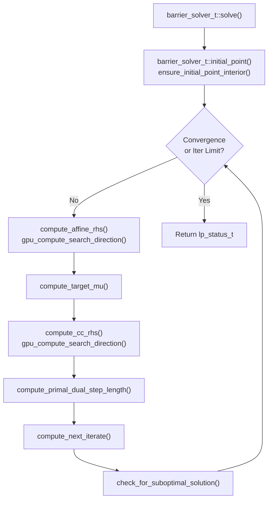
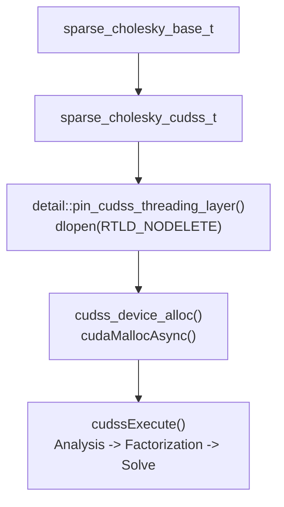
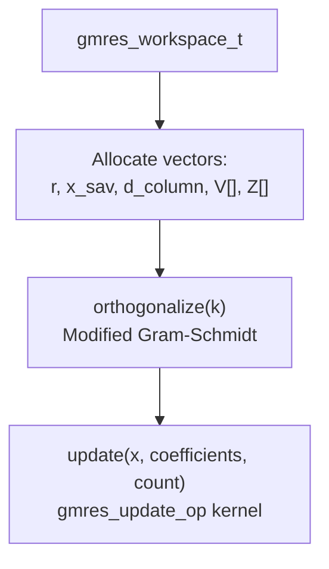
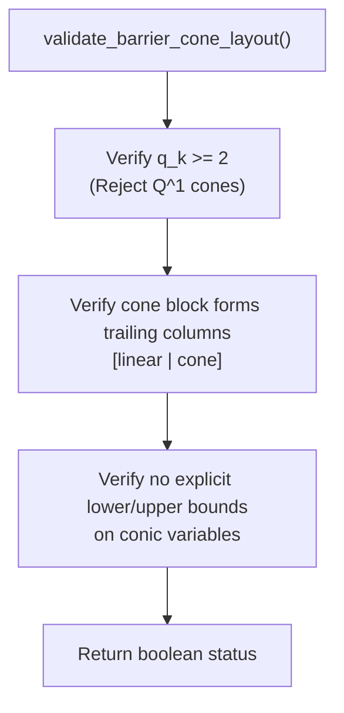
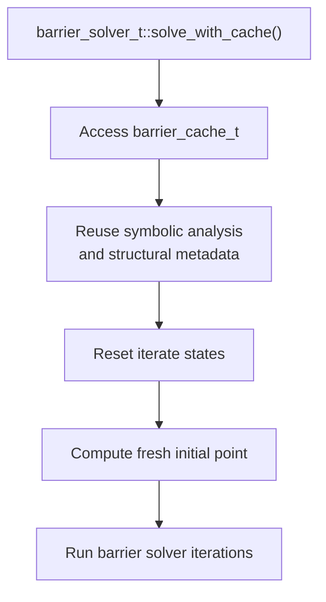

<!-- source: DeepWiki mcp.deepwiki.com · repo NVIDIA/cuopt · extra page Barrier Method and Conic Solving · fetched 2026-10-26 -->

# Barrier Method and Conic Solving

Relevant source files

The following files were used as context for generating this wiki page:

- [benchmarks/linear_programming/cuopt/run_cpufj.cu](benchmarks/linear_programming/cuopt/run_cpufj.cu)
- [cpp/src/barrier/augmented_matvec.cuh](cpp/src/barrier/augmented_matvec.cuh)
- [cpp/src/barrier/barrier.cu](cpp/src/barrier/barrier.cu)
- [cpp/src/barrier/barrier.hpp](cpp/src/barrier/barrier.hpp)
- [cpp/src/barrier/cusparse_view.cu](cpp/src/barrier/cusparse_view.cu)
- [cpp/src/barrier/cusparse_view.hpp](cpp/src/barrier/cusparse_view.hpp)
- [cpp/src/barrier/device_sparse_matrix.cuh](cpp/src/barrier/device_sparse_matrix.cuh)
- [cpp/src/barrier/iterative_refinement.hpp](cpp/src/barrier/iterative_refinement.hpp)
- [cpp/src/barrier/scaling_gpu.cu](cpp/src/barrier/scaling_gpu.cu)
- [cpp/src/barrier/second_order_cone_kernels.cuh](cpp/src/barrier/second_order_cone_kernels.cuh)
- [cpp/src/barrier/sparse_cholesky.cuh](cpp/src/barrier/sparse_cholesky.cuh)
- [cpp/src/barrier/sparse_matrix_kernels.cuh](cpp/src/barrier/sparse_matrix_kernels.cuh)
- [cpp/src/linear_algebra/vector_math.cuh](cpp/src/linear_algebra/vector_math.cuh)
- [cpp/src/mip_heuristics/presolve/trivial_presolve.cuh](cpp/src/mip_heuristics/presolve/trivial_presolve.cuh)
- [cpp/src/mip_heuristics/presolve/trivial_presolve_helpers.cuh](cpp/src/mip_heuristics/presolve/trivial_presolve_helpers.cuh)
- [cpp/src/mip_heuristics/problem/presolve_data.cu](cpp/src/mip_heuristics/problem/presolve_data.cu)
- [cpp/src/mip_heuristics/problem/presolve_data.cuh](cpp/src/mip_heuristics/problem/presolve_data.cuh)
- [cpp/tests/socp/barrier_kernels_test.cu](cpp/tests/socp/barrier_kernels_test.cu)
- [cpp/tests/socp/solve_barrier_socp.cu](cpp/tests/socp/solve_barrier_socp.cu)
- [docs/cuopt/source/convex-settings.rst](docs/cuopt/source/convex-settings.rst)
- [docs/cuopt/source/cuopt-c/convex/convex-c-api.rst](docs/cuopt/source/cuopt-c/convex/convex-c-api.rst)

## Purpose and Scope

This page provides full technical documentation for NVIDIA cuOpt’s interior-point barrier method, covering linear programming (LP), quadratic programming (QP), and second-order cone programming (SOCP) solving. It details the primal-dual path-following algorithm implementation, GPU-accelerated sparse Cholesky and LDLT factorizations via cuDSS, iterative refinement and GMRES preconditioning, conic layout constraints, barrier caching for warm-started sequence solves, and crossover routines.

---

## Overview of the Interior-Point Barrier Method

The barrier method solves convex optimization problems—including linear programs, convex quadratic programs, and second-order cone programs—by transforming inequality constraints into logarithmic barrier terms in the objective function. It tracks a primal-dual central path parameterized by barrier parameter $\mu$, maintaining strict interior feasibility with respect to non-negative orthants and cone bounds.

The primary controller for this execution path is the `barrier_solver_t` class [cpp/src/barrier/barrier.hpp:62-80](), which coordinates iteration steps, linear system matrix assemblies, and convergence checks.

Sources: [cpp/src/barrier/barrier.cu:89-195](), [cpp/src/barrier/barrier.hpp:62-80]()

---

## GPU Sparse Cholesky and LDLT via cuDSS

At each barrier iteration, the system solves a linear KKT system whose coefficient matrix changes due to diagonal scaling variables derived from primal-dual slacks. cuOpt leverages NVIDIA's cuDSS (CUDA Direct Sparse Solver) for GPU-accelerated sparse Cholesky and LDLT factorizations.

The factorization interface is anchored by the `sparse_cholesky_base_t` abstract class [cpp/src/sparse_cholesky.cuh:52-63]() and implemented for cuDSS. To prevent teardown race conditions with OpenMP threads during library unloading, cuOpt pins the threading layer using `detail::pin_cudss_threading_layer()` [cpp/src/sparse_cholesky.cuh:36-48]().

### Key Lifecycle Operations in `sparse_cholesky_cudss_t`
1. **Memory Management**: Uses `cudaMallocAsync` via `cudss_device_alloc()` to mitigate RMM pool fragmentation during large workspace allocations [cpp/src/sparse_cholesky.cuh:115-132]().
2. **Symbolic Analysis**: Computes fill-reducing orderings and sparsity patterns once or upon structural changes.
3. **Numerical Factorization**: Updates matrix coefficients dynamically as barrier weights evolve.

Sources: [cpp/src/sparse_cholesky.cuh:28-63](), [cpp/src/sparse_cholesky.cuh:115-132]()

---

## Iterative Refinement and GMRES Workspace

To maintain numerical stability when solving ill-conditioned KKT systems, cuOpt combines direct sparse solves with iterative refinement and preconditioned GMRES.

The `gmres_workspace_t` struct allocates and reuses device memory across affine/corrector solves and GMRES restarts [cpp/src/iterative_refinement.hpp:57-74]():

Simple iterative refinement is implemented in `iterative_refinement_simple()`, which computes residual vectors $r = b - Ax$ on the device and applies correction steps until convergence or the iteration ceiling ($\le 30$) is reached [cpp/src/iterative_refinement.hpp:157-199]().

Sources: [cpp/src/iterative_refinement.hpp:57-131](), [cpp/src/iterative_refinement.hpp:157-199]()

---

## Second-Order Cone (SOCP) and Quadratic Programming (QP) Support

cuOpt's barrier engine natively supports convex quadratic programs and Second-Order Cone Programs (SOCP).

### Conic Layout Validation
Before executing barrier presolve or solves on problems with second-order cones, cuOpt validates that conic variables reside in a contiguous trailing block (`[linear | cone]`) and lack explicit individual bounds that violate cone definitions. This is checked by `validate_barrier_cone_layout()` [cpp/src/barrier/barrier.cu:83-116]().

### Initial Point Interior Guarantee
To ensure the starting point lies strictly within the interior of the nonnegative orthant and second-order cones, `ensure_initial_point_interior()` adjusts variable vectors using cone norms [cpp/src/barrier/barrier.cu:119-144]():
- Linear variables are shifted by $\epsilon$ adjustment [cpp/src/barrier/barrier.cu:129]().
- Conic variables $Q^k$ are checked against tail norms: if $x_0 \le \sqrt{\sum_{j=1}^{k-1} x_j^2} + \epsilon$, $x_0$ is adjusted accordingly [cpp/src/barrier/barrier.cu:133-143]().

Sources: [cpp/src/barrier/barrier.cu:83-144](), [cpp/tests/socp/solve_barrier_socp.cu:49-87]()

---

## Barrier Cache and Warm Starting

When solving sequences of related problems (such as in branch-and-bound nodes or parametric optimization), cuOpt leverages `barrier_cache_t` to reuse factorization structures, scaling data, and iterate states.

The `solve_with_cache()` method resets iterate states, computes a new initial point using cached factorizations where applicable, and executes the barrier solve without repeating expensive symbolic analyses [cpp/src/barrier/barrier.hpp:73-80]().

Sources: [cpp/src/barrier/barrier.hpp:70-80](), [cpp/src/barrier/barrier.cu:34]()

---

## Crossover and Solution Recovery

Interior-point methods converge to interior points that may not lie on the vertices of the polytope. When an exact basic solution is requested (or required for MIP integration), cuOpt invokes a **crossover** procedure.

- **Phase**: Transition from the interior solution to a basic feasible solution.
- **Mechanism**: Identifies active constraints based on primal-dual tolerances and hands off the reduced basis to the dual simplex engine ([2.1.2]()).

Sources: [docs/cuopt/source/convex-settings.rst:78-88](), [cpp/src/barrier/barrier.hpp:62-80]()

---

## Code Entity Reference

### Key Classes and Functions

| Entity Name | File Path | Role and Description |
|-------------|-----------|----------------------|
| `barrier_solver_t` | `[cpp/src/barrier/barrier.hpp:62-80]()` | Main barrier solver controller managing iterations, steps, and status. |
| `validate_barrier_cone_layout` | `[cpp/src/barrier/barrier.cu:83-116]()` | Validates second-order cone structures and trailing layout. |
| `ensure_initial_point_interior` | `[cpp/src/barrier/barrier.cu:119-144]()` | Shifts initial points into the strict interior of cones and orthants. |
| `sparse_cholesky_base_t` | `[cpp/src/sparse_cholesky.cuh:52-63]()` | Abstract interface for GPU sparse Cholesky/LDLT solvers. |
| `gmres_workspace_t` | `[cpp/src/iterative_refinement.hpp:57-74]()` | Workspace manager for GMRES iterations and orthogonalization. |
| `iterative_refinement_simple` | `[cpp/src/iterative_refinement.hpp:157-162]()` | Performs device-side iterative refinement on linear solves. |

Sources: [cpp/src/barrier/barrier.hpp:62-80](), [cpp/src/barrier/barrier.cu:83-144](), [cpp/src/sparse_cholesky.cuh:52-63](), [cpp/src/iterative_refinement.hpp:57-162]()

---

