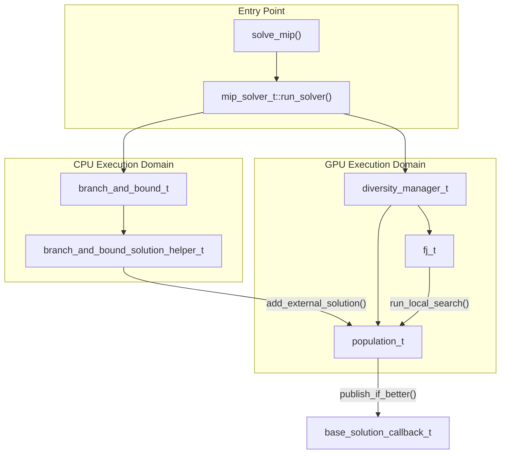
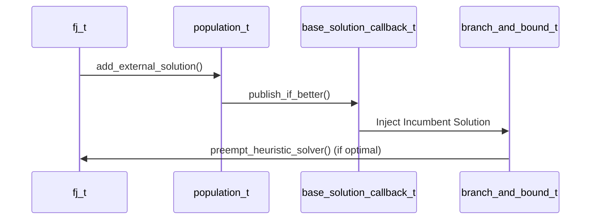

<!-- source: DeepWiki mcp.deepwiki.com · repo NVIDIA/cuopt · extra page GPU Primal Heuristics · fetched 2026-10-26 -->

# GPU Primal Heuristics

Relevant source files

The following files were used as context for generating this wiki page:

- [cpp/src/mip_heuristics/diversity/diversity_manager.cu](cpp/src/mip_heuristics/diversity/diversity_manager.cu)
- [cpp/src/mip_heuristics/diversity/population.cu](cpp/src/mip_heuristics/diversity/population.cu)
- [cpp/src/mip_heuristics/diversity/population.cuh](cpp/src/mip_heuristics/diversity/population.cuh)
- [cpp/src/mip_heuristics/feasibility_jump/feasibility_jump.cu](cpp/src/mip_heuristics/feasibility_jump/feasibility_jump.cu)
- [cpp/src/mip_heuristics/feasibility_jump/feasibility_jump.cuh](cpp/src/mip_heuristics/feasibility_jump/feasibility_jump.cuh)
- [cpp/src/mip_heuristics/feasibility_jump/feasibility_jump_kernels.cu](cpp/src/mip_heuristics/feasibility_jump/feasibility_jump_kernels.cu)
- [cpp/src/mip_heuristics/local_search/local_search.cu](cpp/src/mip_heuristics/local_search/local_search.cu)
- [cpp/src/mip_heuristics/presolve/probing_cache.cu](cpp/src/mip_heuristics/presolve/probing_cache.cu)
- [cpp/src/mip_heuristics/presolve/third_party_presolve.cpp](cpp/src/mip_heuristics/presolve/third_party_presolve.cpp)
- [cpp/src/mip_heuristics/presolve/third_party_presolve.hpp](cpp/src/mip_heuristics/presolve/third_party_presolve.hpp)
- [cpp/src/mip_heuristics/solve.cu](cpp/src/mip_heuristics/solve.cu)
- [cpp/src/mip_heuristics/solver.cu](cpp/src/mip_heuristics/solver.cu)
- [cpp/src/mip_heuristics/utils.cuh](cpp/src/mip_heuristics/utils.cuh)
- [cpp/src/routing/util_kernels/runtime_checks.cu](cpp/src/routing/util_kernels/runtime_checks.cu)
- [cpp/src/utilities/macros.cuh](cpp/src/utilities/macros.cuh)
- [cpp/tests/internal/CMakeLists.txt](cpp/tests/internal/CMakeLists.txt)
- [cpp/tests/linear_programming/unit_tests/presolve_test.cu](cpp/tests/linear_programming/unit_tests/presolve_test.cu)
- [cpp/tests/mip/incumbent_callback_test.cu](cpp/tests/mip/incumbent_callback_test.cu)
- [cpp/tests/mip/population_test.cu](cpp/tests/mip/population_test.cu)

## Purpose and Scope

This page details the GPU-accelerated primal heuristics subsystem within NVIDIA cuOpt's Mixed Integer Programming (MIP) solver engine. These heuristics operate concurrently with the CPU-based branch-and-bound tree search (`branch_and_bound_t`), focusing on discovering high-quality feasible integer solutions rapidly to tighten the global primal bound (upper bound in minimization problems). 

For overarching MIP architecture context, see [2.2](). For the CPU branch-and-bound implementation details, see [2.2.1](). For local search repair and rounding techniques, see [2.2.3]().

Sources: [cpp/src/mip_heuristics/solver.cu:42-125](), [cpp/src/mip_heuristics/diversity/diversity_manager.cuh:35-107]()

## Concurrency with Branch-and-Bound

The MIP solver utilizes a hybrid CPU/GPU architecture managed by `mip_solver_t`. While the CPU executes tree exploration via `branch_and_bound_t`, the GPU runs asynchronous primal heuristics through `diversity_manager_t`. Bidirectional communication is established using `branch_and_bound_solution_helper_t`, which bridges incumbent solutions and LP relaxation outcomes between the CPU and GPU.

### Concurrency and Solution Flow Architecture
Title: "mip_solver_t Concurrent Execution and Solution Flow"

Sources: [cpp/src/mip_heuristics/solver.cu:53-125](), [cpp/src/mip_heuristics/solver.cu:200-300]()

## Diversity Manager and Population Management

The `diversity_manager_t` acts as the orchestrator for all GPU-based heuristic strategies, maintaining a diverse pool of integer solutions (`population_t`). 

### Population Structure and Invariants

The `population_t` class stores candidate solutions, maintaining a strict distinction between objective quality and solution distance (diversity) across integer variable assignments.

| Class / Component | Role / Responsibility |
|-------------------|----------------------|
| `diversity_manager_t` | Coordinates heuristic execution, MAB (Multi-Armed Bandit) weight tuning, and local search routines [cpp/src/mip_heuristics/diversity/diversity_manager.cuh:35-107](). |
| `population_t` | Manages the solution archive, filtering duplicate points via hashing (`population_hash_map`) and evaluating distance thresholds [cpp/src/mip_heuristics/diversity/population.cuh:33-53](). |
| `branch_and_bound_solution_helper_t` | Injects external incumbent solutions discovered during tree search into `population_t` [cpp/src/mip_heuristics/solver.cu:66-74](). |

Sources: [cpp/src/mip_heuristics/diversity/diversity_manager.cuh:35-107](), [cpp/src/mip_heuristics/diversity/population.cuh:33-53]()

## GPU Primal Heuristic Algorithms

### Feasibility Jump (`fj_t`)

`fj_t` is a GPU-accelerated local search metaheuristic designed to eliminate constraint violations by performing variable flip and move operations.
- **Implementation**: Implemented across `fj_t` in `feasibility_jump.cuh` and `feasibility_jump.cu`, utilizing parallel GPU kernels to evaluate move scores across binary and non-binary variables [cpp/src/mip_heuristics/feasibility_jump/feasibility_jump.cuh:98-140]().
- **Weight Adaptation**: Dynamically adjusts constraint weights (`cstr_weights`) when local minima are reached, escaping plateau regions and constraint violation stalls [cpp/src/mip_heuristics/feasibility_jump/feasibility_jump.cu:129-140]().

Sources: [cpp/src/mip_heuristics/feasibility_jump/feasibility_jump.cuh:98-140](), [cpp/src/mip_heuristics/feasibility_jump/feasibility_jump.cu:129-140]()

### Feasibility Pump and Recombiners

Feasibility pump (`fp_recombiner`) bridges continuous LP relaxations and discrete integer space.
- **Mechanism**: Iteratively alternates between rounding fractional solutions to nearest integers and solving a distance-minimization LP model.
- **Recombination**: Combines parent solutions from `population_t` by inheriting variable assignments from one parent while driving feasibility via local search or sub-MIP solves (`sub_mip_recombiner`) [cpp/src/mip_heuristics/diversity/diversity_manager.cuh:70-87]().

Sources: [cpp/src/mip_heuristics/diversity/diversity_manager.cuh:70-87]()

### Relaxation Induced Neighborhood Search (RINS) and Sub-MIPs

RINS exploits agreement between the current incumbent solution and LP relaxation solutions.
- **Sub-MIP Construction**: Variables taking identical values in both the LP relaxation and the incumbent are fixed, creating a smaller restricted sub-MIP.
- **Triggering**: Invoked asynchronously via solution callbacks (`solution_callback()`) and node processing notifications from branch-and-bound [cpp/src/mip_heuristics/solver.cu:66-79]().

Sources: [cpp/src/mip_heuristics/solver.cu:58-84](), [cpp/src/mip_heuristics/diversity/diversity_manager.cuh:101]()

### Simple Rounding

Simple rounding (`simple_rounding.cuh`) provides lightweight, deterministic variable rounding.
- **Execution**: Evaluates objective coefficients and bound structures to quickly snap fractional assignments to valid integer bounds without invoking heavier local search loops [cpp/src/mip_heuristics/solver.cu:11]().

Sources: [cpp/src/mip_heuristics/solver.cu:11](), [cpp/src/mip_heuristics/local_search/rounding/simple_rounding.cuh:1-20]()

## Solution Exchange and Callbacks

Solutions discovered by GPU heuristics are validated against constraint tolerances and published back to the solver context.

### Solution Exchange Sequence
Title: "Solution Exchange and Callback Pipeline"
Source Code Space to Natural Language Space

Sources: [cpp/src/mip_heuristics/diversity/population.cu:147-171](), [cpp/src/mip_heuristics/solver.cu:65-84]()

---

