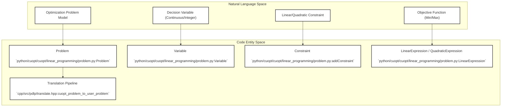
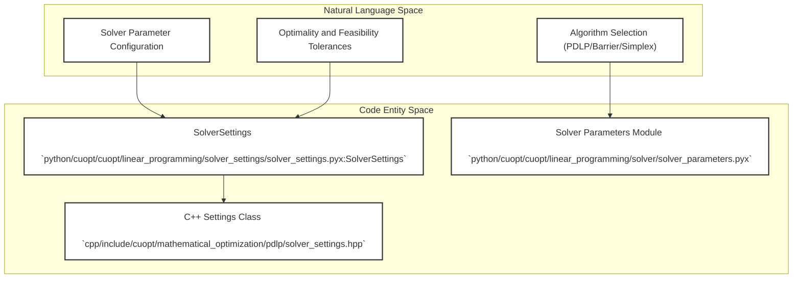

<!-- source: DeepWiki mcp.deepwiki.com · repo NVIDIA/cuopt · extra page Linear Programming Python API · fetched 2026-10-26 -->

# Linear Programming Python API

Relevant source files

The following files were used as context for generating this wiki page:

- [cpp/include/cuopt/grpc/grpc_client_env.hpp](cpp/include/cuopt/grpc/grpc_client_env.hpp)
- [cpp/src/grpc/client/grpc_client_env.cpp](cpp/src/grpc/client/grpc_client_env.cpp)
- [cpp/src/io/mps_writer.cpp](cpp/src/io/mps_writer.cpp)
- [cpp/src/pdlp/translate.hpp](cpp/src/pdlp/translate.hpp)
- [cpp/tests/linear_programming/parser_test.cpp](cpp/tests/linear_programming/parser_test.cpp)
- [cpp/tests/qp/unit_tests/lp_parser_solve_test.cu](cpp/tests/qp/unit_tests/lp_parser_solve_test.cu)
- [cpp/tests/qp/unit_tests/mps_ranged_rows_test.cu](cpp/tests/qp/unit_tests/mps_ranged_rows_test.cu)
- [cpp/tests/qp/unit_tests/mps_writer_test.cpp](cpp/tests/qp/unit_tests/mps_writer_test.cpp)
- [python/cuopt/cuopt/grpc/linear_programming/__init__.py](python/cuopt/cuopt/grpc/linear_programming/__init__.py)
- [python/cuopt/cuopt/linear_programming/problem.py](python/cuopt/cuopt/linear_programming/problem.py)
- [python/cuopt/cuopt/linear_programming/solver/solver.py](python/cuopt/cuopt/linear_programming/solver/solver.py)
- [python/cuopt/cuopt/linear_programming/solver_settings/solver_settings.pxd](python/cuopt/cuopt/linear_programming/solver_settings/solver_settings.pxd)
- [python/cuopt/cuopt/linear_programming/solver_settings/solver_settings.pyx](python/cuopt/cuopt/linear_programming/solver_settings/solver_settings.pyx)
- [python/cuopt/cuopt/tests/fixtures/grpc_server_fixtures.py](python/cuopt/cuopt/tests/fixtures/grpc_server_fixtures.py)
- [python/cuopt/cuopt/tests/linear_programming/test_cpu_only_execution.py](python/cuopt/cuopt/tests/linear_programming/test_cpu_only_execution.py)
- [python/cuopt/cuopt/tests/linear_programming/test_grpc_client.py](python/cuopt/cuopt/tests/linear_programming/test_grpc_client.py)
- [python/cuopt/cuopt/tests/linear_programming/test_incumbent_callbacks.py](python/cuopt/cuopt/tests/linear_programming/test_incumbent_callbacks.py)
- [python/cuopt/cuopt/tests/linear_programming/test_lp_solver.py](python/cuopt/cuopt/tests/linear_programming/test_lp_solver.py)
- [python/cuopt/cuopt/tests/linear_programming/test_python_API.py](python/cuopt/cuopt/tests/linear_programming/test_python_API.py)

## Purpose and Scope

This document details the Python API for Linear Programming (LP), Quadratic Programming (QP), and Mixed Integer Linear Programming (MILP) in NVIDIA cuOpt (`cuopt.linear_programming`). The interface provides high-level mathematical modeling abstractions, solver settings management, callback integration, warm starting, batch solving, and CPU-only remote execution via gRPC. 

Sources: `[python/cuopt/cuopt/linear_programming/problem.py:1-26]`, `[python/cuopt/cuopt/linear_programming/solver/solver.py:1-30]`, `[python/cuopt/cuopt/tests/linear_programming/test_python_API.py:9-37]()`

---

## Modeling API: Problem, Variable, and Expressions

The modeling subsystem allows users to build mathematical optimization models programmatically using classes such as `Problem`, `Variable`, `LinearExpression`, and `QuadraticExpression`. 

### Natural-to-Code Architecture: Problem Modeling Entity Mapping

The following diagram bridges natural language concepts of mathematical optimization to the concrete Python and C++ code entities implemented in the codebase.

Sources: `[python/cuopt/cuopt/linear_programming/problem.py:93-163]`, `[cpp/src/pdlp/translate.hpp:30-111]()`

### Variable Types and Normalization

Variables are instantiated via `Problem.addVariable()` with lower bounds (`lb`), upper bounds (`ub`), objective coefficients (`obj`), types (`vtype`), and names (`name`) [python/cuopt/cuopt/linear_programming/problem.py:93-163](). Variable types are normalized to the `VType` enum (`CONTINUOUS = "C"`, `INTEGER = "I"`, `SEMI_CONTINUOUS = "S")` [python/cuopt/cuopt/linear_programming/problem.py:20-56]().

Sources: `[python/cuopt/cuopt/linear_programming/problem.py:20-56]`, `[python/cuopt/cuopt/tests/linear_programming/test_python_API.py:44-59]()`

---

## Solver Configuration (`SolverSettings`)

The `SolverSettings` class configures algorithm selection, tolerances, time limits, presolve levels, and algorithmic modes.

### Natural-to-Code Architecture: Solver Configuration Mapping

Sources: `[python/cuopt/cuopt/linear_programming/solver_settings/solver_settings.pyx:115-212]`, `[cpp/tests/qp/unit_tests/lp_parser_solve_test.cu:40-44]()`

Parameters are set via `SolverSettings.set_parameter(name, value)` or helper methods like `set_optimality_tolerance(eps_optimal)` [python/cuopt/cuopt/linear_programming/solver_settings/solver_settings.pyx:179-212](). Valid parameter names are dynamically registered from the C++ layer into `solver_params` [python/cuopt/cuopt/linear_programming/solver_settings/solver_settings.pyx:35-54]().

Sources: `[python/cuopt/cuopt/linear_programming/solver_settings/solver_settings.pyx:35-212]()`

---

## Execution APIs: `Solve()`, `BatchSolve()`, and CPU-Only Solving

### Single and Batch Execution

The main entry point for solving optimization problems is `cuopt.linear_programming.solver.Solve()`, which accepts a `DataModel` or `Problem` object alongside optional `SolverSettings` [python/cuopt/cuopt/linear_programming/solver/solver.py:13-110](). 

`BatchSolve()` executes multiple models in parallel across underlying C++ execution threads [python/cuopt/cuopt/linear_programming/solver/solver.py:112-185](). 

Sources: `[python/cuopt/cuopt/linear_programming/solver/solver.py:13-185]()`

### CPU-Only and Remote gRPC Execution

When running on host systems without GPU hardware or CUDA drivers (`CUDA_VISIBLE_DEVICES=""`), cuOpt automatically routes problem evaluation and solving to a remote `cuopt_grpc_server` or local subprocess fallback [python/cuopt/cuopt/tests/linear_programming/test_cpu_only_execution.py:108-142](). Solution polymorphism ensures that primal/dual solution vectors and status structures match in-process GPU execution.

Sources: `[python/cuopt/cuopt/tests/linear_programming/test_cpu_only_execution.py:1-142]`, `[python/cuopt/cuopt/tests/linear_programming/test_grpc_client.py:77-86]()`

---

## Callbacks and Warm Starting

### Callback Integration

For Mixed Integer Programming (MIP), the Python API supports callback hooks registered via `SolverSettings.set_mip_callback()` [python/cuopt/cuopt/tests/linear_programming/test_incumbent_callbacks.py:82-86]().
- `GetSolutionCallback`: Triggered upon discovering new incumbent solutions during branch-and-bound search, providing access to solution vectors, objective costs, and bounds [python/cuopt/cuopt/tests/linear_programming/test_incumbent_callbacks.py:28-50]().
- `SetSolutionCallback`: Allows injection of custom heuristic or warm-start solutions back into the solver engine [python/cuopt/cuopt/tests/linear_programming/test_incumbent_callbacks.py:52-70]().

Sources: `[python/cuopt/cuopt/tests/linear_programming/test_incumbent_callbacks.py:28-86]()`

### Warm Starting

PDLP and iterative solvers support warm-starting via stored solution states (`pdlp_warm_start_data`), enabling faster convergence when resolving closely related model instances [python/cuopt/cuopt/linear_programming/solver_settings/solver_settings.pyx:115-119]().

Sources: `[python/cuopt/cuopt/linear_programming/solver_settings/solver_settings.pyx:115-119]()`

---

