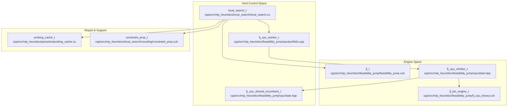
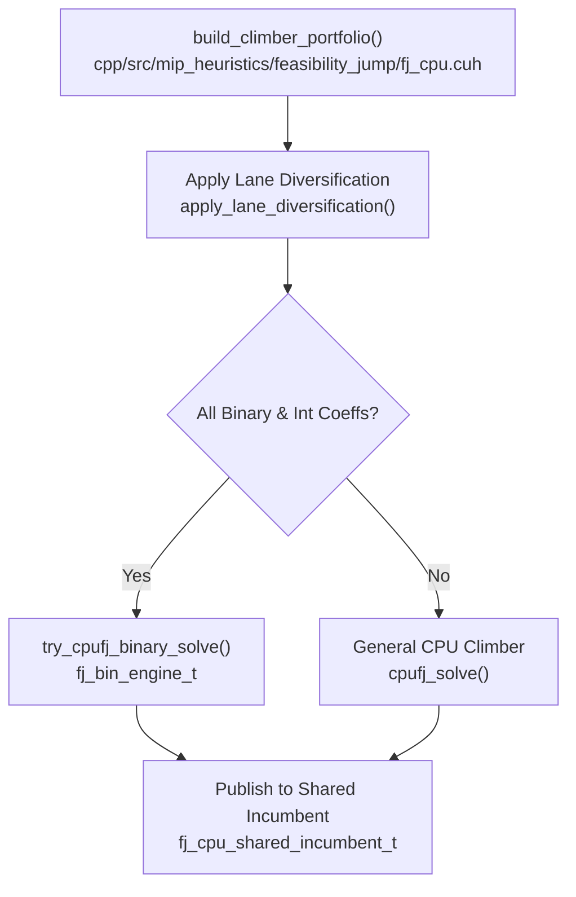

<!-- source: DeepWiki mcp.deepwiki.com · repo NVIDIA/cuopt · extra page Local Search Methods · fetched 2026-10-26 -->

# Local Search Methods

Relevant source files

The following files were used as context for generating this wiki page:

- [cpp/src/mip_heuristics/CMakeLists.txt](cpp/src/mip_heuristics/CMakeLists.txt)
- [cpp/src/mip_heuristics/feasibility_jump/cpu/portfolio.cpp](cpp/src/mip_heuristics/feasibility_jump/cpu/portfolio.cpp)
- [cpp/src/mip_heuristics/feasibility_jump/cpu/state.hpp](cpp/src/mip_heuristics/feasibility_jump/cpu/state.hpp)
- [cpp/src/mip_heuristics/feasibility_jump/feasibility_jump.cu](cpp/src/mip_heuristics/feasibility_jump/feasibility_jump.cu)
- [cpp/src/mip_heuristics/feasibility_jump/feasibility_jump.cuh](cpp/src/mip_heuristics/feasibility_jump/feasibility_jump.cuh)
- [cpp/src/mip_heuristics/feasibility_jump/feasibility_jump_kernels.cu](cpp/src/mip_heuristics/feasibility_jump/feasibility_jump_kernels.cu)
- [cpp/src/mip_heuristics/feasibility_jump/fj_cpu.cuh](cpp/src/mip_heuristics/feasibility_jump/fj_cpu.cuh)
- [cpp/src/mip_heuristics/feasibility_jump/fj_cpu_binary.cu](cpp/src/mip_heuristics/feasibility_jump/fj_cpu_binary.cu)
- [cpp/src/mip_heuristics/feasibility_jump/fj_cpu_binary.cuh](cpp/src/mip_heuristics/feasibility_jump/fj_cpu_binary.cuh)
- [cpp/src/mip_heuristics/feasibility_jump/fj_cpu_binary_kernels.cpp](cpp/src/mip_heuristics/feasibility_jump/fj_cpu_binary_kernels.cpp)
- [cpp/src/mip_heuristics/feasibility_jump/fj_cpu_binary_preprocess.cu](cpp/src/mip_heuristics/feasibility_jump/fj_cpu_binary_preprocess.cu)
- [cpp/src/mip_heuristics/feasibility_jump/fj_cpu_binary_utils.hpp](cpp/src/mip_heuristics/feasibility_jump/fj_cpu_binary_utils.hpp)
- [cpp/src/mip_heuristics/feasibility_jump/sat/cdcl_sat.cpp](cpp/src/mip_heuristics/feasibility_jump/sat/cdcl_sat.cpp)
- [cpp/src/mip_heuristics/feasibility_jump/sat/cdcl_sat_utils.hpp](cpp/src/mip_heuristics/feasibility_jump/sat/cdcl_sat_utils.hpp)
- [cpp/src/mip_heuristics/local_search/local_search.cu](cpp/src/mip_heuristics/local_search/local_search.cu)
- [cpp/src/mip_heuristics/presolve/probing_cache.cu](cpp/src/mip_heuristics/presolve/probing_cache.cu)
- [cpp/src/mip_heuristics/utils.cuh](cpp/src/mip_heuristics/utils.cuh)
- [cpp/src/routing/util_kernels/runtime_checks.cu](cpp/src/routing/util_kernels/runtime_checks.cu)
- [cpp/src/utilities/macros.cuh](cpp/src/utilities/macros.cuh)

## Purpose and Scope

This document describes local search techniques used within cuOpt's Mixed Integer Programming (MIP) solver to improve primal bounds and find feasible solutions. Local search methods explore neighborhoods of candidate solutions by making small modifications to variable assignments, guided by constraint violations and objective improvements. These techniques complement the [Branch and Bound](2.2.1) algorithm's dual bound improvement and work alongside [GPU Primal Heuristics](2.2.2) to rapidly find high-quality feasible solutions.

The primary local search engines in cuOpt include both GPU-accelerated Feasibility Jump (`fj_t`) and CPU-based Feasibility Jump portfolios (`fj_cpu_climber_t`), orchestrating asynchronous workers, weight adaptation, and probing-based repair mechanisms.

Sources: [cpp/src/mip_heuristics/local_search/local_search.cu:30-66](), [cpp/src/mip_heuristics/feasibility_jump/feasibility_jump.cuh:98-120]()

---

## Local Search Architecture and System Integration

Local search in cuOpt operates as part of a hybrid CPU/GPU optimization strategy. The `local_search_t` class manages multiple concurrent search threads, including scratch threads starting from random points and LNS improvement threads [cpp/src/mip_heuristics/local_search/local_search.cu:30-66]().

### System Components and Code Mapping

The local search subsystem bridges natural language search concepts directly to concrete classes and routines:

Diagram Title: Local Search Pipeline and Code Entities

Sources: [cpp/src/mip_heuristics/local_search/local_search.cu:30-160](), [cpp/src/mip_heuristics/feasibility_jump/feasibility_jump.cuh:98-120](), [cpp/src/mip_heuristics/feasibility_jump/cpu/state.hpp:56-87]()

---

## Move Types and Neighborhood Structures

Local search explores neighborhoods by modifying variable values. cuOpt implements specialized move types and data structures across both GPU and CPU execution paths:

| Move Type | Purpose | Constraint Selection | Objective Impact | Implementation Source |
|-----------|---------|---------------------|------------------|----------------------|
| **Lift Move** | Objective improvement | Satisfied constraints only | Direct minimization | `find_lift_move()` [cpp/src/mip_heuristics/feasibility_jump/feasibility_jump_kernels.cu:34-56]() |
| **MTM Violated** | Feasibility restoration | Violated constraints only | Weighted penalty reduction | `find_mtm_move_viol()` [cpp/src/mip_heuristics/feasibility_jump/feasibility_jump.cuh:51-56]() |
| **MTM Satisfied** | Diversification | Satisfied constraints only | Exploration vs exploitation | `find_mtm_move_sat()` [cpp/src/mip_heuristics/feasibility_jump/feasibility_jump.cuh:51-56]() |

### Move-To-Minimum (MTM) Strategy and Scoring

The MTM strategy computes optimal deltas along constraint gradients. For constraints with bounds, moves are scored using a staged scoring function combining a base feasibility metric and a breakthrough bonus [cpp/src/mip_heuristics/feasibility_jump/fj_cpu_binary.cuh:185-191](). Weight adaptation (`update_weights`) increases penalties on persistently violated constraints to escape local minima [cpp/src/mip_heuristics/feasibility_jump/feasibility_jump_kernels.cu:83-144]().

Sources: [cpp/src/mip_heuristics/feasibility_jump/feasibility_jump_kernels.cu:34-144](), [cpp/src/mip_heuristics/feasibility_jump/fj_cpu_binary.cuh:167-191]()

---

## GPU vs CPU Feasibility Jump Engines

cuOpt implements Feasibility Jump in two distinct execution environments: GPU-accelerated kernel loops (`fj_t`) and a high-performance CPU portfolio (`fj_cpu_climber_t`).

### CPU Portfolio and Lane Diversification

The CPU portfolio instantiates multiple workers via `fj_cpu_worker_t::create_worker()` [cpp/src/mip_heuristics/feasibility_jump/cpu/portfolio.cpp:30-50](). Each worker lane is assigned specific structural personas and heuristics using `apply_lane_diversification()` [cpp/src/mip_heuristics/feasibility_jump/cpu/portfolio.cpp:94-137]().

Diagram Title: Portfolio Lane Dispatch and Binary Engine Flow

Sources: [cpp/src/mip_heuristics/feasibility_jump/fj_cpu.cuh:38-42](), [cpp/src/mip_heuristics/feasibility_jump/cpu/portfolio.cpp:94-137](), [cpp/src/mip_heuristics/feasibility_jump/fj_cpu_binary.cuh:159-161]()

### Fast Binary SIMD Engine

When instances consist entirely of binary variables with integer coefficients within `int16` range, cuOpt dispatches to a specialized SIMD engine (`fj_bin_engine_t`) inside `try_cpufj_binary_solve()` [cpp/src/mip_heuristics/feasibility_jump/fj_cpu_binary.cuh:16-19, 153-161](). This engine maintains exact integer row slacks and live per-variable scores without floating-point overhead.

Sources: [cpp/src/mip_heuristics/feasibility_jump/fj_cpu_binary.cuh:16-21, 153-161]()

---

## Probing Cache and Constraint Violation Repair

When local search or rounding produces constraint violations, repair routines leverage implied bounds stored in the `probing_cache_t` [cpp/src/mip_heuristics/presolve/probing_cache.cuh:8-12]() to restore feasibility with minimal conflicts.

### Probing Cache Workflow

The probing cache evaluates alternative roundings by inspecting cached implications:
1.  **Cache Lookup**: `probing_cache_t::contains()` checks if implied bounds exist for variable `var_id` [cpp/src/mip_heuristics/presolve/probing_cache.cu:154-157]().
2.  **Conflict Counting**: `check_number_of_conflicting_vars()` evaluates how many variable bounds would be violated if a specific probe value were applied [cpp/src/mip_heuristics/presolve/probing_cache.cu:33-51]().
3.  **Least-Conflicting Selection**: `get_least_conflicting_rounding()` selects the probe value resulting in the fewest conflicts and updates global bounds [cpp/src/mip_heuristics/presolve/probing_cache.cu:77-151]().

Sources: [cpp/src/mip_heuristics/presolve/probing_cache.cu:33-151](), [cpp/src/mip_heuristics/presolve/probing_cache.cuh:64]()

---

## Performance Optimization and Locality

Local search performance relies heavily on memory locality and incremental updates:
*   **Incremental LHS Maintenance**: On both GPU and CPU climbers, constraint left-hand sides are updated incrementally when a variable changes by $\Delta_j$, avoiding full $O(\text{NNZ})$ recomputations [cpp/src/mip_heuristics/feasibility_jump/feasibility_jump_kernels.cu:147-166]().
*   **Argmax Tile Optimization**: The binary engine utilizes L1 cache-aware tiling (`fj_bin_argmax_tile()`) to accelerate global argmax move selection across large variable neighborhoods [cpp/src/mip_heuristics/feasibility_jump/fj_cpu_binary.cu:134-147]().

Sources: [cpp/src/mip_heuristics/feasibility_jump/feasibility_jump_kernels.cu:147-166](), [cpp/src/mip_heuristics/feasibility_jump/fj_cpu_binary.cu:134-147]()

---

