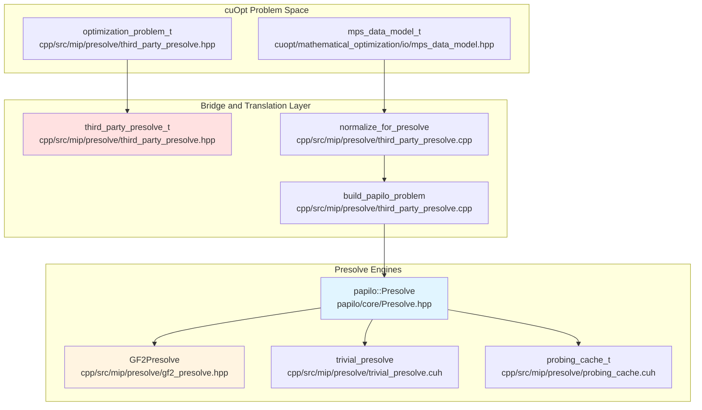

<!-- source: DeepWiki mcp.deepwiki.com · repo NVIDIA/cuopt · extra page MIP Presolving with PaPILO · fetched 2026-10-26 -->

# MIP Presolving with PaPILO

Relevant source files

The following files were used as context for generating this wiki page:

- [benchmarks/linear_programming/cuopt/run_cpufj.cu](benchmarks/linear_programming/cuopt/run_cpufj.cu)
- [cpp/src/barrier/cusparse_view.cu](cpp/src/barrier/cusparse_view.cu)
- [cpp/src/barrier/cusparse_view.hpp](cpp/src/barrier/cusparse_view.hpp)
- [cpp/src/barrier/scaling_gpu.cu](cpp/src/barrier/scaling_gpu.cu)
- [cpp/src/barrier/sparse_matrix_kernels.cuh](cpp/src/barrier/sparse_matrix_kernels.cuh)
- [cpp/src/mip_heuristics/diversity/diversity_manager.cu](cpp/src/mip_heuristics/diversity/diversity_manager.cu)
- [cpp/src/mip_heuristics/diversity/population.cu](cpp/src/mip_heuristics/diversity/population.cu)
- [cpp/src/mip_heuristics/diversity/population.cuh](cpp/src/mip_heuristics/diversity/population.cuh)
- [cpp/src/mip_heuristics/presolve/gf2_presolve.cpp](cpp/src/mip_heuristics/presolve/gf2_presolve.cpp)
- [cpp/src/mip_heuristics/presolve/gf2_presolve.hpp](cpp/src/mip_heuristics/presolve/gf2_presolve.hpp)
- [cpp/src/mip_heuristics/presolve/third_party_presolve.cpp](cpp/src/mip_heuristics/presolve/third_party_presolve.cpp)
- [cpp/src/mip_heuristics/presolve/third_party_presolve.hpp](cpp/src/mip_heuristics/presolve/third_party_presolve.hpp)
- [cpp/src/mip_heuristics/presolve/trivial_presolve.cuh](cpp/src/mip_heuristics/presolve/trivial_presolve.cuh)
- [cpp/src/mip_heuristics/presolve/trivial_presolve_helpers.cuh](cpp/src/mip_heuristics/presolve/trivial_presolve_helpers.cuh)
- [cpp/src/mip_heuristics/problem/presolve_data.cu](cpp/src/mip_heuristics/problem/presolve_data.cu)
- [cpp/src/mip_heuristics/problem/presolve_data.cuh](cpp/src/mip_heuristics/problem/presolve_data.cuh)
- [cpp/src/mip_heuristics/solve.cu](cpp/src/mip_heuristics/solve.cu)
- [cpp/src/mip_heuristics/solver.cu](cpp/src/mip_heuristics/solver.cu)
- [cpp/tests/internal/CMakeLists.txt](cpp/tests/internal/CMakeLists.txt)
- [cpp/tests/linear_programming/unit_tests/presolve_test.cu](cpp/tests/linear_programming/unit_tests/presolve_test.cu)
- [cpp/tests/mip/gf2_presolve_test.cpp](cpp/tests/mip/gf2_presolve_test.cpp)
- [cpp/tests/mip/incumbent_callback_test.cu](cpp/tests/mip/incumbent_callback_test.cu)
- [cpp/tests/mip/population_test.cu](cpp/tests/mip/population_test.cu)
- [cpp/tests/mip/presolve_test.cu](cpp/tests/mip/presolve_test.cu)
- [cpp/tests/mip/termination_test.cu](cpp/tests/mip/termination_test.cu)

## Purpose and Scope

This page documents the integration of the PaPILO (Parallel Presolve for Integer and Linear Optimization) library and PSLP into cuOpt's Mixed Integer Programming (MIP) solver subsystem. Presolve is a problem reduction technique that simplifies mixed-integer linear programming (MILP) instances before solving by eliminating redundant constraints, fixing singleton variables, tightening bounds, performing domain reduction via probing, and detecting structural properties like GF2 (Galois Field 2) equations. 

This page covers the architectural integration, data conversion pipelines, specialized presolvers (GF2 and trivial presolve), probing cache mechanisms, crush/uncrush solution mappings, and build/test configuration.

---

## System Architecture and PaPILO/PSLP Integration

The cuOpt MIP presolving framework wraps the PaPILO and PSLP libraries inside the `third_party_presolve_t` class. This class acts as the bridge between device-side or host-side problem representations and PaPILO's sparse problem structures.

**Architecture Diagram: PaPILO and PSLP Integration Flow**

Sources: [cpp/src/mip/presolve/third_party_presolve.hpp:33-146](), [cpp/src/mip/presolve/third_party_presolve.cpp:58-184]()

---

## Trivial Presolve and GF2 Presolve

Before invoking heavy PaPILO reduction passes, cuOpt applies specialized lightweight presolvers to eliminate trivial structures and exploit binary XOR (Galois Field 2) structures.

### Trivial Presolve
Trivial presolve handles immediate reductions such as fixed variables, empty rows/columns, and singleton constraints without invoking the full PaPILO engine. It validates basic problem feasibility and simplifies bounds.
- **Source Files:** `cpp/src/mip/presolve/trivial_presolve.cuh` and `cpp/src/mip/presolve/trivial_presolve_helpers.cuh`.
- **Test Coverage:** Verified via unit tests in `cpp/tests/mip/termination_test.cu:41-56` (`trivial_presolve_optimality_test`, `trivial_presolve_no_obj_vars_test`).

### GF2 Presolve
GF2 presolve identifies sets of binary variables involved in linear equations modulo 2 (XOR constraints). It applies Gaussian elimination over GF2 to detect linear dependencies, fix redundant binary variables, and discover infeasibilities early.
- **Header:** `cpp/src/mip/presolve/gf2_presolve.hpp`
- **Implementation:** `cpp/src/mip/presolve/gf2_presolve.cpp`
- **Test Coverage:** Tested via `cpp/tests/mip/termination_test.cu:109-120` (`gf2_presolve_optimal`, `gf2_presolve_infeasible`).

Sources: [cpp/src/mip/presolve/third_party_presolve.cpp:31-42](), [cpp/tests/mip/termination_test.cu:41-120]()

---

## Probing Cache and Implied Bounds

Probing explores the consequences of fixing binary variables to $0$ or $1$. The probing subsystem records implied bounds and variable domain reductions in a cache (`probing_cache_t`).

### Extracting Probing Implied Bounds
During branch-and-bound setup, the probing cache is translated into a CPU-only compressed sparse row (CSR) structure (`probing_implied_bound_t`) via `extract_probing_implied_bounds()`. This structure maps binary variables to the implied bound updates they trigger on other variables.

**Extraction Logic:**
1. Iterates over entries in `probing_cache.probing_cache` [cpp/src/mip/solver.cu:116-134]()
2. Remaps raw variable indices back to post-presolve (branch-and-bound) space using `op_problem.reverse_original_ids` [cpp/src/mip/solver.cu:104-108]()
3. Fills CSR offsets and flat arrays (`zero_variables`, `zero_lower_bound`, `one_variables`, etc.) to accelerate cut generation and domain propagation [cpp/src/mip/solver.cu:136-164]()

Sources: [cpp/src/mip/solver.cu:89-164]()

---

## Crush and Uncrush Operations

When a problem is presolved, solutions computed in the reduced problem space must be mapped back to the original problem space (**uncrush**), and original solutions or subproblem assignments must be projected down to the reduced space (**crush**).

### Crush and Uncrush Methods in `third_party_presolve_t`
The `third_party_presolve_t` class provides explicit methods for transforming primal, dual, and reduced-cost vectors across problem spaces:

| Function Signature | Description | Source Reference |
|----------------|-------------|------------------|
| `uncrush_primal_solution(...)` | Maps reduced primal solution back to full primal dimensions | [cpp/src/mip/presolve/third_party_presolve.hpp:147-149]() |
| `crush_primal_solution(...)` | Projects original primal solution onto the reduced problem space | [cpp/src/mip/presolve/third_party_presolve.hpp:156-162]() |
| `crush_primal_dual_solution(...)` | Transforms primal, dual, and reduced-cost vectors simultaneously | [cpp/src/mip/presolve/third_party_presolve.hpp:164-171]() |
| `undo(...)` / `undo_from_device(...)` | Full postsolve restoration of primal/dual/reduced costs on host/device | [cpp/src/mip/presolve/third_party_presolve.hpp:129-146]() |

Sources: [cpp/src/mip/presolve/third_party_presolve.hpp:129-171]()

---

## Build Configuration and Test Integration

The PaPILO and PSLP integration is built as part of the C++ core libraries and tested extensively via the internal test harness.

### Build and Test Targets
- **Internal Test Suite Configuration:** Declared in `cpp/tests/internal/CMakeLists.txt:35-41`, which includes test targets such as:
  - `cpp/tests/mip/presolve_test.cu`
  - `cpp/tests/mip/gf2_presolve_test.cpp`
  - `cpp/tests/mip/block_bve_test.cu`
  - `cpp/tests/mip/single_lock_dual_aggregation_test.cpp`
- **Presolve File Debugging:** Solver settings allow dumping presolve outputs to temporary MPS files (e.g., `settings.presolve_file`), validated in callback and termination tests (`cpp/tests/mip/incumbent_callback_test.cu:144-150`).

Sources: [cpp/tests/internal/CMakeLists.txt:8-43](), [cpp/tests/mip/incumbent_callback_test.cu:141-150]()

---

