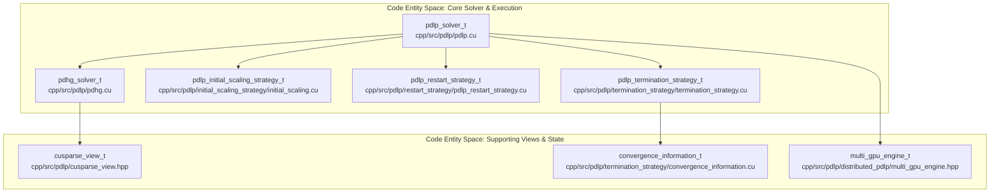
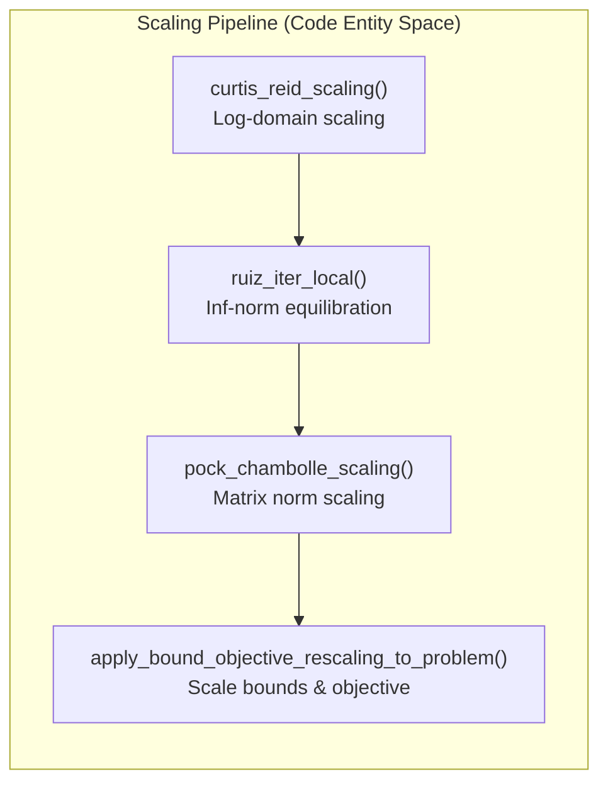

<!-- source: DeepWiki mcp.deepwiki.com · repo NVIDIA/cuopt · extra page PDLP Algorithm · fetched 2026-10-26 -->

# PDLP Algorithm

Relevant source files

The following files were used as context for generating this wiki page:

- [ci/test_cpp_multi_gpu.sh](ci/test_cpp_multi_gpu.sh)
- [cpp/cmake/thirdparty/get_kaminpar.cmake](cpp/cmake/thirdparty/get_kaminpar.cmake)
- [cpp/src/pdlp/cusparse_view.cu](cpp/src/pdlp/cusparse_view.cu)
- [cpp/src/pdlp/cusparse_view.hpp](cpp/src/pdlp/cusparse_view.hpp)
- [cpp/src/pdlp/distributed_pdlp/distributed_algorithms.cu](cpp/src/pdlp/distributed_pdlp/distributed_algorithms.cu)
- [cpp/src/pdlp/distributed_pdlp/multi_gpu_engine.cu](cpp/src/pdlp/distributed_pdlp/multi_gpu_engine.cu)
- [cpp/src/pdlp/distributed_pdlp/multi_gpu_engine.hpp](cpp/src/pdlp/distributed_pdlp/multi_gpu_engine.hpp)
- [cpp/src/pdlp/distributed_pdlp/partitioner.cpp](cpp/src/pdlp/distributed_pdlp/partitioner.cpp)
- [cpp/src/pdlp/distributed_pdlp/partitioner.hpp](cpp/src/pdlp/distributed_pdlp/partitioner.hpp)
- [cpp/src/pdlp/distributed_pdlp/shard.cu](cpp/src/pdlp/distributed_pdlp/shard.cu)
- [cpp/src/pdlp/distributed_pdlp/shard.hpp](cpp/src/pdlp/distributed_pdlp/shard.hpp)
- [cpp/src/pdlp/initial_scaling_strategy/initial_scaling.cu](cpp/src/pdlp/initial_scaling_strategy/initial_scaling.cu)
- [cpp/src/pdlp/initial_scaling_strategy/initial_scaling.cuh](cpp/src/pdlp/initial_scaling_strategy/initial_scaling.cuh)
- [cpp/src/pdlp/optimal_batch_size_handler/optimal_batch_size_handler.cu](cpp/src/pdlp/optimal_batch_size_handler/optimal_batch_size_handler.cu)
- [cpp/src/pdlp/pdhg.cu](cpp/src/pdlp/pdhg.cu)
- [cpp/src/pdlp/pdhg.hpp](cpp/src/pdlp/pdhg.hpp)
- [cpp/src/pdlp/pdlp.cu](cpp/src/pdlp/pdlp.cu)
- [cpp/src/pdlp/pdlp.cuh](cpp/src/pdlp/pdlp.cuh)
- [cpp/src/pdlp/restart_strategy/pdlp_restart_strategy.cu](cpp/src/pdlp/restart_strategy/pdlp_restart_strategy.cu)
- [cpp/src/pdlp/restart_strategy/pdlp_restart_strategy.cuh](cpp/src/pdlp/restart_strategy/pdlp_restart_strategy.cuh)
- [cpp/src/pdlp/restart_strategy/weighted_average_solution.cu](cpp/src/pdlp/restart_strategy/weighted_average_solution.cu)
- [cpp/src/pdlp/restart_strategy/weighted_average_solution.hpp](cpp/src/pdlp/restart_strategy/weighted_average_solution.hpp)
- [cpp/src/pdlp/solve.cuh](cpp/src/pdlp/solve.cuh)
- [cpp/src/pdlp/step_size_strategy/adaptive_step_size_strategy.cu](cpp/src/pdlp/step_size_strategy/adaptive_step_size_strategy.cu)
- [cpp/src/pdlp/termination_strategy/convergence_information.cu](cpp/src/pdlp/termination_strategy/convergence_information.cu)
- [cpp/src/pdlp/termination_strategy/convergence_information.hpp](cpp/src/pdlp/termination_strategy/convergence_information.hpp)
- [cpp/src/pdlp/termination_strategy/infeasibility_information.cu](cpp/src/pdlp/termination_strategy/infeasibility_information.cu)
- [cpp/src/pdlp/termination_strategy/termination_strategy.cu](cpp/src/pdlp/termination_strategy/termination_strategy.cu)
- [cpp/src/pdlp/utilities/ping_pong_graph.cu](cpp/src/pdlp/utilities/ping_pong_graph.cu)
- [cpp/src/pdlp/utilities/ping_pong_graph.cuh](cpp/src/pdlp/utilities/ping_pong_graph.cuh)
- [cpp/src/pdlp/utils.cuh](cpp/src/pdlp/utils.cuh)
- [cpp/src/utilities/device_scalar_init.hpp](cpp/src/utilities/device_scalar_init.hpp)
- [cpp/src/utilities/manual_cuda_graph.cuh](cpp/src/utilities/manual_cuda_graph.cuh)
- [cpp/tests/linear_programming/pdlp_distributed_test.cu](cpp/tests/linear_programming/pdlp_distributed_test.cu)

This page provides a comprehensive technical deep dive into the Primal-Dual Hybrid Gradient (PDLP) algorithm implementation within cuOpt's linear programming solver. PDLP serves as the primary GPU-accelerated first-order solver for large-scale linear and quadratic programming problems.

For details on the CPU revised dual simplex algorithm, see [2.1.2](). For the interior-point barrier method, see [2.1.3](). For the concurrent execution orchestrator, see [2.1.4]().

## Algorithm Overview and Architecture

The PDLP algorithm solves linear programs in saddle-point form by iteratively updating primal and dual variables via projected gradient steps. The implementation is anchored by `pdlp_solver_t` [cpp/src/pdlp/pdlp.cuh:48-50]() and delegates specific subtasks to specialized engine classes such as `pdhg_solver_t` [cpp/src/pdlp/pdhg.hpp](), `pdlp_restart_strategy_t` [cpp/src/pdlp/restart_strategy/pdlp_restart_strategy.cuh](), and `pdlp_initial_scaling_strategy_t` [cpp/src/pdlp/initial_scaling_strategy/initial_scaling.cuh]().

Sources: [cpp/src/pdlp/pdlp.cu:1-50](), [cpp/src/pdlp/pdlp.cuh:48-50](), [cpp/src/pdlp/initial_scaling_strategy/initial_scaling.cuh:26-28]()

---

## PDHG Iterations and Projections

The inner loop executes Primal-Dual Hybrid Gradient (PDHG) iterations via `pdhg_solver_t`. Each iteration updates the primal vector `x` and dual vector `y` using sparse matrix-vector products (`SpMV`) through `cusparse_view_t` [cpp/src/pdlp/cusparse_view.hpp:142-154]() and custom projection kernels.

Sources: [cpp/src/pdlp/pdhg.cu:50-117](), [cpp/src/pdlp/cusparse_view.hpp:142-154]()

### Reflected Primal-Dual Updates
Enabled via `use_reflected_primal_dual` in `pdlp_hyper_params_t`, the solver uses an extrapolated primal iterate (`2 * x'' - x`) when evaluating the dual gradient. This stabilization technique significantly enhances convergence velocity and is integral to the `Stable3` solver mode.

Sources: [cpp/src/pdlp/pdhg.cu:76-87](), [cpp/src/pdlp/restart_strategy/pdlp_restart_strategy.cu:80-87]()

Sources: [cpp/src/pdlp/pdhg.cu:50-117](), [cpp/src/pdlp/cusparse_view.hpp:142-154]()

---

## Adaptive Step Sizing

The step size manager adjusts the primal step size parameter `s` dynamically based on movement and interaction metrics.

- **Interaction**: Measures the coupling between primal and dual changes via `δy^T * A * δx`.
- **Movement**: Combines weighted L2 norms of primal changes (`||δx||²`) and dual changes (`||δy||²`).

These calculations utilize batched cuBLAS operations and `cub::DeviceSegmentedReduce` to maintain high throughput on the GPU.

Sources: [cpp/src/pdlp/step_size_strategy/adaptive_step_size_strategy.cu:1-101]()

---

## Restart Strategies

`pdlp_restart_strategy_t` implements advanced restart mechanisms to discard stale momentum and accelerate convergence [cpp/src/pdlp/restart_strategy/pdlp_restart_strategy.cuh:26-28]().

### Restart Modes
1. **KKT-Based Adaptive Restart**: Monitors KKT residual decay and triggers restarts when sufficient progress is achieved.
2. **Trust Region Restart (cuPDLPx)**: Computes localized duality gaps at current and average iterates, solving a bound-constrained trust region subproblem (`solve_bound_constrained_trust_region_kernel`) to re-center the trajectory.

Sources: [cpp/src/pdlp/restart_strategy/pdlp_restart_strategy.cu:61-138](), [cpp/src/pdlp/restart_strategy/pdlp_restart_strategy.cu:320-409]()

Sources: [cpp/src/pdlp/restart_strategy/pdlp_restart_strategy.cuh:26-28](), [cpp/src/pdlp/restart_strategy/pdlp_restart_strategy.cu:61-138]()

---

## Convergence and Infeasibility Detection

Convergence and infeasibility monitoring are managed by `convergence_information_t` and `infeasibility_information_t` [cpp/src/pdlp/termination_strategy/convergence_information.cu:47-55](), [cpp/src/pdlp/termination_strategy/infeasibility_information.cu:42-54]().

### Convergence Metrics
- **Primal & Dual Objectives**: Computed using reduction kernels over objective coefficients and right-hand sides.
- **Residuals**: Evaluates L2 and L-infinity norms for both primal residuals (`Ax - b` within bounds) and dual residuals (reduced costs).

### Infeasibility Detection
When enabled, the solver evaluates homogeneous primal and dual ray systems to certify primal or dual infeasibility, computing ray infinity norms and maximum constraint violations on device.

Sources: [cpp/src/pdlp/termination_strategy/convergence_information.cu:47-125](), [cpp/src/pdlp/termination_strategy/infeasibility_information.cu:42-120]()

---

## Initial Scaling Strategies

Prior to iteration, `pdlp_initial_scaling_strategy_t` equilibrates the problem matrix to improve conditioning [cpp/src/pdlp/initial_scaling_strategy/initial_scaling.cuh:26-28]().

Sources: [cpp/src/pdlp/initial_scaling_strategy/initial_scaling.cu:63-137](), [cpp/src/pdlp/initial_scaling_strategy/initial_scaling.cuh:26-28]()

1. **Curtis-Reid Prescaling**: A log-domain global magnitude fitting pass that removes broad row/column skew.
2. **Ruiz Equilibration**: Iteratively scales rows and columns using L-infinity norms.
3. **Pock-Chambolle Scaling**: Matrix-norm scaling governed by scaling parameter `alpha`.

Sources: [cpp/src/pdlp/initial_scaling_strategy/initial_scaling.cu:63-137](), [cpp/src/pdlp/initial_scaling_strategy/initial_scaling.cuh:110-144]()

---

## CUDA Graphs and Performance Optimization

To minimize kernel launch overhead during the tight PDHG iteration loop, cuOpt uses `ping_pong_graph_t` and CUDA graph capture [cpp/src/pdlp/pdhg.cu:90-107]().

- **Precision Modes**: Supports FP32 (`SinglePrecision`), FP64 (`DoublePrecision`), and mixed-precision SpMV (FP32 sparse matrix with FP64 vectors) via `cusparse_view_t` [cpp/src/pdlp/cusparse_view.hpp:142-154]().
- **Dynamic Loading**: Runtime resolution of `cusparse` symbols via `dlsym` ensures compatibility across minor CUDA toolkit versions.

Sources: [cpp/src/pdlp/pdhg.cu:90-111](), [cpp/src/pdlp/cusparse_view.cu:37-123]()

---

## Multi-GPU Distributed PDLP

For extremely large problems, `multi_gpu_engine_t` distributes PDLP computation across multiple GPUs using KaMinPar graph partitioning and NCCL/peer-to-peer communication [cpp/src/pdlp/distributed_pdlp/distributed_algorithms.cu:30-150]().

- **Sharding**: The problem matrix `A` is partitioned by rows and columns into local shards assigned to individual GPUs.
- **Distributed Scaling**: Shards coordinate globally-coherent Ruiz and Curtis-Reid scaling iterations by exchanging scaling vectors across halo boundaries [cpp/src/pdlp/distributed_pdlp/distributed_algorithms.cu:105-165]().
- **Solution Gathering**: Potential next solutions and reduced costs are gathered back to the master rank for termination and status verification [cpp/src/pdlp/distributed_pdlp/distributed_algorithms.cu:30-48]().

Sources: [cpp/src/pdlp/distributed_pdlp/distributed_algorithms.cu:30-165](), [cpp/tests/linear_programming/pdlp_distributed_test.cu:32-81]()

---

