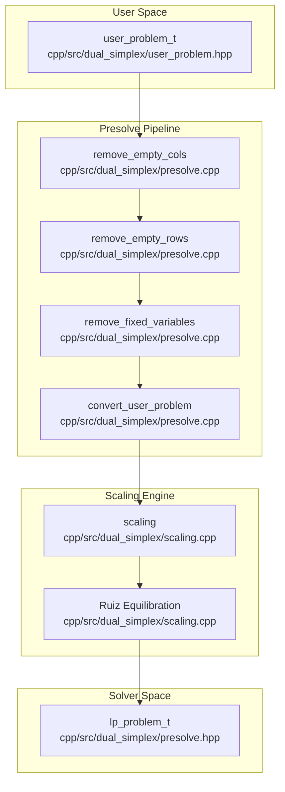
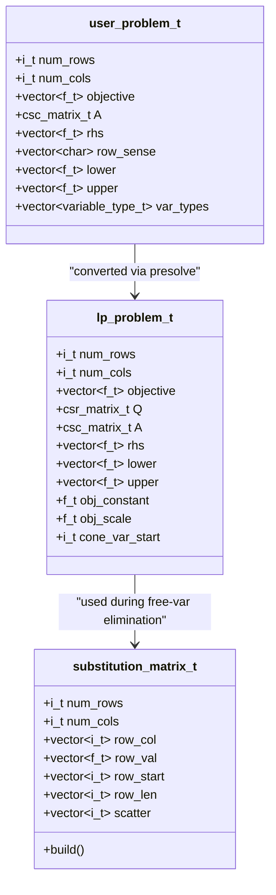

<!-- source: DeepWiki mcp.deepwiki.com · repo NVIDIA/cuopt · extra page Presolving and Scaling · fetched 2026-10-26 -->

# Presolving and Scaling

Relevant source files

The following files were used as context for generating this wiki page:

- [.gitignore](.gitignore)
- [benchmarks/linear_programming/run_mps_files.sh](benchmarks/linear_programming/run_mps_files.sh)
- [cpp/include/cuopt/mathematical_optimization/io/data_model_view.hpp](cpp/include/cuopt/mathematical_optimization/io/data_model_view.hpp)
- [cpp/include/cuopt/mathematical_optimization/io/mps_data_model.hpp](cpp/include/cuopt/mathematical_optimization/io/mps_data_model.hpp)
- [cpp/include/cuopt/mathematical_optimization/io/parser.hpp](cpp/include/cuopt/mathematical_optimization/io/parser.hpp)
- [cpp/src/dual_simplex/presolve.cpp](cpp/src/dual_simplex/presolve.cpp)
- [cpp/src/dual_simplex/presolve.hpp](cpp/src/dual_simplex/presolve.hpp)
- [cpp/src/dual_simplex/scaling.cpp](cpp/src/dual_simplex/scaling.cpp)
- [cpp/src/dual_simplex/scaling.hpp](cpp/src/dual_simplex/scaling.hpp)
- [cpp/src/dual_simplex/solve.cpp](cpp/src/dual_simplex/solve.cpp)
- [cpp/src/dual_simplex/solve.hpp](cpp/src/dual_simplex/solve.hpp)
- [cpp/src/dual_simplex/user_problem.hpp](cpp/src/dual_simplex/user_problem.hpp)
- [cpp/src/io/parser.cpp](cpp/src/io/parser.cpp)
- [cpp/src/linear_algebra/sparse_matrix.hpp](cpp/src/linear_algebra/sparse_matrix.hpp)
- [cpp/tests/dual_simplex/unit_tests/solve.cpp](cpp/tests/dual_simplex/unit_tests/solve.cpp)
- [cpp/tests/dual_simplex/unit_tests/solve_barrier.cu](cpp/tests/dual_simplex/unit_tests/solve_barrier.cu)
- [cpp/tests/linear_programming/pdlp_test.cu](cpp/tests/linear_programming/pdlp_test.cu)
- [datasets/quadratic_programming/min_x_squared.mps](datasets/quadratic_programming/min_x_squared.mps)

## Purpose and Scope

This page details the presolving transformations, dualization decisions, and scaling strategies (including Ruiz equilibration and column pre-scaling) implemented in the cuOpt linear and quadratic programming solver backend. Presolving reduces problem dimensions by identifying redundant constraints, fixing variables, and standardizing inequality representations, while scaling improves the conditioning of the coefficient matrix $A$ and Hessian $Q$ for interior-point, simplex, and first-order solvers.

For details on the core linear programming solvers that consume these processed problems, see [2.1](). For MIP-specific presolving integrations using PaPILO, see [2.2.4]().

---

## Presolve System Architecture

The presolve and scaling subsystem translates user-space optimization models (`user_problem_t`) into standardized internal solver instances (`lp_problem_t`), applies numerical scaling, and later uncrushes solutions back to the original problem space.

**Diagram 1: Presolve and Scaling Pipeline Architecture**

Sources: [cpp/src/dual_simplex/presolve.cpp:23-814](), [cpp/src/dual_simplex/scaling.cpp:30-163](), [cpp/src/dual_simplex/user_problem.hpp:46-86]()

---

## Problem Representation Data Structures

The pipeline manages core data structures that bridge user specifications to internal solver representations.

**Diagram 2: Core Data Structures in Presolve**

### user_problem_t

Defined in [cpp/src/dual_simplex/user_problem.hpp:46-86](), `user_problem_t` holds raw problem specifications including row senses (`'L'`, `'G'`, `'E'`), variable bounds, objectives, range rows, quadratic matrix components (`Q_offsets`, `Q_indices`, `Q_values`), and second-order cone dimensions (`second_order_cone_dims`).

### lp_problem_t

Defined in [cpp/src/dual_simplex/presolve.hpp:41-157](), `lp_problem_t` represents the standardized internal problem format where inequality constraints are converted to equalities, variables are non-negative or shifted, and sparse matrix representations (`csc_matrix_t` for $A$, `csr_matrix_t` for $Q$) are established. It also provides problem serialization and MPS export via `write_mps()` [cpp/src/dual_simplex/presolve.hpp:82-156]().

Sources: [cpp/src/dual_simplex/presolve.hpp:41-157](), [cpp/src/dual_simplex/user_problem.hpp:46-86]()

---

## Presolve Transformations

### Empty Row and Column Removal

Variables with no entries in constraint matrix $A$ are eliminated based on their objective coefficients and bounds [cpp/src/dual_simplex/presolve.cpp:23-130](). Constraints with no variables are checked for feasibility [cpp/src/dual_simplex/presolve.cpp:172-198]().

### Substitution Matrix (`substitution_matrix_t`)

To eliminate free variables efficiently, cuOpt uses `substitution_matrix_t` defined in [cpp/src/dual_simplex/presolve.cpp:107-197](). It organizes rows and columns in flat arenas (`row_col`, `row_val`, `row_start`, `row_len`) with column scatter maps to achieve amortized $O(1)$ appends and efficient row updates during variable substitutions.

Sources: [cpp/src/dual_simplex/presolve.cpp:23-258]()

---

## Scaling Strategies

### Column Scaling and Bound Pre-Conditioning

Scaling routines normalize constraint matrix rows and columns. In [cpp/src/dual_simplex/scaling.cpp:30-163](), `scaling()` computes infinity norms of rows (`compute_row_inf_norms`) and applies Ruiz equilibration when quadratic terms or second-order cones are present.

To prevent interior-point stalls caused by variables spanning extreme orders of magnitude (e.g., $10^4$ to $10^{11}$), `scaling()` applies bound-magnitude column pre-scaling before Ruiz iterations [cpp/src/dual_simplex/scaling.cpp:131-163]().

Sources: [cpp/src/dual_simplex/scaling.cpp:30-163]()

---

## Solution Recovery (Uncrushing)

After the solver computes a solution on the presolved and scaled `lp_problem_t`, `unscale_uncrush_barrier_to_user` [cpp/src/dual_simplex/solve.cpp:48-97]() and related uncrushing routines reverse scaling factors and reconstruct primal ($x$), dual ($y$), and reduced cost ($z$) vectors for the original `user_problem_t`.

Sources: [cpp/src/dual_simplex/solve.cpp:48-97]()

---

## Key Functions Reference

| Function / Class | Location | Purpose |
|------------------|----------|---------|
| `user_problem_t` | [cpp/src/dual_simplex/user_problem.hpp:46-86]() | User-facing optimization problem structure |
| `lp_problem_t` | [cpp/src/dual_simplex/presolve.hpp:41-157]() | Standardized internal LP/QP problem container |
| `substitution_matrix_t` | [cpp/src/dual_simplex/presolve.cpp:107-197]() | Sparse arena structure for eliminating free variables |
| `scaling()` | [cpp/src/dual_simplex/scaling.cpp:30-163]() | Matrix scaling and Ruiz equilibration implementation |
| `unscale_uncrush_barrier_to_user()` | [cpp/src/dual_simplex/solve.cpp:48-97]() | Reverses scaling and uncrushes barrier solution to user space |

Sources: [cpp/src/dual_simplex/presolve.cpp:107-197](), [cpp/src/dual_simplex/presolve.hpp:41-157](), [cpp/src/dual_simplex/scaling.cpp:30-163](), [cpp/src/dual_simplex/solve.cpp:48-97](), [cpp/src/dual_simplex/user_problem.hpp:46-86]()

---

