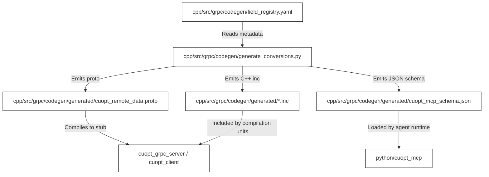
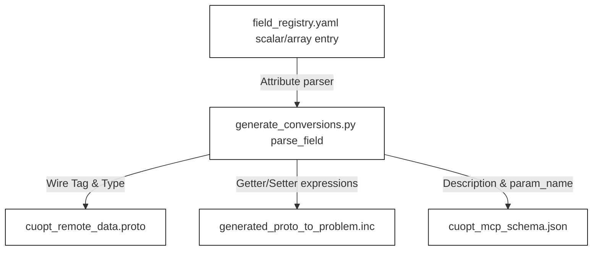

<!-- source: DeepWiki mcp.deepwiki.com · repo NVIDIA/cuopt · extra page Protocol Buffers and Field Registry Codegen · fetched 2026-10-26 -->

# Protocol Buffers and Field Registry Codegen

<details>
<summary>Relevant source files</summary>

The following files were used as context for generating this wiki page:

- [cpp/include/cuopt/mathematical_optimization/cpu_optimization_problem.hpp](cpp/include/cuopt/mathematical_optimization/cpu_optimization_problem.hpp)
- [cpp/include/cuopt/mathematical_optimization/optimization_problem_utils.hpp](cpp/include/cuopt/mathematical_optimization/optimization_problem_utils.hpp)
- [cpp/include/cuopt/mathematical_optimization/pdlp/solver_solution.hpp](cpp/include/cuopt/mathematical_optimization/pdlp/solver_solution.hpp)
- [cpp/src/grpc/codegen/FIELD_REGISTRY_REFERENCE.md](cpp/src/grpc/codegen/FIELD_REGISTRY_REFERENCE.md)
- [cpp/src/grpc/codegen/field_registry.yaml](cpp/src/grpc/codegen/field_registry.yaml)
- [cpp/src/grpc/codegen/generate_conversions.py](cpp/src/grpc/codegen/generate_conversions.py)
- [cpp/src/grpc/codegen/generated/cuopt_mcp_schema.json](cpp/src/grpc/codegen/generated/cuopt_mcp_schema.json)
- [cpp/src/grpc/codegen/generated/cuopt_remote_data.proto](cpp/src/grpc/codegen/generated/cuopt_remote_data.proto)
- [cpp/src/grpc/codegen/generated/generated_build_array_chunks.inc](cpp/src/grpc/codegen/generated/generated_build_array_chunks.inc)
- [cpp/src/grpc/codegen/generated/generated_chunked_arrays_to_problem.inc](cpp/src/grpc/codegen/generated/generated_chunked_arrays_to_problem.inc)
- [cpp/src/grpc/codegen/generated/generated_enum_converters_settings.inc](cpp/src/grpc/codegen/generated/generated_enum_converters_settings.inc)
- [cpp/src/grpc/codegen/generated/generated_estimate_problem_size.inc](cpp/src/grpc/codegen/generated/generated_estimate_problem_size.inc)
- [cpp/src/grpc/codegen/generated/generated_problem_to_proto.inc](cpp/src/grpc/codegen/generated/generated_problem_to_proto.inc)
- [cpp/src/grpc/codegen/generated/generated_proto_to_problem.inc](cpp/src/grpc/codegen/generated/generated_proto_to_problem.inc)
- [cpp/src/io/CMakeLists.txt](cpp/src/io/CMakeLists.txt)
- [cpp/src/math_optimization/CMakeLists.txt](cpp/src/math_optimization/CMakeLists.txt)
- [cpp/src/math_optimization/solver_settings.cpp](cpp/src/math_optimization/solver_settings.cpp)
- [cpp/src/pdlp/CMakeLists.txt](cpp/src/pdlp/CMakeLists.txt)
- [cpp/src/pdlp/cpu_optimization_problem.cpp](cpp/src/pdlp/cpu_optimization_problem.cpp)
- [cpp/tests/linear_programming/unit_tests/pdlp_memory_test.cu](cpp/tests/linear_programming/unit_tests/pdlp_memory_test.cu)
- [cpp/tests/linear_programming/unit_tests/solution_interface_test.cu](cpp/tests/linear_programming/unit_tests/solution_interface_test.cu)
- [cpp/tests/linear_programming/unit_tests/solver_settings_test.cu](cpp/tests/linear_programming/unit_tests/solver_settings_test.cu)
- [python/cuopt_mcp/tests/test_schema.py](python/cuopt_mcp/tests/test_schema.py)

</details>


This page details the metadata-driven code generation pipeline used in the `cuopt_grpc_server` remote solve infrastructure. NVIDIA cuOpt centralizes all gRPC protocol definitions, C++ structure-to-proto converters, chunked array serialization routines, and Model Context Protocol (MCP) JSON schemas into a single configuration file: `cpp/src/grpc/codegen/field_registry.yaml` [cpp/src/grpc/codegen/field_registry.yaml:1-12](). A Python script, `cpp/src/grpc/codegen/generate_conversions.py` [cpp/src/grpc/codegen/generate_conversions.py:1-17](), processes this registry to emit protocol buffer specifications, enum translation routines [cpp/src/grpc/codegen/generate_conversions.py:7-13](), and LLM integration schemas [cpp/src/grpc/codegen/generated/cuopt_mcp_schema.json:1-3]().

---

## 1. Codegen Architecture and Design Philosophy

The remote execution engine relies on convention-over-configuration mapping between C++ optimization problems (`cpu_optimization_problem_t`), solver settings, solutions, and protobuf messages (`OptimizationProblem`, `PDLPSolverSettings`, `ChunkedResultHeader`). Instead of hand-maintaining synchronized C++ serialization boilerplates and `.proto` files—which frequently drift—cuOpt treats `field_registry.yaml` as the single source of truth [cpp/src/grpc/codegen/field_registry.yaml:4-10]().

The generator script parses the YAML definitions and emits the following artifacts into `cpp/src/grpc/codegen/generated/`:
1. `cuopt_remote_data.proto` — The wire-level protobuf schema [cpp/src/grpc/codegen/generate_conversions.py:8]() defining enums (`PDLPTerminationStatus`, `VariableType`, `ArrayFieldId`, `ResultFieldId`) and messages (`OptimizationProblem`, `QuadraticConstraint`, solver settings).
2. `generated_enum_converters_settings.inc` — C++ switch routines translating between remote wire enums and internal C++ enums [cpp/src/grpc/codegen/generate_conversions.py:10]().
3. `generated_*_to_*.inc` — C++ inline bodies for settings, solutions, and problem conversions [cpp/src/grpc/codegen/generate_conversions.py:11-13](), including `generated_proto_to_problem.inc` [cpp/src/grpc/codegen/generated/generated_proto_to_problem.inc:1-114]().
4. `cuopt_mcp_schema.json` — JSON Schema definition containing parameter descriptions and metadata consumed by the Model Context Protocol server (`cuopt_mcp`) [cpp/src/grpc/codegen/generated/cuopt_mcp_schema.json:1-8]().


*Figure 1: Pipeline mapping `field_registry.yaml` to protocol buffers, C++ translation units, and MCP JSON schemas.*

Sources:
- `cpp/src/grpc/codegen/field_registry.yaml:1-12`
- `cpp/src/grpc/codegen/generate_conversions.py:1-17`
- `cpp/src/grpc/codegen/generated/cuopt_remote_data.proto:1-83`
- `cpp/src/grpc/codegen/generated/cuopt_mcp_schema.json:1-8`

---

## 2. Field Registry Schema and Attributes

The `field_registry.yaml` file is divided into top-level sections: `enums:`, `optimization_problem:`, `pdlp_settings:`, `mip_settings:`, `lp_solution:`, `mip_solution:`, and `chunked_result_header:` [cpp/src/grpc/codegen/FIELD_REGISTRY_REFERENCE.md:47-60](). Each section specifies scalars, arrays, nested sub-structures, and mapping attributes [cpp/src/grpc/codegen/FIELD_REGISTRY_REFERENCE.md:58-60]().

Each entry supports rich metadata attributes controlling wire compatibility and C++ binding generation [cpp/src/grpc/codegen/field_registry.yaml:38-98]:
- `field_num`: Protobuf message tag ID. Contiguous within each proto message [cpp/src/grpc/codegen/field_registry.yaml:18-32].
- `array_id`: Enum value mapped to `ArrayFieldId` or `ResultFieldId`, utilized during chunked array transfers (`SendArrayChunk` / `GetResultChunk`) [cpp/src/grpc/codegen/field_registry.yaml:22-25, 70].
- `type`: Protobuf wire type (`double`, `int32`, `int64`, `bool`, `string`, or an enum type) [cpp/src/grpc/codegen/field_registry.yaml:68].
- `getter` / `setter`: C++ method names or expressions used to extract or inject values into `cpu_optimization_problem_t`, solver settings, or solution objects [cpp/src/grpc/codegen/field_registry.yaml:71-73].
- `optional`: Emits proto3 `optional` presence tracking, guarding reads with `.has_X()` to prevent C++ default values from overwriting solver defaults [cpp/src/grpc/codegen/field_registry.yaml:80-85].
- `from_proto_cast` / `to_proto_cast`: Explicit type casting between wire integers and C++ enum classes (e.g., casting wire `int32` to `presolver_t` or `char` row types) [cpp/src/grpc/codegen/field_registry.yaml:91-98].
- `description`: Human-readable text emitted into `cuopt_mcp_schema.json` for LLM agent prompt contexts [cpp/src/grpc/codegen/field_registry.yaml:41-45].
- `param_name`: Maps settings fields to their string parameter constants (defined in `constants.h`), exposed in the MCP schema as `x-parameter-name` [cpp/src/grpc/codegen/field_registry.yaml:57-67].


*Figure 2: Code generation flow from individual YAML registry entries to target artifacts.*

Sources:
- `cpp/src/grpc/codegen/field_registry.yaml:38-112`
- `cpp/src/grpc/codegen/FIELD_REGISTRY_REFERENCE.md:45-122`

---

## 3. Problem and Settings Converters

The generated C++ include files bridge protobuf deserialization objects (`pb_problem`) directly into host structures like `cpu_optimization_problem_t` without requiring intermediate GPU allocations [cpp/src/grpc/codegen/generated/generated_proto_to_problem.inc:5-21](), adhering to optimization problem pipeline utilities (`populate_from_mps_data_model`) [cpp/include/cuopt/mathematical_optimization/optimization_problem_utils.hpp:134-142]().

For instance, scalar fields, sparse constraint matrices (CSR format with `A_values`, `A_indices`, `A_offsets`), quadratic objective matrices (`Q_values`), and variable bounds are unpacked via generated code [cpp/src/grpc/codegen/generated/generated_proto_to_problem.inc:5-64]():

```cpp
  cpu_problem.set_problem_name(pb_problem.problem_name());
  cpu_problem.set_objective_name(pb_problem.objective_name());
  cpu_problem.set_maximize(pb_problem.maximize());
  if (pb_problem.has_objective_scaling_factor()) {
    cpu_problem.set_objective_scaling_factor(pb_problem.objective_scaling_factor());
  }
  cpu_problem.set_objective_offset(pb_problem.objective_offset());

  if (pb_problem.a_offsets_size() > 0) {
    std::vector<f_t> A_values(pb_problem.a_values().begin(), pb_problem.a_values().end());
    std::vector<i_t> A_indices(pb_problem.a_indices().begin(), pb_problem.a_indices().end());
    std::vector<i_t> A_offsets(pb_problem.a_offsets().begin(), pb_problem.a_offsets().end());
    cpu_problem.set_csr_constraint_matrix(A_values.data(), static_cast<i_t>(A_values.size()), 
                                         A_indices.data(), static_cast<i_t>(A_indices.size()), 
                                         A_offsets.data(), static_cast<i_t>(A_offsets.size()));
  }
```
*(Cited from `cpp/src/grpc/codegen/generated/generated_proto_to_problem.inc:5-21`)*

Enum values (such as `VariableType` or solver modes) are converted via auto-generated helper functions [cpp/src/grpc/codegen/generated/generated_proto_to_problem.inc:70-76]:
```cpp
  if (pb_problem.variable_types_size() > 0) {
    std::vector<var_t> variable_types;
    variable_types.reserve(pb_problem.variable_types_size());
    for (const auto& v : pb_problem.variable_types()) {
      variable_types.push_back(from_proto_variable_type(static_cast<cuopt::remote::VariableType>(v)));
    }
    cpu_problem.set_variable_types(variable_types.data(), static_cast<i_t>(variable_types.size()));
  }
```
*(Cited from `cpp/src/grpc/codegen/generated/generated_proto_to_problem.inc:69-76`)*

Sources:
- `cpp/src/grpc/codegen/generated/generated_proto_to_problem.inc:1-114`
- `cpp/include/cuopt/mathematical_optimization/optimization_problem_utils.hpp:134-164`

---

## 4. Chunked Array Building and Streaming Routing

For massive optimization models that exceed gRPC unary message size limits, cuOpt utilizes a chunked array transfer protocol driven by `ArrayFieldId` and `ResultFieldId` enums defined in `cuopt_remote_data.proto` [cpp/src/grpc/codegen/generated/cuopt_remote_data.proto:60-112].

Each `ArrayFieldId` entry explicitly documents the raw byte layout expected by the server [cpp/src/grpc/codegen/generated/cuopt_remote_data.proto:85-93]:
- `FIELD_VARIABLE_NAMES` / `FIELD_ROW_NAMES`: NUL-terminated UTF-8 strings concatenated; total elements equal byte length [cpp/src/grpc/codegen/generated/cuopt_remote_data.proto:94-95].
- `FIELD_A_VALUES` / `FIELD_C` / `FIELD_B`: Raw IEEE-754 fixed64 little-endian bytes (8 bytes/element), `memcpy`'d directly from `std::vector` without protobuf encoding overhead [cpp/src/grpc/codegen/generated/cuopt_remote_data.proto:96-100].
- `FIELD_A_INDICES` / `FIELD_A_OFFSETS`: Raw `int32` little-endian bytes (4 bytes/element) [cpp/src/grpc/codegen/generated/cuopt_remote_data.proto:97-98].

```mermaid
sequenceDiagram
    participant Client as cuopt_client
    participant Server as CuOptRemoteServiceImpl
    participant Problem as cpu_optimization_problem_t

    Client->>Server: SendArrayChunk(ArrayChunk { field_id: FIELD_A_VALUES, data: raw_bytes })
    Server->>Server: Route via ArrayFieldId switch
    Server->>Problem: Unpack raw bytes (memcpy to vector)
    Server->>Client: Acknowledgment (ChunkAck)

    classDef default fill:none,stroke:#000,stroke-width:1px;
```
*Figure 3: Data flow for chunked array streaming via `ArrayFieldId` routing.*

Sources:
- `cpp/src/grpc/codegen/generated/cuopt_remote_data.proto:85-112`
- `cpp/src/grpc/codegen/field_registry.yaml:18-37`

---

## 5. MCP JSON Schema Generation for LLM Agents

The `cuopt_mcp` server exposes cuOpt optimization capabilities via the Model Context Protocol, enabling LLM agents to configure solver parameters dynamically. `generate_conversions.py` compiles `field_registry.yaml` settings definitions into `cuopt_mcp_schema.json` [cpp/src/grpc/codegen/generated/cuopt_mcp_schema.json:1-121]().

Each setting entry incorporates its configured `description`, JSON type (`number`, `integer`, `boolean`, `string`), enum mappings (`x-enum-values`), and string parameter bindings (`x-parameter-name`) [cpp/src/grpc/codegen/generated/cuopt_mcp_schema.json:10-121](). For instance, PDLP solver modes and infeasibility detection parameters are structured as follows:

```json
        "pdlp_solver_mode": {
          "type": "string",
          "enum": [
            "Stable1",
            "Stable2",
            "Methodical1",
            "Fast1",
            "Stable3"
          ],
          "x-enum-values": {
            "Stable1": 0,
            "Stable2": 1,
            "Methodical1": 2,
            "Fast1": 3,
            "Stable3": 4
          },
          "description": "Mode under which PDLP operates... Default: Stable3."
        },
        "detect_infeasibility": {
          "type": "boolean",
          "description": "Whether PDLP attempts to detect infeasibility... Default: false.",
          "x-parameter-name": "infeasibility_detection"
        }
```
*(Cited from `cpp/src/grpc/codegen/generated/cuopt_mcp_schema.json:63-80, 54-58`)*

Sources:
- `cpp/src/grpc/codegen/generated/cuopt_mcp_schema.json:1-121`
- `cpp/src/grpc/codegen/field_registry.yaml:41-67`

---

## 6. Drift Prevention and CI Verification

Because generated files (`cuopt_remote_data.proto`, `.inc` bodies, and `cuopt_mcp_schema.json`) are committed to version control to simplify downstream builds, cuOpt enforces strict drift checks in CI [cpp/src/grpc/codegen/FIELD_REGISTRY_REFERENCE.md:68-74]. 

Developers invoke the generator script and verify repository cleanliness [cpp/src/grpc/codegen/FIELD_REGISTRY_REFERENCE.md:68-70]:
```bash
python cpp/src/grpc/codegen/generate_conversions.py
bash ci/verify_grpc_codegen.sh           # Fails if generated artifacts differ from git HEAD
```

Any modification to solver settings or data schemas must be performed exclusively within `cpp/src/grpc/codegen/field_registry.yaml` [cpp/src/grpc/codegen/field_registry.yaml:4-10](), followed by regeneration, ensuring that C++, gRPC wire serialization, and LLM agent tool definitions remain perfectly synchronized.

Sources:
- `cpp/src/grpc/codegen/FIELD_REGISTRY_REFERENCE.md:68-75`
- `cpp/src/grpc/codegen/generate_conversions.py:7-17`

---

