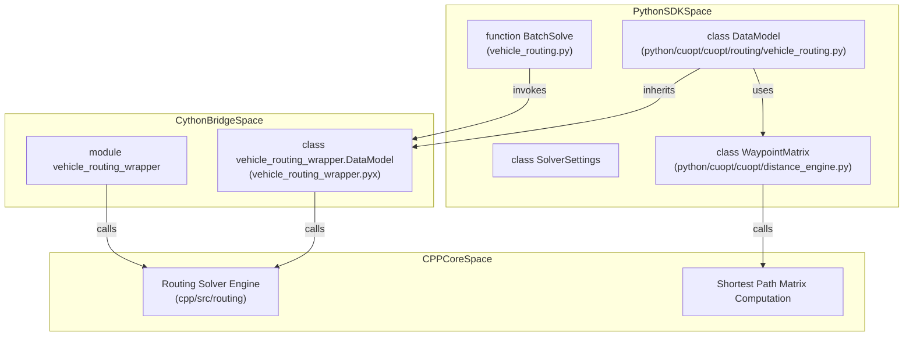
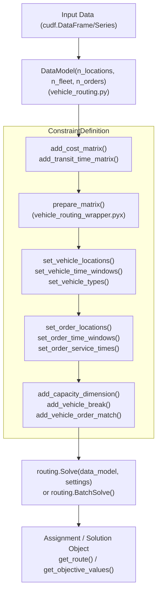

<!-- source: DeepWiki mcp.deepwiki.com · repo NVIDIA/cuopt · extra page Routing Python API · fetched 2026-10-26 -->

# Routing Python API

<details>
<summary>Relevant source files</summary>

The following files were used as context for generating this wiki page:

- [cpp/src/routing/adapters/assignment_adapter.cuh](cpp/src/routing/adapters/assignment_adapter.cuh)
- [cpp/src/routing/local_search/cycle_finder/cycle_finder.hpp](cpp/src/routing/local_search/cycle_finder/cycle_finder.hpp)
- [cpp/src/routing/local_search/move_candidates/move_candidates.cuh](cpp/src/routing/local_search/move_candidates/move_candidates.cuh)
- [cpp/src/routing/local_search/move_candidates/random_move_candidates.cuh](cpp/src/routing/local_search/move_candidates/random_move_candidates.cuh)
- [cpp/src/routing/local_search/move_candidates/vrp_move_candidates.cuh](cpp/src/routing/local_search/move_candidates/vrp_move_candidates.cuh)
- [cpp/src/routing/solution/solution.cu](cpp/src/routing/solution/solution.cu)
- [cpp/src/routing/solution/solution.cuh](cpp/src/routing/solution/solution.cuh)
- [cpp/tests/routing/routing_test.cuh](cpp/tests/routing/routing_test.cuh)
- [python/cuopt/cuopt/routing/__init__.py](python/cuopt/cuopt/routing/__init__.py)
- [python/cuopt/cuopt/routing/validation.py](python/cuopt/cuopt/routing/validation.py)
- [python/cuopt/cuopt/routing/vehicle_routing.pxd](python/cuopt/cuopt/routing/vehicle_routing.pxd)
- [python/cuopt/cuopt/routing/vehicle_routing.py](python/cuopt/cuopt/routing/vehicle_routing.py)
- [python/cuopt/cuopt/routing/vehicle_routing_wrapper.pyx](python/cuopt/cuopt/routing/vehicle_routing_wrapper.pyx)
- [python/cuopt/cuopt/tests/routing/test_batch_solve.py](python/cuopt/cuopt/tests/routing/test_batch_solve.py)
- [python/cuopt/cuopt/tests/routing/test_distance_engine.py](python/cuopt/cuopt/tests/routing/test_distance_engine.py)
- [python/cuopt/cuopt/tests/routing/test_gpu_free_import.py](python/cuopt/cuopt/tests/routing/test_gpu_free_import.py)
- [python/cuopt/cuopt/tests/routing/test_host_arrays.py](python/cuopt/cuopt/tests/routing/test_host_arrays.py)
- [python/cuopt/cuopt/tests/routing/test_routing_grpc_serialization.py](python/cuopt/cuopt/tests/routing/test_routing_grpc_serialization.py)
- [python/cuopt/cuopt/tests/routing/test_solver.py](python/cuopt/cuopt/tests/routing/test_solver.py)

</details>


## Purpose and Scope

This page documents the Python API for solving Vehicle Routing Problems (VRP), Traveling Salesman Problems (TSP), and Pickup-Delivery Problems (PDP) using NVIDIA cuOpt. The routing API is centered around the `DataModel` class in `python/cuopt/cuopt/routing/vehicle_routing.py`, which provides methods to specify problem constraints, objectives, and vehicle/task properties.

The routing API supports a wide variety of VRP variants including:
- Time windows (`VRPTW`) [python/cuopt/cuopt/routing/vehicle_routing.py:550-621]()
- Capacity constraints (`CVRP`) [python/cuopt/cuopt/routing/vehicle_routing.py:988-1059]()
- Pickup and delivery (`PDP`) [python/cuopt/cuopt/routing/vehicle_routing.py:512-547]()
- Heterogeneous fleet and vehicle types [python/cuopt/cuopt/routing/vehicle_routing.py:474-509]()
- Multiple objectives [python/cuopt/cuopt/routing/vehicle_routing.py:394-421]()
- Vehicle breaks (Homogeneous and Heterogeneous) [python/cuopt/cuopt/routing/vehicle_routing.py:262-391]()
- Vehicle-task matching constraints [python/cuopt/cuopt/routing/vehicle_routing.py:845-934]()

---

## DataModel Class Architecture

The `DataModel` class is the primary interface for specifying routing problems. It inherits from `vehicle_routing_wrapper.DataModel` defined in `python/cuopt/cuopt/routing/vehicle_routing_wrapper.pyx`, serving as a Cython-based bridge to the C++ routing engine.

**Diagram: DataModel Entity Relationship and Code Mapping**



Sources: [python/cuopt/cuopt/routing/vehicle_routing.py:22-57](), [python/cuopt/cuopt/routing/vehicle_routing_wrapper.pyx:1-21]()

---

## Problem Specification Workflow

Setting up a routing problem involves initializing the `DataModel`, adding cost matrices, validating arrays via `prepare_matrix`, and defining fleet/task constraints.

**Diagram: Routing Data Flow and Code Entity Mapping**



Sources: [python/cuopt/cuopt/routing/vehicle_routing.py:22-1177](), [python/cuopt/cuopt/routing/vehicle_routing_wrapper.pyx:112-141]()

---

## DataModel Initialization

The `DataModel` constructor defines the core problem dimensions. Inputs can be provided as `cudf` objects, NumPy arrays, or Pandas objects (which are automatically moved to device memory); Python lists and tuples are rejected by `_reject_list` [python/cuopt/cuopt/routing/vehicle_routing.py:47-51](), [python/cuopt/cuopt/routing/vehicle_routing_wrapper.pyx:65-71]().

```python
DataModel(n_locations, n_fleet, n_orders=-1)
```

- `n_locations`: Total unique physical locations (depots + customer sites). [python/cuopt/cuopt/routing/vehicle_routing.py:31-32]()
- `n_fleet`: Number of vehicles available. [python/cuopt/cuopt/routing/vehicle_routing.py:33-34]()
- `n_orders`: Number of tasks. Defaults to `n_locations - 1`. [python/cuopt/cuopt/routing/vehicle_routing.py:35-36]()

Sources: [python/cuopt/cuopt/routing/vehicle_routing.py:22-57](), [python/cuopt/cuopt/routing/vehicle_routing_wrapper.pyx:65-90]()

---

## Cost and Time Matrices

### Cost Matrix
The cost matrix is **mandatory**. It defines the travel cost (distance, time, or custom metric) between all locations.

```python
add_cost_matrix(cost_mat, vehicle_type=0, *, skip_validation=False)
```
- `cost_mat`: Square matrix of size `n_locations × n_locations` (float32). Processed via `prepare_matrix` to ensure C-contiguous device layout [python/cuopt/cuopt/routing/vehicle_routing.py:96-104](), [python/cuopt/cuopt/routing/vehicle_routing_wrapper.pyx:112-141]().
- `vehicle_type`: Identifier for heterogeneous fleet support (e.g., bikes vs. trucks) [python/cuopt/cuopt/routing/vehicle_routing.py:85-87]().

Sources: [python/cuopt/cuopt/routing/vehicle_routing.py:60-151](), [python/cuopt/cuopt/routing/vehicle_routing_wrapper.pyx:112-141]()

### Transit Time Matrix
An optional matrix used for time window validation if travel time differs from the optimization cost.

```python
add_transit_time_matrix(mat, vehicle_type=0)
```
Sources: [python/cuopt/cuopt/routing/vehicle_routing.py:153-205]()

---

## Fleet and Task Constraints

### Vehicle and Order Locations
- `set_vehicle_locations(start_locations, return_locations)`: Sets start/end points for each vehicle. [python/cuopt/cuopt/routing/vehicle_routing.py:624-674]()
- `set_order_locations(order_locations)`: Maps each order index to a physical location index. [python/cuopt/cuopt/routing/vehicle_routing.py:430-471]()

### Time Windows and Service Times
- `set_vehicle_time_windows(earliest, latest)`: Vehicle availability windows. [python/cuopt/cuopt/routing/vehicle_routing.py:550-621]()
- `set_order_time_windows(earliest, latest)`: Customer service windows. [python/cuopt/cuopt/routing/vehicle_routing.py:677-749]()
- `set_order_service_times(service_times, vehicle_id=-1)`: Duration spent at customer site. [python/cuopt/cuopt/routing/vehicle_routing.py:937-985]()

### Capacity Constraints
Supports multi-dimensional constraints (e.g., weight and volume).
```python
add_capacity_dimension(name, demand, capacity)
```
- `demand`: `cudf.Series` (int32) for each order. [python/cuopt/cuopt/routing/vehicle_routing.py:1017-1018]()
- `capacity`: `cudf.Series` (int32) for each vehicle. [python/cuopt/cuopt/routing/vehicle_routing.py:1019-1020]()

Sources: [python/cuopt/cuopt/routing/vehicle_routing.py:988-1059]()

---

## Vehicle Breaks

### Heterogeneous Breaks
Allows defining specific breaks for individual vehicles.
```python
add_vehicle_break(vehicle_id, earliest, latest, duration, locations=cudf.Series())
```
- `locations`: Optional series of location indices where the break can be taken. [python/cuopt/cuopt/routing/vehicle_routing.py:359-360]()

Sources: [python/cuopt/cuopt/routing/vehicle_routing.py:347-391]()

---

## Distance Engine and WaypointMatrix

The `WaypointMatrix` class manages graph-based cost computations for large-scale routing.

```python
WaypointMatrix(offsets, edges, weights)
```
- `offsets`, `edges`, `weights`: CSR representation of the road network graph [python/cuopt/cuopt/tests/routing/test_distance_engine.py:44-48]().

**Key Methods:**
- `compute_cost_matrix(target_locations)`: Generates a square cost matrix for the subset of locations involved in the VRP [python/cuopt/cuopt/tests/routing/test_distance_engine.py:52]().
- `compute_waypoint_sequence(target_locations, solution_df)`: Converts the optimized order sequence back into a full path of graph vertices for navigation [python/cuopt/cuopt/tests/routing/test_distance_engine.py:78]().

Sources: [python/cuopt/cuopt/tests/routing/test_distance_engine.py:44-90]()

---

## Batch Solving

cuOpt supports solving multiple routing problem instances in a batch via `routing.BatchSolve`. This interface accepts a list of `DataModel` instances and a shared `SolverSettings` object, executing solves across problems efficiently [python/cuopt/cuopt/tests/routing/test_batch_solve.py:57]().

```python
solutions = routing.BatchSolve(data_models, settings)
```

Sources: [python/cuopt/cuopt/tests/routing/test_batch_solve.py:19-67]()

---

## Solution Output and Structures

The C++ core constructs solution objects (`solution_t` in `cpp/src/routing/solution/solution.cuh`) that manage route allocations (`check_and_allocate_routes`), node sequences, and objective values. In Python, the solution object exposes methods like:
- `get_status()`: Returns execution error codes or success (`0`) [python/cuopt/cuopt/tests/routing/test_batch_solve.py:62]()
- `get_vehicle_count()`: Number of vehicles utilized in the routes [python/cuopt/cuopt/tests/routing/test_batch_solve.py:65]()
- `get_objective_values()`: Dictionary or breakdown of objective components (cost, prize, vehicle fixed cost, etc.) [python/cuopt/cuopt/tests/routing/test_solver.py:116]()
- `get_route()`: Returns a DataFrame containing route sequencing, arrival times, and cumulative loads [python/cuopt/cuopt/tests/routing/test_distance_engine.py:76]()

Sources: [cpp/src/routing/solution/solution.cuh:39-70](), [cpp/src/routing/solution/solution.cu:16-37](), [python/cuopt/cuopt/tests/routing/test_solver.py:116-121]()

---

## Validation Logic

The routing API performs extensive input validation in `python/cuopt/cuopt/routing/validation.py` and `vehicle_routing.py` to ensure GPU solver stability.

**Validation Rules:**
- **Type Checking**: `_reject_list` ensures inputs are NumPy arrays, Pandas objects, or cuDF objects, rejecting Python lists and tuples [python/cuopt/cuopt/routing/validation.py:7-14]().
- **Matrix Checks**: `validate_matrix` ensures cost matrices are square, match the expected location count, and contain no null/NaN values [python/cuopt/cuopt/routing/validation.py:28-42]().
- **Time Windows**: `validate_time_windows` verifies non-negative timestamps and ensures `earliest <= latest` [python/cuopt/cuopt/routing/validation.py:86-94]().

Sources: [python/cuopt/cuopt/routing/validation.py:1-122](), [python/cuopt/cuopt/routing/vehicle_routing.py:12-19]()

---

