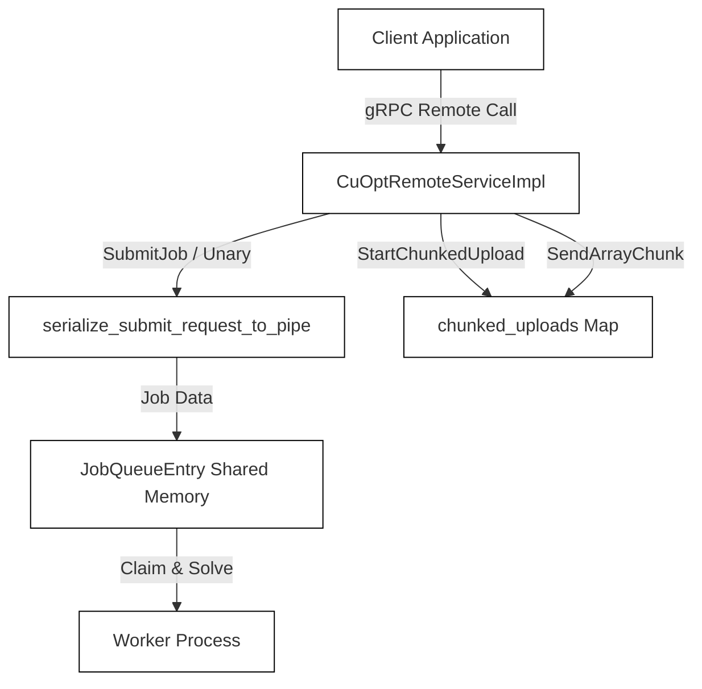
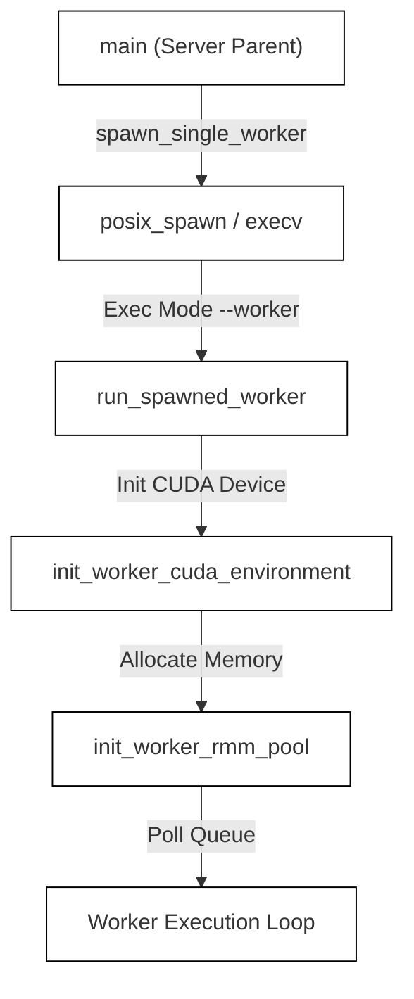

<!-- source: DeepWiki mcp.deepwiki.com · repo NVIDIA/cuopt · extra page gRPC Server Internals · fetched 2026-10-26 -->

# gRPC Server Internals

Relevant source files

The following files were used as context for generating this wiki page:

- [cpp/include/cuopt/mathematical_optimization/backend_selection.hpp](cpp/include/cuopt/mathematical_optimization/backend_selection.hpp)
- [cpp/src/grpc/server/grpc_incumbent_proto.hpp](cpp/src/grpc/server/grpc_incumbent_proto.hpp)
- [cpp/src/grpc/server/grpc_pipe_io.cpp](cpp/src/grpc/server/grpc_pipe_io.cpp)
- [cpp/src/grpc/server/grpc_pipe_serialization.hpp](cpp/src/grpc/server/grpc_pipe_serialization.hpp)
- [cpp/src/grpc/server/grpc_server_logger.hpp](cpp/src/grpc/server/grpc_server_logger.hpp)
- [cpp/src/grpc/server/grpc_server_main.cpp](cpp/src/grpc/server/grpc_server_main.cpp)
- [cpp/src/grpc/server/grpc_server_threads.cpp](cpp/src/grpc/server/grpc_server_threads.cpp)
- [cpp/src/grpc/server/grpc_server_types.hpp](cpp/src/grpc/server/grpc_server_types.hpp)
- [cpp/src/grpc/server/grpc_service_impl.cpp](cpp/src/grpc/server/grpc_service_impl.cpp)
- [cpp/src/grpc/server/grpc_worker.cpp](cpp/src/grpc/server/grpc_worker.cpp)
- [cpp/src/grpc/server/grpc_worker_infra.cpp](cpp/src/grpc/server/grpc_worker_infra.cpp)
- [cpp/src/math_optimization/logger_entry.cpp](cpp/src/math_optimization/logger_entry.cpp)
- [cpp/src/pdlp/backend_selection.cpp](cpp/src/pdlp/backend_selection.cpp)
- [cpp/src/routing/solve.cu](cpp/src/routing/solve.cu)
- [cpp/src/utilities/logger.hpp](cpp/src/utilities/logger.hpp)
- [cpp/tests/linear_programming/grpc/CMakeLists.txt](cpp/tests/linear_programming/grpc/CMakeLists.txt)
- [cpp/tests/linear_programming/grpc/grpc_integration_test.cpp](cpp/tests/linear_programming/grpc/grpc_integration_test.cpp)
- [cpp/tests/linear_programming/grpc/grpc_worker_spawn_test.cpp](cpp/tests/linear_programming/grpc/grpc_worker_spawn_test.cpp)
- [cpp/tests/utilities/CMakeLists.txt](cpp/tests/utilities/CMakeLists.txt)
- [cpp/tests/utilities/test_console_log_callback.cpp](cpp/tests/utilities/test_console_log_callback.cpp)
- [java/cuopt/src/main/java/com/nvidia/cuopt/mathematicaloptimization/NativeLogSink.java](java/cuopt/src/main/java/com/nvidia/cuopt/mathematicaloptimization/NativeLogSink.java)
- [java/cuopt/src/main/native/cuopt_jni.cpp](java/cuopt/src/main/native/cuopt_jni.cpp)
- [java/cuopt/src/test/java/com/nvidia/cuopt/mathematicaloptimization/NativeLogSinkTest.java](java/cuopt/src/test/java/com/nvidia/cuopt/mathematicaloptimization/NativeLogSinkTest.java)

## Purpose and Scope

This document details the architectural internals of the NVIDIA cuOpt remote gRPC server (`cuopt_grpc_server`). It covers the implementation of `CuOptRemoteServiceImpl`, POSIX shared-memory job and result queues, `posix_spawn`-based worker process execution, pipe serialization protocols, chunked transfer mechanics, incumbent streaming, and worker monitoring subsystems.

---

## 1. Architecture of `CuOptRemoteServiceImpl`

The gRPC remote service endpoint is implemented by `CuOptRemoteServiceImpl`, which inherits from the generated Protobuf service base class `cuopt::remote::CuOptRemoteService::Service` [cpp/src/grpc/server/grpc_service_impl.cpp:12-12](). It intercepts remote solve requests (`SubmitJob`), manages chunked data upload sessions (`StartChunkedUpload`, `SendArrayChunk`), and dispatches structured work payloads to background worker processes.

*Figure 1: `CuOptRemoteServiceImpl` request routing and translation pipeline.*

Sources: `cpp/src/grpc/server/grpc_service_impl.cpp:12-12`, `cpp/src/grpc/server/grpc_service_impl.cpp:17-67`, `cpp/src/grpc/server/grpc_service_impl.cpp:73-107`

---

## 2. Shared-Memory Job and Result Queues

Inter-process communication (IPC) for job dispatch and result collection relies on POSIX shared memory segments created in the main server process [cpp/src/grpc/server/grpc_server_main.cpp:34-63]() and mapped by each worker process.

### Shared Memory Layout Constants

The queue capacities are fixed at startup using global configuration constants:
* `MAX_JOBS = 100`: Maximum simultaneous queued or executing jobs [cpp/src/grpc/server/grpc_server_types.hpp:71-71]().
* `MAX_RESULTS = 100`: Maximum simultaneous completed results buffer entries [cpp/src/grpc/server/grpc_server_types.hpp:72-72]().

### Control and Entry Structures

| Structure Name | Code Symbol | Role & Description |
| :--- | :--- | :--- |
| **Job Queue Entry** | `JobQueueEntry` | Contains `job_id`, `problem_category`, `data_size`, and atomic flags (`ready`, `claimed`, `cancelled`, `data_sent`, `is_chunked`) [cpp/src/grpc/server/grpc_server_types.hpp:86-97](). |
| **Result Queue Entry** | `ResultQueueEntry` | Tracks completed job outcomes via `ResultStatus` (`RESULT_SUCCESS`, `RESULT_ERROR`, `RESULT_CANCELLED`), error strings, and synchronization atomics (`claimed`, `ready`, `retrieved`) [cpp/src/grpc/server/grpc_server_types.hpp:100-115](). |
| **Shared Control** | `SharedMemoryControl` | Global server state flags including `shutdown_requested` and `active_workers` counters [cpp/src/grpc/server/grpc_server_types.hpp:117-120](). |

Sources: `cpp/src/grpc/server/grpc_server_main.cpp:34-63`, `cpp/src/grpc/server/grpc_server_types.hpp:70-120`

---

## 3. Worker Lifecycle & `posix_spawn` / Exec Process Management

Workers are initialized as independent executions of the server binary rather than simple forks, using `/proc/self/exe` combined with internal argument switches [cpp/src/grpc/server/grpc_server_main.cpp:67-71]().

*Figure 2: Worker process instantiation and initialization flow.*

### File Descriptor Redirection

During worker spawn, standard file descriptors are restricted and pipe ends are bound to fixed lower identifiers [cpp/src/grpc/src/server/grpc_worker_infra.cpp:29-32]():
* `kSpawnedJobReadFd` (`3`): Read end of the problem payload pipe.
* `kSpawnedResultWriteFd` (`4`): Write end of the solution result pipe.
* `kSpawnedIncumbentWriteFd` (`5`): Write end of the intermediate incumbent streaming pipe.

Sources: `cpp/src/grpc/server/grpc_server_main.cpp:67-71`, `cpp/src/grpc/server/grpc_worker_infra.cpp:29-33`, `cpp/src/grpc/server/grpc_server_threads.cpp:58-138`

---

## 4. Pipe Serialization and Chunked Transfers

Problem instances and solutions are transferred between the parent gRPC server and worker processes using bidirectional anonymous pipes configured with enhanced buffer limits (`kPipeBufferSize = 1 MiB`) [cpp/src/grpc/src/server/grpc_pipe_serialization.hpp:24-24]().

### Protobuf Pipe I/O Primitives
* `write_protobuf_to_pipe`: Prefixes a serialized `google::protobuf::MessageLite` with a `uint32_t` length header before writing to the descriptor [cpp/src/grpc/src/server/grpc_pipe_serialization.hpp:47-57]().
* `read_protobuf_from_pipe`: Reads the `uint32_t` size header and deserializes the payload into a target Protobuf object [cpp/src/grpc/src/server/grpc_pipe_serialization.hpp:59-68]().

### Chunked Transfer Validation

Chunked array streams are pre-flight validated via `validate_field_chunks` to ensure exact disjoint coverage of logical arrays without gaps or overlaps before any bytes traverse the worker pipe [cpp/src/grpc/src/server/grpc_pipe_serialization.hpp:121-157]().

### Tri-State Pipe Write Status

`write_chunked_request_to_pipe` returns a `PipeWriteStatus` enum [cpp/src/grpc/src/server/grpc_pipe_serialization.hpp:95-105]():
1. `PipeWriteStatus::Success`: Transfer completed successfully.
2. `PipeWriteStatus::ValidationFailed`: Pre-pipe checks rejected the request; worker process remains unaffected.
3. `PipeWriteStatus::PipeFailed`: Stream interruption occurred mid-write; the worker must be terminated due to desynchronization.

Sources: `cpp/src/grpc/src/server/grpc_pipe_serialization.hpp:21-157`, `cpp/src/grpc/server/grpc_service_impl.cpp:73-160`

---

## 5. Incumbent Streaming

During Mixed Integer Programming (MIP) or complex routing solves, workers stream intermediate feasible solutions (incumbents) asynchronously to the parent server using `build_incumbent_proto` and `parse_incumbent_proto` [cpp/src/grpc/server/grpc_incumbent_proto.hpp:21-59](). These updates are delivered through the dedicated worker incumbent pipe (`incumbent_from_worker_fd`) [cpp/src/grpc/server/grpc_server_types.hpp:185-186]() and appended to the active `JobInfo` state tracking structures [cpp/src/grpc/server/grpc_server_types.hpp:128-145]().

Sources: `cpp/src/grpc/server/grpc_incumbent_proto.hpp:21-59`, `cpp/src/grpc/server/grpc_server_types.hpp:128-187`

---

## 6. Worker Monitoring and Health Checks

The background worker monitor thread (`worker_monitor_thread`) oversees worker health by evaluating process exit codes and performing periodic GPU liveness probes [cpp/src/grpc/server/grpc_server_threads.cpp:58-138](), [cpp/src/grpc/server/grpc_worker.cpp:80-118]().

### GPU Health Diagnostics

Before taking jobs or during idle periods, workers execute `probe_worker_gpu_liveness`, which allocates a test buffer via the Rapid Memory Manager (RMM) pool and executes an asynchronous `cudaMemsetAsync` coupled with a stream synchronization check [cpp/src/grpc/server/grpc_worker.cpp:80-118](). If a CUDA driver failure or RMM exception occurs, the worker exits with `kGpuUnhealthyExitCode` [cpp/src/grpc/server/grpc_worker.cpp:121-126](), triggering a clean server-wide shutdown via `request_fatal_worker_shutdown` [cpp/src/grpc/server/grpc_server_threads.cpp:39-50]().

Sources: `cpp/src/grpc/server/grpc_server_threads.cpp:39-138`, `cpp/src/grpc/server/grpc_worker.cpp:80-126`

---

